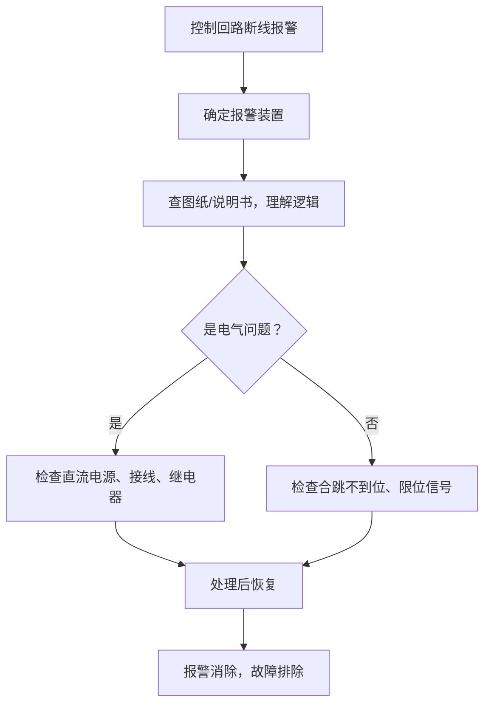

# 2025-07-17

## 19:28 控制回路断线排查

来源：6878de48-1488-8006-9320-94fc251c0952
时间：2025-07-17 19:28

### 我
<!-- mid: b3e342ce-3338-460c-b8c0-f1511406fc85 -->
断路器控制回路端线，首先你得知道这个控制回路断线是哪台装置报出来的有没有在后台上显示，如果有显示，然后你要查找是哪台装置出来的控制和断线，然后你需要知道控制和路断线这个信号是怎么来的，需要看他的图纸或说明书，比如说南瑞这个就是何谓接和调味节双一或双菱的时候来的，那你就会找如何才能导致他双林和双翼去看那个和未接和跳街的接电器，你会发现在这个回路上这个回路上有机械的部分，有电路的部分电路的部分，包括了说直流没有电了，直流的那根线掉了或者接触不良了，然后机械部分比如说这个当器没有核到位，或者说你那个下面那个卡子掐着他不允许他喝茶，就是说你要分成两部分，因为现在这个部分的图纸不是很明细，所以无法知道里面的具体到底是怎么导致的然后这个回路他空了胡涂断线，从而来说这个控制和漏断线就是开关因某种原因无法和尚导致的问题，在这个回路里面找，然后就是你分成两部分，一部分是机械部分，一部分是电器部分，这样就能解决这个问题

### AI
<!-- mid: 12298f3a-5361-4cb8-a34d-1db05d438ac1 -->
你这段话已经把断路器控制回路断线的排查思路讲得很清楚了，我来帮你整理成更清晰、条理化的表达，便于写汇报、指导新手或用在文档中：

---

### **控制回路断线的排查思路整理**

当后台或现场装置报警提示“控制回路断线”时，需按以下步骤进行分析与处理：

#### 一、确定报警来源
1. **明确是哪台装置或后台系统报出的“控制回路断线”信号**。
2. **确认报警是否在后台系统或监控界面有显示**，并记录报警时间、装置编号、位置等信息。

#### 二、分析信号产生机制
1. **查阅该装置对应的图纸或说明书**，理解“控制回路断线”信号的来源逻辑。
   - 以**南瑞保护装置**为例：该信号通常在**合位继电器（合未接）和跳位继电器（跳未接）同时处于动作状态**时才会产生。
   - 这是因为合跳均未就位，系统认为控制回路断开，报出控制回路断线。

#### 三、分模块排查控制回路断线原因
将整个控制回路分为两大部分进行排查：

##### 1. 电气部分：
- **直流电源是否正常**（如控制电源未送电、断线、熔断器熔断等）。
- **回路中接线端子松动或接触不良**。
- **相关继电器线圈未得电或触点卡滞不动作**。
- **设备内部接插件松动或虚焊问题**。

##### 2. 机械部分：
- **合闸不到位或跳闸不到位**（操作机构实际未完成动作，但信号未能准确反映）。
- **限位触点未触发或卡滞**。
- **辅助开关（如CS开关）未完全拨到位，机械卡阻等**。
- **压接或固定部位受力不均导致动作不到位**。

#### 四、总结判断
控制回路断线，实质是断路器在某种情况下**不能可靠合闸或跳闸**，或者**反馈信号异常导致后台误判为控制回路断线**。

处理此类问题，需要结合图纸、实物检查及信号逻辑，按**“电气+机械”两线并行**思路进行排查，逐步缩小范围，最终锁定故障点。

---

如你需要，我也可以把这个内容转换成适合PPT汇报、故障处理流程图、或应急处理预案形式。是否需要？

### 我
<!-- mid: 1058db17-7964-49e2-b714-7aca7d5fce98 -->
变成图文的这种形式

### AI
<!-- mid: 903083a1-7398-4055-ae34-ff60fbbf8f18 -->
好的，我来为你整理成一份“图文形式”的图解排查流程，用于培训、汇报或故障应急指导。

---

## ✅ 控制回路断线排查图解指南

---

### 🚨 一、发现报警

📍**提示现象：**  
后台或装置报出“控制回路断线”

📷 **示意图：**  
> （图：后台监控界面弹出“控制回路断线”报警窗口）

---

### 🔍 二、确认来源

🧭 **需要操作：**
- 确认**是哪台装置**报出的信号？  
- 是否在后台系统显示？是否持续？

📷 **示意图：**  
> （图：一台装置+后台告警编号示意图）

---

### 🧠 三、理解报警逻辑

📘 **说明：**
- 查看装置图纸/说明书
- 分析“控制回路断线”是**如何判断出来的**

📌 **例如（南瑞装置）：**  
合位（HE）和跳位（TE）**都未到位** → 判定控制回路断线

📷 **图纸片段示意：**  
> 合位HE继电器、跳位TE继电器同时未动作时 → 发出“控制回路断线”信号

---

### 🧩 四、两大部分分模块排查

---

#### 📂 电气部分

🔧 **排查要点：**
- ✅ 直流控制电源是否断电  
- ✅ 回路中线缆是否松脱、端子氧化  
- ✅ 控制继电器是否烧坏/卡滞  
- ✅ 插头/插件接触是否良好  

📷 **示意图：**  
> 控制柜内部接线图 + 直流断电示意

---

#### ⚙️ 机械部分

🔧 **排查要点：**
- ✅ 合闸/跳闸不到位（动作失败）  
- ✅ 反馈信号触点未触发  
- ✅ 限位开关卡滞、不到位  
- ✅ 操作机构卡死、卡簧阻挡

📷 **示意图：**  
> 断路器侧面机构+限位触点/辅助开关指示

---

### 🧾 五、归纳总结

📌 **核心逻辑：**
> 控制回路断线 = 开关**合/跳动作未完成 + 反馈信号异常**

🛠 **处理方法：**
> 分为 **电气部分 + 机械部分** 排查  
逐步缩小故障范围 ➜ 找到问题点 ➜ 修复/更换部件 ➜ 验证恢复

📷 **流程图：**

---

如果你需要这套图文内容生成成 PDF 或 PPT 文件，我也可以帮你打包成完整资料或提供图片样式。是否需要我继续？

### 我
<!-- mid: b44aa382-3e47-48e5-9d56-2a8eea20d21e -->
把它变成一个图片，一个图片的那种

### 我
<!-- mid: 27876b97-2ad1-4690-ac2b-2b2bb1c96efd -->
换成中文简体的这种，你这个不好

### 我
<!-- mid: 4ae48cdf-5262-4c3d-a9f7-d2f0bd648440 -->
把它修改成中文简体的图片，两张的内容我一会儿有不对的内容，我需要修改

### 我
<!-- mid: 10165774-70d1-4719-ba6f-741a27e03d91 -->
把它修改成中文简体的图片，两张的内容我一会儿有不对的内容，我需要修改

### AI
<!-- mid: dbcc00ec-90f7-4573-a39f-da5a15796994 -->
Something went wrong while generating your image. Sorry about that.

### 我
<!-- mid: 74e0e02a-4e14-450f-8a32-da6a3efdc2d7 -->
把它修改成中文简体的图片，两张的内容我一会儿有不对的内容，我需要修改
