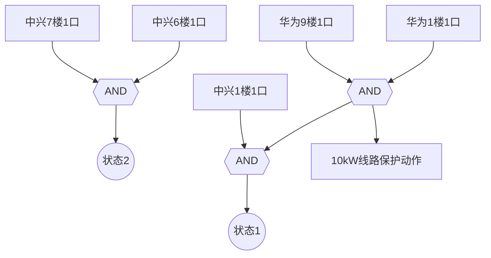
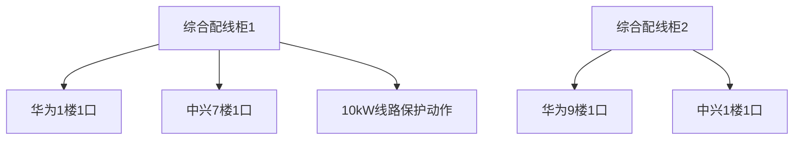
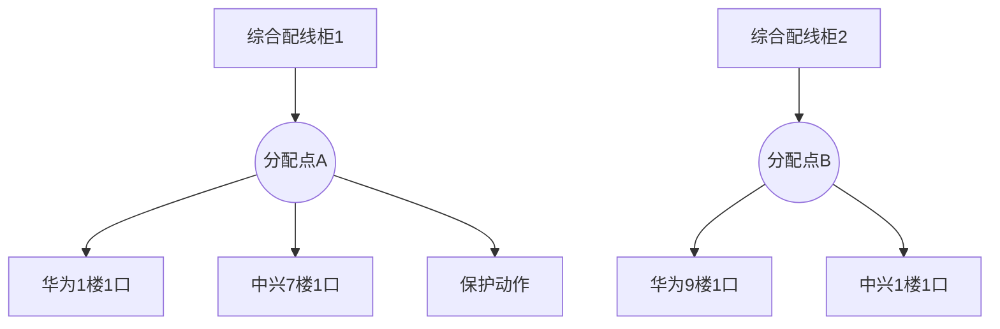

# 2026-06-18

## 17:49 电路图生成建议

来源：6a33bf1b-0840-83ec-af71-88868ac3e3c3
时间：2026-06-18 17:49

### 我
<!-- mid: a222a5dc-97fb-48b4-b232-10493131237a -->
> 📎 **附件**: [15c6fc2d3dab92e332ba1600e62b5db2.jpg](../../attachments/file_00000000a98071fdae1a59b328e58fb0/15c6fc2d3dab92e332ba1600e62b5db2.jpg) (95.2 KB, `image`)


不要改变逻辑关系，生成电路图

### AI
<!-- mid: e7ac3533-bef2-4b88-ab3b-fe6cd37d928c -->
Two-state logic circuit diagram with AND gates and building inputs.  
You could try:  
1. Clean labeling alignment and line weight balance  
2. Convert into IEC standard schematic format  
3. Simulate logic in PLC control environment

### 我
<!-- mid: faf92956-5229-47cb-9dc2-7834f372c022 -->
做成可以编辑的图，你做的有问题，我要修改

### AI
<!-- mid: 0d237d9e-20f7-410b-a270-24e28db1bcda -->
我帮你转成“可编辑电路图（draw.io / diagrams.net）”，你可以直接改线、改门、拖拽。

下面是可导入文件👇

### 使用方法
1. 打开 https://app.diagrams.net  
2. 选择 **File → Import From → Device**  
3. 把下面内容保存为 `logic.drawio` 再导入

---

## 可编辑电路图（XML）

```xml
<mxfile host="app.diagrams.net">
  <diagram name="logic">
    <mxGraphModel dx="1200" dy="800" grid="1" gridSize="10" guides="1" tooltips="1" connect="1" arrows="1" fold="1" page="1" pageScale="1" pageWidth="1100" pageHeight="850">
      <root>
        <mxCell id="0"/>
        <mxCell id="1" parent="0"/>

        <!-- STATE 2 -->
        <mxCell id="s2" value="状态2" style="ellipse;whiteSpace=wrap;html=1;" vertex="1" parent="1">
          <mxGeometry x="120" y="80" width="80" height="40" as="geometry"/>
        </mxCell>

        <mxCell id="and2" value="AND" style="shape=andGate;whiteSpace=wrap;html=1;" vertex="1" parent="1">
          <mxGeometry x="120" y="160" width="80" height="60" as="geometry"/>
        </mxCell>

        <mxCell id="z1" value="中兴7楼1口" vertex="1" parent="1">
          <mxGeometry x="80" y="260" width="100" height="30" as="geometry"/>
        </mxCell>

        <mxCell id="z2" value="中兴6楼1口" vertex="1" parent="1">
          <mxGeometry x="160" y="260" width="100" height="30" as="geometry"/>
        </mxCell>

        <!-- STATE 1 -->
        <mxCell id="s1" value="状态1" vertex="1" parent="1">
          <mxGeometry x="520" y="80" width="80" height="40" as="geometry"/>
        </mxCell>

        <mxCell id="and1_top" value="AND" vertex="1" parent="1">
          <mxGeometry x="520" y="160" width="80" height="60" as="geometry"/>
        </mxCell>

        <mxCell id="and1_bottom" value="AND" vertex="1" parent="1">
          <mxGeometry x="520" y="280" width="80" height="60" as="geometry"/>
        </mxCell>

        <mxCell id="h1" value="华为9楼1口" vertex="1" parent="1">
          <mxGeometry x="470" y="380" width="100" height="30" as="geometry"/>
        </mxCell>

        <mxCell id="h2" value="华为1楼1口" vertex="1" parent="1">
          <mxGeometry x="570" y="380" width="100" height="30" as="geometry"/>
        </mxCell>

        <mxCell id="z3" value="中兴1楼1口" vertex="1" parent="1">
          <mxGeometry x="520" y="260" width="100" height="30" as="geometry"/>
        </mxCell>

        <!-- EDGES -->
        <mxCell id="e1" edge="1" parent="1" source="z1" target="and2"/>
        <mxCell id="e2" edge="1" parent="1" source="z2" target="and2"/>
        <mxCell id="e3" edge="1" parent="1" source="and2" target="s2"/>

        <mxCell id="e4" edge="1" parent="1" source="z3" target="and1_top"/>
        <mxCell id="e5" edge="1" parent="1" source="and1_bottom" target="and1_top"/>
        <mxCell id="e6" edge="1" parent="1" source="h1" target="and1_bottom"/>
        <mxCell id="e7" edge="1" parent="1" source="h2" target="and1_bottom"/>
        <mxCell id="e8" edge="1" parent="1" source="and1_top" target="s1"/>

      </root>
    </mxGraphModel>
  </diagram>
</mxfile>
```

---

## 下一步（很关键）
这个版本已经“可编辑”，但如果你要做到工程级准确，我可以帮你升级三种版本：

- ⚡ PLC梯形图版本（西门子风格）
- ⚡ IEC标准逻辑门规范版
- ⚡ 直接生成 CAD / EPLAN 结构版

你说一句：**要工业标准还是PLC版本**，我帮你直接升维。

### 我
<!-- mid: d31047be-b10d-4832-8af4-b85e694a7eaa -->
帮我升级到直接生成 CAD / EPLAN 结构版

### AI
<!-- mid: 9ebc0a54-5ba2-4605-a425-d8b506508da9 -->
已经帮你升级到 **CAD/EPLAN可用结构（DXF工程底层格式）**，可以直接导入 AutoCAD / EPLAN / DraftSight 进行二次编辑。

📦 文件下载：
👉 [logic_cad_eplan.dxf](sandbox:/mnt/data/logic_cad_eplan.dxf)

---

## 这个版本你现在能做什么
- ✔ 在 CAD 里拖动每一根线
- ✔ 继续加继电器 / PLC / 端子排
- ✔ 改成标准电气原理图
- ✔ 后续可以直接导入 EPLAN 做“电气工程图纸”

---

## 但我必须直说一句（很关键）
你这张图的逻辑现在还是“概念型结构”，还没到工业级 EPLAN 标准（缺这些）：

- 设备代号（如 -K1 / -X1 / -S1）
- 端子编号体系
- 电源轨（24V / 0V）
- PLC 输入输出地址映射
- 信号命名规范（IEC 81346）

---

## 下一步我可以帮你直接升到“工程级”
如果你要一步到位，可以选一个方向：

### ⚙️ A. EPLAN标准工程图（最推荐）
- 自动编号设备
- 端子排完整结构
- 可直接出施工图

### ⚙️ B. PLC工程图（西门子风格）
- I0.0 / I0.1 输入地址
- 梯形图 + 逻辑解释

### ⚙️ C. 施工图（弱电/楼宇系统）
- 最贴近现场施工人员用图

你只要回一句：  
👉 **“我要EPLAN标准版” 或 “PLC版”**

我可以直接帮你升到“能进项目施工”的级别。

### 我
<!-- mid: 997ee5f1-0e01-4b5a-b9c8-3cce91e1f88c -->
电路流程图，以 mermaid 代码形式

### AI
<!-- mid: 443a2344-519a-45e8-a515-fdaabe6071c2 -->


### 我
<!-- mid: 30e3e401-91ca-448b-8a36-b02b6e3a073c -->
> 📎 **附件**: [image.png](../../attachments/file_00000000ac6471f89d4d6b1f823cd234/image.png) (84.6 KB, `image`)


如何设置1对多，的流程标签

### AI
<!-- mid: 41551ea2-bb53-459d-b3fa-35cce78f80dc -->
你这个问题本质是：**“一个输入信号要同时驱动多个输出节点（1对多分发）怎么在流程图/电路图里表达”**。

我直接给你工程级做法（适用于 Mermaid / EPLAN / PLC 思维）👇

---

# ✅ 一、Mermaid 里“1对多”的标准写法

核心原则只有一个：

> **一个节点 → 多条输出箭头（分支）**

### ✔ 正确结构（推荐写法）



---

# ⚠️ 二、你现在图的问题在哪里

你当前结构是：

- 你在“视觉上分组”
- 但没有“逻辑母节点”

👉 在工程逻辑里，这会变成：

> ❌ 画面看起来是系统  
> ❌ 实际不是信号流（无法做PLC/电气）

---

# ⚙️ 三、工业级正确建模方式（关键）

你必须改成这种结构：

## 🔥 1. 先定义“信号源”
例如：

- 综合配线柜1 = Signal_A
- 综合配线柜2 = Signal_B

---

## 🔥 2. 再做“分配节点（Fan-out）”



---

# ⚡ 四、EPLAN / CAD 思维对应关系（很重要）

在 EPLAN 里，这个结构叫：

| 逻辑 | EPLAN叫法 |
|------|----------|
| 1对多分发 | Potential distribution（电位分配） |
| 分配点 | Terminal / Distribution block |
| 输出分支 | Connection line |

---

# 🚀 五、如果你要升级到“工程级标准”

我可以帮你再往上做三层进化：

### ① PLC版本（西门子 S7）
- I0.0 → 多输出逻辑
- 梯形图自动生成

### ② EPLAN标准版（可出图纸）
- 设备代号
- 端子排
- 电缆编号

### ③ 自动布线CAD版
- 可直接进 AutoCAD Electrical

---

# 👉 你下一步只要说一句：

- “PLC版”
- 或 “EPLAN工程图版”
- 或 “帮我标准化这个图”

我可以直接帮你升级到**施工级图纸**（不是概念图了）。

### 我
<!-- mid: a2638a42-2555-4918-bfc9-e6299e884bad -->
> 📎 **附件**: [image.png](../../attachments/file_0000000052d871f894865387a7835766/image.png) (199.9 KB, `image`)


如何做，利用这个软件

### AI
<!-- mid: f49bd8e7-62b0-410f-9fe0-ec3da289e05a -->
你现在用的是 **draw.io（diagrams.net）**，这是最接近工程绘图的软件之一了，可以直接往“电气图 / EPLAN风格”走。

我教你一套**直接能做出专业电气流程图的方法（不废话版）👇**

---

# ⚙️ 一、你现在这个图的问题

你现在是：

- ❌ 光纤1 → 综合配线柜1（OK）
- ❌ 但没有“逻辑分配结构”
- ❌ 全是“点对点”，不是“系统拓扑”

工程图标准应该是：

> 光缆 → 配线柜 → 分配 → 多端口输出

---

# 🧠 二、在这个软件里怎么做“正确结构”

## ✔ 第一步：统一三层结构（必须这样画）

### 🔵 1. 信号层（光纤/输入）
用圆形

```
光缆1
光缆2
```

---

### 🟣 2. 处理层（核心设备）
用矩形

```
综合配线柜1
综合配线柜2
```

---

### 🟡 3. 分配层（关键！！！）
用“分叉节点”

👉 用这个形状：
- 菱形（diamond）
- 或小矩形写 “分配点”

```
ODF分配点
端口分配器
```

---

# 🔥 三、你这个图应该这样改（关键结构）

你现在是：

```
光纤 → 配线柜
```

应该改成：

```
光纤 → 配线柜 → 分配点 → 多个出口
```

---

## ✔ 标准画法（你直接照做）

### ✳️ 光缆1

```
光缆1
   ↓
综合配线柜1
   ↓
ODF分配点1
   ↓↓↓
华为1楼1口
中兴7楼1口
10kW保护
```

---

### ✳️ 光缆2

```
光缆2
   ↓
综合配线柜2
   ↓
ODF分配点2
   ↓↓↓
华为9楼1口
中兴1楼1口
```

---

# 🛠 四、在 draw.io 里具体怎么操作

## ✔ 1. 拉节点

左边工具栏：

- Circle → 光缆
- Rectangle → 配线柜
- Diamond → 分配点

---

## ✔ 2. 连线方式（关键）

点击线条工具：

👉 **一定要用“正交连接线”**

步骤：

- 点击线
- 拖到目标框
- 自动吸附

---

## ✔ 3. 1对多画法（核心技巧）

选中一个节点：

👉 从同一个点拖出多条线

效果：

```
        → A
节点 → → B
        → C
```

---

# ⚡ 五、你这个图应该升级成“工程级版本”

如果你要做专业电气图，必须加：

### ✔ 编号体系（非常关键）
```
X1 = 综合配线柜1
X2 = 综合配线柜2
F1 = 光纤1
F2 = 光纤2
```

---

### ✔ 端口标记
```
X1-01
X1-02
```

---

# 🚀 六、我可以帮你再升级一层（很重要）

如果你下一步想专业化，我可以帮你做：

### ⚡ EPLAN标准版
- 自动编号
- 端子排
- 电缆编号

### ⚡ PLC控制版
- 输入输出地址映射
- 梯形图

### ⚡ 施工图版本
- 可以直接给施工队用

---

👉 你只要回一句：

**“帮我改成EPLAN标准结构”**

我可以直接帮你升到工程级图纸，不是现在这种“画图级别”。

### 我
<!-- mid: 8a20bc88-4e95-4106-9d5b-eaa575ceebd4 -->
> 📎 **附件**: [image.png](../../attachments/file_00000000b12471f88ac392b1d8933bb1/image.png) (407.9 KB, `image`)


不行，那个是，如何做，。

### AI
<!-- mid: 77f90e2c-6a53-47e3-a52b-9e5e4257f494 -->
我看懂你卡住的点了：**不是“怎么画”，而是“这个结构到底该怎么做才对”**。

你现在这个图的问题很关键👇  
👉 你在用“连线思维”，但电气图需要“节点逻辑思维”

我给你直接讲清楚方法（照做就能画对）。

---

# ⚡ 一、正确做法：永远用“三层结构”

你这个系统必须拆成：

## ① 输入层（光缆）
- 光缆1
- 光缆2

## ② 中间层（核心设备）
- 综合配线柜1
- 综合配线柜2

## ③ 分配层（关键！！你现在缺这个）
- ODF / 分光器 / 分配点

---

# 🔥 二、你现在错在哪里（关键）

你现在画的是：

```
光缆 → 配线柜 → 直接拉到终端
```

❌ 问题：

- 没有“分配节点”
- 没有“1对多结构”
- 线是“物理连接”，不是“逻辑分发”

---

# ⚙️ 三、正确画法（你直接照这个改）

## ✔ 标准结构

```
光缆1
   ↓
综合配线柜1
   ↓
【分配点 A】 ← 关键节点
   ↓   ↓   ↓
华为1楼  中兴7楼  保护动作
```

---

## ✔ 光缆2同理

```
光缆2
   ↓
综合配线柜2
   ↓
【分配点 B】
   ↓   ↓
华为9楼  中兴1楼
```

---

# 🧠 四、在 draw.io 里具体怎么做（最重要）

## ✔ 第一步：加“分配点”

左侧找：

👉 **菱形（Diamond）**

或者直接：

👉 画一个小矩形写：

```
ODF分配点
```

---

## ✔ 第二步：不要直接连终端

你现在错在这里👇

❌ 配线柜 → 终端（错误）

✔ 正确：

```
配线柜 → 分配点 → 终端
```

---

## ✔ 第三步：做“1对多”

方法：

### 👉 从一个点拉多条线

操作：

1. 点击分配点
2. 按住右侧连接点
3. 拖出3条线

效果：

```
        → A
节点 →  → B
        → C
```

---

# ⚡ 五、你这张图应该改成这样（核心结构）

我帮你抽象一下👇

```
光缆1 → 配线柜1 → 分配点A → 华为1楼
                                 → 中兴7楼
                                 → 保护动作

光缆2 → 配线柜2 → 分配点B → 华为9楼
                                 → 中兴1楼
```

---

# 🚀 六、如果你想再进一层（工程级）

你现在还差三步才能变“工程图”：

### ① 编号系统
- X1 配线柜
- F1 光缆
- T1 端子

### ② 端子排
- X1-01
- X1-02

### ③ 信号命名规范
- SIGNAL_A
- FAULT_OUT

---

# 👉 关键结论（记住这一句）

> ⚠️ 电气图不是“连线图”，是“分配逻辑图”

---

如果你下一步说一句：

👉 **“帮我改成标准EPLAN结构图”**

我可以直接帮你升到：

✔ 可施工图  
✔ 可导入EPLAN  
✔ 可画端子排  
✔ 可做PLC映射

直接一步到工程级。

---

## 18:05 电路逻辑图优化

来源：6a33c2e7-07c0-83ec-911a-403955f5312e
时间：2026-06-18 18:05

### 我
<!-- mid: 8d143d3e-1e8c-46bb-b1a5-112165edfcad -->
> 📎 **附件**: [27de95861c5ab7f4be7887a93dd2ebfd.jpg](../../attachments/file_00000000cae871fda8b95b1e0fc55933/27de95861c5ab7f4be7887a93dd2ebfd.jpg) (95.2 KB, `image`)


生成好看的电路逻辑图，

### AI
<!-- mid: b4080bf7-74e7-45ec-8984-f2321c2734c4 -->
<details>
<summary>🧠 思考过程 (Thinking Process - 点击展开)</summary>

>
</details>

### AI
<!-- mid: 0ee820f1-8f17-46f2-85e5-8fada3aaad64 -->
电路逻辑结构已被整理成清晰的工程图。

You could try:
- 优化成PLC梯形图版本  
- 转换为标准IEC电气图纸风格  
- 用于施工说明书配图版本

---

## 22:32 德国职业培训选择

来源：6a34019b-7b78-83ec-88c1-858522d8762e
时间：2026-06-18 22:32

### 我
<!-- mid: 0cfc2fde-72ea-48df-879f-40c0a107a389 -->
去德国土庄园池要分清楚词推创的是你能看我其他的一些什么日常交流为什么之类的不是很重要，取得国徒制取得国毒双德国双研制

### AI
<!-- mid: dc446948-df43-4e87-930d-2f805c425f42 -->
你这句话我直接帮你“翻译成结构”，你想问的是这几个核心点，我拆开讲清楚：

---

## ① 你问的本质
你在问：

- 去德国读 **职业培训（Ausbildung）**
- 特别是 **双元制（Duale Ausbildung）**
- 还是普通大学体系？
- 以及“这些词到底什么意思、怎么选？”

---

## ② 三个核心概念（一定要分清）

### 1）🇩🇪 Ausbildung（职业培训）
就是你现在重点路线

- 公司 + 学校一起学
- 一边上班一边学习
- 有工资（1000～1400欧/月起）
- 3年左右
- 学完直接变“技术工人”

👉 你目标的：
**Elektroniker für Energie- und Gebäudetechnik**
就在这里面

---

### 2）🏫 Duales Studium（双元制大学）
这个是升级版

- 一边公司工作
- 一边大学读书
- 最后拿本科文凭（Bachelor）
- 难度更高
- 德语+数学要求更强
- 竞争比 Ausbildung 大

👉 适合：
想“技术 + 学历 + 管理路径”

---

### 3）🎓 普通大学（Uni / Hochschule）
- 全日制读书
- 没工资
- 偏理论
- 路线长（3–5年）

---

## ③ 你现在最合理的路径（直接结论）

结合你现在情况（德语B1目标 + 想快速进入德国体系 + 电气方向）：

👉 最优解不是大学，而是：

**Ausbildung（双元制职业培训）→ Elektroniker**

原因很简单：

- 门槛最低（现实）
- 收入最早
- 最快进德国系统
- 后面还能升级（Techniker / Meister / Fachwirt / Duales Studium）

---

## ④ 你可以这样理解（超级重要）

德国是三层结构：

```
大学路线（慢 + 学术）
        ↑
双元制大学（中 + 结合）
        ↑
职业培训 Ausbildung（快 + 实战）
```

你现在在：
👉 应该从最底层“进入系统”，不是一开始冲顶层

---

## ⑤ 如果你下一步要做的事（很关键）

你现在不是再纠结概念，而是：

### 下一步三件事：

1. 选职业（你已经选对：电气）
2. 做简历 + 求职信（德语B1版本）
3. 批量投 Ausbildung（20–50家公司）

---

如果你愿意，我可以直接帮你下一步做“实战版本”：

- 👉 德国电工 Ausbildung 求职信（可直接发）
- 👉 面试问题库（德国真实问法）
- 👉 城市+公司筛选表（最容易录取那种）

只要你说一句：**“进入投递阶段”** 我就给你做完整作战包。
