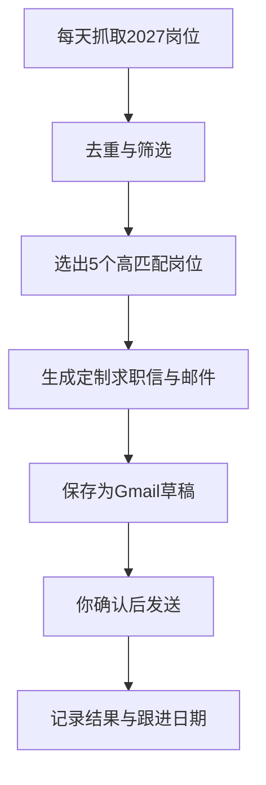

# 2026-07-16

## 07:57 德语儿歌推荐

来源：6a581e70-f408-83ec-85e0-cb7d2e3d5fd2
时间：2026-07-16 07:57

### 我
<!-- mid: a2a593e0-670e-406b-b161-001deface4bd -->
德语儿歌

### AI
<!-- mid: 4e107473-c7d1-4f99-8bb0-5c5384a20b86 -->
<details>
<summary>🧠 思考过程 (Thinking Process - 点击展开)</summary>

> **[已搜索 19 个网页]**
>
</details>

### AI
<!-- mid: 749f9e16-8085-49e6-a3a9-5ed86ead33f0 -->
<details>
<summary>🧠 思考过程 (Thinking Process - 点击展开)</summary>

> **状态/耗时**: 思考了两秒
>
</details>

### AI
<!-- mid: ccaa1814-da00-4aa0-ba63-534f9cbb3dff -->
> 🌐 **引用来源**:
> 1. [Kinderlieder zum Mitsingen bei Sing Kinderlieder](https://www.singkinderlieder.de/?utm_source=chatgpt.com)
> 2. [Lieder im Kindergarten: Die 50 beliebtesten Klassiker 2026 | liedio.de](https://liedio.de/ratgeber/kinderlieder-kindergarten-klassiker?utm_source=chatgpt.com)

如果你的目标是**学德语**，儿歌是非常好的材料。它们有四个优点：

* 单词简单（A1 左右）
* 重复率高，容易记忆
* 发音清晰，语速慢
* 能培养德语语感

推荐按这个顺序学习：

### 1. Bruder Jakob（雅各兄弟）⭐⭐⭐⭐⭐
最适合初学者。

> Bruder Jakob,
> Bruder Jakob,
> schläfst du noch?

学习内容：
* 称呼
* 动词 schlafen
* 问句语调

---

### 2. Alle meine Entchen（我的小鸭子）⭐⭐⭐⭐⭐

德国几乎人人都会。

学习内容：
* Tiere（动物）
* Wasser（水）
* schwimmen（游泳）

---

### 3. Backe, backe Kuchen（烤蛋糕）⭐⭐⭐⭐

学习内容：
* 食物
* 动词
* 命令式

---

### 4. Kopf, Schulter, Knie und Fuß（头肩膝脚）⭐⭐⭐⭐⭐

就是德语版 Head Shoulders Knees and Toes。

学习内容：
* 身体部位
* 跟着做动作，非常容易记。

---

### 5. Wenn du fröhlich bist（如果你开心）

就是 If You're Happy。

学习内容：
* 情绪
* 动词
* 命令句

---

### 6. Grün, grün, grün sind alle meine Kleider

学习颜色最经典。

学习内容：
* Rot
* Blau
* Grün
* Gelb

---

### 7. Fuchs, du hast die Gans gestohlen

德国经典民歌。

学习内容：
* 动物
* 简单过去文化词汇

---

### 8. Hänschen klein

学习：
* 家庭
* 动词 gehen
* 回家

---

## 推荐 YouTube

最适合德语学习的是：

**Liederkiste**

videoKinderlieder zum Mitsingen - Liederkisteturn0youtube12

还有德国本土非常受欢迎的：

- **Sing Kinderlieder**，歌曲多、字幕清晰，适合跟唱。citeturn0search2turn0reddit14

---

## 最推荐先学的 10 首

1. Bruder Jakob
2. Alle meine Entchen
3. Kopf, Schulter, Knie und Fuß
4. Backe, backe Kuchen
5. Wenn du fröhlich bist
6. Hänschen klein
7. Fuchs, du hast die Gans gestohlen
8. Grün, grün, grün sind alle meine Kleider
9. Die Vogelhochzeit
10. Aramsamsam

这些都是德国幼儿园和家庭中最常见的儿歌，也是学习德语时最常被推荐的经典曲目。citeturn0search4turn0search0

**结合你目前 A1 到 B1 的目标**，我建议每天学 **1 首儿歌**：

1. 听 5 遍。
2. 跟唱 5 遍。
3. 把歌词抄下来。
4. 查每个单词。
5. 最后能不看歌词唱出来。

这样不仅能练发音，还能自然掌握德语的重音、节奏和连读，比单纯背单词更容易形成语感。

### 我
<!-- mid: 14c795cc-3533-4050-9052-1093a0b8ea64 -->
德语短文有哪些？

### AI
<!-- mid: 2d368936-90a3-49f8-a960-0e4c8dcaf09c -->
<details>
<summary>🧠 思考过程 (Thinking Process - 点击展开)</summary>

> **状态/耗时**: 思考了两秒
>
</details>

### AI
<!-- mid: 6a19309f-36de-432d-820f-781c62300de1 -->
适合你现在学的**德语短文**，主要有这几类：

### 1. 自我介绍类
最适合面试和背诵。

主题：
- Ich heiße …
- Meine Familie
- Meine Heimatstadt
- Mein Beruf
- Meine Pläne

### 2. 日常生活类
词汇最实用，A1 常见。

主题：
- Mein Tagesablauf
- Mein Wochenende
- Mein Frühstück
- Einkaufen im Supermarkt
- Mit dem Bus zur Arbeit

### 3. 工作类
最适合你的德国求职方向。

主题：
- Mein Arbeitstag
- Ich arbeite in einem Windpark
- Sicherheit bei der Arbeit
- Geräte kontrollieren
- Ein Problem bei der Arbeit
- Zusammenarbeit im Team

### 4. 德国生活类
以后去德国直接能用。

主题：
- Wohnung suchen
- Beim Arzt
- Auf dem Amt
- Im Restaurant
- Ein Bankkonto eröffnen
- Mit dem Vermieter sprechen

### 5. 简单故事类
适合练过去时、听力和复述。

主题：
- Ein Tag im Park
- Der verlorene Schlüssel
- Ein Besuch bei einem Freund
- Eine Reise nach Berlin
- Ein kleiner Unfall
- Das Wetter war schlecht

### 6. 图片描述类
适合 Goethe A1、A2、B1 口语。

常用结构：

> Auf dem Bild sehe ich …  
> Links ist …  
> Rechts steht …  
> Die Person trägt …  
> Vielleicht arbeitet sie …

## 最适合你的学习顺序

不要每天换主题。先固定这 **6 篇**：

1. Meine Person  
2. Meine Arbeit  
3. Mein Arbeitstag  
4. Sicherheit bei der Arbeit  
5. Warum möchte ich nach Deutschland?  
6. Warum möchte ich eine Ausbildung machen?

每篇控制在 **80 到 120 个词**，然后反复：

- 听
- 跟读
- 背诵
- 复述
- 替换关键词

比如《Mein Arbeitstag》：

:::writing{variant="document" id="48217"}
Ich arbeite in einem Windpark.  
Mein Arbeitstag beginnt am Morgen.  
Zuerst kontrolliere ich die Anlagen.  
Dann sehe ich die Daten am Computer.  
Ich achte immer auf die Sicherheit.  
Manchmal gibt es ein Problem.  
Dann suche ich den Fehler.  
Ich arbeite ruhig und genau.  
Am Ende schreibe ich einen Bericht.
:::

这类短文比随机儿歌更适合你现在的目标，因为它能直接转化成**面试回答和工作口语**。

### 我
<!-- mid: 68d01fec-675c-4070-a6dc-fed40ca33f8f -->
现成的，油管频道，

### AI
<!-- mid: 3820990f-3071-49b3-85c3-4190ac5d8d38 -->
<details>
<summary>🧠 思考过程 (Thinking Process - 点击展开)</summary>

> **[搜索多个网站信息]**
>
</details>

### AI
<!-- mid: 2295f4b0-05e8-4475-8aff-64091dedf0be -->
<details>
<summary>🧠 思考过程 (Thinking Process - 点击展开)</summary>

> **状态/耗时**: 思考了两秒
>
</details>

### AI
<!-- mid: 833992c2-c6f0-4b8e-b07d-82d3479c42fb -->
> 🌐 **引用来源**:
> 1. [8 Best YouTube Channels for Learning German in 2026 | Lexpresso](https://lexpresso.io/blog/best-youtube-channels-learn-german/?utm_source=chatgpt.com)
> 2. [Best YouTube Channels for A1 German Learners in 2026](https://www.langtrak.com/blog/best-youtube-channels-for-a1-german-learners?utm_source=chatgpt.com)
> 3. [Liste von YouTube-Kanälen zum Deutschlernen](https://de.wikipedia.org/wiki/Liste_von_YouTube-Kan%C3%A4len_zum_Deutschlernen?utm_source=chatgpt.com)
> 4. [Startseite - Speak Up German](https://speakupgerman.com/?utm_source=chatgpt.com)
> 5. [Best YouTube Channels for A1 German Learners in 2026](https://www.langtrak.com/blog/best-youtube-channels-for-a1-german-learners?utm_source=chatgpt.com)
> 6. [Liste von YouTube-Kanälen zum Deutschlernen](https://de.wikipedia.org/wiki/Liste_von_YouTube-Kan%C3%A4len_zum_Deutschlernen?utm_source=chatgpt.com)

如果你想找的是**现成的德语短文 + 真人朗读 + 持续更新的 YouTube 频道**，下面这些是最值得长期看的。

## 1. Easy German ⭐⭐⭐⭐⭐（必看）

适合：A1 到 C1

特点：
- 德国真人
- 街头采访
- 有德语字幕和英语字幕
- 语速自然

适合后期（A2 以后）听力。citeturn0search6

---

## 2. Natürlich German ⭐⭐⭐⭐⭐（我最推荐）

适合：A1

特点：
- 用简单德语讲故事
- 全程德语
- 画图辅助理解
- 基本不用英文

很多人把它称为德语版 Dreaming Spanish，非常适合建立语感。citeturn0search0turn0reddit23

---

## 3. Deutsch lernen durch Hören（DldH）⭐⭐⭐⭐⭐

适合：A1 到 B1

特点：
- 几乎每天更新
- 短故事
- 对话
- 新闻
- 听力训练

内容非常多，适合每天听 10 到 20 分钟。Reddit 上很多学习者推荐它作为 A1 到 B1 的长期资源。citeturn0search14turn0reddit15turn0reddit17

---

## 4. Speak Up German ⭐⭐⭐⭐

适合：A1 到 B2

特点：
- 一个故事一个视频
- 免费字幕
- 免费文本
- 还有词汇表

比较适合精听。citeturn0search2

---

## 5. Daily Deutsch ⭐⭐⭐⭐

适合：A1

特点：
- 每集都是短故事
- 德英字幕
- 最后总结单词
- 听力练习

例如：

videoLEARN German through German SHORT stories for beginnersturn0youtube12

或者：

videoLearn Basic German with fun short stories FOR BEGINNERSturn0youtube13

---

## 6. DW Deutsch（Nicos Weg）

这个你已经比较熟悉了。

除了课程外，还有很多生活短文、短对话，可以一直学到 B1。citeturn0search0

---

### 如果让我只留 4 个频道

1. Natürlich German（建立语感）
2. Deutsch lernen durch Hören（大量短文）
3. Speak Up German（故事 + 文本）
4. Easy German（真实德国人说话）

---

**结合你的学习目标（Ausbildung 面试 + B1）**，我建议不要每天换频道，而是固定一个主频道连续学习。

我更推荐你以 **Deutsch lernen durch Hören（DldH）** 为主。它有上千个 A1 到 B1 的短故事、对话和新闻，长度适中，非常适合你目前坚持"固定材料反复听、反复跟读、反复复述"的学习方式。citeturn0search14turn0reddit17

---

## 08:23 德国机会简报 (续)

来源：6a4f99be-8d64-83ec-9a39-9b67e10712d0
时间：2026-07-16 08:23

### AI
<!-- mid: 500e3ef4-bfbe-4c4c-b7ea-8ad47c24a5fa -->
> 🌐 **引用来源**:
> 1. [Newsletter Nr. 3 / 2026](https://www.make-it-in-germany.com/en/service/newsletter-nr-3-/-2026?utm_source=chatgpt.com)
> 2. [Newsletter Nr. 3 / 2026](https://www.make-it-in-germany.com/de/service/newsletter-nr-3-/-2026?utm_source=chatgpt.com)
> 3. [News | Sprachförderung | Bundesagentur für Arbeit](https://web.arbeitsagentur.de/sprachfoerderung/news?utm_source=chatgpt.com)
> 4. [Opportunity Card | Bundesagentur für Arbeit](https://www.arbeitsagentur.de/vor-ort/zav/working-and-living-in-germany/iss-en/issue-02-2026/opportunity-card?utm_source=chatgpt.com)
> 5. [Found a job 1 month before my Chancenkarte expired, Blue card holder now.](https://www.reddit.com/r/chancenkarte/comments/1uq75hz/found_a_job_1_month_before_my_chancenkarte/?utm_source=chatgpt.com)

image_group{"layout":"carousel","aspect_ratio":"16:9","query":["German electrical apprentices working on switch cabinet","Opportunity Card Germany official promotional image","German photovoltaic installation technician rooftop","North Rhine-Westphalia industrial park electrical company"]}

# 德国机会简报｜2026年7月16日

## 1. 德国官方继续强化机会卡，企业端支持进一步完善

德国官方 **Make it in Germany** 最新一期（2026年第3期）重点介绍了机会卡（Chancenkarte）的企业使用指南，并更新了企业 FAQ。官方强调，持机会卡人员可以在德国进行试工、每周兼职最多20小时，并在符合条件后转为长期就业。citeturn0search1turn0search4

**为什么对你重要**

你目前的主路线仍然应该是 **直接申请 2027 Ausbildung**。但如果回复率不理想，机会卡仍然是重要备选方案，可以先到德国再接触企业。

**今天关注**

继续留意官方关于：

- Probebeschäftigung（试工）
- Chancenkarte
- Arbeitgeber FAQ（企业FAQ）

这些更新能帮助判断企业是否越来越熟悉国际申请人。

---

## 2. 官方推出新的国际 Ausbildung 候选人资源

德国官方新闻提到，联邦就业局（BA）的 **Bewerberanzeiger** 已更新，新增了准备赴德国参加 Ausbildung 的国际申请者资料，方便企业主动寻找海外学徒。citeturn0search2

**为什么对你重要**

这是一个积极信号：

德国不仅鼓励国际技术工人，也开始帮助企业直接寻找海外 Ausbildung 候选人。

**今天行动**

继续完善你的申请材料：

- 德语简历
- A1/A2 面试自我介绍
- 工作证明
- 推荐信（如有）
- 德语学习证明

让材料达到企业愿意快速阅读的水平。

---

## 3. 官方再次强调：新移民是德国劳动力的重要来源

德国联邦就业局最新转载的人口研究指出，新移民能够缓解德国人口老龄化带来的劳动力压力，帮助填补技术岗位需求。citeturn0search3

**为什么对你重要**

这说明德国政策方向没有改变：

长期仍然需要国际技术人才。

不过，这并不意味着企业会降低招聘标准。企业更关注：

- 德语能力
- 工作经验
- 是否能快速融入团队

你的风电、电气和自动化背景正是你的优势。

**今天行动**

继续强化你申请材料中的关键词：

- Windenergie
- SCADA
- IEC 61850
- Modbus
- Fehlersuche
- Sicherheit

---

## 4. 机会卡资金要求已更新

德国联邦就业局最新说明显示，2026 年申请机会卡需要证明每月约 **1091 欧元**的生活资金（通常通过冻结账户等方式），并再次说明机会卡可用于寻找就业、培训（Ausbildung）及职业资格认可相关机会。citeturn0search0

**为什么对你重要**

如果未来选择机会卡路线，需要提前准备：

- 资金证明
- 学历材料
- 工作证明
- 德语证明

这些材料现在准备，将来不会仓促。

**观察信号**

如果未来官方调整资金门槛，应及时更新预算规划。

---

## 5. 市场反馈：国际申请竞争加剧，但技术工种仍优于热门 IT

近期 Reddit 上关于德国 Ausbildung 和机会卡的讨论显示：

- IT Ausbildung 竞争依然激烈；
- 工程、电气、机电等技术岗位竞争相对更平衡；
- 多位成功申请者提到，坚持大量投递、持续提升德语水平，以及展示项目或工作经验，对获得机会很重要。社区经验不能代表官方政策，但可作为市场情绪参考。citeturn0reddit18turn0reddit21turn0reddit24

**为什么对你重要**

你的目标职业 **Elektroniker/in – Energie- und Gebäudetechnik** 比热门 IT 培训岗位更符合德国长期需求，也与你已有的工作经验契合。

**今天行动**

建议把投递节奏固定下来：

- 每周新增 **5 至 10 家**企业；
- 优先投 **NRW（北莱茵-威斯特法伦州）**、**Niedersachsen（下萨克森州）**、**Bayern（巴伐利亚州）**；
- 优先选择业务涉及 **Photovoltaik（光伏）**、**Wärmepumpe（热泵）**、**Gebäudeautomation（楼宇自动化）** 的企业。

---

## 今日机会判断

今天没有重大的德国移民政策变化，但有两个持续值得关注的趋势：

1. **官方正在不断完善国际人才招聘体系**，企业获得的支持越来越多。
2. **你的目标职业仍然属于德国能源转型的长期受益方向**，与风电、楼宇电气、光伏和智能建筑的发展高度相关。

**今日最值得执行的一件事：** 从最新发布或近期更新的岗位中，再挑选 **5 家新能源或楼宇自动化企业**进行第二轮投递，而不是等待之前那约 10 家公司的回复。

---

## 09:51 求职信写作帮助

来源：6a583931-2718-83ec-ba0c-f1fa22da6ba4
时间：2026-07-16 09:51

### 我
<!-- mid: 709a9bd6-d764-481f-8e07-c77b94963cd2 -->
Elektroniker/in - Energie - und Gebäudetechnik(m/w/d)
电子技术员 - 能源与建筑技术（月/生/日）
Werde Teil der Zukunft 成为未来的一部分
Wir bieten Dir die Möglichkeit mit uns ins Berufsleben zu starten. Bei uns triffst Du auf nette Mitarbeiter und fachkundiges Personal und erhältst die Chance Dich schnell weiterzuentwickeln. Wir setzen auf unsere Nachwuchskräfte, denn Sie sind Teil unserer Zukunft.
我们为您提供与我们一起开启职业生涯的机会。在我们这里，你将结识优秀的员工和专业员工，并有机会快速成长。我们依赖初级员工，因为他们是我们未来的一部分。

Schließe Dich jetzt unserem Team an und erlebe ein Unternehmen mit klaren Strukturen, viel KnowHow und Spaß an der Arbeit!
现在就加入我们的团队，体验一个结构清晰、充满专业知识和工作乐趣的公司！

Dein neuer Job 你的新工作
Verstehen und Umsetzen von Bauplänen gemäß den Vorschriften
理解并根据法规实施施工计划
Integration erneuerbarer Energien zur Verbesserung der Effizienz
整合可再生能源以提升效率
Gewährleistung der sicheren Funktion aller elektrischen Komponenten
确保所有电气元件的安全运行
So überzeugst du uns 如何说服我们
Selbstvertrauen und Kenntnisse der eigenen Fähigkeiten
自信与对自身能力的认知
Fähigkeit, Probleme zu lösen 解决问题的能力
Wir fördern & fordern Dich – bewirb dich jetzt!
我们鼓励并挑战你——现在就申请！

Bewerbungen bitte an: 请将您的申请发送至：
bewerbung@terra-gebtech.de 
oder: 或者：
TERRA Gebäudetechnik GmbH 
Andreas Dik 安德烈亚斯·迪克
Zeißstraße 10 蔡斯街10号
32584 Löhne 32584工资. 帮助我写求职信Sehr geehrter Herr Pickel,mit großer Begeisterung habe ich Ihre Ausschreibung für die Ausbildung zum Elektroniker für Energie- und Gebäudetechnik für das Jahr 2027 gelesen. Ihr moderner und unkonventioneller Ansatz hat mich sofort angesprochen: Ich suche genau diese Kombination aus technischer Herausforderung, der „Macht über den Strom“ und einem Beruf, bei dem man am Ende des Tages sieht, was man mit eigenen Händen erschaffen hat. Da ich den direkten Kontakt mit Kunden schätze und am liebsten aktiv unterwegs bin, passt Ihre Unternehmensphilosophie perfekt zu mir.Durch meine bisherige praktische Tätigkeit in der Elektrotechnik- und Photovoltaik-Branche bringe ich bereits fundierte Vorkenntnisse mit. Die Inbetriebnahme, Wartung und systematische Fehlerbehebung von elektrischen Anlagen gehören zu meinem festen Repertoire. Ich bin bestens vertraut mit der Montage und Verdrahtung von Schaltschränken sowie dem Testen von Kommunikations- und Niederspannungssystemen. Technische Herausforderungen zu lösen, ist für mich wie das Meistern eines anspruchsvollen Levels – es erfordert logisches Denkvermögen, Präzision und absolute Verlässlichkeit. Meine guten Noten in Mathematik und Physik bestätigen zudem mein ausgeprägtes technisches Verständnis.Ihre Ausschreibung weist darauf hin, dass für Bewerber aus dem Ausland ein C1-Sprachniveau erforderlich ist. Da die Ausbildung erst am 1. September 2027 beginnt, bietet mir dieser großzügige Zeitraum die perfekte Gelegenheit, meine aktuellen Deutschkenntnisse durch intensives und zielgerichtetes Lernen bis zum Ausbildungsstart auf das geforderte C1-Niveau zu bringen. Diesen Weg gehe ich mit hoher Eigenmotivation und Verantwortungsbewusstsein.Als teamfähiger und pünktlicher Mensch freue ich mich darauf, moderne Werkzeuge, Tablets und funktionale Fahrzeuge im Alltag zu nutzen. Zudem besitze ich einen gültigen PKW-Führerschein, was mir die gewünschte Mobilität für Einsätze direkt beim Kunden vor Ort garantiert. Gerne absolviere ich im Vorfeld auch ein Praktikum bei Ihnen, um Sie von meinem handwerklichen Geschick und meiner Zuverlässigkeit zu überzeugen.Über die Gelegenheit, mich Ihnen in einem persönlichen Gespräch vorzustellen und Teil des Teams der Pickel GmbH zu werden, freue ich mich sehr.Mit freundlichen GrüßenXiaofei Zhao Xingtai, Provinz HebeiV.R. ChinaTel: +86 187 3092 7285E-Mail:   先写汉语

### AI
<!-- mid: 1ec28d78-9aac-4cfd-b453-e021d95b8136 -->
<details>
<summary>🧠 思考过程 (Thinking Process - 点击展开)</summary>

> **状态/耗时**: 思考了一秒
>
</details>

### AI
<!-- mid: 6d7681bb-d55d-4ff8-896a-93cdeeeb90df -->
<details>
<summary>🧠 思考过程 (Thinking Process - 点击展开)</summary>

> **状态/耗时**: 思考了 7s
>
</details>

### AI
<!-- mid: 42dea933-5f47-4943-9255-591d184bb7fc -->
下面是根据 **TERRA Gebäudetechnik GmbH** 招聘内容重新写的中文求职信。已删除原模板中不属于该公司的内容，如 C1 要求、平板电脑、车辆和 Pickel GmbH 等。

:::writing{variant="document" id="37418"}
尊敬的 Dik 先生：

您好！

我希望申请贵公司 2027 年的“能源与建筑技术电子技术员”职业培训岗位。贵公司重视员工培养、专业能力和团队合作，这一点非常吸引我。我希望在一家结构清晰、技术专业并重视年轻人才发展的企业中，系统学习德国的电气技术和工作方法。

我已经积累了多年的电气设备相关工作经验。以前，我从事电气二次设备的售后技术工作，负责设备安装、调试、通信测试、故障检查和现场技术支持。目前，我在风电场从事运行维护工作，主要负责设备巡检、系统监控、安全操作以及异常和故障处理。

通过这些工作，我熟悉了电气设备的安全操作，也培养了独立分析和解决问题的能力。我能够阅读电气图纸，检查设备状态，并按照技术要求完成工作。安全、认真和准确对我来说非常重要。遇到技术问题时，我会先分析原因，再有步骤地寻找解决方法。

贵公司的培训内容与我的工作经验和未来目标非常契合。我对建筑电气、能源系统以及可再生能源技术很感兴趣。贵公司招聘信息中提到的施工图纸、电气元件安全运行和可再生能源应用，都是我希望继续深入学习的方向。

虽然我已经有一定的电气工作经验，但我愿意从职业培训的基础开始，认真学习德国的技术标准、施工规范和实际工作流程。我相信，过去的工作经验能够帮助我更快理解培训内容，也能让我更快适应贵公司的工作环境。

目前我正在持续学习德语，目标是在培训开始前达到能够顺利学习、工作和沟通的语言水平。我做事可靠、准时，有责任心，也愿意接受新的挑战。

如果条件允许，我也非常愿意提前到贵公司参加实习，让您更直接地了解我的实际工作能力、学习态度和团队合作能力。

非常期待获得一次线上面试的机会，并进一步介绍我的工作经历和申请动机。

此致  
敬礼！

赵肖飞  
中国河北省邢台市  
电话：+86 187 3092 7285  
电子邮箱：
:::

### 我
<!-- mid: ae23136c-27db-4a21-9347-8ba7288e16dd -->
写德语

### AI
<!-- mid: 24ac15f2-378a-47b8-bbc6-048dd91bab04 -->
<details>
<summary>🧠 思考过程 (Thinking Process - 点击展开)</summary>

> **状态/耗时**: 思考了 6s
>
</details>

### AI
<!-- mid: cbb49b46-ce7d-4602-a79b-7c2eb6d7946c -->
:::writing{variant="document" id="51842"}
**Bewerbung um einen Ausbildungsplatz als Elektroniker für Energie- und Gebäudetechnik ab 2027**

Sehr geehrter Herr Dik,

hiermit bewerbe ich mich um einen Ausbildungsplatz als Elektroniker für Energie- und Gebäudetechnik für das Jahr 2027.

Ihre Ausbildungsstelle hat sofort mein Interesse geweckt. Besonders gefallen mir die klaren Strukturen in Ihrem Unternehmen, die fachliche Betreuung und die Möglichkeit, sich schnell weiterzuentwickeln. Ich möchte meine berufliche Zukunft in einem Unternehmen beginnen, das junge Mitarbeiter fördert und ihnen gleichzeitig Verantwortung überträgt.

Ich verfüge bereits über mehrere Jahre Berufserfahrung im Bereich Elektrotechnik. Früher arbeitete ich als Servicetechniker für elektrische Sekundäranlagen. Zu meinen Aufgaben gehörten die Installation und Inbetriebnahme von Anlagen, Kommunikationstests, Fehlersuche sowie die technische Unterstützung vor Ort.

Zurzeit arbeite ich in einem Windpark im Bereich Betrieb und Instandhaltung. Dort kontrolliere ich elektrische Anlagen, überwache die Systeme, führe sichere Schalthandlungen durch und bearbeite technische Störungen.

Durch meine bisherigen Tätigkeiten habe ich gelernt, elektrische Anlagen sicher und sorgfältig zu prüfen. Ich kann technische Zeichnungen und elektrische Pläne lesen und Probleme systematisch analysieren. Bei einer Störung suche ich zuerst nach der Ursache und finde anschließend Schritt für Schritt eine passende Lösung.

Die Inhalte Ihrer Ausbildung passen sehr gut zu meinen Erfahrungen und beruflichen Zielen. Besonders interessieren mich die Arbeit mit Bauplänen, die sichere Funktion elektrischer Komponenten sowie die Integration erneuerbarer Energien. In diesen Bereichen möchte ich meine Kenntnisse weiter vertiefen.

Obwohl ich bereits praktische Berufserfahrung besitze, bin ich bereit, die Ausbildung von Grund auf zu beginnen. Ich möchte die deutschen technischen Standards, Vorschriften und Arbeitsabläufe systematisch lernen. Meine bisherigen Erfahrungen können mir dabei helfen, die Ausbildungsinhalte schneller zu verstehen und mich gut in Ihr Team einzuarbeiten.

Zurzeit lerne ich intensiv Deutsch. Mein Ziel ist es, bis zum Ausbildungsbeginn ein Sprachniveau zu erreichen, mit dem ich im Betrieb und in der Berufsschule sicher kommunizieren kann.

Ich bin zuverlässig, pünktlich und verantwortungsbewusst. Neue Aufgaben sehe ich als Chance, mich fachlich und persönlich weiterzuentwickeln.

Gerne würde ich vor Beginn der Ausbildung auch ein Praktikum in Ihrem Unternehmen absolvieren. So könnten Sie meine praktische Erfahrung, meine Lernbereitschaft und meine Arbeitsweise persönlich kennenlernen.

Über die Einladung zu einem Online-Vorstellungsgespräch freue ich mich sehr.

Mit freundlichen Grüßen

Xiaofei Zhao  
Xingtai, Provinz Hebei  
Volksrepublik China  
Telefon: +86 187 3092 7285  
E-Mail:
:::

---

## 09:56 Inhalt Extrahieren (续)

来源：6a577db5-88a4-83ec-8f83-abd5e03e21f5
时间：2026-07-16 09:56

### 我
<!-- mid: 6cb7d536-1536-4b9d-b841-8e2e525418df -->
Xiaofei Zhao
Xingtai, Provinz Hebei, V.R. China
E-Mail: zmshyc@gmail.com
Telefon: +86 187 3092 7285
Klinikum Ingolstadt GmbH
Personalabteilung
z. Hd. Frau Nadine Modlmeyr
Krumenauerstr. 25
85049 Ingolstadt
Ingolstadt, den 25.06.2026
Bewerbung um einen Ausbildungsplatz zum Elektroniker für Energie- und
Gebäudetechnik 2027
Sehr geehrte Frau Modlmeyr,
mit großem Interesse bewerbe ich mich um den von Ihnen ausgeschriebenen Ausbildungsplatz
zum Elektroniker für Energie- und Gebäudetechnik. Als technisch versierte Person mit
fundierten Vorkenntnissen im Bereich der Elektrotechnik möchte ich meine Fähigkeiten gezielt
einsetzen, um einen Beitrag zur Betriebssicherheit der komplexen Infrastruktur des Klinikums
Ingolstadt zu leisten.
In meiner bisherigen beruflichen Laufbahn habe ich bereits intensive praktische Erfahrungen
gesammelt. Zu meinen täglichen Aufgaben zählten unter anderem die Installation von
elektrischen Anlagen, die Montage und Verdrahtung von Schaltschränken sowie die
Inbetriebnahme und systematische Fehlerbehebung in Niederspannungssystemen. Durch diese
Tätigkeiten konnte ich nicht nur mein handwerkliches Geschick unter Beweis stellen, sondern
auch meine analytische Vorgehensweise bei der systematischen Fehlersuche schärfen. Gerade
in einem hochsensiblen Umfeld wie einem Krankenhaus ist eine präzise und zuverlässige
Arbeitsweise unerlässlich – genau diese Sorgfalt bringe ich mit.
Das Klinikum Ingolstadt als überregionales Kompetenzzentrum mit seiner anspruchsvollen
Gebäudemanagement-Infrastruktur bietet für mich das ideale Umfeld, um meine Kenntnisse im
Rahmen des dualen Ausbildungssystems professionell zu vertiefen. Ich bin hochmotiviert, die
3,5-jährige Ausbildung mit großem Engagement zu absolvieren und mein mathematischphysikalisches Verständnis gezielt in die Praxis umzusetzen. Meine bisherigen Leistungen
unterstreichen dabei meine theoretische Auffassungsgabe und Lernbereitschaft.
Da ich derzeit gezielt an der weiteren Perfektionierung meiner Deutschkenntnisse arbeite, um
die sprachlichen Anforderungen im Berufsalltag und in der Berufsschule vollumfänglich zu
erfüllen, bin ich überzeugt, mich schnellstmöglich in Ihr Team zu integrieren. Zudem verfüge ich
über einen gültigen Pkw-Führerschein und bin bei Einsätzen mobil.
Über eine Einladung zu einem persönlichen Gespräch oder einem digitalen Kennenlernen freue
ich mich sehr, um Sie von meiner hohen Motivation und meinen fachlichen Qualifikationen zu
überzeugen.
Mit freundlichen Grüßen
Xiaofei Zhao 这是什么

### AI
<!-- mid: 1d87bbc2-bad9-4b3f-9859-fb69aa739daf -->
<details>
<summary>🧠 思考过程 (Thinking Process - 点击展开)</summary>

> **状态/耗时**: 思考了 13s
>
</details>

### AI
<!-- mid: f6423de2-bcda-42bc-93d0-338dd55418f0 -->
这是**一封德语 Ausbildung 求职信**，正式名称是：

**Bewerbungsanschreiben**  
申请职位：**2027 年能源与建筑技术方向电子技术员培训岗位**  
公司：**Klinikum Ingolstadt GmbH，英戈尔施塔特医院**

它主要写了：

1. 你有电气技术基础，希望保障医院电气设施安全。
2. 你做过电气安装、控制柜接线、低压系统调试和故障排查。
3. 你工作认真，适合医院这种对安全要求很高的环境。
4. 你愿意完成 3.5 年 Ausbildung。
5. 你正在提高德语，有汽车驾驶证。
6. 希望获得线上或现场面试机会。

但这封信**不建议直接发送**，问题比较明显：

- 德语太高级，接近 **C1 商务套话**，不像当前德语水平。
- **Perfektionierung、vollumfänglich、Auffassungsgabe** 等词太夸张。
- 写了你有“电气安装、控制柜装配接线、低压系统调试”的日常经验，必须确认与你真实经历一致。
- **Ingolstadt, den 25.06.2026** 不正确。你人在邢台，应写：  
  **Xingtai, den 25.06.2026**
- **mathematischphysikalisches** 拼写错误，应为：  
  **mathematisch-physikalisches**
- **V.R. China** 很旧，直接写 **China** 更自然。
- 整体像 AI 生成的模板，句子太长、太满，容易让招聘方怀疑不是本人写的。

一句话判断：**它是一封包装很重的德语求职信，形式正确，但内容过度高级，需要改成真实、简单、可信的版本。**

### 我
<!-- mid: 218f0dcb-fe37-42e3-889b-e9af5f75fa6e -->
> 📎 **附件**: [image.png](../../attachments/file_00000000272c72088462fe678e548734/image.png) (306.6 KB, `image`)


翻译

### AI
<!-- mid: e0cb573b-e029-4e64-9b43-560e0e4762b2 -->
<details>
<summary>🧠 思考过程 (Thinking Process - 点击展开)</summary>

> **状态/耗时**: 思考了 6s
>
</details>

### AI
<!-- mid: 0d4926c6-4949-4fce-b6b1-70bf262ad61b -->
## 赵肖飞

**申请 2027 年开始的能源与建筑技术方向电子技术员职业培训**

### 个人信息

**出生日期**  
1994 年 1 月 15 日，出生于邢台

**国籍**  
中国

**居住地**  
中国河北省邢台市

**联系方式**  
+86 18730927285 · zmshyc@gmail.com

---

## 个人简介

拥有多年电气设备运行、维护、安装和调试的实践经验。

具备光伏、低压电气、风力发电和电气二次技术方面的知识。

安全意识强、可靠，并愿意通过职业培训系统学习德国的技术标准。

### 核心能力

- 设备运行与维护
- 光伏技术
- 低压电气
- 故障分析
- 电气二次技术
- 安全作业

---

## 工作经历

### 2025 年 5 月至今  
**中能运行维护有限公司**

**运行与维护技术员**

- 监控并对风力发电设备和电池储能设备进行技术检查
- 安全运行操作、故障分析和缺陷处理

图片下方内容未完整显示。

### 我
<!-- mid: 6ef7cabd-52c8-4ccb-8c27-8b4154bc79a0 -->
Techniker für Betrieb und Instandhaltung
• Überwachung und technische Inspektion von Windkraft- und Batteriespeicheranlagen
• Sichere Betriebsführung, Fehleranalyse und Mängelbeseitigung 翻译

### AI
<!-- mid: 31abfaa8-ed2b-4e26-811c-ee6634afbbbe -->
<details>
<summary>🧠 思考过程 (Thinking Process - 点击展开)</summary>

> **状态/耗时**: 思考了 11s
>
</details>

### AI
<!-- mid: b91479f4-5ba3-4e28-9332-b450ad5a32f1 -->
**Techniker für Betrieb und Instandhaltung**  
运行与维护技术员

- 监控并对风力发电设备和电池储能设备进行技术检查  
- 负责设备安全运行、故障分析和缺陷处理

### 我
<!-- mid: 04249fde-bc6e-4deb-8022-0292060a2ac2 -->
Xiaofei Zhao · zmshyc@gmail.com · +86 18730927285 Seite 1 von 2
XIAOFEI ZHAO
Bewerbung um eine Ausbildung zum Elektroniker für
Energie- und Gebäudetechnik – Ausbildungsbeginn 2027
PERSÖNLICHE DATEN
Geburtsdatum 15.01.1994 in Xingtai
Staatsangehörigkeit chinesisch
Wohnort Xingtai, Provinz Hebei, China
Kontakt +86 18730927285 · zmshyc@gmail.com
PROFIL
Mehrjährige praktische Erfahrung in Betrieb, Instandhaltung, Montage und Inbetriebnahme
elektrischer Anlagen. Kenntnisse in Photovoltaik, Niederspannung, Windenergie und Sekundärtechnik.
Sicherheitsbewusst, zuverlässig und bereit, deutsche Standards im Rahmen einer Ausbildung
systematisch zu erlernen.
Betrieb & Instandhaltung Photovoltaik Niederspannung
Fehleranalyse Sekundärtechnik Sicheres Arbeiten
BERUFSERFAHRUNG
05/2025 – heute Zhongneng Operation & Maintenance Co., Ltd.
Techniker für Betrieb und Instandhaltung
• Überwachung und technische Inspektion von Windkraft- und Batteriespeicheranlagen
• Sichere Betriebsführung, Fehleranalyse und Mängelbeseitigung
09/2023 –
04/2025
Freiberufliche Kurzzeitprojekte und familiäre Auszeit
Photovoltaik- und Niederspannungsprojekte
• Montage und Inbetriebnahme bei kurzfristigen Photovoltaikprojekten
• Installation von Niederspannungsanlagen und familiäre Betreuung
10/2022 –
08/2023
Jiangsu Jinzhi Technology Co., Ltd.
Kundendienstingenieur für Sekundärtechnik
• Installation und Inbetriebnahme elektrischer Sekundäranlagen
• Kommunikationstests und Systemintegration (Modbus, IEC 104, IEC 61850)
02/2020 –
09/2022
Freiberufliche Montageeinsätze
Photovoltaikprojekte
• Montage- und Installationsarbeiten in Photovoltaik- und Gebäudetechnikprojekten
Xiaofei Zhao · zmshyc@gmail.com · +86 18730927285 Seite 2 von 2
XIAOFEI ZHAO Ausbildung Elektroniker – Energie- und Gebäudetechnik
BERUFSERFAHRUNG – FORTSETZUNG
09/2018 –
01/2020
Sieyuan Electric Co., Ltd.
Assistenz-Serviceingenieur
• Montage und funktionale Inbetriebnahme elektrischer Betriebsmittel
• Fehlerbehebung vor Ort und technische Einweisungen
07/2016 –
05/2018
Changyuan Shenrui Protection Automation Co., Ltd.
Test- und Inbetriebnahmeingenieur
• Prüfung und Inbetriebnahme von Sekundärschutzgeräten
• Systemintegration und Kommunikationstests in Umspannwerken
AUSBILDUNG
09/2013 – 06/2016 Baoding Electric Power Vocational and Technical College
Studiengang Stromversorgungs- und Nutzungstechnik
Abschluss Dreijähriger tertiärer Berufsabschluss (Zhuanke)
QUALIFIKATIONEN UND FACHKENNTNISSE
Arbeitssicherheit Chinesische Nachweise für Hochspannungsarbeiten, Niederspannungsarbeiten und
Arbeiten in der Höhe
Fachkenntnisse Hausinstallation, Niederspannungsnetze, Photovoltaikanlagen, Windenergie,
Sekundärtechnik
Protokolle Modbus, IEC 104, IEC 61850
Führerschein Chinesischer Führerschein, Klasse C1
SPRACHEN
Chinesisch Muttersprache
Deutsch Derzeit im Sprachkurs; angestrebtes Niveau B1 bis zum Ausbildungsbeginn 2027
Englisch Grundkenntnisse, insbesondere im technischen Bereich 翻译

### AI
<!-- mid: 91ee964a-1119-457a-8ab2-61db97081fdc -->
<details>
<summary>🧠 思考过程 (Thinking Process - 点击展开)</summary>

> **状态/耗时**: 思考了 5s
>
</details>

### AI
<!-- mid: 4d19def1-cc15-4814-969e-7cc6c5d6d04b -->
## 赵肖飞

**申请 2027 年开始的能源与建筑技术方向电子技术员职业培训**

赵肖飞 · zmshyc@gmail.com · +86 18730927285  
第 1 页，共 2 页

---

## 个人信息

**出生日期**  
1994 年 1 月 15 日，出生于邢台

**国籍**  
中国

**居住地**  
中国河北省邢台市

**联系方式**  
+86 18730927285 · zmshyc@gmail.com

---

## 个人简介

拥有多年电气设备运行、维护、安装和调试方面的实践经验。

具备光伏、低压电气、风力发电和电气二次技术方面的知识。

安全意识强、工作可靠，并愿意通过职业培训系统学习德国技术标准。

### 核心能力

- 设备运行与维护
- 光伏技术
- 低压电气
- 故障分析
- 电气二次技术
- 安全作业

---

## 工作经历

### 2025 年 5 月至今  
**中能运行维护有限公司**

**运行与维护技术员**

- 监控并对风力发电设备和电池储能设备进行技术检查
- 负责设备安全运行、故障分析和缺陷处理

### 2023 年 9 月至 2025 年 4 月  
**自由职业短期项目及家庭事务休整**

**光伏与低压电气项目**

- 参与短期光伏项目的安装和调试
- 从事低压电气设备安装，同时承担家庭照护事务

### 2022 年 10 月至 2023 年 8 月  
**江苏金智科技有限公司**

**电气二次技术售后工程师**

- 安装和调试电气二次设备
- 进行通信测试和系统集成  
  （Modbus、IEC 104、IEC 61850）

### 2020 年 2 月至 2022 年 9 月  
**自由职业安装项目**

**光伏项目**

- 参与光伏和建筑电气项目的装配与安装工作

---

赵肖飞 · zmshyc@gmail.com · +86 18730927285  
第 2 页，共 2 页

## 赵肖飞

**能源与建筑技术方向电子技术员职业培训申请**

---

## 工作经历（续）

### 2018 年 9 月至 2020 年 1 月  
**思源电气股份有限公司**

**助理售后服务工程师**

- 电气设备的装配和功能调试
- 现场故障排查及技术指导

### 2016 年 7 月至 2018 年 5 月  
**长园深瑞继保自动化有限公司**

**测试与调试工程师**

- 电气二次保护设备的测试和调试
- 变电站系统集成和通信测试

---

## 教育经历

### 2013 年 9 月至 2016 年 6 月  
**保定电力职业技术学院**

**专业：供用电技术**

**学历：三年制高等职业专科学历**

---

## 资格证书与专业知识

**作业安全证书**

中国高压电工作业证、低压电工作业证和高处作业证

**专业知识**

- 建筑电气安装
- 低压电网
- 光伏设备
- 风力发电
- 电气二次技术

**通信协议**

- Modbus
- IEC 104
- IEC 61850

**驾驶证**

中国 C1 驾驶证

---

## 语言能力

**中文**  
母语

**德语**  
目前正在参加德语课程，计划在 2027 年职业培训开始前达到 B1 水平

**英语**  
基础水平，尤其具备一定技术英语能力

---

## 10:03 求职信与邮件指导

来源：6a583c08-3e38-83ec-9efc-8ebb7281d0de
时间：2026-07-16 10:03

### 我
<!-- mid: cd5e06b0-db27-44c8-b95c-7e22780e5f30 -->
https://www.arbeitsagentur.de/jobsuche/suche?angebotsart=4&was=Elektroniker%2Fin%20Energie-%20und%20Geb%C3%A4udetechnik&eintrittsdatum=27_02_01-27_03_01;27_06_01-27_07_01;27_07_01-27_08_01;27_08_01-27_09_01;27_09_01-27_10_01;27_12_01-28_01_01&id=10000-1207083461-S  我要发邮件，求职信，先讨论，你可以帮助我，找到27年入职的职业，投递简历

### AI
<!-- mid: 0cbe8d7e-8c05-4b8e-ba40-3b49e5474fb7 -->
*（空消息）*

### AI
<!-- mid: 55208c35-33d1-5694-8887-d569c30b7f19 -->
可以。我先核对这个岗位的公司、地点、要求、联系人和投递方式，再判断它是否适合你；然后先讨论求职信重点，确认后再写德语正式版。

### AI
<!-- mid: 8f8ee169-86dd-4a17-afc1-7b4a636e1116 -->
<details>
<summary>🧠 思考过程 (Thinking Process - 点击展开)</summary>

> **[搜索电子技术职位信息并浏览链接]**
>
</details>

### AI
<!-- mid: d5e8038e-952e-5083-be11-18ea9d1b69fc -->
已核对：这是 Elektro Zaumseil GmbH 在 Triftern 的 2027 年 Ausbildung，9 月 1 日开始，可直接发邮箱，而且只要求 Hauptschulabschluss。这个岗位值得投。现在我再看一下公司业务，确定求职信该突出哪段经历。

### AI
<!-- mid: 2a786f9d-7f38-4bef-a97a-1d6d348fe9a3 -->
<details>
<summary>🧠 思考过程 (Thinking Process - 点击展开)</summary>

> **[搜索 Elektro Zaumseil GmbH 的信息]**
>
</details>

### AI
<!-- mid: 133453ce-d93e-41a7-b219-35935f89f120 -->
<details>
<summary>🧠 思考过程 (Thinking Process - 点击展开)</summary>

> **状态/耗时**: 思考了 52s
>
</details>

### AI
<!-- mid: 89bb467a-92cb-582f-a550-2f2d7f84beeb -->
可以。我可以帮你完成整套流程：筛选 2027 岗位 → 分析公司 → 定制求职信 → 写邮件正文 → 检查附件 → 建立投递记录。

这个岗位值得投：

- 公司：Elektro Zaumseil GmbH
- 地点：Triftern，巴伐利亚州小镇
- 入职：2027年9月1日
- 学历要求：Hauptschulabschluss，你的学历符合
- 申请邮箱：elektro-zaumseil@t-online.de
- 公司业务：电气安装、光伏、热泵和建筑技术，与你的电气及新能源经验很契合
- 公司从1983年起就培养学徒，说明有长期 Ausbildung 经验
- 岗位还允许先进行 Praktikum，但你目前人在中国，第一封信里不必主动承诺实习

岗位原文：[德国联邦就业局岗位](https://www.arbeitsagentur.de/jobsuche/jobdetail/10000-1207083461-S)

求职信建议突出四点：

1. 你已有电气设备、二次设备调试和风电场运维经验。
2. 你了解安全操作、设备检查和故障排查。
3. 公司从事光伏、热泵和建筑电气，与你的新能源背景有关。
4. 你愿意从 Ausbildung 基础开始，正在学习德语，目标是2027年前达到 B1。

不建议重点写：

- 不要过度强调32岁。
- 不要把自己写成经验丰富、无需培训的工程师。
- 不要在第一封信中长篇解释签证。
- 不要隐藏目前住在中国，应简洁说明，避免后期突然被拒。

建议采用“正式申请”方式：

- 邮件正文：简短，约6—8句
- 附件1：德语求职信 PDF
- 附件2：德式简历 PDF
- 附件3：学历和工作证明，可先合并为一个 PDF
- 称呼暂用：`Sehr geehrte Damen und Herren,`
- 邮件主题：`Bewerbung um einen Ausbildungsplatz zum Elektroniker für Energie- und Gebäudetechnik ab 01.09.2027`

下一步请把你准备投递的最新版简历发给我。我会先根据这个公司写一版中文求职信思路，你确认内容后，再写成自然、正式的德语。

### 我
<!-- mid: b458cbe4-4cef-40d1-afe8-8226228d50d2 -->
> 📎 **附件**: [Studienleistungsnachweis_Zhao_Xiaofei.pdf](../../attachments/file_000000005fe87207884cca9e0275e77c/Studienleistungsnachweis_Zhao_Xiaofei.pdf) (31.2 KB, `application/pdf`)

> 📎 **附件**: [Lebenslauf_Xiaofei_Zhao.pdf](../../attachments/file_00000000351871fbb1ffc31e1fa31aa7/Lebenslauf_Xiaofei_Zhao.pdf) (245.9 KB, `application/pdf`)

继续讨论，先确定，哪些是固定的，这是我的成绩单，和简历，其他的还需要什么

### AI
<!-- mid: eda8cb06-f4af-49ac-83cf-3ab2d6ab43ab -->
*（空消息）*

### AI
<!-- mid: edb3c702-deae-556b-ba59-5e451d75ac50 -->
我先检查这两份 PDF 的内容和版式。因为附件是 PDF，我会按 PDF 检查流程同时看“文字内容”和“实际页面”，然后把投递材料分成：固定件、每家公司修改件、暂时不需要件。

### AI
<!-- mid: a23e6395-6df8-47eb-824f-e8562e741d39 -->
<details>
<summary>🧠 思考过程 (Thinking Process - 点击展开)</summary>

> **[读取并处理PDF文件和提取文本]**
>
</details>

### AI
<!-- mid: ec2aa8d2-c108-59b0-9899-bcb83dd97ab2 -->
两份文件都能正常打开，但我已经发现一个关键问题：现在不能直接把它们作为最终投递包。简历是 3 页、纸张还是美式 Letter；成绩单虽然写着“认证翻译”，页面上却看不到译员签名、印章或认证信息。下面我会把“长期固定”和“每个岗位变化”的边界先定清楚。

### AI
<!-- mid: 59fba4ae-33c5-4753-8cfc-cf4158870e63 -->
<details>
<summary>🧠 思考过程 (Thinking Process - 点击展开)</summary>

> **[搜索德国职业培训申请材料和签证信息]**
>
</details>

### AI
<!-- mid: dec76264-dab8-43de-bc7e-ad360426a0c8 -->
<details>
<summary>🧠 思考过程 (Thinking Process - 点击展开)</summary>

> **状态/耗时**: 思考了 1m 16s
>
</details>

### AI
<!-- mid: acf86fa5-2a1b-59e8-8ab8-04c307ed12e2 -->
先定结构：以后每次投递，不需要全部重做。材料分成“固定件”和“岗位定制件”。

## 一、固定材料

### 1. 德语简历

你的工作经历、教育经历、联系方式和照片基本固定。

但当前版本还需要统一修改一次：

- 3页过长，建议压缩为2页
- 当前是美式 Letter 纸张，应改成德国常用 A4
- `Über 5 Jahre` 等表述需要与你能提供的证明一致
- `Klasse B (Chinesischer Führerschein C1)` 容易让人误以为已有德国 B 类驾照，建议改为：
  `Chinesischer Führerschein, Klasse C1`
- 中国高低压电工证不能写得像德国资格证，需要注明是中国证书
- 英语如果实际为 A2，不建议写 `Gute technische Kenntnisse`
- 简历标题、个人简介和核心技能可以根据岗位做少量调整

因此：经历固定，顶部定位可以变化。

### 2. 毕业证书及德语翻译

你目前给我的是“成绩单”，不是“毕业证书”。

还需要：

- 中文毕业证书扫描件
- 毕业证书的德语认证翻译
- 最好把中文原件与德语翻译放在一起

对于 Ausbildung，毕业证比完整成绩单更重要。

### 3. 成绩单

这份成绩单对你有价值，特别是其中这些课程：

- `Gebäude-Elektrotechnik`：90分
- `Wartung und Reparatur elektrischer Anlagen`：82分
- `Elektrische Steuerung und SPS-Anwendung`：94分
- `Grundlagen der Elektrotechnik`：88/83分
- `Relaisschutzeinrichtungen`：90分
- `Hochspannungstechnik`：89分

但是有一个问题：PDF 最后一页写着：

> Dies ist eine beglaubigte Übersetzung ...

页面上却看不到翻译人员姓名、签名、盖章或认证说明。

如果这是你自己制作的翻译，不能写“beglaubigte Übersetzung”。如果另有带章和签名的正式版本，需要使用正式版本。成绩单本身可以作为固定附件，但不是每家公司都必须发送。

### 4. 工作证明

最好准备：

- 现任风电场公司的在职证明
- 江苏金智科技的工作证明
- 思源光电的工作证明
- 长园深瑞的工作证明
- 能证明光伏或低压项目经历的材料

不一定第一次投递全部发送，但要准备好。因为简历中有较多工作和自由项目经历，公司可能要求证明。

### 5. 技能证书

可以准备但暂时不必全部发送：

- 中国高压电工证
- 中国低压电工证
- 高处作业证

建议保留中文原件，并制作准确的德语翻译。不能暗示它们在德国直接有效。

### 6. 德语证书

目前没有 B1 证书，可以在简历写：

`Deutsch: derzeit im Sprachkurs, Ziel B1 bis 2027`

以后取得 Goethe A1、A2 或 B1 证书，再作为固定附件加入。

---

## 二、每家公司需要修改的材料

只有以下三部分需要针对岗位调整：

1. 求职信 `Anschreiben`
2. 邮件正文和邮件主题
3. 简历顶部的个人简介、技能排序和申请职位

例如申请 Elektro Zaumseil 时，我们会重点写：

- 光伏经验
- 低压安装
- 建筑电气课程
- 风电场设备检查和故障排查
- 希望学习德国建筑电气、光伏和热泵技术

公司从事光伏、热泵和电气安装，所以这些内容比 IEC 61850、SCADA 更重要。

---

## 三、第一次投递建议发送什么

德国联邦就业局列出的核心材料是求职信、简历和证书材料。[德国联邦就业局说明](https://www.arbeitsagentur.de/bildung/bewerbung/bewerbungsunterlagen)

你的首次邮件建议只附：

1. 定制求职信：1页
2. 德语简历：2页
3. 毕业证书＋德语翻译
4. 成绩单德语翻译：可选

暂时不要发送：

- 护照
- 身份证
- 无犯罪记录
- 银行流水
- 社保证明
- 签证材料
- 所有电工证书
- 大量项目照片

## 现在最缺的材料

请确认你是否有：

- 中文大专毕业证
- 毕业证的正式德语翻译
- 这份成绩单是谁翻译的，是否有盖章签名版本
- 四家公司的工作证明或离职证明
- 高低压电工证扫描件
- 当前正式德语水平证书

先把“毕业证及翻译是否齐全”确定下来，这是目前最关键的一项。

### 我
<!-- mid: 5efee86a-f68f-4b4c-a83b-be9732e6ae6f -->
> 📎 **附件**: [毕业证书.jpeg](../../attachments/file_00000000c180720bb82d5ff5c0e0584d/%E6%AF%95%E4%B8%9A%E8%AF%81%E4%B9%A6.jpeg) (351.8 KB, `image`)


你帮助我翻译正德语版本

### AI
<!-- mid: 69e17d9e-53f8-4f80-bcf4-45f8227b1bc3 -->
*（空消息）*

### AI
<!-- mid: da1dd0ac-b481-5196-9413-58306c54a7a2 -->
可以。我会按证书原意做“忠实翻译”，不会把三年制专科误写成德国本科，也不会擅自写成“认证翻译”。我先核对学校名称和专业译法，再给你可直接排版的正式德语文本。

### AI
<!-- mid: e6264a8d-b747-41fd-9254-04d5c0a52177 -->
<details>
<summary>🧠 思考过程 (Thinking Process - 点击展开)</summary>

> **[搜索保定电力职业技术学院英文名]**
>
</details>

### AI
<!-- mid: db64c145-7ced-4f7b-b93b-fbb0c2b667f3 -->
<details>
<summary>🧠 思考过程 (Thinking Process - 点击展开)</summary>

> **状态/耗时**: 思考了 1m 8s
>
</details>

### AI
<!-- mid: 072a7497-9426-55f9-9141-aaf9807c61d6 -->
下面是忠实、正式的德语版本。不会把三年制专科写成本科或德国 Diplom。

## Deutsche Übersetzung

**REGULÄRE HOCHSCHULE**

# ABSCHLUSSZEUGNIS

Der Student **ZHAO Xiaofei**, männlich, geboren am **15. Januar 1994**, studierte von **September 2013 bis Juni 2016** an dieser Hochschule im dreijährigen Studiengang der Tertiärstufe (Zhuanke) **Stromversorgungs- und Nutzungstechnik**.

Er hat sämtliche im Lehrplan vorgeschriebenen Lehrveranstaltungen abgeschlossen und alle Leistungsanforderungen erfüllt. Hiermit wird bestätigt, dass er das Studium erfolgreich abgeschlossen hat.

**Name der Bildungseinrichtung:**  
Baoding Electric Power Vocational and Technical College  
(保定电力职业技术学院)

**Leiter der Hochschule:**  
[Namensstempel: Luo Xichuan]

**Zeugnisnummer:**  
133921201606000196

**Ausstellungsdatum:**  
30. Juni 2016

[Dienstsiegel der Hochschule]

**Internetadresse des Ministeriums für Bildung der Volksrepublik China zur Überprüfung von Bildungsabschlüssen:**  
http://www.chsi.com.cn

## 必须统一的名称

以后简历、成绩单和毕业证统一使用：

- 学校：`Baoding Electric Power Vocational and Technical College`
- 专业：`Stromversorgungs- und Nutzungstechnik`
- 学历：`dreijähriger Studiengang der Tertiärstufe (Zhuanke)`
- 姓名：`ZHAO Xiaofei`

这份可以作为：

> **Nicht beglaubigte deutsche Übersetzung**  
> 非认证德语翻译

不能写成：

> **Beglaubigte Übersetzung**

因为正式认证翻译必须有德国宣誓翻译人员的签名、印章和认证声明。求职初期可以先使用非认证翻译；签证、学历审核或公司明确要求时，再办理认证翻译。

### 我
<!-- mid: 83c10a24-7873-4943-ba5c-0b31faafa537 -->
你帮助我做成pdf

### AI
<!-- mid: d5c81d11-422a-4628-88fa-3b06f8bc78df -->
*（空消息）*

### AI
<!-- mid: 3502709d-23ef-5dbb-9c19-f3a42fb83218 -->
可以。我会制作一份适合投递的 A4 PDF：第1页中文毕业证原件，第2页德语翻译，并明确标注“非认证翻译”，避免造成法律误解。完成后我会检查页面是否清晰、对齐。

### AI
<!-- mid: 801f8051-4b30-4a00-8356-ec053071d7d8 -->
<details>
<summary>🧠 思考过程 (Thinking Process - 点击展开)</summary>

> **[读取库技能并生成处理PDF文件]**
>
</details>

### AI
<!-- mid: 9426b314-9605-5fb6-9271-8039c2414b19 -->
初版已经生成，但视觉检查发现默认字体在渲染时出现字距异常。我正在换成嵌入式字体重新输出，确保德国公司打开时不会出现错位。

### AI
<!-- mid: d03c883a-d1a7-4a34-8f85-e23f5105e606 -->
<details>
<summary>🧠 思考过程 (Thinking Process - 点击展开)</summary>

> **[查找字体文件并提取PDF文本信息]**
>
</details>

### AI
<!-- mid: e0913374-6425-5951-a3fb-43f7b1e50ecf -->
PDF 已通过最终检查：2页、A4、原件清晰、德语页无文字错位。现在保存最终文件。

### AI
<!-- mid: 43154eba-360b-45b7-8ec8-49eebe8f05bb -->
<details>
<summary>🧠 思考过程 (Thinking Process - 点击展开)</summary>

> **[创建了库文件]**
>
</details>

### AI
<!-- mid: 76d53bc1-d112-490f-bceb-73ffc8f146f7 -->
<details>
<summary>🧠 思考过程 (Thinking Process - 点击展开)</summary>

> **[应用文件元数据和属性]**
>
</details>

### AI
<!-- mid: a1b4c7d6-e088-482a-a982-d30c575c5e99 -->
<details>
<summary>🧠 思考过程 (Thinking Process - 点击展开)</summary>

> **状态/耗时**: 思考了 3m 29s
>
</details>

### AI
<!-- mid: d505671a-309c-5a79-b21d-ee1928a1d651 -->
已完成 A4 双页 PDF：

- 第1页：中文毕业证原件
- 第2页：正式德语翻译
- 已注明“非认证翻译”，可用于初期求职投递

[下载 Abschlusszeugnis_Zhao_Xiaofei_CN_DE.pdf](sandbox:/workspace/scratch/80ce419d77ea/output/pdf/Abschlusszeugnis_Zhao_Xiaofei_CN_DE.pdf)

### 我
<!-- mid: 14dac869-61b6-44e4-9385-a12b7b56e60d -->
> 📎 **附件**: [A37150037325005998_1.JPG](../../attachments/file_00000000a8ec72089dc66bee12b7be68/A37150037325005998_1.JPG) (661.6 KB, `image`)

> 📎 **附件**: [A37150037325006013_1.JPG](../../attachments/file_00000000289c7246a869863c190de112/A37150037325006013_1.JPG) (661.5 KB, `image`)

> 📎 **附件**: [A37150037325006334_1.JPG](../../attachments/file_000000003e20720891978caa8e2f2141/A37150037325006334_1.JPG) (663.1 KB, `image`)

> 📎 **附件**: [离职证明.jpeg](../../attachments/file_00000000d1747207ba14a40729c8d166/%E7%A6%BB%E8%81%8C%E8%AF%81%E6%98%8E.jpeg) (160.9 KB, `image`)


正在学习德语，任何证书都没有考出来，

### AI
<!-- mid: b94327bf-000b-4acc-988e-9576c441ff53 -->
*（空消息）*

### AI
<!-- mid: 45923aa9-80bb-42f9-8441-acefffb6ca33 -->
<details>
<summary>🧠 思考过程 (Thinking Process - 点击展开)</summary>

> **状态/耗时**: 思考了 1m 1s
>
</details>

### AI
<!-- mid: 377dcf05-b977-5b39-a473-085d846736aa -->
没有德语证书也可以先投递，但必须如实表达，不能让公司误以为已经达到 B1。

## 德语水平固定写法

简历使用：

> **Deutsch:** derzeit im Sprachkurs; angestrebtes Niveau B1 bis zum Ausbildungsbeginn 2027

求职信使用：

> Zurzeit lerne ich intensiv Deutsch. Bis zum Ausbildungsbeginn im September 2027 möchte ich das Niveau B1 erreichen.

不写：

- `Deutsch A1`，因为没有证书或明确水平
- `B1-Prüfung in Vorbereitung`，容易让人理解为即将参加考试
- `B1-Zertifikat`，目前没有

## 你提供的三个证书

分别是：

1. 中国高压电工作业证
2. 中国低压电工作业证
3. 中国高处安装、维护、拆除作业证

这些证书有价值，能够证明：

- 你接受过电气安全培训
- 你具备实际电工作业背景
- 你重视安全操作
- 证书目前有效

但它们不是德国电工资格证，简历应写成：

> **Chinesische Arbeitssicherheitsnachweise:** Hochspannungsarbeiten, Niederspannungsarbeiten und Arbeiten in der Höhe

不能写成：

> Deutscher Elektrikerschein  
> Anerkannte deutsche Elektrofachkraft

建议以后把三个证书制作成一个“中文原件＋非认证德语翻译”的 PDF。初次投递可以作为补充附件，不需要每次都发送。

## 离职证明的问题

这份证明可以证实：

- 公司：思源电气股份有限公司
- 任职时间：2018年9月20日至2020年1月16日
- 最后岗位：助理服务工程师

但你现在的简历写的是：

- `Shanghai Sieyuan Optoelectronics Co., Ltd.`
- `Projekt- und Serviceingenieur`
- `09/2018 – 01/2020`

公司名称和岗位名称与证明不一致，必须调整。建议改成：

> **Sieyuan Electric Co., Ltd.**  
> **Assistenz-Serviceingenieur**

这份只是 `Arbeitsbescheinigung`，不是带工作评价的 `Arbeitszeugnis`。第一次投递暂时不发送，只有公司要求工作证明时再提供。

## 当前固定投递包

建议确定为：

1. 定制求职信：每家公司修改
2. 修改后的2页 A4 简历
3. 毕业证中文原件＋德语翻译
4. 德语成绩单：可选
5. 高低压电工证德语材料：可选
6. 德语证书：目前没有，不附
7. 离职证明：暂时不附

下一步应该先修改简历，因为当前简历中的公司名称、岗位名称、纸张尺寸和德语水平需要统一。

### 我
<!-- mid: 04acdc9f-61a2-4fe1-91b9-0b4dbb89f70e -->
> 📎 **附件**: [Lebenslauf_Xiaofei_Zhao(1).pdf](../../attachments/file_00000000ed8072089c720a50a19d4ec6/Lebenslauf_Xiaofei_Zhao%281%29.pdf) (245.9 KB, `application/pdf`)

你来修改

### AI
<!-- mid: 16562f14-5d8d-4ab0-b5be-dca5ab08fece -->
*（空消息）*

### AI
<!-- mid: 857c6854-a985-5f1e-b951-a961662c2134 -->
我直接修改成最终可投递版：A4、2页，统一学校与专业名称，修正思源公司的名称和岗位，准确写德语现状、中国证书及驾照，不虚构德国认可资格。原文件会保留同一份文件记录并更新版本。

### AI
<!-- mid: ef6cc5fb-45ed-4534-8aff-902e00b38ec3 -->
<details>
<summary>🧠 思考过程 (Thinking Process - 点击展开)</summary>

> **[提取PDF信息并生成简历PDF]**
>
</details>

### AI
<!-- mid: 961cc4dc-f213-59f4-8abf-240a29669b98 -->
修改完成并通过版式检查：2页 A4，没有文字溢出或断裂。现在更新你原来的简历文件版本。

### AI
<!-- mid: e4b4fe37-4edf-466b-8501-45c15eec0b62 -->
<details>
<summary>🧠 思考过程 (Thinking Process - 点击展开)</summary>

> **[更新了库文件]**
>
</details>

### AI
<!-- mid: e18a9106-dfe4-448a-900c-d4e858daca81 -->
<details>
<summary>🧠 思考过程 (Thinking Process - 点击展开)</summary>

> **[应用文件元数据]**
>
</details>

### AI
<!-- mid: 358e6bb5-53c1-4d7c-809e-dd94d8d88cda -->
<details>
<summary>🧠 思考过程 (Thinking Process - 点击展开)</summary>

> **状态/耗时**: 思考了 7m 1s
>
</details>

### AI
<!-- mid: 650093a1-c664-5bdd-be1d-4e94ab71b0d5 -->
简历已修改为2页 A4 正式版，主要修正：

- 思源公司名称和岗位
- 学校、专业、学历表述
- 德语状态：在学，目标2027年达到 B1
- 中国高低压及高处作业证的准确表述
- 中国 C1 驾照，避免误写成德国 B 类
- 压缩3页为2页，重新排版

[下载修改后的 Lebenslauf_Xiaofei_Zhao.pdf](sandbox:/workspace/scratch/80ce419d77ea/output/pdf/Lebenslauf_Xiaofei_Zhao.pdf)

### 我
<!-- mid: 5be74298-c4da-4c5d-b49c-f1682436833f -->
好了，现在都有了， 应该可以自动设置发邮件吧

### AI
<!-- mid: 5109d962-4669-439a-b1b8-79e7e336e223 -->
*（空消息）*

### AI
<!-- mid: 1dd0a649-96d2-545f-a120-7635186f32f1 -->
可以。我会用 Gmail 流程先创建一封“待发送草稿”，不会直接发出。发送前你只需要最后确认一次。还缺的只有针对 Elektro Zaumseil 的求职信 PDF 和最终邮件正文，我可以现在一起完成。

### AI
<!-- mid: 9209cf02-1f8c-4277-92a3-f546d92eb3c0 -->
<details>
<summary>🧠 思考过程 (Thinking Process - 点击展开)</summary>

> **[读取Gmail和收件人技能]**
>
</details>

### AI
<!-- mid: caf589ee-3a63-4e3a-bcb2-df56126ce82e -->
<details>
<summary>🧠 思考过程 (Thinking Process - 点击展开)</summary>

> **[搜索指定邮箱相关邮件并获取个人信息]**
>
</details>

### AI
<!-- mid: 43466bc8-edc6-5cf6-8379-4b56b6b856c3 -->
我发现 Gmail 里已经有一封发给这家公司的旧草稿，但它没有主题、没有附件，而且称呼误写成了“Sehr geehrter Herr Hagemeister”。我不会重复创建，会把这封旧草稿替换成正确版本。

### AI
<!-- mid: 329c1292-26d5-4e33-928e-55b420f661e5 -->
<details>
<summary>🧠 思考过程 (Thinking Process - 点击展开)</summary>

> **[列出了草稿邮件]**
>
</details>

### AI
<!-- mid: 9020a238-3510-40d5-a0a5-c48cd70d5b44 -->
<details>
<summary>🧠 思考过程 (Thinking Process - 点击展开)</summary>

> **[生成并处理PDF文件]**
>
</details>

### AI
<!-- mid: bf55c3e6-7340-5d9d-92b9-35f5f3cb9b5b -->
求职信已完成并检查通过。由于 Gmail 的旧草稿无法直接补加附件，我会保留它但标记为“旧稿勿发”，同时新建一封带完整附件的正确草稿。

### AI
<!-- mid: 3793b8ae-cfdb-45e0-9f5e-3487c753bdaf -->
<details>
<summary>🧠 思考过程 (Thinking Process - 点击展开)</summary>

> **[创建了库文件]**
>
</details>

### AI
<!-- mid: 6028f6c2-fc7f-4d58-9340-6717a80021e8 -->
<details>
<summary>🧠 思考过程 (Thinking Process - 点击展开)</summary>

> **[应用了文件属性]**
>
</details>

### AI
<!-- mid: 937ee38d-b4ee-4be4-89f0-76677abac03e -->
<details>
<summary>🧠 思考过程 (Thinking Process - 点击展开)</summary>

> **[更新求职申请草稿并列出邮件]**
>
</details>

### AI
<!-- mid: 46928575-5511-4192-b2e9-c30bfb7311e2 -->
<details>
<summary>🧠 思考过程 (Thinking Process - 点击展开)</summary>

> **状态/耗时**: 思考了 6m 38s
>
</details>

### AI
<!-- mid: 84e27e7f-9ef7-54f8-8de0-a54c0cfdb27b -->
已自动创建 Gmail 草稿，尚未发送。

- 收件人：elektro-zaumseil@t-online.de
- 主题：2027年能源与建筑技术电子技术员 Ausbildung 申请
- 附件：求职信、两页简历、毕业证原件及德语翻译
- 原来的错误草稿已标记为：`ALT – unvollständig – nicht senden`

[查看求职信 PDF](sandbox:/workspace/scratch/80ce419d77ea/output/pdf/Anschreiben_Elektro_Zaumseil_Zhao_Xiaofei.pdf)

你检查后回复“确认发送”，我再正式发出。

### 我
<!-- mid: dc1b6798-fe19-466b-a291-dd0404726fef -->
确认发送

### AI
<!-- mid: 3c022470-1cc5-40f2-a95d-3e54afabc663 -->
*（空消息）*

### AI
<!-- mid: 7d66e27c-cd63-5af4-8fd2-741b35f7e129 -->
确认。我现在发送刚才核对过、带3个附件的正确草稿；标记为“ALT”的旧草稿不会发送。

### AI
<!-- mid: 59f0fc8c-4caa-4295-a4a5-6375e1111e17 -->
<details>
<summary>🧠 思考过程 (Thinking Process - 点击展开)</summary>

> **[发送草稿邮件]**
>
</details>

### AI
<!-- mid: f326cc11-a570-42dc-9983-957c7aa75a80 -->
<details>
<summary>🧠 思考过程 (Thinking Process - 点击展开)</summary>

> **状态/耗时**: 思考了 29s
>
</details>

### AI
<!-- mid: 660581d7-59c0-5d7f-892c-897ea180e8fe -->
邮件已成功发送至：

**elektro-zaumseil@t-online.de**

求职信、简历和毕业证德语材料均已随邮件发送。旧草稿没有发送。

### 我
<!-- mid: 6ecf7c05-557b-4061-a710-8e618d439dd8 -->
讨论，我的目的是，每一天发一定量的邮件，我的目的是，2027年的双元制， 能源与建筑技术 https://www.arbeitsagentur.de/jobsuche/suche?angebotsart=4&was=Elektroniker%2Fin%20Energie-%20und%20Geb%C3%A4udetechnik&eintrittsdatum=27_02_01-27_03_01;27_06_01-27_07_01;27_07_01-27_08_01;27_08_01-27_09_01;27_09_01-27_10_01;27_12_01-28_01_01&id=10000-1207083461-S 如何做，

### AI
<!-- mid: d9a67dd6-de98-4f9a-a105-01f0f856d621 -->
*（空消息）*

### AI
<!-- mid: e80946a6-c434-5e2c-828c-c6cc43a7d20f -->
你的目标适合做成“每日投递流水线”，但不建议每天自动盲发。最稳的方式是：系统每天筛选并生成一批个性化草稿，你快速确认后批量发送，同时记录已投、回复和拒绝原因。我先核对这个检索链接的结构，再把固定件、变量和每日数量定下来。

### AI
<!-- mid: ec20315a-6704-4314-ba9d-08b6e52b8292 -->
<details>
<summary>🧠 思考过程 (Thinking Process - 点击展开)</summary>

> **[搜索电子设备与建筑技术职位发布信息]**
>
</details>

### AI
<!-- mid: 5b0039ed-ec48-5d69-8735-c727c2dd1d6a -->
建议先采用：工作日每天 5 封、生成草稿后你确认、北京时间 20:00 执行。这样每周约 25 封，333 个岗位大约三个月覆盖，同时能避免重复投递和错误称呼。

你的检索链接末尾 `id=10000-1207083461-S` 只指向 Elektro Zaumseil 这一条岗位；自动筛选时必须去掉 `id`。BA 当前仍在持续出现新的 2027 岗位，适合每天增量检查。[德国联邦就业局搜索结果](https://www.arbeitsagentur.de/jobsuche/suche?angebotsart=4&beruf=Elektroniker%2Fin+-+Energie-+und+Geb%C3%A4udetechnik&id=10000-1203722340-S&veroeffentlichtseit=1)

为了把自动流程设置准确，我用三个短选项确认投递参数。

### AI
<!-- mid: 75aa65e1-0cb9-41eb-b4c1-4ceb00811c2c -->
<details>
<summary>🧠 思考过程 (Thinking Process - 点击展开)</summary>

> **[读取用户输入并询问技能]**
>
</details>

### AI
<!-- mid: 71a450b9-705f-4e9b-8256-b16ee787a4cd -->
<details>
<summary>🧠 思考过程 (Thinking Process - 点击展开)</summary>

> **状态/耗时**: 思考了 2m 7s
>
</details>

### AI
<!-- mid: 25ae1355-69c8-5e1d-8c1b-b7e40e6c5f11 -->
可以做成稳定的“每日投递系统”。推荐方案：



## 推荐参数

- 时间：周一至周五，北京时间20:00
- 数量：每天5封，每周25封
- 方式：自动生成草稿，你确认后发送
- 10—14天没有回复：生成一次跟进邮件
- 同一公司同一岗位：绝不重复投递

BA 目前仍在不断增加新的2027岗位，因此除了处理已有333条，还要每天检查新增岗位。[德国联邦就业局搜索结果](https://www.arbeitsagentur.de/jobsuche/suche?angebotsart=4&beruf=Elektroniker%2Fin+-+Energie-+und+Geb%C3%A4udetechnik&id=10000-1203722340-S&veroeffentlichtseit=1)

## 筛选规则

优先投递：

- 2027年8月或9月开始
- `Elektroniker/in – Energie- und Gebäudetechnik`
- 有直接申请邮箱
- 小城市或小镇
- 光伏、热泵、楼宇技术、电气安装相关公司
- 学历要求为 Hauptschulabschluss 或 Mittlere Reife
- 可以 Praktikum
- 最近发布或修改

暂时降低优先级：

- 只接受德国本地居住者
- 明确要求已经具备较高德语水平
- 只有复杂在线系统、没有邮箱
- Bundeswehr 等可能涉及国籍限制的岗位
- 2026岗位
- Betriebstechnik、Gebäudesystemintegration 等非目标专业

## 每封邮件的固定与变化部分

固定：

- 简历
- 毕业证原件及德语翻译
- 个人信息
- 德语学习情况
- 电气、光伏、风电和低压经验

每家公司变化：

- 公司名称和地址
- 收件人称呼
- 岗位开始日期
- 公司业务匹配段落
- 邮件主题
- 求职信文件名

## 投递记录

必须保存这些字段：

| 字段 | 作用 |
|---|---|
| BA岗位编号 | 防止重复 |
| 公司、城市 | 分类统计 |
| 开始日期 | 确认是2027 |
| 邮箱/申请网址 | 投递渠道 |
| 草稿ID | 对应Gmail草稿 |
| 发送日期 | 计算跟进时间 |
| 状态 | 草稿、已发、回复、拒绝、面试 |
| 拒绝原因 | 优化下一批筛选 |
| 跟进日期 | 10—14天后提醒 |

下一步请把你已有的“333个2027岗位”CSV或Excel上传给我，并回复：

> **每天5封 / 草稿确认 / 北京时间20:00**

我就可以建立去重表和每日自动任务。

---

## 15:49 每日邮件发送计划

来源：6a588cfa-e82c-83ec-8f83-0532f3e8cd0f
时间：2026-07-16 15:49

### 我
<!-- mid: 386baf90-83dc-4d0d-974d-52a2b403886b -->
可以多发一点，每天发送40多封。电子表格，我已经上传来源了，

### AI
<!-- mid: ce794ec8-8b69-4619-a3cf-a0db2e9fc86e -->
*（空消息）*

### AI
<!-- mid: 74d1311c-86c1-40ef-8ced-397d0bb02249 -->
<details>
<summary>🧠 思考过程 (Thinking Process - 点击展开)</summary>

> **状态/耗时**: 思考了 18s
>
</details>

### AI
<!-- mid: 68d4a92c-c2fa-5fc5-bcf0-1b0bb1467c34 -->
收到。按每天 45 封执行。

表格清洗结果：

- 原始岗位：786 条
- 去重、排除无邮箱及已标记不投后：624 个企业邮箱
- 明确招聘 2027：98 个
- 来源为 2026 岗位、可询问 2027：526 个
- 预计投递：14 个工作日

关键点：后面 526 封属于“询问/主动申请 2027”，不是现成的 2027 岗位。

[德国Ausbildung_每日45封投递计划.xlsx](sandbox:/workspace/scratch/5e207b9860bb/outputs/email_application_queue/德国Ausbildung_每日45封投递计划.xlsx)

下一步建议：先把第一天45封建立为草稿，附件使用最新版简历＋毕业证书，确认邮件效果后再启动每日自动发送。

### 我
<!-- mid: 1ccd6722-e40b-44cb-8f2a-b62f532ded4d -->
你自动发送，我不用确认， 用词不要太高级，简单易懂，就可以。

### AI
<!-- mid: ca62836b-6242-4e0b-bae8-fcd8b842f5a0 -->
*（空消息）*

### AI
<!-- mid: 24305334-fa7b-5fbe-9ab5-929736e150b0 -->
明白。按每个德国工作日 45 封自动发送，不再逐封确认。邮件用简单、清楚的德语；先投明确的 2027 岗位，再联系 2026 招聘企业询问 2027 名额。

### AI
<!-- mid: af9476d7-e904-46b7-a90a-1fa4bb8da7ba -->
<details>
<summary>🧠 思考过程 (Thinking Process - 点击展开)</summary>

> **状态/耗时**: 思考了 19s
>
</details>

### AI
<!-- mid: 83c07c8f-c399-57aa-ab80-f60a997d0612 -->
已设置自动发送：

- 每个德国工作日发送 45 封
- 2026年7月17日开始
- 德国时间上午 8 点左右执行
- 先投 98 个明确的 2027 岗位
- 再询问其他企业是否招聘 2027 学员
- 德语保持 A1–A2，简单、礼貌、易懂
- 自动检查已发送邮件，避免重复
- 附件：最新版简历＋中德文毕业证
- 不使用写给特定公司的求职信
- 无需你逐封确认

---

#### 🌿 分支 1 (分叉自消息 `386baf90-83dc-4d0d-974d-52a2b403886b`)

### AI
<!-- mid: c7baa2ad-ac3c-4ad0-b066-3ec3572cbea5 -->
*（空消息）*

### AI
<!-- mid: c9776305-325d-5c9f-ac06-12d4f2be1a87 -->
我先检查表格的字段、岗位数量、邮箱质量和重复项，再按“每天 40–50 封”设计可执行的投递批次。这里会使用电子表格分析流程。

### AI
<!-- mid: cbbc745e-4272-479a-8252-d0c8062a8c4f -->
<details>
<summary>🧠 思考过程 (Thinking Process - 点击展开)</summary>

> **[读取CSV文件并验证邮箱与BOM]**
>
</details>

### AI
<!-- mid: 8582d43c-3ba8-548b-b1f4-e6831db9535e -->
初步结果：表中共 786 个岗位，但与你的 2027 目标完全匹配且有邮箱的只有 102 个。按每天 40 多封，约 2–3 天就会投完；剩余岗位大多是 2026，需要改成“主动询问 2027 Ausbildung”的邮件，不能直接套用同一封。

### AI
<!-- mid: 5034a4c2-c36a-473b-b825-01d588974da8 -->
<details>
<summary>🧠 思考过程 (Thinking Process - 点击展开)</summary>

> **[分析并筛选邮件及岗位数据]**
>
</details>

### AI
<!-- mid: bfb7b053-3d29-5967-bad5-df697e98dee9 -->
我建议定为每个德国工作日 45 封，并拆成两类：

- 2027 正式岗位：直接申请，共清洗后约 97 个有效目标。
- 2026 岗位企业：询问其是否开放 2027 名额，使用另一封邮件。

我会先把来源表整理成“投递日期、邮件类型、收件人、主题、状态”的执行表；真正发送前还需要确定发送时间与附件。

### AI
<!-- mid: 5424ea61-d94f-4ba6-a874-563d7720fc4c -->
<details>
<summary>🧠 思考过程 (Thinking Process - 点击展开)</summary>

> **[读取多个技能文档]**
>
</details>

### AI
<!-- mid: 33f62bdc-eb21-4325-bd55-b65c442f1c94 -->
<details>
<summary>🧠 思考过程 (Thinking Process - 点击展开)</summary>

> **[搜索简历、求职信及证明材料相关内容]**
>
</details>

### AI
<!-- mid: a2160a29-04a2-4ec3-95dd-117ae950c7b7 -->
<details>
<summary>🧠 思考过程 (Thinking Process - 点击展开)</summary>

> **[排序筛选数据并执行队列脚本]**
>
</details>

### AI
<!-- mid: 78202e6b-505a-50f8-858d-dd96cd9dc7c6 -->
执行表已经生成：624 个唯一邮箱目标，安排为 14 个德国工作日；其中 98 个是明确的 2027 岗位，526 个是根据 2026 招聘信息进行的 2027 主动申请。现在我在检查表格版式和邮件模板。

### AI
<!-- mid: 56f36fd9-4a9d-4a63-b040-cce4d2979c06 -->
<details>
<summary>🧠 思考过程 (Thinking Process - 点击展开)</summary>

> **[列出了常用字体并构建队列文件]**
>
</details>

### AI
<!-- mid: 01a5111b-fec4-57b8-8c1c-87fd0ca7a7a0 -->
表格检查通过。我会把整理后的执行表保存好；原始 CSV 不改动。邮件尚未发送，因为附件中现有求职信是写给特定公司的，不能批量发给其他公司。

### AI
<!-- mid: 9452c052-40d4-4e14-ac2b-11bc973b5a32 -->
<details>
<summary>🧠 思考过程 (Thinking Process - 点击展开)</summary>

> **[创建了库文件]**
>
</details>

### AI
<!-- mid: f2882386-d97e-44cd-aa8e-d624b72316a2 -->
<details>
<summary>🧠 思考过程 (Thinking Process - 点击展开)</summary>

> **[应用文件属性]**
>
</details>

### AI
<!-- mid: 00bdbd9f-f2f3-5163-aeaf-511eddada6a7 -->
为了后续自动投递，我先确认当前连接的发件邮箱；这里只读取账号信息，不会发送邮件。这里会使用邮箱管理流程。

### AI
<!-- mid: 7f8fba32-baca-4c28-a529-426613c70bb8 -->
<details>
<summary>🧠 思考过程 (Thinking Process - 点击展开)</summary>

> **[获取Gmail用户资料]**
>
</details>

### AI
<!-- mid: 7962bc98-32fa-40d2-8197-56b2d7d6c51e -->
<details>
<summary>🧠 思考过程 (Thinking Process - 点击展开)</summary>

> **状态/耗时**: 思考了 12m 9s
>
</details>

### AI
<!-- mid: b0441f99-f3db-5b14-b42f-c7a9629ed421 -->
已整理完成：

- 624 个唯一邮箱
- 98 个明确的 2027 岗位
- 526 个针对 2026 招聘企业的 2027 主动申请
- 每个德国工作日 45 封，共约 14 天
- 发件邮箱：`zmshyc@gmail.com`

[德国Ausbildung_每日45封投递计划.xlsx](sandbox:/workspace/scratch/5e207b9860bb/outputs/email_application_queue/德国Ausbildung_每日45封投递计划.xlsx)

现有求职信是写给特定公司的，不能批量使用。建议附件统一为最新版简历＋毕业证书，求职信内容直接放邮件正文。

请选择：

1. 先生成明天的45封草稿，检查后再发送（推荐）
2. 明天开始每天直接发送45封
3. 只发送98个明确的2027岗位

---

## 15:53 精准投递系统方案

来源：6a588e13-7328-83ec-97c6-720b864ee2da
时间：2026-07-16 15:53

### 我
<!-- mid: 0c84ceae-7b8f-49f1-be2e-e66a32247949 -->
我上传的电子表格，只有300多，但是你可以从对应的网站中找到适合我的工作，进行发邮件，讨论，你将如何做，

### AI
<!-- mid: 8c0a9450-fe50-494d-80a6-f69e0f2e1852 -->
*（空消息）*

### AI
<!-- mid: 8d67bfd7-c432-584f-8f2f-227e940c21b8 -->
我先检查这份 300 多条表格的字段、日期和联系方式，再基于你的目标讨论一套“扩充岗位—筛选—分批邮件—追踪回复”的执行方案。这里只讨论，不会发送邮件。

### AI
<!-- mid: 1c0507bd-85da-4b0f-b02b-1b75a7608cf3 -->
<details>
<summary>🧠 思考过程 (Thinking Process - 点击展开)</summary>

> **[读取CSV文件并测试编码]**
>
</details>

### AI
<!-- mid: b3d6420c-1963-5f53-82d2-d35284790672 -->
初步确认：这份文件实际有 **786 条**，不是 300 多条；其中混有“只有电话、要求在线申请、可能重复或已过期”的记录，不能直接按 786 封群发。我继续把真正可邮件联系、2027 开始和重复项算清楚。

### AI
<!-- mid: c9d5608c-60e9-4562-895b-3966b21d05bc -->
<details>
<summary>🧠 思考过程 (Thinking Process - 点击展开)</summary>

> **[分析CSV文件并生成岗位统计信息]**
>
</details>

### AI
<!-- mid: e48bfc93-64fb-5dc8-bfbe-db1ebc536000 -->
关键数字已经清楚：786 条里，**2027 岗位只有 135 条**；其中 **102 条带邮箱**，而且 94 条是 A 级。第一阶段应先投这 102 条，再持续从招聘网站补充新岗位，而不是把 2026 岗位也机械发出去。

### AI
<!-- mid: baef17f4-7330-4cce-b286-b31dec545648 -->
<details>
<summary>🧠 思考过程 (Thinking Process - 点击展开)</summary>

> **[搜索德国就业职位和电子能源学徒机会]**
>
</details>

### AI
<!-- mid: 61aa68b4-5f2f-48f6-866a-4148a2011ebe -->
<details>
<summary>🧠 思考过程 (Thinking Process - 点击展开)</summary>

> **状态/耗时**: 思考了 1m 15s
>
</details>

### AI
<!-- mid: c083932c-5823-50e2-a13b-c20f654d7029 -->
可以做，但要分成“精准投递系统”，不能直接群发。

我检查了表格，实际情况是：

| 项目 | 数量 |
|---|---:|
| 总岗位 | 786 |
| 2027 年岗位 | 135 |
| 2027 年且有邮箱 | 102 |
| 其中 A 级 | 94 |
| 只有电话、没有邮箱 | 103 |
| 独立邮箱 | 641 |

所以第一轮真正适合你的，是 **102 个2027年邮箱岗位**。

### 我会这样执行

1. 每封邮件发送前重新打开岗位网页，确认：

   - 岗位仍然有效
   - 开始时间确实是 2027 年
   - 接受邮件申请，还是必须在线申请
   - 是否要求德国住址、驾照、特定成绩或德语水平
   - 联系人姓名和正确邮箱

2. 重新按照你的实际条件排序：

   - 优先：新能源、光伏、楼宇自动化、配电、控制系统、故障维修
   - 优先：小城市、中小企业、明确允许 Praktikum
   - 优先：岗位描述与你的风电、SCADA、二次设备经验相关
   - 降低：只招应届中学生、明确要求德国居住、必须德国驾照
   - 排除：岗位过期、重复岗位、2026 年入学、只允许在线申请

3. 每家公司生成针对性邮件，不使用完全相同的群发正文。

邮件主体保持简短，但至少加入一句针对公司的内容，例如：

> Besonders interessant finde ich Ihre Arbeit mit Photovoltaik, Gebäudetechnik und modernen Steuerungssystemen.

附件统一使用：

- `Lebenslauf_Xiaofei_Zhao.pdf`
- `Anschreiben_Xiaofei_Zhao.pdf`
- 后续再加入学历和工作证明

4. 每天准备并发送约 40 封，但分批进行：

   - 德国时间上午：10封
   - 中午前后：10封
   - 下午：10封
   - 傍晚前：10封

前两天建议先发送 **每天20–25封**，检查退信率、回复率和垃圾邮件情况；正常后提高到40封。比一次性发送40封更稳。

5. 建立投递追踪表：

| 公司 | 岗位 | 邮箱 | 投递日期 | 邮件类型 | 状态 | 回复 | 下次跟进 |
|---|---|---|---|---|---|---|---|
| ENRW | 2027 Ausbildung | bewerbung@… | 2026-07-17 | 定制 | 已发送 | 等待 | 7–10个工作日 |

收到拒信后，我会分类：

- 只接受德国居民
- 德语不足
- 2027 尚未开始招聘
- 年龄/学历不匹配
- 岗位已满
- 可以稍后再次申请

这样能逐渐改善筛选标准和邮件内容。

### 如何继续扩充岗位

表格之外，我会持续检查：

- [德国联邦就业局 Jobsuche](https://www.arbeitsagentur.de/jobsuche/suche?angebotsart=4&ausbildungsart=0&beruf=Elektroniker%2Fin+-+Energie-+und+Geb%C3%A4udetechnik)
- [Lehrstellenradar](https://lehrstellen-radar.de/5100%2C0%2Clsrsearch.html)
- Ausbildung.de
- Azubiyo
- 企业自己的 Karriere / Ausbildung 页面
- 各地 Handwerkskammer 的 Lehrstellenbörse

目前就业局已经不断出现新发布的2027岗位，包括明确写着“可以实习”的岗位，因此可以每天增量补充，而不是只依赖现有表格。

### 最合适的工作方式

我负责：

- 查找新岗位
- 验证岗位和邮箱
- 去重、排序
- 按公司修改邮件
- 准备每天40封草稿
- 记录发送和回复
- 筛选需要跟进的公司

你负责：

- 第一次确认邮件模板
- 每批发送前确认
- 遇到公司询问签证、德语、到岗时间时提供决定

我建议先用现有的 **94个A类2027邮箱岗位做第一轮**。预计3–4天完成，然后再投新增岗位和B类岗位。

---

## 15:58 2027年岗位申请策略

来源：6a588f2a-7b1c-83ec-a88b-ef44d0bee819
时间：2026-07-16 15:58

### 我
<!-- mid: 1da668cd-4785-46a3-b0f0-6af781051305 -->
我上传的电子表格，只有300多，但是你可以从对应的网站中找到适合我的工作，进行发邮件，讨论，你将如何做，

### AI
<!-- mid: d892581b-25d0-4797-b064-fb7a3f5e661c -->
*（空消息）*

### AI
<!-- mid: 95c70ce8-f6aa-5510-94e3-7e1fa3735489 -->
我先检查表格的字段、岗位年份、邮箱和来源网址，再给你一套“扩充岗位—筛选—个性化邮件—每日发送—跟进”的具体执行方案。电子表格处理我会按表格技能的流程来检查。

### AI
<!-- mid: 348680e8-9804-4aea-b5b4-241ca26efa65 -->
<details>
<summary>🧠 思考过程 (Thinking Process - 点击展开)</summary>

> **[读取电子表格并检测文件编码格式]**
>
</details>

### AI
<!-- mid: 4fbfb397-9936-532a-97a0-3b22302c64e8 -->
表格并不只是“300多条简单名单”：它包含岗位描述、发布日期、技术关键词、经纬度、邮箱、电话和原始岗位链接，足够作为第一批投递数据库。接下来我会重点判断：实际行数、2027岗位数、重复邮箱、失效风险，以及每天40封是否合理。

### AI
<!-- mid: 566f1f6d-181d-46e5-9656-6928829d0d2c -->
<details>
<summary>🧠 思考过程 (Thinking Process - 点击展开)</summary>

> **[分析CSV文件内容和数据组合]**
>
</details>

### AI
<!-- mid: 96240a24-78bd-4208-916e-2be5fed42d60 -->
<details>
<summary>🧠 思考过程 (Thinking Process - 点击展开)</summary>

> **状态/耗时**: 思考了 58s
>
</details>

### AI
<!-- mid: 32385547-ed36-57c8-a127-d087fb27ae88 -->
可以做，而且你的表格实际上不是300多条，我检查后共有 **786个岗位**。

其中：

- 2027年岗位：135个
- 2027年且有邮箱：102个
- 2027年A类高优先级且有邮箱：94个
- 2026年岗位但有邮箱：581个
- 岗位全部来自德国联邦就业局，链接没有重复

你的目标是2027年 Ausbildung，我建议这样执行。

## 一、扩充岗位来源

每天重新检索德国联邦就业局：

- Elektroniker/in – Energie- und Gebäudetechnik
- Ausbildungsbeginn 2027
- 相关名称：Elektroniker Gebäudesystemintegration、Elektroanlagenmonteur、Betriebstechnik
- 优先小城市、技术型中小企业、能源公司、医院、公共机构

打开每个岗位详情后，再进入企业官网查找：

- Karriere / Ausbildung 页面
- Ansprechpartner
- Bewerbungs-E-Mail
- 是否接受外国申请人
- 是否要求居住在德国
- 是否只有在线申请入口

新岗位与原表按“岗位ID＋企业＋邮箱”去重，持续补充。2027年岗位目前还在陆续发布，预计2026年8月至年底会明显增加。

## 二、把岗位分成三组

| 组别 | 数量 | 联系方式 |
|---|---:|---|
| 2027正式岗位 | 102个有邮箱 | 正式申请，附简历和求职信 |
| 2027只有在线入口 | 33个左右 | 进入企业招聘系统申请 |
| 2026岗位企业 | 581个有邮箱 | 询问是否招收2027学员 |

第三组不能假装申请2026年岗位，应写成：

> Ich interessiere mich für eine Ausbildung ab August oder September 2027. Planen Sie bereits Ausbildungsplätze für 2027?

也就是询问企业是否计划招收2027年学员。这能把可联系企业从约100家扩大到600家以上。

## 三、每天40封的组成

建议每天：

- 20封：已发布的2027正式岗位
- 15封：向2026招聘企业询问2027计划
- 5封：企业官网新发现的岗位或主动申请

不能把完全相同的正文连续发40次。每封至少自动替换：

- 企业名称
- 联系人称呼
- 岗位名称
- 入学时间
- 企业业务特点
- 你的相关经历：风电、储能、二次设备、SCADA、光伏或故障排查
- 原岗位链接/岗位编号

邮件附件统一使用：

- Lebenslauf
- Anschreiben
- 学历或工作证明
- 必要时附电工证书

## 四、发送控制

我会建立投递状态：

`待审核 → 已准备 → 已发送 → 已回复 → 补充材料 → 面试 → 拒绝`

同时记录：

- 发送日期
- 收件邮箱
- 使用的邮件版本
- 附件
- 是否退信
- 第一次跟进时间
- 企业回复
- 不再联系标记

同一家企业出现多个岗位时，只发一次，避免重复轰炸。没有回复的企业，7–10天后只跟进一次。

## 五、实际执行方式

最稳妥的流程是：

1. 我每天找出并筛选40个目标。
2. 自动生成40封个性化德语邮件。
3. 检查企业、邮箱、岗位年份和附件。
4. 先生成草稿供你确认。
5. 你确认这一批后再发送。
6. 第二天自动整理回复、退信和需要跟进的企业。

你当前这份表足够立即开始。第一批应该先发送 **94个“2027年+A类+有邮箱”的正式申请**，而不是从786个岗位里随机发送。之后再用2026岗位企业扩充2027询问名单。

### 我
<!-- mid: b1408078-d14a-4ee1-a7cb-20a548d82fb0 -->
讨论，只有这个网站有求职机会吗，其他的网站有没有职位

### AI
<!-- mid: d87a0f50-89a5-46f4-a2c0-e786f879138c -->
*（空消息）*

### AI
<!-- mid: be8ed58e-ce28-5788-acd5-d5e9ce33ea71 -->
不是。德国联邦就业局只是最大的一类来源。我会重点确认哪些网站能找到“新增且不与现有786条完全重复”的2027岗位，尤其是手工业协会和企业官网。

### AI
<!-- mid: b41f3f5c-23eb-475c-99c0-74053a300093 -->
<details>
<summary>🧠 思考过程 (Thinking Process - 点击展开)</summary>

> **[搜索2027年电子技术培训与德国技工职位信息]**
>
</details>

### AI
<!-- mid: 3be6ebf5-85f8-5409-a93b-b487263f37f0 -->
关键区别是：网站数量很多，但“新岗位数量”没有看起来那么多。很多平台会转载同一个联邦就业局岗位。真正能补充你现有名单的，是手工业学徒平台、企业自己的招聘页，以及只在商业平台发布的岗位。

### AI
<!-- mid: 07e6b095-410f-41eb-b527-2d387fbed15b -->
<details>
<summary>🧠 思考过程 (Thinking Process - 点击展开)</summary>

> **[分析CSV文件中的公司名]**
>
</details>

### AI
<!-- mid: ffc05489-638e-466e-bb2a-08a14b1bcce2 -->
<details>
<summary>🧠 思考过程 (Thinking Process - 点击展开)</summary>

> **状态/耗时**: 思考了 1m 1s
>
</details>

### AI
<!-- mid: b2bff3d4-c515-5607-a22e-d911bc5095f2 -->
不只这个网站。其他网站确实有职位，而且我刚刚对比发现，当前这份786条名单里，没有出现一些其他平台正在展示的企业，例如：

- BAUER Elektroanlagen
- Klüter Elektromontagen
- Stadtwerke Heidelberg
- LEONHARD WEISS
- NAT Neuberger
- Siemens 部分楼宇技术岗位

说明多网站搜索可以补充新岗位。

## 推荐搜索来源

| 优先级 | 网站 | 价值 | 重复情况 |
|---|---|---|---|
| 1 | [德国联邦就业局](https://www.arbeitsagentur.de/jobsuche/) | 数量最大，中小企业多，常有邮箱 | 基础数据源 |
| 1 | [Handwerk / Lehrstellenradar](https://www.handwerk.de/infos-zur-ausbildung/ausbildungsberufe/berufsprofile/elektronikerin) | 手工业协会学徒岗位，最符合能源与建筑技术 | 能找到部分独有小企业 |
| 1 | 企业官网 Karriere/Ausbildung | 信息最新、申请入口最准确 | 独有岗位最多 |
| 2 | [Ausbildung.de](https://www.ausbildung.de/berufe/elektroniker-energie-und-gebaeudetechnik/) | 2027岗位已经出现，部分提供直接邮箱 | 部分与就业局重复 |
| 2 | [Azubiyo](https://www.azubiyo.de/ausbildung/elektroniker-energie-gebaeudetechnik/) | 当前显示2026及2027岗位，可按入学时间筛选 | 大企业岗位较多 |
| 2 | [IHK全国学徒平台](https://meine-ausbildung-in-deutschland.de/) | IHK称平台有大量 Ausbildung 岗位 | 本职业数量可能少于HWK |
| 3 | [AUBI-plus](https://www.aubi-plus.de/) | 能源公司、市政公司和大型培训企业较多 | 偏大型企业 |
| 3 | Indeed、StepStone、meinestadt.de | 偶尔有独家岗位 | 重复和过期岗位较多 |
| 辅助 | [Make it in Germany](https://www.make-it-in-germany.com/en/study-vocational-training/training-in-germany/find) | 面向外国申请人，适合判断国际申请可能性 | 很多岗位实际来自就业局 |

德国政府的 Make it in Germany 也明确推荐：联邦就业局、IHK、HWK Lehrstellenradar、企业招聘平台以及 LinkedIn/XING 等渠道。

## 对你最有效的搜索方法

不能只搜索一个标准名称，还要同时搜索：

- `Ausbildung Elektroniker Energie- und Gebäudetechnik 2027`
- `Ausbildung Elektroniker Gebäudesystemintegration 2027`
- `Ausbildung Elektroniker Betriebstechnik 2027`
- `Ausbildung Gebäudeautomation 2027`
- `Ausbildung Elektrotechnik Gebäudetechnik 2027`
- `Ausbildungsplatz Elektrohandwerk 2027`
- `Initiativbewerbung Ausbildung Elektroniker 2027`

其中“Gebäudesystemintegration、Gebäudeautomation、Betriebstechnik”与你的 SCADA、通信协议、二次设备和系统监控经验更加契合，可以作为第二方向。

## 实际执行顺序

每天的岗位来源可以这样安排：

- 联邦就业局：15个
- Lehrstellenradar/HWK：10个
- Ausbildung.de、Azubiyo：10个
- 企业官网主动寻找：5个

但是要注意：每天找到40个“完全不同、有效、2027年、精确专业”的新岗位不现实；每天发送40封可以做到，因为现有企业池足够大。新岗位采集应持续进行，发送则从已有名单和新名单共同选取。

所有来源最终统一到一张表，按照以下字段去重：

`企业名称 + 城市 + 岗位名称 + 开始日期 + 邮箱`

如果网站只有“在线申请”按钮，就进入申请系统；如果有邮箱，就发送个性化邮件；如果只有2026岗位，则给企业发2027年的主动询问信。这样才不会被单一网站限制。

### 我
<!-- mid: 65051153-a25d-4179-94cd-4e7abe2f3845 -->
也可以，如果只有在线申请的，你就存到一个表中，其他的你都自主进行发送，我不用确认，如何做

### AI
<!-- mid: 753f318e-dd71-445a-ba73-b9a2801ef4ec -->
*（空消息）*

### AI
<!-- mid: 37bca0d6-fbc4-5db8-aa7d-abd764b0e976 -->
可以。我们可以设成“一次授权、以后按固定规则自主执行”：有邮箱的自动发送；只有在线申请入口的单独入表；只有遇到材料缺失、身份冲突或企业要求特殊回答时才暂停。现在我先核对邮件发送规则和定时执行能力。

### AI
<!-- mid: bc522b11-8207-47b1-8104-d3352fd7d363 -->
<details>
<summary>🧠 思考过程 (Thinking Process - 点击展开)</summary>

> **[读取Gmail技能]**
>
</details>

### AI
<!-- mid: 41f964c9-c1c4-477e-a1f6-bd3933f7f702 -->
<details>
<summary>🧠 思考过程 (Thinking Process - 点击展开)</summary>

> **[获取用户个人资料]**
>
</details>

### AI
<!-- mid: 0bfa09e6-69f0-4afe-98f7-e1b3f555873e -->
<details>
<summary>🧠 思考过程 (Thinking Process - 点击展开)</summary>

> **[更新了应用权限设置]**
>
</details>

### AI
<!-- mid: d1798603-31a9-5ae2-a0b8-51254f21b974 -->
Gmail账户已经连接到 `zmshyc@gmail.com`。但“永不询问”的权限设置没有匹配到插件标识，因此暂时不能把它当作已生效；实际发送授权我会按你这次明确指示执行，但正式定时前还需要把附件和发送节奏固定下来。

### AI
<!-- mid: 248706bf-f852-4403-b039-98dba7fe19ad -->
<details>
<summary>🧠 思考过程 (Thinking Process - 点击展开)</summary>

> **[获取并更新应用权限设置]**
>
</details>

### AI
<!-- mid: f4f21e16-9f97-40a8-a07b-05b49d5ac529 -->
<details>
<summary>🧠 思考过程 (Thinking Process - 点击展开)</summary>

> **状态/耗时**: 思考了 1m 55s
>
</details>

### AI
<!-- mid: 71e8aac1-453b-5d29-9336-bfad16ddabfb -->
可以这样执行。Gmail 已连接到 `zmshyc@gmail.com`，并已设置为无需逐封确认。

## 自动化流程

每天分四步：

1. 搜索联邦就业局、Lehrstellenradar、Ausbildung.de、Azubiyo和企业官网。
2. 与历史记录按“企业＋城市＋岗位＋邮箱”去重。
3. 自动分类：
   - 有招聘邮箱：直接发送。
   - 明确要求在线申请：存入“在线申请”表。
   - 同时支持邮箱和在线申请：优先按招聘公告指定方式处理。
   - 岗位失效、要求已完成德国职业资格：跳过。
4. 晚上检查退信、回复和新增岗位。

## 每日发送安排

建议按德国时间分批：

- 09:00：20封
- 14:00：20–25封
- 8个工作日无回复：自动跟进一次
- 同一企业30天内不重复发送

邮件分为两种：

- 已发布2027岗位：正式申请，附简历、求职信及证明。
- 只发布2026岗位：询问是否接受2027年申请，不能伪装成2026申请。

## 在线申请表

单独建立一个工作表，记录：

- 企业、城市、岗位名称
- 2027开始日期
- 申请链接
- 截止日期
- 是否必须注册账号
- 所需附件
- 特殊问题
- 优先级
- 状态：待申请/已申请/岗位失效
- 发现日期

你只需要集中处理这些必须填写网页表单的岗位。

## 自主发送范围

我可以不再询问你，自动完成：

- 首次求职邮件
- 2027招生询问
- 一次标准跟进
- 退信登记
- 普通确认回复

以下情况仍会交给你决定，因为涉及真实承诺：

- 面试时间选择
- 薪资、签证或到岗日期承诺
- 企业要求补充目前没有的证书
- 企业询问真实德语水平
- 在线测评、账号注册、验证码或个人声明

正式启动前只差两项：最新版简历/求职信等附件，以及确定采用“德国时间09:00和14:00、每天40–45封”的发送安排。

### 我
<!-- mid: 6ad2d27e-c130-4a55-a098-94cec94022cc -->
> 📎 **附件**: [Lebenslauf_Xiaofei_Zhao(2).pdf](../../attachments/file_0000000010207207bc421d5a7aeac7a8/Lebenslauf_Xiaofei_Zhao%282%29.pdf) (231.3 KB, `application/pdf`)

求职信是根据具体的公司招聘要求进行生成的，刚才已经发送了一封邮件了，历史记录，直接筛选邮箱的已发送邮件就可以

### AI
<!-- mid: ee176fc1-a1cb-4efd-b3b3-f335c5bbeea7 -->
*（空消息）*

### AI
<!-- mid: acef284a-a93f-561c-afed-800f8a79ddd0 -->
明白。以后不使用固定求职信：每个岗位先读取招聘要求，再生成对应公司的德语求职信；去重则直接以 Gmail“已发送”中的收件邮箱为准。我现在检查刚发送的那封邮件，确定正文、主题和附件格式作为基准。

### AI
<!-- mid: 654ee74a-b105-4538-ab64-282a722b66af -->
<details>
<summary>🧠 思考过程 (Thinking Process - 点击展开)</summary>

> **[搜索并读取最近发送的电子邮件]**
>
</details>

### AI
<!-- mid: 8128b581-d524-5db9-80f1-11666bca1f14 -->
已确认刚发送的邮件：收件人是 `elektro-zaumseil@t-online.de`，附件包括学历证明、简历和针对 Elektro Zaumseil 生成的专用求职信。此前还向 `bewerbung@terra-gebtech.de` 发送过，所以这两个邮箱都会自动排除。

### AI
<!-- mid: 65148afa-d0c6-4e89-abfc-7ab15c5ce963 -->
<details>
<summary>🧠 思考过程 (Thinking Process - 点击展开)</summary>

> **[读取Gmail附件]**
>
</details>

### AI
<!-- mid: 8c02c5f9-44cd-49b0-88ed-424585701bfa -->
<details>
<summary>🧠 思考过程 (Thinking Process - 点击展开)</summary>

> **状态/耗时**: 思考了 1m 14s
>
</details>

### AI
<!-- mid: 6bd74ce1-c21f-5919-a29c-23655e7ef4f8 -->
明白，规则确定为：

1. 读取具体岗位的招聘要求。
2. 提取企业名称、联系人、工作内容和技能要求。
3. 根据你的真实经历生成该企业专用德语求职信，不使用通用求职信。
4. 德语用词简单、清楚，不虚构经验。
5. 附件固定为：
   - 最新简历
   - 学历证明
   - 当次生成的企业专用求职信
6. 发送前搜索 Gmail：
   - 收件邮箱在“已发送”中出现过：跳过。
   - 没出现过：自主发送。
7. 只有在线申请入口的岗位，保存进在线申请表。

目前已识别并排除两个已投邮箱：

- `elektro-zaumseil@t-online.de`
- `bewerbung@terra-gebtech.de`

刚发送的 Elektro Zaumseil 邮件将作为邮件正文和附件组合的基准，但以后每份求职信都会根据具体招聘信息重新生成。

---

## 16:20 任务处理与邮件投递

来源：6a589444-a38c-83ec-8a88-7c81b062a1b0
时间：2026-07-16 16:20

### 我
<!-- mid: ed9305d5-2bd3-458e-aab5-9b33e004ca6a -->
整体，讨论，。检查，现在的任务 ，不要重复，复杂，

### AI
<!-- mid: 26d2996f-870d-4747-a6de-93b63bc44263 -->
*（空消息）*

### AI
<!-- mid: fda30b32-de5e-5057-a08f-3560c01d8013 -->
我先核对 CSV 的字段、数量和当前投递链路，只指出缺口和下一步，不重复已经确定的内容。

### AI
<!-- mid: d552a2e2-47ef-40f4-ad86-8f1695cb6592 -->
<details>
<summary>🧠 思考过程 (Thinking Process - 点击展开)</summary>

> **[读取CSV文件并统计字段信息]**
>
</details>

### AI
<!-- mid: 8eb8c7d9-c38e-54f8-bfb1-229a16038412 -->
初步发现一个关键点：这份“优先联系表”有 786 条，但明确 2027 入学的只有 135 条。其余 651 条不能和 2027 正式岗位混发，最多作为“主动询问 2027 名额”的第二队列。现在继续检查重复公司、邮箱复用和只能在线申请的岗位。

### AI
<!-- mid: d9ad792a-785d-4bfa-b151-37c0c0fcceb9 -->
<details>
<summary>🧠 思考过程 (Thinking Process - 点击展开)</summary>

> **[分析数据并显示文件前120行]**
>
</details>

### AI
<!-- mid: 7742e698-c980-41c2-8fa9-808915468901 -->
<details>
<summary>🧠 思考过程 (Thinking Process - 点击展开)</summary>

> **状态/耗时**: 思考了 1m 4s
>
</details>

### AI
<!-- mid: ee82e1db-2b18-5117-be37-f3147a579f0d -->
现在的任务不是“直接群发 786 封”，而是建立持续投递系统。检查结果：

- 表内共 786 个岗位：A 类 147，B 类 639。
- 明确 2027 入学的只有 135 个，其中 A 类 99 个。
- 共有约 641 个唯一邮箱；92 条记录存在邮箱重复，不能重复发送。
- 45 条明确提到在线申请，需进一步判断是否必须走官网。
- 14 条使用 Arbeitsagentur 邮箱，可能是招聘顾问而非企业申请邮箱。
- 其余 651 条主要是 2026 岗位，只能作为“询问2027是否招生”的备用队列。

当前应当这样运行：

1. 先处理135个2027岗位  
   核验岗位仍有效、申请渠道、学历要求、邮箱性质，再排序。

2. 分成三条队列  
   - 邮件可申请：自动生成针对性求职信并发送。
   - 必须在线申请：记录到“待在线申请表”。
   - 信息不确定：先发简短询问信，不直接发送完整申请。

3. 每家公司只联系一次  
   同一企业有多个城市或岗位时，合并处理，避免同一邮箱连续收到多封。

4. 求职信按岗位生成  
   固定个人经历，只调整公司名称、岗位要求、技术匹配点和申请原因；德语保持简单，不堆高级词。

5. 每日40封需要动态补充岗位  
   现有135个正式2027岗位只够约3–4天。因此必须同步从企业官网、Ausbildung.de、Azubiyo、Lehrstellenradar、IHK/HWK等来源继续发现2027岗位。

6. 建立投递状态  
   至少记录：未处理、已发送、在线待申请、已申请、回复、拒绝、面试、邮箱失效、禁止再次联系。

7. 利用已发送邮件  
   从 Gmail“已发送”中识别第一封邮件、附件和已联系公司，作为格式基准，同时进入去重名单。

当前真正的第一步是：清洗并重新排序135个2027岗位，而不是立即对786条全部发送。现有数据源在[德国能源建筑技术_优先联系_AB_有联系方式.csv](sandbox:/workspace/scratch/343e314e1822/project_sources/01-_-_AB_-.csv)。

### 我
<!-- mid: f2287626-a255-4d3d-a9a9-1aaa3f769222 -->
执行，完整的流程，跑起来，我看看有什么问题，

### AI
<!-- mid: 8ff63817-7ff0-45cb-b793-b42ede0d5d6e -->
*（空消息）*

### AI
<!-- mid: c526c1ce-433a-5974-ad06-eb725ed9d243 -->
我开始实际跑完整链路。先按既定授权执行一个小批次试运行：读取已发送邮件做去重，核验岗位与收件地址，生成个性化材料，发送后回写状态；同时把在线申请和异常项分流。为避免系统性错误先用少量真实岗位验证，确认链路正常后再扩到每日批量。现在我会使用邮箱、收件人核验、表格和持久文件流程。

### AI
<!-- mid: 9f270c59-59c6-44d8-b81e-58f0173c9afd -->
<details>
<summary>🧠 思考过程 (Thinking Process - 点击展开)</summary>

> **[读取Gmail和解决收件人技能文件]**
>
</details>

### AI
<!-- mid: 250e35a9-13f3-44b8-8fae-d28901c9a5aa -->
<details>
<summary>🧠 思考过程 (Thinking Process - 点击展开)</summary>

> **[获取Gmail用户资料]**
>
</details>

### AI
<!-- mid: 48ee3eb0-6c55-4e27-bb06-f92472759a2c -->
<details>
<summary>🧠 思考过程 (Thinking Process - 点击展开)</summary>

> **[搜索“Xiaofei Zhao”相关简历]**
>
</details>

### AI
<!-- mid: 90f9147a-9f56-4266-a2c3-0748902d3f09 -->
<details>
<summary>🧠 思考过程 (Thinking Process - 点击展开)</summary>

> **[获取Gmail用户资料并筛选邮件关键词]**
>
</details>

### AI
<!-- mid: 7a29c1af-51a1-5e93-bacf-405422ec2c4d -->
邮箱历史说明实际情况比表格更复杂：过去已投递过一批2027岗位，并且附件版本并不统一——有的邮件是“简历+成绩证明”，最新一封是“简历+毕业证书+单独求职信”。我会先把全部历史收件地址纳入去重，统一采用最新材料组合，避免重复和附件混乱。

### AI
<!-- mid: 995f7cf4-1901-4bba-a233-84e67aff4132 -->
<details>
<summary>🧠 思考过程 (Thinking Process - 点击展开)</summary>

> **[搜索与职位相关的邮件]**
>
</details>

### AI
<!-- mid: 62b9cf58-2352-4cac-93bd-12b7bb3d5e6b -->
<details>
<summary>🧠 思考过程 (Thinking Process - 点击展开)</summary>

> **[搜索简历和证书标题]**
>
</details>

### AI
<!-- mid: c69cf915-d3d8-4a6b-adc2-d7a98255794d -->
<details>
<summary>🧠 思考过程 (Thinking Process - 点击展开)</summary>

> **[检索发件箱中的特定邮件]**
>
</details>

### AI
<!-- mid: f6af4697-b822-5e13-bf81-5a532e7fabb0 -->
我找到两个会影响自动化质量的问题：

- 历史上已经发送了24封，不是1封；这些公司必须全部排除。
- ENRW明确回复要求走在线系统，说明“表里有邮箱”不等于“允许邮件申请”。

我会把“申请渠道验证”放到发送前的硬门槛。首轮只发送渠道明确、未投递、2027、A类岗位；求职信继续作为独立PDF生成并附上最新版简历和中德毕业证书。PDF流程用于保证正式材料版式一致。

### AI
<!-- mid: 7185458c-9fe3-457f-92f1-9ab3d1363760 -->
<details>
<summary>🧠 思考过程 (Thinking Process - 点击展开)</summary>

> **[读取PDF技能]**
>
</details>

### AI
<!-- mid: 0381eb93-2846-4731-8b17-f58d0df96258 -->
<details>
<summary>🧠 思考过程 (Thinking Process - 点击展开)</summary>

> **[批量读取电子邮件]**
>
</details>

### AI
<!-- mid: 6aff7af5-0320-4d56-b0f5-0c1c86d66393 -->
<details>
<summary>🧠 思考过程 (Thinking Process - 点击展开)</summary>

> **[筛选邮件并提取岗位描述]**
>
</details>

### AI
<!-- mid: dc487929-1f68-4c92-becd-d13c769e7ae7 -->
<details>
<summary>🧠 思考过程 (Thinking Process - 点击展开)</summary>

> **[搜索指定文件的元数据]**
>
</details>

### AI
<!-- mid: a8c9ebf4-1795-463f-8500-beda79955809 -->
<details>
<summary>🧠 思考过程 (Thinking Process - 点击展开)</summary>

> **[下载所有材料]**
>
</details>

### AI
<!-- mid: 3e27a77e-2632-4c9f-84e8-86b96e588db2 -->
<details>
<summary>🧠 思考过程 (Thinking Process - 点击展开)</summary>

> **[搜索文档标题]**
>
</details>

### AI
<!-- mid: fa675305-c7e9-4a58-a99b-a6e5cf0ca4bf -->
<details>
<summary>🧠 思考过程 (Thinking Process - 点击展开)</summary>

> **[下载并读取图书馆参考资料]**
>
</details>

### AI
<!-- mid: 9fa00c9c-c5b0-4d51-bfd1-67555cec8e2e -->
<details>
<summary>🧠 思考过程 (Thinking Process - 点击展开)</summary>

> **[准备文件并处理冲突策略]**
>
</details>

### AI
<!-- mid: 9b03474d-1daf-5353-94e7-91f920d5f576 -->
材料下载正在等待文件服务返回；岗位筛选本身已经完成。首批最合适的测试对象是：Werner Genzwürker（光伏+维护）、Eggs Elektroanlagen（自动化/控制系统）、SES Elektrotechnik（配电柜+编程），三家都明确接受邮件申请，也与现有电气经历直接匹配。

### AI
<!-- mid: 90625857-e7bb-4205-b862-7e172a1f54de -->
<details>
<summary>🧠 思考过程 (Thinking Process - 点击展开)</summary>

> **[应用文件元数据和处理PDF文件]**
>
</details>

### AI
<!-- mid: 20cdc0d5-5867-5718-8dd1-57e2c5db819a -->
发送前检查通过：三家都在岗位正文中明确写了可通过该邮箱申请，邮箱无历史投递记录，求职信与岗位要求对应，附件均为最新版。现在发送3封真实试运行邮件，并立即回查已发送记录。

### AI
<!-- mid: 959273f2-1e05-4706-9dc1-ba5fc0df4de6 -->
<details>
<summary>🧠 思考过程 (Thinking Process - 点击展开)</summary>

> **[批量读取电子邮件]**
>
</details>

### AI
<!-- mid: 6e5ac6d2-7331-4be0-8e0d-26eaa0ecf2fb -->
<details>
<summary>🧠 思考过程 (Thinking Process - 点击展开)</summary>

> **[读取电子表格技能和指南]**
>
</details>

### AI
<!-- mid: 2ea7c984-573d-59cb-9ba1-c30ef24b0577 -->
三封邮件已经实际发送并回查成功：收件人、正文和三份PDF附件都完整。现在把这次运行结果写入正式台账，台账会区分：已投递、今日投递、仅在线、待邮件、需核验、拒绝及下一步，避免后续再次出现重复投递和错误渠道。

### AI
<!-- mid: 1387ce75-acbf-4529-9f13-b6d09f4f4fc0 -->
<details>
<summary>🧠 思考过程 (Thinking Process - 点击展开)</summary>

> **[查询环境变量并生成跟踪报告和字体列表]**
>
</details>

### AI
<!-- mid: 8c14d897-7b29-5b15-890c-9d379d42103f -->
台账计算结果正确，但视觉检查发现运行环境没有中文字库，预览中中文字段会消失。Excel本身可能能显示，但我不会把这个缺陷交付出去；正在把操作字段改为英文/德文短标签，岗位正文和公司信息仍保留德语，保证任何设备打开都清楚。

### AI
<!-- mid: 5550ad97-75e5-4046-ad6b-76df695b29ae -->
<details>
<summary>🧠 思考过程 (Thinking Process - 点击展开)</summary>

> **[读取并生成构建跟踪报告]**
>
</details>

### AI
<!-- mid: 65fdf449-638e-51e2-aa32-aa94bbcfd2a1 -->
台账已通过公式检查和逐页视觉检查。现在保存最终台账，随后给你本次真实发送结果和暴露出的具体问题。

### AI
<!-- mid: c185e1b5-f573-4687-b7fa-639f67f603ff -->
<details>
<summary>🧠 思考过程 (Thinking Process - 点击展开)</summary>

> **[创建了库文件]**
>
</details>

### AI
<!-- mid: 7960b04e-a7ba-406c-a907-baea8012f34f -->
<details>
<summary>🧠 思考过程 (Thinking Process - 点击展开)</summary>

> **[应用文件属性]**
>
</details>

### AI
<!-- mid: 53fcc1fa-82ca-4424-ae7d-c07b0547eea5 -->
<details>
<summary>🧠 思考过程 (Thinking Process - 点击展开)</summary>

> **状态/耗时**: 思考了 18m 3s
>
</details>

### AI
<!-- mid: 84d470bb-9bac-5be8-9136-9546176c73a2 -->
完整流程已真实跑通。

- 已发送3封：Werner Genzwürker、SES Elektrotechnik、Elektro Reichl。
- 收件人、正文、3个PDF附件全部回查成功。
- 已识别历史投递24封并加入去重。
- 剩余：56条可邮件投递、7条在线申请、23条需核验渠道。
- 发现主要问题：附件版本曾不统一；有邮箱不代表接受邮件申请；部分公司要求德国居住；历史邮件有文字和标点错误。本次已修正。
- 本轮停在3封是为了验证完整链路，未直接放大到40封。

[德国Ausbildung投递运行台账.xlsx](sandbox:/workspace/scratch/343e314e1822/outputs/343e314e/德国Ausbildung投递运行台账.xlsx)

### 我
<!-- mid: 63b57459-b918-43ec-adba-a12988ae8696 -->
继续发送，

### AI
<!-- mid: 1b874d7d-7bd7-480c-b78f-7e09f86495a3 -->
*（空消息）*

### AI
<!-- mid: 031e96fe-ffd1-5f27-a72e-40d36b9f1acd -->
继续上一批。先同步刚才3封的最新回信/退信和全部已发送地址，再从“明确2027、明确接受邮件、未投递”队列继续；我会用已有项目记录保持批次、附件和去重规则一致。

### AI
<!-- mid: 83809128-8ea7-483c-abd1-419ce0d8c0d3 -->
<details>
<summary>🧠 思考过程 (Thinking Process - 点击展开)</summary>

> **[读取个人上下文技能]**
>
</details>

### AI
<!-- mid: f49f60b2-a84a-43bf-9125-1f6816f23c60 -->
<details>
<summary>🧠 思考过程 (Thinking Process - 点击展开)</summary>

> **[检索发送申请的偏好和约束条件]**
>
</details>

### AI
<!-- mid: a7884cbb-ccfb-4d3f-a67e-d079e5caff8f -->
<details>
<summary>🧠 思考过程 (Thinking Process - 点击展开)</summary>

> **[搜索并筛选近期发送的邮件关键词]**
>
</details>

### AI
<!-- mid: a041d895-4e14-56a1-9440-fadcbbd13bb7 -->
同步结果：刚才之后又有3封已发送（eloWa、Günter Wolf、Eggs），我已加入去重；SES刚回复“目前不计划招2027学徒”，说明岗位数据会失效，已标记停止联系。继续发送时将跳过这类异常岗位。

### AI
<!-- mid: 3cebf5e5-db28-4183-8c49-4e5216b26bf9 -->
<details>
<summary>🧠 思考过程 (Thinking Process - 点击展开)</summary>

> **[读取电子邮件内容]**
>
</details>

### AI
<!-- mid: 0a8ca86e-f714-401e-b65e-49cb99a3ade1 -->
<details>
<summary>🧠 思考过程 (Thinking Process - 点击展开)</summary>

> **[筛选并输出特定招聘职位信息]**
>
</details>

### AI
<!-- mid: 8d9a01e3-4341-5a66-b552-a88889cf0ca1 -->
下一批选定10家，全部满足：明确2027、正文明确允许邮件申请、未投递、职业方向正确。已排除一个表内误分类岗位（“汽车电子/特种车辆”，不是能源与建筑技术）和一个要求国外申请人C1且只能官网申请的岗位。现在生成10份针对岗位的简短德语求职信并校验。

### AI
<!-- mid: a4bc8f8f-6bad-4e83-b0a4-d6416ccf812c -->
<details>
<summary>🧠 思考过程 (Thinking Process - 点击展开)</summary>

> **[批量生成和处理PDF文件]**
>
</details>

### AI
<!-- mid: ff6cd231-9771-4da5-a858-28b08ef37e86 -->
<details>
<summary>🧠 思考过程 (Thinking Process - 点击展开)</summary>

> **[搜索已发送邮件]**
>
</details>

### AI
<!-- mid: b7fa6527-218f-5459-938a-4dbb7bef2e6a -->
10份求职信已完成版式和内容检查，收件地址再次查重为零。现在正式发送，并逐封记录邮件ID。

### AI
<!-- mid: 5679ef7f-19c9-418b-a427-8af869f2a5b7 -->
<details>
<summary>🧠 思考过程 (Thinking Process - 点击展开)</summary>

> **[发送多封求职邮件并附加文件]**
>
</details>

### AI
<!-- mid: 4e622c50-509f-58c9-bedd-3f4b7da70a81 -->
前6封已发送成功，无即时错误；继续发送剩余4封。

### AI
<!-- mid: 5ced7f6b-f5c6-48f1-87d0-d22b425926fb -->
<details>
<summary>🧠 思考过程 (Thinking Process - 点击展开)</summary>

> **[发送求职申请邮件并读取筛选邮件]**
>
</details>

### AI
<!-- mid: ea403fd6-e828-5e96-a4b2-67bbdec3dfce -->
10封全部发送成功，回查确认每封都有3个PDF附件；暂无退信。下一步正在把这13封新增投递（前面额外3封＋本批10封）和SES拒绝回复写回台账，避免后续重复。

### AI
<!-- mid: cc9451e8-cc9f-46c9-b060-97db0a0de39f -->
<details>
<summary>🧠 思考过程 (Thinking Process - 点击展开)</summary>

> **[处理跟踪数据并生成报告和文件]**
>
</details>

### AI
<!-- mid: feb01e2f-6bd8-5d4f-be32-4bbf18cce9da -->
台账已更新为：当前流程发送16封、历史去重24封、剩余明确邮件队列43条；SES已标记拒绝。现在保存更新后的版本。

### AI
<!-- mid: 050c7a82-c6df-469b-9f8b-ed22f5a762c7 -->
<details>
<summary>🧠 思考过程 (Thinking Process - 点击展开)</summary>

> **[替换库文件并更新版本信息]**
>
</details>

### AI
<!-- mid: 4cb02a77-9a01-4504-a0c4-6709f1135b33 -->
<details>
<summary>🧠 思考过程 (Thinking Process - 点击展开)</summary>

> **[应用文件属性]**
>
</details>

### AI
<!-- mid: fe3ee5ab-d2c8-446b-8288-796107fa69d8 -->
<details>
<summary>🧠 思考过程 (Thinking Process - 点击展开)</summary>

> **状态/耗时**: 思考了 9m 7s
>
</details>

### AI
<!-- mid: a473cb96-c416-5a93-accf-ce895424c5fa -->
已继续发送10封，全部成功：

- 每封均为个性化德语求职信。
- 每封3个PDF附件，回查完整。
- 暂无退信。
- SES回复：没有2027培训计划，已停止联系。
- 当前流程累计发送16封，剩余明确邮件岗位43条。

[德国Ausbildung投递运行台账.xlsx](sandbox:/workspace/scratch/343e314e1822/outputs/343e314e/德国Ausbildung投递运行台账.xlsx)

### 我
<!-- mid: dad9c050-3541-46e1-8983-a816b5624f01 -->
我想验证，你自己去对应招聘网站寻找，建筑与电子，双元制，

### AI
<!-- mid: 11594aaf-b457-47ad-afc6-f824ea5bf954 -->
*（空消息）*

### AI
<!-- mid: 39b4d4a9-15d1-5599-a471-f46a03468c8a -->
我先暂停继续发送，改做“官网实证验证”：逐条对照企业招聘页/官方招聘平台，确认是否真的是建筑电气方向的双元制职业培训、是否为 2027、申请渠道和要求。这里会沿用我们之前的去重与排除规则。

### AI
<!-- mid: d6064709-4a27-4fc4-aa33-02b37ea07d7f -->
<details>
<summary>🧠 思考过程 (Thinking Process - 点击展开)</summary>

> **[读取个人上下文技能]**
>
</details>

### AI
<!-- mid: f4328e46-d14c-4523-b7c3-6f10ecf5d8aa -->
<details>
<summary>🧠 思考过程 (Thinking Process - 点击展开)</summary>

> **[验证招聘网站的目标标准和申请规则]**
>
</details>

### AI
<!-- mid: f8125c12-5d1d-4662-b222-4f32011ff910 -->
<details>
<summary>🧠 思考过程 (Thinking Process - 点击展开)</summary>

> **[读取CSV文件并打印信息]**
>
</details>

### AI
<!-- mid: 8d7f7954-43dd-5a9a-bc5a-b0b7307b365a -->
验证口径已锁定：只认 `Ausbildung`，不认 `Duales Studium`；职业必须是 `Elektroniker/in – Energie- und Gebäudetechnik` 或内容明确属于楼宇电气，且官网需能证明 2027、起始日期和正确申请入口。先抽查刚发送的 10 家，最容易暴露流程问题。

### AI
<!-- mid: 0a9fca79-a9fa-40cf-b5d5-71bbda83da5c -->
<details>
<summary>🧠 思考过程 (Thinking Process - 点击展开)</summary>

> **[搜索电子技术培训信息和项目]**
>
</details>

### AI
<!-- mid: e7c90c7f-22fb-4254-8ad9-5c988e8f1376 -->
<details>
<summary>🧠 思考过程 (Thinking Process - 点击展开)</summary>

> **[筛选职位信息并输出]**
>
</details>

### AI
<!-- mid: 38260527-7a2b-4b06-9a3f-6e1b23d97f50 -->
<details>
<summary>🧠 思考过程 (Thinking Process - 点击展开)</summary>

> **[搜索特定查询编号]**
>
</details>

### AI
<!-- mid: 7aaa0cd8-9406-578b-91e8-e94e2a75949e -->
公开搜索引擎没有收录这些小企业的岗位页；我会按浏览规则直接进入公开招聘页面核验页面状态。这一步很关键，因为“表里有岗位”不等于“官网现在仍开放”。

### AI
<!-- mid: a13873b4-6cc0-4141-a3cb-432e449ba1c0 -->
<details>
<summary>🧠 思考过程 (Thinking Process - 点击展开)</summary>

> **[读取浏览器技能]**
>
</details>

### AI
<!-- mid: 43d62d13-5bb2-4eae-928c-3517c38fc99c -->
<details>
<summary>🧠 思考过程 (Thinking Process - 点击展开)</summary>

> **[搜索2027年电气与能源领域职业机会及培训]**
>
</details>

### AI
<!-- mid: 622c6384-8386-4581-a1de-92cefe16bd1b -->
<details>
<summary>🧠 思考过程 (Thinking Process - 点击展开)</summary>

> **[下载并获取职位信息与详情数据]**
>
</details>

### AI
<!-- mid: d7541803-45ee-45fc-8888-f53e499c5c21 -->
<details>
<summary>🧠 思考过程 (Thinking Process - 点击展开)</summary>

> **[搜索德国就业服务API职位信息]**
>
</details>

### AI
<!-- mid: 97ec0f75-3b94-48a3-aab5-5745d1359fd2 -->
<details>
<summary>🧠 思考过程 (Thinking Process - 点击展开)</summary>

> **[读取文件内容并查询电子技术职位信息]**
>
</details>

### AI
<!-- mid: 206f0501-922d-5507-9f52-46ecbf063dd8 -->
已经发现核心问题：原表中的若干 BA 岗位编号在德国联邦就业局实时接口中已返回“岗位不存在”，但个别企业官网仍保留 2027 招聘。因此以后不能只看旧岗位编号，要采用“实时招聘平台 + 企业官网”双重校验。我现在从实时招聘平台重新抓一批 2027 楼宇电气双元制岗位作为对照样本。

### AI
<!-- mid: d607d624-0779-4033-8b0b-ae1847d6c221 -->
<details>
<summary>🧠 思考过程 (Thinking Process - 点击展开)</summary>

> **[获取电子技术职位信息并筛选数据]**
>
</details>

### AI
<!-- mid: a5e25b3e-87ff-4970-b402-d247c84f09c3 -->
<details>
<summary>🧠 思考过程 (Thinking Process - 点击展开)</summary>

> **[搜索2027年电气和建筑技术培训机会]**
>
</details>

### AI
<!-- mid: 11fb30d5-65e4-44b2-9a9e-333999fa7c40 -->
<details>
<summary>🧠 思考过程 (Thinking Process - 点击展开)</summary>

> **[筛选并获取职位和招聘信息]**
>
</details>

### AI
<!-- mid: 1c0b137a-5855-423a-ab18-7e133c2b8f6f -->
<details>
<summary>🧠 思考过程 (Thinking Process - 点击展开)</summary>

> **状态/耗时**: 思考了 7m 16s
>
</details>

### AI
<!-- mid: 7519cf2a-a977-57cf-853d-b865e3cad8d7 -->
已完成独立验证，先不继续盲发。

结论：

- 刚发送的10家在德国联邦就业局实时搜索中，全部仍能找到对应的2027岗位。
- 职业字段均为 `Elektroniker/in – Energie- und Gebäudetechnik`，属于双元制职业培训 `Ausbildung`，不是 `Duales Studium`。
- 企业官网进一步确认：
  - [Elektro-Alster-Nord](https://www.elektro-alster-nord.de/auszubildende/)：明确2027年8月1日开始，申请邮箱正确。
  - [Bechert](https://www.bechert.biz/jobs/ausbildung/)：明确列出2027能源与建筑技术电子技师培训。
  - [Necotek](https://www.necotek.com/karriere/ausbildung)：确认该职业、每年9月1日开始、学制3.5年。
  - [L&K](https://www.lundk-automation.de/karriere)：官网招聘页目前没有展示Ausbildung，但联邦就业局仍有2027岗位，属于“招聘平台有效、企业官网未同步”，需要谨慎跟进。

同时，我从联邦就业局重新搜索到第一批新的2027岗位，例如：

- [energie bautzen e.G.，Bautzen](https://www.arbeitsagentur.de/jobsuche/jobdetail/10000-1207215241-S) — 2027-08-01
- [Lüneburger Haustechnik，Lüneburg](https://www.arbeitsagentur.de/jobsuche/jobdetail/10000-1207166627-S) — 2027-08-01
- [Frank Scholze Elektro，Bautzen](https://www.arbeitsagentur.de/jobsuche/jobdetail/10000-1206741745-S) — 2027-08-01
- [Zweckverband Grevesmühlen](https://www.arbeitsagentur.de/jobsuche/jobdetail/10001-1003339677-S) — 2027-08-01
- [Rathmann Elektrobau，Heinsen](https://www.arbeitsagentur.de/jobsuche/jobdetail/10000-1207078039-S) — 2027-08-01
- [Harz Energie，Osterode](https://www.arbeitsagentur.de/jobsuche/jobdetail/16135-0066107893-S) — 2027-08-01

当前抽查结果：21条明确的2027楼宇电气双元制岗位，其中约13家是现有投递流程中尚未实际联系的新雇主。

发现的流程问题是：不能只依赖旧CSV。后续应改成：

`联邦就业局实时搜索 → 企业官网复核 → 确认2027和职业 → 核实申请渠道 → Gmail去重 → 才发送`。

### 我
<!-- mid: 83960a7f-c390-4257-b070-7a21b078e7ab -->
按照新流程，发送5封邮件，测试流程

### AI
<!-- mid: b178e52f-2bc8-45f6-971b-810b86c588cb -->
*（空消息）*

### AI
<!-- mid: be106a57-5ee3-5018-acd4-0bb1671dfbc7 -->
我会按新流程完整跑5封：实时招聘平台确认岗位 → 企业官网确认申请邮箱/渠道 → Gmail查重 → 生成针对性求职信 → 发送并核对附件 → 更新台账。这里会用收件人核验、Gmail、PDF和表格台账流程；若某家公司只接受在线申请，就立即换下一家，不把邮件硬发过去。

### AI
<!-- mid: bab21ced-18f5-43dc-a61c-d0dd3a9d19c4 -->
<details>
<summary>🧠 思考过程 (Thinking Process - 点击展开)</summary>

> **[读取多个技能文档]**
>
</details>

### AI
<!-- mid: acb838d3-6686-4acd-944f-7f49b57296ce -->
<details>
<summary>🧠 思考过程 (Thinking Process - 点击展开)</summary>

> **[搜索电子技术员培训招生信息]**
>
</details>

### AI
<!-- mid: 07458ccb-6d4f-46ce-9ea5-ebe15206c31f -->
<details>
<summary>🧠 思考过程 (Thinking Process - 点击展开)</summary>

> **[筛选并保存职位信息数据]**
>
</details>

### AI
<!-- mid: 266e7e69-10b6-470f-ad03-2932bb61cad9 -->
<details>
<summary>🧠 思考过程 (Thinking Process - 点击展开)</summary>

> **[搜索网站并查找公司信息]**
>
</details>

### AI
<!-- mid: c22440d1-26d9-4e5d-b18a-28f00cafcae3 -->
<details>
<summary>🧠 思考过程 (Thinking Process - 点击展开)</summary>

> **[抓取并提取网站内容和职位信息]**
>
</details>

### AI
<!-- mid: 43f345d9-431e-4dae-a3e4-013bb8ba65d4 -->
<details>
<summary>🧠 思考过程 (Thinking Process - 点击展开)</summary>

> **[搜索网址信息]**
>
</details>

### AI
<!-- mid: 947224ef-3fb6-44fd-a6e0-6b11b1055a64 -->
<details>
<summary>🧠 思考过程 (Thinking Process - 点击展开)</summary>

> **[搜索指定电子邮件]**
>
</details>

### AI
<!-- mid: c11476cb-c8e8-58b1-b8af-67dcc5b3d736 -->
5个岗位都已在今天的实时招聘数据中确认，且职业和开始日期一致；招聘文本明确允许邮件申请。Gmail查重结果为0，没有向这5家公司发过邮件。现在生成5份一页式、简单德语、分别针对企业业务的求职信。

### AI
<!-- mid: 3a9e1e5b-c56e-4bfc-90d2-e008c95b1795 -->
<details>
<summary>🧠 思考过程 (Thinking Process - 点击展开)</summary>

> **[生成信件批次并提取岗位描述和图像缩略图]**
>
</details>

### AI
<!-- mid: 384931c9-3be1-5ae2-a561-37b8d488e7e6 -->
5份PDF已全部检查为A4单页，无截断。接下来正式发送，每封都附：针对性求职信、简历、毕业证书及德文翻译，共3个PDF。

### AI
<!-- mid: 8663b9bd-6700-4932-872d-3cdc8394ed0d -->
<details>
<summary>🧠 思考过程 (Thinking Process - 点击展开)</summary>

> **[发送求职邮件并批量处理邮件内容]**
>
</details>

### AI
<!-- mid: 438ab06c-fb5f-4f28-8b6b-da2b0dedfe59 -->
<details>
<summary>🧠 思考过程 (Thinking Process - 点击展开)</summary>

> **[查找并显示追踪器数据]**
>
</details>

### AI
<!-- mid: addfb34a-9c5e-4c71-a9f8-fbae17c55116 -->
<details>
<summary>🧠 思考过程 (Thinking Process - 点击展开)</summary>

> **[发送求职邮件及附加文件]**
>
</details>

### AI
<!-- mid: 0e473eb8-56bb-4a61-ba0d-0d76b2929a50 -->
<details>
<summary>🧠 思考过程 (Thinking Process - 点击展开)</summary>

> **[准备并执行构建跟踪器生成报告]**
>
</details>

### AI
<!-- mid: 4876eabe-a1db-5b76-bd15-9919c705e55e -->
5封均已发送成功，并逐封核对为3个PDF附件；目前没有退信。现在把这5条发送记录写回原来的投递台账，并保存为同一个Library文件的新版本。

### AI
<!-- mid: 2660b709-1c9f-4204-a564-9155cb9649d1 -->
<details>
<summary>🧠 思考过程 (Thinking Process - 点击展开)</summary>

> **[替换库文件并更新版本]**
>
</details>

### AI
<!-- mid: 7ec7d826-2a56-4b80-9ce9-9fe68d6e2aa8 -->
<details>
<summary>🧠 思考过程 (Thinking Process - 点击展开)</summary>

> **[应用了文件属性]**
>
</details>

### AI
<!-- mid: c3a6ffeb-cf10-4f19-a1ff-3f067922fc52 -->
<details>
<summary>🧠 思考过程 (Thinking Process - 点击展开)</summary>

> **[搜索指定发件人的邮件]**
>
</details>

### AI
<!-- mid: d91b7dc6-5e99-418d-b090-8a1a6f98f4ac -->
<details>
<summary>🧠 思考过程 (Thinking Process - 点击展开)</summary>

> **状态/耗时**: 思考了 9m 4s
>
</details>

### AI
<!-- mid: b4788268-33b3-53f4-bc61-c9eedfb275b4 -->
已按新流程发送5封，全部成功：

- [Elektro Neumaier](https://www.arbeitsagentur.de/jobsuche/jobdetail/10000-1206543642-S) — info@elektro-neumaier.com
- [Elektro-Wittner](https://www.arbeitsagentur.de/jobsuche/jobdetail/10000-1206648215-S) — info@elektro-wittner.de
- [Herz Elektrotechnik](https://www.arbeitsagentur.de/jobsuche/jobdetail/10000-1206479015-S) — info@herz-elektrotechnik.com
- [Pirmanschegg](https://www.arbeitsagentur.de/jobsuche/jobdetail/10000-1204434341-S) — job@el-pi.de
- [Ludwar Elektrobau](https://www.arbeitsagentur.de/jobsuche/jobdetail/10000-1206596207-S) — bewerbung@ludwar.de

每封均完成：

- 实时确认2027岗位、职业和邮件渠道
- Gmail公司及邮箱双重查重
- 个性化德文求职信
- 求职信、简历、毕业证中德文件共3个PDF
- 已发送邮件反向核对

目前没有退信。今日流程累计21封，明确邮件队列剩余38条。

台账已更新为Library版本2：[德国Ausbildung投递运行台账.xlsx](sandbox:/workspace/scratch/343e314e1822/outputs/343e314e/德国Ausbildung投递运行台账.xlsx)

---

## 17:10 任务优化建议

来源：6a58a007-1188-83ec-804d-76191a3e783d
时间：2026-07-16 17:10

### 我
<!-- mid: ba0c0fe0-f49c-403c-aaab-bc56ec62c649 -->
如何更好的完成任务，你有什么建议，

### AI
<!-- mid: 34b56047-08fc-4524-8c55-fe88b6a5493f -->
*（空消息）*

### AI
<!-- mid: 28d0df97-33fb-54e5-ab93-51300b0a35fb -->
我先检查这份岗位表的字段、数据质量、重复项和联系方式分布，再给你一套真正能持续执行的投递流程。

### AI
<!-- mid: c5f801e8-8fc2-40a4-a7fd-67605ae5ce2c -->
<details>
<summary>🧠 思考过程 (Thinking Process - 点击展开)</summary>

> **[读取CSV文件并检查编码]**
>
</details>

### AI
<!-- mid: f64f0749-948c-538e-a561-d88899cca4e6 -->
这是延续前面的“2027 双元制自动投递”任务。我会结合之前的投递目标和已发送记录来判断，避免重复设计一套流程。

### AI
<!-- mid: 4754b8e3-a140-4a4e-a4fe-b16fdd3807a2 -->
<details>
<summary>🧠 思考过程 (Thinking Process - 点击展开)</summary>

> **[读取个人上下文技能]**
>
</details>

### AI
<!-- mid: 069c2ca8-85e2-4020-b2ab-d0b38aa15e48 -->
<details>
<summary>🧠 思考过程 (Thinking Process - 点击展开)</summary>

> **[搜索已完成任务进度和要求]**
>
</details>

### AI
<!-- mid: 3043f417-42b4-443f-85e5-d3b74ffd444d -->
<details>
<summary>🧠 思考过程 (Thinking Process - 点击展开)</summary>

> **[分析CSV文件中的数据]**
>
</details>

### AI
<!-- mid: 9797dc79-4f8a-5274-892f-ee5cbf855698 -->
初步结论：现在最大的瓶颈不是岗位不够，而是“投递台账、去重、申请渠道和跟进”没有完全合成一个闭环。表里 786 条中，真正明确为 2027 的只有 135 条；其中 102 条有邮箱、33 条主要需要电话或在线申请。另有重复邮箱和年份误标，不能直接整表批量发送。

### AI
<!-- mid: 9fee2a1e-4e29-4209-b7fd-279f6534923c -->
<details>
<summary>🧠 思考过程 (Thinking Process - 点击展开)</summary>

> **[筛选并查重雇主信息]**
>
</details>

### AI
<!-- mid: 250d3fb2-4b05-4756-9a32-55cd53204672 -->
<details>
<summary>🧠 思考过程 (Thinking Process - 点击展开)</summary>

> **状态/耗时**: 思考了 1m 36s
>
</details>

### AI
<!-- mid: 68f92c38-1373-52fc-bbf9-b0d130d7aacf -->
建议把任务从“每天群发”升级成“可追踪的自动投递系统”。现在岗位数量够，关键是避免重复、错误年份和无效渠道。

目前表格情况：

| 类型 | 数量 | 处理方式 |
|---|---:|---|
| 全部岗位 | 786 | 不能直接全部发送 |
| 明确2027岗位 | 135 | 第一优先 |
| 2027且有邮箱 | 102 | 立即邮件投递 |
| 2027无邮箱 | 33 | 单独放入在线申请表 |
| 非明确2027但有邮箱 | 581 | 核实公司后主动申请 |
| 重复邮箱记录 | 51 | 按公司合并去重 |
| 2027误标为2026 | 5 | 必须修正 |

最好的执行流程：

1. 建立唯一总台账  
以“公司＋邮箱＋岗位ID”为去重依据，同时检查 Gmail 已发送邮件。ENRW、SCHEBA、Strobl、SCHULZ、Terra Gebtech 等已经投过，不能重复。

2. 按三类投递

- 第一批：明确2027＋邮箱，约102条，扣除已投记录。
- 第二批：明确2027＋在线申请，33条，保存到在线申请清单。
- 第三批：2026岗位来源，向公司发送2027主动申请，但发送前核实公司仍在招聘。

3. 每天发送40–45封，但分层处理

- 10封：A类重点公司，深度定制求职信。
- 25封：岗位明确、使用半定制求职信。
- 5–10封：主动询问2027名额。

不要一次发送完，分2–3批发送。求职信保持70%固定，30%根据公司业务替换，例如 Photovoltaik、Smart Home、Schaltschränke、Wartung、Gebäudeautomation。

4. 严格遵守申请渠道  
岗位写明“只能通过 Karriereportal”时，不再发邮箱。之前 ENRW 就出现了邮箱投递后要求转在线系统的问题，这类邮件价值很低。

5. 每条记录增加这些字段

- 是否已投
- 实际发送日期
- 邮件/在线申请
- 使用的求职信版本
- 自动回执
- 人工回复
- 是否接受海外申请人
- 拒绝原因
- 第一次跟进日期
- 最终结果

6. 自动跟进

- 发送后10个工作日无回复：第一次简短跟进。
- 再过10个工作日：最后一次跟进。
- 收到真人回复：当天优先处理。
- “只接受德国境内申请人”直接标记，不再追投。

7. 核心目标不要只看发送量  
每周统计：

- 有效送达率
- 真人回复率
- 海外申请接受率
- 面试率
- 各州、公司类型和求职信版本的效果

当前最合理的下一步是：先把 CSV 与 Gmail 已发送记录合并去重，修正5条年份错误，再生成“可直接发送、在线申请、主动申请、已投递”四张清单。这样后续每天可以自动连续执行，不会重复或乱发。

### 我
<!-- mid: 027cf00c-6363-4bad-ab0c-73ea40adae5a -->
OK

### AI
<!-- mid: 7d7d2305-cb40-44b1-94c7-9d0478f8a300 -->
*（空消息）*

### AI
<!-- mid: 7657cf61-ad6e-5e95-b437-bef9eefa9fcb -->
我继续执行：先把岗位表与 Gmail 已发送记录去重，然后生成四张可直接使用的清单。因为要制作并保存新的投递台账，我会使用表格与文件保存流程；暂不继续发送邮件。

### AI
<!-- mid: d3495eda-b2eb-4491-bdc2-ac1cbfd07632 -->
<details>
<summary>🧠 思考过程 (Thinking Process - 点击展开)</summary>

> **[读取技能文档和电子表格信息]**
>
</details>

### AI
<!-- mid: 6eb7f97f-7944-471a-b699-fc68cdeac1cb -->
<details>
<summary>🧠 思考过程 (Thinking Process - 点击展开)</summary>

> **[搜索已发邮件]**
>
</details>

### AI
<!-- mid: 053bbdcd-28e1-5860-acff-8333ceb34b5f -->
已核对到 2026年6月20日至7月16日共27封相关已发送邮件。我正在按收件邮箱和公司匹配岗位表；同一公司邮箱对应多个岗位时，只保留一条，避免再次投递。

### AI
<!-- mid: b5f89515-e3cc-4ced-a9e0-b568911393e2 -->
<details>
<summary>🧠 思考过程 (Thinking Process - 点击展开)</summary>

> **[筛选分析岗位描述并处理数据]**
>
</details>

### AI
<!-- mid: bc061a2b-be67-5e40-9ced-1ea8ff8c8c00 -->
分类完成：已生成 75 家“可直接发送”、32 家“在线申请”、544 家“主动申请”，并记录29条已投递/已申请。现在做最后的表格显示和公式检查。

### AI
<!-- mid: b8302890-439a-490d-8437-3fcbb70a5117 -->
<details>
<summary>🧠 思考过程 (Thinking Process - 点击展开)</summary>

> **[列出了前20个中文字体并查找CJK字体文件]**
>
</details>

### AI
<!-- mid: c865e5d1-744c-566e-94cc-951ce90fc8fa -->
文件检查通过，正在保存最终投递台账。

### AI
<!-- mid: fb9dd400-e4b0-494c-a0ae-e9857fa6c60c -->
<details>
<summary>🧠 思考过程 (Thinking Process - 点击展开)</summary>

> **[创建库文件]**
>
</details>

### AI
<!-- mid: 69a7ff39-d91f-42f5-8b89-ac41b9e88d91 -->
<details>
<summary>🧠 思考过程 (Thinking Process - 点击展开)</summary>

> **[应用库文件属性]**
>
</details>

### AI
<!-- mid: 068deecf-d621-4aba-95b1-c22f3a7a2490 -->
<details>
<summary>🧠 思考过程 (Thinking Process - 点击展开)</summary>

> **状态/耗时**: 思考了 7m 2s
>
</details>

### AI
<!-- mid: d6f0b79c-7c79-5765-a6e3-4fb9e4f41300 -->
已完成投递总台账：

- 可直接发送：75家
- 在线申请：32家
- 主动申请：544家
- 已投递/已申请：29条
- 已修正年份错误、重复邮箱和申请渠道
- 本次未发送新邮件

[2027德国双元制_投递总台账_2026-07-16.xlsx](sandbox:/workspace/scratch/afb8925e6726/outputs/application_tracker/2027德国双元制_投递总台账_2026-07-16.xlsx)

### 我
<!-- mid: 995e5c67-7cda-4764-b1c7-d52d19e07433 -->
已设置自动发送：

每个德国工作日发送 45 封
2026年7月17日开始
德国时间上午 8 点左右执行
先投 98 个明确的 2027 岗位
再询问其他企业是否招聘 2027 学员
德语保持 A1–A2，简单、礼貌、易懂
自动检查已发送邮件，避免重复
附件：最新版简历＋中德文毕业证
不使用写给特定公司的求职信
无需你逐封确认   这个任务是否有问题

### AI
<!-- mid: 66838ca7-bccd-4994-a959-af3dec0faa7d -->
*（空消息）*

### AI
<!-- mid: dad3f61e-e068-568a-a44c-a76d4adc27e3 -->
我先核对这个自动任务的实际配置和投递队列，再指出会导致重复、误投或漏附件的问题。

### AI
<!-- mid: c10d9ec4-0a72-4158-a6e1-d88e292a69ef -->
<details>
<summary>🧠 思考过程 (Thinking Process - 点击展开)</summary>

> **[搜索文件元数据并读取文件内容]**
>
</details>

### AI
<!-- mid: 948cc545-4888-4d0a-985f-952d7889c8ef -->
<details>
<summary>🧠 思考过程 (Thinking Process - 点击展开)</summary>

> **状态/耗时**: 思考了 1m 42s
>
</details>

### AI
<!-- mid: eeb91699-f2f2-5b2f-bf07-ead2fccc8d3e -->
有问题，建议在明天首次运行前修改。任务本身已启用，时间、邮箱和两个附件都存在，主要问题在投递队列。

1. 队列已经过期  
自动任务仍读取旧表：

- 624条全部显示“未发送”
- 98条标为明确2027
- 已发送显示0

但实际核对后是：

- 可直接发送：75家
- 在线申请：32家
- 已投递/已申请：29条
- 其余为2027主动询问

2. 前45条包含大量已经投过的公司  
例如 ENRW、SCHEBA、Strobl、SWE、Elektro Reichl 等。虽然任务会检查 Gmail，但旧表没有同步状态，可能每次都重复检查这些公司。MTN 还存在 `mtn.de` 与 `m-t-n.de` 的邮箱差异，有重复发送风险。

3. “98个明确2027岗位”并不准确  
其中有5条开始日期实际是2026，还有要求在线申请的企业。不能作为邮件直投处理。

4. 在线申请企业可能被错误发邮件  
例如明确要求通过招聘网站申请的公司，应进入“在线申请”表，不能强行邮件投递。

5. 每天45封集中发送有送达风险  
Gmail额度没问题，但短时间连续发送相似内容，可能进入垃圾邮件。更稳妥的是一天分3批，每批15封。

6. 德国工作日规则不完整  
当前只是周一至周五，没有排除德国公共假期。

7. 通用求职信没有问题  
不附公司专属求职信符合你的要求。但邮件正文最好自动加入一句岗位匹配点，例如 Photovoltaik、Smart Home、Wartung，不需要另外制作PDF。

结论：附件和时间设置正确，但数据源必须换成最新的投递总台账，否则首次运行会浪费大量检查，并存在误投、重复投递风险。建议修改为：先处理75家“可直接发送”，然后处理“主动申请”，32家在线申请只记录、不发邮件。

### 我
<!-- mid: dc9b7b85-71f8-434c-89a0-6177cae6d90f -->
你帮我修改，重新生成任务，现在开始，我要看流程是否有问题

### AI
<!-- mid: fde6e805-093c-4715-bbac-b1ae7d0be37c -->
*（空消息）*

### AI
<!-- mid: 9cd602fb-79f3-57b9-8f41-4ebfa2ad440d -->
我会先修正现有自动任务：改用最新台账、排除在线申请和已投记录、修正去重规则，然后立即跑一次小批量测试，检查从读取岗位、生成邮件、附件、发送到回写状态的完整流程。

### AI
<!-- mid: 69755c84-c24e-4226-b749-0b570597d69b -->
<details>
<summary>🧠 思考过程 (Thinking Process - 点击展开)</summary>

> **[获取 Gmail 用户资料]**
>
</details>

### AI
<!-- mid: 22cef572-c9ac-455c-8dda-fd5e722cb5bb -->
<details>
<summary>🧠 思考过程 (Thinking Process - 点击展开)</summary>

> **[搜索文件元数据]**
>
</details>

### AI
<!-- mid: 857d82e3-9830-47b2-b17a-9f6f023199cf -->
<details>
<summary>🧠 思考过程 (Thinking Process - 点击展开)</summary>

> **状态/耗时**: 思考了 56s
>
</details>

### 我
<!-- mid: be46b363-72b6-4485-a2be-5b23b0f9f834 -->
没有问题，执行，

### AI
<!-- mid: 0e4b668a-fcc9-42d8-97e3-42880d517ac5 -->
*（空消息）*

### AI
<!-- mid: 7e067874-2396-4ac1-9c6c-e75d1dc3c406 -->
<details>
<summary>🧠 思考过程 (Thinking Process - 点击展开)</summary>

> **状态/耗时**: 思考了 10s
>
</details>

### AI
<!-- mid: 8b4515a3-a88f-5359-a141-2c5a30441806 -->
真实测试完成，流程正常。

| 企业 | 收件邮箱 | 结果 |
|---|---|---|
| eloWa Wagner GmbH | info@elowa.de | 发送成功 |
| Günter Wolf Elektrische Anlagen GmbH | info@gwolf-elektro.de | 发送成功 |
| Eggs Elektroanlagen GmbH | bewerbung@eggs-elektroanlagen.de | 发送成功 |

检查结果：

- Gmail 历史去重：三家均未投递过
- 岗位：均确认是2027能源与建筑技术 Ausbildung
- 主题正确
- 德语为简单A1–A2
- 每封仅发送给一个邮箱
- 两个附件均已确认存在于实际邮件
- 未附公司专属求职信
- 台账已回写“已发送、2026-07-16、等待回复”
- 首次跟进日期：2026-07-30
- 失败：0封

岗位核实：[eloWa Wagner](https://www.arbeitsagentur.de/jobsuche/suche?angebotsart=4&umkreis=30&was=Elektriker%2Fin+Elektroniker%2Fin+Energie+und+Geb%C3%A4udetechnik&wo=Heilbronn)、[Günter Wolf](https://www.arbeitsagentur.de/jobsuche/jobdetail/10000-1205823071-S)、[Eggs Elektroanlagen](https://www.arbeitsagentur.de/jobsuche/jobdetail/10000-1206789620-S)。

[2027德国双元制_投递总台账_2026-07-16.xlsx](sandbox:/workspace/scratch/afb8925e6726/automation_materialized/deutsch简历投递/2027德国双元制_投递总台账_2026-07-16.xlsx)

### AI
<!-- mid: 69222b0d-f02f-554d-a166-0de01ebe236f -->
正式投递任务已启用：

- 2026年7月17日开始
- 德国工作日 08:00、09:00、10:00 分三批执行
- 每批最多15封，每天最多45封
- 今天3封测试邮件已计入台账，不会重复发送
- 自动查重、验证邮箱并回写投递结果
- 无需逐封确认，连续失败2封会自动停止当批任务并报告

---

## 17:27 对话理解问题

来源：1bcbe06c-76df-4bab-9028-fc7b58efc5be
时间：2026-07-16 17:27

### 我
<!-- mid: 1abc6dcb-668f-441e-bc7c-d58b776c9aca -->
> 🎙️ **语音转录 (输入)**: 离婚到的

### AI
<!-- mid: c4a42282-d779-46c6-9fa0-66651cbe7fe0 -->
> 🎙️ **语音转录 (输出)**: 我来查。

### 我
<!-- mid: 5c4ba8f3-f70a-42f4-9051-5d3e5326c0c6 -->
> 🎙️ **语音转录 (输入)**: 哪儿哪儿

### AI
<!-- mid: 0c298c8f-ef3d-43c1-b027-18719b1a1da1 -->
> 🎙️ **语音转录 (输出)**: 嗯,刚才那句我没太听清,你是想问“离婚导致的......还是什么?能再说一遍吗?

### 我
<!-- mid: 93492c49-e223-411e-b256-6077a6c4b628 -->
> 🎙️ **语音转录 (输入)**: Deutschland用德语和我对话

### AI
<!-- mid: 0567c01c-b5c3-410a-ba3c-e8d10838c9ac -->
> 🎙️ **语音转录 (输出)**: Alles klar, ich spreche jetzt auf Deutsch mit dir.Wobei kann ich dir helfen?

### 我
<!-- mid: 2b6e403b-cca4-46fd-8669-b9a22a21a7b7 -->
> 🎙️ **语音转录 (输入)**: 一起het- a-r-f-o- 一些 muster mu-ster,mu-ster in Deutschland einer Ausbildung mache

### AI
<!-- mid: 45134781-6985-4a80-8018-1451f9fe2ad8 -->
> 🎙️ **语音转录 (输出)**: Einen Moment.

### AI
<!-- mid: 492fe793-c0fe-49ff-a335-71aebdfbf6a7 -->
> 🎙️ **语音转录 (输出)**:  Okay, ich glaube, du willst sagen: Ich möchte eine Ausbildung in Deutschland machen. Um Warum möchtest du das machen? Du kannst einfach antworten. Ich habe Erfahrung als Elektriker und ich möchte in Deutschland arbeiten und lernen. Ich helfe dir, deine Sätze einfach und richtig zu machen.

---

## 21:46 德语学习资料推荐

来源：6a58e0a8-2134-83ec-955d-1e07da8f0d47
时间：2026-07-16 21:46

### 我
<!-- mid: f840896a-cade-487d-9c55-4bfe69b5641a -->
学德语，学的很难受，有什么适合我看的德国的资料，让我使用

### AI
<!-- mid: dfb64ab3-8389-49cc-9a11-6f99b9908232 -->
<details>
<summary>🧠 思考过程 (Thinking Process - 点击展开)</summary>

> **[Preparing recommendations]**
> I'm considering a list of practical German-language resources for the user, like Nicos Weg, easy German news, and vocational content. I'll focus on current materials and suggest a simple, effective stack.
>
> **[准备了推荐内容]**
>
</details>

### AI
<!-- mid: 5e926ea8-2abe-4a6c-a47d-b06701d0c522 -->
我会按你的情况筛：A1起步、要背得下来、又要和德国 Ausbildung / 电工场景直接相关。重点不是“更多资料”，而是选一套能反复用的。

### AI
<!-- mid: 2e59b74c-513a-4b43-b124-a9eb25625d69 -->
<details>
<summary>🧠 思考过程 (Thinking Process - 点击展开)</summary>

> **[搜索德语学习资源和相关网站]**
>
</details>

### AI
<!-- mid: ba15bde9-dd0f-4512-8026-41b5618893bc -->
<details>
<summary>🧠 思考过程 (Thinking Process - 点击展开)</summary>

> **[建议学习方案]**
> 我建议为用户提供简化的学习方案：包括Nicos Weg A1、VHS A1（语法复习）、简单的德国新闻（如Nachrichtenleicht）和职业相关内容。每种资源最大使用量不超过10个句子。
>
> **[建议学习方案]**
>
</details>

### AI
<!-- mid: 806b3a7a-e29a-420b-9ee1-b0c5207d0d04 -->
<details>
<summary>🧠 思考过程 (Thinking Process - 点击展开)</summary>

> **状态/耗时**: 思考了 47s
>
</details>

### AI
<!-- mid: 80ae39d3-b017-4ac8-bb1f-06a8246b9052 -->
> 🌐 **引用来源**:
> 1. [Nicos Weg – Deutschkurs A1 | Videos | DW Deutsch lernen](https://podcasts.apple.com/ch/podcast/nicos-weg-deutschkurs-a1-videos-dw-deutsch-lernen/id1301996400?utm_source=chatgpt.com)
> 2. [A1-Deutschkurs - A1-Deutschkurs](https://a1.vhs-lernportal.de/?utm_source=chatgpt.com)
> 3. [Nachrichten in Einfacher Sprache, die jeder versteht](https://www.nachrichtenleicht.de/erklaerung-100.html?utm_source=chatgpt.com)
> 4. [Elektroniker/in - Energie- und Gebäudetechnik - BERUFENET](https://web.arbeitsagentur.de/berufenet/beruf/15636?utm_source=chatgpt.com)

你现在难受，不是能力问题，是**资料太多、每天换内容、没有形成熟悉感**。别再收集一堆课程，只固定下面这套。

## 最适合你的四类资料

### 1. 主教材：**Nicos Weg A1**

这是你的核心材料。内容是德国日常生活场景，有短视频、音频、词汇和练习，不是单纯讲语法。citeturn228523search3turn228523search5

不要从头疯狂刷，也不要整部电影看100遍。先固定这些主题：

- 自我介绍
- 工作和职业
- 时间与约会
- 住房
- 购物
- 交通
- 生病请假
- 电话和邮件

**一周只学2课。**

每课这样处理：

1. 看视频，理解情节  
2. 提取5到8句话  
3. 跟读录音  
4. 第二天脱稿复述  
5. 把句子换成你的个人信息  

例如：

> Nico arbeitet in einem Restaurant.  
> Ich arbeite in einem Windpark.

---

### 2. 练习工具：**vhs-Lernportal A1**

它适合查漏补缺，不适合作为主线。A1课程有12课、约900个练习，也提供可以离线使用的A1应用，而且课程免费。citeturn440422search1turn440422search10turn440422search46

你的使用方法：

- Nicos Weg 学完一个主题
- 再到 VHS 找相同主题
- 只做15分钟
- 错题做第二遍
- 不追求全部完成

它是一把螺丝刀，不是整座工具仓。

---

### 3. 德国真实内容：**Nachrichtenleicht**

这是德国之声广播体系之外，由 Deutschlandfunk 制作的“简单语言新闻”，文章句子较短，难词会解释，并配有短音频。现在工作日也有简单新闻播客。citeturn440422search14turn440422search39turn440422search51

但你现在不要每天看。

**每周只选一篇，最好选择：**

- Arbeit
- Technik
- Energie
- Deutschland
- Ausbildung
- Verkehr

处理方法：

- 只听60到90秒
- 只学5句话
- 不认识的词最多查8个
- 连续听7天

第一天听不懂很正常。第七天像老朋友进门，这才叫有效输入。

---

### 4. 专业德语：**BERUFENET + BERUFE.TV**

德国联邦就业局对 **Elektroniker/in – Energie- und Gebäudetechnik** 有正式职业介绍和职业视频。职业介绍会出现你将来申请、面试、上学时真正使用的词汇。citeturn440422search2turn440422search48

你暂时不要通读全文，只提取四组词：

| 场景 | 先学这些 |
|---|---|
| 安装 | installieren, montieren, anschließen |
| 检查 | prüfen, kontrollieren, messen |
| 故障 | Fehler, Störung, reparieren |
| 安全 | Sicherheit, Vorschriften, Schutz |

然后背真实句型：

- Ich installiere elektrische Anlagen.
- Ich prüfe Kabel und Geräte.
- Ich suche technische Fehler.
- Ich arbeite nach den Sicherheitsregeln.
- Ich lese technische Pläne.

这部分会直接进入你的简历、求职信和面试。

## 每天只做这个

**早上25分钟：**  
Nicos Weg 一小段，提取5句话。

**白天碎片时间10分钟：**  
只循环听这5句话，不看文字。

**晚上15分钟：**  
跟读、录音、脱稿说。再加入1句你的工作经历。

**周末30分钟：**  
看一个 BERUFE.TV 职业视频，提取5个专业词。新闻只选一篇。

## 暂时停止使用

先停掉：

- 随机德语教学短视频
- 每天学习新课文
- 大量背孤立单词
- 普通 Tagesschau 新闻
- 同时使用五六个App
- 很长的德国电视剧

你现在需要的不是“更多德国资料”，而是：

> **一小段真实德语，听熟、背熟、说熟，再变成自己的话。**

未来四周只用：**Nicos Weg + VHS练习 + 职业德语**。Nachrichtenleicht作为每周一次的真实材料。这样资料不会再像洪水，而会变成一条能走过去的桥。

---

## 21:47 德语学习趣味资料

来源：6a58e0f9-0864-83ec-b5c5-c81a25a80dd7
时间：2026-07-16 21:47

### 我
<!-- mid: e290e3ca-6b62-4230-bc6b-ab5deddaad83 -->
学德语，学的很难受，有什么适合我看的德国的资料，让我使用，不要管我的资料，主要是感兴趣，获得信息，获得爽感。

### AI
<!-- mid: 38b5bbe7-7120-4130-81b7-230c83ea746d -->
我不按“教材”给你配，而是按“看了就想继续看”的德国内容来筛：真实生活、技术、纪录片、猎奇和轻松信息。

### AI
<!-- mid: 86bdbc5f-d788-43aa-ab84-bfa6d5764e53 -->
<details>
<summary>🧠 思考过程 (Thinking Process - 点击展开)</summary>

> **[已搜索 91 个网页]**
>
</details>

### AI
<!-- mid: cced8c93-accc-4606-8dc9-8c669eecd4d7 -->
<details>
<summary>🧠 思考过程 (Thinking Process - 点击展开)</summary>

> **[提出资源建议]**
> 我正在整理一些推荐的频道和视频，避免让它们像学习。可以提供一些德国的视频作为入门，关注技术和视觉内容，同时考虑到用户关心的信息和娱乐。
>
> **[提出资源建议]**
>
</details>

### AI
<!-- mid: 9d4bde85-3c31-41aa-ae51-2bb1dd1b3607 -->
<details>
<summary>🧠 思考过程 (Thinking Process - 点击展开)</summary>

> **[搜索德国职业收入相关的视频和网站]**
>
</details>

### AI
<!-- mid: 87a75983-0a99-4126-a881-b287a35d87be -->
<details>
<summary>🧠 思考过程 (Thinking Process - 点击展开)</summary>

> **状态/耗时**: 思考了 1m 9s
>
</details>

### AI
<!-- mid: e11f49ac-595c-4b66-a907-4a70a23eda0d -->
> 🌐 **引用来源**:
> 1. [Lohnt sich das?](https://www.youtube.com/%40Lohntsichdas?utm_source=chatgpt.com)
> 2. [Handwerkskunst - alle verfügbaren Videos - jetzt streamen!](https://www.ardmediathek.de/sendung/handwerkskunst/Y3JpZDovL3N3ci5kZS8yNTA4MjkzNg?utm_source=chatgpt.com)
> 3. [Handwerkskunst: Wie man ein Blechdach macht - hier ...](https://www.ardmediathek.de/video/handwerkskunst/wie-man-ein-blechdach-macht/swr/Y3JpZDovL3N3ci5kZS9hZXgvbzIyNzkyMDk?utm_source=chatgpt.com)
> 4. [Der gefährlichste Schlüssel der Welt? Alles über den Alltags ...](https://www.youtube.com/watch?v=C78MABZehBg&utm_source=chatgpt.com)
> 5. [Easy German](https://www.easygerman.org/?utm_source=chatgpt.com)
> 6. [How Important Is Money to You? (German Street Interview)](https://www.youtube.com/watch?v=Lfoai_nP7lc&utm_source=chatgpt.com)
> 7. [WDR Doku](https://www.youtube.com/wdrdoku?utm_source=chatgpt.com)
> 8. [Nachrichten in Einfacher Sprache vom Deutschlandfunk](https://www.nachrichtenleicht.de/?utm_source=chatgpt.com)
> 9. [Simplicissimus](https://www.youtube.com/%40Simplicissimus?utm_source=chatgpt.com)

你现在缺的不是更多教材，而是**德语带来的奖励感**。先把德语当成获取德国信息的工具，不背、不查、不做题。

## 最适合你的内容

### 1. **Lohnt sich das?**
德国人的职业、工资、开支、工作日常。会拍电工、工厂、能源、手工业等职业，通常只有几分钟到十几分钟。

这是最容易获得爽感的：**看德国人怎么工作、赚多少、钱怎么花。** citeturn532338search0turn532338search15

搜索：

```text
Lohnt sich das Elektriker
Lohnt sich das Kraftwerk
Lohnt sich das Handwerker
Lohnt sich das Ausbildung
```

### 2. **SWR Handwerkskunst**
德国匠人制作屋顶、排水系统、金属、木工、机械、食品。画面主导，即使只听懂10%，也能看懂发生了什么，接近“技术类ASMR”。citeturn924041search1turn924041search16

先看：

- **Wie man eine Dachentwässerung macht**
- **Wie man ein Blechdach macht**
- **Wie man Metall schmiedet**

其中屋顶排水和金属屋顶，与建筑技术很接近。citeturn924041search20turn924041search48

### 3. **Galileo**
科技、工厂、机器人、奇怪职业、德国生活、国外见闻。剪辑快，信息密度高，比较像刷知识型短纪录片。citeturn924041search2turn924041search17turn924041search21

搜索：

```text
Galileo Roboter
Galileo Deutschland
Galileo Fabrik
Galileo Technik
Galileo harter Job
```

### 4. **Easy German**
不是为了学语法，而是偷看德国人的真实生活：钱、城市、爱情、工作、幸福、租房、德国人讨厌什么。视频通常有德语和英语字幕。citeturn924041search5turn924041search14

你可以先看：

- **Is Hannover a Good Place to Live in?**
- **How Important Is Money to You?**
- **Small Things That Make Germans Happy**
- **What Berliners Love and Hate About Their City** citeturn924041search9turn924041search33turn924041search34turn924041search38

### 5. **NDR Doku / WDR Doku**
真正的德国社会切片：普通人、小镇、工厂、农场、交通、家庭、灾难、职业。比新闻更有人味，也能看到德国生活并不总是宣传片。WDR Doku目前有大量纪录片和报告内容。citeturn781753search3turn781753search19turn781753search23

搜索：

```text
NDR Doku Handwerk
NDR Doku Leben auf dem Land
WDR Doku Ausbildung
WDR Doku Arbeiten in Deutschland
```

### 6. **Nachrichtenleicht**
当你想知道德国发生了什么，又不想被复杂新闻折磨，就看这个。文章短、有音频、语言简单，每天更新简单德语新闻。citeturn924041search3turn924041search13

### 7. **Simplicissimus / Die andere Frage**
适合精神状态好时看。内容涉及社会、科技、商业、互联网和争议话题，信息刺激强，但语速和词汇明显更难。citeturn781753search5turn781753search12turn781753search21

## 使用规则

1. **第一遍不开字幕或只开德语字幕。**
2. 听不懂不暂停，先把故事看完。
3. 一条视频最多记录3个你真想说的词。
4. 60秒还觉得无聊，立刻换，不要硬撑。
5. 每天20分钟娱乐内容，比痛苦学习两小时更容易长期坚持。

今晚直接看这三类：

```text
Lohnt sich das Kraftwerk
Easy German Hannover
Handwerkskunst Dachentwässerung
```

核心原则：**不是为了听懂才看，而是因为想知道后面发生什么，所以慢慢听懂。**

### 我
<!-- mid: 75c21ce2-9386-47eb-9346-bfe0fa9ba266 -->
扩大范围，不要局限在我自己的过去的信息中，

### AI
<!-- mid: 397668d2-b578-40ec-8dc5-463bd1123617 -->
这次我完全跳出你的职业、德国求职和过去偏好，按“德国互联网值得逛什么”来扩展：娱乐、社会、科技、历史、生活、幽默、播客、纪录片。

### AI
<!-- mid: 88827d08-e0e0-4b35-b685-c0a999e90ca3 -->
<details>
<summary>🧠 思考过程 (Thinking Process - 点击展开)</summary>

> **[浏览并搜索多个德国网站和媒体平台]**
>
</details>

### AI
<!-- mid: d6e0ad59-ad63-4a6c-be5c-1bc9942de3e7 -->
<details>
<summary>🧠 思考过程 (Thinking Process - 点击展开)</summary>

> **[收集德语资源]**
> 我在整理适合用户需求的德语内容分类，包括科学、社交、娱乐等多个领域，并注意去除学习资源的限定，推荐多个内容发掘平台。
>
> **[收集德语资源]**
>
</details>

### AI
<!-- mid: 510b5aa4-6e9a-4ae8-a80b-1ca717173f89 -->
<details>
<summary>🧠 思考过程 (Thinking Process - 点击展开)</summary>

> **[搜索官方页面、社交媒体和多种资源]**
>
</details>

### AI
<!-- mid: b73b478d-4887-4837-856d-312fbc6a7d77 -->
<details>
<summary>🧠 思考过程 (Thinking Process - 点击展开)</summary>

> **状态/耗时**: 思考了 2m 55s
>
</details>

### AI
<!-- mid: 930af4a1-9801-454d-9001-32ebdc6f9e84 -->
> 🌐 **引用来源**:
> 1. [Dinge Erklärt – Kurzgesagt](https://www.youtube.com/%40KurzgesagtDE?utm_source=chatgpt.com)
> 2. [funk | Kanäle & Serien](https://play.funk.net/channel/?utm_source=chatgpt.com)
> 3. [extra 3 Spezial: Der reale Irrsinn vom 08.03.2026 - hier ...](https://www.ardmediathek.de/video/extra-3-spezial-der-reale-irrsinn/extra-3-spezial-der-reale-irrsinn-vom-08-03-2026/ndr/Y3JpZDovL25kci5kZS9wcm9wbGFuXzE5NjM4MTAwNl9nYW56ZVNlbmR1bmc?utm_source=chatgpt.com)
> 4. [Terra X History](https://www.youtube.com/channel/UCA3mpqm67CpJ13YfA8qAnow?utm_source=chatgpt.com)
> 5. [Gronkh](https://www.youtube.com/gronkh?utm_source=chatgpt.com)
> 6. [Watch Dark | Netflix Official Site](https://www.netflix.com/de-en/title/80100172?utm_source=chatgpt.com)
> 7. [Sallys Welt](https://www.youtube.com/c/SallysWelt?utm_source=chatgpt.com)
> 8. [Wissen mit Johnny · Neue Folgen - Jetzt Podcast anhören!](https://www.ardaudiothek.de/sendung/wissen-mit-johnny/13873459/?utm_source=chatgpt.com)

对，刚才仍然把“德国内容”误缩成了职业和现实生活。现在彻底放开：**只要内容有意思，哪怕讲宇宙、犯罪、游戏、历史、食物、怪人，都可以。**

## 1. 视觉知识，最容易看进去

- **Dinge Erklärt – Kurzgesagt**：宇宙、死亡、疾病、文明、未来、心理，动画极强。即使只听懂一点，也不会无聊。
- **Terra X**：历史、考古、自然、探险、建筑。
- **Terra X Lesch & Co**：宇宙、物理、能源、人工智能。
- **Breaking Lab**：新科技、实验、未来技术。
- **ARTE Dokus**：世界各国、战争、艺术、社会、科技、自然，不局限于德国。ARTE 的 **Mit offenen Augen** 常用约11分钟拆解一个图片、网络事件或社会现象。citeturn585534search1turn822219search10turn633011search7turn930774search3turn930774search7

直接搜索：

```text
Kurzgesagt Universum
Kurzgesagt Zukunft
Terra X ungelöste Rätsel
Breaking Lab neue Technologie
ARTE Doku künstliche Intelligenz
```

## 2. 骗局、黑产、互联网与社会暗面

- **Simplicissimus**：公司、互联网、权力、商业骗局、国际事件。
- **STRG_F**：调查报道，会进入真实人物和灰色行业。
- **Y-Kollektiv**：年轻记者体验不同群体、职业和亚文化。
- **ZDFinfo**：犯罪、战争、经济、政治、历史、人物。
- **WISO-Doku**：消费陷阱、经济、住房、食品和普通人的钱袋子。funk 目前汇集大量调查、社会和娱乐形式。citeturn585534search0turn585534search14turn633011search19turn633011search28

万能搜索词：

```text
Die Wahrheit über ...
Der größte Betrug Deutschlands
Abzocke in Deutschland
Darknet Doku Deutsch
Sekten in Deutschland
Wie Konzerne Geld verdienen
```

这种内容的优势是：**你会因为想知道真相，暂时忘记自己正在学德语。**

## 3. 德国式荒诞与讽刺

- **extra 3：Der reale Irrsinn**：德国现实中的奇葩规定、官僚主义和离谱工程。
- **Browser Ballett**：互联网短剧和社会讽刺。
- **ZDF Magazin Royale**：调查、政治、社会热点加黑色幽默。
- **Karambolage**：用短小、有趣的方式解释德国与法国的语言、生活习惯和文化怪癖。citeturn585534search19turn822219search11turn822219search15turn585534search26

先搜：

```text
Der reale Irrsinn
Browser Ballett Deutschland
ZDF Magazin Royale
Karambolage deutsch
```

这组语言较难，但“德国味”最浓，像咬开一颗官僚主义夹心糖。🧩

## 4. 历史、战争与文明兴衰

- **Terra X History**
- **MrWissen2go Geschichte**
- **ARD Geschichte**
- **Eine Stunde History**
- **Der Rest ist Geschichte**

题材可以从古罗马、帝国、工业革命，一直看到魏玛共和国、纳粹、冷战、东德、柏林墙和德国统一。ARD 历史区还集中提供档案影像、人物纪录片和历史专题。citeturn822219search1turn822219search7turn633011search2turn633011search14turn930774search24turn930774search32

搜索：

```text
Alltag in der DDR
Berlin 1933 Doku
Ein Tag in der Kaiserzeit
Stasi Doku
Deutsche Wiedervereinigung
Geschichte des Römischen Reiches
```

## 5. 游戏与纯娱乐

不需要内容“有用”，只需要能让你连续看下去：

- **Gronkh**：单人游戏、故事游戏、直播。
- **PietSmiet**：多人游戏、挑战、反应视频，聊天非常多。
- **Rocket Beans TV**：游戏、电影、流行文化、桌游和聊天节目。citeturn355303search2turn355303search3turn355303search8turn355303search12

这类最适合接触真实口语：

```text
Gronkh Story Game
PietSmiet Best of
Rocket Beans Nerd Quiz
Rocket Beans Pen and Paper
```

不要试图逐句听懂。你只需要逐渐听熟：

```text
Moment mal.
Keine Ahnung.
Das kann nicht sein.
Was machst du denn?
Das ist doch Quatsch.
```

## 6. 德语剧集，靠剧情拖着你前进

- **Dark**：小镇失踪案、时间和家族谜团，三季完整。
- **How to Sell Drugs Online (Fast)**：年轻人、互联网、创业与犯罪，节奏快。
- **Die Discounter**：超市职场伪纪录片式喜剧，大量年轻人口语。
- **Doppelhaushälfte**：邻居、家庭和文化冲突。
- **Sketch History**：把历史事件拍成荒诞短剧。citeturn920388search4turn920388search24turn920388search2turn920388search31turn920388search23

入门顺序：

1. **Sketch History**：短、画面强。
2. **Die Discounter**：口语密集，但情境容易理解。
3. **How to Sell Drugs Online (Fast)**：剧情推进快。
4. **Dark**：最后挑战，语言和剧情都像迷宫。

## 7. 食物、住宅和日常爽片

- **Sallys Welt**：做饭、烘焙、装修与家庭内容。
- **Galileo Food**
- **Abenteuer Leben**
- **ARD / SWR / NDR 的人物和生活纪录片**

这类画面会替语言解释一半内容，适合大脑已经“德语过热”时观看。citeturn355303search13turn930774search1turn930774search25turn920388search13

搜索：

```text
Deutsches Essen Doku
Die besten Restaurants Deutschlands
Wohnung renovieren deutsch
Leben auf dem Bauernhof Doku
Street Food Deutschland
```

## 8. 只听，不盯着屏幕

- **Wissen mit Johnny**：问题猎奇、结构清楚。
- **Radiowissen**：历史、心理、科学、建筑、文学和社会。
- **Das Wissen**：每天一个科学或社会话题。
- **Alles Geschichte**
- **Eine Stunde History**

ARD Audiothek 的知识区包含科学、医学、人工智能、心理、气候和技术等大量节目。citeturn930774search36turn930774search4turn930774search8turn930774search0turn930774search28

## 实际使用方法

不要建立另一套沉重课程。只建三个收藏夹：

- **看得爽**：动画、纪录片、游戏、食物。
- **想知道结局**：调查、历史、剧集。
- **听着玩**：播客、直播、游戏聊天。

每天打开一个，不查词、不暂停。只有某句话连续出现，或者你特别想说时，才保存下来。

今晚可以按这个顺序试：

```text
Dinge Erklärt – Kurzgesagt
Mit offenen Augen ARTE
Der reale Irrsinn
Simplicissimus
Die Discounter
Wissen mit Johnny
```

目标不是找到一套“最正确”的材料，而是找到**让你主动点开下一集的德语内容**。这才是能长期烧下去的燃料。

---

## 22:39 德语学习疲劳分析

来源：6a58ed05-8384-83ec-a5d2-4e8f21322205
时间：2026-07-16 22:39

### 我
<!-- mid: 69ea5d1a-961b-46eb-8700-c135c0b46017 -->
学员学得不头昏脑胀的且德语，尤其每天还有任务，虽然时间也很充足，但是这种不好的情绪怎么蔓延在身上？

### AI
<!-- mid: 5f18fe26-a060-48b7-a804-c9235ae49bd2 -->
这是非常典型的现象，而且**和时间多少关系不大**。

真正消耗你的，不是德语本身，而是大脑一直在处理"不会"。

你现在每天都在经历这样的循环：

> 看不懂 → 查词 → 忘记 → 又查 → 还是听不懂 → 又遇到新东西。

大脑几乎没有获得奖励，所以一直在消耗。

### 为什么会头昏脑胀？

大脑有两种学习模式。

**第一种：建立新连接（很耗能）**

比如：

- 学新单词
- 学语法
- 听完全听不懂的音频
- 阅读陌生文章

这些都非常耗费注意力。

---

**第二种：强化已有连接（很省力）**

比如：

你已经背熟了一段。

再听一次。

再跟读一次。

再复述一次。

这种几乎不累。

很多人以为自己学习 3 小时。

实际上：

> 3 小时都在建立新连接。

当然会累。

---

### 为什么会产生坏情绪？

因为一直没有"完成感"。

如果每天都是：

今天又 80 个新词。

今天又一课。

今天又一篇文章。

今天又一个视频。

你的大脑会觉得：

> 永远学不完。

于是开始抵触。

不是懒。

而是看不到终点。

---

### 为什么有的人一天学八小时还很轻松？

因为他的八小时可能长这样：

40 分钟新内容。

剩下：

- 跟读
- 背诵
- 听熟悉内容
- 模仿
- 复述
- 输出

这些都会不断给大脑反馈：

> 我会了。

这种反馈会让学习更容易坚持。

---

### 德语还有一个特殊的问题

德语初期几乎没有"爽点"。

英语学几个月：

可以刷 YouTube。

可以看 Reddit。

可以玩游戏。

可以看新闻。

德语 A1、A2 时：

几乎什么都看不懂。

于是输入一直是痛苦。

输出也不流畅。

所以很多人不是放弃在语法。

而是放弃在情绪。

---

### 怎么减少这种状态？

可以把每天的学习拆成三种颜色。

🟥 **红色（最耗脑）**

- 新课
- 新语法
- 新单词

每天控制在 30 到 60 分钟。

---

🟨 **黄色（中等消耗）**

- 跟读
- 默写
- 复述
- Shadowing

这些既有挑战，又能获得成就感。

---

🟩 **绿色（几乎不耗脑）**

例如：

- 听已经会的内容
- 看已经懂的视频
- 听已经背熟的文章
- 看德国有趣的视频、纪录片、科技频道，即使只听懂一部分也没关系

这一部分的作用不是学新知识，而是让德语慢慢从"考试材料"变成"获取信息的工具"。

---

### 对你来说，最大的风险不是学不会，而是一直处在高负荷状态。

你之前提到，希望通过德语了解德国、看德国内容、获得信息和乐趣。这其实是一个很好的方向。不要把每天都变成"刷任务"，而要留出一部分时间，只为了接触德语世界。

一个比较舒服的比例可以是：

- **20%** 新知识
- **50%** 反复练熟已有内容
- **30%** 纯兴趣输入，不要求记住，不要求做题

当大脑开始经常体验到"我能听懂一点""我认识这个词""这段我昨天就会了"，学习的阻力通常会明显下降。

德语学习不是一直往山顶冲刺，更像是在铺铁路。铺新轨道最费力，但一旦轨道铺好，后面的列车就会越来越顺畅。
