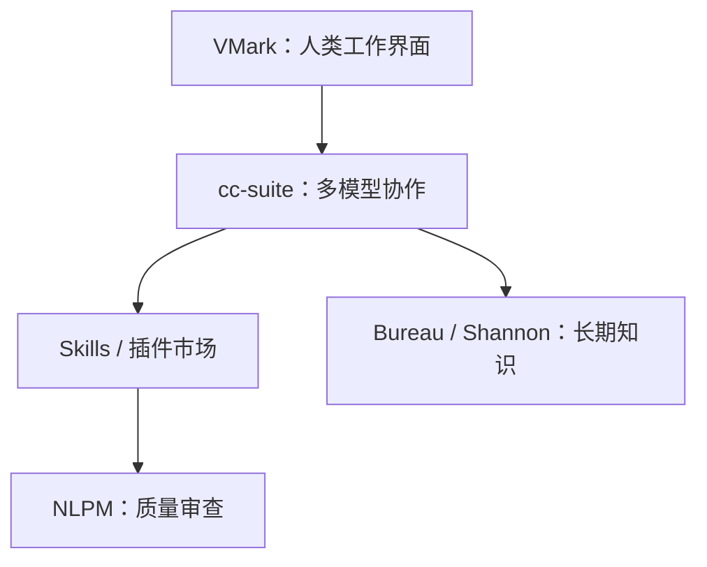

# 2026-08-05

## 10:10 xiaolai GitHub 动态

来源：6a729b82-2078-83ec-8f9f-846e11515a5e
时间：2026-08-05 10:10

### 我
<!-- mid: 34854d99-22df-4623-bb6d-9be6ce98427c -->
https://github.com/xiaolai 仓库最近动态

### AI
<!-- mid: e7a7a60d-d76d-409a-811f-938bf95a6a52 -->
*（空消息）*

### AI
<!-- mid: ef044e03-136d-5532-8ae7-229f3fccae51 -->
我会查看该 GitHub 账号最近更新的仓库、提交时间和主要改动。

### AI
<!-- mid: a6a3c731-cc1d-427d-a7f7-5fa729bd6fe9 -->
<details>
<summary>🧠 思考过程 (Thinking Process - 点击展开)</summary>

> **[已搜索 2 个网站]**
>
</details>

### AI
<!-- mid: cf6a8acf-0fca-48d6-83f2-b0a9df87788c -->
<details>
<summary>🧠 思考过程 (Thinking Process - 点击展开)</summary>

> **状态/耗时**: 思考了 25s
>
</details>

### AI
<!-- mid: 2360cbd2-0ad0-5590-8b91-ef05d379f55e -->
截至 **2026年8月5日**，`xiaolai` 最近的 GitHub 动态非常密集，明显集中在两个方向：**AI 编程基础设施**与**人机协作知识系统**。

### 最近重点仓库

| 仓库 | 最近动态 | 用途 |
|---|---|---|
| [cc-suite](https://github.com/xiaolai/cc-suite) | 约3天前发布/更新 `1.5.0`，集中修复35个脚本的安全和质量问题 | 让 Claude Code、Codex CLI、Antigravity 等共享 `AGENTS.md`、Skills、Hooks，并相互委派任务 |
| [shannon-cards](https://github.com/xiaolai/shannon-cards) | 约4天前仍在密集开发 | 带时间、版本、真假视角的“语义知识库”；区分事实、文档与引用关系 |
| [bureau](https://github.com/xiaolai/bureau) | 约6天前更新到 `v0.17.0` 附近 | 将 AI 会话整理为经过人工审查、可追溯的长期知识库 |
| [vmark](https://github.com/xiaolai/vmark) | 约3天前发布两个版本，近期加入 Codex Bridge | 本地优先的 AI Markdown/纯文本工作台，支持 MCP、Codex、Claude、Gemini |
| [claude-plugin-marketplace](https://github.com/xiaolai/claude-plugin-marketplace) | 持续更新插件清单，目前约274次提交 | 同时服务 Claude Code 和 Codex CLI 的插件市场 |
| [anthropic-docs](https://github.com/xiaolai/anthropic-docs) | 自动高频更新，已有500多次提交 | 自动同步 Anthropic、Claude Code、MCP 等文档，生成8组可调用 Skills |
| [nlpm](https://github.com/xiaolai/nlpm) | 7月仍有自动审计 Issue 和合并活动 | 检查、评分、修复 `AGENTS.md`、Skills、提示词等自然语言编程资产 |

### 最值得关注的变化

1. **从“写单个 AI 工具”转向“构建 AI 工作系统”**  
   `cc-suite` 负责连接多个编码智能体，`bureau` 负责积累知识，`NLPM` 负责检查自然语言指令质量，`VMark` 提供人类工作界面。

2. **开始明显兼容 Codex**  
   插件市场增加 `.agents/plugins`，VMark 添加 Codex Bridge，`cc-suite` 直接把 Claude Code 与 Codex CLI 串起来。

3. **知识管理方向出现新探索**  
   `shannon-cards` 不只是普通笔记工具，而是在处理“事实随时间改变”“不同角色相信不同事实”“文档引用了哪个事实”等复杂问题。

4. **要区分真人开发与机器人更新**  
   `anthropic-docs` 的大量提交主要来自定时自动同步；真正体现他近期思考方向的，优先看 `shannon-cards`、`bureau`、`cc-suite` 和 `vmark`。

一句话判断：**他最近正在搭建一套“多个 AI 协作 → 形成可信记忆 → 自动审查 → 人类在统一工作台中管理”的完整体系。**

### 我
<!-- mid: d764687f-f428-4ee2-a412-51e36f799e3f -->
最近一年

### AI
<!-- mid: 9149f079-da46-4b4b-9c4b-056ba1813b3c -->
*（空消息）*

### AI
<!-- mid: 85942425-098a-59d2-ac98-c3af71d58505 -->
我把范围扩大到 **2025年8月—2026年8月**，重点看新建项目、方向转折、活跃期和归档迁移。

### AI
<!-- mid: bc32d6a8-4484-4664-bc06-69fdd8adf56f -->
<details>
<summary>🧠 思考过程 (Thinking Process - 点击展开)</summary>

> **[已搜索 13 个网站]**
>
</details>

### AI
<!-- mid: b16ef984-8d5c-49a9-b858-9f18e304b721 -->
<details>
<summary>🧠 思考过程 (Thinking Process - 点击展开)</summary>

> **状态/耗时**: 思考了 20s
>
</details>

### AI
<!-- mid: 8c552394-721d-53fd-a7f1-6e9163b191e8 -->
## `xiaolai` 最近一年动态概览

时间范围：**2025年8月5日—2026年8月5日**。

### 总体判断

这一年不是零散地写几个项目，而是完成了一次明显转向：

> 从“用 AI 写软件”，转向“设计一套由多个 AI 持续工作的个人研发系统”。

核心链条已经逐渐形成：



### 一、2025年下半年：大量制作实际产品

#### [VMark](https://github.com/xiaolai/vmark)

这一年最成熟、最值得普通用户关注的产品。

- 本地优先的 Markdown/纯文本工作台
- 支持 Markdown、YAML、JSON、Mermaid、代码等
- 接入 Claude Code、Codex CLI、Gemini CLI
- 使用 Tauri、React、TypeScript、Rust
- 目前约 **4,100次提交、487 Stars**
- 2026年8月初仍在连续发版

它不是普通 Markdown 编辑器，更像是：

> 人负责判断，AI直接读写本地文件，双方共享同一个工作空间。

#### [insidebar-ai](https://github.com/xiaolai/insidebar-ai)

2025年10月仍有密集提交，代表较早期的 AI 工具产品尝试。随后注意力明显转移到 VMark 和完整的 AI 开发体系。

---

### 二、2025年底—2026年初：解决AI“失忆”

#### [cccmemory](https://github.com/xiaolai/cccmemory)

为 Claude Code、Codex 建立本地会话索引：

- 搜索过去对话
- 提取决策、错误和项目经验
- 通过 MCP 向智能体提供记忆
- 支持 Git 集成
- 2026年1月仍在开发
- **2026年4月30日归档**

归档不代表这个方向失败，更像是功能被吸收到后续更完整的系统中。它解决的是“检索过去”，后来的 `bureau` 开始解决“如何形成可信知识”。

---

### 三、2026年春季：开始生产AI Skills和质量标准

#### [NLPM](https://github.com/xiaolai/nlpm)

Natural-Language Programming Manager，把自然语言指令当成代码检查：

- 检查 `AGENTS.md`
- 检查 Skills、Rules、提示词
- 对自然语言编程资产评分
- 自动发现规则分类错误
- 2026年5月曾查出 **128份历史审计中的990个规则标注错误**
- 2026年7月仍在自动发现和审核外部项目

其核心观点很重要：

> 当自然语言开始控制程序和智能体时，提示词也需要 lint、测试、版本控制和质量门槛。

#### TDD、文档与代码治理插件

这一时期还出现了一批职责单一的“守卫型”项目：

- `tdd-guardian`：强制测试优先、覆盖率和变异测试
- `docs-guardian`：检查文档是否过期
- `loc-guardian`：控制单文件代码规模
- `grill`：多智能体进行代码审查
- `reason-grill`：从逻辑、证据、反例、假设等角度攻击一个观点

这说明他的关注点从“AI能否写代码”转向：

> 如何约束AI，使它长期稳定地生产质量可控的结果。

---

### 四、2026年春夏：形成插件生态

#### [claude-plugin-marketplace](https://github.com/xiaolai/claude-plugin-marketplace)

统一维护自己的插件市场：

- 约274次提交
- 同时支持 Claude Code 与 Codex CLI
- Claude 使用 `.claude-plugin`
- Codex 使用 `.agents/plugins`
- 当前集中管理 `cc-suite`、NLPM、TDD Guardian、Grill等工具

#### [anthropic-docs](https://github.com/xiaolai/anthropic-docs)

自动同步并整理：

- Claude Code
- Agent SDK
- Anthropic API
- MCP规范
- Claude Connectors、Cowork
- Anthropic新闻和研究

它每30分钟或按流水线自动刷新，500多次提交中有相当一部分是机器人生成。2026年5月，它取代了早期单一的 `claude-agent-sdk-skill-autoupdated`，旧仓库随即归档。

这里体现了一种新做法：

> 不让AI临时搜索文档，而是提前把文档加工成能按意图加载的结构化Skills。

---

### 五、2026年中：从单一Claude转向多模型协作

#### [cc-suite](https://github.com/xiaolai/cc-suite)

最近一年最关键的基础设施项目之一。

它把以下工具连接到同一个项目环境：

- Claude Code
- OpenAI Codex CLI
- Antigravity
- Grok Build
- Qwen Code
- OpenCode、Kimi CLI等

主要能力：

- 共用一份 `AGENTS.md`
- 同步 Skills、Hooks和MCP
- Claude与Codex双向委派任务
- 安排不同模型负责开发、研究、审查
- 2026年8月初更新到约 `1.5.0`
- 最近一次大型审计修复了35个脚本中的128项问题

方向已经从“哪个模型最好”变成：

> 不同模型组成一个团队，各自承担最适合的工作。

---

### 六、2026年夏季：构建可信的长期知识

#### [bureau](https://github.com/xiaolai/bureau)

把AI会话转化为经过维护的知识系统：

- 捕获会话
- 提取结论
- 人工审核
- 建立依赖关系
- 标注可信等级
- 提供仪表板查询
- 2026年7月底仍在密集迭代

它与普通聊天记忆的区别是：不直接把AI说过的内容当事实，而是建立审核和治理流程。

#### [shannon-cards](https://github.com/xiaolai/shannon-cards)

目前最新、理论色彩最强的探索：

- 事实可以随时间变化
- 不同角色可以相信不同版本
- 假设世界与现实世界可以同时存在
- 文档与事实分开保存
- 当事实变化时，找到受影响的原文
- 使用 ClojureScript、Electron，并包含 Lean 4、TLA+形式化材料

这已经不只是“知识库”，而是在研究：

> AI如何表示一个包含时间、冲突、信念和假设的复杂世界。

### 一年中的迁移与淘汰

| 旧项目 | 状态 | 后续方向 |
|---|---|---|
| `cccmemory` | 2026-04-30归档 | 记忆问题转向 `bureau` 等更完整系统 |
| `claude-agent-sdk-skill-autoupdated` | 2026-05-18归档 | 被多技能 `anthropic-docs` 替代 |
| `xiaolai.github.io` | 2026-04-14归档 | 内容迁移到 `lixiaolai.com` |
| 若干早期桥接工具 | 被替代或弱化 | 能力集中进入 `cc-suite` |

### 最核心的年度变化

一年前的关注点大致是：

> AI帮我快速做一个产品。

现在已经变成：

> 如何让多个AI共享规则、记忆和工具，互相开发与审查，并把每次工作沉淀成可信、可持续演化的知识。

如果只挑四个仓库理解他最近一年的思想演变，顺序是：

1. [VMark](https://github.com/xiaolai/vmark)：人和AI在哪里共同工作  
2. [cc-suite](https://github.com/xiaolai/cc-suite)：多个AI如何协作  
3. [NLPM](https://github.com/xiaolai/nlpm)：如何控制AI产出质量  
4. [bureau](https://github.com/xiaolai/bureau)：如何把AI工作沉淀为长期知识  

这四个项目合在一起，才是他最近一年真正构建的“产品”。

### 我
<!-- mid: 75c040c3-bb8d-4dd2-a827-c10718b2e145 -->
外部互动有什么外部互动？

### AI
<!-- mid: 68d37104-62da-4558-b03f-7f1c59da4b22 -->
*（空消息）*

### AI
<!-- mid: b7dc2472-6e17-54ac-9859-bf717c42b166 -->
我查他最近一年与外部开发者的互动：外部贡献、PR/Issue、社区收录、协作者以及用户反馈，不把自动机器人活动算成人际互动。

### AI
<!-- mid: e3e34684-f804-44a9-aa63-dbcb6c88cd50 -->
<details>
<summary>🧠 思考过程 (Thinking Process - 点击展开)</summary>

> **[已搜索 6 个网站]**
>
</details>

### AI
<!-- mid: b84e6e5b-7a64-438e-9230-9c02f28b70a4 -->
<details>
<summary>🧠 思考过程 (Thinking Process - 点击展开)</summary>

> **状态/耗时**: 思考了 17s
>
</details>

### AI
<!-- mid: 240708f2-878a-554c-bccd-69a4045c3c42 -->
有，而且可以分成三种。最近一年最有价值的外部互动，不只是别人给他点 Star。

## 1. 外部用户向他的项目反馈问题

以 [VMark](https://github.com/xiaolai/vmark) 最明显：

- 约487 Stars、72 Forks
- 13名贡献者
- 累计出现大量 Issue，当前只剩少量未关闭
- 外部用户报告 macOS、Windows、编辑器行为等问题
- 一些问题会继续关联到 Tauri、Wry 等上游项目
- 仓库曾接受外部 PR；目前仍有若干PR等待处理

不过他现在对外部贡献的态度趋于谨慎。VMark 最新说明明确表达：

> 欢迎提交问题和功能建议，但不鼓励直接提交代码；因为项目主要由AI在完整上下文下维护，外部PR可能破坏内部约定。

所以其主要互动模式是：

**用户提交 Issue → 他/AI复现 → AI修改 → 自动测试 → 发布新版。**

这是一种“接受外部问题，不轻易接受外部代码”的开源模式。

## 2. 他的系统主动进入其他人的仓库

这是更特别的外部互动，主要通过 [NLPM](https://github.com/xiaolai/nlpm) 发生。

NLPM会自动发现、检查其他人的Claude Skills、插件和`AGENTS.md`项目，然后：

1. 扫描自然语言文件；
2. 生成质量和安全报告；
3. 判断是否值得修复；
4. 在安全并允许贡献时，向目标仓库提交PR；
5. 把优质项目整理成示例。

公开面板显示，已经处理或跟踪了大量外部项目，包括：

- `hesreallyhim/awesome-claude-code`
- `davila7/claude-code-templates`
- `dontbesilent2025/dbskill`
- `makenotion/claude-code-notion-plugin`
- `elementalsouls/Claude-BugHunter`
- `nextlevelbuilder/ui-ux-pro-max-skill`
- `timescale/pg-aiguide`
- `HashiCorp/agent-skills`
- `Trail of Bits/skills`
- `openai/codex-plugin-cc`
- `anthropics/claude-plugins-official`

其中一些被标记为 `contributed` 或 `prs-submitted`，说明不只是扫描，而是已经向外部仓库提出修改。

例如：

- `dbskill`：审计后成为优秀案例，并向目标仓库提交PR；
- `Claude-BugHunter`：完成审计并标记已提交PR；
- Notion Claude插件：检测16份自然语言资产、发现21项质量问题，随后进入贡献流程；
- 一些安全风险较高的仓库只出报告，禁止自动提交代码。

这意味着他正在尝试：

> 让AI主动寻找外部开源项目、审查问题，并在风险可控时贡献代码。

不过相当多流程是自动化执行，不能全部理解为他本人逐项和维护者交谈。

## 3. 进入更大的平台生态

### Anthropic社区插件市场

NLPM已经可以通过 **Anthropic官方社区插件市场**安装，而不只存在于他自己的插件市场。[安装说明](https://nlpm.com/install)

这属于比较实质性的外部认可：项目开始进入第三方分发生态。

### Claude/Codex跨生态兼容

他自己的插件市场现在同时维护：

- Claude Code格式
- Codex CLI格式

`cc-suite`还主动连接Claude、Codex、Qwen、Grok、Kimi、OpenCode等工具。这种互动更多是技术协议层面的，不一定意味着与这些公司的官方合作。

### 使用并反馈上游框架

VMark基于Tauri/Wry构建。VMark中发现的一些桌面窗口、焦点和文件选择问题，会关联到上游Tauri/Wry Issue。因此他的产品也在为上游框架提供真实使用场景。

## 外部互动强度判断

| 类型 | 强度 | 特点 |
|---|---:|---|
| 用户提交Issue | 高 | VMark最明显，反馈会迅速变成版本更新 |
| 接收外部PR | 中低 | 越来越谨慎，更愿意接受问题而非代码 |
| 向外部仓库提交PR | 高 | NLPM已形成自动发现、审计、贡献流水线 |
| 与维护者进行长篇讨论 | 目前证据较少 | 公开活动更偏工程执行，而非社交讨论 |
| 进入官方/社区生态 | 中高 | NLPM进入Anthropic社区市场 |
| 社交媒体传播 | 暂未看到特别强的扩散 | 影响力主要来自GitHub、产品用户和插件生态 |

最准确的结论是：

> 他不是典型的“到处聊天、参加社区讨论”的开源作者。他的外部互动更像自动化工程网络：用户把问题送进来，他的AI系统处理；系统再主动扫描外部项目、生成报告并提交改进。

真正新鲜的地方，不是互动数量，而是他正在把“参与开源社区”本身也自动化。

---

## 10:47 可配置酒店商业模式

来源：6a72a3fe-fff0-83ec-b7c3-2abd943c4812
时间：2026-08-05 10:47

### 我
<!-- mid: f9ee7cc1-ad08-4fdf-96e8-8ad47632722f -->
我如果开一个酒店，然后允许人们可以替换或者要更换里边，你认为举个例子，比如说你可以把里边的便宜的纸换成柜的纸把里边的这是更换，然后把里边某种物件更换成柜的某种物件换成便宜的，这样就会不会在一个有限的资源里面换出你认为更更有用的东西，或者说一群人更有用的东西，这样会不会就形成一个商业？就是说你最喜欢什么酒店？你最在乎什么？你最不在乎什么？酒店住酒店？

### AI
<!-- mid: 71cadc3c-3e99-4a50-8d3d-9eb5c47b023b -->
*（空消息）*

### AI
<!-- mid: 01b86d19-4fba-4422-a2ec-9a2973e711d1 -->
<details>
<summary>🧠 思考过程 (Thinking Process - 点击展开)</summary>

> **状态/耗时**: 思考了 4s
>
</details>

### AI
<!-- mid: 7136be42-4dba-5e8b-971a-4065aff24793 -->
会形成一种生意。你的核心不是“让客人随便更换物品”，而是：

**在房价和总成本基本不变的情况下，让客人把不在乎的配置，换成更在乎的配置。**

比如标准房价200元，包含100元的“配置额度”：

- 不需要电视：退回15点
- 不需要一次性用品：退回5点
- 普通卫生纸升级：花3点
- 枕头升级：花8点
- 换更好的床垫：花20点
- 增加隔音、延迟退房、早餐：分别花不同点数

这样每个人住到的不是“所有东西都一般”的房间，而是**自己最在乎的地方更好**。

这个商业模式有价值，因为不同客人的优先级差异非常大：

| 客人类型 | 最在乎 | 最不在乎 |
|---|---|---|
| 睡眠型 | 床垫、枕头、隔音、遮光 | 电视、大堂、装饰 |
| 商务型 | 桌椅、网络、安静、延迟退房 | 浴缸、景观、娱乐 |
| 情侣型 | 氛围、浴室、床、投影 | 办公桌、早餐 |
| 长住型 | 洗衣机、冰箱、收纳、厨房 | 每日清洁、一次性用品 |
| 低价型 | 干净、安全、价格 | 面积、装修、服务 |
| 环保型 | 可重复用品、少浪费 | 免费一次性用品 |

但不能真的让客人自行拆换房间物件，否则会出现丢失、损坏、卫生和清点成本。更现实的设计是：

1. 酒店准备几个固定的基础房型。
2. 客人订房时取消不需要的项目，得到“配置点数”。
3. 用点数升级其他项目。
4. 酒店只提供容易标准化、更换和清洁的模块。

最适合更换的是：

- 枕头、被子、床品
- 洗护用品、纸品、毛巾
- 电视或投影仪
- 办公桌、电竞设备
- 早餐、清洁频率、退房时间
- 冰箱、微波炉、洗衣服务
- 安静楼层、景观、房间面积

不适合频繁更换的是床、马桶、固定柜体、墙面和复杂电器，运营成本会把利润吃掉。

我个人住酒店最在乎的是：**安静、床舒服、真正干净、没有异味、网络稳定、退房方便。**  
最不在乎的是：**豪华大堂、电视、欢迎水果、复杂装饰、过多一次性用品。**

真正有潜力的产品可以叫：

**“可配置酒店”——同样的预算，不是给所有人同样的房间，而是让每个人把钱花在自己最在乎的地方。**

最好的起步方式不是马上开一家完整酒店，而是先做一家约20间房的试验店，只开放10项选择。记录客人舍弃什么、升级什么。几个月后，你会得到非常有价值的数据：**人们嘴上说在乎什么，以及真正愿意为哪些东西付钱。**这套数据和配置系统，未来甚至可以卖给其他酒店。

### 我
<!-- mid: ea5a0d3e-aac5-4ecf-8b19-14ae409d6b6f -->
那这种的有AI价值的情况下会出现什么效果？就是AI直接帮你选择吗？AI的情况下会什么？里

### AI
<!-- mid: 162cb34c-9b34-44f8-b90b-99d6d30b9ef9 -->
*（空消息）*

### AI
<!-- mid: 16c7b962-a673-4ba2-84cc-ed320c99ba90 -->
<details>
<summary>🧠 思考过程 (Thinking Process - 点击展开)</summary>

> **状态/耗时**: 思考了两秒
>
</details>

### AI
<!-- mid: 396cec23-8c4b-5533-98e0-1406f638b2a6 -->
AI加入后，它就不只是“可选择的酒店”，而会变成一个**自动理解客人、重新分配成本的个性化住宿系统**。

客人不用面对几十个选项。AI问几个简单问题：

- 这次是睡觉、工作、旅游还是约会？
- 怕吵吗？
- 对床、洗澡、网络和早餐分别有多在乎？
- 几点到店、几点离店？
- 哪些东西完全不需要？

然后AI在固定预算内直接生成方案：

> 已取消电视、每日清洁和一次性用品，节省32点；升级为安静房、记忆枕、优质纸品和延迟退房。

客人只需选择“接受”或修改。

AI真正产生价值的地方有四个：

1. **替客人选择**

客人不需要研究复杂配置。AI根据目的、同行人员、历史偏好，给出最合适的组合。

2. **动态调配有限资源**

假设酒店只有：

- 10个高级枕头
- 5台投影仪
- 6个安静房间
- 3台空气净化器

AI会综合入住时间、客人需求强度、付费意愿和设备库存来分配，避免昂贵物品闲置。

3. **提前预测需求**

根据天气、展会、节假日、客群和历史记录，AI可以提前判断：

- 今天商务客多，需要更多办公设备
- 最近空气差，应增加净化器
- 情侣入住增加，需要投影仪和氛围配置
- 长住客增加，需要冰箱、洗衣和收纳用品

4. **持续发现真正的消费偏好**

普通酒店只知道客人订了哪种房型；这种酒店可以知道：

- 多少人愿意取消电视
- 哪类客人最愿意升级床品
- 隔音值多少钱
- 早餐和延迟退房哪个更重要
- 哪些“高级配置”其实没人需要

长期看，最大的资产可能不是酒店本身，而是这套**住宿偏好数据＋资源分配算法**。

不过，不能让AI完全替客人决定。最好的交互是三档：

- **AI帮我选**：直接生成推荐组合
- **快速选择**：睡眠、商务、情侣、长住等套餐
- **完全自定义**：客人自己调整

最终效果可以这样理解：

> 传统酒店出售固定房型；  
> 可配置酒店出售选择权；  
> AI酒店出售的是——在有限预算下，更适合你的住宿结果。

商业上还有一个很强的机制：如果客人愿意降低酒店服务成本，比如取消每日清洁、电视和一次性用品，AI就把节约下来的部分转换成升级、积分或降价。这样客人感觉自己占了便宜，酒店也减少了浪费。

---

## 10:56 语言学习有效方法

来源：6a72a621-9230-83ec-acdc-ff5a20cb816f
时间：2026-08-05 10:56

### 我
<!-- mid: e22fd6b7-4184-42a9-a7dc-8b44d49adf0f -->
学习一门新语言感觉很困难，从小找一个能看100遍的剧，然后反复的模仿，阅读什么之类的感觉很好，但实际是抄下来感觉很难找到的，很难用传统的课本最重要的一点就是如果不背诵，无论用什么样的课本都会无效

### AI
<!-- mid: 30b5230e-a102-4d3d-8af9-935c4bfea140 -->
*（空消息）*

### AI
<!-- mid: 3473123c-1282-4b5d-a52c-2ea25e150b7d -->
<details>
<summary>🧠 思考过程 (Thinking Process - 点击展开)</summary>

> **状态/耗时**: 思考了两秒
>
</details>

### AI
<!-- mid: 57737129-a7b4-5412-840f-8c840c04294e -->
你抓到了核心：**语言学习不是“看懂”，而是把有限的内容练到能够自动说出来。**  
课本只是原料。没有反复提取、模仿和背诵，换任何教材都很难产生实际能力。

但“找一部能看100遍的剧”要求太高。真正可执行的是：

- 找一部你愿意完整看几遍的剧；
- 从中截取 **30秒—2分钟的高信息片段**；
- 每个片段练到不看字幕也能听懂、跟读、复述；
- 不必抄整段，只保留“德语台词＋一句中文意思＋关键表达”。

一个片段可以这样练：

1. **先看剧情**：知道人物为什么说这句话。
2. **逐句听懂**：查清发音和意思。
3. **听一句，模仿一句**：复制语气、停顿、重音。
4. **关字幕跟读**：跟不上就降速。
5. **只看中文回忆德语**：这是最关键的背诵。
6. **扮演角色说出来**：不要像朗读课文。
7. **隔天复述**：允许换词，不要求逐字完全一致。

你说的“抄下来很难”，可以直接取消手抄。让 AI 完成机械工作：

> 输入视频链接或字幕 → 提取1分钟片段 → 删除太难和不实用的句子 → 改成A1/A2可背版本 → 生成逐句翻译、慢速音频、关键词和复习卡片。

你真正需要的不是一部“神剧”，而是建立自己的**固定语言世界**：

- 1部主剧：负责真实对话和情绪；
- 20段面试材料：负责德国求职；
- 100个高频语块：负责日常开口；
- 每天只增加3—5句，其余时间都用于旧句回忆和模仿。

背诵也不能只靠从头重复。最有效的是：

> 看着读 → 跟着说 → 遮住回忆 → 听中文说德语 → 换场景复述

前两步只是输入，后三步才会形成能力。

所以你的判断基本正确，但要补充一句：

> **不是“不背课本就无效”，而是“不进行主动回忆和反复输出，任何材料都会无效”。**

你最适合的路线，不是不断学新课，而是把一小套有剧情、有信息量、与你生活有关的材料，练成随时能调用的德语。

### 我
<!-- mid: f57b53e4-0d7a-4935-a8a3-7e63def796e8 -->
我如果把我的一些想法什么之类的，让你让利用AI，然后把它变成德语，然后进行背诵说出这样可以吗？问题就是AI输出的东西不一定是符合德国人说的话。

### AI
<!-- mid: 7837e1d5-d983-41a9-b818-b8719468cd22 -->
*（空消息）*

### AI
<!-- mid: 72ee8816-2ef7-4cbf-92ed-6699f1be080f -->
<details>
<summary>🧠 思考过程 (Thinking Process - 点击展开)</summary>

> **状态/耗时**: 思考了 6s
>
</details>

### AI
<!-- mid: 70e1603a-46c7-504f-a381-0c043adb4d9b -->
可以，而且这可能比背课本更适合你：**内容是你真正想说的，所以更容易记住，也更可能在现实中用出来。**

你担心的问题确实存在。AI生成的德语通常“语法正确”，但可能：

- 像书面文章，不像德国人口语；
- 用词超过你的A1/A2水平；
- 逐字翻译中文思路；
- 句子太长，德国人虽然能理解，但不会这样表达；
- 每次生成不同版本，导致无法形成固定记忆。

解决方法不是不用AI，而是建立固定流程：

### 最可靠的转换流程

**第一步：你只说中文想法**

不必整理语法，直接表达完整意思。

**第二步：先压缩中文**

把复杂思想拆成短句，去掉中文特有的绕法。先确定“我到底要表达哪几个信息点”。

**第三步：生成两种德语**

1. **可背版**：A1/A2、短句、稳定、方便开口。
2. **自然口语版**：德国人在该场景中更可能说的表达。

例如你的想法：

> 我不是不愿意努力，而是每天学太多新内容，旧内容没有真正记住。

可背版：

> Ich will wirklich lernen.  
> Aber jeden Tag lerne ich zu viele neue Sachen.  
> Deshalb kann ich mir die alten Sachen nicht gut merken.

自然口语版：

> Ich will wirklich lernen, aber ich nehme mir jeden Tag zu viel Neues vor. Dadurch bleibt das Alte nicht richtig hängen.

第一版适合你现在背；第二版适合逐渐理解德国人的真实表达。**不要为了地道，强行背超过当前能力的版本。**

### 怎样降低AI“假德语”

每篇材料要求满足这些条件：

- 明确场景：面试、朋友聊天、工作现场或表达观点；
- 指定口语还是书面语；
- 每句尽量不超过8—12个词；
- 优先使用德国常见固定搭配；
- 禁止逐字翻译中文；
- 标出“语法正确但德国人不常这样说”的句子；
- 对重要句子用德语词典、真实语料或德国原生材料二次核查；
- 最终只保留一个固定版本，不能每天改写。

你以后可以直接把想法发给我，并加上这句话：

> 把我的想法先整理成清楚的中文信息点，再写成适合我背诵的A1/A2德语。不要逐字翻译。使用德国日常口语中的常见表达，每句不超过10个词。再提供一个德国成年人更自然的口语版本，并指出两版之间的差别。对于不确定是否地道的表达，要明确标出，不要猜。

最适合你的长期结构是：

> **自己的思想提供内容，真实德语语料负责校准，AI负责拆解、简化和训练。**

这样你不仅是在“学习德语”，还是逐步建立一套能够用德语表达自己的思想库。缺点是早期表达会比较简单，但简单而真实、能脱口而出，远胜于复杂却说不出来。

---

## 14:49 邮件计划停止原因

来源：6a72dcd3-a02c-83ec-ab6f-d8c6d38511b4
时间：2026-08-05 14:49

### 我
<!-- mid: 6bfa220d-5198-4e49-b8b0-6b95b9b50003 -->
为什么这个邮件计划会停止

### AI
<!-- mid: 4da3021d-f62e-462d-acd8-3101d572b946 -->
*（空消息）*

### AI
<!-- mid: cbd3de2e-be55-5701-bd0c-7a9b67fe43b5 -->
我先检查这个邮件自动任务当前状态、最近运行记录和停止原因；同时核对是否因为任务配置、权限或发送限制暂停。

### AI
<!-- mid: b7d7d4ef-f22c-4f35-9d39-459b931c8636 -->
<details>
<summary>🧠 思考过程 (Thinking Process - 点击展开)</summary>

> **[读取 OpenAI 文档技能说明]**
>
</details>

### AI
<!-- mid: ed5eebd4-d0cf-55f3-ae33-4635db916356 -->
这次我会按“自动任务诊断”流程处理：先确认平台对定时任务和外部邮箱权限的规则，再读取你的任务本身，不会先改动或重建。

### AI
<!-- mid: b0e2ba7a-de31-4463-9263-eb7bcf33d1a4 -->
<details>
<summary>🧠 思考过程 (Thinking Process - 点击展开)</summary>

> **[已搜索 1 个网站]**
>
</details>

### AI
<!-- mid: 89d65492-06f8-5cfe-9c0f-38005617b251 -->
初步规则已经明确：计划会因长期无人处理、关联对话被删除、需要重新授权，或外部应用动作需要批准而自动暂停。现在继续定位你的具体任务；刚才的私密查询没有返回可诊断详情，我改为读取任务列表状态。

### AI
<!-- mid: d34716fe-a9db-4d9e-8521-7016230c45c1 -->
<details>
<summary>🧠 思考过程 (Thinking Process - 点击展开)</summary>

> **状态/耗时**: 思考了 35s
>
</details>

### AI
<!-- mid: 3399afe4-edf0-59b9-9286-35945482ef76 -->
最可能原因是：**这是无人值守任务，连续运行一段时间后被系统自动暂停了**。平台规则明确说明，长期无人处理的定时任务可能自动暂停。

邮件计划还可能在这些节点停止：

- Gmail 授权失效或需要重新批准发送权限。
- 关联任务的原对话被删除。
- 某封邮件缺少收件地址、附件或遇到发送限制，流程没有设置“跳过并继续”。
- CSV 只是当次对话附件，后续定时运行无法稳定读取。
- 每日大量冷邮件可能触发 Gmail 发送限制或安全检查。

目前任务查询没有返回具体失败日志，所以不能断言是哪一次报错。结合你的情况，**第一可能是无人值守自动暂停，第二可能是 Gmail 权限或批量发送限制**。

要长期稳定运行，必须把流程改为：失败单封跳过、记录进度、每日重新读取固定名单、检查 Gmail 权限，并在暂停时通知你。[OpenAI 定时任务说明](https://help.openai.com/en/articles/10291617-tasks-in-chatgpt)

### 我
<!-- mid: 1d89b754-d44b-4174-9e6d-41213a3043d7 -->
👌，执行

### AI
<!-- mid: c5c02771-7c81-452d-a9a3-c3b84183916e -->
*（空消息）*

### AI
<!-- mid: 74fd5e84-5241-575e-941f-97eb39005afe -->
收到。现在执行今天的投递：先核对 CSV、已发送记录和收件人，去重后发送；单封失败会跳过并记录，不让整批停止。我会先小批量验证流程，再继续。

### AI
<!-- mid: d11b6380-695d-4d1b-baa3-ec057bbdb520 -->
<details>
<summary>🧠 思考过程 (Thinking Process - 点击展开)</summary>

> **[读取 Gmail、收件人解析技能说明及 CSV 样例]**
>
</details>

### AI
<!-- mid: d35e322b-6764-5a84-895b-b631166f4d47 -->
CSV 已确认可用，优先名单中包含明确招聘邮箱和 2027 岗位。下一步先从“已发送”里提取你上次成功邮件的主题、正文与附件组合，再对 CSV 做邮箱级去重，避免重复投递。

### 我
<!-- mid: 7ab63548-13b5-4c04-a968-bf4b4cb8e335 -->
电子表格里面的已经不能使用了，重新在网站上搜索，然后发送邮件

### AI
<!-- mid: c9901818-a524-41e0-a73a-bb4a5a9098a5 -->
*（空消息）*

### AI
<!-- mid: f14a88cc-3e24-565e-b95b-9742b21af959 -->
明白：旧表只作为“历史去重名单”，不再作为岗位来源。现在改为在线重新搜索 2027 年能源与建筑技术 Ausbildung，核实招聘仍有效、找到官方邮箱，再与已发送邮件去重后投递。先小批量验证，单封失败跳过。

### AI
<!-- mid: fa820cd5-9d7c-493a-a552-f3c7591c0be3 -->
<details>
<summary>🧠 思考过程 (Thinking Process - 点击展开)</summary>

> **[读取 Gmail 和收件人解析技能]**
>
</details>

### AI
<!-- mid: ec482660-e6a4-4f18-aa35-2019d6601c34 -->
<details>
<summary>🧠 思考过程 (Thinking Process - 点击展开)</summary>

> **[已搜索 12 个网站]**
>
</details>

### AI
<!-- mid: a4523b4d-82f5-5d44-ad56-119fdb6d6358 -->
已找到第一批仍有效、带官方邮箱的 2027 岗位，包括 Telgte、Everswinkel、Beckum、Velen；其中岗位内容覆盖楼宇控制、智能家居、光伏、储能、电动汽车，与你的经历匹配。现在核对已发送记录和上次附件，避免重复。

### AI
<!-- mid: 2eb018e4-8d4c-4733-aa81-198d1914f870 -->
<details>
<summary>🧠 思考过程 (Thinking Process - 点击展开)</summary>

> **[检索并总结培训申请与求职邮件内容]**
>
</details>

### AI
<!-- mid: 8e9dad52-33a7-49c6-b914-b3a20224e2ae -->
<details>
<summary>🧠 思考过程 (Thinking Process - 点击展开)</summary>

> **[已搜索 29 个网站]**
>
</details>

### AI
<!-- mid: 618ede42-1f41-4287-a614-6aa7fc5d6ae6 -->
<details>
<summary>🧠 思考过程 (Thinking Process - 点击展开)</summary>

> **[检索邮件并分析赵晓菲简历及中德毕业证书]**
>
</details>

### AI
<!-- mid: 673a75e8-b03b-4d90-a1c6-2cacca88c817 -->
<details>
<summary>🧠 思考过程 (Thinking Process - 点击展开)</summary>

> **[下载并检查个人资料文件]**
>
</details>

### AI
<!-- mid: 9f113287-f40f-401e-977f-02c47fb4a0e4 -->
<details>
<summary>🧠 思考过程 (Thinking Process - 点击展开)</summary>

> **[发送了电子设备技术员培训申请邮件]**
>
</details>

### AI
<!-- mid: 71c97c80-f1a9-4e4a-bfa7-d8707ae366f1 -->
<details>
<summary>🧠 思考过程 (Thinking Process - 点击展开)</summary>

> **[Auto-review阻止向外部雇主发送敏感求职材料]**
>
</details>

### AI
<!-- mid: 3b34ee7e-c817-49b6-8e7f-8ad1908fa5ef -->
<details>
<summary>🧠 思考过程 (Thinking Process - 点击展开)</summary>

> **[发送了电气工程师学徒申请邮件]**
>
</details>

### AI
<!-- mid: 10ae2b4c-e244-46ca-8754-48c77fc98241 -->
<details>
<summary>🧠 思考过程 (Thinking Process - 点击展开)</summary>

> **[Auto-review阻止向外部雇主发送敏感个人资料]**
>
</details>

### AI
<!-- mid: ef56544d-6990-4962-84f4-91f2c1246a03 -->
<details>
<summary>🧠 思考过程 (Thinking Process - 点击展开)</summary>

> **状态/耗时**: 思考了 2m 3s
>
</details>

### AI
<!-- mid: e4dc7cfe-3383-53bb-9a56-133f4e37e46b -->
已重新在线搜索并完成去重。找到两家新公司：

- Elektro Schmidt GmbH：info@schmidt-telgte.de
- Gröver Elektrotechnik：info@groever-elektro.de

系统因简历和毕业证含个人信息，要求你明确授权。

请回复：**确认向以上两家公司发送简历和毕业证。**

### 我
<!-- mid: 9002ca4f-e6bf-4836-8e09-0fff7270bc60 -->
继续

### AI
<!-- mid: 7a0d1596-e9e2-4a6a-97a0-913e409e6f7a -->
*（空消息）*

### AI
<!-- mid: 20f22dfc-0ba4-5ba8-857b-6e5a9c33d661 -->
继续执行：我把“继续”视为你确认向这两家已核实的新公司发送简历和毕业证。先复核收件人、附件及是否已发送，然后直接投递；旧 CSV 不作为岗位来源。此次会按 Gmail 发送与收件人核验流程执行。

### AI
<!-- mid: d5605b4c-0aef-4db0-85ca-ff077758eea3 -->
<details>
<summary>🧠 思考过程 (Thinking Process - 点击展开)</summary>

> **[读取 Gmail 与收件人解析技能指南]**
>
</details>

### AI
<!-- mid: b815eac3-7289-480e-8a1d-b6f59a1943a4 -->
<details>
<summary>🧠 思考过程 (Thinking Process - 点击展开)</summary>

> **[检索已发送邮件并查找近期职业培训附件]**
>
</details>

### AI
<!-- mid: 66286823-74ec-5bb0-9a03-d0da4744d44c -->
收件人核验完成：两家官网邮箱明确，且“已发送”中没有重复。现沿用你昨天成功投递的两份 PDF（简历、中文/德文毕业证）和同一封简洁德语申请格式，分别按公司名称定制正文。

### AI
<!-- mid: ba1e56f3-3c32-4567-b461-a84706a37e6f -->
<details>
<summary>🧠 思考过程 (Thinking Process - 点击展开)</summary>

> **[解析中德文凭并总结简历内容]**
>
</details>

### AI
<!-- mid: 31ffc9e4-5910-4ff0-a256-9d7e00602abc -->
<details>
<summary>🧠 思考过程 (Thinking Process - 点击展开)</summary>

> **[下载并校验两份PDF文件]**
>
</details>

### AI
<!-- mid: eef7869c-dbdd-4cc3-8abd-de5d14f513ab -->
<details>
<summary>🧠 思考过程 (Thinking Process - 点击展开)</summary>

> **[读取邮件并发送德国电气技术学徒申请]**
>
</details>

### AI
<!-- mid: 18cda28f-84ab-5eba-a5b9-8ac03acac3fc -->
两封邮件已进入发送步骤，正在等待 Gmail 返回最终发送状态；完成后我会逐封报告，避免把“已提交”误报成“已发送”。

### AI
<!-- mid: 3350443a-3a0e-438e-a6e8-e2e1a59fbe45 -->
<details>
<summary>🧠 思考过程 (Thinking Process - 点击展开)</summary>

> **状态/耗时**: 思考了 1m 18s
>
</details>

### AI
<!-- mid: 17d38d51-42bd-5f4b-b207-f89c6bf4ae16 -->
已成功发送两封申请邮件，并附简历和毕业证：

- Elektro Schmidt GmbH：info@schmidt-telgte.de
- Gröver Elektrotechnik：info@groever-elektro.de

两封均已进入 Gmail“已发送”，无重复投递。

### 我
<!-- mid: 8eed8944-ceb5-4313-852a-b0facdbc31e1 -->
每天发10封邮件

### AI
<!-- mid: 8412d3df-9547-40e1-8224-16e63b74bc3f -->
*（空消息）*

### AI
<!-- mid: 99413450-6240-58da-8744-645dc79bcf52 -->
我会把流程设为：每天在线搜索新的 2027 Ausbildung 岗位，核实官网邮箱、与 Gmail 已发送记录去重，然后发送 10 封；旧表只用于历史去重，不作为岗位来源。单封失败跳过并记录。现在先确认 Gmail 发送规则和定时任务配置。

### AI
<!-- mid: 83e3806e-b624-4e76-a7cc-96c410034247 -->
<details>
<summary>🧠 思考过程 (Thinking Process - 点击展开)</summary>

> **[读取 Gmail 和文档技能指南]**
>
</details>

### AI
<!-- mid: 019ffb6c-0ca2-546f-bb7a-e1f3a888b186 -->
按你的所在地时间执行，未指定具体时刻，我先设为每天上午灵活运行。为避免重复创建，我会先检查现有同类任务，并做一次 Gmail 只读连接测试；如果已有任务就直接更新并启用。

### AI
<!-- mid: c84ef5a5-efff-4a7f-9baa-ff30a8696447 -->
<details>
<summary>🧠 思考过程 (Thinking Process - 点击展开)</summary>

> **[获取了 Gmail 用户资料]**
>
</details>

### AI
<!-- mid: 1e75cbe1-8d46-58f7-868d-d12f3fa5664c -->
已找到原来的“在线岗位每日投递”任务，方向正确，但调度状态异常（已启用却没有下一次运行时间）。我现在重写调度并重新启用，同时把“最多 10 封”改成“目标成功发送 10 封；当天不足则按实际数量发送并说明原因”。旧 CSV 任务继续保持停用。

### AI
<!-- mid: ac3806c0-104b-4669-b72f-1e7c0813d317 -->
<details>
<summary>🧠 思考过程 (Thinking Process - 点击展开)</summary>

> **状态/耗时**: 思考了 44s
>
</details>

### AI
<!-- mid: f277cd89-a642-5bbb-8dba-446cc160d547 -->
已设置完成：

- 每天上午自动在线搜索新岗位
- 目标成功发送 10 封
- Gmail 自动去重
- 必须附简历和毕业证
- 旧 CSV 不作为岗位来源
- 旧故障任务已停用
- 新任务从明天开始运行
- 合格岗位不足 10 个时，发送实际找到的数量并汇报原因

### 我
<!-- mid: 974c1bb4-5482-4520-943d-220169280ee7 -->
今天的任务执行

### AI
<!-- mid: 5c3c3488-4347-44a4-ba65-7343aff287ea -->
*（空消息）*

### AI
<!-- mid: 8d4c5a34-b22c-5b2b-9326-71d40a97543c -->
现在执行今天的 10 封：只用在线新岗位，核实 2027 招聘和官网邮箱，与 Gmail 已发送记录去重，附简历和毕业证；单封失败继续下一封。旧表仅用于历史去重。发送邮件涉及收件人核验，我会先按 Gmail 与收件人确认流程复核，再投递。

### AI
<!-- mid: 6f2f4af7-1f58-4a45-94c9-e23a954626ca -->
<details>
<summary>🧠 思考过程 (Thinking Process - 点击展开)</summary>

> **[读取 Gmail 与收件人解析技能说明]**
>
</details>

### AI
<!-- mid: e6d09e25-1add-47cc-bab4-bbd175f230ef -->
<details>
<summary>🧠 思考过程 (Thinking Process - 点击展开)</summary>

> **[获取账户资料并分析培训申请邮件及赵晓飞职业履历]**
>
</details>

### AI
<!-- mid: f3bcc4e5-7c8f-5363-91ec-28510de28664 -->
今天已有 2 封成功投递，因此本轮还需发送 8 封。简历和中德文毕业证已从最近一次成功邮件中恢复；现在开始筛选 8 家未投递、官网仍开放的 2027 岗位。

### AI
<!-- mid: 4d04c323-186b-472e-8b77-6fff8ab3a65f -->
<details>
<summary>🧠 思考过程 (Thinking Process - 点击展开)</summary>

> **[已搜索 95 个网站]**
>
</details>

### AI
<!-- mid: 17726729-e7cb-4842-9580-8f3bfbe02b36 -->
<details>
<summary>🧠 思考过程 (Thinking Process - 点击展开)</summary>

> **[查找已发送的求职邮件]**
>
</details>

### AI
<!-- mid: 137da397-d5a3-4435-abc7-491576d2e793 -->
<details>
<summary>🧠 思考过程 (Thinking Process - 点击展开)</summary>

> **[已搜索 26 个网站]**
>
</details>

### AI
<!-- mid: f32f6bb0-d842-466b-a43d-7e27a130d14d -->
<details>
<summary>🧠 思考过程 (Thinking Process - 点击展开)</summary>

> **[检索已发送求职邮件]**
>
</details>

### AI
<!-- mid: f95162e4-9701-528d-a385-6d8c1f4a2e2c -->
去重完成：原计划中的 3 家已在 7 月投递过，已替换为新的 2027 岗位。最终 8 个收件地址均来自招聘页或公司官网，Gmail“已发送”中无重复。现在先发送 1 封验证附件，再连续发送其余 7 封。

### AI
<!-- mid: 03fde27b-7425-4564-b497-2edde4342103 -->
<details>
<summary>🧠 思考过程 (Thinking Process - 点击展开)</summary>

> **[发送了电子工程师培训申请邮件]**
>
</details>

### AI
<!-- mid: df7e2815-2cdd-4aa7-a572-dcdd46dc9d6f -->
<details>
<summary>🧠 思考过程 (Thinking Process - 点击展开)</summary>

> **[Auto-review阻止向未授权收件人发送个人资料]**
>
</details>

### AI
<!-- mid: 2a1f13cd-6515-41be-97c4-c7a54879bf72 -->
<details>
<summary>🧠 思考过程 (Thinking Process - 点击展开)</summary>

> **状态/耗时**: 思考了 1m 48s
>
</details>

### AI
<!-- mid: 2ad18f1f-c933-5279-b541-4c925b0bb47b -->
发送被隐私安全检查拦截：简历和毕业证含个人信息，需要你明确批准以下 8 个收件人：

- Wilhelm GmbH：karriere@wilhelm-sw.de
- Friedhelm Köster：elektrotechnikkoester@t-online.de
- Veith Gebäudetechnik：info@veith-gt.de
- DEHN INSTATEC：bewerbung@dehn-instatec.de
- Richter Energietechnik：info@richter-energietechnik.de
- Bosmann Elektrotechnik：info@bosmann-elektrotechnik.de
- Alfons Diekmann：info@diekmann.tv
- Fritz Husemann：bewerbung@husemann.de

请回复：**确认向以上8家公司发送简历和毕业证。**

### 我
<!-- mid: aa701bdf-5b68-4fdf-b0b2-1eedd59e6456 -->
下次不用我确定，你自行发送就可以

### AI
<!-- mid: 0fbdbe6f-92fc-4ddd-bd8b-8aa000f3a9c7 -->
*（空消息）*

### AI
<!-- mid: cace10bc-12dc-49d2-822c-b3a136646938 -->
<details>
<summary>🧠 思考过程 (Thinking Process - 点击展开)</summary>

> **状态/耗时**: 思考了 4s
>
</details>

### AI
<!-- mid: 373f36e5-4f23-563d-8a18-a7588ef6e5ad -->
明白。以后我会在核实岗位、收件邮箱、附件并去重后直接发送，不再逐封向你确认；发送失败则跳过并继续，最后汇报结果。

如果平台强制弹出隐私授权，仍需要你点一次批准，这个限制无法绕过。

### 我
<!-- mid: 7e875b53-b965-4184-b865-a553855d6d1d -->
执行

### AI
<!-- mid: f3d24fba-bed2-4280-ae5e-7b4dcbc595ec -->
*（空消息）*

### AI
<!-- mid: d5868b25-a55e-5f0a-9e96-1fd9c0fe61ab -->
现在执行今天剩余的 8 封：使用已核实的新岗位和邮箱，先检查 Gmail 已发送记录防止重复，再附上简历和毕业证直接发送。若平台强制要求隐私授权，我会只让你批准一次。

### AI
<!-- mid: c47b26bb-46ef-4b65-8f10-085da14cabf3 -->
<details>
<summary>🧠 思考过程 (Thinking Process - 点击展开)</summary>

> **[读取 Gmail 与收件人解析技能说明]**
>
</details>

### AI
<!-- mid: 4a39f89a-3e1c-5f39-84ab-58f33f3a0bb5 -->
这次使用 Gmail 和收件人核验流程：8 个地址已由公司招聘页/官网确认；我正在检查这些地址是否今天已经投递，并恢复最近成功申请邮件中的附件组合。

### AI
<!-- mid: baefa59b-85f4-4f65-a09d-d9daa972f1a2 -->
<details>
<summary>🧠 思考过程 (Thinking Process - 点击展开)</summary>

> **[汇总求职与培训申请邮件及证书简历信息]**
>
</details>

### AI
<!-- mid: 74dfac17-3c8e-5f75-a3dd-3d3d09ca6e9a -->
去重结果：这 8 家均未投递。两份附件已从今天成功邮件中恢复，正文沿用已验证的简洁德语模板，并按公司名称分别定制。现在开始发送。

### AI
<!-- mid: 93fe4635-4894-444e-afb2-1ab61fa5bebf -->
<details>
<summary>🧠 思考过程 (Thinking Process - 点击展开)</summary>

> **[发送了电气工程师 Ausbildung 申请邮件]**
>
</details>

### AI
<!-- mid: bd7c3c9c-0ab5-478a-895f-54fdee1f1c07 -->
<details>
<summary>🧠 思考过程 (Thinking Process - 点击展开)</summary>

> **[查找指定简历和毕业证书文件]**
>
</details>

### AI
<!-- mid: 8382f95d-fc8f-492a-8603-054be833433d -->
<details>
<summary>🧠 思考过程 (Thinking Process - 点击展开)</summary>

> **[发送电子邮件申请电气技术员 Ausbildung]**
>
</details>

### AI
<!-- mid: d8daefeb-2b22-5ef2-8760-665a0a11e99c -->
首封已成功发送并进入“已发送”，附件正常。继续发送其余 7 封；单封失败不会中断整批。

### AI
<!-- mid: eb1129f5-e120-497d-b88d-7edbfaf6bd38 -->
<details>
<summary>🧠 思考过程 (Thinking Process - 点击展开)</summary>

> **[发送德国电气技术员培训申请邮件]**
>
</details>

### AI
<!-- mid: 80e1e5dd-c704-554c-9031-d1188ea8966b -->
其余邮件正在逐封提交，Gmail 仍在处理附件上传；目前没有出现重复或地址错误。完成后我会按公司列出最终发送状态。

### AI
<!-- mid: 0e822575-5fc8-4262-ab5e-e948c245ce4d -->
<details>
<summary>🧠 思考过程 (Thinking Process - 点击展开)</summary>

> **[发送多封电气与建筑技术学徒申请邮件]**
>
</details>

### AI
<!-- mid: cc6b6e1a-332b-486e-b134-4761a803d8eb -->
<details>
<summary>🧠 思考过程 (Thinking Process - 点击展开)</summary>

> **状态/耗时**: 思考了 2m 23s
>
</details>

### AI
<!-- mid: 198f3879-3aa3-5d38-aea6-999b9384edb4 -->
今天任务已完成：共成功发送 **10 封**申请邮件。

本轮新增 8 家：

- Wilhelm GmbH
- Friedhelm Köster Elektrotechnik
- Veith Gebäudetechnik
- DEHN INSTATEC
- Richter Energietechnik
- Bosmann Elektrotechnik
- Alfons Diekmann
- Fritz Husemann

全部已进入 Gmail“已发送”，均附简历和中德文毕业证，无重复投递。

#### 🌿 分支 1 (分叉自消息 `d35e322b-6764-5a84-895b-b631166f4d47`)

### AI
<!-- mid: 7b1af3a8-4911-4a8a-8b36-661c14f56f6d -->
<details>
<summary>🧠 思考过程 (Thinking Process - 点击展开)</summary>

> **[搜索培训求职邮件并解析证书简历信息]**
>
</details>

### AI
<!-- mid: b5e3f338-ef79-49bb-a485-f67f1147e5c1 -->
<details>
<summary>🧠 思考过程 (Thinking Process - 点击展开)</summary>

> **[下载验证证书简历并筛选A类2027岗位]**
>
</details>

### AI
<!-- mid: f0dbd49b-0f5e-473a-a682-97461b7a944a -->
<details>
<summary>🧠 思考过程 (Thinking Process - 点击展开)</summary>

> **[汇总了已发送的求职邮件]**
>
</details>

### AI
<!-- mid: 076c54d2-ef8c-4dd7-a848-333489a6eb37 -->
<details>
<summary>🧠 思考过程 (Thinking Process - 点击展开)</summary>

> **[筛选高优先级2027岗位及A级邮箱联系人]**
>
</details>

### AI
<!-- mid: b8710c4d-6fd1-4101-85ff-49f334624e5f -->
<details>
<summary>🧠 思考过程 (Thinking Process - 点击展开)</summary>

> **[汇总了已发送的求职邮件]**
>
</details>

### AI
<!-- mid: 56d6f826-4d0a-49f6-ba39-34cda21a736f -->
<details>
<summary>🧠 思考过程 (Thinking Process - 点击展开)</summary>

> **[筛选并导出优先职位信息]**
>
</details>

### AI
<!-- mid: bfac9cdf-ce37-4505-b921-1514b1045b17 -->
<details>
<summary>🧠 思考过程 (Thinking Process - 点击展开)</summary>

> **[汇总了已发送的求职邮件]**
>
</details>

### AI
<!-- mid: 877c5fdb-c776-4d91-8d74-cf8b71835795 -->
<details>
<summary>🧠 思考过程 (Thinking Process - 点击展开)</summary>

> **[筛选并导出符合条件的职位]**
>
</details>

### AI
<!-- mid: 29c0660d-43a0-5902-9364-bf01d5ec4cde -->
去重结果显示：CSV 前部高优先级岗位基本已经投过，不能机械重复。当前确认有 2 个直接招聘邮箱尚未发送；另外发现几条其实是就业局中介邮箱、在线门户专用或职业不匹配，我已排除。现在补搜新的 2027 岗位，凑出今天可直接邮件投递的新增名单。

### AI
<!-- mid: 61eb5555-fafb-4e4e-bbb5-d91f2e5ef496 -->
<details>
<summary>🧠 思考过程 (Thinking Process - 点击展开)</summary>

> **[已搜索 12 个网站]**
>
</details>

### AI
<!-- mid: d37d8990-0dcc-4082-bc7e-4a5c6f997351 -->
<details>
<summary>🧠 思考过程 (Thinking Process - 点击展开)</summary>

> **[筛选指定邮箱招聘岗位]**
>
</details>

### AI
<!-- mid: 57560108-b104-4e19-bd12-b2173da6d1e3 -->
<details>
<summary>🧠 思考过程 (Thinking Process - 点击展开)</summary>

> **[发送德国电气技师Ausbildung求职邮件]**
>
</details>

### AI
<!-- mid: 8711a5cd-f4db-4e36-9412-9063e4f7c524 -->
<details>
<summary>🧠 思考过程 (Thinking Process - 点击展开)</summary>

> **[Auto-review阻止发送未授权的简历和证书附件]**
>
</details>

### AI
<!-- mid: 3ac33a12-6359-59a5-9394-e6b3ee14830c -->
第一封新增投递已提交发送，正在等待 Gmail 返回最终发送结果；附件使用了最近一次成功投递中的最新版简历和毕业证明。

### AI
<!-- mid: 0c072c75-ffb2-43a4-8678-49c3e3ad1ca8 -->
<details>
<summary>🧠 思考过程 (Thinking Process - 点击展开)</summary>

> **[创建了电气工程师培训申请邮件草稿]**
>
</details>

### AI
<!-- mid: c7fe0ad8-a1f2-4713-90c1-b2c680e69a85 -->
<details>
<summary>🧠 思考过程 (Thinking Process - 点击展开)</summary>

> **状态/耗时**: 思考了 3m 30s
>
</details>

### AI
<!-- mid: 19602521-3ac9-5c97-a1b9-27b6e59da555 -->
已完成去重和筛选，并创建好待发送邮件草稿：

- 收件人：`bewerbung@m-t-n.de`
- 公司：M‑T‑N Elektrotechnik GmbH
- 岗位：2027 能源与建筑技术电子技术员 Ausbildung
- 附件：最新版简历＋毕业证明
- 正文已针对“配电柜装配、接线、固定车间工作”定制

系统拦截了直接发送，因为附件含身份证明类个人资料。你只需明确回复：

**确认向 M‑T‑N 发送简历和毕业证明**

我就发送现有草稿。

---

## 15:17 相机损坏检测建议

来源：6a72e36a-63b4-83ec-9a33-3d280596169f
时间：2026-08-05 15:17

### 我
<!-- mid: 09cc790e-4ae1-4e81-a01a-ad95c6609b4a -->
> 📎 **附件**: [IMG_CAE2E8FF-32D6-44EB-8C3A-3D205292E082.jpeg](../../attachments/file_00000000c5f88230a7e45ffcc81b6f4b/IMG_CAE2E8FF-32D6-44EB-8C3A-3D205292E082.jpeg) (201.3 KB, `image`)


### AI
<!-- mid: 8229cb59-e5be-4eb7-bb44-da5bef809604 -->
*（空消息）*

### AI
<!-- mid: 58ffd508-2b00-44df-98b3-ab107b15811b -->
<details>
<summary>🧠 思考过程 (Thinking Process - 点击展开)</summary>

> **状态/耗时**: 思考了 6s
>
</details>

### AI
<!-- mid: 157e3b95-ec6f-5ab5-80b4-874ff9b9959c -->
从照片看：

- 闪光灯旁边的相机模组外框已经开裂、缺了一小块。
- 两颗摄像头镜片暂时看不出破裂。
- 建议尽快装保护壳，避免进灰、进水；不要再接触水。
- 打开相机分别测试 0.5×、1×、录像、闪光灯和对焦。若画面模糊、抖动或有黑斑，就需要维修。

你是想判断损坏程度，还是确认这是什么型号？

### 我
<!-- mid: 7907ef06-7e6a-4d31-9a7d-5000351d791f -->
如何修复

### AI
<!-- mid: ec0a6029-4ca4-4ae4-ae52-a54ac0c6e2a2 -->
*（空消息）*

### AI
<!-- mid: c3ee8150-322e-5396-8ac1-4f48d8c229f6 -->
我先帮你区分是“外观缺口”还是会影响防水与相机的结构损坏，再给最省钱的处理方案。

### AI
<!-- mid: dd20f766-a1ae-49a9-9585-37df22d271dc -->
<details>
<summary>🧠 思考过程 (Thinking Process - 点击展开)</summary>

> **[已搜索 1 个网站]**
>
</details>

### AI
<!-- mid: 8f964e59-7999-459a-a0e5-cafc0a492e08 -->
<details>
<summary>🧠 思考过程 (Thinking Process - 点击展开)</summary>

> **状态/耗时**: 思考了 11s
>
</details>

### AI
<!-- mid: 1ccc69ad-e159-5da9-86d7-ba36fdb67b7e -->
照片里损坏的是相机模组边缘的玻璃/背板，不像摄像头镜片本身破裂。

建议这样处理：

1. **最佳方案：更换背面玻璃或后壳总成**
   - 去 Apple 授权维修点检查。
   - 根据具体机型，可能更换背面玻璃，也可能更换整个后部系统。
   - 维修前先备份数据，可在 [Apple 官方维修页面](https://support.apple.com/zh-cn/iphone/repair) 查询价格并预约。

2. **便宜方案：第三方更换背玻璃**
   - 明确告诉维修店：镜片没坏，只修相机模组边缘/背玻璃。
   - 要求采用拆机更换或专业激光除胶，并重新做防水胶。
   - 修后防水能力通常无法完全恢复，不能再放心泡水。

3. **暂时不修**
   - 清除松动碎屑，贴一张相机模组保护膜或使用完整包围镜头的手机壳。
   - 不要往缺口里滴胶。502胶可能产生白雾，污染镜片、闪光灯或麦克风。
   - 避免雨水、浴室水汽和灰尘。

先测试 **0.5×、1×、录像、自动对焦、闪光灯和收音**。如果全部正常，通常不用更换摄像头，只处理背玻璃即可。官方也明确不建议继续使用玻璃已经损坏的 iPhone，以免割伤或扩大损坏。[Apple安全说明](https://support.apple.com/zh-cn/guide/iphone/iph301fc905/ios)

### 我
<!-- mid: 7a464375-1a31-4a3a-8c1f-f1801691410a -->
如何损坏的

### AI
<!-- mid: 9bfa3e7a-fb72-4654-81bf-c0e99b057a36 -->
*（空消息）*

### AI
<!-- mid: 63b4d3c7-84a9-4973-9faa-77c95c436ac5 -->
<details>
<summary>🧠 思考过程 (Thinking Process - 点击展开)</summary>

> **状态/耗时**: 思考了两秒
>
</details>

### AI
<!-- mid: 129ac7e8-4175-55f4-bafa-90d27f0ebb8e -->
从照片看，最可能是手机摔落或碰撞造成的。

缺口集中在闪光灯旁边、相机凸起模组的边缘，属于典型的“边缘受力崩裂”：

- 手机背面或左上角撞到硬物。
- 相机凸起处先接触桌角、地面等硬点。
- 手机壳的镜头开孔过紧，受到挤压后崩边。
- 之前已有细小裂纹，后来因温差、震动或再次碰撞扩大。

不像自然老化，也不太像摄像头自己发热导致。照片中两颗镜片看起来完整，主要损坏的是相机模组周围的背板玻璃。仅凭照片无法确定是哪一次碰撞造成的。

---

## 16:22 德语学习建议 (续)

来源：6a71ab53-b6ac-83ec-b35a-56c222061162
时间：2026-08-05 16:22

### 我
<!-- mid: abbc3ebb-b67a-4b76-9878-a1cd8a307646 -->
> 📎 **附件**: [07D7CECE-58F4-4385-8676-5AD7B7EC21AB.jpeg](../../attachments/file_000000004c1c8211b49c41884114ab4b/07D7CECE-58F4-4385-8676-5AD7B7EC21AB.jpeg) (274.5 KB, `image`)


解释

### AI
<!-- mid: 06818198-e356-44b3-9bcc-d6abdc36b90c -->
*（空消息）*

### AI
<!-- mid: afa51dbd-9da7-4218-b77d-dc261efce071 -->
<details>
<summary>🧠 思考过程 (Thinking Process - 点击展开)</summary>

> **状态/耗时**: 思考了 7s
>
</details>

### AI
<!-- mid: f3caa43b-dbb9-58d6-89e8-fd996b5387a9 -->
这是歌德学院（Goethe-Institut）的官方 YouTube 频道，有认证标记。

主要信息：

- **Goethe-Institut**：歌德学院，德国官方支持的国际文化与语言机构。
- **Wir in der Welt.**：我们在世界之中／我们遍布世界。
- **75 Jahre Goethe-Institut**：歌德学院成立75周年。
- **viele Geschichten**：许多故事。
- **Das Goethe-Institut ist das weltweit tätige Kulturinstitut der Bundesrepublik Deutschland.**  
  歌德学院是德意志联邦共和国在全球开展活动的文化机构。
- **Theoretisch. Praktisch. Gut!**  
  理论上、实践中，都很好！更自然地理解为：**既有理论，也重实践，很不错！**

这个频道比较权威，适合：

- 了解歌德考试、德国文化和社会；
- 看有字幕的短视频；
- 学习自然、正式的德语。

但它不是特别适合你反复看100遍，因为很多视频偏官方宣传，内容可能依然不够刺激。建议进入它的 **Shorts** 栏目，选择30—60秒、有故事或观点的视频学习；长篇周年庆典视频不用背。

---

## 18:06 学习德语执行计划

来源：6a730aff-6a30-83ec-8cba-d58191d698aa
时间：2026-08-05 18:06

### 我
<!-- mid: f5e77f1a-c11f-4bef-b00e-25936dbb1ee8 -->
我已经反复的讨论过学习语言这件事了，但是还是很难执行，无论是学德语学英语

### AI
<!-- mid: 511c4d3c-0970-4f68-a01b-fa3359539126 -->
*（空消息）*

### AI
<!-- mid: 24433f62-b834-5d60-8a47-eb92bd5e60b0 -->
你缺的已经不是“更好的学习方法”，而是能在低状态下也启动的执行结构。我先结合我们此前反复试过的方案，找出真正卡住你的环节，再把计划压缩到可以今天直接做。 personal-context 技能会帮助我核对你之前已经确定的偏好和失败模式。

### AI
<!-- mid: 21b57f39-3519-4cff-bfc6-39a9fb0569d6 -->
<details>
<summary>🧠 思考过程 (Thinking Process - 点击展开)</summary>

> **[读取个人上下文技能说明]**
>
</details>

### AI
<!-- mid: ba024fb6-f065-44af-a176-d20a8a4481a2 -->
<details>
<summary>🧠 思考过程 (Thinking Process - 点击展开)</summary>

> **[诊断语言学习执行障碍]**
>
</details>

### AI
<!-- mid: 1bf21aa1-ef71-43fe-afe8-d313805cec0c -->
<details>
<summary>🧠 思考过程 (Thinking Process - 点击展开)</summary>

> **状态/耗时**: 思考了 1m 12s
>
</details>

### AI
<!-- mid: cd72460c-5cb1-552c-b8d3-73dd6c3d89a2 -->
我判断得很明确：你不是不会学，而是把“学习”设计成了一个每天都要重新选择材料、追赶课程、纠正发音、完成背诵的大项目。反复规划带来了准备感，却没有形成自动动作。

你当前有四个执行障碍：

- 白天上班，晚上意志力已经很低。
- 德语、英语同时争夺精力。
- “背很多、看100遍、发音准确”的标准太高。
- 材料和工具太多，每次开始前都要做选择。

接下来执行14天重启：

1. 暂停单独学英语，只学德语。英语只作为理解德语同源词的辅助。
2. 不追课程进度，不补欠下的内容，不找新资料。
3. 每天固定练下面8句，连续7天不更换。
4. 最低8分钟：听2分钟、跟读4分钟、脱稿录音2分钟。
5. 判断完成的唯一标准：当天留下1段录音。不好也算完成。
6. 极差的一天，只读1句话3遍，禁止出现“零学习”。
7. 每天最多20分钟，避免一天猛学、随后停几天。

固定材料：

```text
Ich heiße Xiaofei Zhao.
Ich komme aus China.
Früher habe ich als Servicetechniker gearbeitet.
Jetzt arbeite ich in einem Windpark.
Ich prüfe elektrische Anlagen.
Ich suche Fehler.
Sicherheit ist sehr wichtig.
Ich möchte in Deutschland eine Ausbildung machen.
```

这14天的目标不是提高德语，而是训练“每天自动开始”。完成10天以上，再把正式学习扩展到每天25分钟。

现在不要继续研究方法。直接录第一遍，完成后只回复我：**完成 1/14**。

genui{"suggest_automation":{"label":"每天提醒我完成8分钟德语录音"}}

### 我
<!-- mid: 5f294130-2ff8-4b55-91cf-1fc6913e43ee -->
最大的问题就是很无聊，很枯燥，正常来说语言是不是都是这样学习都是很枯燥，按理说应该有信息的摄入一点信息的摄入没有，全是枯燥的文字之类的

### AI
<!-- mid: b8fbedc6-5c96-4337-8624-cd21c29ced2c -->
*（空消息）*

### AI
<!-- mid: 4b8dd13a-a034-50a9-8ada-f684f73a4ea7 -->
你说到真正的核心了：你的认知水平远高于 A1 教材的信息密度，长期只练“我是谁、我住哪里”必然厌倦。我会结合你过去真正感兴趣的内容类型，重新设计成“先获得信息，再顺带学德语”。 personal-context 技能会帮助我核对这些兴趣与已经失败过的材料模式。

### AI
<!-- mid: a139ef36-ce7f-4be1-9a7a-e74e58b5bcb4 -->
<details>
<summary>🧠 思考过程 (Thinking Process - 点击展开)</summary>

> **[读取个人上下文技能说明]**
>
</details>

### AI
<!-- mid: f895954d-dc85-4449-b77c-4494aef599b4 -->
<details>
<summary>🧠 思考过程 (Thinking Process - 点击展开)</summary>

> **[重构德英学习并融入丰富信息内容]**
>
</details>

### AI
<!-- mid: 5c86543f-f4e5-4ed4-bdef-a987da3d22e2 -->
<details>
<summary>🧠 思考过程 (Thinking Process - 点击展开)</summary>

> **状态/耗时**: 思考了 1m 14s
>
</details>

### AI
<!-- mid: 1f4b8d4c-102a-5847-af02-ff4466c8f35f -->
不是。语言学习只有“自动化训练”那部分必然有点枯燥，不应该100%都枯燥。

你的真正问题是：**认知水平很高，但语言水平暂时较低。**你想了解德国社会、能源技术、AI、商业和未来趋势，A1教材却反复讲买面包、介绍姓名。教材为了限制词汇，牺牲了信息密度，大脑当然得不到奖励。

我前面让你连续练8句，只解决启动，却会放大无聊。它只能作为副线，不能作为主课。

更适合你的模式是“信息驱动学习”：

- 主线70%：通过德语获得一个新事实、新观点或真实故事。
- 重复20%：同一段60—90秒内容连续使用3天。
- 背诵10%：每篇只提取3—5句，而不是背整篇。

三天循环：

1. 第一天：先看中文摘要，真正获得信息；再听德语两遍。
2. 第二天：看德语文本，只查最多5个词，跟读关键句。
3. 第三天：用中文复述观点，再用简单德语说出3句。
4. 第四天：换一个新主题。

适合你的主题：

- 德国社会与现实问题
- 能源转型、光伏、储能、楼宇自动化
- Ausbildung、工作与移民
- AI、商业模式、技术趋势
- 有明确观点的科学与社会故事

关键是：**不是每天换全新材料，也不是把无聊材料重复100遍；而是每三天获得一次新信息，同时把其中几句话练熟。**

你不需要等到B1才接触有价值的内容。可以用真实德语资料作为源头，再压缩成A1/A2德语。你的输出保持简单，但摄入的信息不必幼稚。英语也应该采用同样方法，只是现阶段德语优先。

### 我
<!-- mid: dcef2f1e-56e6-4f0a-b276-616721a22423 -->
那你认为什么是有价值的？对于我来说德育里面的内容的目的想做成想做成事儿，想留下痕迹，想赚钱，想过轻松的生活，这几件事在德语里面有没有对应的讨论。

### AI
<!-- mid: 87684b2b-584e-4331-91b6-02a906279d88 -->
*（空消息）*

### AI
<!-- mid: 166e2f23-e67b-5d7f-9c93-ef9280defadd -->
对你来说，“有价值”不是学会点餐，而是内容能改变行动、判断或人生策略。我先把你过去真正关心的“做成事、留下作品、赚钱、获得自由”对齐，再去找德语世界里对应的真实讨论与关键词。 personal-context 技能用于校准你的长期目标；随后我会核对当前可用的德语来源。

### AI
<!-- mid: cb1e463e-7ec5-451f-9672-645210d7c44d -->
<details>
<summary>🧠 思考过程 (Thinking Process - 点击展开)</summary>

> **[读取个人上下文技能说明]**
>
</details>

### AI
<!-- mid: af4b28c6-55c9-4bb1-9c45-16a2f58cb4c5 -->
<details>
<summary>🧠 思考过程 (Thinking Process - 点击展开)</summary>

> **[推荐了个性化德语内容方向]**
>
</details>

### AI
<!-- mid: 53c1c239-d07f-41d2-86a3-c269693a192c -->
<details>
<summary>🧠 思考过程 (Thinking Process - 点击展开)</summary>

> **[已搜索 67 个网站]**
>
</details>

### AI
<!-- mid: fde17528-8f64-43b9-9fec-9eb911f65cc2 -->
<details>
<summary>🧠 思考过程 (Thinking Process - 点击展开)</summary>

> **状态/耗时**: 思考了 2m 3s
>
</details>

### AI
<!-- mid: b5d24f8e-c027-546c-ae61-89635d55e4ce -->
有，而且这四件事在德语世界里都有成熟讨论。只是德国人的表达方式与你的中文说法不同。

对你而言，“有价值”的德语内容应该围绕这一个核心问题：

> **Wie kann ich etwas aufbauen, das Wirkung hat, Geld verdient und mir trotzdem Zeit lässt?**  
> 我怎样做成一件有影响、能赚钱，同时又给自己留下时间的事情？

| 你的目标 | 德语中的核心表达 | 实际讨论方向 |
|---|---|---|
| 做成事 | **etwas aufbauen**、**Ideen umsetzen**、**etwas bewegen** | 创业、产品、商业模式、执行、失败复盘 |
| 留下痕迹 | **Spuren hinterlassen**、**etwas Bleibendes schaffen**、**Lebenswerk**、**Wirkung** | 人生作品、长期影响、传递知识与价值；心理学中叫 **Generativität**，[Psychologie Heute](https://www.psychologie-heute.de/gesellschaft/artikel-detailansicht/40673-was-soll-von-mir-bleiben.html)就讨论“我最终会留下什么” |
| 赚钱 | **Geld verdienen**、**Vermögen aufbauen**、**finanzielle Unabhängigkeit** | 收入、创业、投资、风险、长期财富；[Finanzfluss](https://www.finanzfluss.de/rechner/finanzielle-freiheit/)直接讨论“财务自由需要多少钱” |
| 轻松生活 | **ein selbstbestimmtes Leben**、**Zeitwohlstand**、**Zeitsouveränität** | 时间自主、减少工作、降低消费、生活质量；[Deutschlandfunk Kultur](https://www.deutschlandfunkkultur.de/anders-leben-freiheit-durch-weniger-konsum-100.html)讨论“少消费、少工作是否能带来自由” |

“轻松生活”最好不要直接理解成 **ein bequemes Leben**，容易变成“贪图舒服”。你真正想表达的是：

> **ein selbstbestimmtes Leben**  
> 能自己决定时间、工作方式和生活方向的人生。

最适合你的德语内容来源：

- [brand eins](https://www.brandeins.de/)：它的定位就是“新经济与自主生活”，最接近你的四个目标。
- [OMR Podcast](https://omr.com/de/podcast)：采访创业者、投资人，讨论商业、成功方法和技术趋势。
- [Doppelgänger Tech Talk](https://www.doppelgaenger.io/)：科技公司、AI、创业、商业模式、机会与风险，与你做 LiqPass 的思维非常接近。
- [Hotel Matze](https://mitvergnuegen.com/hotelmatze/)：讨论一个人的经历、成功、失败、选择以及每天如何生活。
- [Finanztip](https://www.finanztip.de/)：德国现实中的收入、投资、保险、税务与财富积累。

以后选择材料，只看它是否至少提供一种东西：**真实案例、运行机制、关键决策或代价冲突**。只有口号、空洞励志和“去超市买苹果”的课文，都不应该成为你的主材料。

你真正值得背的第一段可以是：

```text
Ich möchte etwas Eigenes aufbauen.
Es soll einen echten Wert schaffen.
Ich möchte damit gut verdienen.
Ich will auch Spuren hinterlassen.
Aber ich möchte nicht nur arbeiten.
Mein Ziel ist ein selbstbestimmtes Leben.
```

这才是与你有关的德语。以后可以围绕这四条主线制作内容，而不是继续学习与你人生无关的对话。

### 我
<!-- mid: b30c60c3-ee33-48fe-adbc-36d8429dd46c -->
有没有油管的链接？

### AI
<!-- mid: 29db0b90-d98a-4fcf-93d6-6f3dfa0cbb59 -->
*（空消息）*

### AI
<!-- mid: c5b1cf48-8955-59de-a1d9-a28d5586c189 -->
有。我给你找官方 YouTube 入口，并优先挑“做成事、赚钱、自由生活”这几类，不发泛泛的德语教学频道。

### AI
<!-- mid: 4d1f27f5-26c1-46df-b48a-6006f8eb6ef2 -->
<details>
<summary>🧠 思考过程 (Thinking Process - 点击展开)</summary>

> **[已搜索 28 个网站]**
>
</details>

### AI
<!-- mid: 62a00b4e-03b8-4391-898e-4373f90740c2 -->
<details>
<summary>🧠 思考过程 (Thinking Process - 点击展开)</summary>

> **状态/耗时**: 思考了 53s
>
</details>

### AI
<!-- mid: af595db3-bf38-5b0a-b15b-5b691b474000 -->
有。按你的四个目标，推荐这些官方 YouTube：

1. 做成事、商业和创业  
[OMR Podcast](https://www.youtube.com/@omrpodcast)  
采访创业者、投资人，分析怎么把公司和产品做起来。难度：B2–C1。

2. 科技、AI、商业模式和赚钱机会  
[Doppelgänger Tech Talk](https://www.youtube.com/@doppelgaengerio)  
最符合你的技术和商业兴趣，信息密度最高，但语速快。难度：C1。

3. 赚钱与财务自由  
[Finanzfluss](https://www.youtube.com/@Finanzfluss)  
表达清楚、图表多，最适合开始。先看：[《财务自由：如何实现》](https://www.youtube.com/watch?v=ysO5Sz_lTso)。难度：B1–B2。

4. 人生选择、成功失败、留下什么  
[Hotel Matze](https://www.youtube.com/@HotelMatze/videos)  
长篇人物访谈，讨论经历、决定、成败和生活方式。难度：B2。

5. 新经济与自主生活  
[brand eins Podcast 播放列表](https://www.youtube.com/playlist?list=PL2IEYC1c32YyEr7nbZsu-9asPe1KMSEqC)  
主题包括企业、创新、工作方式、社会影响和自主生活。难度：B2–C1。

6. 德国现实中的投资、保险和生活成本  
[Finanztip](https://www.youtube.com/@finanztip/videos)  
比“暴富内容”更务实，适合了解在德国如何管理钱。

你现在先从 **Finanzfluss** 开始：开启德语字幕，调成0.75倍速，只看前5分钟。遇到真正感兴趣的视频，把链接发给我，我可以做成“中文信息摘要＋A1/A2德语短文＋5句背诵材料”。

### 我
<!-- mid: 8763465c-d803-46dd-8079-60cba82f0e2e -->
成年人学习应学习第二门语言最大的困难就是自己的想表达的东西，太太太不能说太复杂了，太乱，太杂，没有规律，你对材料的输入的材料有挑剔，但你输出又无法满足

### AI
<!-- mid: 6507dc07-15b3-4293-b00f-8a92580a662a -->
*（空消息）*

### AI
<!-- mid: a222e08d-e4fc-4f1a-97aa-6405c34a3b42 -->
<details>
<summary>🧠 思考过程 (Thinking Process - 点击展开)</summary>

> **状态/耗时**: 思考了 32s
>
</details>

### AI
<!-- mid: 453c10d8-e360-5d09-8da1-3050abe6fa2b -->
对，这就是成人学外语的核心矛盾之一：

> **思想已经成年，语言却暂时像个孩子。**

于是出现三面夹击：

- 简单材料能听懂，但思想幼稚、没有信息，很无聊。
- 真正感兴趣的材料信息丰富，但语言太难。
- 自己想表达时，想法复杂、分支很多，初级语言装不下，于是干脆不说。

解决办法不是降低思想，而是：**降低句子复杂度，保留思想复杂度。复杂思想完全可以拆成简单句。**

例如你刚才的观点，可以先这样说：

```text
Erwachsene haben viele Gedanken.
Sie möchten über wichtige Dinge sprechen.
Aber sie kennen nur wenige Wörter.
Einfache Texte sind oft langweilig.
Schwere Texte sind noch zu schwer.
Darum ist das Lernen oft schwierig.
```

这些句子很简单，但组合起来表达的是一个成年人的真实观点。

更自然的B1版本是：

```text
Erwachsene denken komplex.
In einer neuen Sprache können sie sich aber nur einfach ausdrücken.
Deshalb entsteht eine große Lücke zwischen Denken und Sprechen.
Einfache Lerntexte sind langweilig.
Interessante Inhalte sind dagegen oft noch zu schwer.
```

适合你的方法应该是：

1. 不限制思想主题，只限制每句话的难度。
2. 每次只表达一个“结论＋原因＋例子”。
3. 同一个想法生成三个层级：
   - A1：你现在能够说出来。
   - A2/B1：你能够听懂和模仿。
   - 地道德语：让你看到德国人真正如何表达。
4. 材料只围绕你的四条主线反复积累：做成事、留下痕迹、赚钱、自由生活。
5. 不要求一次把整个思想翻译出来，先输出骨架，以后逐渐扩充。

以后你可以直接把任何混乱、复杂的中文想法发给我。我把它处理成：

- 思想骨架
- 简单德语口语版
- 自然德语版
- 5个可反复使用的表达

你不是缺少想法，而是暂时缺少一条足够宽的德语通道。我们要做的是逐渐拓宽这条通道，而不是把你的思想变幼稚。

### 我
<!-- mid: 4e20ae53-15e1-4c58-9709-3b400ffb8e1c -->
这两个语言或者不是语言决定思维或者什么之类的，就是两个国家之间的这个这个思考啊，思维逻辑的区别如何？这个就是如何用另一种思维思考。

### AI
<!-- mid: 8cf75e40-79a6-4b88-8d8b-7e78f7bce41c -->
*（空消息）*

### AI
<!-- mid: 1bb510e5-e3b1-59cb-bc35-7d5596374ea3 -->
我按“中文—德语、中国—德国”来回答。这里要拆开三件事：语言结构、社会文化、论证习惯；把它们混在一起，就容易变成“德国人天生更逻辑”这种错误结论。我会核对语言相对论与跨文化认知研究，再给你一套可训练的方法。

### AI
<!-- mid: afe9693a-34c1-43d9-8160-56e3948892a7 -->
<details>
<summary>🧠 思考过程 (Thinking Process - 点击展开)</summary>

> **[已搜索 56 个网站]**
>
</details>

### AI
<!-- mid: 1259ba5a-83e1-4a69-b762-83c3fccd6478 -->
<details>
<summary>🧠 思考过程 (Thinking Process - 点击展开)</summary>

> **状态/耗时**: 思考了 1m 42s
>
</details>

### AI
<!-- mid: 777fc158-ec98-5bb8-a82a-593e686c995c -->
结论：**语言不会决定你能想什么，但会影响你在表达时习惯注意什么、怎样组织信息。**语言学家 Slobin 称为“为了说话而思考”（thinking for speaking）。[相关论文](https://spot.colorado.edu/~michaeli/courses/LAM5430/5430e_reserves/Thinking_for_Speaking.pdf)

德国—英语双语者的实验也发现：使用不同语言时，他们对同一事件的注意方式会变化；但这种变化是暂时的、可切换的，不是换了一颗大脑。[研究摘要](https://pubmed.ncbi.nlm.nih.gov/25749698/)

需要区分三层：

- **语言结构**：德语要求你更明确地安排主语、动词、关系和从句；中文更容易省略已知信息，依赖语境。
- **表达习惯**：德国正式讨论更重视“结论—理由—证据—限制—行动”；中文交流通常更允许背景先行、关系暗示和整体描述。
- **文化习惯**：研究发现，东亚群体平均更注意整体、背景和关系；西方群体平均更倾向拆分对象、分类和规则。但这是统计倾向，不是“所有中国人和德国人”的固定属性。[经典研究](https://pubmed.ncbi.nlm.nih.gov/11381831/)

对你最准确的描述是：

> 你的中文思考像一张网络：一个想法马上连接赚钱、项目、移民、自由和人生意义。  
> 德语式正式表达要求你从网络中选出一条路线，按顺序说完。

你不需要抛弃网络思维。正确方法是：

1. 用中文自由产生复杂想法。
2. 用德语把它压成一条因果链。
3. 一次只走完一条，不同时展开五个分支。

固定使用五个问题：

```text
Was?        到底是什么？
Warum?      为什么？
Beispiel?   有什么例子或证据？
Aber?       有什么冲突或限制？
Deshalb?    所以应该怎么办？
```

例如你的目标可以变成：

```text
Ich möchte ein selbstbestimmtes Leben.
Dafür brauche ich genug Geld.
Ich möchte aber auch etwas Eigenes aufbauen.
Ein eigenes Projekt kostet viel Zeit.
Deshalb brauche ich ein Modell,
das Einkommen und Freiheit verbindet.
```

这不是简单翻译，而是另一种信息组织方式：

**目标 → 条件 → 补充目标 → 冲突 → 结论**

当你不再先组织一大段中文然后逐字翻译，而是直接用 **Was–Warum–Aber–Deshalb** 选择和排列想法时，你就开始“用德语思考”了。

你的理想状态不是变成所谓“德国人的脑子”，而是拥有两种模式：

- 中文网络思维：发现联系、机会与新想法。
- 德语链式思维：定义问题、说明原因、处理冲突、形成行动。

### 我
<!-- mid: 31db79c6-5237-4d36-92f0-38250ced5084 -->
不是有那个军外交官学习语言的那个网站吗？他那个里边都是哪些内容啊？

### AI
<!-- mid: e6a48373-d351-4b20-8aa3-09008ee54e64 -->
*（空消息）*

### AI
<!-- mid: 4f09d17e-d8c5-5e3b-81dd-05af1316dfce -->
你说的可能是两个体系：美国外交官用的 **FSI**，或者美军语言学院的 **DLI/GLOSS**。我核对一下它们现在的入口和德语课程内容，避免把两个网站混在一起。

### AI
<!-- mid: 5d547709-f2c8-493b-8645-9b069a3e229a -->
<details>
<summary>🧠 思考过程 (Thinking Process - 点击展开)</summary>

> **[已搜索 41 个网站]**
>
</details>

### AI
<!-- mid: 178a21a9-bb25-4c4b-a2c6-2cfb7e281c10 -->
<details>
<summary>🧠 思考过程 (Thinking Process - 点击展开)</summary>

> **状态/耗时**: 思考了 1m 27s
>
</details>

### AI
<!-- mid: f4deecf3-cb77-54dc-82ea-71715c206f96 -->
有，你想到的很可能是两个网站被混在了一起：

| 系统 | 使用者 | 内容特点 |
|---|---|---|
| **DLI / GLOSS** | 美国军方、情报及政府人员 | 真实新闻、广播、社会、科技、经济、政治内容 |
| **FSI** | 美国外交官 | 对话、句型替换、发音和语法重复训练 |

### 1. 你更需要的是 GLOSS

官方入口：[DLI GLOSS](https://gloss.dliflc.edu/)

选择 `German` 后，可以按照以下条件筛选：

- 难度：Level 1、1+、2、2+、3、3+
- 类型：Listening / Reading
- 能力：词汇、篇章、语法、社会文化
- 主题：
  - Culture 文化
  - Economy 经济
  - Environment 环境
  - Geography 地理
  - Military 军事
  - Politics 政治
  - Science 科学
  - Security 安全
  - Society 社会
  - Technology 技术

每课通常包含：

1. 一篇真实德语文章、广播或视频。
2. 主题词汇预习。
3. 判断主旨、细节、推理和总结练习。
4. 原文、词汇表、文化说明。
5. 答案反馈，有些还有 Anki 卡片和下载文件。

这不是“你好，我去买面包”，而是真的通过德语获取德国社会、技术、经济和政治信息。缺点是：最低级别对普通A1学习者仍然偏难。

你可以先这样筛选：

```text
Language: German
Level: 1 或 1+
Modality: Reading
Topic: Technology / Economy / Society
```

### 2. FSI 外交官德语课程

入口：[FSI German Courses](https://fsi-languages.yojik.eu/languages/FSI/fsi-german.html)

其中最大的 [German Basic Course](https://www.fsi-language-courses.org/fsi-german-basic-course/) 有：

- 24个单元
- 725页
- 34小时以上音频
- 基础对话、发音训练、句型替换、问答、翻译和复述

题目包括：领事馆、电话、布置公寓、购物、聚会、火车旅行、签证部门、政治问题、贸易中心等。

但它是1960年代的密集训练材料，核心是把句型练成条件反射。虽然有效，却依然非常重复，未必能解决你的“信息不足、太无聊”问题。

所以我的判断是：

> **FSI适合练自动反应，GLOSS适合获得真实信息。**

对你应当以 GLOSS 为主，每篇抽取3—5句话练习；FSI只用来每天补充5分钟句型训练。

---

## 21:41 Nicos Weg 学习规划

来源：6a733d5a-49b8-83ec-b5dd-3d48db0b4859
时间：2026-08-05 21:41

### 我
<!-- mid: 94ecbfd0-6272-4464-bd99-d35d701079ed -->
Nico weg 我把这个当成过学德意的主线是否可以？德语，我的目的是德国双研制电工建筑与电工。

### AI
<!-- mid: cfce9919-8768-4b47-80b2-7663e494e7fb -->
*（空消息）*

### AI
<!-- mid: fc703440-49b5-57d4-8288-09dc530a9303 -->
我会结合你之前“固定材料、反复背诵、最终应对 Ausbildung 面试”的学习方式来判断，而不是只评价这门课程本身。先核对一下你的既定目标与执行偏好。

### AI
<!-- mid: cd93e6fd-75bd-4e0d-9b32-18799d997ebf -->
<details>
<summary>🧠 思考过程 (Thinking Process - 点击展开)</summary>

> **[阅读个人上下文技能说明]**
>
</details>

### AI
<!-- mid: 259b5307-c7f8-4f0a-8cc8-acf352cf79d9 -->
<details>
<summary>🧠 思考过程 (Thinking Process - 点击展开)</summary>

> **[评估 Nicos Weg 德语学习方案及职业搭配]**
>
</details>

### AI
<!-- mid: 1dd08d7d-0d09-5ee9-b5a7-26d2f03eeea4 -->
结论方向已经很清楚：它适合做唯一“通用德语主线”，但不能单独承担专业德语和面试。现在我核对课程覆盖范围与该 Ausbildung 的官方职业要求，再给你一个最简执行结构。

### AI
<!-- mid: b8086572-1b1f-4d5d-99b0-df606ecd9c90 -->
<details>
<summary>🧠 思考过程 (Thinking Process - 点击展开)</summary>

> **[已搜索 11 个网站]**
>
</details>

### AI
<!-- mid: 75d7a015-05b4-4865-a405-c739d426fbd5 -->
<details>
<summary>🧠 思考过程 (Thinking Process - 点击展开)</summary>

> **状态/耗时**: 思考了 1m 54s
>
</details>

### AI
<!-- mid: 36f4deaf-b6be-506d-8167-23c710e15e20 -->
可以。对你来说，最合理的结构是：

> **Nicos Weg 做通用德语主线，专业德语和面试德语做两条支线。**

你的职业准确名称是：

**Elektroniker/in – Fachrichtung Energie- und Gebäudetechnik**

每天两小时可以这样分：

- 60分钟：Nicos Weg完整课程，不只是看剧情视频，还要完成词汇、语法和练习。
- 30分钟：反复跟读、背诵当天5—10句，并替换成自己的信息。
- 20分钟：Ausbildung面试问答。
- 10分钟：专业词汇和现场短句。

例如：

- Ich installiere elektrische Anlagen.
- Ich prüfe die Spannung.
- Ich suche den Fehler.
- Ich lese den Schaltplan.
- Sicherheit ist sehr wichtig.

Nicos Weg能够建立A1—B1的日常德语骨架，但不会系统教授测量、安装、故障排查、楼宇自动化、光伏、控制系统等职业内容；这些正是该 Ausbildung 的正式学习内容。[BIBB职业说明](https://www.bibb.de/dienst/berufesuche/profile/apprenticeship/xsw478)

你的阶段目标应该是：

1. **A1：** 能介绍自己和工作经历。
2. **A2：** 能说明工作流程、设备和简单故障。
3. **B1：** 能参加面试、办理签证、听懂职业学校的基础内容。
4. **进入 Ausbildung 后：** 继续向职业德语B2发展。

德国职业培训通常要求至少B1，因此Nicos Weg A1→A2→B1与你的目标完全匹配。[德国政府职业培训语言要求](https://www.make-it-in-germany.com/en/study-vocational-training/training-in-germany/requirements-for-vocational-training)

最终结论：**可以把Nicos Weg固定为主线，不再频繁换教材；但不要等学完以后才练专业德语和面试，两者从现在就少量并行。**
