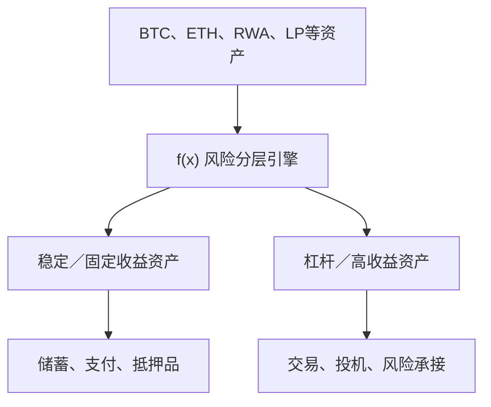

# 2026-09-01

## 00:16 分支 · 分析UP代币上涨原因 (续)

来源：6a9591f1-b754-83ec-ae70-d0d3ad026089
时间：2026-09-01 00:16

### 我
<!-- mid: 48eedf96-8477-4c93-a35f-ac9165a41dd6 -->
是否发售了，价格

### AI
<!-- mid: a1dfbe2e-ec9e-41e6-a8c1-384580660508 -->
我现在直接核对 **官方公告 + 官方合约/交易入口 + 二级市场价格**。重点确认两件事：**到底已经 TGE/开放交易没有，以及当前真实成交价是多少。**

### AI
<!-- mid: 73befd3b-a058-42bc-804b-20e91917ed36 -->
<details>
<summary>🧠 思考过程 (Thinking Process - 点击展开)</summary>

> **[已搜索 1 个网站]**
>
</details>

### AI
<!-- mid: f1c83707-831d-4d02-aa3a-6d86a90603c9 -->
<details>
<summary>🧠 思考过程 (Thinking Process - 点击展开)</summary>

> **状态/耗时**: 思考了 26s
>
</details>

### AI
<!-- mid: f16b85e2-f876-4fcb-94ff-47831d0d8184 -->
> 🌐 **引用来源**:
> 1. [รɦﻉٱᛕ💠 @shiek_ - Twitter Profile | TwStalker](https://twstalker.com/shiek_?utm_source=chatgpt.com)
> 2. [just.in @jjust_inn - Twitter Profile | TwStalker](https://twstalker.com/jjust_inn?utm_source=chatgpt.com)
> 3. [Juri23 🐻⛓ @scadet99 - Twitter Profile | TwStalker](https://mobile.twstalker.com/scadet99?utm_source=chatgpt.com)
> 4. [docs.gigadex.fi](https://docs.gigadex.fi/security/contracts)
> 5. [GIGA $90,811.97 - GIGACHAD on Hood / WETH on Robinhood / Uniswap - DEX Screener](https://dexscreener.com/robinhood/0xa192102e50a84a17968cd2636a2a2a5102cc861f?utm_source=chatgpt.com)

是的，**GIGA 已经完成过一次 Community Sale（社区发售）**。但“发售价”和“现在二级市场价格”要分开看。

### 已确认的发售信息

官方在 **2026 年 8 月 26 日**开放社区销售：

- **发售价：$0.02 / GIGA**
- 总供应：**10 亿 GIGA**
- 社区销售：**2000 万 GIGA，占总量 2%**
- 对应销售估值：**$20M FDV**
- 当时最多预计约 **5.5% 总供应可处于 liquid 状态**
- 销售方式：FCFS，先到先得。citeturn230869search0turn233792search10

随后项目官方宣布：

> **Public Sale 已经结束。**

所以现在已经不能按照 $0.02 参加这轮公售。citeturn345449search0turn345449search1

### 那么现在价格是多少？

这里反而要非常小心。

项目原计划 **8 月 31 日 GIGA Genesis / TGE**，合作方 Root 也明确表示其 GIGA allocation 将在 8 月 31 日 TGE 获得。citeturn345449search6

但是截至我刚刚核查的 **2026 年 9 月 1 日 00:16（新加坡时间）**：

**GIGA 官方 Contracts 页面仍然没有列出 GIGA ERC-20 Token 合约地址。**现在列出的还是 Controller、Emission Center、Vault、Router、MasterChef 等协议合约。citeturn220779view0

因此我目前能确认的价格只有：

> ## **官方发售价 = $0.02**

但我**不能可靠确认一个官方二级市场现价**。

而且 Dexscreener 已经出现多个名字叫 **GIGA / GIGACHAD** 的 Robinhood Chain 代币，有的价格甚至是 `$0.00009`、`$0.000003` 之类，这些**不是我能确认的 GIGA DEX 官方代币**。citeturn947602search0turn947602search1

所以现在千万不要看到：

**GIGA + Robinhood Chain**

就直接买。

### 现在的状态可以理解为

**8月26日**
→ GIGA 公售  
→ **$0.02**

**随后**
→ 公售结束

**8月31日**
→ 原计划 Genesis / TGE

**现在**
→ 等待/核实官方 **GIGA Token CA + 正式交易池**

一旦官方 CA 出现，我们马上就能计算：

**实际价格 → 相对 $0.02 涨跌 → 流通市值 → FDV → 池子流动性 → 能不能买。**

例如：

| 二级价格 | 相对公售价 | FDV |
|---:|---:|---:|
| $0.01 | -50% | $10M |
| **$0.02** | 公售价 | **$20M** |
| $0.03 | +50% | $30M |
| $0.05 | +150% | $50M |
| $0.10 | **5×** | $100M |
| $0.20 | **10×** | $200M |

所以**现在最有信息价值的不是猜价格，而是等官方 CA 和第一笔真实市场价格出现。**这正符合你上传的方法里“机会窗口”和“信息价值”的逻辑：真正会改变决策的下一条信息，就是 **官方合约 + 首个交易池 + 开盘 FDV**。fileciteturn1file0

我可以持续盯 GIGA，一旦官方合约和真实价格出现就提醒你。

genui{"suggest_automation":{"label":"监控 GIGA 上线和价格"}}

### 我
<!-- mid: e0ac5f52-52ed-48dc-9a4b-30f654b3a739 -->
继续

### AI
<!-- mid: f52723f8-ae45-4d8f-84fe-f1628a429cd1 -->
我继续往下查最关键的三件事：**官方 GIGA 合约地址、是否已经开放二级交易、当前真实成交价/流动性**。如果这三项都成立，我们就能从“观察”切到“可执行”。

### AI
<!-- mid: 59a90a32-1e42-4632-b549-565804ca15bc -->
<details>
<summary>🧠 思考过程 (Thinking Process - 点击展开)</summary>

> **[已搜索 2 个网站]**
>
</details>

### AI
<!-- mid: 3aa105da-0aae-43bb-9610-e2b542176c16 -->
有更新了，而且是关键更新：**GIGA 已经正式上线交易。**

我已经找到与 GIGA DEX 官方网站、官方 X、官方 Discord 绑定的 GIGA/USDG 池，并且链上 Token 地址已经出现。接下来我再做最后一层核验：当前价格、FDV、池子深度，以及从 $0.02 公售价已经涨了多少。

### AI
<!-- mid: 26320e1e-0fa3-479a-888f-7cd0bd49289d -->
<details>
<summary>🧠 思考过程 (Thinking Process - 点击展开)</summary>

> **[已搜索 2 个网站]**
>
</details>

### AI
<!-- mid: 53878023-8006-405a-bdb3-5d6bdca0dfb7 -->
<details>
<summary>🧠 思考过程 (Thinking Process - 点击展开)</summary>

> **状态/耗时**: 思考了 43s
>
</details>

### AI
<!-- mid: bfe09a5d-22d8-47d9-9dcc-f74f5eb616f7 -->
> 🌐 **引用来源**:
> 1. [GIGA (@giga_dex) / X](https://x.com/giga_dex?utm_source=chatgpt.com)
> 2. [Robinhood Chain token details | Blockscout](https://robinhoodchain.blockscout.com/token/0x5BaaeC1B70864f01dbdb747358FF59F2E2cCF7D5)
> 3. [GIGA $36.35M - GIGA / USDG on Robinhood / GIGA - DEX Screener](https://dexscreener.com/robinhood/0x23b2098904100215307ad6e8af5d19d8a4523cf5)
> 4. [GIGA $36.35M - GIGA / USDG on Robinhood / GIGA - DEX Screener](https://dexscreener.com/robinhood/0x23b2098904100215307ad6e8af5d19d8a4523cf5)
> 5. [docs.gigadex.fi](https://docs.gigadex.fi/tokenomics)
> 6. [docs.gigadex.fi](https://docs.gigadex.fi/resources/official-links)

有关键更新：**GIGA 现在已经正式 TGE，并且已经可以交易了。** 前面“还没有官方 CA”的状态已经结束。

官方 GIGA X 已经明确发布：

**GIGA Contract Address：**
`0x5BaaeC1B70864f01dbdb747358FF59F2E2cCF7D5`

并宣布 “GIGA IS LIVE”。citeturn176924news0  
Blockscout 上也已经能看到这个 Token 合约。citeturn635566view1

### 现在价格

我刚核对 GIGA 官方 DEX 上的 GIGA/USDG 池：

- **价格：约 $0.0364–0.0366**
- 公售价：**$0.020**
- 相比公售价：约 **+82%**
- 也就是公售参与者目前约 **1.82×**
- 总供应：10 亿
- 对应 FDV：约 **$36.5M**
- 最大的 GIGA/USDG V3 池当前流动性约 **$216K**。citeturn324869view0turn564294view0

所以价格路径目前大致是：

**$0.020 公售 → $0.0365 现在**

还远远没有出现 5×、10×，现在属于非常早期的**第一次价格发现阶段**。

### 这时候我怎么看

这其实比昨天更有意思，因为市场没有直接把它炒到 $0.10、$0.20。

按现在约 $0.0365：

| GIGA价格 | FDV | 相对公售价 |
|---:|---:|---:|
| $0.020 | $20M | 1× |
| **$0.0365** | **$36.5M** | **1.83×** |
| $0.05 | $50M | 2.5× |
| $0.10 | $100M | 5× |
| $0.20 | $200M | 10× |
| $0.50 | $500M | 25× |
| $1.00 | $1B | 50× |

从我们的“重尾机会”框架看，现在已经不是 $0.02 的 S 级赔率，但**$36M FDV 仍然没有贵到把成功全部定价进去**。真正要判断的是，它能不能从目前约 $100M+ 月度 DEX volume 继续向 UP 的规模靠近，并把交易量真正转换成 veGIGA 收入。这个判断更符合你上传方法里的“机会窗口 + 经济租 + 反馈回路”，而不是简单看涨幅。fileciteturn1file0

### 但这里出现了一个数据陷阱

DEX Screener 的不同页面对 **circulating market cap** 显示不一致。

单池页面目前把 Market Cap 直接显示成约 **$36M**，等同 FDV；但 GIGA DEX 聚合页显示约 **$3.2M 市值**。citeturn324869view0turn564294view0

因此目前我更信：

**价格 $0.0365 + 固定总量 1B → FDV ≈ $36.5M**

而暂时**不把 $3.2M circulating market cap 当作已经确认的准确数字**。官方 Tokenomics 只明确写了 Genesis 时最多 5.5% 即 55M GIGA 可流通，并且 40% 的 LP emissions reserve 要在未来三年释放。citeturn221903view1

这意味着当前最值得进一步查的是：

> **实际流通量究竟是多少？公售有多少人选择锁成 veGIGA？现在前20钱包持仓多少？团队/协议钱包能不能卖？第一天真实净卖压多大？**

这几项比“涨了82%”重要得多。

### 如果你现在真的准备买

只认这个官方 CA：

`0x5BaaeC1B70864f01dbdb747358FF59F2E2cCF7D5`

官方文档确认 GIGA DEX App 是 `gigadex.fi`，官方 X 是 `@giga_dex`。citeturn773084view0

当前最大的官方 GIGA/USDG V3 池就是我们找到的这个：

url查看 GIGA/USDG 实时价格https://dexscreener.com/robinhood/0x23b2098904100215307ad6e8af5d19d8a4523cf5

**我现在不会在 $0.0365 一把买。** 因为 TGE 刚开始，低流通币第一天的价格往往像刚开瓶的汽水，泡沫和真实液体还没分层。

更值得做的是下一步直接拆它的**链上筹码结构**。如果发现真实自由流通只有 $1M–$3M、公售大量锁成 veGIGA、协议控制供应不可卖，同时成交量继续增长，那么 **$36M FDV 反而可能仍处于很早的位置**。如果发现所谓低流通只是表象，未来几周释放很重，那结论完全相反。

我建议继续盯住上线后价格和链上筹码变化，而不是只看一个开盘价。

genui{"suggest_automation":{"label":"监控 GIGA 价格和链上变化"}}

### 我
<!-- mid: 15c45b88-7bdf-4586-ab5c-e86948c65ab1 -->
调研筹码结构

### AI
<!-- mid: a0b93c50-bf08-4013-9995-c193b2e0d23d -->
我会把“筹码结构”拆成四层来查：**总供应与解锁、当前真实流通、前十大/前二十大地址集中度、未来30–90天潜在卖压**。最后我会直接给你一个“适不适合现在买”的结论，而不是只列链上数据。

### AI
<!-- mid: dcb972c5-ef71-463e-824f-2c51d2d9968a -->
<details>
<summary>🧠 思考过程 (Thinking Process - 点击展开)</summary>

> **[已搜索 3 个网站]**
>
</details>

### AI
<!-- mid: 606fca62-0fdd-458c-a414-1e5b860365dc -->
先给你一个已经确定的底板：**10亿总量里，至少 94.5% 在 Genesis 时不是普通现货自由流通筹码**。其中 39% Treasury + GIGA Machine 是 veGIGA 锁仓，14.5% ROOT/Launch Partner 也是 veGIGA，1% 空投是 veGIGA，40% LP Reserve 三年释放。真正需要盯的是剩下那 **最多 5.5%** 到底有多少已经锁回 veGIGA、多少落在 LP、多少正在钱包里等着卖。

### AI
<!-- mid: b468404b-bcf9-443e-878b-be9bb1957fa1 -->
<details>
<summary>🧠 思考过程 (Thinking Process - 点击展开)</summary>

> **[检索代币持有者及区块链数据]**
>
</details>

### AI
<!-- mid: d6ca6e28-e5ef-44e4-b650-0eab9051f81c -->
<details>
<summary>🧠 思考过程 (Thinking Process - 点击展开)</summary>

> **[估算代币流通]**
> 我正在核对代币分配与锁定安排：公开销售可能贡献约1333万至2000万枚，流动数量取决于锁定选择；加上流动性、积分和储备后，创世流通上限或约5500万枚，但锁定期限与续期仍是关键风险。
>
</details>

### AI
<!-- mid: e00ed0d7-215c-4b83-b3de-ad529fb5287d -->
<details>
<summary>🧠 思考过程 (Thinking Process - 点击展开)</summary>

> **[核对锁定风险]**
> 我正在确认GIGA的锁定机制：六个月锁仓若不续期，代币可能逐渐恢复流动性，或在2027年初形成潜在抛压。最大持仓地址可能对应锁仓或托管合约，但我仍需官方排放与锁定数据验证。
>
> **[核对锁定风险]**
>
</details>

### AI
<!-- mid: e04ee68a-90fc-4cfa-9a13-3efc4fe09b18 -->
<details>
<summary>🧠 思考过程 (Thinking Process - 点击展开)</summary>

> **[映射持仓结构]**
> 我正在把最大持仓地址与官方分配表交叉核对。约5.5亿枚的规模接近创世锁仓总量，因此它很可能是锁仓托管地址，但这仍属于推断，不能当作已验证标签。
>
> **[映射持仓结构]**
>
</details>

### AI
<!-- mid: b626b0ab-0d2a-4959-bb42-3ef8353f7d69 -->
<details>
<summary>🧠 思考过程 (Thinking Process - 点击展开)</summary>

> **[评估数据矛盾]**
> 我发现官方资料中的机器分配数存在190M与200M差异，而最大持仓约550M更接近190M方案加上额外锁仓。持仓数量仍偏少，说明项目可能处于早期阶段，相关结论需要等待合约标签和最终排放表确认。
>
> **[评估了数据矛盾]**
>
</details>

### AI
<!-- mid: 3636efbe-d57d-4b24-8860-de01fce204d6 -->
<details>
<summary>🧠 思考过程 (Thinking Process - 点击展开)</summary>

> **[已搜索 5 个网站]**
>
</details>

### AI
<!-- mid: 1f048a7a-8c30-4fe1-ba0c-fbd8c0624cd7 -->
现在已经能拼出一个很有意思的链上轮廓：**DEX Screener 按当前价格给出的流通市值只有约 $1.9M，而 FDV 约 $38.5M**，反推流通约 **5000万枚，约总量5%**。这和官方“Genesis 最多 5500万枚可流通”高度吻合。换句话说，低流通不是宣传口号，链上数据目前确实支持它。

### AI
<!-- mid: 4191c38b-1915-46b8-9b1e-08baa25f4cfc -->
<details>
<summary>🧠 思考过程 (Thinking Process - 点击展开)</summary>

> **[核对认购与释放]**
> 我正在区分官方数据与机械推算：1.5倍锁仓机制意味着基础认购量约1333万枚、募资约26.7万美元；此外，1500万积分兑换可能带来短期抛压，但具体领取时间和释放规则仍需确认。
>
> **[核对了认购与释放信息]**
>
</details>

### AI
<!-- mid: 03525b3b-d3c3-46c6-8002-29799d120344 -->
<details>
<summary>🧠 思考过程 (Thinking Process - 点击展开)</summary>

> **[划分供应风险]**
> 我正在把供应分成当前流通、永久或强锁定、六个月可续期锁仓及未来排放。约100万枚相当于当前流通量22%，是最关键数字；但190M与200M机器分配差异降低了精确度。
>
> **[划分了供应风险]**
>
</details>

### AI
<!-- mid: fc8d23e1-f5bc-4b39-b6b0-c0027ce3b411 -->
<details>
<summary>🧠 思考过程 (Thinking Process - 点击展开)</summary>

> **[评估治理风险]**
> 我正在补充治理与权限因素：团队可调整激励参数但不能任意增发，储备释放仍由规则控制。当前流通量和市值存在数据源差异，因此我会把关键结论标为估算，并列出需要持续监测的解锁、排放与持仓变化。
>
> **[评估了治理风险]**
>
</details>

### AI
<!-- mid: b529d0c7-0cc2-4068-a473-50ee12283ace -->
<details>
<summary>🧠 思考过程 (Thinking Process - 点击展开)</summary>

> **[已搜索 1 个网站]**
>
</details>

### AI
<!-- mid: 217f5f16-a5ae-4a6a-95c3-72f4ab2642c2 -->
<details>
<summary>🧠 思考过程 (Thinking Process - 点击展开)</summary>

> **状态/耗时**: 思考了 3m 42s
>
</details>

### AI
<!-- mid: f65de11f-27ff-45d7-b283-94fb0d6b3e0c -->
> 🌐 **引用来源**:
> 1. [docs.gigadex.fi](https://docs.gigadex.fi/tokenomics)
> 2. [GIGA $1.97M - GIGA / USDG on Robinhood / GIGA](https://dexscreener.com/robinhood/0x23b2098904100215307ad6e8af5d19d8a4523cf5?utm_source=chatgpt.com)
> 3. [GIGA/USDG - GIGA Price on Giga V3 with 1% Fee | GeckoTerminal](https://www.geckoterminal.com/robinhood/pools/0x23b2098904100215307ad6e8af5d19d8a4523cf5)
> 4. [GIGA/USDG - GIGA Price on Giga V3 with 1% Fee | GeckoTerminal](https://www.geckoterminal.com/robinhood/pools/0x23b2098904100215307ad6e8af5d19d8a4523cf5)
> 5. [GIGA/USDG - GIGA Price on Giga V3 with 1% Fee | GeckoTerminal](https://www.geckoterminal.com/robinhood/pools/0x23b2098904100215307ad6e8af5d19d8a4523cf5?utm_source=chatgpt.com)
> 6. [Ravenhood Protocol (@RVHProtocol) - Twitter Profile | Zamantika](https://zamantika.com/tl/profile/RVHProtocol?utm_source=chatgpt.com)
> 7. [Juri23 🐻⛓ @scadet99 - Twitter Profile | TwStalker](https://mobile.twstalker.com/scadet99?utm_source=chatgpt.com)
> 8. [docs.gigadex.fi](https://docs.gigadex.fi/points)
> 9. [GIGA DEX Docs](https://docs.gigadex.fi/protocol/emissions?utm_source=chatgpt.com)
> 10. [GIGA DEX Docs](https://docs.gigadex.fi/protocol/emissions?utm_source=chatgpt.com)
> 11. [GIGA DEX Docs](https://docs.gigadex.fi/protocol/giga-machine?utm_source=chatgpt.com)
> 12. [docs.gigadex.fi](https://docs.gigadex.fi/protocol/vegiga)
> 13. [Juri23 🐻⛓ @scadet99 - Twitter Profile | TwStalker](https://mobile.twstalker.com/scadet99?utm_source=chatgpt.com)
> 14. [GIGA DEX Docs](https://docs.gigadex.fi/tokenomics?utm_source=chatgpt.com)
> 15. [docs.gigadex.fi](https://docs.gigadex.fi/security/governance)

调研下来，GIGA 的筹码结构比我最初判断的还要“低流通”，但同时也埋着一个非常大的中期释放阀门。

**一句话结论：GIGA 是典型的「约 5% 流通 + 大量 ve 锁仓 + 40% 三年排放」结构。短期容易形成筹码挤压，长期能不能涨取决于业务增长能否跑赢排放。**

### 1. 先把 10 亿 GIGA 拆开

官方 Tokenomics 是：

| 去向 | GIGA | 占比 | Genesis 状态 |
|---|---:|---:|---|
| LP Emissions Reserve | 400M | 40% | 储备，3 年释放 |
| Treasury | 200M | 20% | **veGIGA 锁定** |
| GIGA Machine | 190M | 19% | **veGIGA 锁定** |
| ROOT | 75M | 7.5% | **veGIGA 锁定** |
| Launch Partner | 70M | 7% | **veGIGA 锁定** |
| Community Airdrop | 10M | 1% | **veGIGA 锁定** |
| Community Sale | 20M | 2% | GIGA / veGIGA |
| LP Support | 20M | 2% | GIGA / veGIGA |
| Points | 15M | 1.5% | GIGA |

因此官方自己给出的结论就是：

> **Genesis 时最多只有 55M GIGA，也就是 5.5%，能够处于 liquid 状态。**

其余 94.5% 要么锁着，要么在排放储备里。citeturn962016view0

这本身就是非常特殊的筹码设计。

---

# 2. 链上现在基本验证了“约 5% 流通”

当前主 GIGA/USDG 池价格大约 **$0.0386**：

- FDV ≈ **$38.5M**
- DEX Screener 显示 circulating market cap ≈ **$1.9M**
- 主池流动性 ≈ **$244K**
- 主池内约 **3.29M GIGA**
- USDG 约 $117K。citeturn839605news0

反推：

**$1.9M ÷ $0.0386 ≈ 49M GIGA**

所以目前市场数据隐含的流通供应大概：

> ## **49M–50M GIGA**
> 约总供应量 **4.9%–5.0%**

和官方说的“最多 55M”非常接近。

这意味着：

**低流通不是故事，目前确实有链上数据支持。**

不过 GeckoTerminal 暂时把 Market Cap 直接按 1B 总供应算成 ~$40M，等同 FDV，所以不同数据商对 circulating supply 的识别还没同步。我目前把 **约 50M** 视为“高度可信的工作估计”，而不是官方最终 circulating supply。citeturn312842view0

---

# 3. 更有意思的是第一大地址

GeckoTerminal 现在识别到：

> `0x307c...26e8`

持有大约：

## **551M GIGA**

也就是整个供应量的：

### **55.1%**

而官方 Tokenomics 中原本应该处于 veGIGA 状态的是：

200M Treasury  
+ 190M Machine  
+ 75M ROOT  
+ 70M Launch Partner  
+ 10M Airdrop

= **545M GIGA**

非常接近这个链上大地址的 **~551M**。citeturn312842view0turn962016search1

所以我的**推断**是：

> **0x307c… 很可能就是 veGIGA 锁仓/托管体系的核心合约地址。**

目前我没有找到官方文档对这个地址的明确标签，因此这不是100%确认。

但数字吻合得非常漂亮：

**官方基础 veGIGA：545M**

→ 链上大地址：~551M

→ 多出来约：**6M**

这很可能是公售参与者以及 TGE 后用户主动选择锁成 veGIGA 的筹码。

而且不同时间抓取的数据里，这个大地址从约 **550.2M 增加到约551.4M**，也符合“上线后用户继续把 GIGA 锁入 veGIGA”的行为。citeturn435979search2turn312842view0

如果这个推断最终被官方地址标签证实，这是一个不错的筹码信号。

---

# 4. 公售筹码也没有全部砸向市场

这个地方很有意思。

Community Sale 分配：

**20M GIGA**

公售价：

**$0.02**

但用户可以选择锁成 veGIGA，获得 **1.5× allocation**。

官方销售结束后的原话大意是：

如果所有参与者都选择 1.5× veGIGA 锁仓，那么这轮分配的全部 Token 就会被用完。citeturn651661search0

按照这个措辞反推：

**20M ÷ 1.5 ≈ 13.33M**

也就是说这轮销售的基础购买量可能约：

### **13.3M GIGA**

对应募集金额：

### **约 $267K**

注意，这是**我根据官方措辞反推**，不是官方已经公布的最终销售统计。

---

# 5. 而且我们已经知道一个大买家：ROOT

ROOT 公开表示：

投入：

### **$50,000**

公售价 $0.02，所以基础购买：

**2.5M GIGA**

由于选择 veGIGA：

### **最终获得 3.75M veGIGA**

而且 ROOT 明确说：

> **permanently locking**

也就是永久锁仓。citeturn842976search11

这个信息非常重要。

如果我前面的约 $267K 销售反推成立：

ROOT 一家就贡献：

**$50K / $267K ≈ 18.7%**

的销售资金。

但这部分筹码不是潜在抛压，而是：

> **3.75M 被永久锁掉。**

所以公售筹码结构比一般 ICO 健康。

---

# 6. 现在真正自由漂浮的筹码可能比 50M 还少

这是最值得关注的一点。

那约 **50M circulating** 里面还包含：

**20M LP Support**

这些不一定是“躺在钱包里等着砸”的筹码，很大一部分功能就是做流动性。

还有：

**15M Points**

这是前六周 LP 挖出来的积分兑换 GIGA。官方明确说 Points allocation 是 1.5% 总供应，而且最终兑换成 GIGA。citeturn298774view0

还有：

**约10M左右公售 liquid GIGA**，具体取决于多少参与者选择了 ve 锁仓。

再加上：

主 GIGA/USDG 池本身已经塞进去：

### **约3.3M GIGA**

所以真正意义上的：

> **“随时可能直接市价砸盘的 Loose Float”**

很可能显著低于 50M。

这就是为什么这个币的价格可能特别敏感。

---

# 7. 但最大的雷不是团队解锁

真正最大的长期抛压是：

# **400M LP Emissions Reserve**

也就是：

## 总供应的40%。

官方规则是：

> 400M GIGA 在 **3年内 vest**，由 Emission Controller 根据池子的真实收入分配给 LP。

并且每小时重新分配。citeturn298774search1

简单除一下：

**400M ÷ 36个月 ≈ 11.1M GIGA/月**

也就是说：

### 每个月最多新 vest 的 GIGA ≈ 当前流通量的22%。

三个月：

### ~33M

大约相当于现在流通量的：

### **2/3。**

这是非常重要的数字。

不过不能理解成：

> 每个月一定砸11M。

官方明确写了：

**vested amount 只是硬上限，Controller 没必要把已经 vested 的 GIGA 全部发出去。**

没有被使用的币继续留在 Controller。citeturn962016search0

所以真正应该监控的是：

> **实际 GIGA emissions / day**

而不是单看 vesting schedule。

---

# 8. 这就形成了一个非常漂亮的多空反馈回路

### 牛市版本

Robinhood Chain 交易增长

→ GIGA Volume ↑

→ Fees ↑

→ 更多 LP 愿意提供资金

→ GIGA emissions 被真实需求吸收

→ veGIGA 收入 ↑

→ 用户买 GIGA 锁 veGIGA

→ GIGA Machine 用收入购买 GIGA

→ 更多 GIGA 被锁

→ 自由流通下降

→ 价格上涨

→ 更多 LP / 用户进入。

这就是一个强化回路。官方的 GIGA Machine 本身就是专门设计成买入并锁定 GIGA 的协议自有大仓位。citeturn435979search12

---

# 9. 熊市版本恰好完全反过来

如果 GIGA 业务没有增长：

交易量↓

→ 手续费↓

→ veGIGA 收益率↓

→ 锁仓吸引力↓

→ 用户不再 renew

同时：

400M reserve 持续 vest

→ LP 获得 GIGA

→ LP 卖 GIGA 回收成本

→ 流通量↑

→ 价格↓

→ APR 看起来更差

→ 更多人退出。

这会成为一个：

### **负向排放死亡螺旋。**

所以这个币不能只看：

> “固定10亿，没有通胀。”

这句话很容易误导。

更准确的是：

> **没有新增铸币，但未来三年有400M已经铸好的币等待进入市场。**

经济效果仍然是稀释。

---

# 10. 第二个需要盯的是“6个月”

veGIGA 不是永久锁仓设计。

官方规则：

> GIGA 锁 **6个月** → veGIGA。

用户不断 renew 就继续锁；停止 renew 后，锁仓逐渐到期，最终可以重新取回 GIGA。citeturn962016view1

所以：

**2026-08-31 Genesis**

往后约6个月：

## **2027年2月底～3月**

会成为第一个非常重要的观察窗口。

并不是说那天会突然解锁 550M。

因为：

- GIGA Machine 设计目标是长期/永久累积；
- ROOT 公售的 3.75M 已明确永久锁仓；
- Treasury 很可能持续 renew；
- 很多 veGIGA 为了收入也会继续 renew。citeturn842976search11turn435979search12

但：

**Launch Partner、部分 ROOT allocation、社区 veGIGA、普通用户的 veGIGA 是否继续 renew**

必须观察。

---

# 11. 我发现一个值得警惕的文档矛盾

官方 Tokenomics 写：

> GIGA Machine = **190M / 19%**

但单独的 GIGA Machine 页面写：

> GIGA Machine = **200M / 20%**。citeturn962016search1turn298774search5

差了：

### **10M GIGA**

别小看这个差异。

因为10M相当于：

> **当前估算流通量约20%。**

所以在筹码分析里，这是一个必须解决的数据缺口。

我现在更倾向 Tokenomics 的 **190M** 是当前总分配表，因为那个表所有项目正好加到100%；但在链上地址完全标签化之前，我不会把它当最终答案。

---

# 12. 还有一个治理风险

虽然不能额外 mint GIGA，但官方明确说明：

**Controller、Fee Center、Emission Center 和 Vault 仍由 GIGA 团队控制。**

团队可以：

- 调整 emissions 导向；
- 路由协议费用；
- 修改 incentive system 参数。

但是不能从用户 LP 池里直接拿走资产，也不能增发超过10亿总供应。citeturn661155view0

所以：

**供应上限风险低，排放参数治理风险仍然存在。**

---

# 我的筹码评分

我现在会这样评分：

| 维度 | 评价 |
|---|---|
| 初始流通 | **A+，约5%** |
| 团队/协议锁仓 | **A** |
| 公售筹码 | **A-，有大量锁仓激励** |
| 协议自有买盘 | **A-，GIGA Machine** |
| 当前交易深度 | **C+，只有几十万美元** |
| 未来排放 | **C，400M/3年很重** |
| 6个月解锁风险 | **B-，取决于 renew** |
| 信息透明度 | **B-，190M/200M仍有矛盾** |
| 整体筹码结构 | **A- / B+** |

所以它不是传统意义的：

> “总量固定，所以稀缺。”

而是一个更有意思的东西：

> ## **短期极度稀缺，长期需要业务增长持续吸收排放。**

这也是为什么它具有你一直找的**重尾结构**：当前可交易筹码非常小，一旦需求增加，价格可以远快于基本面移动；但反过来，如果需求没有形成，未来排放会慢慢把稀缺性融掉。这个判断正好对应“重尾 + 反馈回路 + 非遍历性”的思路。fileciteturn1file0

### 我现在最想盯的不是价格，而是这5个数字

**① veGIGA 总锁仓**  
现在疑似 ~551M。继续增长是强信号。

**② 实际 circulating supply**  
现在估算 ~49–50M。最好继续下降，而不是上升。

**③ 每日实际 emissions**  
这是最关键的潜在卖压。

**④ veGIGA renew rate**  
尤其到 2027年2–3月。

**⑤ Protocol revenue / emissions value**  
这是最终生死线：

> 如果每天发 $10,000 GIGA，但协议每天创造 $30,000 真收入，很健康。

反过来：

> 每天发 $30,000 GIGA，只产生 $2,000 真收入，

那就是补贴出来的繁荣。

**这个指标我认为甚至比 GIGA 价格本身重要。**

下一步最有价值的是把 **GIGA 的“每日排放价值 ÷ 每日协议收入”**算出来，再和 **UP** 放在一起比较。这样我们就能判断：**GIGA 现在是真正的早期飞轮，还是低流通制造出来的价格幻觉。**

### 我
<!-- mid: fbe0498e-965b-447a-bfd1-81a48fe933f8 -->
继续

### AI
<!-- mid: 8fe5ffb6-faa4-45f2-a90c-18e08f1cc68f -->
继续，这一刀我们不看“故事”，只看**飞轮有没有自我供血**：

> **每天发出去多少美元的 GIGA，换来了多少美元的真实协议收入？**

然后把这个比值和 UP 放在一起，谁更像“收费站”，谁更像“补贴站”，会很清楚。

### AI
<!-- mid: 43dc4752-00f1-4688-bf67-454024050fe9 -->
<details>
<summary>🧠 思考过程 (Thinking Process - 点击展开)</summary>

> **[已搜索 2 个网站]**
>
</details>

### AI
<!-- mid: ba0062cb-f814-4ab1-835b-70ed66b5e61d -->
这里出现了一个必须先纠正的地方：**“400M/3年 = 每天约36.5万 GIGA”只是 vesting 上限，不等于每天实际排放。** 官方明确说 Controller 可以少发，没用掉的继续留在储备里。

所以我不会拿这个上限冒充真实卖压。接下来真正的判断分成“最坏上限”和“目前已验证实际值”两套。

### AI
<!-- mid: 5f5aa47f-eae3-4895-8f40-b8eb4c79310a -->
<details>
<summary>🧠 思考过程 (Thinking Process - 点击展开)</summary>

> **[比较排放与收入]**
> 我正在区分名义排放价值与实际卖压：周收入约为23万至26.87万美元，而UP每周排放量可能价值约116万美元，但锁仓会吸收部分代币。接下来我会确认周期、当前价格及GIGA的实际首日排放数据。
>
> **[比较了排放与收入]**
>
</details>

### AI
<!-- mid: 56d1bee9-0dcd-42d0-862b-2865c855b342 -->
<details>
<summary>🧠 思考过程 (Thinking Process - 点击展开)</summary>

> **[评估GIGA排放]**
> 我正在用GIGA的最大归属上限估算潜在卖压：每日约36.5万枚，按现价约16,600美元。相比约1,200至1,450美元日收入，名义比例约11.5至13.3倍，但实际排放量和启动状态仍需链上数据确认。
>
> **[评估了GIGA排放]**
>
</details>

### AI
<!-- mid: de04cf24-a005-4b03-be3d-8235b9cce2ba -->
<details>
<summary>🧠 思考过程 (Thinking Process - 点击展开)</summary>

> **[已搜索 11 个网站]**
>
</details>

### AI
<!-- mid: c5ce56ad-04b3-438f-ae9c-71a40e3f5545 -->
<details>
<summary>🧠 思考过程 (Thinking Process - 点击展开)</summary>

> **状态/耗时**: 思考了 1m 39s
>
</details>

### AI
<!-- mid: 6d095b74-a1fd-43c0-8413-8a67507e344e -->
> 🌐 **引用来源**:
> 1. [docs.gigadex.fi](https://docs.gigadex.fi/protocol/emissions)
> 2. [GIGA $1.97M - GIGA / USDG on Robinhood / GIGA](https://www.google.com/url?q=CAEShAEB6zswFU8xpUtTpvMWg07M2Ifk2x_ZLweJr-t-upMdfnIqA8UkIrOgS7lt50Q14SFlwI8lVssLSgus0rOKSL4uRuOknQgy5ZnHsJGMmE1rYxNu3LU9Wt_wl5iimPpuW6EpRTX1t4hG5ziFo_7rwGxYP12debHdrPrNWpoe5Tz1vyGGqZ0&sa=U&uoh=3&usg=AOvVaw10_vP81CeQjuQpNYaLQ4JH&ved=2ahUKEwjW8ejh3syWAxXKTDABHWkqBR0QxfQBegQIAhAC&utm_source=chatgpt.com)
> 3. [GIGA TVL, Fees, Revenue & Volume](https://defillama.com/protocol/giga?utm_source=chatgpt.com)
> 4. [GIGA DEX Docs](https://docs.gigadex.fi/protocol/emissions?utm_source=chatgpt.com)
> 5. [up. (@uponrh) - Twitter Profili | Zamantika](https://zamantika.com/profile/uponrh?utm_source=chatgpt.com)
> 6. [up. (@uponrh) | nitter](https://x.noodl3.net/uponrh?utm_source=chatgpt.com)
> 7. [docs.gigadex.fi](https://docs.gigadex.fi/protocol/emissions)
> 8. [UP $20.98M - up / WETH on Robinhood / Up](https://dexscreener.com/robinhood/0x23d641feccd207e8794c593e8240444a0674c4ba?utm_source=chatgpt.com)
> 9. [GIGA TVL, Fees, Revenue & Volume](https://defillama.com/protocol/giga?utm_source=chatgpt.com)

继续，这一步非常关键。我把 **GIGA 和 UP 的“真实补贴效率”**放到了一张表里，结论比单看 FDV 有意思得多。

## 结论

**目前 UP 已经证明了“排放 → 被锁回去 → 自由流通反而下降”的闭环。**

**GIGA 还没有。**

GIGA 最大的未知已经不是交易量，也不是价格，而是：

> **实际每天排放多少 GIGA，以及这些 GIGA 有多少被市场卖掉、多少重新进入 veGIGA。**

所以此时我会把 **UP 定义为“已验证飞轮”**，把 **GIGA 定义为“正在验证飞轮”**。

---

## 一、先算 GIGA 最坏的排放上限

官方确定：

- LP Emissions Reserve = **400M GIGA**
- 三年 vest
- Controller 不能超过 vested 数量排放
- 但**不要求把 vested 数量全部发掉**。citeturn198658view0turn513683search2

因此理论上平均每天最多新增可排放额度：

**400M ÷ 1095 ≈ 365,300 GIGA/天**

现在主 GIGA/USDG 深池价格大约在 **$0.04～$0.045** 附近，DEX Screener 最新抓取约 $0.0454，主池流动性约 $249K。citeturn598118news0

那么最大理论额度对应：

> **365,300 × $0.0454 ≈ $16,600/天**

注意，这是**最大 vesting ceiling，不是已确认实际排放**。

---

# 二、GIGA 每天真正赚多少钱？

目前 DefiLlama：

- 24h Volume ≈ **$18.1M**
- 24h Fees ≈ **$6,236**
- 24h Protocol Revenue ≈ **$1,248**
- 7d Revenue ≈ **$7,163**
- 30d Revenue ≈ **$17,238**。citeturn413308search11

所以，如果极端情况下把每日 vested 上限全部发掉：

### 对 Gross Fees

$16.6K emissions  
÷ $6.24K fees

≈ **2.7×**

### 对 Protocol Revenue

$16.6K emissions  
÷ $1.25K revenue

≈ **13.3×**

这意味着：

> 如果真的每天把36.5万 GIGA 全发掉，目前的收入完全养不起这种排放。

但是官方机制恰恰允许少发，因此**实际 emission rate 才是决定 GIGA 生死的数字**。citeturn688598search1

---

# 三、我给 GIGA 算出了一个“生死线”

假设：

GIGA = **$0.045**

当前 Protocol Revenue ≈ **$1,250/天**

那么：

**$1,250 ÷ $0.045 ≈ 27,800 GIGA**

也就是说：

> ## 每日实际排放 ≤ 约 28K GIGA
>
> 排放价值 ≤ 当前协议收入。

这是一个非常漂亮的状态。

反过来：

| GIGA实际日排放 | 约美元价值 | 排放/协议收入 | 判断 |
|---:|---:|---:|---|
| 20K | $900 | 0.7× | 🟢 非常好 |
| **30K** | **$1,350** | **1.1×** | 🟢 健康 |
| 50K | $2,250 | 1.8× | 🟡 可以 |
| 100K | $4,500 | 3.6× | 🟡 需要增长 |
| 200K | $9,000 | 7.2× | 🟠 高补贴 |
| **365K** | **$16.4K** | **13×** | 🔴 不可持续 |

所以以后看 GIGA，我甚至不需要每天看很多东西。

只看：

# **Emission/day**

就行。

---

# 四、但还有第二个、更重要的数字

光看排放还是不够。

因为 UP 已经给我们上了一课：

> **排放出去 ≠ 流通增加。**

UP 最近一个 epoch：

约：

### **1.1M UP emitted**

但同时：

### **1.8M UP locked**

也就是说：

**Lock / Emission ≈ 1.64×**

排出去110万，

市场反而锁进去180万。

净效果：

> **-700K liquid UP**

项目方最新也称，UP 上线时流通约20M，现在约 **19.91M**，尽管每周约有1M UP emissions。citeturn585820search1turn585820search3

这才是 UP 最厉害的地方。

---

# 五、UP 是怎么把“通胀”变成“通缩”的？

UP 的结构：

**交易**

↓

产生费用

↓

100% protocol revenue 给 veUP

↓

持有者发现锁 UP 可以赚真收入

↓

购买 UP

↓

锁成 veUP

↓

流通减少

与此同时：

Gauge emissions 发给 LP。

但是约 **90% 潜在 emissions** 因达不到 productive-pool 条件而被 burn，而不是机械发出去。项目公开的数据称，虽然已经经历多个 epoch，circulating supply 相比启动阶段增长极少，最近甚至已经低于初始水平。citeturn585820search0

所以 UP 已经出现：

> **收入 → 锁仓需求 > 排放 → 流通减少**

这就是一个成熟的 token flywheel。

---

# 六、而 GIGA 现在正在尝试复制这个魔法

GIGA 的机制甚至更机械化：

它不让 veGIGA holder 投票决定 emissions。

而是：

**哪个 Pool 创造 Revenue 更多**

↓

Controller 自动给更多 emissions

↓

每小时重新计算。citeturn198658view0

因此它试图消灭传统 ve(3,3) 最麻烦的一层：

**bribe / gauge politics。**

理论上非常漂亮。

但目前只有理论。

---

# 七、真正应该比较的是这三个比率

以后我建议把所有 ve(3,3) DEX 都用这三个指标扫描。

### ① Emission Efficiency

**协议收入 / emission $ value**

越高越好。

---

### ② Lock Absorption Ratio

**新增锁仓 / 新排放**

最重要。

如果：

**>1**

意味着：

> 每发1枚，市场锁回超过1枚。

实际自由流通下降。

如果：

**<1**

意味着：

> 排放正在慢慢灌进市场。

UP 最近：

### **≈1.64**

非常强。

GIGA：

### **暂时未知。**

这就是现在最大的 Alpha 数据。

---

### ③ Net Float Change

公式更加简单：

**新排放 + 解锁 - 新锁仓 - 永久销毁**

如果：

### < 0

Token 实际处于：

**净通缩 / 流通收缩**

如果：

### > 0

Token 实际进入：

**流通膨胀**

---

# 八、这三个指标比“总供应10亿”重要100倍

比如 GIGA：

账面：

**1B fixed supply**

看起来没通胀。

其实可能：

50M liquid

→ 70M

→ 100M

→ 150M

虽然 total supply 一枚没增加，

但是交易市场面对的供应：

### **3倍了。**

价格一样会承压。

所以应该看的是：

> **Liquid Supply Inflation**

而不是：

> Total Supply Inflation。

这个区别非常重要。

---

# 九、现在 UP 和 GIGA 的状态已经可以画出来了

| | UP | GIGA |
|---|---:|---:|
| 商业收入 | 🟢 强 | 🟡 早期 |
| 24h Revenue | ~$70.7K | ~$1.2K |
| 7d Revenue | ~$269K | ~$7.2K |
| 实际排放 | ~1.1M UP/epoch | **待确认** |
| 新锁仓 | ~1.8M/epoch | **待确认** |
| Lock/Emission | **~1.64×** | **？** |
| 自由流通趋势 | **下降** | 未知 |
| 业务飞轮 | **已验证** | 刚启动 |
| FDV | ~$537M 当前快照 | ~$40–45M |
| 上行赔率 | 中等 | **高** |
| 证明程度 | **高** | 低 |

UP 当前价格已经大幅冲到约 **$1.06**，FDV ~$537M、流通市值约 $20.6M，因此它今天和几天前 $0.5 左右的估值已经完全不是一回事。citeturn597158news0

这一点尤其值得注意。

---

# 十、所以两者的赔率发生了变化

几天前：

**UP ~$250M FDV**

vs

**GIGA ~$20–40M FDV**

我还比较偏向 UP 的基本面确定性。

现在：

> **UP ~$537M FDV**
>
> **GIGA ~$40–45M FDV**

估值已经拉开大约：

# **12倍**

但业务收入差距没有永久固定。

GIGA 最近7天 DEX Volume 已达到约 **$74M～94M**，而 Robinhood Chain 本身7日 DEX volume 已达到 **$6.16B，周增约79%**。citeturn413308search11turn413308search17turn413308search12

于是 GIGA 的重尾性明显提高了。

不是因为它“便宜”。

而是：

> **只有 UP 约1/12的 FDV，却已经开始获得相当规模的真实成交。**

---

# 十一、现在我会怎么分阶段判断 GIGA

### S级信号

如果接下来发现：

**实际 emissions <50K GIGA/day**

同时：

**veGIGA lock/day > emissions/day**

同时：

**Revenue 持续上涨**

那么：

> **GIGA 会直接升级成我认为非常值得关注的重尾机会。**

因为会形成：

Revenue ↑  
→ veGIGA收益↑  
→ GIGA需求↑  
→ Lock ↑  
→ Float ↓  
→ Price ↑  
→ LP incentives价值↑  
→ Liquidity ↑  
→ Volume ↑。

这是完整闭环。

---

### A级

Emissions 50K～100K/day

但：

Revenue快速增长 + Lock/Emission >1。

仍然很好。

---

### B级

100K～200K/day

需要非常强的业务增长才能消化。

---

### C级

如果一上来接近：

**365K/day**

同时：

Lock/Emission <0.5

那我会迅速降低 GIGA 评级。

因为那说明：

> **低流通只是TGE阶段的暂时幻觉。**

400M reserve 会逐渐把这个幻觉冲淡。

---

# 十二、现在真正的 Alpha 在哪里？

不是再研究：

“GIGA是什么？”

“Robinhood Chain怎么样？”

“ve(3,3)是什么？”

这些信息已经公开了。

现在市场真正还没有完全定价的是：

> ## **第一周实际 GIGA emissions**
>
> ## **第一周新增 veGIGA locks**
>
> ## **第一周 Net Liquid Supply**

这就是你上传的方法里“信息价值”的典型案例：不是搜更多新闻，而是找到**哪一个未知变量一旦揭晓，会直接改变下注大小**。fileciteturn1file0

**而且现在正好是最佳观测窗口。**

因为 GIGA 才刚上线几个小时，第一批 emissions、第一批 farmer 卖盘、第一批主动锁仓正在形成。

如果第一周出现类似 UP：

> 发 1M  
> 锁 1.5M

那这个项目就非常值得重新定价。

如果出现：

> 发 2M  
> 锁 0.2M

那就是另外一个故事。

**所以我现在把 GIGA 的第一优先级从“价格监控”改成了“净筹码流监控”。**这比它今天是 $0.03、$0.04 还是 $0.05 更重要。

### 我
<!-- mid: 220354fd-a7d3-4980-9758-ad2fb9bfd95d -->
现在它的价格在上涨，你调研分析，

### AI
<!-- mid: d9b52f7d-4353-455c-8fe7-eedd50f3d013 -->
我直接按“**价格上涨是不是有基本面跟随**”来查：当前价格/成交量、池子深度、链上买卖盘、GIGA 官方有没有新公告，以及 veGIGA 锁仓/排放有没有同步变化。最后我会判断这是**健康重估、低流通挤压，还是短线情绪拉升**。

### AI
<!-- mid: a64d966f-b870-4b18-b5af-6725184a0a77 -->
<details>
<summary>🧠 思考过程 (Thinking Process - 点击展开)</summary>

> **[已搜索 2 个网站]**
>
</details>

### AI
<!-- mid: 9b51d6a2-d592-4ef8-8e75-961ac693c578 -->
已经找到一个比“开盘低流通”更重要的新催化：**GIGA 在 TGE 前后把所有池的 protocol fee 下调到了 3%**，目标是做 Robinhood Chain 最低协议抽成的流动性层。这短期会压低协议收入，但可能明显提升做市商/LP 的留存和成交量，所以市场实际上在提前交易“抢份额”，不是单纯交易第一天的收入。

### AI
<!-- mid: 32b8c4d6-6421-4be5-95e5-67a66072a5cc -->
<details>
<summary>🧠 思考过程 (Thinking Process - 点击展开)</summary>

> **[评估代币数据]**
> 我正在核对价格、流动性、交易量和持有人数量，避免把协议整体数据误当成代币表现。初步看，价格上涨伴随流动性薄弱、持有人较少，结论需要保持谨慎。
>
> **[评估了代币数据]**
>
</details>

### AI
<!-- mid: a46d828a-e31b-43bf-9d08-3708e5e4de03 -->
<details>
<summary>🧠 思考过程 (Thinking Process - 点击展开)</summary>

> **[评估价值捕获]**
> 我正在把质押凭证的二级流动性、代币解锁激励和协议费率变化分开分析。二级市场可能改善锁仓意愿，但若协议实际分成降至约3%，未来收入和估值支撑可能明显弱于历史数据。
>
> **[评估了价值捕获可能性]**
>
</details>

### AI
<!-- mid: a0fb44d9-9d88-41fd-8e4e-0fdd6c6653c3 -->
<details>
<summary>🧠 思考过程 (Thinking Process - 点击展开)</summary>

> **[已搜索 9 个网站]**
>
</details>

### AI
<!-- mid: 1dda782f-3189-4efd-91ee-ebead629851e -->
这里又找到一处市场容易忽略的“错配”：DefiLlama 现在仍显示 **Revenue ≈ Fees 的20%**（24h $6,569 fees → $1,314 revenue），但 GIGA 刚宣布把 protocol fee capture 降到 **3%**。也就是说，历史收入数据暂时还没有完全反映新费率。若3%确实是“交易费中的协议分成”，短期基本面收入会先下降，市场买的是**未来份额增长**，不是当前收益率。

### AI
<!-- mid: 53749a32-5285-4029-949b-2e417671f49b -->
<details>
<summary>🧠 思考过程 (Thinking Process - 点击展开)</summary>

> **[已搜索 8 个网站]**
>
</details>

### AI
<!-- mid: 2aa09bf4-9e78-4a43-bb99-1db168ed0d6a -->
<details>
<summary>🧠 思考过程 (Thinking Process - 点击展开)</summary>

> **状态/耗时**: 思考了 1m 35s
>
</details>

### AI
<!-- mid: 778b0dec-45ca-4809-9524-f6d7fd2d1053 -->
> 🌐 **引用来源**:
> 1. [GIGA/USDG - GIGA Price on Giga V3 with 1% Fee | GeckoTerminal](https://www.geckoterminal.com/robinhood/pools/0x23b2098904100215307ad6e8af5d19d8a4523cf5?utm_source=chatgpt.com)
> 2. [GIGA DEX Docs](https://docs.gigadex.fi/tokenomics?utm_source=chatgpt.com)
> 3. [GIGA/USDG - GIGA Price on Giga V3 with 1% Fee | GeckoTerminal](https://www.geckoterminal.com/robinhood/pools/0x23b2098904100215307ad6e8af5d19d8a4523cf5?utm_source=chatgpt.com)
> 4. [Robinhood Chain - DeFi TVL, Fees, & Revenue - DefiLlama](https://defillama.com/chain/robinhood-chain?utm_source=chatgpt.com)
> 5. [GIGA TVL, Fees, Revenue & Volume](https://defillama.com/protocol/giga?dexVolume=true&events=false&tvl=false&utm_source=chatgpt.com)
> 6. [Robinhood Chain Crypto DEX Protocols - Volume, TVL, Fees, & Revenue](https://defillama.com/protocols/clmm/robinhood-chain?utm_source=chatgpt.com)
> 7. [JJay♐︎ @JustJay4k - Twitter Profile | TwStalker](https://ww.twstalker.com/JustJay4k?utm_source=chatgpt.com)
> 8. [Smokey The Bera 🐻⛓ @SmokeyTheBera - Twitter Profile | TwStalker](https://www6.twstalker.com/SmokeyTheBera?utm_source=chatgpt.com)
> 9. [GIGA TVL, Fees, Revenue & Volume](https://defillama.com/protocol/giga?dexVolume=true&events=false&tvl=false&utm_source=chatgpt.com)
> 10. [GIGA DEX Docs](https://docs.gigadex.fi/resources/glossary?utm_source=chatgpt.com)
> 11. [Ravenhood Protocol (@RVHProtocol) - Twitter Profile | Zamantika](https://zamantika.com/tl/profile/RVHProtocol?utm_source=chatgpt.com)
> 12. [GIGA/USDG - GIGA Price on Giga V3 with 1% Fee | GeckoTerminal](https://www.geckoterminal.com/robinhood/pools/0x23b2098904100215307ad6e8af5d19d8a4523cf5?utm_source=chatgpt.com)
> 13. [GIGA TVL, Fees, Revenue & Volume](https://defillama.com/protocol/giga?dexVolume=true&events=false&tvl=false&utm_source=chatgpt.com)

我重新把 **GIGA 价格、主交易池、GIGA DEX 业务数据、Robinhood Chain 大盘和刚发布的新政策**对了一遍。

## 结论先说

**这轮 GIGA 上涨不是完全没基本面，但目前上涨的主要驱动力仍然是：**

> **TGE价格发现 + 极低自由流通 + Robinhood Chain整体爆发 + 市场提前交易GIGA抢流动性份额。**

还不能说：

> **“GIGA收入飞轮已经验证，所以价格上涨。”**

这两句话差别非常大。

我现在给这轮上涨大约：

**60% 筹码/价格发现 + 30% 生态和业务增长预期 + 10% 已兑现现金流。**

所以它是一个**有基本面底座的低流通挤压行情**，不是纯 Meme 拉盘，但也还没有进入“现金流支撑估值”的阶段。

---

## 一、价格到底发生了什么？

我目前能抓到的流动性最好的官方 GIGA V3 `GIGA/USDG` 主池快照：

- GIGA ≈ **$0.0377**
- 公售价 = **$0.020**
- 公售以来约 **+89%**
- FDV ≈ **$37.7M**
- 主池流动性 ≈ **$210K**
- 主池 GIGA ≈ **2.86M**
- Token holders 约 **161**
- 主池24h成交约 **$49.6K**。citeturn882336search0turn567704search1

如果你现在屏幕上已经看到 $0.04、$0.045 甚至更高，以实时主池报价为准，因为搜索抓取会有时间延迟。

但有一个极其重要的细节：

> **只有约161个 holder、20万美元级主池流动性。**

这是一个非常非常薄的市场。

所以现在不能看到：

**$0.02 → $0.04**

就理解成：

> “市场增加了2000万美元真实资本。”

完全不是。

FDV 增加 $20M，并不代表流入 $20M。

在这么薄的浮筹结构里，可能几万、几十万美元持续净买入，就能让边际价格发生巨大变化。

这就是第一推动力。

---

# 二、为什么 GIGA 天生特别容易涨？

我们刚刚分析过筹码：

官方总量：

**1B GIGA**

Genesis 最大 liquid：

### **55M = 5.5%**

其余绝大部分：

- Treasury 200M → veGIGA
- GIGA Machine 190M → veGIGA
- ROOT 75M → veGIGA
- Launch Partner 70M → veGIGA
- Airdrop 10M → veGIGA
- Emissions Reserve 400M → 三年逐渐释放。citeturn603742search1

而现在 GeckoTerminal 最大地址依然大约持有：

### **550M GIGA**

这与大量 Genesis veGIGA 锁仓高度吻合。citeturn567704search1

所以眼前出现了一个很典型的结构：

> 10亿总量  
> ↓  
> 真正能够交易的只有几千万  
> ↓  
> 其中还有一部分在 LP  
> ↓  
> 公售参与者又有人选择 veGIGA  
> ↓  
> 真正愿意卖的筹码更少  
> ↓  
> 新买盘进入  
> ↓  
> 边际价格迅速上移。

这就是**筹码凸性**。

价格对资金流的敏感程度很高。

按照你上传的重尾分布和反馈回路框架，这恰恰是容易产生极端价格结果的结构，但同时也意味着反方向波动会一样凶。fileciteturn1file0

---

# 三、第二个原因更重要：Robinhood Chain 本身正在爆发

这不是 GIGA 自己关起门来炒。

Robinhood Chain 最新 DefiLlama：

| Robinhood Chain | 最新数据 |
|---|---:|
| TVL | **$731M** |
| Stablecoins | **$797M** |
| Stablecoin 7d | **+7.76%** |
| DEX Volume 24h | **$1.448B** |
| DEX Volume 7d | **$6.924B** |
| DEX weekly growth | **+89.5%** |

citeturn766439search4

这非常重要。

因为我们最初发现 UP 和 GIGA 的零阶逻辑就是：

> **先判断母生态是不是增长。**

Robinhood Chain 现在不是：

“大家觉得以后可能有交易量。”

而是已经到了：

### **一天约14亿美元 DEX Volume。**

所以 GIGA 不是在一个荒岛上建收费站。

它是在一条**已经非常繁忙的高速公路旁边抢收费口**。

这使 GIGA 的期权价值明显提高。

---

# 四、最强的基本面信号其实是 GIGA 的成交增长

GIGA DEX 自己：

| 指标 | 当前 |
|---|---:|
| TVL | **$822K** |
| 30d Volume | **$148.4M** |
| 7d Volume | **$116.1M** |
| 24h Volume | **$24.25M** |
| 30d Fees | $94K |
| 7d Fees | $44.9K |
| 24h Fees | $6.57K |

citeturn766439search2

看到问题了吗？

### 30天成交 $148M

但是：

### 最近7天就成交 $116M。

即：

> **78%的30日成交量是在最近7天产生。**

这就是我们一直在寻找的：

# **一阶导数突然改变。**

不是：

“GIGA一直有一亿美元成交。”

而是：

> **它最近突然开始进入真正的交易状态。**

这个信号，比现在 Token 涨80%更有意义。

---

# 五、GIGA已经接近UP的成交规模了

Robinhood Chain CLMM：

### UP

7d Volume：

**$129.5M**

24h：

**$51.4M**

### GIGA V3

7d：

**$115.8M**

24h：

**$21M**

citeturn766439search3

也就是说：

> ## GIGA 7日成交已经达到 UP 的约89%。

这是非常重要的。

几天前我们研究 GIGA 时，它最大的问号是：

> “它能不能真正抢到交易？”

现在至少出现了第一份肯定答案：

### 能。

但还不能说已经赢。

因为整个 Robinhood Chain 最大的怪兽仍然是：

### Uniswap V3

7d：

**$2.43B**

相比之下：

UP ~$129M  
GIGA ~$116M。

所以实际市场份额大约是：

> Uniswap：巨无霸  
> UP/GIGA：正在争夺本土流动性层的位置。

这场战争才刚开始。

---

# 六、市场为什么现在突然愿意提前给GIGA估值？

还有一个昨天刚发生的变化。

GIGA 官方宣布：

> **把所有 GIGA pools 的 protocol fee capture 降到3%。**

并宣传自己成为 Robinhood Chain 最低 protocol fee capture 的流动性平台之一。citeturn207236search0

这件事情短期其实是：

### 对Token现金流利空。

因为协议抽的钱少了。

但是：

### 对抢市场份额利好。

逻辑是：

低协议抽成

→ 更多费用留给 LP

→ LP收益更好

→ 更多流动性来到 GIGA

→ 滑点下降

→ 聚合器路由更多成交

→ Volume增加

→ 更多 Pool 获得 emissions

→ 更多 LP进来。

GIGA现在采取的战略不是：

> **“马上从100美元交易里多抽钱。”**

而是：

> **“先把Robinhood Chain流动性尽可能吸过来。”**

这像早期平台主动降低租金抢商户。

---

# 七、甚至已经开始出现技术层面的差异化

BrownFi 的 PropAMM 已经在 GIGA 上运行。

他们公开的数据称：

NVDA/USDG Pool 的：

### Volume / TVL ≈ 14×

而对应 Uniswap 流动性约：

### 8×

并且 BrownFi PropAMM pools 目前是在 GIGA 上运行的差异化流动性产品。citeturn207236search14

这个证据目前还是项目/生态方披露，不是我认为已经充分独立验证的数据，所以权重不能给太高。

但方向很重要：

GIGA不是只说：

> “我们也是个Uniswap。”

它试图做的是：

> **针对股票Token、RWA和Robinhood资产重新设计流动性机器。**

如果以后 NVDA、SPY、TSLA 等股票Token大量进入 DeFi，这种 specialized AMM 确实可能形成差异化。

---

# 八、但现在市场正在忽略一个大利空

这是我这次调研觉得最值得提醒你的地方。

DefiLlama当前显示：

24h Fees：

### $6,569

Protocol Revenue：

### $1,314

恰好大约：

### **20%**

citeturn766439search2

但GIGA刚刚宣布：

### protocol fee capture → **3%**

因此 DefiLlama 当前历史收入数据**明显还混合着旧的20%费率时期**。

如果新的“3%”确实代表交易费中协议保留比例，那么在交易规模完全不变的假设下：

$6,569 × 3%

≈

### **$197/day**

而不是：

$1,314/day。

也就是说：

> **未来收入可能先掉约85%。**

这是市场现在很容易忽视的东西。

---

# 九、这意味着市场现在根本不是按照“现金流”买GIGA

假设：

GIGA $0.0377

→ FDV：

### $37.7M。

如果新费率下，每天协议收入暂时只有约 $200：

年化：

### ~$72K。

那么：

FDV / Revenue

会高达：

### **500×左右。**

当然这只是静态计算，因为：

- Volume可能增长10倍；
- veGIGA还有其他fee来源；
- non-gauged pools有10% fees给veGIGA；
- GIGA Machine会再投资；
- fee structure仍可能继续变化。citeturn603742search3turn603742search4

所以不能把500×当最终估值。

但是它告诉我们：

> ## 现在涨的不是利润。
>
> ## 现在涨的是未来市场份额预期。

这是我认为今天最重要的判断。

---

# 十、还有一个催化：veGIGA也要拥有二级流动性

Ravenhood 已经宣布：

> **veGIGA market coming to Flock Exchange。**

也就是说锁了6个月的 veGIGA position，未来可以作为整体仓位在二级市场交易。citeturn207236search2turn207236search4

这个设计很有意思。

正常情况下：

“锁6个月”

会让人不愿意锁。

但如果：

GIGA → veGIGA

虽然底层币锁着，

但整个 ve Position 可以卖，

那么用户对：

### “锁仓失去流动性”

的恐惧会降低。

这可能提高：

### Lock / Emission Ratio。

如果真的如此，对现货筹码极其重要。

---

# 十一、但是现在最大的红灯仍然是 Token 本身的交易深度

千万不要把：

### GIGA DEX每天交易 $24M

和：

### GIGA Token每天交易 $24M

混成一回事。

不是。

目前主 GIGA/USDG Token 池：

### 只有约 $210K Liquidity

24h token volume：

### ~$50K

holders：

### ~161。

citeturn882336search0

也就是说：

**业务的交易量已经不小。**

但：

**Token自己的市场还像一个刚搭起来的小码头。**

这是价格上涨如此猛烈的重要原因。

也是价格可能突然下跌30%、40%的原因。

---

# 十二、所以我把这次上涨拆成四个发动机

| 驱动因素 | 我给的权重 | 状态 |
|---|---:|---|
| 极低流通 + TGE价格发现 | **35%** | 🔥 很强 |
| Robinhood Chain整体爆发 | **25%** | 🔥 很强 |
| GIGA DEX成交量加速 | **25%** | 🟢 真数据 |
| Token收入/锁仓飞轮 | **15%** | 🟡 尚待验证 |

这和 Meme 最大的区别在第三项：

### **GIGA确实有真实业务增长。**

但它和 UP 最大的差别在第四项：

### **Token价值捕获还没有证明。**

---

# 十三、现在我最关心价格上涨时的“伴随变量”

接下来不要单独盯K线。

我会同时看这五个东西：

1. **GIGA Token holders：161 → 300 → 500 → 1000？**
2. **主池 Liquidity：$210K → $300K → $500K？**
3. **GIGA DEX 24h Volume：$24M → $30M → $50M？**
4. **veGIGA locked：是否继续净增加？**
5. **实际 GIGA emissions / day 到底是多少？**

真正的S级走势不是：

> Price ↑↑↑

而是：

> **Price ↑**  
> **Holders ↑**  
> **Liquidity ↑**  
> **DEX Volume ↑**  
> **veGIGA Lock ↑**  
> **Net Float ↓**

如果六个一起发生：

### 那不是单纯拉盘。

那就是一个真正开始自我强化的飞轮。

---

# 十四、现在大概处在什么机会窗口？

我会这样定义：

### $0.02

公售阶段。

**S级价格期权。**

### $0.037～0.04

现在附近。

FDV约：

**$37–40M。**

我给：

## **A / A- 级观察窗口**

原因是业务开始验证，但飞轮还没验证。

### $0.05

FDV：

**$50M。**

如果业务数据不继续增长：

开始普通。

如果锁仓/Volume继续爆发：

仍然不错。

### $0.10

FDV：

**$100M。**

那就必须看到：

> GIGA进入Robinhood DEX核心前三  
> + Volume持续几亿美元  
> + veGIGA大量净锁入  
> + emissions没有变成持续卖压。

否则就是价格跑得比业务太远。

### $0.20

FDV：

**$200M。**

必须开始出现“Robinhood原生流动性基础设施赢家”的证据。

否则我不会再叫它早期机会。

---

# 我的当前判断

**这轮上涨有理由。**

而且我认为它不是纯粹随机上涨。

因为同时出现：

> Robinhood Chain DEX +89%/周  
> +  
> GIGA最近7日贡献78%的30日Volume  
> +  
> GIGA 7d成交开始接近UP  
> +  
> 低流通  
> +  
> TGE  
> +  
> 新的低protocol-fee抢份额策略  
> +  
> veGIGA二级市场即将出现。

这些信号叠在一起，构成了一个相当漂亮的**机会窗口**。citeturn766439search2turn766439search3turn766439search4turn207236search0

但是我现在**不会因为价格上涨本身就提高评级**。

真正让我从：

**A → S**

的只有一件事：

> ## **第一批 emissions 发出来以后，veGIGA 新锁仓 > GIGA 新排放。**

如果出现：

**Emission 1M**

但：

**New lock 1.5M**

那么我们就发现了一个和早期 UP 极其相似的结构：

> **业务增长 + 极低float + 新发行被锁仓反向吸收。**

那时候价格上涨的性质就变了。

现在，它还处于从“**低流通价格挤压**”向“**基本面飞轮**”过渡的临界点。

**我认为未来24–72小时最值得调研的已经不是价格，而是第一轮 `emission → lock → net float` 链上数据。** 这个数据一出来，GIGA 的评级很可能会发生一次真正的大更新。fileciteturn1file0

我可以持续盯 **GIGA 价格、veGIGA锁仓和排放量**，一旦出现“锁仓 > 排放”或相反的信号就提醒你。

### 我
<!-- mid: a2d4eac5-c6fd-4ef0-8fc1-9e84bc4f73a3 -->
GIGA 是否应该购买

### AI
<!-- mid: 44bf622f-c80e-4746-ae27-bfb7d37211e0 -->
我会按“**值不值得现在买**”而不是“项目好不好”来判断。关键是四件事：**当前价格是否透支、业务有没有继续加速、筹码飞轮是否开始验证、如果买错最多亏多少。**

### AI
<!-- mid: ffc8b1d4-a1d7-4017-b1c2-2b20213529d4 -->
<details>
<summary>🧠 思考过程 (Thinking Process - 点击展开)</summary>

> **[评估买入决策]**
> 我正在把主流动性、成交量和价格分歧放在一起看。当前更像是流动性碎片化，而不是明确套利机会；我不会一次性重仓，最多考虑小额试仓，并先确认官方公告、费用捕获与合约风险。
>
> **[评估了买入决策]**
>
</details>

### AI
<!-- mid: ca799489-84d7-4427-9b56-1ca9b0621cc8 -->
<details>
<summary>🧠 思考过程 (Thinking Process - 点击展开)</summary>

> **[已搜索 3 个网站]**
>
</details>

### AI
<!-- mid: 0c0a118e-4711-4456-bf45-8d1d40ab89ae -->
<details>
<summary>🧠 思考过程 (Thinking Process - 点击展开)</summary>

> **状态/耗时**: 思考了 32s
>
</details>

### AI
<!-- mid: 5e406124-46d1-4157-b8e0-7657dec932d9 -->
> 🌐 **引用来源**:
> 1. [GIGA/USDG - GIGA Price on Giga V3 with 1% Fee | GeckoTerminal](https://www.geckoterminal.com/robinhood/pools/0x23b2098904100215307ad6e8af5d19d8a4523cf5?utm_source=chatgpt.com)
> 2. [Robinhood Chain - DeFi TVL, Fees, & Revenue - DefiLlama](https://defillama.com/chain/robinhood-chain?utm_source=chatgpt.com)
> 3. [GIGA DEX Docs](https://docs.gigadex.fi/tokenomics?utm_source=chatgpt.com)
> 4. [Robinhood Chain DEX Volume Rankings - DefiLlama](https://defillama.com/dexs/chain/robinhood-chain?utm_source=chatgpt.com)
> 5. [GIGA TVL, Fees, Revenue & Volume](https://defillama.com/protocol/giga?dexVolume=true&events=false&tvl=false&utm_source=chatgpt.com)

**我的判断：可以买，但只能把它当“高赔率、尚未验证完成的早期仓位”，不适合现在一次性重仓追涨。**

按目前我能核验到的主流动性池，GIGA 约 **$0.0377**，对应约 **$37.7M FDV**。官方公售价是 $0.02，所以现在已经约 **1.9× 公售价**。主池流动性却只有约 **$210K**、持币地址约 **161 个**，这说明价格弹性极大，涨得快，跌起来也会像电梯断了几层按钮。citeturn640578search0

### 为什么我仍然愿意买一点

最重要的不是币价，而是母生态和业务正在真增长。Robinhood Chain 当前 24h DEX 成交约 **$1.45B**、7d 约 **$6.9B**，周增长接近 **90%**。GIGA 自己最近 7d DEX volume 约 **$116M**，30d 只有 $148M，也就是说最近一周贡献了将近八成的30日成交，增长斜率非常明显。citeturn895723search2turn895723search5

同时，GIGA 的 Token 结构确实提供了很大的价格凸性。官方总供应10亿，但 Genesis 时最多只有 **5.5%，也就是5500万枚**能够 liquid；40% 是未来三年的 LP emissions reserve，大量其他份额直接以 veGIGA 形式锁定。citeturn895723search8

如果按当前 $0.0377 粗算，5500万枚即使全部处于流通状态，名义价值也只有约：

**$2.07M。**

所以出现几十万美元级别的持续净买盘，完全可能推动一个 $37M FDV 的币显著上涨。这也是它现在最有吸引力，同时最危险的地方。

### 为什么我不会现在重仓

因为有三个关键问题还没证明。

第一，**GIGA 目前只占 Robinhood Chain DEX 成交约1.5%–2%**。GIGA 7d $116M 看起来很大，但整个链是 $6.9B；Uniswap 仍然是绝对巨头。citeturn895723search3

第二，**Token价值捕获仍弱于业务增长**。DefiLlama 当前显示 GIGA 24h DEX volume 约 $24.25M，但协议收入只有约 **$1,314/day**，年化收入约 $0.2M。按照 $37.7M FDV 静态计算，已经接近 **180× 当前年化协议收入**。citeturn895723search5

所以你现在买的其实不是“便宜现金流”，而是在买：

> GIGA 将来拿到更大的 Robinhood Chain 流动性份额。

第三，也是我认为最大的未知：

**400M emissions 到底实际发多少，以及发出去之后有没有重新锁进 veGIGA。**

这决定了现在的5%低流通到底是长期结构，还是TGE阶段的一层薄冰。

---

## 所以如果是我，我会这样做

我不会二选一地说“买”或者“不买”，而是把它拆成三步。

**第一笔：可以买一个小的观察仓。**

目的不是押中最低价，而是取得上行暴露。因为如果它真的形成飞轮，$37M FDV → $100M 并非不可想象；如果完全不买，一旦数据验证后价格可能已经明显高于今天。

但这笔应该小到：

> 即使 GIGA 短期跌 50%，也完全不会迫使你做任何事情。

这正是你上传方法中“重尾 + 凯利 + 非遍历性”的组合：重尾机会需要有暴露，但不能为了尾部上行把自己暴露给毁灭性下行。fileciteturn1file0

**第二笔不应该因为价格上涨而加，而应该因为证据上涨而加。**

我现在最想看到的三个证据是：

> **veGIGA新增锁仓 > 新增emissions**  
> **GIGA 7d DEX market share 从约1.7%继续向3%、5%上升**  
> **主Token池流动性从 $210K 向 $500K、$1M 增长**

其中前两个尤其重要。

如果它价格从 $0.038 涨到 $0.05，但同时这些指标改善，我反而可能认为**赔率没有恶化很多**。

反过来，如果价格涨到 $0.05，但业务成交下降、锁仓没有增长、emissions开始流入市场，那就是最应该警惕的时候。

### 我的价格分区

| GIGA价格 | FDV | 我的动作倾向 |
|---:|---:|---|
| **≤ $0.025** | ≤$25M | 很有吸引力 |
| **$0.025–0.04** | $25–40M | **小仓可以买** |
| **$0.04–0.05** | $40–50M | 可以观察仓，不追大仓 |
| **$0.05–0.075** | $50–75M | 需要链上数据证明飞轮 |
| **$0.10** | $100M | 必须看到明显市场份额提升 |
| **≥ $0.20** | ≥$200M | 已不属于“发现阶段” |

所以，在目前大约 **$0.037–0.04** 的区域：

> ## 我会买一点，但不会重仓。
>
> **评级：A-级重尾机会，不是S级确定性机会。**

真正让我把它升级成 **S级** 的不是价格再涨30%，而是我们发现：

**每天排放10万 GIGA，但每天新增锁仓15万 GIGA。**

那意味着：

> 业务增长  
> → 收入  
> → 买币锁仓  
> → 新排放被吸收  
> → liquid float继续收缩。

**那一刻，GIGA才会从“低流通新币”变成“正在形成经济租的流动性平台Token”。**

现在最值得做的不是追K线，而是盯住未来几天的 **emission / new veGIGA lock / circulating supply**。这三个数字会直接决定我下一步是**加仓、保持，还是退出观察**。

如果你愿意，我也可以持续监控这三个指标，一旦出现“锁仓 > 排放”或反过来的信号就提醒你。

### 我
<!-- mid: 832e83ff-508f-4540-bbc2-a7657e18367e -->
继续

### AI
<!-- mid: 2362133b-487a-4fa5-8787-a05769b139f3 -->
继续往“可执行”推进：我现在不再只判断项目，而是把 **买入条件、分批仓位、加仓触发器、撤退条件** 做成一套规则。这样价格继续涨时，不会被K线牵着鼻子走。

### AI
<!-- mid: d55d6f5f-1697-4121-8efb-704ea4076f37 -->
<details>
<summary>🧠 思考过程 (Thinking Process - 点击展开)</summary>

> **[评估价格变化]**
> 我注意到价格已升至 0.05749 美元，24 小时上涨 88%。我会先核对合约、流动性和官方信息，再判断上涨是否超过基本面支持，并相应调整买入建议。
>
> **[评估了价格变化]**
>
</details>

### AI
<!-- mid: 80555be5-d6cf-4b85-892c-64cb5283b17e -->
<details>
<summary>🧠 思考过程 (Thinking Process - 点击展开)</summary>

> **[调整买入判断]**
> 买单量暂时领先卖单量约 3 万美元，市值约 290 万美元，但价格单日上涨 88%，明显快于业务指标。我的判断从“可小仓试买”调整为“先等待回调或确认”。
>
> **[制定操作方案]**
> 我不会追高：已有仓位可继续持有但暂不加仓；尚未买入则等待回落至约 0.04–0.045 美元，或等锁仓、排放和真实收入数据得到验证后再考虑。
>
> **[调整买入判断并制定操作方案]**
>
</details>

### AI
<!-- mid: 27f7d7b6-51a4-4d81-9ada-4789f2644865 -->
<details>
<summary>🧠 思考过程 (Thinking Process - 点击展开)</summary>

> **[识别流动性风险]**
> 我发现当前价格上涨主要由约 3 万美元净买入推动，而流动性仅约 17.6 万美元；这更像低流动性挤压，不足以证明基本面同步改善，因此我继续建议不追高。
>
> **[识别了流动性风险]**
>
</details>

### AI
<!-- mid: 32e79fa9-3328-47d5-aa6a-85b9720da92c -->
<details>
<summary>🧠 思考过程 (Thinking Process - 点击展开)</summary>

> **[已搜索 2 个网站]**
>
</details>

### AI
<!-- mid: 7ab2ed1b-94dc-44e9-85a4-af9d90406f08 -->
<details>
<summary>🧠 思考过程 (Thinking Process - 点击展开)</summary>

> **状态/耗时**: 思考了 1m 8s
>
</details>

### AI
<!-- mid: c53fa01b-945a-4ef7-b384-e023f0e0d95f -->
> 🌐 **引用来源**:
> 1. [GIGA $2.92M - GIGA / USDG on Robinhood / GIGA - DEX Screener](https://dexscreener.com/robinhood/0x54da163942726883b6ef8ee509e60c18bbcbbe29)
> 2. [GIGA TVL, Fees, Revenue & Volume](https://defillama.com/protocol/giga?dexVolume=true&events=false&tvl=false&utm_source=chatgpt.com)
> 3. [GIGA $2.92M - GIGA / USDG on Robinhood / GIGA - DEX Screener](https://dexscreener.com/robinhood/0x54da163942726883b6ef8ee509e60c18bbcbbe29)
> 4. [GIGA $2.92M - GIGA / USDG on Robinhood / GIGA - DEX Screener](https://dexscreener.com/robinhood/0x54da163942726883b6ef8ee509e60c18bbcbbe29)
> 5. [GIGA $2.92M - GIGA / USDG on Robinhood / GIGA - DEX Screener](https://dexscreener.com/robinhood/0x54da163942726883b6ef8ee509e60c18bbcbbe29)
> 6. [GIGA/USDG - GIGA Price on Giga V3 with 1% Fee | GeckoTerminal](https://www.geckoterminal.com/robinhood/pools/0x23b2098904100215307ad6e8af5d19d8a4523cf5?utm_source=chatgpt.com)

继续以后，我的结论需要**立刻更新**：现在 GIGA 已经不是我刚才说的 `$0.037–0.04` 买入区了。

目前更新更快的 GIGA/USDG V2 池报价约 **$0.0575**，FDV **$57.4M**，流通市值约 **$2.9M**，24 小时上涨约 **88%**。从 $0.02 公售价算，已经到了约 **2.87 倍**。citeturn728624view0

## 所以现在我的动作改变了

> **$0.037：我愿意建立小仓。**
>
> **$0.0575：我不建议因为上涨而追第一笔大仓。**
>
> **如果已经在 $0.03–0.04 买了：继续拿观察仓，不加速追涨。**

原因非常简单：

**价格今天跑得比基本面快。**

GIGA DEX 最新业务数据仍大约是：

- 24h DEX Volume：**$24.25M**
- 7d：**$116.05M**
- 24h protocol revenue：**$1,314**
- 7d revenue：**$8,990**。citeturn138171search5

与此同时币价一天接近 **+88%**。

也就是说目前没有看到：

> Revenue +88%  
> Volume +88%  
> veGIGA Lock +88%

来对应币价。

因此这轮上涨里，**筹码挤压的权重正在提高**。

---

## 一个数字特别说明问题

当前 V2 GIGA/USDG 池：

**Liquidity ≈ $176K**

24h Token Volume：

**$284K**

其中：

- Buy volume ≈ **$157K**
- Sell volume ≈ **$127K**

净买入不过大约：

# **+$30K**

结果 GIGA 24h：

# **+88%**

citeturn728624view0

这正是我们前面研究筹码结构的意义。

不是突然来了几千万美元。

而是：

> **真正自由流通筹码只有约5%**
>
> +
>
> **交易池只有十几万美元深度**
>
> +
>
> 几万美元持续净买入
>
> =
>
> **边际价格猛烈上移。**

这是典型的低浮筹价格凸性。

---

# 而且当前 circulating 数据进一步确认了这一点

DEX Screener：

**FDV = $57.4M**

但：

**Circulating Market Cap = $2.9M。** citeturn728624view0

反推流通供应：

$2.9M ÷ $0.0575 ≈ **50.4M GIGA**

即：

# **约5.0%总供应**

这和官方 Genesis 最大约5.5% liquid 的结构基本对得上。

所以我们之前关于筹码的判断基本被市场数据验证：

> **真正正在市场里争夺的不是10亿 GIGA，而是约5000万枚这一层。**

---

# 但是现在赔率已经发生变化

假设从现在 $0.0575 买：

| 未来价格 | 从现在收益 | FDV |
|---:|---:|---:|
| $0.03 | **-48%** | $30M |
| $0.04 | -30% | $40M |
| **$0.0575** | 现在 | **$57.5M** |
| $0.10 | +74% | $100M |
| $0.20 | **+248%** | $200M |
| $0.50 | +770% | $500M |
| $1 | +1,639% | $1B |

现在的问题已经从：

> “这个东西值不值得发现？”

变成：

> **“它有没有足够强的基本面，支撑从 $57M FDV 再走到 $200M、$500M？”**

难度明显提高了。

---

# 我现在给 GIGA 三种路径

### 路径A：真正的飞轮，概率上升时才能加仓

未来几天出现：

**GIGA DEX Volume继续增长**

→ 7d $116M → $200M → $300M

同时：

**Robinhood DEX share**

现在约：

$116M / $6.16B ≈ **1.9%**

逐渐：

**2% → 3% → 5%**

同时：

**新增 veGIGA Lock > Emissions**

这时即使价格到了 $0.07，我反而可能比今天更加愿意买。

因为：

> **价格贵了，但不确定性下降得更多。**

这就是贝叶斯式加仓，不是“跌了补、涨了追”。

---

### 路径B：价格继续狂奔，业务不动

比如：

GIGA：

**$0.057 → $0.08 → $0.10**

但是：

DEX Volume还在每天 $20M左右，

Revenue还是 ~$1K/day，

市场份额还是约2%，

veGIGA锁仓也没明显增加。

那么：

# **越涨，我越不想买。**

因为这就是：

**价格反馈回路 > 业务反馈回路。**

届时很容易出现：

$0.10  
→ $0.07  
→ $0.05

这种非常暴力的均值回归。

---

### 路径C：先洗一轮

这是我认为非常正常的一条路径。

因为公售价：

**$0.02**

现在：

**$0.0575**

早期参与者已经：

### **+187%**

如果其中一部分没有锁 veGIGA，那么这里已经出现非常现实的获利了结诱因。

假设回踩：

**$0.04**

FDV重新回到：

**$40M**

而 GIGA DEX 的业务数据仍然继续上涨。

那种情况我认为会比现在：

# **更漂亮。**

因为你用更低价格买到了更强的业务证据。

---

# 所以我现在不会“FOMO修改模型”

这个特别重要。

我们之前已经规定：

> **$0.025–0.04：小仓买入区**
>
> **$0.05–0.075：需要飞轮数据验证**
>
> **$0.10：必须看到明显市场份额提升。**

现在价格刚好冲进：

# **$0.05–0.075**

不能因为它涨了就把规则改成：

> “原来 $0.06 也挺便宜。”

这正是前景理论和叙事最容易坑人的地方。

价格上涨以后，人会自动产生：

> “是不是我漏掉了什么？”

于是把价格本身当作新证据。

但：

### **价格是证据之一，不是基本面的替代品。**

这正符合你上传的方法中“概率分布、贝叶斯、机会窗口与凯利”的组合：新价格应该改变赔率，而不是让我们倒过来修改原来的判断标准。fileciteturn1file0

---

# 我现在的具体动作会是这样

如果**完全没有 GIGA**：

### 不会在 $0.0575 一次性买完。

最多建立一个非常小的：

**探索仓 / 信息仓。**

然后留下绝大多数预算。

等两个机会中的任意一个：

**机会1：价格回到 $0.04–0.045 左右，而业务没有恶化。**

这是价格给机会。

或者：

**机会2：即使价格保持 $0.055–0.07，但出现 Lock > Emission + market share明显上涨。**

这是信息给机会。

第二种情况下虽然价格更贵，**风险其实可能更小**。

---

如果已经在：

### **$0.03–0.04 买了**

我的动作是：

> **拿着，不追。**

让这个仓位拥有它该有的重尾上行。

但不要因为账面盈利：

> +30% → 加  
> +50% → 加  
> +100% → 再加

最终把本来非常漂亮的小成本重尾下注，变成高位大仓。

那会把整个赔率结构倒过来。

---

# 现在甚至出现了一个值得注意的数据问题

目前不同 GIGA 池的数据源报价并不完全同步。

最新 V2 GIGA/USDG 池显示约：

### **$0.05749**。citeturn728624view0

而较早抓取的 GIGA V3 GIGA/USDG 池仍显示：

### **$0.03772**

流动性约 $210K。citeturn228162search0

V3 这份快照明显较早，所以不能把 $0.0377 当作现在还能实际成交的价格。

这也意味着现在处在 TGE 后非常早的价格发现阶段，**不同池、数据索引、集中流动性区间可能暂时不同步**。

所以真要成交时，应该：

> **以 GIGA 官方 Router 给出的实际 swap quote 为准**
>
> 而不是 Google、CoinGecko 或某个池子的截图价格。

---

# 当前评级我也调整

之前 $0.037：

### **A-，可以买小仓。**

现在 $0.0575：

### **B+ / A- 观察级。**

不是因为项目变差。

恰恰相反：

**项目没变差，是价格变贵了。**

而真正能重新升到：

# **A级甚至S级**

需要出现：

> **GIGA实际排放 < 新增veGIGA锁仓**
>
> +
>
> **市场份额约2% → 3% → 5%**
>
> +
>
> **DEX成交持续增长**
>
> +
>
> **Token liquidity明显变深，而不是单靠薄池拉价格。**

**如果这四个同时出现，我会允许自己在更高价格重新提高估值。**

现在这阶段最危险的错误不是错过，而是把**“发现了一个好项目”误认为“任何价格都应该买”。**

项目和价格，是两件事。memcite

### 我
<!-- mid: 1a4d3244-65e3-487f-9513-1e1f8811e9e5 -->
https://robinhoodchain.blockscout.com/stats 你可以有什么发现

### AI
<!-- mid: 6f57da55-9192-49b2-aa0a-ecd842dc9168 -->
我会把这个页面当成“链上脉搏仪”来读，不只看总交易数，而是重点找：**活跃地址、交易增长、合约部署、Gas/区块负载、Token活动、是否出现异常集中**。然后再把这些和 GIGA/UP 的上涨联系起来。

### AI
<!-- mid: 99480c21-29c9-41ed-aaf2-aada6bee49ba -->
<details>
<summary>🧠 思考过程 (Thinking Process - 点击展开)</summary>

> **[已搜索 1 个网站]**
>
</details>

### AI
<!-- mid: 6f77b1ff-4547-4c56-9d6a-dfc038ea2578 -->
<details>
<summary>🧠 思考过程 (Thinking Process - 点击展开)</summary>

> **[测试了Blockscout API网络访问]**
>
</details>

### AI
<!-- mid: ef9cee05-6d7c-48dd-8b80-fffd7fc26637 -->
<details>
<summary>🧠 思考过程 (Thinking Process - 点击展开)</summary>

> **[整理链上数据]**
> 我正在评估 Robinhood Chain 的交易量、地址数和增长趋势，但公开指标可能因统计口径不同而不一致。我会优先区分累计数据、日活跃数据与历史峰值，避免直接混用。
>
> **[整理了链上数据]**
>
</details>

### AI
<!-- mid: 723d9698-235e-48a5-a606-54a16af5819a -->
<details>
<summary>🧠 思考过程 (Thinking Process - 点击展开)</summary>

> **[已搜索 19 个网站]**
>
</details>

### AI
<!-- mid: f6322284-469e-464e-be36-e7e6e36ea68e -->
这个页面让我发现了一个比 GIGA 本身更大的东西：**Robinhood Chain 现在已经不是“小生态冷启动”，而是在以接近 100+ TPS 的速度跑一个真实的大规模交易实验。**

但里面同时藏着一个非常关键的“倒计时”：**交易 Gas 前90天由 Robinhood 补贴**。所以 9 月底附近，会出现一次极有价值的自然实验，能检验这些交易到底有多少是真需求。

### AI
<!-- mid: 08c221d1-981d-4c0d-9180-553c12f0b9ae -->
<details>
<summary>🧠 思考过程 (Thinking Process - 点击展开)</summary>

> **[分析网络趋势]**
> 我正在补充地址数、累计交易、区块速度和燃料费的时间变化。初步看，地址增长非常快，交易处理能力较高，而燃料费虽曾极低，近期出现明显回升。
>
> **[分析了网络趋势]**
>
</details>

### AI
<!-- mid: 114bdb5a-8fc4-4cda-b51a-d8a2cbb50feb -->
<details>
<summary>🧠 思考过程 (Thinking Process - 点击展开)</summary>

> **[提炼关键发现]**
> 我正在把数据整理成几条主线：原始交易规模很大，但地址未必等于用户；活跃度可能受自动化影响；当前增长更偏向交易与发射平台，现实资产代币化仍在形成。
>
> **[提炼了关键发现]**
>
</details>

### AI
<!-- mid: 531d2064-dcde-4da2-86bc-1cbb4773bd68 -->
<details>
<summary>🧠 思考过程 (Thinking Process - 点击展开)</summary>

> **[综合平台证据]**
> 我正在把动态区块链指标与交易、应用和代币化资产数据交叉核对。重点不是单看排行榜，而是判断真实用户、自动化流量、费用收入和生态增长之间是否一致。
>
> **[综合平台证据完成分析]**
>
</details>

### AI
<!-- mid: a639e35f-9c5e-40cc-aa55-56ede93ac1dd -->
<details>
<summary>🧠 思考过程 (Thinking Process - 点击展开)</summary>

> **[已搜索 1 个网站]**
>
</details>

### AI
<!-- mid: 190b6231-ab2e-4391-9aab-bc82cf8beabf -->
<details>
<summary>🧠 思考过程 (Thinking Process - 点击展开)</summary>

> **状态/耗时**: 思考了 2m 15s
>
</details>

### AI
<!-- mid: ccdb702f-0b12-4923-9e67-7d1ce9c7e62c -->
> 🌐 **引用来源**:
> 1. [docs/robinhood-api.mdx at main · blockscout/docs · GitHub](https://github.com/blockscout/docs/blob/main/robinhood-api.mdx?utm_source=chatgpt.com)
> 2. [Robinhood Chain Explorer | HoodScan Mainnet Block Explorer](https://www.hood-chain.com/?utm_source=chatgpt.com)
> 3. [Robinhood Chain | Dune](https://dune.com/blockchains/robinhood)
> 4. [Robinhood Chain Mainnet: Memecoins Lit the Fuse | Synthra](https://synthra.org/research/robinhood-chain-mainnet-first-month?utm_source=chatgpt.com)
> 5. [Robinhood Chain Hits Record $874.8 Million Volume — Are Meme Coins Back?](https://beincrypto.com/robinhood-chain-record-dex-volume-pons/?utm_source=chatgpt.com)
> 6. [Robinhood Chain - DeFi TVL, Fees, & Revenue - DefiLlama](https://defillama.com/chain/robinhood-chain?utm_source=chatgpt.com)
> 7. [Robinhood Chain DEX Volume Rankings - DefiLlama](https://defillama.com/dexs/chain/robinhood-chain?utm_source=chatgpt.com)
> 8. [up TVL, Fees, Revenue & Volume](https://defillama.com/protocol/up?dexVolume=true&events=false&tvl=false&utm_source=chatgpt.com)
> 9. [Build on Robinhood Chain with the Blockscout Pro API](https://www.blog.blockscout.com/build-on-robinhood-chain-with-the-blockscout-pro-api/?utm_source=chatgpt.com)
> 10. [Robinhood Chain - DeFi TVL, Fees, & Revenue - DefiLlama](https://defillama.com/chain/robinhood-chain?utm_source=chatgpt.com)
> 11. [Robinhood Chain beats Ethereum in daily revenue as memecoin trading takes over](https://www.coindesk.com/markets/2026/08/31/robinhood-chain-beats-ethereum-in-daily-revenue-as-memecoin-trading-takes-over?utm_source=chatgpt.com)
> 12. [Pons daily revenue surpasses $1 million for the first time, with total revenue exceeding $10 million. | KuCoin](https://www.kucoin.com/news/flash/pons-daily-revenue-surpasses-1-million-for-first-time-total-revenue-exceeds-10-million?utm_source=chatgpt.com)
> 13. [Robinhood Chain Hits Record $874.8 Million Volume — Are Meme Coins Back?](https://beincrypto.com/robinhood-chain-record-dex-volume-pons/?utm_source=chatgpt.com)
> 14. [Robinhood Chain - DeFi TVL, Fees, & Revenue - DefiLlama](https://defillama.com/chain/robinhood-chain?utm_source=chatgpt.com)
> 15. [Uniswap processes $1.5 billion in tokenized stock trades on Robinhood Chain in six weeks | PrimeXBT](https://primexbt.com/news/uniswap-processes-1-5-billion-in-tokenized-stock-trades-on-robinhood-chain-in-si/?utm_source=chatgpt.com)

有，而且这个 Blockscout 页面让我对 Robinhood Chain 的判断又往前推进了一层。

我把它和 Blockscout 的公开 API、Dune、DefiLlama 以及最近几天的链上数据交叉了一遍。**最大的发现不是“链很活跃”，而是：Robinhood Chain 已经进入了一个高速扩张的“平台形成期”，但当前链上活跃度里混着大量自动化、低成本补贴和 Meme/Launchpad 流量。** 所以现在正好是寻找下一批 UP、GIGA、PONS 的窗口。

## 1. 这条链的规模已经非常夸张

Blockscout 是 Robinhood Chain 官方浏览器，官方 API 本身就提供 `total_blocks / total_transactions / average_block_time` 等网络指标。citeturn932977search2turn212643search0

目前使用 Blockscout 数据的实时浏览器显示大约：

- 总交易：**5亿级**
- 累计地址：**1700万级**
- 最新区块：**5100万+**
- 当前吞吐：约 **116 TPS**
- 区块时间：约 **0.1 秒**。citeturn509200search10turn509200search13

而 Dune 当前给出的最近一周数据更加夸张：

> **Weekly Transactions：94.21M，+12.81%**  
> **Weekly Active Addresses：7.21M，+534.83%**。citeturn541204view0

这已经不是一条“小众新链”。

从交易系统的角度，它正在成为一个**高频金融执行环境**。

---

# 2. 但千万不要把“1700万地址”理解成1700万人

这是我从 Blockscout 数据里发现的第一个陷阱。

Robinhood Chain 第一月的数据就表现出非常高的自动化特征：

- 平均每个 active address 约 **33 次交易**
- 抽样交易中约 **96% 是合约交互**
- 大量 factory-created contracts
- ERC-4337 smart wallets 大量出现。citeturn761294search11

现在更夸张的是：

Dune说周活跃地址 **7.21M**，

但 PONS 这种最热门 Token 在8月30日：

> 约 **12,670 unique traders**

就已经产生：

> 135,566 trades  
> $67.38M volume。citeturn761294search4

因此：

> **地址 ≠ 人**
>
> **交易 ≠ 独立用户**

Robinhood Chain 很可能正在大量生成：

**Smart account + Bot + Token factory + Router + Agent + LP automation**

产生的链上活动。

这反而让我发现一个新的投资方向：

## Robinhood Chain 不只是“散户链”，越来越像“机器交易链”。

因此未来重要的不一定只是 Meme。

还有：

**Router / Aggregator / AMM / Liquidity manager / Agent trading / Smart wallet / Launchpad / MEV & execution infrastructure。**

这其实更利好 GIGA、UP、Arcus 这一类基础设施。

---

# 3. 更重要：Robinhood Chain 已经开始产生真正的“经济租”

最新 DefiLlama 数据：

| 指标 | Robinhood Chain |
|---|---:|
| TVL | **$731M** |
| Stablecoins | **$797M** |
| Bridged TVL | **$2.53B** |
| RWA Active Mcap | **$165M** |
| DEX 24h | **$1.448B** |
| DEX 7d | **$6.924B** |
| 周增长 | **+89.47%** |
| App Fees 24h | **$14.3M** |
| App Revenue | **$3.0M** |
| Chain Fees | **$2.13M** |
| Chain Revenue | **$1.92M** |

citeturn969651search13

这个数字非常关键。

以前我们是在下注：

> Robinhood Chain **会不会**产生经济活动？

现在这个问题基本已经过去了。

新的问题变成：

> ## 这几十亿美元的交易和几百万美元/天的收入，最后被谁拿走？

这就是“经济租”的问题。fileciteturn1file0

也就是说，现在应该寻找的已经不是：

**“Robinhood Chain会不会成功？”**

而是：

**Robinhood Chain成功以后，哪个收费节点会获得最大份额？**

---

# 4. 这重新定义了 GIGA

现在整个 Robinhood Chain：

### $1.44B/day DEX volume

但 GIGA：

### ~$20–24M/day。

UP：

### ~$37–50M/day。

Uniswap：

### ~$1.2B/day。citeturn969651search12turn969651search15turn969651search14

所以现在的结构大概是：

> **Uniswap：绝对霸主**
>
> ↓
>
> UP / Metric / RamsesX
>
> ↓
>
> GIGA / Arcus / Fables / 其他本土基础设施。

这里其实包含一个非常漂亮的不对称性。

GIGA当前只拿到全链大约：

### **1%–2%**

的 DEX Volume。

所以：

**坏消息：**

GIGA根本还不是 Robinhood Chain 的主导流动性层。

**好消息：**

如果 GIGA真的拥有差异化，它甚至不需要 Robinhood Chain 再增长10倍。

只需要：

> **1.5% → 3% → 5% → 10% 市场份额**

GIGA自己的业务就可能增长：

### 2× → 3× → 6×。

因此现在 GIGA 最大的变量已经发生变化。

以前：

> Robinhood Chain会不会增长？

现在：

> ## **GIGA能不能抢份额？**

这是更容易监控的问题。

---

# 5. UP也是一样

UP当前：

- 24h DEX volume ~$37M
- 24h fees ~$107K
- 24h holder revenue ~$71K
- TVL ~$12.2M。citeturn969651search14

整个链已经 $1.4B/day。

所以 UP 也只有全链很小的一部分。

这让我重新理解了 UP 为什么能从 $0.03 涨这么多：

并不是市场已经认为：

> “UP统治 Robinhood。”

而是在交易一个期权：

> **如果 Robinhood Chain成为大型交易网络，原生 liquidity coordination protocol 哪怕只拿5%-10%，收入都会非常可观。**

所以 UP 和 GIGA 本质上都是：

# Robinhood Chain 市场份额期权。

---

# 6. 但是我发现了一个极重要的风险：Gas补贴

这是这个 Blockscout 页面最容易被忽略的信息之一。

Blockscout 官方明确写了：

> Robinhood Chain 前 **90天**，用户进行 **trading actions 是 gas-free 的**。

部署合约等开发者操作仍然要付Gas。citeturn212643search0

Robinhood Chain 是：

**2026年7月1日上线。**

也就是说：

## 9月底附近

这个90天实验期就会来到关键节点。

这非常重要。

因为现在看到：

> 100+ TPS  
> 数百万地址  
> 每周9400万交易

不能完全解释成：

> “用户如此热爱Robinhood Chain。”

一部分可能是：

> **交易成本接近0 → Bot/Agent/用户疯狂交易。**

---

# 7. 所以9月底将出现一个极好的“自然实验”

现在：

**交易 Gas 免费**

↓

交易量非常大。

如果Gas补贴结束以后：

### 情景A

DEX：

$1.4B/day  
→ 仍然 $1B+

活跃交易者基本不掉

App revenue保持

Stablecoin/TVL继续增加。

那我会大幅提高 Robinhood Chain 的长期评级。

因为这证明：

> **补贴撤掉，用户仍然留下。**

这是 PMF。

---

### 情景B

补贴结束以后：

Transactions：

-70%

活跃地址：

-80%

DEX Volume：

$1.4B → $300M。

那就说明：

> 很多活动实际上是补贴敏感的机器人流量。

生态价值需要重新估计。

---

# 8. 所以 Chain Revenue $1.92M/day 也不能直接当“真实利润”

这里特别容易误判。

当前 DefiLlama显示：

**Chain Fees $2.13M**

**Chain Revenue $1.92M。** citeturn969651search13

看起来惊人。

但由于交易Gas目前对用户免费：

> **谁实际承担这部分Gas？**

这是必须继续拆开的。

有可能存在：

**Robinhood/Paymaster**

→ 替交易用户支付Gas

→ Sequencer收取Gas。

那其中一部分会类似：

> 左口袋补贴 → 右口袋收入。

所以现阶段我更相信的经济指标反而是：

### **App Fees = $14.3M/day**

因为这是用户真实执行：

swap / launch / trading / protocol activity

产生的应用层经济活动。

而不是单纯把 Chain Revenue 当Robinhood净赚的钱。

---

# 9. Meme还是当前最大的发动机

8月30日：

- 5.52M transactions
- $875M DEX
- **22,600个新Token一天内通过Pons产生**
- App revenue ~$2.66M
- GMGN + Pons + Uniswap 占约 **88%**。citeturn761294search1

Pons一天收入甚至突破：

### **$1M**

累计收入已经超过：

### **$10M。** citeturn509200search14

所以现在 Robinhood Chain 真正的“杀手应用”并不是：

**Tokenized Apple / Tesla。**

而是：

> **发行资产 + 赌博 + Meme + 高频交易。**

这其实完全符合历史规律。

Ethereum：

ICO → DeFi

Solana：

Meme → DEX → Perps

Robinhood Chain：

现在正在经历：

> **Meme / Launchpad**
>
> ↓
>
> **Liquidity infrastructure**
>
> ↓
>
> **RWA / Stock Token DeFi**

我认为现在正处于第二层开始形成的时候。

---

# 10. 但RWA正在悄悄长出来

这又是一个很重要的新变化。

8月30日：

- Tokenized value ~$51.8M
- 股票约 ~$40.8M
- 当天RWA activity约 **$165.5M**。citeturn761294search4

最新 DefiLlama RWA Active Mcap 已经显示：

### **$165M。** citeturn969651search13

而过去六周，Uniswap处理 Robinhood Chain tokenized stock 交易约：

### **$1.5B**

而且大约拥有 **99% tokenized-stock DEX liquidity**。citeturn761294search15

这对GIGA特别重要。

因为：

> **GIGA想成为Robinhood liquidity engine。**

真正的大考不是能不能交易 Meme。

而是：

# 能不能从Uniswap手里抢 Stock Token liquidity。

如果以后看到：

NVDA / SPY / TSLA / AAPL

的流动性开始：

> Uniswap → GIGA

哪怕只是：

**99/1 → 95/5 → 90/10**

我会非常重视。

这可能比GIGA价格涨50%更重要。

---

# 11. 我现在认为这张Stats页面应该怎么用

不要每天看：

**Total transactions**

这个累计数字没什么意思。

我们真正应该从 Blockscout / Dune 建一个：

# Robinhood Chain“新大陆监控器”

只盯七个变量：

| 指标 | 我想看到什么 |
|---|---|
| Weekly active traders | 持续增长 |
| Returning users | 增长 |
| DEX volume | 高位维持 |
| App revenue | 跟着Volume增长 |
| Stablecoin supply | 持续净流入 |
| RWA / Stock volume | 占比提高 |
| Gas补贴结束后留存 | **最关键** |

然后对每个基础设施单独计算：

### Market Share

**Protocol Volume / Robinhood Total Volume**

比如今天：

GIGA：

> ~1–2%

UP：

> ~3%左右

Uniswap：

> **80%+**

如果以后：

GIGA：

**1.5 → 2 → 3 → 5%**

这才是我真正愿意给 GIGA 加仓的证据。

---

# 12. 还有一个我认为非常值得研究的新方向

Blockscout的数据让我开始怀疑：

**Robinhood Chain 最终最大的机会未必是“另一个 Meme”。**

而可能是：

> ## “给几百万自动化钱包、Agent、Token和交易机器人提供基础设施。”

因为这里已经有：

**0.1秒区块**

+  
**超低Gas**

+  
**大量Smart Account**

+  
**高合约交互率**

+  
**数以万计Token每天生成**

+  
**十亿美元级日成交**

+  
**Robinhood分发入口**。

这是一块非常适合：

**AI Agent × financial execution**

生长的土壤。

这会让我接下来重点扫描：

**① Agent trading infrastructure**  
**② Router / Aggregator**  
**③ LP automation**  
**④ Smart wallet / account abstraction**  
**⑤ Token launch infrastructure**  
**⑥ Stock-token AMM**  
**⑦ Onchain risk/oracle/data infrastructure**

这里面很可能还藏着 **“现在没有Token、甚至市场还没注意到的下一只UP”**。

---

## 所以这次最大的发现

以前我们的叙事是：

> Robinhood Chain可能成为一个新生态  
> → 找UP/GIGA/PONS。

现在数据已经把问题推进到了下一阶段：

> **Robinhood Chain已经形成了大量经济活动。**
>
> **现在要研究谁在控制流量、流动性、发行、路由、数据和交易入口。**

也就是从：

### “押母链增长”

进入：

# “寻找母链内部的经济租节点”。

这正是你上传的方法里“平台 + 经济租 + 机会窗口”的组合。fileciteturn1file0

而我认为**接下来最值得做的一步，不是继续研究 GIGA，而是把 Robinhood Chain 全链合约/协议按「交易次数增长、地址增长、收入增长、Token是否已发行」扫描一遍**。目标是专门找到：

> **业务已经开始爆发，但Token还没涨，甚至还没发行的项目。**

这比继续追已经上涨的 GIGA 更接近我们最初要找的 **10×–100× 重尾机会**。memcite

### 我
<!-- mid: bfbf0857-09d9-4300-85c3-8a137c12d24c -->
可以

### AI
<!-- mid: 9e901c71-2e1e-4ee9-b159-46aecccfbd32 -->
好，我就按这个方向扫一遍全链，不再从“涨幅榜”出发，而是从**业务先行、Token滞后**出发。重点筛三类：**已经有真实成交/收入但还没Token、Token刚上线但估值还低、业务增速突然改变但市场还没充分定价**。

### AI
<!-- mid: e8d4be7d-58e6-4a69-aecb-8a96043d3193 -->
<details>
<summary>🧠 思考过程 (Thinking Process - 点击展开)</summary>

> **[已搜索 16 个网站]**
>
</details>

### AI
<!-- mid: dcff7b59-5d37-41b5-bdc5-eb40afecc4f8 -->
第一轮筛选已经把几个“噪声项目”淘掉了。现在真正值得继续盯的不是十几个，而是 **Arcus、Metric、Rialto、Fables/PROLOGUE、StonkBrokers** 五个，其中 **Arcus 和 Metric** 最接近“业务先成熟、Token还没充分定价”的模板。

### AI
<!-- mid: 7865dbf6-53c6-4f74-8a32-8a286e17a143 -->
<details>
<summary>🧠 思考过程 (Thinking Process - 点击展开)</summary>

> **[整理项目评估]**
> 我会把 Arcus、Rialto 和 Metric Network 区分为“已有公开数据”和“仍需核验”的项目，重点比较收入、激励方式、代币状态与可持续性，避免把推测写成事实。
>
> **[校准项目判断]**
> 我会明确区分官方确认、第三方空投传闻和个人推断：Arcus、Metric、Rialto更像待观察机会；PROLOGUE已可交易但可能提前定价，StonkBrokers收入较高，却需警惕一次性激活费造成的虚高表现。
>
> **[整理并校准项目评估判断]**
>
</details>

### AI
<!-- mid: 47bba494-14b5-4c59-9592-41088c169399 -->
<details>
<summary>🧠 思考过程 (Thinking Process - 点击展开)</summary>

> **[已搜索 18 个网站]**
>
</details>

### AI
<!-- mid: 5ec67e10-ff58-45c0-ace0-3424d5e0f5d6 -->
<details>
<summary>🧠 思考过程 (Thinking Process - 点击展开)</summary>

> **状态/耗时**: 思考了 59s
>
</details>

### AI
<!-- mid: 0652a6ba-2d9c-4680-a014-3a52a2d6706b -->
> 🌐 **引用来源**:
> 1. [Arcus TVL, Fees, Revenue & Volume](https://defillama.com/protocol/arcus?dexVolume=true&events=false&tvl=false&utm_source=chatgpt.com)
> 2. [Robinhood Chain DEX Arcus launches pTokens to turn perp accounts into transferable ERC-20s | The Block](https://www.theblock.co/news/defi/2026-08-25-robinhood-chain-dex-arcus-ptokens-perps-erc-20s-412696?utm_source=chatgpt.com)
> 3. [Robinhood Accelerates Global Expansion with Robinhood Chain Mainnet, Stock Tokens, Agentic Trading and New Suite of DeFi Products](https://robinhood.com/us/en/newsroom/robinhood-accelerates-global-expansion-robinhood-chain-mainnet-stock-tokens-agentic-trading/?lang=en&utm_source=chatgpt.com)
> 4. [dYdX | LinkedIn](https://www.linkedin.com/company/dydx?utm_source=chatgpt.com)
> 5. [Metric on Chainlink Ecosystem | Every Chainlink integration and partnership](https://www.chainlinkecosystem.com/ecosystem/metric?utm_source=chatgpt.com)
> 6. [Metric Launches New DEX Powered By Chainlink Data Streams - Chainlink Today](https://chainlinktoday.com/metric-launches-new-dex-powered-by-chainlink-data-streams/?utm_source=chatgpt.com)
> 7. [About Robinhood Chain – Robinhood Chain Documentation](https://docs.robinhood.com/chain/?utm_source=chatgpt.com)
> 8. [Rialto Fees, Revenue & Volume](https://defillama.com/protocol/rialto?utm_source=chatgpt.com)
> 9. [Rialto Airdrop: Trade RWAs on Robinhood Chain (2026)](https://airdrops.io/rialto/?utm_source=chatgpt.com)
> 10. [Fables TVL, Fees, Revenue & Volume](https://defillama.com/protocol/fables?utm_source=chatgpt.com)
> 11. [Fables TVL, Fees, Revenue & Volume](https://defillama.com/protocol/fables?utm_source=chatgpt.com)
> 12. [Telegram: View @fablesfi](https://t.me/fablesfi?utm_source=chatgpt.com)
> 13. [MEXC Moves PROLOGUE to Innovation Zone](https://www.mexc.com/announcements/article/mexc-moves-prologue-to-innovation-zone-17827791538020?utm_source=chatgpt.com)
> 14. [Prologue Price: PROLOGUE/USD Live Price Chart, Market Cap & News Today | CoinGecko](https://www.coingecko.com/en/coins/prologue?utm_source=chatgpt.com)
> 15. [Fables TVL, Fees, Revenue & Volume](https://defillama.com/protocol/fables?dexVolume=true&events=false&tvl=false&utm_source=chatgpt.com)
> 16. [StonkBrokers TVL, Fees, Revenue & Volume](https://defillama.com/protocol/stonkbrokers?events=false&revenue=true&tvl=false&utm_source=chatgpt.com)
> 17. [StonkBrokers TVL, Fees, Revenue & Volume](https://defillama.com/protocol/stonkbrokers?events=false&holdersRevenue=true&tvl=false&utm_source=chatgpt.com)
> 18. [StonkBroker price today, STONKBROKER to USD live price, marketcap and chart | CoinMarketCap](https://coinmarketcap.com/currencies/stonkbroker/?utm_source=chatgpt.com)
> 19. [Pons Launchpad — Launch & Trade Fixed-Supply Tokens on Robinhood Chain](https://www.ponslaunchpad.com/?utm_source=chatgpt.com)

扫完第一轮以后，我认为 Robinhood Chain 现在已经出现了一个很清楚的“机会梯队”。

**如果目标是找下一只早期 UP，而不是追已经涨起来的币，我现在最关注的顺序是：Arcus > Metric ≈ Rialto > Fables/PROLOGUE > StonkBrokers。**

这里有一个重要变化：**前三名里两个甚至还没有我能确认的官方 Token。**这反而正是我们想要的位置。

## 第一名：Arcus，当前最值得研究

这是目前我找到的最符合“**业务已经成立，Token价格还没有介入**”的项目。

最新 DefiLlama：

- TVL：**$20.1M**
- 30d Perp Volume：**$1.854B**
- 7d Perp Volume：**$440M**
- 24h Perp Volume：**$56.8M**
- 30d Spot Volume：**$144.5M**
- 30d Fees：**$301K**
- 30d Protocol Revenue：**$276.5K**
- 当前年化收入 run-rate：约 **$4.04M**
- 24h active addresses：**1,316**
- 24h transactions：**160,401**。citeturn901005search4

而且 Arcus 已经推出 **pTokens**，可以把杠杆永续账户包装成 ERC-20，在其他 DeFi 协议中继续使用。这不是简单复制一个 Perp DEX，而是在尝试把“交易账户本身资产化”。citeturn145663search23

Robinhood 自己的官方生态文档也直接列出了 Arcus，Robinhood Wallet 的 Stock Token 交易入口包括 Uniswap、Rialto、Lighter、Arcus 和 1inch。citeturn366938search1turn453026search4

### 最重要的地方

**我目前没有找到足够强的一手证据证明 Arcus 已经正式公布 Token、ticker、tokenomics 或 TGE。**

网上有很多所谓“Arcus airdrop”页面声称 Token 已确认，但这些不是我愿意拿来作为投资依据的官方来源。

dYdX 自己公开的信息只明确说，原 dYdX 用户的历史行为会被 Arcus “prioritized for access”，不能直接等同于“肯定发币”。citeturn453026search12

所以 Arcus 是：

> **S级研究标的**
>
> 但不是“S级可以买的币”。

这区别非常重要。

如果哪一天 Arcus 官方突然宣布：

**points / token / TGE / community allocation**

那会是一个非常高信息价值事件。

因为你面对的不是：

> 发币 → 讲故事 → 找用户

而是：

> **$2B+累计perp成交 → $4M收入run-rate → 然后才Token化。**

这正是我们一直想找的顺序。

---

# 第二名：Metric，一个可能被低估的“后台收费站”

Metric 最近才真正进入我的雷达。

Chainlink 8月25日确认 Metric 上线自己的 RWA DEX，使用 Chainlink Data Streams 给 Stock Token、ETF、商品等资产提供实时外部定价。citeturn453026search8

更重要的是，在正式推出自己的 DEX 前：

> Metric 已作为多链 aggregator / execution venue，
>
> **一个季度处理超过 $5B volume**
>
> **单月超过 $2B。**

在 HyperEVM、Monad、Base 等链，一些主要交易对的 aggregator flow 约40%会经过 Metric。citeturn366938search10

这很有意思。

因为它不是：

> “我在 Robinhood Chain 新建了一个 DEX，请大家来用。”

而是：

> **已经有执行和路由能力 → 现在进入 Robinhood Chain 的 Stock Token 市场。**

这跟我们刚才从 Blockscout 观察到的趋势非常契合：

**Robinhood Chain越来越像机器交易/Router/Agent执行网络。**

Metric 可能正好坐在这个位置。

### 为什么我现在不直接说买？

因为我目前**没有找到可靠官方 Metric Token / tokenomics / TGE 信息**。

所以它现在更像：

> **Arcus的第二种版本：先跟踪业务，再等价值捕获工具出现。**

如果未来 Metric 发布 Token，而 Robinhood Chain Stock Token routing 已经明显增长，那会非常值得看。

---

# 第三名：Rialto，非常纯粹的“业务先于Token”

这个容易被忽视。

Robinhood 官方明确把 Rialto 列为：

> **PropAMM / Aggregator**

生态基础设施。citeturn453026search4

DefiLlama：

- 30d DEX Volume：约 **$25–26M**
- 30d Protocol Revenue：约 **$14K**
- 年化 Revenue：约 **$188K**
- 收入目前几乎100%归协议。citeturn366938search8turn366938search13

绝对规模比 Arcus 小很多。

但这里存在一个漂亮的位置：

> Robinhood Stock Tokens越来越多  
> → 流动性越来越碎片化  
> → 用户/Wallet不想知道在哪个DEX成交  
> → Router/Aggregator决定订单去哪  
> → **路由层获得经济租。**

这就是平台经济里很典型的：

> 不一定生产商品，
>
> **但控制交易流向。**

目前第三方追踪也明确说，Rialto **尚未宣布 Token、points 或 airdrop**。这个信息我只把它当辅助，因为不是官方声明。citeturn453026search13

所以 Rialto 的监控重点不是“空投撸不撸”。

而是：

### Robinhood Wallet到底给Rialto路由了多少成交？

如果这个数字突然增长，它的战略价值会比现在的 $188K 年收入重要得多。

---

# 第四名：Fables / PROLOGUE

这是目前最接近“已经可以直接交易”的早期候选。

Fables 是一个：

> **Uniswap V4 Hook + dynamic fee + ve(3,3)**

DEX。

它针对 Stock Token 使用交易日历动态收费，对 Crypto 使用波动率动态收费。citeturn901005search0

最新业务：

- TVL：**$2.15M**
- 30d Volume：**$17.4M**
- 7d Volume：**$17.2M**
- 24h Volume：**$10.4M**
- 30d Fees：**$11.5K**
- Protocol Revenue：**$0**。citeturn901005search0

这里真正惊人的还是导数：

> **几乎整个30日成交量都发生在最近7天。**

也就是：

### 业务刚刚启动。

这正是我们一直在找的状态改变。

---

## PROLOGUE 是什么？

Fables 官方 Telegram 明确写：

> **“No token yet: $PROLOGUE is the pre-token.”** citeturn366938search3

MEXC 今天也把 PROLOGUE 从 Meme+ 转入 Innovation Zone，并明确写了同样的信息：

> Fables 暂时没有正式 Token，PROLOGUE 是 pre-token。citeturn366938search6

当前 PROLOGUE：

- Market cap：约 **$5.4M**
- 24h Volume：约 **$5.5–6.4M**
- holders：数千
- 最近7天已经上涨约 **300%**。citeturn453026search5turn453026search7

所以它很符合我们想要的：

> **小估值 + 业务突然启动 + 有正式Token迁移预期。**

但问题同样明显：

### 已经开始被市场发现了。

因此我会给：

**A-**

而不是 S。

另外当前 Fables：

> **protocol revenue = 0**

这是它与 UP 最大的差距。

现在只有 LP赚钱，还没有证明未来 Token holder 到底怎么捕获价值。citeturn901005search10

---

# 第五名：StonkBrokers

这个项目的数据非常奇怪，也非常值得研究。

DefiLlama当前：

- TVL：约 **$1.26M**
- 30d Fees：**$2.65M**
- 30d Protocol Revenue：**$1.81M**
- 30d Holders Revenue：**$776K**
- 24h Revenue：约 **$12K**
- 24h Holders Revenue：约 **$3.9K**
- 30d DEX Volume：只有 **$6.8M**。citeturn901005search2

这是什么概念？

它30天：

> $6.8M DEX volume

却产生：

> $2.65M fees。

显然收入并不主要来自普通 Swap。

DefiLlama的方法学也证实了这一点：它的收入来源包括 Broker activation/upgrade fees、NFT交易、NFT贷款、Launchpad税、Safety Deposit Box、Broker Box、Bonding Curve 等很多东西。citeturn901005search6

这说明它实际上更像：

> **Robinhood Chain上的金融赌场 + Launchpad + NFT broker工具箱。**

Token目前大约：

- $STONKBROKER ≈ **$0.025**
- circulating cap ≈ **$30M**
- FDV ≈ **$60M**。citeturn453026search10

表面看：

$30M mcap

vs

~$9M holders revenue annualized

很便宜。

但是我不会直接这么算。

因为最大的未知是：

> **这些 Broker activation fees 到底是可重复收入，还是第一波用户激活的一次性收入？**

如果是一次性：

收入会快速掉。

如果是可重复：

STONKBROKER 可能严重低估。

所以它是：

### **A-级特殊情况研究标的。**

---

# 这五个项目放在一起看

| 项目 | 业务 | Token状态 | 当前最大优势 | 最大问题 | 我的评级 |
|---|---|---|---|---|---|
| **Arcus** | ~$1.85B 30d perp | 无可靠官方TGE | **真实收入+大业务** | Token可能根本不来 | **S研究** |
| **Metric** | 多链季度>$5B | 未找到官方Token | **路由/机器交易位置** | Robinhood份额未知 | **A+研究** |
| **Rialto** | ~$25M 30d | 未见Token | **官方Wallet入口/aggregator** | 业务仍小 | **A研究** |
| **PROLOGUE/Fables** | 7d ~$17M | **pre-token可交易** | **小市值+业务导数爆发** | 收入=0 | **A-** |
| **STONKBROKER** | 收入非常高 | 已发Token | **持有人现金流** | 收入质量不清 | **A-** |

然后是我们已经研究过的：

**GIGA：业务↑，Token已迅速重估 → A-/B+**

**UP：飞轮最成熟，但已经大幅重估 → B**

**PONS：平台很强，但 Token已明显进入发现后期。**

PONS Launchpad 自己当前已经显示 **16万+ launched tokens、5,000+ graduated tokens**，说明它确实占住了发行入口；而 $PONS 今天又获得了新的中心化交易所现货上市。citeturn145663search22turn145663search21

这已经不是早期无人知道的机会。

---

# 我现在最兴奋的是 Arcus，不是 GIGA

原因很简单。

比较二者：

### GIGA

已经：

> Token出来  
> → 大家讨论  
> → 价格2–3倍  
> → 我们再验证业务。

### Arcus

却是：

> **业务先跑到 $1.85B/月perps**
>
> → **协议收入年化约 $4M**
>
> → 新产品pTokens上线
>
> → Token还没有进入价格发现。

这才是我们真正想寻找的：

# **TGE之前的UP。**

当然它存在一个根本风险：

> **Arcus可能永远不发Token。**

如果最后价值全部归公司股权，Token投资者没有入口，那我们研究再多也买不到。

所以这是一份**期权**，不是一个币。

---

# 我现在会建立三个“雷达”

### 雷达A：未发币项目

**Arcus / Metric / Rialto**

只要出现：

- Points
- Snapshot
- Tokenomics
- TGE
- Community allocation
- Governance
- Protocol revenue sharing

任何一个关键词，马上重新研究。

---

### 雷达B：刚发币 / pre-token

**PROLOGUE / GIGA**

监控：

> Price  
> + Volume  
> + Revenue  
> + Circulating Supply  
> + Lock  
> + Emission。

不是看哪个涨得快。

---

### 雷达C：已经有收入的Token

**UP / STONKBROKER / PONS**

找：

> **Mcap / 可持续Holder Revenue**

而不是普通 P/E。

尤其 StonkBrokers，我认为值得单独拆一次：

**$1.8M 30d收入到底是谁付的钱，这些钱是不是可持续？**

---

## 这次扫描让我把方法又提前了一层

原来我们的流程是：

> 看涨幅榜  
> → 找项目  
> → 查基本面。

后来变成：

> 找新链  
> → 找新项目  
> → 找低市值Token。

现在我认为应该升级成：

> **发现快速扩张的母生态**
>
> ↓
>
> **列出不可绕过的经济租节点**
>
> ↓
>
> **寻找已经产生真实业务但尚未Token化的节点**
>
> ↓
>
> **等待Token出现**
>
> ↓
>
> **在第一次价格发现阶段判断是否下注。**

这就是“机会窗口 + 经济租 + 重尾”的真正组合，而不是等币涨300%以后才去解释为什么。fileciteturn1file0

**如果只让我选一个下一步，我会先深挖 Arcus。**因为在目前发现的项目里，它离“业务成熟，但市场还没有Token定价”这个理想状态最近。

### 我
<!-- mid: 4fd089ad-7733-4c81-b743-e23364ff476f -->
继续

### AI
<!-- mid: 5b713f25-73c8-4b43-9d79-13ac6ada9fb0 -->
继续深挖 Arcus。我这次只回答四个决定性问题：**谁做的、业务是不是真、收入归谁、有没有发币/怎么让价值落到 Token。** 最后一刀会直接告诉你：它是“下一只 UP 的前夜”，还是“业务很强但普通投资者买不到的股权故事”。

### AI
<!-- mid: 2780fad9-d3d9-4a0f-9ff1-90f80894b059 -->
<details>
<summary>🧠 思考过程 (Thinking Process - 点击展开)</summary>

> **[评估 Arcus 机会]**
> 我正在基于现有数据判断 Arcus 是否值得继续关注。它的交易量约占该生态永续合约市场四分之一，排名靠前但并非主导；在缺乏代币和明确价值捕获机制前，我更倾向于观察，而不是贸然投入。
>
> **[评估了 Arcus 机会]**
>
</details>

### AI
<!-- mid: 75ad63ce-4b6b-4012-a72f-9ecc14b5675e -->
<details>
<summary>🧠 思考过程 (Thinking Process - 点击展开)</summary>

> **[已搜索 3 个网站]**
>
</details>

### AI
<!-- mid: 3cdbecad-5a79-485e-bb0b-5b3ac2eea14f -->
Arcus 的轮廓已经很清楚了：它不是“小项目等叙事”，而是 **Robinhood Chain 永续第二名 + 已经赚钱 + Spot 最近突然加速 + pTokens 刚上线**。现在真正的悬念只剩一个：**这些收入以后会不会被 Token 捕获。**

### AI
<!-- mid: bda04a70-e9b2-4347-b179-4fc16d920306 -->
<details>
<summary>🧠 思考过程 (Thinking Process - 点击展开)</summary>

> **[判断入场时机]**
> 我会把 Arcus 视为高优先级观察对象，而非当前直接买入标的。其永续合约交易量排名第二，约占生态总量28%，手续费收入已具规模；但代币、分配和价值捕获机制仍未明确，继续等待催化剂更稳妥。
>
</details>

### AI
<!-- mid: 47fb51fc-5c3f-4ef5-acca-e57866180c0e -->
<details>
<summary>🧠 思考过程 (Thinking Process - 点击展开)</summary>

> **[已搜索 1 个网站]**
>
</details>

### AI
<!-- mid: 1c2f5a8e-4056-491f-a49a-335f8977710a -->
<details>
<summary>🧠 思考过程 (Thinking Process - 点击展开)</summary>

> **状态/耗时**: 思考了 1m 17s
>
</details>

### AI
<!-- mid: a6f99ddd-9235-4e8a-a744-a8168e996753 -->
> 🌐 **引用来源**:
> 1. [Arcus TVL, Fees, Revenue & Volume](https://defillama.com/protocol/arcus?dexVolume=true&events=false&tvl=false)
> 2. [Arcus TVL, Fees, Revenue & Volume](https://defillama.com/protocol/arcus?dexVolume=true&events=false&tvl=false)
> 3. [Arcus Spot Volume Stats & Charts](https://defillama.com/protocol/arcus-spot)
> 4. [Robinhood Chain DEX Arcus launches pTokens to turn perp accounts into transferable ERC-20s | The Block](https://www.theblock.co/news/defi/2026-08-25-robinhood-chain-dex-arcus-ptokens-perps-erc-20s-412696)
> 5. [Arcus pTokens TVL Stats & Charts](https://defillama.com/protocol/arcus-ptokens)
> 6. [Arcus TVL, Fees, Revenue & Volume](https://defillama.com/protocol/arcus?dexVolume=true&events=false&tvl=false)
> 7. [Arcus secures investment from Robinhood Crypto, joins Robinhood Chain ecosystem](https://cryptobriefing.com/arcus-robinhood-crypto-investment-chain-ecosystem/?utm_source=chatgpt.com)
> 8. [Robinhood Markets, Inc. Reports July 2026 Operating Data | Wed, 08/12/2026 - 16:05](https://investors.robinhood.com/news-releases/news-release-details/robinhood-markets-inc-reports-july-2026-operating-data?utm_source=chatgpt.com)

继续深挖后，我把 Arcus 的评级反而提高了，但要改一下定义：

> **Arcus 现在不是“应该买什么币”的答案，而是目前 Robinhood Chain 上最值得提前埋伏的“发币前期权”。**

它和 GIGA 最大的差异是：**GIGA 是 Token 先进入价格发现，再验证业务；Arcus 已经把业务跑出来了，但 Token 价值捕获还没有进入市场定价。**

### 一、Arcus 的业务已经不是“小项目”

最新 DefiLlama 数据，Arcus 30 日永续成交已经达到 **$1.903B**，而整个 Robinhood Chain 30 日 Perp Volume 是 **$6.706B**。也就是说，Arcus 已经拿到了大约 **28%** 的 Robinhood Chain 永续成交份额，仅次于 Lighter 的 $4.804B。24 小时 Arcus 约 $72.9M，全链约 $354M，份额约 **20.6%**。citeturn952475view0turn633491view0

这非常关键，因为它已经不是：

> “如果未来有人用 Arcus……”

而是：

> **Robinhood Chain 每四美元左右的永续成交，就有大约一美元经过 Arcus。**

它已经占住了一个真实位置。

### 二、而且收入质量比 STONKBROKER 干净得多

Arcus 最近 30 天：

| 指标 | 当前 |
|---|---:|
| Fees | **$314K** |
| Protocol Revenue | **$289K** |
| 年化 Revenue | **$4.06M** |
| Referral/成本 | ~$25K |
| 30d Perp Volume | **$1.903B** |
| TVL | **$20.3M** |

DefiLlama 的收入表显示，收入主要就是 **Trading Fees**，成本主要是 Referral Fees，而不是一次性激活费、NFT 销售、Launchpad 税之类。换句话说，Arcus 的 $4M 年化收入更加接近我们真正想要的：

> **交易发生 → 收费 → 协议留下钱。**

这是相对高质量的经济租。citeturn419659view0

这也是为什么我认为 Arcus 比 STONKBROKER 更漂亮。

STONKBROKER 的问题是：“这收入明年还会不会有？”

Arcus 的问题则更简单：

> **只要交易量还在，手续费就还在。**

### 三、Spot 业务最近也突然出现了加速

这个是这次继续研究的新发现。

Arcus Spot：

- 30d Volume：**$164.35M**
- 7d：**$59.33M**
- 24h：**$22.11M**
- 24h Active Addresses：**913**
- 24h 新地址：**218**
- 24h transactions：**38,024**。citeturn662905view1

注意比例。

过去 7 天总成交 $59.3M，但是**最近24小时就有 $22.1M**。

也就是：

> **一天贡献了最近7天约37%的成交。**

如果这个速度不是一次性异常，而能连续保持几天，那么 Arcus 的第二条曲线已经开始冒头：

**Perps 已经站稳**

↓

**Spot Stock Token/RWA 开始增长**

↓

**pTokens 再把杠杆头寸变成 ERC-20**

这就不是单一 Perp DEX 了。

它是在尝试形成：

> **Spot + Perps + structured leveraged assets**

三个产品层。

### 四、pTokens 是最值得重视，也最容易吹过头的创新

8 月 25 日 Arcus 刚推出 pTokens。

它做了一件相当有意思的事：

普通 perpetual position 本来是一个账户里的仓位，很难拿出去组合。

Arcus 把一个管理好的 Perp Account 包装成 ERC-20，例如：

**pBTC3x**

可以代表一个预设好的 3× BTC exposure。

以后理论上这种 Token 可以：

- 直接交易；
- 进入 Lending；
- 做抵押物；
- 进入其他 DeFi；
- 被其他 Agent/协议组合。

The Block 报道 Arcus 已经提供 BTC、SOL、HYPE 以及 HOOD Stock Token 等 pToken 产品。citeturn927609view3

这让我想到一个比“另一个 Hyperliquid”更大的可能性：

> **Arcus 有可能把“金融策略”本身 Token 化。**

股票世界有：

ETF  
→ Leveraged ETF  
→ Structured Product。

Arcus 想把这个过程搬到链上。

但这里必须降温一下。

现在 Arcus pTokens TVL 只有：

### **约 $390K**

非常非常早。citeturn662905view0

所以：

**机制创新：A**

**当前采用：C**

不能因为产品设计漂亮就假设 PMF 已成立。

### 五、团队和分发也不是草台班子

DefiLlama 和 The Block 都把 Arcus 描述为 **由 dYdX 背后的团队打造，并与 Robinhood Crypto 合作**。The Block 还报道其已有超过 $2B 交易量，并称超过 85,000 人加入 Perps waitlist。citeturn952475view0turn927609view3

另有 Crypto Briefing 报道 Robinhood Crypto 对 Arcus 进行了投资，并称项目由 dYdX Labs incubate。这一“投资”信息目前我把它视为媒体报道，而不是 Robinhood IR 官方披露，因此权重略低。citeturn952475search1

不过更大的分发背景是真的。

Robinhood 本身截至 2026 年 7 月已有 **28.5M funded customers、$355B platform assets**。而 Robinhood Chain 官方定位就是为 Stock Tokens、RWA 和开放金融基础设施构建。citeturn257172search0turn483184search4

所以 Arcus 最大的期权不是：

> “从加密老用户里再抢一点 perp trader。”

而是：

> **Robinhood 把股票、ETF、Agentic Trading 用户导入链上后，Arcus 成为其中一个衍生品执行层。**

这是一个完全不同的 TAM。

---

# 六、现在最大的问题反而非常明确

我仍然**没有找到 Arcus 官方公布的 Token ticker、Tokenomics、TGE 日期或明确的 Token Revenue Share 方案。**

这是整个投资判断里最大的红字。

网上有很多“Arcus airdrop”网站，但我目前不会把那些当可靠证据。

因此你现在不能做这样的推理：

> Arcus赚 $4M/year  
> → Arcus Token值 $100M  
> → 所以赶紧买。

因为：

### **Arcus目前根本没有一个我能确认的、承接这$4M收入的 Token。**

这 $4M 当前首先属于**协议经济体**。

未来有三种完全不同的路径：

**路径A**

Arcus发 Token，而且 Token holder 分享协议收入。

🔥 这是我们最想看到的。

**路径B**

发 Token，但只是 governance / incentives。

那么 $4M收入和Token价值之间的关系弱很多。

**路径C**

压根不发Token，或者主要价值留给公司股权。

那么 Arcus 是非常好的生意，但不是我们的 Token 投资机会。

这就是现在最大的未知。

---

# 七、所以如果它发Token，什么估值有意思？

我们可以先做一个“预埋估值尺子”。

当前 Revenue run-rate：

### ~$4.06M/year

假设未来 Token **真的能够有效捕获协议收入**，仅做数学参考：

| TGE FDV | FDV / 当前Revenue | 我的感觉 |
|---:|---:|---|
| **$25M** | ~6× | 极有吸引力 |
| **$50M** | ~12× | **很漂亮** |
| **$100M** | ~25× | 合理早期成长估值 |
| **$200M** | ~49× | 要求继续高增长 |
| **$500M** | ~123× | 已提前定价大量成功 |
| **$1B** | ~246× | 必须成为大赢家 |

但这个表有一个巨大的前提：

> **Token真的拿得到协议收入。**

如果未来 Token 只能拿 25%的收入，那么经济倍数要乘4。

比如：

$100M FDV

看上去：

25× protocol revenue。

但如果 Token 只能捕获25%，实际上：

### ~100× Token holder revenue。

所以未来 Arcus 一旦公布 tokenomics，我第一件事不会看：

> “总量多少？”

而是看：

> **到底有多少 Arcus 的经济租属于 Token。**

---

# 八、和 GIGA 对比一下就非常清楚了

| | GIGA | Arcus |
|---|---|---|
| Token | **已经有** | **未确认** |
| Token价格发现 | 已开始 | **尚未开始** |
| 业务 | ~$100M级月DEX | **$1.9B月Perps** |
| 年化协议收入 | 很早期 | **~$4M** |
| 市场份额 | DEX约1–2%级 | **Perps约28% 30d** |
| 产品创新 | 自动emissions | **pTokens** |
| 当前主要风险 | 排放/低流通 | **Token可能不捕获价值** |
| 重尾窗口 | 已经开始缩窄 | **尚未开启** |

所以：

> **GIGA 是“现在可以买，但赔率已经开始变贵”。**
>
> **Arcus 是“现在还买不了，但如果Token窗口打开，可能比GIGA当初更干净”。**

这就是为什么我现在把 Arcus 放在第一监控位。

---

# 九、我现在不会去“撸空投式乱刷”

原因是没有官方 Token 承诺。

如果为了一个未经确认的空投：

刷大量交易  
→ 付手续费  
→ 承担 Perp 风险  
→ 暴露钱包

可能最后什么也没有。

这不是好的期权。

按照你上传的“信息价值 + 机会窗口 + 效果推理”，现在成本最低、信息价值最高的行动，是**等待能够改变投资状态的官方信号**，而不是先把钱烧掉。fileciteturn1file0

我现在把 Arcus 的触发器缩成 5 个：

- 官方出现 **Token / TGE / Tokenomics**
- 官方出现 **Points / Snapshot / Community allocation**
- 明确 **Protocol Revenue → Token holder**
- Arcus Perp share 从约28%继续向 **35%–40%**走
- pTokens TVL 从约 $0.39M 跨过 **$1M、$5M、$10M**

其中前三个任何一个出现，**Arcus都应该立刻从“研究标的”升级成“投资标的重新定价”。**

### 当前评级

**业务质量：A+**  
**市场位置：A**  
**增长潜力：A+**  
**Token可投资性：D，目前没有入口**  
**发币前机会价值：S**

所以我现在最希望看到的不是 Arcus 成交再涨20%。

而是一句官方公告：

> **“Introducing ARCUS token…”**

如果它出现，而 FDV 又在 **$50M–$100M** 左右，同时收入权真正给 Token，那会是我们目前这轮 Robinhood Chain 调研里非常值得认真下注的一次窗口。

我可以继续沿着这条线，下一步把 **Arcus 的链上用户质量、交易是否刷量、前十大交易地址、Perp交易频率以及和 Lighter 的用户重合度** 拆出来。那一步可以判断这 $1.9B 到底是“真实网络效应”，还是少量高频钱包把数字刷得很漂亮。memcite

### 我
<!-- mid: 72cd7469-1339-466f-b23c-28a6f74fa6a4 -->
继续

### AI
<!-- mid: 9e2744c0-50ad-4ec7-9ada-2263f425358b -->
继续。这一刀我会专门拆 **Arcus 的“用户质量”**：交易量是不是少数高频钱包刷出来的、真实交易者有多少、重复用户如何、和 Lighter 的用户是否高度重合。这样才能判断 $1.9B 月成交到底是“网络效应”，还是“几台发动机把仪表盘轰红”。

### AI
<!-- mid: 412f6e26-e9be-4ec0-8ce1-2ee0a058c03f -->
<details>
<summary>🧠 思考过程 (Thinking Process - 点击展开)</summary>

> **[已搜索 8 个网站]**
>
</details>

### AI
<!-- mid: 3780ba34-d27f-4226-bdb3-194d85f15e56 -->
已经发现一个很关键的反证：**Arcus 的 $1.8B–$1.9B 月成交，不能直接理解成“有很多 Robinhood 原生用户”。** Arcus 官方的 Perps Beta 本来就优先挑选在 **dYdX、Hyperliquid、Lighter** 有历史成交量的老交易者，所以早期用户与这些 Perp 平台高度重合，是产品设计出来的。

### AI
<!-- mid: 82f5b0e0-c2f2-4dd8-861e-f4435eab5e17 -->
<details>
<summary>🧠 思考过程 (Thinking Process - 点击展开)</summary>

> **[评估交易集中度]**
> 我正在比较公开数据中的活跃地址、交易量和交易次数，但不同来源差异很大。初步看，高频交易和自动化活动可能占比较高，因此地址数量未必等于真实用户数量。
>
> **[衡量活跃度]**
> 我正在用交易量、未平仓量和费用估算周转特征：日交易量约为未平仓量的数倍，说明短线活动旺盛。但公开数据不足以确认交易是否集中于少数账户或自动化参与者。
>
> **[评估交易集中度并衡量活跃度]**
>
</details>

### AI
<!-- mid: a7517dba-84dd-4b35-93fa-470f6a0d511b -->
<details>
<summary>🧠 思考过程 (Thinking Process - 点击展开)</summary>

> **[补充集中度证据]**
> 第三方榜单显示，部分高排名账户交易频率极高，符合专业量化或自动化交易特征。结合活跃地址与交易次数差异，我会把集中度判断为“可能偏高”，但暂不量化具体占比。
>
> **[补充了集中度证据]**
>
</details>

### AI
<!-- mid: e3c59a20-9e9b-4c39-ba31-ba9b7712fc45 -->
<details>
<summary>🧠 思考过程 (Thinking Process - 点击展开)</summary>

> **[区分链上与链下]**
> 我发现高频榜单的“交易次数”可能包含链下撮合，不宜直接与链上交易数相加。结论可支持自动化交易活跃，但仍无法可靠计算前十账户的成交量占比。
>
> **[区分了链上与链下操作]**
>
</details>

### AI
<!-- mid: ad368389-9da3-4c5a-ab77-f8e99285316b -->
<details>
<summary>🧠 思考过程 (Thinking Process - 点击展开)</summary>

> **[已搜索 10 个网站]**
>
</details>

### AI
<!-- mid: 351e58ff-dd03-4d81-ad42-741178792d67 -->
现在可以给 Arcus 做一次“去幻觉处理”了：**成交是真，但用户广度没有成交量看起来那么大。** 它更像“少量专业交易者 + HFT/做市机器人驱动的高周转市场”，而不是已经形成几十万自然用户的消费级网络。这个区别会直接影响未来 Token 应该给多少估值。

### AI
<!-- mid: e82c15fe-aa82-49e1-8df5-8a31a9fa7f64 -->
<details>
<summary>🧠 思考过程 (Thinking Process - 点击展开)</summary>

> **[计算交易量与业务指标比率]**
>
</details>

### AI
<!-- mid: 8f06704a-4e1d-4359-b4db-85b2a22871bb -->
<details>
<summary>🧠 思考过程 (Thinking Process - 点击展开)</summary>

> **[形成阶段判断]**
> 我会把 Arcus 的交易活动评为“真实但偏专业化”：成交量足以支撑手续费收入，周转率很高；不过高频账户和链下撮合意味着大众用户渗透率仍缺乏证据，暂不宜视为广泛采用。
>
> **[形成阶段判断]**
>
</details>

### AI
<!-- mid: 92bd7ae2-af3d-4596-8af5-3e0e9b1e11e5 -->
<details>
<summary>🧠 思考过程 (Thinking Process - 点击展开)</summary>

> **[已搜索 1 个网站]**
>
</details>

### AI
<!-- mid: a4cfdae4-c4a2-44d2-a84c-9a2ee14ce2b9 -->
<details>
<summary>🧠 思考过程 (Thinking Process - 点击展开)</summary>

> **状态/耗时**: 思考了 2m 41s
>
</details>

### AI
<!-- mid: 22aded6d-66e4-478a-a5ca-e36dd22af8a4 -->
> 🌐 **引用来源**:
> 1. [Arcus Top Traders | Coinner](https://coinner.co/leaderboards/arcus)
> 2. [Robinhood Chain DEX Arcus launches pTokens to turn perp accounts into transferable ERC-20s | The Block](https://www.theblock.co/news/defi/2026-08-25-robinhood-chain-dex-arcus-ptokens-perps-erc-20s-412696)
> 3. [Arcus Perps TVL, Fees, Revenue & Volume](https://www.google.com/url?q=CAESYgHrOzAVsrRUMvK1Hn-q3UrTm4BS01qbPvJKr0bE5nWF65wD2k15NNk4it0lD_3SKoQWIDayy99geUMtrCzRYizT7NHxYpEgAZBfw2jje0ckUdf0znKSMnxIej9mCW_bfRAF&sa=U&uoh=3&usg=AOvVaw12Xhr46pLHaa0xiDBraKMp&ved=2ahUKEwi1w9b7us2WAxUi6ckDHfCKHe4QxfQBegQIBRAC&utm_source=chatgpt.com)
> 4. [Arcus Exchange | Robinhood Chain](https://arcusdex.trade/?utm_source=chatgpt.com)
> 5. [Arcus Spot Volume Now Counts Toward the Perps Waitlist | DYAX](https://dyax.io/news/tree-1784818571751DASVNCTtPW?lang=en&utm_source=chatgpt.com)
> 6. [Arcus Exchange | Robinhood Chain](https://arcusdex.trade/?utm_source=chatgpt.com)
> 7. [Robinhood Chain Perp DEX & Futures Volume - DefiLlama](https://defillama.com/perps/chain/robinhood-chain?utm_source=chatgpt.com)
> 8. [Arcus TVL, Fees, Revenue & Volume](https://defillama.com/protocol/arcus?dexVolume=true&events=false&tvl=false&utm_source=chatgpt.com)
> 9. [Arcus TVL, Fees, Revenue & Volume](https://defillama.com/protocol/arcus?dexVolume=true&events=false&tvl=false&utm_source=chatgpt.com)
> 10. [Arcus Spot Volume Now Counts Toward the Perps Waitlist | DYAX](https://dyax.io/news/tree-1784818571751DASVNCTtPW?lang=en&utm_source=chatgpt.com)
> 11. [dimension-adapters/open-interest/arcus-oi.ts at master · DefiLlama/dimension-adapters · GitHub](https://github.com/DefiLlama/dimension-adapters/blob/master/open-interest/arcus-oi.ts?utm_source=chatgpt.com)
> 12. [How to Build a Copy Trading Bot on Arcus (R | Dwellir Guides](https://www.dwellir.com/guides/arcus-copy-trading-bot?utm_source=chatgpt.com)
> 13. [Arcus Analytics | growthepie](https://www.growthepie.com/applications/arcus)
> 14. [Arcus Perps TVL, Fees, Revenue & Volume](https://www.google.com/url?q=CAESYgHrOzAVsrRUMvK1Hn-q3UrTm4BS01qbPvJKr0bE5nWF65wD2k15NNk4it0lD_3SKoQWIDayy99geUMtrCzRYizT7NHxYpEgAZBfw2jje0ckUdf0znKSMnxIej9mCW_bfRAF&sa=U&uoh=3&usg=AOvVaw12Xhr46pLHaa0xiDBraKMp&ved=2ahUKEwi1w9b7us2WAxUi6ckDHfCKHe4QxfQBegQIBRAC&utm_source=chatgpt.com)
> 15. [How to Build a Copy Trading Bot on Arcus (R | Dwellir Guides](https://www.dwellir.com/guides/arcus-copy-trading-bot?utm_source=chatgpt.com)
> 16. [arcusspot package - github.com/arcus-xyz/arcus-spot-sdk/go - Go Packages](https://pkg.go.dev/github.com/arcus-xyz/arcus-spot-sdk/go?utm_source=chatgpt.com)

继续拆完以后，我对 Arcus 的判断更精确了：

> **Arcus 的交易业务是真实的，但“用户网络效应”目前远没有 $18 亿月成交那么强。**
>
> 它现在更像一台由专业交易者、做市商和 HFT 驱动的高速交易发动机，而不是已经拥有巨大自然用户群的平台。

这不一定是坏事。对于 Perp DEX，专业流动性反而是冷启动的正确方式。但它意味着未来 Arcus Token 的估值不能拿“$2B 成交量”直接讲故事。

## 1. 最明显的发现：HFT 含量非常高

第三方 Coinner 的 Arcus leaderboard 标明数据来自 Arcus。前50名里已经能看到非常夸张的交易频率：

| 钱包 | 平均交易次数/天 |
|---|---:|
| `0xd993…e6c4` | **28,512** |
| `0x5144…40ed` | **36,369** |
| `0x8021…d109` | **4,091** |
| `0xea4f…32f1` | **3,571** |
| `0x8880…9275` | **3,136** |
| `0x898a…dddd` | **2,268** |

其中多个直接被标记为 **HFT**。citeturn807207view0

一天 28,000～36,000 次交易是什么概念？

每分钟约：

**20～25 次。**

这显然不是普通散户。

所以 Arcus 的市场结构更接近：

> 专业交易者  
> + 做市机器人  
> + HFT  
> + API trader  
> + 少量普通用户。

而不是：

> 85,000 个 Robinhood 散户每天疯狂交易。

---

# 2. 85,000 Waitlist 不能等同于85,000用户

Arcus 对外披露：

> 超过 **85,000 人**加入 Perps waitlist。citeturn807207view3

但真正的活跃交易地址远少得多。

DefiLlama 最近几个快照显示 Arcus Perps 24h 活跃地址只有大约 **数百个**，最新抓取约 **773**；整个 Arcus 产品组合约千级活跃地址。citeturn967732news1turn967732search5

所以现在漏斗更接近：

**85,000 waitlist**

↓

**部分获得 Beta access**

↓

**几百个活跃 Perp 地址**

↓

**其中又有少量极高频专业账户贡献大量交易。**

这说明 Arcus 还处于：

### 专业交易者冷启动阶段。

而不是 mass adoption。

---

# 3. 更重要：这种专业用户集中是 Arcus 主动设计出来的

这不是偶然。

Arcus 官方 FAQ 明确说，Perps waitlist 排位会看：

- dYdX 历史 Perps Volume
- Hyperliquid 历史 Volume
- **Lighter 历史 Volume**
- RWA trading history
- referrals

甚至允许用户连接**多个钱包，把历史交易量聚合起来**。citeturn136623search1

后来 Arcus 又把自己平台的 Spot Stock Token volume 加入 waitlist 排名。citeturn605241search5

所以 Arcus 的用户冷启动策略其实是：

> 不随机找100万钱包
>
> ↓
>
> 直接从 dYdX / Hyperliquid / Lighter
>
> ↓
>
> 挑最会交易的那几千个人
>
> ↓
>
> 把他们搬过来。

这是很聪明的。

但这带来一个投资判断上的修正：

### Arcus现在的用户并不是独立于Lighter的新需求。

它在相当程度上是：

**Crypto原有Perp power users的迁移/多平台使用。**

因此我现在不会说：

> “Arcus已经给Robinhood带来了一个全新的衍生品用户群。”

证据还不够。

---

# 4. Lighter 重合度到底多少？

**精确百分比我目前没有可靠数据，不能编一个数字。**

但我们已经知道方向：

Arcus自己在准入机制里**明确优待 Lighter、Hyperliquid、dYdX 的交易者**。因此早期 cohort 与这些平台高度重合，是合理推断。citeturn136623search1

而且 Lighter 在 Robinhood Chain 仍然明显领先：

- Lighter Robinhood 30d Perp Volume：约 **$4.3B**
- Arcus：约 **$1.83B**
- Robinhood Chain 两者合计占绝大多数 Perp volume。citeturn845168search2turn845168search3

所以现在可以把市场理解为：

**Lighter = 第一大执行场**

**Arcus = 第二名挑战者**

而不是两个完全不同的用户市场。

---

# 5. 但是我不会因此说 Arcus 成交量是假的

这个区别非常重要。

Arcus 当前：

- 30d Perp volume ≈ **$1.85B**
- 7d ≈ **$440M**
- 24h ≈ **$56.8M**
- OI ≈ **$12.65M**
- 30d Fees ≈ **$301K**
- Protocol Revenue ≈ **$276.5K**。citeturn967732search5

也就是说它不是简单：

> 左手买 → 右手卖 → 做出$2B数字 → 什么钱都没产生。

因为交易者确实付出了费用。

粗算：

**$301K / $1.854B ≈ 0.0162%**

也就是：

### 约1.62 bps平均手续费。

而其中绝大部分变成协议 Revenue。

所以这些交易即使大量来自专业/HFT用户，也产生了真正的经济价值。

这和零成本刷交易是不一样的。

---

# 6. 但“刷量/激励交易”风险确实存在

我不会现在把 Arcus 定性为 wash trading，因为没有证据证明交易双方受同一主体控制。

但存在三个放大量的因素：

**① Maker beta阶段非常便宜甚至0 fee**

专业做市商可以疯狂周转。

**② Referral**

Arcus最近约 $301K fees 中，大约 $24.5K 被支付为 referral costs。citeturn967732search5

所以确实存在增长激励。

**③ Spot volume直接影响Perps waitlist**

用户多交易 Spot 可以提高 Perps 准入排名。citeturn605241search5

所以 Spot volume 不是100%的自然消费需求，其中部分是：

> “为了更早拿到Perps资格而交易。”

这和空投 farming 不完全一样，但属于行为激励。

---

# 7. 我还发现一个数据审计上的重要问题

这个非常值得注意。

DefiLlama 的 Arcus Perp Volume 并不是完全从 Blockscout 的链上 Swap logs 重建出来的。

DefiLlama adapter 明确把 Arcus 接入其 normalized-volume framework：

`normalizedVolumeAdapter('arcus', ROBINHOOD...)`

而 Arcus OI adapter 更直接从：

`https://api.arcus.xyz/v1/markets`

读取市场数据。citeturn265906search0turn265906search1

为什么？

因为 Arcus Perps 本身是：

> **类似 dYdX 的 off-chain order book**
>
> + blockchain settlement。

其 Spot 才是 RFQ/AMM router 后原子化链上结算。citeturn444342search0

这意味着：

### Blockscout不能独立完整验证每一美元Arcus Perp成交。

我们必须部分依赖：

**Arcus API + DefiLlama adapter。**

这不是说数据是假。

Hyperliquid、CEX式order book系统也会遇到类似数据架构问题。

但证据等级应该比：

> “所有Swap全部链上公开、第三方随时可以重放验证”

低一级。

---

# 8. 甚至不同链上数据商对“用户数”的理解差异非常大

这是个很好的警报。

Growthepie 基于 Open Labels Initiative 追踪 Arcus 的已标注链上合约，在一个7日快照中只识别：

- **147 active addresses**
- 332.7K transactions。citeturn807207view2

而 DefiLlama 同期/近期给 Arcus：

> 数百到千级24h active addresses。citeturn967732news1turn967732search5

两个数字明显不能直接比较。

原因很可能是：

- 合约标签覆盖不同；
- Perps order book大量行为发生在链外；
- settlement/service账户；
- 一个用户可能多个钱包；
- 一个钱包也可能代表一个bot/策略。

所以我现在会把：

### “Active Addresses”

从 Arcus 投资模型里的高权重指标降级。

更应该看：

> **独立 funded accounts**
>
> **depositors**
>
> **retained traders**
>
> **volume concentration**
>
> **revenue concentration。**

---

# 9. 真正值得看的应该是“成交集中度”

我们还缺一个最重要的数据：

### Top 10 traders贡献Arcus多少Volume？

例如如果最后发现：

Top10：

**占 $1.85B 的 70%**

那 Arcus 会变成：

> 很好的专业交易产品，
>
> 但网络效应很弱。

因为其中2～3个MM撤掉，成交就可能塌。

如果：

Top10 < 20%

Top100 < 50%

同时月活交易账户稳定上涨，

那才开始形成真正的平台网络。

目前公开 leaderboard 只能确认：

> **HFT非常活跃。**

还不足以精确计算 volume concentration。

这是目前我认为 Arcus **信息价值最高的缺口之一**。

---

# 10. 这反而让我更喜欢它的 Spot 方向

Arcus Spot 和 Perps 是两个不同故事。

Spot：

**RFQ + AMM routing**

↓

每笔最终 onchain settlement

↓

数据更容易第三方验证。citeturn444342search0

Arcus的开源 Spot SDK甚至显示，其 Router 不只走 Arcus 自己：

> Arcus  
> Rialto  
> LI.FI

三个 venue 都可以进入 Arcus router。citeturn444342search2

这让我发现 Arcus 更有价值的潜在定位可能不是：

> “第二大的Perp DEX。”

而是：

# **Robinhood Chain的统一交易执行层。**

用户只说：

> “买 NVDA。”

Arcus 后台决定：

Arcus RFQ？

Rialto？

AMM？

跨链？

哪个最好就去哪个。

一旦它控制订单流，这才是真正的平台经济租。

---

# 11. 这个发现把 Arcus 的投资逻辑分成了两层

原来我以为：

> Arcus → Perp Volume → Fees → Token。

现在我认为更大的可能是：

### 第一层

**专业Perp交易所**

已经验证。

这是今天的业务。

### 第二层

**Stock Token / Perp / pToken / RFQ / Routing 的统一执行平台**

还没有验证。

这是潜在的百亿美元故事。

如果第二层成功：

Arcus就不只是：

> 另一个Perp DEX。

而会变成：

> **Robinhood Chain上连接用户订单与所有流动性venue的交易OS。**

这才可能形成真正难以绕开的经济租。

---

# 我的评级因此不是简单上调或下调

| 维度 | 原来 | 现在 |
|---|---:|---:|
| 业务真实性 | A+ | **A** |
| Revenue质量 | A | **A** |
| Perp市场份额 | A | **A** |
| 用户广度 | A? | **B-** |
| 用户质量 | 未知 | **A，专业交易者很强** |
| 自然用户增长 | 未知 | **B-/待验证** |
| HFT集中风险 | 未知 | **较高** |
| 数据可验证性 | A | **B+** |
| Router经济租潜力 | 未充分考虑 | **A+** |
| 发币前期权 | S研究 | **仍然S研究** |

所以我的结论是：

> **Arcus没有因为HFT多而变差。**
>
> 只是我们终于知道它现在到底是什么了。

它现在不是：

### “8.5万散户使用的新DEX”。

它更像：

### **“几百个高质量专业账户把交易机器高速跑起来的新金融基础设施”。**

对于一个才上线两个月的 Perp DEX，这其实并不糟。

但如果未来要给 Arcus Token **$200M、$500M甚至$1B估值**，仅靠这些高频交易者是不够的。

我接下来最想看到的是：

> **773 → 1,500 → 3,000 独立Perp交易者**
>
> 同时
>
> **单用户平均Volume下降，但总Volume继续上升。**

这会意味着成交增长正在从：

**少数鲸鱼/HFT贡献**

转成：

**用户基数扩散。**

那才是极强的信号。

这正好对应你上传的**选择偏差 + 信息价值 + 经济租**：Arcus主动筛选“本来就非常会交易的人”，所以当前成绩不能直接外推到普通用户；真正值得获取的新信息，是这种专业用户冷启动能否扩散成普通用户网络。fileciteturn1file0

**下一刀我反而想转向 Metric 和 Rialto。**因为 Arcus 这次暴露出的最大机会，就是“谁控制 Robinhood Chain 的订单路由”。如果 Metric / Rialto / Arcus Router 里有一个正在悄悄成为所有 Stock Token 的默认执行层，它可能比单独押一个 DEX 更接近真正的“收费站”。memcite

---

## 08:05 分支 · 读取电报消息 (续)

来源：6a9502d7-e500-83ec-974c-70c465cbd8b4
时间：2026-09-01 08:05

### AI
<!-- mid: 8cca3692-c7a2-545f-ac7d-124a50cc0e98 -->
过去24小时出现了 **3个真实资源升级、3个重要确认信号**。最值得关注的是：ICE把纽交所级证券基础设施接入链上，以及Hyperliquid尝试借Kraken的美国牌照体系进入美国。

## 1. ICE投资tZERO：纽交所代币化开始补齐清算层

**优先级：A｜真实资源入场**

- **事件**：8月31日，纽交所母公司ICE宣布投资tZERO，并将其作为拟建代币化证券市场的基础设施合作方。
- **进入资源**：
  - ICE/NYSE的交易、清算和机构客户网络
  - tZERO的SEC注册转让代理、经纪商、ATS
  - 103项区块链专利
  - 合规身份、股权登记和公司行动处理能力
- **进一步价值**：双方还会研究让代币化证券成为ICE清算所的抵押品。这比单纯“股票代币发行”更重要，因为它打通了：
  
  > 证券发行 → 所有权登记 → 交易 → 链上结算 → 抵押品

- **受益对象**：
  - 直接：tZERO、ICE
  - 可交易映射：ICE股票；tZERO的TZROP流动性和准入都有限
  - **不要自动映射到ONDO、SUI或其他RWA币**，本次协议没有证明它们获得收入。
- **阶段**：基础设施早期，尚未进入大规模交易。
- **风险**：投资金额未披露；仍需监管、技术和运营批准；tZERO与Securitize存在专利诉讼。
- **观察指标**：首批证券、正式上线日期、结算链、交易量、是否真的进入ICE清算抵押体系。

[官方公告](https://www.tzero.com/news/tzero-and-ice-agree-to-collaborate-on-infrastructure-for-public-tokenized-securities-markets)、[交叉验证](https://www.coindesk.com/business/2026/08/31/nyse-owner-ice-taps-tzero-for-tokenized-securities-push-takes-stake-in-firm)

## 2. Hyperliquid借Payward/Bitnomial进入美国

**优先级：A-｜潜在巨大升级，但尚未获批**

- **事件**：Payward——Kraken母公司——据报已向CFTC提交方案，拟通过其受监管子公司Bitnomial，让美国用户交易与Hyperliquid市场连接的永续合约。
- **进入资源**：
  - Kraken的美国用户和分发入口
  - Bitnomial的CFTC持牌交易、清算和经纪体系
  - 美国合规永续合约通道
- **受益对象**：HYPE最直接；Payward/Kraken平台也会捕获交易与客户收入。
- **价值捕获**：如果美国成交量进入Hyperliquid，协议手续费、HYPE回购/销毁路径会增强。
- **阶段**：监管前置阶段；不是落地完成。专家预计即便顺利也可能需要10–12个月。
- **主要风险**：HYPE约84美元、接近历史高位，资源升级真实但价格已明显反映；同时Arkham识别的朝鲜关联钱包三周内通过Hyperliquid出售超过3000万美元BTC，可能加重制裁与AML阻力。
- **观察指标**：
  1. CFTC正式文件，而不是媒体消息；
  2. 合约是否直接路由到Hyperliquid；
  3. 美国交易手续费是否进入HYPE价值捕获；
  4. 制裁地址过滤方案。

[合作与监管进展](https://www.theblock.co/news/markets/2026-08-31-hyperliquid-eyes-us-entry-kraken-parent-payward-perpetual-futures-deal-bloomberg-413129)、[链上合规风险](https://www.coindesk.com/business/2026/08/31/north-korean-hackers-are-moving-tens-of-millions-on-hyperliquid-as-trump-pushes-to-onshore-the-crypto-platform)

**判断：值得重点跟踪，不适合把接近历史高点的HYPE当成早期机会。**

## 3. 俄罗斯监管市场启动，Sber准备交易、托管和抵押贷款

**优先级：B+｜制度资源正式进入**

- **事件**：俄罗斯加密监管框架于9月1日开始生效；Sber估计首年约3.5万亿–4万亿卢布交易量可能迁移到受监管交易所。
- **进入资源**：
  - 俄罗斯最大银行的客户入口
  - 合法交易、托管、钱包和数字资产存管体系
  - BTC、ETH、USDT抵押贷款需求
- **受益对象**：BTC、ETH、USDT获得新增合法用途；更直接的经济租可能由Sber和本地持牌中介捕获。
- **阶段**：制度窗口刚开启，实际产品尚未完整上线。
- **风险**：
  - 预计只有约20%现有活动迁入正规市场；
  - 非合格散户受额度和考试限制；
  - 牌照过渡期持续到2027年；
  - 制裁与跨境流动性风险极高。
- **观察指标**：12月前Sber钱包/托管是否上线、首月真实成交额、BTC/ETH/USDT抵押贷款规模。

[市场与产品计划](https://www.theblock.co/news/business/2026-08-31-russias-largest-bank-forecasts-46-billion-in-first-year-crypto-exchange-trading-under-new-rules-report-413082)

## 4. Robinhood Chain：真实资金入场，但生态币已进入过热区

**优先级：B｜真实资源升级，不是追涨信号**

链上资源继续明显增强：

- 单日DEX成交额创纪录：9.89亿美元
- TVL达到7.08亿美元，月环比接近翻倍
- 稳定币供应约7.7亿美元，月增47%
- 8月30日处理552万笔交易，产生约266万美元收入

但投机污染也非常严重：

- 单日发行约22,600个代币
- PONS市值一个月从约2000万美元升至超过2亿美元
- Delta、UP、NetNet等8月均已约10倍
- Meme和发币工具贡献大量交易与收入

[链上资源数据](https://www.theblock.co/news/markets/2026-08-31-robinhood-chain-activity-surges-in-august-as-dex-volume-near-1-billion-413136)、[交易与发币结构](https://www.coindesk.com/)

**判断**：

> Robinhood Chain已经从“冷启动”进入“繁荣/过热交界”。稳定币、TVL和收入是真资源；当前头部生态币多数已不是早期价格。

下一步只观察尚未发币或估值未膨胀的桥、钱包、股票抵押借贷、清算和流动性路由，不追已经10倍的UP、PONS等。

## 5. Zcash隐私支付性能明显升级

**优先级：B｜技术资源升级，价格窗口较晚**

Zakura发布新的开源密码学工具：

- 移动端隐私证明生成提速超过14倍
- 部分场景从3秒以上降至200毫秒以内
- 桌面端超过5倍
- 不需要Zcash主网升级，钱包可直接集成
- Vizor Wallet与Zakura节点已经开始采用

这解决的是隐私支付真实体验瓶颈，不是社群叙事。[技术与采用情况](https://www.coindesk.com/tech/2026/08/31/zcash-private-transactions-could-go-from-three-second-waits-to-under-200-milliseconds)

**受益对象**：ZEC最直接，但当前约839美元，已完成大幅重估，不属于低估值早期资产。

观察：

- 支持新组件的钱包数量
- 屏蔽交易占比
- 活跃用户和支付量是否增长
- NU7与50,000 TPS目标是否按计划推进

## 6. SOL价值捕获改善，但属于成熟资产确认

Solana的SGP-0002获得通过：

- 年度通胀下降速度从15%提高到30%
- 未来六年预计减少约1890万枚SOL发行
- 七日平均费用约9200 SOL/日，三个月增长80%以上
- 非投票交易创七日纪录

这同时出现了“真实使用增长＋供应增速下降”，对SOL价值捕获属于正面确认。[数据与治理结果](https://www.theblock.co/news/ecosystems/2026-08-31-solana-fees-hit-record-as-validators-double-pace-of-inflation-cuts-413135)

但SOL是成熟资产，不是十倍级早期平台；主要风险是小型验证者收益受压、验证网络进一步集中。

## 今日行动排序

1. **重点建档：ICE–tZERO**——这是过去24小时最干净的RWA基础设施资源入场。
2. **等待确认：Hyperliquid–Payward**——只在CFTC正式文件出现后提高权重，不追接近历史高位的HYPE。
3. **继续观察Robinhood Chain的第二层基础设施**——停止把已经10倍的生态币视为早期机会。
4. **ZEC与SOL归入“基本面继续强化，但价格窗口偏晚”**。
5. **没有发现经过官方材料和可靠来源验证的新公售、低估值IDO或高价值代币迁移机会。**

Wizz Radar的Telegram公开页面本次无法稳定取得过去24小时的完整新增消息，因此没有把无法核验的频道内容计入结论。

---

---

## 09:06 德语学习认知负荷

来源：6a9624fd-aa48-83ec-82a1-f2e31088bde5
时间：2026-09-01 09:06

### 我
<!-- mid: e44b3370-dcb1-4867-899f-410aaf31a41c -->
从认知负荷理论来说，我的德语学习进度和德语材料

### AI
<!-- mid: 84a20f19-dcdb-4f85-817a-e81565179d0f -->
<details>
<summary>🧠 思考过程 (Thinking Process - 点击展开)</summary>

> **状态/耗时**: 思考了 4s
>
</details>

### AI
<!-- mid: 0c39d35e-151f-4f7e-bad9-2005e24b04f4 -->
从**认知负荷理论（Cognitive Load Theory）**看，你现在德语学习最大的风险不是“学得慢”，而是**材料跨度过大、同时处理的任务太多**。

你目前的方向其实应该进一步收缩：**A1短句 + 高频场景 + 大量重复**，非常适合现阶段。memcite

### 先看你大脑现在到底在忙什么

当你读一句：

**Können Sie mir das zeigen?**

你可能同时在处理：

发音 → `Können / Sie / zeigen` 怎么读  
词义 → 每个词什么意思  
语序 → 为什么动词在这里  
句意 → 整句话什么意思  
嘴巴 → 怎么连起来说  
记忆 → 我能不能不看文字说出来

这其实已经占用了大量工作记忆。

所以如果这时候再给你：

- 新语法
- 20个新单词
- 长文章
- B1材料
- 德语字幕视频
- 听力题
- 写作

大脑就会出现一个现象：

> **输入很多，真正编码进长期记忆的东西却很少。**

这就是典型的**认知过载**。

---

## 用认知负荷理论拆你的学习

认知负荷通常可以粗略分成三块。

| 类型 | 你现在的情况 | 怎么处理 |
|---|---|---|
| 内在负荷 | 德语发音、语序、词义本身就陌生 | 降低材料难度 |
| 外在负荷 | 同时看音标、翻译、语法、视频、词典 | 大幅减少 |
| 有效负荷 | 反复朗读、回忆、替换造句 | 增加 |

所以你现在最应该做的不是：

> **扩大知识面**

而是：

> **把已经见过的东西自动化。**

这是两个完全不同的学习阶段。

---

# 你目前最合适的材料难度

我会把材料划成五层。

### 第1层：单句

比如：

**Ich verstehe das nicht.**  
**Können Sie mir helfen?**  
**Ich arbeite heute.**  
**Ich habe eine Frage.**

目标不是“理解”。

而是看到以后，嘴巴基本自动出来。

---

### 第2层：微型替换

例如只改变一个位置：

**Ich arbeite heute.**

→ Ich arbeite morgen.  
→ Ich arbeite hier.  
→ Ich arbeite draußen.  
→ Ich arbeite allein.

这一步认知负荷非常低，但学习效率极高。

因为大脑开始形成：

> **Ich arbeite + X**

而不是每次重新拼句子。

---

### 第3层：5句小场景

你现在正在做的这种材料，其实非常合适。memcite

比如：

A: Guten Morgen.  
B: Guten Morgen.  
A: Können Sie mir helfen?  
B: Ja, natürlich.  
A: Danke.

大脑开始学习的不是单词，而是**语言块**。

---

### 第4层：同场景变化

原版：

**Können Sie mir helfen?**

变化：

**Können Sie mir das zeigen?**  
**Können Sie das wiederholen?**  
**Können Sie langsamer sprechen?**

这时候才开始真正产生语言能力。

---

### 第5层：自由输出

最后才是：

> 不给德语，只给你一个场景。

例如：

**“你没听懂德国师傅说什么。”**

你自己说：

**Entschuldigung. Ich verstehe das nicht. Können Sie das bitte wiederholen?**

这一步才是最终目标。

---

# 所以你现在的进度应该怎么判断？

不要用：

> “今天学了多少页？”

也不要用：

> “今天背了多少单词？”

甚至暂时不要太在意：

> “我已经学到A1第几课了？”

你应该看三个指标。

### ① 识别速度

看到：

**Natürlich.**

是不是立即知道什么意思。

### ② 发音自动化

看到：

**Können Sie mir helfen?**

是不是不用一个词一个词解码。

### ③ 提取速度

我只告诉你：

> “您能帮我吗？”

你能不能在 **2～3秒** 内说：

**Können Sie mir helfen?**

真正的进步在这里。

---

# 一个非常重要的判断

你之前觉得：

> “我现在只能朗读15秒左右。”

这个指标本身没有问题。memcite

现阶段甚至可以故意把材料控制在：

**10～30秒。**

因为一段60秒的新材料，很可能产生过高负荷。

而同一段15秒材料：

**第一遍磕磕巴巴  
→ 第10遍顺畅  
→ 第30遍不用翻译  
→ 第50遍可以跟读  
→ 第100遍可以脱稿  
→ 改两个词还能继续说**

这才是学习发生的地方。

不是：

> 15秒 → 30秒 → 1分钟 → 2分钟

而应该是：

> **15秒陌生 → 15秒熟悉 → 15秒自动化 → 15秒可变形。**

这条路径更重要。

---

# 你那“50句 → 几百句”的计划，也要稍微改

不要直接：

**50句 → 500个新句子。**

这会重新增加认知负荷。

应该：

**50个核心句型 → 200～500个低成本变体。**

例如一个：

**Ich arbeite im Windpark.**

可以长出：

Ich arbeite heute.  
Ich arbeite hier.  
Ich arbeite draußen.  
Ich arbeite mit Kollegen.  
Ich arbeite seit zwei Jahren hier.

所以500句话里，真正的新结构可能只有：

**50～80个。**

剩下的是组合。

这就是语言学习中的“乐高化” 🧱。

---

## 你现在最适合的比例

我建议：

**70%：已经学过的简单材料**  
**20%：旧结构的小变化**  
**10%：真正的新东西**

而不是很多课程常见的：

**10%复习 + 90%新内容。**

后者很容易造成一种错觉：

> 上课一直在前进，语言能力却没有同步前进。

你之前感觉线上课“每天都有新内容、内容太多”，从认知负荷理论看，这个感觉是有依据的。memcite

---

# 最适合你现阶段的一条路线

**A1微型句子**

↓

**反复朗读到流畅**

↓

**听音频直接理解**

↓

**遮住文字复述**

↓

**替换1个词**

↓

**替换2个词**

↓

**5句对话**

↓

**同场景自由说**

↓

再进入A2。

所以你现在**不用着急增加材料难度**。

你真正需要增加的是：

> **同一批简单材料的熟练度、提取速度和变化能力。**

一句话概括：

**当前阶段，深度 > 广度，自动化 > 知识量，50句真正变成你的语言，远胜于看过500句。** memcite

### 我
<!-- mid: 31a0e698-35aa-4e9f-b04b-5dbbfb9c9e08 -->
按照这个阶段，我如果不断地停在a1，然后就不断地读一些A1的词，然后替换什么之类的，会让我更好地记录吗？或者说

### AI
<!-- mid: bbabefef-07e3-466c-ab58-615e3cde0663 -->
<details>
<summary>🧠 思考过程 (Thinking Process - 点击展开)</summary>

> **状态/耗时**: 思考了两秒
>
</details>

### AI
<!-- mid: 369515f2-9ddb-440b-9433-c7947b7bcb7b -->
会，而且**在你现在这个阶段，先把 A1“踩实”是高收益策略**。但有个关键点：不是一直停在“A1难度”，而是停在**A1核心结构反复自动化**，同时一点点加变化。

单纯不断读 A1 单词，记忆效果一般。更好的顺序是：

**单词 → 短语 → 句子 → 替换 → 场景 → 不看文字说出来。**

比如不要只背：

**arbeiten = 工作**

而是直接形成几个固定块：

- **Ich arbeite hier.**
- **Ich arbeite im Windpark.**
- **Ich arbeite mit Kollegen.**
- **Heute arbeite ich draußen.**

然后只替换一个位置：

**Ich arbeite im Windpark.**  
→ im Büro  
→ in der Werkstatt  
→ auf der Baustelle

这样大脑并不是记 4 个新句子，而是在把一个结构压缩成一个“模块”。以后说话时，不需要重新组装整句话。

你可以把它理解成：刚开始一句德语占你工作记忆的 **5 个格子**，熟练以后整句可能只占 **1 个格子**。这就是自动化。

所以你现在真正应该追求的不是：

> 我又学了100个A1单词。

而是：

> 我有50个结构已经可以非常轻松地使用。

例如：

**Ich habe …**  
**Ich brauche …**  
**Ich möchte …**  
**Ich kann …**  
**Ich muss …**  
**Ich arbeite …**  
**Ich komme aus …**  
**Können Sie …?**  
**Wo ist …?**  
**Was bedeutet …?**

每个结构做 5～10 个变体，你实际上很快就有 **300～500句话的表达能力**，但认知负荷并没有增加到300～500个独立句子的程度。

不过有一个坑要避免：

**不要一年都只朗读完全熟悉的 A1。**

如果一句话你已经可以毫不费力地读、听、理解、复述，那么继续读第200遍，边际收益就开始下降。

这时候应该升级一点点：

**熟悉句子 → 替换词 → 改语序 → 问答 → 小场景 → 不看文字输出。**

例如：

**Ich arbeite heute.**

第一步：
**Ich arbeite morgen.**

第二步：
**Heute arbeite ich im Büro.**

第三步：
**Wo arbeiten Sie heute?**

你回答：
**Heute arbeite ich im Büro.**

第四步：
给你中文场景：

> 今天你在办公室工作。

你自己直接说德语。

这就比单纯朗读强很多。

所以按照你现在阶段，我建议一个很简单的比例：

**60% 熟悉A1 + 30% A1变体 + 10%稍微超出当前水平的新东西。**

这会形成一个很舒服的“缓坡”，而不是突然从 A1 跳到 A2，被语法和词汇一起砸下来。

判断什么时候该进入更多 A2，也不要看“学完A1没有”，而看这三个信号：

1. 常见 A1 句子你可以直接理解，不需要翻中文。
2. 给中文意思，你能在几秒内说出简单德语。
3. 一个句型，你能自己替换 3～5 个词继续说。

如果这三个开始大量出现，**A2就可以自然渗进来了**。

所以你的路线不是：

**A1 → 学完 → A2。**

更适合你的其实是：

**A1输入 → A1自动化 → A1变形 → A1/A2混合 → A2。**

像把地基一层层夯实，而不是急着往楼上搬家具。🧱 memcite

### 我
<!-- mid: b56de9a4-837c-42c7-b9bb-c08b606f37e9 -->
> 📎 **附件**: [IMG_336C7432-0EC6-4AFE-9A05-616042D952A3.jpeg](../../attachments/file_00000000bb60821192da2ae40a23694d/IMG_336C7432-0EC6-4AFE-9A05-616042D952A3.jpeg) (264.7 KB, `image`)


翻译

### AI
<!-- mid: 9a3d4d90-eb1e-4e86-bee0-847ec7845818 -->
<details>
<summary>🧠 思考过程 (Thinking Process - 点击展开)</summary>

> **状态/耗时**: 思考了 5s
>
</details>

### AI
<!-- mid: 928997e3-4edb-4af6-9c67-313528660bbd -->
这页是一个很典型的 **A1“初次认识”对话**。翻译如下：

**sich kennenlernen**  
互相认识 / 初次认识

**Hallo, wie heißt du?**  
你好，你叫什么名字？

**Hallo, ich heiße Sophie.**  
你好，我叫 Sophie。

**Freut mich.**  
很高兴认识你。

**Freut mich auch.**  
我也很高兴认识你。

**Ich heiße Lukas.**  
我叫 Lukas。

**Schön, dich kennenzulernen.**  
很高兴认识你。

**Woher kommst du?**  
你来自哪里？

**Ich komme aus Spanien.**  
我来自西班牙。

**Ah, toll.**  
啊，真不错。

**Und du?**  
你呢？

**Ich komme aus Polen.**  
我来自波兰。

**Sehr schön.**  
很好 / 真不错。

**Wohnst du in Deutschland?**  
你住在德国吗？

**Ja, in Berlin. Seit sechs Monaten.**  
是的，住在柏林。已经六个月了。

**Ich bin auch neu in Deutschland.**  
我也是刚来德国不久。

**Ach so, verstehe.**  
原来如此，明白了。

**Gefällt dir Berlin?**  
你喜欢柏林吗？

**Ja, sehr.**  
是的，非常喜欢。

**Das ist eine sehr schöne Stadt.**  
这是一座非常漂亮的城市。

**Arbeitest du oder lernst du Deutsch?**  
你是在工作，还是在学德语？

**Ich lerne Deutsch.**  
我在学德语。

**Wo lernst du Deutsch?**  
你在哪里学德语？

**In einer Sprachschule.**  
在一所语言学校。

**Interessant.**  
挺有意思的。

**Und du?**  
你呢？

**Ich lerne auch Deutsch.**  
我也在学德语。

**Ah, sehr gut.**  
啊，很好。

**Sprichst du jeden Tag Deutsch?**  
你每天都说德语吗？

**Ja, ein bisschen.**  
是的，说一点。

**Ich auch.**  
我也是。

**Perfekt.**  
太好了。

**Wir können zusammen Deutsch üben.**  
我们可以一起练习德语。

**Ja, gute Idee.**  
好主意。

**Trinkst du gern Kaffee?**  
你喜欢喝咖啡吗？

**Ja, sehr gern.**  
是的，非常喜欢。

这类材料非常适合你现在反复朗读，因为里面基本都是**可以直接拿来替换的 A1 高频句型**。memcite

### 我
<!-- mid: 05705cab-cc63-4d5a-bf06-e6f96abb64bd -->
> 📎 **附件**: [IMG_08A79E8A-0871-4CAA-9F75-9133D357DF9C.jpeg](../../attachments/file_00000000bd6c81fa9f43962d27c9f732/IMG_08A79E8A-0871-4CAA-9F75-9133D357DF9C.jpeg) (148.1 KB, `image`)


### AI
<!-- mid: 01ffc62f-cb3f-4c0b-b51b-9ccc2c4aff08 -->
<details>
<summary>🧠 思考过程 (Thinking Process - 点击展开)</summary>

> **状态/耗时**: 思考了两秒
>
</details>

### AI
<!-- mid: fa0bc569-982e-48c8-963f-f3f26060d2fc -->
这页继续翻译：

**Dann können wir nach dem Kurs einen Kaffee trinken.**  
那我们下课后可以一起喝杯咖啡。

**Natürlich.**  
当然。

**Es war schön, dich kennenzulernen.**  
很高兴认识你。 / 认识你很开心。

最后一句手写的是：

**Ich mich auch** ❌  
这个不对。

更自然可以说：

**Mich auch.**  
我也是。

或者更完整：

**Es war auch schön, dich kennenzulernen.**  
我也很高兴认识你。

口语里还经常说：

**Hat mich auch gefreut.**  
我也很高兴认识你。

整套对话到这里就是完整的“A1初次认识 → 聊学习 → 约喝咖啡 → 告别”场景。很适合整段反复朗读。

### 我
<!-- mid: 703d2871-50ff-42d9-844a-a613516f5a1a -->
我按照这个做，然后还可以，然后也不是很难，这个礼拜不是说那么影子跟读，然后读得跟那个视频里边的一样，我在想我应该不是一口气把它读200遍，应该是上午足矣读一读，然后下午读一读，明天读一读，后天读一读，然后反复的

### AI
<!-- mid: cc40e773-53ff-4c56-b9f8-cf005aad7e06 -->
<details>
<summary>🧠 思考过程 (Thinking Process - 点击展开)</summary>

> **状态/耗时**: 思考了几秒
>
</details>

### AI
<!-- mid: 02f4dd07-fe36-4cc5-811b-79d5bff12c95 -->
对，这个思路更好。

**不要一口气读 200 遍。**  
对你现在这个阶段，应该把 200 遍拆散到几天甚至一两周里。这样利用的是**间隔效应 + 提取练习 + 睡眠巩固**，通常比连续刷效果强很多。

你可以直接这样练：

**上午 10 分钟**
先听 2～3 遍 → 看文本跟读 5～10 遍 → 影子跟读 5 遍。

**下午 5～10 分钟**
先不看文本读一次 → 卡住再看 → 再跟视频 5～10 遍。

**晚上 5 分钟**
只做轻复习。听一遍，跟一遍，尝试脱稿一遍。

第二天不要换材料，继续同一段。  
第三天继续，但开始减少看文本。  
第四、五天开始做**替换**。

比如原句：

**Ich komme aus Spanien.**

换成：

**Ich komme aus China.**  
**Ich komme aus Hebei.**

原句：

**Ich lerne Deutsch.**

换成：

**Ich arbeite in Deutschland.**  
**Ich lerne jeden Tag Deutsch.**

这样一段材料会经历：

**看着读 → 跟着读 → 跟视频同步 → 不看读 → 自己说 → 替换说。**

这比单纯“200遍朗读”强得多。

还有一个关键点：**不要每遍都用力。**

如果一天读 50 遍，很容易到后面嘴巴在动，大脑已经挂机了 📴。真正有效的是每次重新拿起材料时，大脑需要“重新提取”一次。

所以宁可：

**一天 3 次 × 每次 10 遍 × 5 天**

也不要：

**一天一次 × 150 遍。**

你这个礼拜甚至可以只吃透这一个对话。等你能做到：

**听到就懂、几乎同步跟上、不看也能说、还能换几个词**

这段材料才算真正“进入你脑子里”。

你现在不需要追求材料数量，应该追求一种感觉：

> **昨天还需要用力读，今天突然变轻松了。**

这个“突然变轻松”，就是自动化正在形成。memcite

### 我
<!-- mid: 830f5a8d-15df-43cb-8e2f-894e811f44dd -->
其他的时间在做什么？就是我比如说读了好多遍了，我其他的时间用来重新读一个对话吗？

### AI
<!-- mid: 3df87d9b-763e-4b37-a0e8-b0fc5925a3bc -->
<details>
<summary>🧠 思考过程 (Thinking Process - 点击展开)</summary>

> **状态/耗时**: 思考了两秒
>
</details>

### AI
<!-- mid: 1eef8d88-dcd7-49dd-9d92-27b4a95b651e -->
可以，而且你现在最适合的不是“这篇读完就换下一篇”，而是**一篇主练 + 一篇轻接触 + 旧材料滚动复习**。

比如你一天学 1 小时，可以这样分：

- **20分钟：主对话**
  继续影子跟读、纠音、尝试不看文字说。
- **15分钟：新对话**
  只听、理解、慢慢读，不要求当天背下来。
- **10分钟：旧对话复习**
  把前几天学过的对话快速读一遍。
- **10分钟：替换练习**
  比如 `Ich komme aus Spanien.` → China / Hebei / Xingtai。
- **5分钟：自由输出**
  不看材料，自己说几句。

这样学习会像一条传送带：

**新材料 → 熟悉 → 自动化 → 低频复习。**

比如：

**周一**
主练对话 A，新接触 B。

**周二**
继续 A，B 开始跟读，再接触一点 C。

**周三**
A 已经很熟，降为复习；B 变成主练。

**周四**
主练 B，复习 A，新接触 C。

我不建议你一天认真练 5 个新对话。那样认知负荷又会被拉高，最后容易变成“都见过，但没有哪个真正会”。

你现在一个很合适的速度是：

> **每 2～4 天真正吃透一个 A1 小对话。**

一个月下来，大概能真正掌握 **10～15个场景**。重点不是“看过”，而是能顺畅说、能替换、能稍微变形。

所以其他时间，不是一直机械刷同一篇，也不是疯狂开新材料，而是做三件事：

**复习旧的、轻碰新的、把熟悉句子改成自己的话。**

这三件事一起做，才最容易把 A1 从“教材里的德语”变成“你嘴里的德语”。

#### 🌿 分支 1 (分叉自消息 `830f5a8d-15df-43cb-8e2f-894e811f44dd`)

### AI
<!-- mid: 65f311d3-7d13-4c9b-bcfb-c649425f9c9e -->
<details>
<summary>🧠 思考过程 (Thinking Process - 点击展开)</summary>

> **状态/耗时**: 思考了 4s
>
</details>

### AI
<!-- mid: 48272c58-4b01-41ab-b101-bf06178760e7 -->
可以，但**不是“旧对话读完了，就完全换一个新的”**。更好的方法是：

**一个主对话反复打磨 + 一个新对话少量进入。**

比如你一天有 1 小时学德语，可以这样分：

- **20分钟：主对话**
  继续影子跟读、纠音、尝试不看文字说。
- **15分钟：新对话**
  只听、理解、慢慢读，不要求当天背下来。
- **10分钟：旧对话复习**
  把前几天学过的对话快速读一遍。
- **10分钟：替换练习**
  比如 `Ich komme aus Spanien.` → China / Hebei / Xingtai。
- **5分钟：自由输出**
  不看材料，自己说几句。

核心是形成一个“滚动学习”。

比如：

**周一**
主练对话 A，新接触 B。

**周二**
继续 A，B 开始跟读，再接触一点 C。

**周三**
A 已经很熟，降为复习；B 变成主练。

**周四**
主练 B，复习 A，新接触 C。

这样你的材料不会越来越多到爆炸，而是不断流动：

**新材料 → 熟悉 → 自动化 → 低频复习。**

我反而不建议你一天同时认真练 5 个新对话。那样认知负荷又上去了。

现阶段一个非常合适的速度是：

> **每 2～4 天吃透一个 A1 小对话。**

一个月下来也能真正掌握 **10～15个场景**，而且不是“看过”，是真能说。

所以其他时间不是继续机械读同一篇，也不是疯狂开新材料，而是做三件事：

**复习旧的、轻碰新的、把熟悉句子变成自己的话。**

这三个组合起来，效果比“每天学新课”强很多。

---

## 09:10 SYRUP 买入触发器

来源：6a962606-628c-83ec-9c20-c94e24defd9e
时间：2026-09-01 09:10

### AI
<!-- mid: f9d2065b-c7f2-4d37-a51a-2a6a2dfa0d6b -->
> 🌐 **引用来源**:
> 1. [Maple Memo, August 2026: AUM Steadies, Buybacks Turn On | Maple Finance](https://maple.finance/insights/maple-memo-august-2026?utm_source=chatgpt.com)
> 2. [Transparency | Maple Finance](https://maple.finance/transparency?utm_source=chatgpt.com)
> 3. [MIP-021: A Rules-Based Buyback That Scales With Revenue - Proposal Forum - Maple Governance Forum](https://community.maple.finance/t/mip-021-a-rules-based-buyback-that-scales-with-revenue/1153?utm_source=chatgpt.com)

⚠️ **SYRUP 触发器出现重要变化，但尚未正式触发买入升级。**

| 触发器 | 最新值 | 条件 | 状态 |
|---|---:|---:|---|
| 月协议收入 | **$1.37M** | ≥ $2.0M | ❌ |
| AUM（管理资产规模） | **$4.81B** | ≥ $5.0B | 🟡 只差约3.9% |
| Buyback（回购） | **当前10%档已执行** | 进入30%档并持续 | ❌ |

最值得注意的是 **AUM**。Maple 8月20日官方月报披露约 **$4.55B**，最新官方 Transparency 页面已经达到 **$4.81B**，约十余天增加 **$260M、+5.7%**，方向重新明显向上。距离我们设定的 $5B 触发器只差约 **$190M**。citeturn944654search6turn944654search3

收入还没有跟上。Maple官网最新显示 **Monthly Protocol Revenue = $1.37M**；DefiLlama的过去30日协议收入约 **$1.10M**，两个口径均明显低于 $2M。因此目前不能把AUM增长直接解释成“盈利同步进入新台阶”。citeturn944654search3turn944654search8

回购也没有触发。现在执行的是 **MIP-021 分档回购机制**：月净收入 <$1.5M 时回购10%，$1.5M–$2M为20%，**>$2M才进入30%档**。Maple 8月确认首次按新规则执行的是 **10%档**，花 $136,768 回购 852,840枚 SYRUP。citeturn580454search1turn944654search6

### 当前判断

**SYRUP仍维持“观察候选”，暂不升级为高确信度研究对象。**

原因很明确：

> AUM已经非常接近我们设定的 $5B 门槛，属于积极变化；  
> 但 **Revenue还没有同步突破 $2M，因此30% Buyback也没有启动。**

真正强信号会是：

**$5B+ AUM → $2M+月收入 → 30%回购开始执行**

这三步如果开始连起来，就意味着 Maple 不只是“钱越来越多”，而是已经把新增资产规模转化成**更高收入 → 更强SYRUP回购需求**。那时升级研究确信度才有依据。 memcite

---

## 09:48 安装技能说明 (续)

来源：6a9170ee-915c-83ec-af5c-88578a4e0ed1
时间：2026-09-01 09:48

### AI
<!-- mid: 50b7f1b5-29b7-5476-a532-91f03f22dd9e -->
截至 2026 年 9 月 1 日，本轮实时检索与投递已完成。

- 实时发现：41 个候选岗位
- 岗位原页及企业官网核验：26 个
- Gmail 成功发送：10 封
- 重复或不合格跳过：31 个
- 发送失败：0
- 每封均只附加指定的简历和中德文毕业证 PDF，无抄送、密送或其他附件

已发送：

1. Müller Dörsam Elektrotechnik GmbH｜Mörlenbach  
   info@mueller-doersam.de｜[岗位原页](https://www.arbeitsagentur.de/jobsuche/jobdetail/10000-1207322203-S)｜已发送

2. HAUPT Kühlsysteme GmbH｜Wilhelmsthal  
   michael.mueller@haupt-gmbh.de｜[岗位原页](https://www.arbeitsagentur.de/jobsuche/jobdetail/10000-1207509124-S)｜已发送

3. NEL Neontechnik Elektroanlagen Leipzig GmbH｜Leipzig  
   d.czekay@nel.de｜[岗位原页](https://www.arbeitsagentur.de/jobsuche/jobdetail/10000-1207090259-S)｜已发送

4. U.P. Elektro & Datentechnik GmbH & Co. KG｜Haan  
   info@up-datentechnik.de｜[岗位原页](https://www.arbeitsagentur.de/jobsuche/jobdetail/10000-1207633027-S)｜已发送

5. Elektro Redeker GmbH & Co. KG｜Hattingen  
   redeker@elektro-laschinski.de｜[岗位原页](https://www.arbeitsagentur.de/jobsuche/jobdetail/10000-1207600547-S)｜已发送

6. STS Netzwerke GmbH｜Saarlouis  
   info@sts-netzwerke.de｜[岗位原页](https://www.arbeitsagentur.de/jobsuche/jobdetail/10000-1207514459-S)｜已发送

7. Elektro Wilhelm GmbH｜Eltville am Rhein  
   info@elektrowilhelm.de｜[岗位原页](https://www.arbeitsagentur.de/jobsuche/jobdetail/10000-1207528750-S)｜已发送

8. Elektro Koppen GmbH｜Oberhausen  
   bewerbung@elektro-koppen.com｜[企业招聘页](https://elektro-koppen.com/wir-fuer-sie/deine-karriere)｜已发送

9. PILA-Tec GmbH & Co. KG｜Metelen  
   info@pila-tec.de｜[岗位原页](https://www.arbeitsagentur.de/jobsuche/jobdetail/10000-1207484179-S)｜已发送

10. Matthias Radke Elektroinstallation｜Borken  
    elektro.radke@t-online.de｜[2027 岗位信息](https://www.ausbildungsstellen.de/ausbildungsplaetze-elektroniker-in-fuer-energie-und-gebaeudetechnik-ahaus)｜已发送

仅在线申请待办：

- SWiFT Tec GmbH｜Frankenthal｜[岗位原页](https://www.arbeitsagentur.de/jobsuche/jobdetail/10000-1207531889-S)
- Weidacher Elektrotechnik｜Prien am Chiemsee｜[企业招聘页](https://www.elektro-weidacher.de/karriere)
- CWTEC GmbH｜Hage｜[企业 Ausbildung 页面](https://cwtec.de/ausbildung/)
- Wald Elektrotechnik／Bodo Wascher Gruppe｜Alt-Mölln｜[在线申请岗位](https://www.ausbildung.de/stellen/ausbildung-zum-elektroniker-fuer-energie-und-gebaeudetechnik-m-w-d-bei-bodo-wascher-gruppe-in-alt-moelln-c2624a80-16fa-48f7-9b85-829cc673868f/)
- Niedersachsen Ports GmbH & Co. KG｜Cuxhaven｜[岗位原页](https://www.arbeitsagentur.de/jobsuche/jobdetail/14089-01485340-S)

ASE Straub、Sebastian Kurth Elektrotechnik、Rudolf Glittenberg、Martens Elektrotechnik和 Elektro Kock／ELANKO 等因已有相同邮箱、企业或关联域名的历史投递记录而未再次发送。

---

## 14:20 调研Bounce Tech

来源：6a966e97-0a64-83ec-b96f-84240363ceab
时间：2026-09-01 14:20

### 我
<!-- mid: 644f6ac6-12e7-428c-a1ea-b7bef71ed4ca -->
https://x.com/0xanonnnn/status/2094646355503559085?s=46调研

### AI
<!-- mid: e20efa43-aa6d-4b25-b144-fb7da733ae5d -->
我先把这条 X 的原文、提到的项目/代币、时间点和关键数据拆出来，再去核验链上、融资、代币结构和市场反馈。最后我会给你一个“值得不值得继续跟”的结论，不只复述推文。

### AI
<!-- mid: a8cecfe6-958a-4d35-9dd3-3ecaeb588507 -->
<details>
<summary>🧠 思考过程 (Thinking Process - 点击展开)</summary>

> **[正在搜索 5 个网站]**
>
</details>

### AI
<!-- mid: 4ed7c79c-ebc6-4497-b0da-693051ab7c7f -->
已经定位到了：这条不是普通短推，而是一篇 X Article，主题是 **Bounce Tech 的 ERC-20 杠杆代币为什么能直接进入 Meme/DEX 流动性池**。核心创新点确实值得看，因为它把“永续合约仓位”第一次更彻底地变成了可组合的链上资产。

我继续往下查两层：第一层看产品机制是不是只是包装，第二层看 **BOUNCE 代币有没有真正吃到协议增长**，这决定它是“好产品”还是“好投资”。

### AI
<!-- mid: 2e35ec93-b87e-4cce-9476-2939a0861027 -->
<details>
<summary>🧠 思考过程 (Thinking Process - 点击展开)</summary>

> **[核查项目线索]**
> 我正在核对审计信息与第三方报道之间的矛盾，重点查看官方文档和代码中的质押、奖励及代币安排，并判断这究竟是已公布项目，还是潜在的早期交互机会。
>
> **[核查项目线索]**
>
</details>

### AI
<!-- mid: 5c176218-1075-4bd7-a129-410ff7435e7c -->
<details>
<summary>🧠 思考过程 (Thinking Process - 点击展开)</summary>

> **[搭建研究框架]**
> 我会把这条线索放进机会窗口、经济租金、反馈回路和重尾分布框架中，先核验官方质押与奖励机制，再区分已上线资产、未公布代币和潜在空投。
>
> **[搭建了研究框架]**
>
</details>

### AI
<!-- mid: b22640dd-f6ad-4075-915c-9dff7aee13fd -->
<details>
<summary>🧠 思考过程 (Thinking Process - 点击展开)</summary>

> **[已搜索 5 个网站]**
>
</details>

### AI
<!-- mid: a280da5b-0beb-456c-a48b-c212553f2d5d -->
这里出现了一个很关键的“隐藏信息差”：**公开官网现在没有正式宣布 Bounce Tech 原生币/TGE**，但 2026 年的安全审计文件却明确写过“协议费用流向 BOUNCE stakers”。这不能当成已发币事实，但它说明团队至少在协议设计层面考虑过“代币质押捕获手续费”。

这比“某个 Meme 会不会涨”更值得追，因为如果未来真 TGE，价值捕获路径可能已经埋在合约/审计设计里。我再核一下代码仓库有没有 staking/reward 痕迹，以及当前生态是否已经真正形成使用飞轮。

### AI
<!-- mid: 184ff105-7c64-40ef-9414-b6b9e04d0535 -->
<details>
<summary>🧠 思考过程 (Thinking Process - 点击展开)</summary>

> **[搜索并检查质押、费用、空投及归属合约代码]**
>
</details>

### AI
<!-- mid: 173cfd53-efce-4ff4-ad80-ed9704df7a51 -->
<details>
<summary>🧠 思考过程 (Thinking Process - 点击展开)</summary>

> **[已搜索 5 个网站]**
>
</details>

### AI
<!-- mid: 7f482afd-f7a4-48f0-acbf-5ab123fc8d30 -->
<details>
<summary>🧠 思考过程 (Thinking Process - 点击展开)</summary>

> **状态/耗时**: 思考了 2m 43s
>
</details>

### AI
<!-- mid: 18ec890a-40c5-40ea-8bea-2450e439ba89 -->
> 🌐 **引用来源**:
> 1. [那个能进Meme 底池的杠杆代币，到底是什么](https://x.com/i/article/2094646355503559085?utm_source=chatgpt.com)
> 2. [Hyperliquid | Bounce.Tech](https://docs.bounce.tech/basics/how-leveraged-tokens-work/hyperliquid?utm_source=chatgpt.com)
> 3. [Bounce Tech | Introducing Bounce Tech](https://bounce.tech/blog/introducing-bounce-tech/?utm_source=chatgpt.com)
> 4. [Bitget Wallet 研究院：alt.fun 如何驱动 HYPE 生态飞轮](https://web3.bitget.com/zh-CN/blog/articles/altfun-hyperevm?utm_source=chatgpt.com)
> 5. [Alt Fun TVL, Fees, Revenue & Volume](https://defillama.com/protocol/alt-fun?events=false&revenue=true&tvl=false&utm_source=chatgpt.com)
> 6. [Bounce Tech | Leveraged Tokens](https://bounce.tech/?utm_source=chatgpt.com)
> 7. [Hyperliquid Announcements – Telegram](https://t.me/s/hyperliquid_announcements/552?utm_source=chatgpt.com)
> 8. [Bounce.Tech | Airdrop](https://droomdroom.com/airdrops/bouncetech?utm_source=chatgpt.com)
> 9. [Fees | Bounce.Tech](https://docs.bounce.tech/basics/fees?utm_source=chatgpt.com)
> 10. [Bounce Tech](https://bounce.tech/bounce-phage-audit-2.pdf?utm_source=chatgpt.com)
> 11. [Effects of rebalancing | Bounce.Tech](https://docs.bounce.tech/basics/how-leveraged-tokens-work/effects-of-rebalancing?utm_source=chatgpt.com)

调研完了。这条值得重视，而且我认为它真正指向的机会 **不是那几个 Meme，而是 Bounce Tech 本身**。

按你这套研究框架，我主要用“机会窗口 + 经济租 + 反馈回路”来看。fileciteturn0file0

## 结论先说

**Bounce Tech 是目前 Hyperliquid 生态里我认为值得进入一级监控名单的新基础设施。**

我会把机会优先级排成：

**① Bounce Tech 潜在 TGE / 空投 > ② Bounce 生态增长带来的 HYPE > ③ alt.fun / 其他集成方 > ④ 具体 Meme。**

尤其重要的是，我查到了一条推文里没完全展开的线索：

> **Bounce Tech 目前没有正式宣布原生币，但它的代码和安全审计已经留下了明显的“发币基础设施”。**

这值得继续深挖。

---

# 1. 这条推文到底在说什么

文章标题就是：

**《那个能进 Meme 底池的杠杆代币，到底是什么》**。citeturn108030search1

核心对象是 **Bounce Tech Leveraged Token，LT**。

传统 Hyperliquid 仓位是：

**USDC → Hyperliquid → 永续合约仓位**

这个仓位困在交易账户里。

Bounce 把它改造成：

**USDC → Hyperliquid perp → Bounce LT → ERC-20**

例如：

- HYPE5L = 5 倍 HYPE 多头
- HYPE5S = 5 倍 HYPE 空头
- GOLD5L = 5 倍黄金多头
- SPCX5L = 5 倍 SpaceX 多头

它不是一个“跟踪价格的空气 ERC-20”。

每一个 LT 背后对应真实的 Hyperliquid perp 仓位。citeturn149168search6turn149168search8

这一步非常关键。

---

# 2. 真正的创新不是“免爆仓”

很多人看到的是：

> 杠杆代币，不爆仓。

这不是最大的东西。

真正重要的是：

> **Bounce 把一个不可组合的金融仓位，变成了可以自由流通的 ERC-20 资产。**

于是原来只能：

**开仓 → 平仓**

现在变成：

**开仓 → Token 化 → AMM → LP → Meme 底池 → 借贷 → 抵押 → Launchpad → 结构化产品**

Bounce 官方自己也明确提出，LT 可以进入借贷、LP 等 DeFi 场景。citeturn637938search3

这才是我认为它有基础设施价值的地方。

---

# 3. alt.fun 已经证明它不是 PPT

最有意思的第一个下游案例就是 **alt.fun**。

alt.fun 把传统 Meme：

**Meme / USDC**

改造成：

**Meme / Bounce Leveraged Token**

例如一个 Meme 底层可以直接是：

**5× Long HYPE**

于是这个 Meme 有两台发动机：

**Meme 买盘 + HYPE 5×方向收益**

所以即使没人买 Meme，只要 HYPE 上涨，LT 的 NAV 本身就上涨，Meme 底池也跟着变化。citeturn164499search1turn158039search33

这是一种很有意思的：

> **Meme + ETF + Perp + Launchpad**

混合资产。

而且不是没人用。

截至现在：

- alt.fun 累计 DEX Volume ≈ **$50.9M**
- 最近 30 日交易量 ≈ **$9M**
- 最近 30 日协议收入约 **$42K**
- 8 月 23 日单日给 Hyperliquid 带来的 perp volume 曾超过 **$20M**。citeturn158039search7turn158039search5

所以机制已经经历了真实市场验证。

---

# 4. 更重要的是 Bounce 自己已经长起来了

Bounce 官网当前显示：

**累计交易量：约 $370.6M**

支持：

**200+ underlying**

最高：

**10× leverage**

官网当前仍显示：

**$0 liquidations**。citeturn342822search4

这已经不是只有几百万美元测试量的小玩具了。

而且 Hyperliquid 官方周报专门把 Bounce 列为了 HyperEVM 新团队/产品之一。citeturn219151search1

所以现在的阶段很有意思：

**产品已经验证，但资产层面的市场定价还没有完全发生。**

这正是我喜欢的阶段。

---

# 5. 我发现的真正 Alpha：TGE 痕迹

这个最值得注意。

公开层面，目前依然找不到 Bounce Tech 正式公布：

- tokenomics
- TGE
- native token
- confirmed airdrop

第三方空投追踪站也明确写的是：

**尚未宣布 native token / TGE / confirmed airdrop。** citeturn342822search2

但是我直接翻了它现在公开的 GitHub 合约。

发现代码树里面居然存在：

### `IAirdrop.sol`

里面已经定义：

- Merkle root
- claim
- totalClaimed
- deadline
- alreadyClaimed
- recover

也就是一整套标准 Token Airdrop 接口。fileciteturn8file0L2-L2

而且还有：

### `IVesting.sol`

里面已经定义：

- create vesting
- vesting duration
- claim vested
- revoke vesting
- transfer vesting
- vesting delegate

这明显是典型的 **团队/投资人/生态 Token Vesting 基础设施**。fileciteturn9file0L2-L2

更有意思的是当前代码树明确同时存在：

**IAirdrop.sol + IVesting.sol + IFeeHandler.sol**。fileciteturn7file0L2-L2

这三个放在一起，味道就很浓了。

---

# 6. 还有第二块拼图：手续费价值捕获

Bounce 不是没有收入来源。

官方目前收费：

- Streaming fee：**2% annualized**
- Redemption fee：**0.3% × leverage**
- 还承担 Hyperliquid funding / rebalancing 等底层成本。citeturn631688search6

我继续直接翻当前合约。

现在的 `_payFees()` 已经不是单纯“所有手续费打团队钱包”。

代码设计成：

**Fee → Treasury + FeeHandler**

如果 FeeHandler 启用，一部分费用可以由 FeeHandler 继续处理；没有启用时，才全部进入 treasury。fileciteturn5file0L2-L2

而今年 Phage 的正式安全审计甚至明确写过：

> protocol fees flow to **BOUNCE stakers**

也就是协议手续费设计曾经明确指向 **BOUNCE 质押者**。citeturn631688search14

注意：

### 这还不能证明 BOUNCE 一定会发币。

但证据链已经变成：

**Airdrop interface  
+ Vesting interface  
+ FeeHandler  
+ 审计文件写 BOUNCE stakers**

这比“社区猜测要发币”的可信度高很多。

这是我这轮调研最大的发现。

---

# 7. 为什么这个东西可能形成“经济租”

真正应该问：

> 如果 Hyperliquid 的资产越来越多，谁坐在最肥的收费站上？

Hyperliquid解决：

**交易流动性。**

HIP-3解决：

**任何股票、商品、指数都可以成为 perp。**

Bounce解决：

**把这些 perp 变成 ERC-20。**

于是：

**Hyperliquid liquidity**
↓
**Bounce tokenization**
↓
DEX / LP  
↓
alt.fun  
↓
借贷  
↓
Meme  
↓
RWA  
↓
结构化产品

如果越来越多协议都不自己重新做“perp → token”，而直接调用 Bounce：

Bounce 就会从一个“杠杆 ETF 产品”，慢慢变成：

> **Hyperliquid 的金融资产 Tokenization Layer。**

这才可能产生经济租。

---

# 8. 还有一个非常漂亮的飞轮

我现在看到的是：

**Hyperliquid 上新资产**
↓
Bounce 可以生成新的 LT
↓
更多可组合 ERC-20
↓
alt.fun / AMM / lending 接入
↓
更多用户持有 LT
↓
更多 Hyperliquid perp volume
↓
Hyperliquid 流动性更好
↓
Bounce LT 更好用
↓
更多协议接入

这是个真实的正反馈。

而且 Bounce 不需要自己从零建立 orderbook。

它直接“寄生”在 Hyperliquid 已经存在的深度上。

这个商业位置非常漂亮。

---

# 9. 但不要被“不爆仓”骗了

这是最大认知陷阱。

**不 liquidation ≠ 不会亏光。**

因为 constant leverage 必须不断 rebalance。

震荡市场会产生经典：

### Volatility Decay

Bounce 官方自己举过例子。

资产：

- 第一天 -10%
- 第二天 +10%

普通 2× perp 大约：

**-2%**

不断再平衡的 2× LT：

**约 -4%**。citeturn631688search12

高倍杠杆 + 高频震荡，NAV 可以像冰块一样慢慢融掉。

再加：

- funding
- streaming fee
- redemption fee
- rebalancing cost

所以它更适合：

**强趋势下注**

而不是长期躺着。

---

# 10. 我现在怎么给机会排序

| 机会 | 我的判断 |
|---|---|
| **Bounce Tech 潜在 TGE/空投** | ⭐⭐⭐⭐⭐ |
| Bounce 早期交互 | ⭐⭐⭐⭐⭐ |
| 研究其未来 tokenomics | ⭐⭐⭐⭐⭐ |
| HYPE | ⭐⭐⭐⭐ |
| alt.fun 平台 | ⭐⭐⭐⭐ |
| ALT | ⭐⭐⭐ |
| alt.fun 龙头 Meme | ⭐⭐～⭐⭐⭐⭐⭐ |
| 随机杠杆 Meme | ⭐ |

最关键的一点：

**不要把 Bounce Tech 和老项目 Bounce Finance / AUCTION 搞混。**

目前交易所里的 **AUCTION 不是这里研究的 Bounce Tech 潜在原生币**。

---

# 11. 和我们之前寻找百倍机会的方法对应起来

这个项目非常符合我们最近总结的模式：

### 不是找“已经涨起来的币”。

而是：

**先找到一个新金融原语。**

然后观察：

**新原语 → 第一个应用 → 第二个应用 → 交易量增长 → 资金进入 → TGE**

Bounce 现在大概处于：

**原语已经工作  
→ 第一批应用已经出现  
→ 交易量已经出现  
→ 但 Token 价值捕获还没公开定价**

这比去追一个已经 10 亿 FDV 的“热门新基础设施币”有意思得多。

---

## 我的当前判断

我会把 **Bounce Tech 提升到这个项目“代币研究”的一级观察对象。**

不是现在去买所谓 BOUNCE，因为**目前没有确认可买的官方 Bounce Tech Token**。

而是重点盯四件事：

**TGE / token contract 出现、Airdrop/Vesting 合约正式部署、FeeHandler 最终指向谁、第二/第三个大型协议开始把 Bounce LT 当底层资产。**

一旦后面出现：

> **Token + 手续费分配给 Token + 外部协议大规模集成**

这三个条件同时成立，我会把它从“值得撸/观察”升级成**可能值得重仓研究的新基础设施资产**。

而且我认为这个线索比原推文表面上的“杠杆 Meme”重要得多。🔬

我可以持续盯 Bounce 的 **TGE、合约部署、手续费分配和新集成**，有实质变化就提醒你。

genui{"suggest_automation":{"label":"监控 Bounce TGE 与新集成"}}

---

## 15:25 翻译超市对话

来源：6a967dec-6ac8-83ec-ab6f-7f6f58249686
时间：2026-09-01 15:25

### 我
<!-- mid: a80fec5b-9525-43aa-97b8-564520a0efc5 -->
> 📎 **附件**: [IMG_C7525192-8536-4D5D-8ACC-BC8827596800.jpeg](../../attachments/file_000000001cd481fa8fe81ac2ba024f25/IMG_C7525192-8536-4D5D-8ACC-BC8827596800.jpeg) (236.5 KB, `image`)


翻译

### AI
<!-- mid: df6f669e-2848-4652-8c85-94465744504c -->
<details>
<summary>🧠 思考过程 (Thinking Process - 点击展开)</summary>

> **状态/耗时**: 思考了 4s
>
</details>

### AI
<!-- mid: eaa4c637-e79c-4cde-8c7d-8bb67f3370d6 -->
## Im Supermarkt
**在超市**

**Entschuldigung.**  
不好意思 / 打扰一下。

**Entschuldigung, können Sie mir helfen?**  
不好意思，您能帮我一下吗？

**Ja, gern.**  
好的，当然。

**Was suchen Sie?**  
您在找什么？

**Wo finde ich Milch?**  
我在哪里可以找到牛奶？

**Milch ist im Gang 2.**  
牛奶在第 2 通道。

**Danke.**  
谢谢。

**Und Brot?**  
那面包呢？

**Brot ist hinten links.**  
面包在后面左边。

**Gibt es frisches Brot?**  
有新鲜的面包吗？

**Ja, heute Morgen geliefert.**  
有，今天早上刚送到。

**Super, danke.**  
太好了，谢谢。

**Suchen Sie noch etwas?**  
您还需要找别的东西吗？

**Ja, ich brauche Obst.**  
是的，我需要水果。

**Obst ist im Gang 3.**  
水果在第 3 通道。

**Haben Sie Bananen?**  
你们有香蕉吗？

**Ja, dort rechts.**  
有，在那边右边。

**Danke.**  
谢谢。

**Noch eine Frage?**  
还有一个问题吗？

**Ja, der Kuchen dort.**  
有，那边的蛋糕。

**Ist der frisch?**  
那个新鲜吗？

**Ja, von heute.**  
是的，今天做的 / 今天的。

**Wie viel kostet er?**  
它多少钱？

**Der Kuchen kostet 8 Euro.**  
这个蛋糕 8 欧元。

**Das ist gut.**  
可以 / 很好。

**Möchten Sie ihn kaufen?**  
您想买它吗？

**Ja, bitte ein Stück.**  
是的，请给我一块。

**Gern, ich packe es ein.**  
好的，我给您包起来。

**Haben Sie auch Getränke?**  
你们也有饮料吗？

**Ja, im Gang 1.**  
有，在第 1 通道。

**Gibt es Wasser ohne Gas?**  
有不带气的水吗？（无气矿泉水）

**Ja, dort unten im Regal.**  
有，在那边货架下面。

**Perfekt, danke.**  
太好了，谢谢。

---

## 19:25 解决币安更新问题

来源：6a96b62d-9a54-83ec-bb28-f4464c81c990
时间：2026-09-01 19:25

### 我
<!-- mid: 3a53c2d3-9487-459d-8a9b-64e44b4009f7 -->
香港appstore 账号，不能更新币安的app

### AI
<!-- mid: 59e903e8-fd6d-4900-b6f3-1c89b9e048bf -->
<details>
<summary>🧠 思考过程 (Thinking Process - 点击展开)</summary>

> **[已搜索 2 个网站]**
>
</details>

### AI
<!-- mid: 7a9d7d33-5b8a-4135-a17e-707561a5b2f1 -->
<details>
<summary>🧠 思考过程 (Thinking Process - 点击展开)</summary>

> **状态/耗时**: 思考了 9s
>
</details>

### AI
<!-- mid: 822fce9b-6102-4499-9d3a-00c063fda678 -->
> 🌐 **引用来源**:
> 1. [Guide to downloading the Binance App on iPhone](https://www.binance.com/support-region-list?utm_source=chatgpt.com)
> 2. [If there’s an issue when you re-download apps, films or other content from Apple - Apple Support (IE)](https://support.apple.com/en-ie/108105?utm_source=chatgpt.com)
> 3. [If you can’t download or update apps on your iPhone or iPad - Apple Support](https://support.apple.com/en-asia/102632?utm_source=chatgpt.com)
> 4. [Guide to downloading the Binance App on iPhone](https://www.binance.com/support-region-list?utm_source=chatgpt.com)

现在香港区 App Store **可以正常下载/更新 Binance**。币安官方 2026 年 8 月 18 日更新的地区列表明确写着 Hong Kong = Available，而且香港 App Store 当前也有 Binance 官方页面。citeturn177127search1turn177127search0

所以你这个问题，大概率不是“香港区不支持”，而是下面几种情况：

1. **你的 Binance 最初不是用这个香港 Apple ID 下载的**
   App 的更新权限跟“当初下载它的 Apple ID”绑定。Apple 也明确说，如果 App 不在当前 Apple Account 的购买记录里，它可能是用另一个账号下载的。citeturn529147search2  
   最简单处理：**删除 Binance → 用现在的香港区 App Store 账号重新下载安装。**  
   注意先确认 Binance 登录密码、2FA、Passkey 等都能正常使用。

2. **App Store 当前登录的“媒体与购买项目”不是香港账号**
   去：
   **设置 → Apple Account → 媒体与购买项目**
   
   看这里登录的是不是你的香港 Apple ID。iCloud 账号和 App Store 账号可以不是同一个，所以经常会在这里串号。

3. **香港账号本身有支付/验证异常**
   即便免费 App，Apple 有时也会因为付款方式、账户验证、年龄确认等阻止更新。Apple 官方也把这些列为常见原因。citeturn529147search0turn529147search3

### 我建议你直接这样处理

**最省事路线：**

> 先不要改整个 iPhone 的 iCloud 账号。  
> 只把“媒体与购买项目”切到香港 Apple ID → 打开香港 App Store 搜索 Binance。

如果显示：

- **“更新”** → 直接更新。
- **“获取/云朵”** → 说明现在安装的 Binance 很可能属于另一个 Apple ID。删除后重新下载。
- **“此 App 在你所在国家或地区不可用”** → 把这个页面截图给我，我可以继续判断到底是 Apple ID 地区、设备地区还是账号限制。

目前来看，**你没必要专门再搞美区/台湾区账号，香港区本身已经支持 Binance。** citeturn177127search1

### 我
<!-- mid: 44c76fed-6ec9-4794-885a-d23ebae115ce -->
> 📎 **附件**: [IMG_4945.jpeg](../../attachments/file_00000000812081faa87d6089060cb5cc/IMG_4945.jpeg) (247.4 KB, `image`)


### AI
<!-- mid: ee18bf13-f86e-4e3b-9dc6-b554e574b34b -->
<details>
<summary>🧠 思考过程 (Thinking Process - 点击展开)</summary>

> **[已搜索 2 个网站]**
>
</details>

### AI
<!-- mid: 123cf63d-dae4-4e06-868a-697ca10b6fda -->
<details>
<summary>🧠 思考过程 (Thinking Process - 点击展开)</summary>

> **状态/耗时**: 思考了 13s
>
</details>

### AI
<!-- mid: c26a6892-f928-47b8-8edd-6010c4b3ed8d -->
> 🌐 **引用来源**:
> 1. [‎《幣安 - 買比特幣，就用全球第一投資理財首選加密貨幣交易所》App - App Store](https://apps.apple.com/hk/app/%E5%B9%A3%E5%AE%89-%E8%B2%B7%E6%AF%94%E7%89%B9%E5%B9%A3-%E5%B0%B1%E7%94%A8%E5%85%A8%E7%90%83%E7%AC%AC%E4%B8%80%E6%8A%95%E8%B3%87%E7%90%86%E8%B2%A1%E9%A6%96%E9%81%B8%E5%8A%A0%E5%AF%86%E8%B2%A8%E5%B9%A3%E4%BA%A4%E6%98%93%E6%89%80/id1436799971?platform=ipad&utm_source=chatgpt.com)

从你这张截图看，**App Store 搜索确实只给你显示了 Binance.US，没有显示全球版 Binance**。

但我刚刚重新核验了：**全球版 Binance 目前确实存在于香港 App Store**，开发者是 **Binance Switzerland AG**，App ID 是 `1436799971`。币安官方 2026-08-18 的支持列表也明确写着 **Hong Kong：Available**。citeturn610890search0turn610890search1

所以先**千万别删除你手机上现有的 Binance**。直接用这个香港 App Store 官方页面打开：

url打开香港 App Store 的 Binance 全球版https://apps.apple.com/hk/app/id1436799971

然后看按钮是什么：

- **“更新”** → 直接更新，问题解决。
- **“打开”** → 已经是最新版。
- **“获取”/云朵** → 你现在安装的 Binance 很可能是另一个 Apple ID 下载的。
- **“此 App 在你所在的国家或地区不可用”** → 那基本可以确定，**你当前 App Store 实际 storefront 并不是香港**，哪怕你以为登录的是香港账号。

你这张截图还有一个重要信号：搜 `binance` 时第一名竟然是 **Binance.US**。这很值得怀疑你的 **“媒体与购买项目”账号地区**。

下一步你可以把：

**设置 → 你的名字 → 媒体与购买项目 → 查看账户 → 国家/地区**

这一页截图给我，我直接帮你判断。

### 我
<!-- mid: 6a85bbfb-2225-47fa-aa02-76ffb7fd2583 -->
> 📎 **附件**: [IMG_4946.jpeg](../../attachments/file_000000008d6881fa8c37e4dc5a560cad/IMG_4946.jpeg) (201.8 KB, `image`)


### AI
<!-- mid: 7ac7aa6d-0b7a-4db7-8264-6943f3650d13 -->
<details>
<summary>🧠 思考过程 (Thinking Process - 点击展开)</summary>

> **[已搜索 2 个网站]**
>
</details>

### AI
<!-- mid: 54271e33-811d-42e5-8d8c-83242350bc98 -->
<details>
<summary>🧠 思考过程 (Thinking Process - 点击展开)</summary>

> **状态/耗时**: 思考了 15s
>
</details>

### AI
<!-- mid: 27b6aecd-fbe8-4ab5-b065-74b7928d5585 -->
> 🌐 **引用来源**:
> 1. [Guide to downloading the Binance App on iPhone](https://www.binance.com/support-region-list?utm_source=chatgpt.com)
> 2. [Change your Apple Account country or region - Apple Support (SG)](https://support.apple.com/en-sg/118283?utm_source=chatgpt.com)
> 3. [Migrate purchases from one Apple Account to another Apple Account - Apple Support (SG)](https://support.apple.com/en-sg/117294?utm_source=chatgpt.com)

这张图基本把问题锁定了：

**你现在实际连接的 App Store 商店区，大概率不是香港区，而是美国区。**

证据很明显：你搜索 `binance` 时，第一位出现的是 **Binance.US**，而全球版 Binance 没出现；点击全球版链接又提示“目前你所在国家或地区尚不提供此 App”。但币安官方截至 **2026-08-18** 的名单明确显示 **Hong Kong = Available**，香港区 App Store 也确实存在全球版 Binance。citeturn794633search0turn794633search10

### 现在这样检查

进入：

**设置 → 你的名字 → 媒体与购买项目 → 查看账户 → 国家/地区**

重点不是看：

> 设置 → 通用 → 语言与地区

那个没用。真正决定 App Store 商店的是 **“媒体与购买项目”的 Apple Account 地区**。Apple 官方也是从这个位置查看和修改国家/地区。citeturn170214search0

### 如果这里显示“香港”

那继续做一次：

**设置 → Apple Account → 媒体与购买项目 → 退出登录**

然后：

**重新登录你的香港 Apple ID → 强制关闭 App Store → 重新打开 → 搜 Binance**

不要退出整个 iCloud，只退出 **“媒体与购买项目”**。

### 如果显示“美国”

那就找到原因了。

你可能是：

**iCloud 登录一个账号，但 App Store「媒体与购买项目」登录了另一个美国账号。**

iPhone 完全允许这样使用两个不同账号。Apple 官方也明确说明，“媒体与购买项目”可以使用不同于主 iCloud 的 Apple Account。citeturn170214search1

**还有一点：先不要删除手机里现有 Binance。**  
在香港区商店真正恢复正常之前，删除了反而可能暂时装不回来。

你现在把 **“查看账户 → 国家/地区”** 那一页截图发给我，我可以直接判断下一步怎么改。

---

## 19:31 代币研究仓位管理

来源：6a96b78f-ea10-83ec-b4da-ce7a4ecd2abb
时间：2026-09-01 19:31

### 我
<!-- mid: 845a5e08-de4b-4fc9-aba9-f6bc97e2f171 -->
每天研究这么多代币，怎么管理，代币，研究，买入，仓位。

### AI
<!-- mid: 570f662a-9347-4643-89b1-6b70aa4342f4 -->
<details>
<summary>🧠 思考过程 (Thinking Process - 点击展开)</summary>

> **状态/耗时**: 思考了 5s
>
</details>

### AI
<!-- mid: 92892fe4-05ec-47a6-9bff-30c2b2f0b356 -->
最适合你的，不是“研究更多代币”，而是建立一个**代币研究流水线 + 仓位系统**。否则每天看 20 个币，最后脑子里只剩一锅 ticker 粥。

你现在面对的是典型的**重尾分布 + 信息过载 + 连续下注**问题。真正的大收益很可能只来自少数几个机会，所以研究系统的目的不是把每个币研究透，而是快速淘汰 80%–90%，把时间和资金集中到少数高赔率标的。这和你上传的思维工具里“重尾分布、凯利、非遍历性、OODA”的逻辑高度一致。fileciteturn0file0

## 一、所有代币只允许处于 6 个状态

不要按“今天研究了什么”管理，按**状态**管理：

| 状态 | 意义 | 数量控制 |
|---|---|---:|
| ① Inbox | 刚发现，还没判断 | ≤30 |
| ② Watch | 有点东西，继续观察 | ≤20 |
| ③ Research | 值得深挖 | ≤8 |
| ④ Candidate | 已达到买入候选标准 | ≤5 |
| ⑤ Position | 已经持仓 | ≤3–6 |
| ⑥ Archive | 逻辑失效/错过/垃圾 | 无限 |

核心规则：

> **新币进来，旧币必须出去。**

例如 Research 已经有 8 个，新发现一个非常好，那么必须淘汰一个。

这样你不会出现“研究了 150 个币，每一个都觉得有机会”。

---

# 二、每个币只建立一张「代币卡」

不要写长篇研究报告。

每个币固定只记录这些：

### 基础

**TOKEN：GIGA**

**发现日期：** 2026-09-01  
**发现来源：** X / Telegram / 涨幅榜 / Binance / VC / 链上  
**价格：** $X  
**市值：** $X  
**FDV：** $X  
**流通率：** X%

### 为什么值得研究

只允许写 **3 条**：

1. 新平台 / 新链 / 新玩法
2. 出现新的资金或分发渠道
3. 市场尚未充分定价

如果连三句话都写不清楚：

> Archive。

---

# 三、最重要的一栏：上涨机器

你以后研究任何币，都问：

> **这个币凭什么从 1 变成 10？**

不能只写“叙事很好”。

必须找到具体的乘法机器。

例如：

**价格上涨链：**

Robinhood 用户进入  
↓  
链上活跃增加  
↓  
交易量增加  
↓  
DEX 收入增加  
↓  
代币捕获收入  
↓  
资金开始重新估值

或者：

Binance 推出新平台  
↓  
交易奖励  
↓  
大量用户刷量  
↓  
TVL / Volume 爆炸  
↓  
代币进入价格发现  
↓  
市场 FOMO

这就是你的**因果链**。

没有因果链：

> 不买。

---

# 四、给每个币打一个非常简单的分

我建议你不要搞 20 个指标。

只看 **6 个**：

| 项目 | 0–5分 |
|---|---:|
| 新东西 | /5 |
| 新资金 | /5 |
| 新用户 | /5 |
| 供给结构 | /5 |
| 价格位置 | /5 |
| 催化剂 | /5 |

总分 30。

你的规则可以直接定：

**<15：Archive**

**15–19：Watch**

**20–23：Research**

**24–26：Candidate**

**27+：重点机会**

但注意：

**评分不是为了预测价格。**

评分只是为了：

> 排研究优先级。

这是防止指标反客为主。

---

# 五、研究和买入必须分开

这是极重要的一点。

你现在容易发生：

> 研究 → 看好 → 买

应该改成：

> 发现 → 研究 → 建立假设 → 等证据 → Candidate → 买

也就是说：

### Research ≠ Buy

例如：

GIGA

研究结论：

> 如果交易量突破 X、前 20 地址集中度下降、交易所开始支持，我才买。

这样市场帮你验证。

---

# 六、每个 Candidate 必须有「买入条件」

例如：

### GIGA

**核心假设**

Robinhood Chain 会成为新的散户分发渠道。

**买入触发**

满足以下任意 2–3 个：

- 日交易量 > $20m
- 活跃地址连续 3 日增长
- TVL 突破 $XXm
- Robinhood 官方增加入口
- 大交易所出现支持
- 前 10 地址集中度下降

这样你不会因为：

> 今天 +40%

就突然冲进去。

---

# 七、仓位不要按“我有多喜欢它”

按**证据等级**。

我建议你的加密仓位使用 4 档。

### S0：观察仓

**0%**

只是研究。

---

### S1：探针仓

总资金：

**1%–3%**

作用不是赚钱。

作用是：

> 获得市场感觉 + 强迫持续研究。

---

### S2：确认仓

逻辑开始兑现：

**5%–10%**

例如：

用户增长、交易量、资金流同时出现。

---

### S3：核心仓

只有极少数机会：

**10%–20%**

必须满足：

**逻辑正确 + 数据正确 + 价格趋势正确。**

而不是单纯“我觉得它能百倍”。

---

# 八、永远保留现金

这是整个系统的保险丝。

因为加密是典型非遍历市场。

一次归零不是：

> -100%

而是：

> 失去下一次 ASTER / MYX / PONS 的下注资格。

所以如果本金是 **$1000**，一个比较合理的研究型组合可能是：

| 用途 | 资金 |
|---|---:|
| 现金 | $400 |
| 核心机会 | $300 |
| 2–3 个确认仓 | $200 |
| 试验仓 | $100 |

注意这不是固定投资建议，而是仓位架构。

真正重要的是：

> **任何一个币失败，都不能把你踢出游戏。**

这正是非遍历性和分数凯利的核心。

---

# 九、每天只做三个动作

不要每天从头研究几十个币。

每天固定：

### ① Scan

10–20 分钟。

扫描：

交易所涨幅榜  
X / Telegram  
新链  
新平台  
融资  
交易所动态  
链上异动

发现新东西 → Inbox。

---

### ② Filter

从 Inbox 中挑：

**最多 3 个。**

进入 Watch / Research。

其他直接 Archive。

---

### ③ Update

重点不是研究新币。

而是更新已有 Research / Candidate：

> 我的原假设有没有变？

所以每天真正应该重点看的可能只有：

**5–10 个币。**

---

# 十、每个持仓一定要有「卖出理由」

买的时候就写。

例如：

### 买入

$0.08

### 原始逻辑

Robinhood Chain 新生态 + DEX 收入爆发。

### 加仓

TVL > $100m。

### 减仓

估值达到同类项目 3 倍。

### 清仓

Robinhood 不再导流。

或者：

活跃用户连续两周下降。

这样卖出的依据不是：

> “涨好多了。”

也不是：

> “跌这么多舍不得卖。”

而是：

> **当初为什么买，现在这个理由还成立吗？**

---

# 十一、你真正应该有两个排行榜

这个特别重要。

不要只有：

**「最看好的币」**

而应该有：

### A. 研究排行榜

> 哪个最值得继续研究？

例如：

1. GIGA
2. UP
3. PONS
4. 新 Perp DEX
5. 新稳定币平台

---

### B. 资金排行榜

> 哪个最值得占用我的本金？

这两个排序经常完全不同。

比如：

某个 Meme：

研究价值 ★★★★★  
资金价值 ★★

某个新平台：

研究价值 ★★★★  
资金价值 ★★★★★

这是你以后必须强制分开的东西。

---

# 最终你的系统应该长这样

```text
市场消息
   ↓
Inbox
   ↓
Watch
   ↓
Research
   ↓
Candidate
   ↓
S1 探针仓
   ↓
数据确认
   ↓
S2 确认仓
   ↓
趋势 + 基本面继续兑现
   ↓
S3 核心仓
   ↓
逻辑失效 / 估值过高
   ↓
Exit
   ↓
Archive + 复盘
```

**一句话总结：**

> 不要管理“代币”，要管理代币所处的决策状态；不要管理“观点”，要管理证据；不要凭看好程度管理仓位，要按 edge 和证据强度管理仓位。

你现在每天研究这么多币，真正缺的不是更多研究能力，而是这套**漏斗系统**。一旦建起来，你每天看到 50 个新币，也只需要让其中 2–3 个进入你的注意力核心。

### 我
<!-- mid: 2772ab7d-56e1-48c0-85eb-77320e2a8268 -->
你能帮助我做什么

### AI
<!-- mid: 21d98fb5-2273-4961-b296-5ee10fa55551 -->
<details>
<summary>🧠 思考过程 (Thinking Process - 点击展开)</summary>

> **状态/耗时**: 思考了几秒
>
</details>

### AI
<!-- mid: 5dcad6c9-8a05-42dd-aebd-30b1923c01df -->
可以，而且最有价值的不是“帮你多找几个币”，而是直接充当你的**代币研究操作系统**。

我可以替你做 6 件事：

1. **发现**
   每天从涨幅榜、交易所、X、Telegram、新链、新平台、融资、链上数据里找新机会。

2. **初筛**
   新发现的币先不过度研究，我先判断：
   **Archive / Watch / Research / Candidate**
   把垃圾和普通机会快速砍掉。

3. **深度研究**
   对进入 Research 的币，固定研究：
   - 为什么涨
   - 新资金从哪来
   - 新用户从哪来
   - 筹码结构
   - FDV / 流通
   - 团队/投资人
   - 收入和价值捕获
   - 催化剂
   - 最大风险
   - 10 倍路径是否真实

4. **维护排行榜**
   我可以持续给你维护两张榜：
   **研究优先级榜**和**资金优先级榜**。
   
   这样 UP、GIGA、PONS、Robinhood Chain 项目以及以后发现的新币，都进入同一个体系，而不是散落在几十个对话里。

5. **辅助仓位决策**
   每个标的给出：
   **0%观察 → 1–3%探针 → 5–10%确认 → 核心仓**
   
   同时记录：
   - 什么条件可以买
   - 什么条件加仓
   - 什么条件减仓
   - 什么证据说明逻辑错了

   仓位最终由你决定，我负责把判断结构化。

6. **持续复盘**
   每天不重新研究全部币，只更新变化：
   - 哪个逻辑增强了
   - 哪个逻辑变弱了
   - 哪个突然出现新催化
   - 哪个应该从 Watch 升到 Candidate
   - 哪个应该直接删除

最关键的是，我可以把你现在这个项目里的研究逐渐压缩成一张**总控制台**：

| Token | 状态 | 核心逻辑 | 评分 | 当前价格 | 仓位 | 下一触发条件 |
|---|---|---|---:|---:|---:|---|
| UP | Research | Robinhood基础设施 | 24 | — | 0 | 用户/交易量确认 |
| GIGA | Research | 待验证 | 21 | — | 0 | 筹码+交易增长 |
| PONS | Watch | 新链Launchpad | 20 | — | 0 | 活跃重新加速 |
| XXX | Candidate | 新平台+新资金 | 27 | — | 2% | 数据继续确认 |

然后你以后甚至不用问：

> “这个币怎么样？”

你只需要把币名、链接或者截图丢给我。

我负责回答：

> **它应该进入哪个状态？为什么？有没有资格占用你的钱？**

这会比每天零散研究几十个币强很多。memcite

### 我
<!-- mid: 3ba340ce-ebbc-4d5c-8b3c-2e9e487cf12f -->
可以

### AI
<!-- mid: 939de129-1f6e-4122-a50f-a72f652e0f4d -->
<details>
<summary>🧠 思考过程 (Thinking Process - 点击展开)</summary>

> **状态/耗时**: 思考了 6s
>
</details>

### AI
<!-- mid: d7f2d70a-701d-4be1-a039-9797012be721 -->
那就直接开始。

从现在起，我把这个项目里的代币统一放进一套 **「代币研究总账」**。以后你扔给我任何币、链接、截图、推文，我都按同一套标准处理，不再散着研究。

### V1 总控制台

| 标的 | 类型 | 当前状态 | 主要任务 | 是否占仓 |
|---|---|---|---|---|
| UP | Robinhood Chain 基础设施 | Research | 上涨原因、收入、筹码、持续性 | 待判断 |
| GIGA | 新代币/新机会 | Research | 项目本体、发行、筹码、资金来源 | 待判断 |
| PONS | Robinhood Chain / Launchpad | Watch | 用户增长、交易量、生态地位 | 暂不 |
| CASHCAT | Robinhood Chain Meme | Archive/案例库 | 复盘百倍形成机制 | 不追历史 |
| ASTER / APX | 迁移型机会 | 案例库 | 提炼「旧币→新币」模式 | 不作为当前信号 |
| MYX | 新平台机会 | 案例库 | 提炼冷启动+激励机制 | 不作为当前信号 |
| XPL | 公售机会 | 案例库 | 提炼新平台公售模式 | 不作为当前信号 |
| ZEC | 重估型资产 | 案例库 | 提炼老资产重新定价模式 | 另行判断 |

这里我会强制把**历史百倍案例**和**现在可以买的标的**分开，否则最容易产生事后偏差。

以后每一个币，我都会给你固定输出：

> **状态 → 核心逻辑 → 10倍路径 → 反证 → 筹码 → 催化剂 → 买入条件 → 仓位等级 → 卖出条件**

仓位只分四级：

**0 = 观察**  
**1 = 探针仓 1–3%**  
**2 = 确认仓 5–10%**  
**3 = 核心仓 10–20%**

而且我会专门维护三个排名：

**研究优先级**
> 今天最值得花时间研究谁？

**买入优先级**
> 今天谁最值得占用本金？

**变化优先级**
> 哪个项目过去 24–72 小时出现了最重要的新变化？

这样你真正要看的不是几十个币，而是每天最上面的 **3–5 个**。

下一步我们就可以直接把目前项目里研究过的 **UP、GIGA、PONS、Robinhood Chain 生态等全部重新过一遍，做出第一版真正的“当前机会排行榜”**。这一步我会用最新数据重新核验，而不是照搬之前的结论。memcite

### 我
<!-- mid: 915fa513-bf8b-4227-8135-6d396ab6db1f -->
继续

### AI
<!-- mid: c2ec8699-81bb-4bd9-912f-c49df007cc34 -->
我继续把它做成第一版“当前机会排行榜”。我先核对几个核心标的的最新价格、流动性、筹码和催化，再把它们按“研究价值”和“资金价值”分开排序。

### AI
<!-- mid: e8b5a06f-e7b7-4ee3-8fd1-62694e03e746 -->
<details>
<summary>🧠 思考过程 (Thinking Process - 点击展开)</summary>

> **[Used personal_context tool]**
>
</details>

### AI
<!-- mid: c6e7d71d-9248-4ef2-a4f8-1881f3e632c0 -->
先校正一个重要点：我们现在研究的 **UP 是 Robinhood Chain 上的原生 (3,3) DEX / liquidity marketplace `up33.xyz`**，不是 Solana 的同名 UP。当前 DefiLlama 显示它 24h DEX 量约 **$55.8M**、24h 协议收入约 **$131.5k**，这已经不是单纯叙事币，而是有真实交易现金流的标的。

### AI
<!-- mid: dc1a97e1-567d-4fa5-9e69-b63629bc0f64 -->
<details>
<summary>🧠 思考过程 (Thinking Process - 点击展开)</summary>

> **[评估代币估值]**
> 我正在比较收入、完全稀释估值、流通量、激励支出和回购机制。UP 活跃度更强，但估值仍高度依赖补贴；GIGA 收入规模较小；PONS 的数据不一致，需要谨慎判断其真实价值捕获能力。
>
> **[评估代币估值]**
>
</details>

### AI
<!-- mid: 5d473612-1033-4f44-bfc2-d74241937ca2 -->
<details>
<summary>🧠 思考过程 (Thinking Process - 点击展开)</summary>

> **[制定研究策略]**
> 我把 PONS、UP、GIGA 暂列为高风险研究候选，而不是追涨信号。PONS 接近高位，UP 估值受低流通量影响，GIGA 仍需等待回调或基本面确认。Robinhood Chain 生态强劲，但资金流并非全面改善。
>
> **[制定研究策略]**
>
</details>

### AI
<!-- mid: 299b8a33-6933-4ecd-b874-6d7e8816f835 -->
<details>
<summary>🧠 思考过程 (Thinking Process - 点击展开)</summary>

> **状态/耗时**: 思考了 1m 49s
>
</details>

### AI
<!-- mid: 5995f446-14f5-4870-b7ad-db0d99d3e4b3 -->
> 🌐 **引用来源**:
> 1. [Robinhood Chain - DeFi TVL, Fees, & Revenue - DefiLlama](https://defillama.com/chain/robinhood-chain?utm_source=chatgpt.com)
> 2. [Pons Fees, Revenue & Volume](https://defillama.com/protocol/pons?events=false&holdersRevenue=true&tvl=false&utm_source=chatgpt.com)
> 3. [pons docs · pons](https://docs.ponsfamily.com/)
> 4. [Pons Launchpad — Launch & Trade Fixed-Supply Tokens on Robinhood Chain](https://www.ponslaunchpad.com/)
> 5. [Pons (PONS) Token Security Scan on Robinhood | CertiK](https://skynet.certik.com/tools/token-scan/robinhood/0x39dbed3a2bd333467115de45665cc57f813c4571?utm_source=chatgpt.com)
> 6. [Pons Fees, Revenue & Volume](https://defillama.com/protocol/pons?events=false&incentives=true&tvl=false&utm_source=chatgpt.com)
> 7. [UP Price, Market Cap, Supply & Trading Volume](https://defillama.com/token/UP)
> 8. [up TVL, Fees, Revenue & Volume](https://defillama.com/protocol/up)
> 9. [up TVL, Fees, Revenue & Volume](https://defillama.com/protocol/up)
> 10. [up TVL, Fees, Revenue & Volume](https://defillama.com/protocol/up)
> 11. [GIGA TVL, Fees, Revenue & Volume](https://defillama.com/protocol/giga?dexVolume=true&events=false&tvl=false&utm_source=chatgpt.com)
> 12. [docs.gigadex.app](https://docs.gigadex.app/what-is-giga)
> 13. [docs.gigadex.app](https://docs.gigadex.app/tokenomics)

继续。第一版总账现在已经能排出来了。这里把**Robinhood Chain 当母叙事，PONS / UP / GIGA 当三个不同的“收费站”**来比较。

## 当前总判断

Robinhood Chain 本身还在明显扩张：当前 DeFi TVL 约 **$731M**，稳定币市值约 **$797M**，24h DEX 交易量约 **$1.45B**，过去 7 天 DEX 量增长约 **89%**。所以现在不是单纯炒 Robinhood 概念，而是链上的经济活动真的快速增长。citeturn460166search0turn460166search3

这意味着我们的核心问题已经变成：

> **Robinhood Chain 如果继续扩大，哪个代币最能捕获这次扩张？**

### 第一版排行榜

| 排名 | 标的 | 状态 | 研究价值 | 资金价值 | 我现在的判断 |
|---|---|---|---:|---:|---|
| 🥇 | **PONS** | Candidate | 26/30 | ★★★★☆ | 当前最强基本面 |
| 🥈 | **UP** | Candidate/等入场 | 24/30 | ★★★☆☆ | 最强低流通+增长交易 |
| 🥉 | **GIGA** | Research | 21/30 | ★★★☆☆ | 高赔率，但还没证明自己 |
| 母变量 | Robinhood Chain | Bullish Watch | — | — | 整个篮子的发动机 |

---

# ① PONS：目前我认为最值得盯

这次重新查数据后，PONS 比我之前想象得更强。

DefiLlama 当前数据显示：

- 30d Fees：约 **$21.7M**
- 30d Protocol Revenue：约 **$4.32M**
- 年化 Revenue：约 **$64M**
- Holders Revenue 年化：约 **$27.9M**
- 24h DEX Volume：约 **$56M**
- 当前价格数据约 **$0.34**
- 市值约 **$241M** citeturn807839search2turn807839search10

更关键的是代币捕获机制。

PONS 当前 launchpad 的协议部分收费，官方文档称协议收入中目前约 **80% 用于 TWAP 买入 PONS 并销毁**，剩余约 20% 用于基础设施和团队。citeturn374214view1

于是出现非常漂亮的一条链：

> Robinhood Chain 更多散户  
> → 更多 Meme/Token 发行  
> → 更多 PONS 交易  
> → Pons 收手续费  
> → 协议拿收入  
> → 买 PONS  
> → Burn  
> → PONS 捕获生态增长

而且现在 launchpad 页面已经显示约 **167,000 个 token launch**，说明它不是“准备中的平台”。citeturn374214view2

筹码也没有明显的大户雷区。第三方安全扫描显示 Top 10 约占 **11%**，总供应 10 亿。citeturn291831search6

### 但我暂时不愿意给它 S2/S3

原因只有一个：

**价格已经跑得太快。**

DefiLlama 的低点约 $0.0033，现在已经到约 $0.34 一带，理论上已经接近 **100 倍**。citeturn807839search10

所以：

> **PONS 是现在三个币里“业务最强”的，不等于“当前买点最好”。**

我的状态：

**Candidate，等待价格和收入出现更好的赔率。**

---

# ② UP：现在最有意思的是“低流通陷阱/机会”

UP 的数据也很猛：

- Price：约 **$1.37**
- 24h +28%
- ATH：$1.53
- 流通市值：约 **$26.4M**
- FDV：约 **$686M**
- 流通量：**19.37M UP**
- 24h Volume：约 **$12.7M** citeturn417906view0

业务：

- TVL：约 **$13.2M**
- 24h DEX Volume：约 **$55.8M**
- 30d Volume：约 **$367M**
- 30d Revenue：约 **$862k**
- 年化 holders revenue：约 **$7.25M** citeturn876706view0

而且这个收入不是“公司收入”。

DefiLlama 明确写的是：

> DEX swap fees → **veUP voters / token holders**。citeturn876706view0

所以 UP 的经济租非常清晰。

但这里藏着最大的雷：

### $26M 市值是幻觉之一

真正应该看的还有：

**FDV ≈ $686M。**

流通量只有约 19.4M。

这意味着 UP 是典型：

> **极低流通 + 高 FDV + 强收入 + 强趋势**

这种东西在牛市非常危险，也非常容易继续暴涨。

因为真正市场上可以买卖的筹码很少。

但同样意味着未来释放可能成为巨大的供给压力。

而且目前还有另一个红灯：

过去 30 天：

**Revenue ≈ $0.86M**

但：

**Incentives ≈ $9.9M。** citeturn322506view0

也就是说现在的增长还严重依赖补贴。

所以 UP 最重要的问题已经不是：

> “有没有收入？”

有。

而是：

> **停止大规模激励以后，这些 Volume / TVL / Revenue 能留下多少？**

这就是接下来 UP 的核心研究任务。

---

# ③ GIGA：我反而不会删掉

GIGA 当前业务明显比 UP 小：

- TVL：约 **$0.82M**
- 30d DEX Volume：约 **$148M**
- 7d Volume：约 **$116M**
- 24h Volume：约 **$24M**
- 年化协议 Revenue：约 **$205k** citeturn789052search3

所以现在：

**UP > GIGA，业务验证程度明显如此。**

但 GIGA 有一个值得保留的地方：

它设计的是一个自动化 liquidity coordination layer。

不是让 veToken 用户投票决定 emissions，而是：

> 哪个池产生更多实际收入  
> → 系统每小时自动增加那个池的 emissions。citeturn417906view3turn789052view1

这个机制是有创新性的。

而且：

- 总量固定 1B
- 40% 即 400M 是三年 LP Emission Reserve
- 19% 即 190M 是 GIGA Machine
- veGIGA 锁定周期 6 个月
- veGIGA 可以获得协议收入
- GIGA Machine 收到收入后继续积累、锁定 GIGA citeturn789052view0turn789052view2turn417906view2

因此形成：

> Volume  
> → Fees  
> → veGIGA Revenue  
> → Machine 积累 GIGA  
> → 更多 GIGA 被锁  
> → 流通减少

设计很好。

问题是：

> **机器漂亮，但现在机器还太小。**

所以它目前只能放：

**Research**

不能因为“机制很好”直接升级 Candidate。

这正是经济租 + 重尾 + 凯利组合要解决的问题：找到巨大上行，但不能让一个未经验证的小项目拥有已经验证项目一样的仓位。fileciteturn0file0

---

# 三个币真正的区别

把所有噪音拿掉：

**PONS**

> 赌 Robinhood Chain 上“发行 Meme / Token”这个行为爆炸。

**UP**

> 赌 Robinhood Chain 上“交易 + liquidity marketplace”成为核心基础设施。

**GIGA**

> 赌新的 liquidity coordination 模型夺取市场份额。

所以它们不是三个随机币。

它们实际上对应：

```text
Robinhood Chain
        │
        ├── Token 创建 → PONS
        │
        ├── Token 交易 → UP
        │
        └── 流动性配置 → GIGA
```

这就开始形成我们真正想找的东西了：

> **不是找一个上涨的币，而是在新生态里寻找“收税位置”。**

---

# 当前操作状态

我现在给第一版状态定成：

### PONS
**Candidate**
  
不追涨，重点监控：

**Revenue / Token launch / Buyback / 价格回撤。**

### UP
**Candidate，但红色标记“低流通”**

重点监控：

**激励下降后，Volume 和 Revenue 是否还能维持。**

这是它能不能从“农场”变成“真正 DEX”的关键。

### GIGA
**Research**

重点监控：

**Volume / TVL / Revenue 是否连续追赶 UP。**

如果 GIGA 的市场份额开始持续增加，它会立刻升级 Candidate。

---

## 现在最重要的新发现

不是某一个币涨了。

而是：

> **Robinhood Chain 已经开始出现第二阶段。**

第一阶段是：

**链上线 → Meme 暴涨 → CASHCAT/PONS 等价格发现。**

现在开始转向：

**谁控制发行、交易、流动性、借贷、Perps这些基础设施。**

我认为接下来我们研究的重心应该从“继续找 Robinhood Meme”逐渐切到：

> **Robinhood Chain 上哪些协议正在获得经济租，而且代币还没有完全反映这种经济租。**

这比单独研究 PONS、UP、GIGA 更重要。

下一轮我会沿着这个方向继续筛 **Arcus、Lighter、launchpad、借贷、稳定币、交易机器人等整个 Robinhood Chain**，找有没有比这三个赔率更好的“下一只 UP”。memcite

### 我
<!-- mid: df543c63-47e6-4361-9b2d-e3f99ad3d80e -->
继续

### AI
<!-- mid: a8519142-4e07-44cc-9165-94da3d9dbe38 -->
我继续往“**Robinhood Chain 上真正收租的基础设施**”这一层筛，不再追着涨幅榜跑。重点看四类：交易、借贷/稳定币、发行平台、用户入口，然后找**业务增长已经出现、但代币定价还没完全跟上**的项目。

### AI
<!-- mid: a3dbe471-a172-4b27-bbfe-5234cca164f3 -->
<details>
<summary>🧠 思考过程 (Thinking Process - 点击展开)</summary>

> **[比较机会与估值]**
> 我正在比较 LIT、GIGA、PONS、Arcus 和 Morpho 的估值、收入、流通量及解锁压力。LIT 具备原生整合与回购支持，但估值仍高、每周解锁偏重；Arcus 更适合跟踪或参与活动，而非购买代币。
>
> **[比较了投资机会与估值]**
>
</details>

### AI
<!-- mid: f8caf69f-2fa4-4072-bee6-b0b0414cf902 -->
<details>
<summary>🧠 思考过程 (Thinking Process - 点击展开)</summary>

> **[已搜索 5 个网站]**
>
</details>

### AI
<!-- mid: 67d0dc6f-d6de-4f28-bbcc-bf62bb6e5669 -->
第二轮里出现了一个更重要的新标的：**LIT（Lighter）**。它不是小生态币，但 Robinhood 已把 Lighter 永续直接嵌进 Wallet，并拿出 **1100 万 LIT** 给 Robinhood 用户做交易奖励，所以它实际上拿到了官方分发入口。

### AI
<!-- mid: 41409729-9317-4c06-9e40-42be503ef5b0 -->
<details>
<summary>🧠 思考过程 (Thinking Process - 点击展开)</summary>

> **[更新候选清单]**
> 我正在把项目分成执行、观察和空投跟踪三类：PONS、UP 暂不追高；LIT 质量较高但估值和解锁构成压力；Arcus、Rialto 缺少代币，更适合早期使用与跟踪；Morpho 质量高但估值已大。
>
> **[更新了候选清单]**
>
</details>

### AI
<!-- mid: 4e9ee831-097b-4f84-963f-52ede434c5cf -->
<details>
<summary>🧠 思考过程 (Thinking Process - 点击展开)</summary>

> **[核查 GIGA 数据]**
> 我发现 GIGA 的数据可能存在口径混淆：显示市值约 180 万美元、完全稀释估值约 3720 万美元，但单一交易池流动性仅约 1800 美元。流通比例也可能偏低，因此我会把它列为高风险研究项，不直接下结论。
>
> **[形成投资排序]**
> 我正在把数据与激励、稀释和流动性一起衡量：GIGA 非常不对称但流动性薄；UP 协议更成熟却有巨大稀释；PONS 现金流强但涨幅过大。整体更适合分级、小仓位验证，而非追高。
>
> **[核查GIGA数据并形成投资排序]**
>
</details>

### AI
<!-- mid: b140123b-ffdd-4748-8317-20bea026dc80 -->
<details>
<summary>🧠 思考过程 (Thinking Process - 点击展开)</summary>

> **[已搜索 10 个网站]**
>
</details>

### AI
<!-- mid: 6ef1cbe4-aa5a-4789-ad31-40c7a728946a -->
<details>
<summary>🧠 思考过程 (Thinking Process - 点击展开)</summary>

> **状态/耗时**: 思考了 1m 26s
>
</details>

### AI
<!-- mid: b8dd0d45-f815-4962-8861-c0255a234727 -->
> 🌐 **引用来源**:
> 1. [GIGA TVL, Fees, Revenue & Volume](https://defillama.com/protocol/giga?utm_source=chatgpt.com)
> 2. [GIGA $1.89M - GIGA / WETH on Robinhood / Up - DEX Screener](https://dexscreener.com/robinhood/0xea6ed0d3f6fd5178e7e72bc034933cb4d2e84529)
> 3. [Robinhood Blockchain: Coins, NFTs, Exchanges & More | CoinGecko](https://www.coingecko.com/en/chains/robinhood?utm_source=chatgpt.com)
> 4. [up TVL, Fees, Revenue & Volume](https://defillama.com/protocol/up?dexVolume=true&events=false&tvl=false&utm_source=chatgpt.com)
> 5. [UP Price, Market Cap, Supply & Trading Volume](https://defillama.com/token/UP?utm_source=chatgpt.com)
> 6. [up TVL, Fees, Revenue & Volume](https://defillama.com/protocol/up?dexVolume=true&events=false&tvl=false&utm_source=chatgpt.com)
> 7. [About Robinhood Chain – Robinhood Chain Documentation](https://docs.robinhood.com/chain/?utm_source=chatgpt.com)
> 8. [Arcus Perps TVL, Fees, Revenue & Volume](https://defillama.com/protocol/arcus-perps?utm_source=chatgpt.com)
> 9. [Robinhood Chain DEX Arcus launches pTokens to turn perp accounts into transferable ERC-20s | The Block](https://www.theblock.co/news/defi/2026-08-25-robinhood-chain-dex-arcus-ptokens-perps-erc-20s-412696?utm_source=chatgpt.com)
> 10. [Pons Fees, Revenue & Volume](https://defillama.com/protocol/pons?events=false&mcap=true&tvl=false&utm_source=chatgpt.com)
> 11. [Pons Fees, Revenue & Volume](https://defillama.com/protocol/pons?events=false&holdersRevenue=true&tvl=false&utm_source=chatgpt.com)
> 12. [Robinhood Wallet perpetual futures | Robinhood](https://robinhood.com/us/en/support/articles/robinhood-wallet-perpetual-futures/?utm_source=chatgpt.com)
> 13. [Lighter TVL, Fees, Revenue & Volume](https://defillama.com/protocol/lighter?groupBy=monthly&utm_source=chatgpt.com)
> 14. [LIT Price, Market Cap, Supply, Trading Volume & Token Rights](https://defillama.com/token/LIT?utm_source=chatgpt.com)
> 15. [Lighter Token Unlocks & Vesting Schedule](https://defillama.com/unlocks/lighter?utm_source=chatgpt.com)
> 16. [Robinhood Chain DeFi Lending Protocols - TVL, Fees, & Revenue](https://defillama.com/protocols/lending/robinhood-chain?utm_source=chatgpt.com)
> 17. [Robinhood Earn | Robinhood](https://robinhood.com/us/en/support/articles/robinhood-earn/?utm_source=chatgpt.com)
> 18. [Morpho TVL, Fees & Revenue](https://defillama.com/protocol/morpho?utm_source=chatgpt.com)
> 19. [About Robinhood Chain – Robinhood Chain Documentation](https://docs.robinhood.com/chain/?utm_source=chatgpt.com)
> 20. [Introducing Rialto](https://rialto.ghost.io/introducing-rialto/?utm_source=chatgpt.com)
> 21. [Rialto Fees, Revenue & Volume](https://defillama.com/protocol/rialto?utm_source=chatgpt.com)

继续。这一轮筛完后，我会**调整排行榜**。最大的变化是：**GIGA 的赔率比我上一轮判断的高，Arcus 则进入“无币早期机会”第一梯队。**

### 当前机会总榜

| 排名 | 标的 | 状态 | 核心性质 | 我的动作 |
|---|---|---|---|---|
| 1 | **GIGA** | Candidate-S1 | 极小市值 + 业务开始爆发 | 小探针，继续查筹码 |
| 2 | **UP** | Candidate-S1 | 强业务 + 极低流通 | 等补贴验证/回撤 |
| 3 | **Arcus** | Research-Airdrop | Robinhood+dYdX，暂无明确币 | 做低成本真实用户 |
| 4 | **PONS** | Candidate | 最强现金流 | 不追高 |
| 5 | **LIT** | Watch | 官方分发最强 | 估值/解锁限制赔率 |
| 6 | **Morpho** | Watch | Robinhood 借贷事实龙头 | 好资产，不是最佳10x |
| 7 | **Rialto** | Research | Stock Token执行层 | 无币，继续观察 |

## 1. GIGA：现在值得提高优先级

这是本轮最大的变化。

GIGA 协议当前只有约 **$0.73M TVL**，但近 30 日 DEX Volume 已约 **$104M**，7 日约 **$74M**，年化协议收入约 **$192k**。也就是说，它很小，但交易活动已经不是玩具级。citeturn229576search0

更夸张的是最新 DEX 市场数据。一个 GIGA/WETH 市场显示价格约 **$0.0373**、流通市值约 **$1.8M**、FDV 约 **$37.2M**。但这个交易对本身只有约 $1.8k 流动性，所以价格与市值数据必须继续交叉验证，不能把它当精确估值。citeturn818696view0

与此同时，CoinGecko 的 Robinhood Chain DEX 排名中，GIGA V3 约占链上 DEX 成交量 **4.4%**，已经非常接近 UP V3 的约 **4.6%**。头部仍是 Uniswap，但 **GIGA 已经不是一个没人用的小协议**。citeturn194739search3

这就出现了我们特别喜欢的一种结构：

> **极小代币估值 + 已经出现真实业务量 + 新生态高速增长。**

这是潜在 10x/50x 标的应该出现的位置。

但它也同时满足：

> **低流动性 + 低流通 + 高 FDV + 新协议。**

所以我的动作不是重仓，而是：

**GIGA：Research → Candidate / S1**

如果是 $1,000 组合，我最多把它理解为 **$10–30 的探针级别**，而不是 $200 梭进去。

下一刀必须查：

**GIGA 的总持币地址、Top20、团队/treasury、LP、veGIGA 锁仓、实际可卖流通量、未来 3/6/12 月排放。**

如果这刀过关，GIGA 会正式成为目前最高赔率候选。

---

# 2. UP：基本面比 GIGA 成熟，但有一个巨大的洞

最新数据反而更漂亮了。

UP 当前：

- TVL 约 **$12.2M**
- 30d DEX Volume **$312.5M**
- 30d Revenue **$734k**
- 年化 Holders Revenue **$6.38M** citeturn196426search6

而代币当前：

- 价格约 **$0.90**
- 流通市值仅 **$17.5M**
- FDV 却高达 **$453M**
- 流通只有 **19.38M UP**。citeturn196426search0

表面看非常诱人：

> $17.5M 流通市值  
> 对  
> $6.38M 年化 holders revenue

但是千万别被这个数字骗了。

因为 UP 过去 30 日：

**协议收入 ≈ $0.73M**

而：

**Incentives ≈ $9.9M。** citeturn196426search6

也就是现在大约：

> 花 $9.9M 激励  
> 换来 $0.73M Revenue。

所以 UP 最关键的问题已经极其明确：

### 补贴撤掉以后还有多少交易？

如果补贴减少 80%，Volume 还能留下 50%以上：

**UP 很强。**

如果补贴减少 80%，Volume 跌 80%：

**UP 本质还是流动性农场。**

因此：

**UP 暂时仍然 Candidate-S1，不升级。**

---

# 3. Arcus：我认为这是一个“不能买币，但必须进入总账”的项目

这个发现很重要。

Robinhood 官方生态目录明确把：

- Morpho = Lending
- Lighter = Perps
- **Arcus = Perps**
- Rialto = PropAMM
- Paxos = USDG

列为 Robinhood Chain 基础设施。citeturn821209search3

Arcus 更特殊。

它是原 **dYdX 团队**做的新交易所，而且 Robinhood Crypto 参与支持，定位是：

> Stock Token + Crypto + Commodity + Index  
> 24/7  
> Cross-margin Perps  
> 最大 50x。

现在已经不是 PPT。

过去 30 日：

**Perp Volume ≈ $1.83B**

TVL：

**≈ $20M**

30d Revenue：

**≈ $267k**

累计 perp volume 已超过：

**$2B。** citeturn821209search5

而 8 月 25 日 Arcus 又推出 **pTokens**：

> 把一个永续合约账户变成 ERC-20  
> → 可以转账  
> → 可以进入借贷  
> → 可以被 DeFi 继续组合。citeturn821209search2

这个方向我很感兴趣。

因为它不是：

> 又一个 Perp DEX。

而可能是：

> **把杠杆仓位本身变成可组合资产。**

这是“新东西”。

目前没有找到 Arcus 官方已经发布可购买 token 的证据，因此暂时不要把“Arcus 空投”写成事实。

但它应该进入：

### Research-Airdrop / Token Watch

如果以后出现：

- Points
- Season
- Tokenomics
- Foundation
- Governance
- TGE
- 用户奖励

立刻升级。

---

# 4. PONS：最赚钱，但赔率已经被市场发现

PONS 的业务数字仍然碾压前面两个：

最新抓取一组数据达到：

- 30d Fees **$26.5M**
- 30d Revenue **$5.2M**
- 年化 Revenue **$70M**
- 30d Volume **$295M**
- 市值约 **$243M**。citeturn229576search4turn229576search7

问题恰恰是：

**大家已经发现它了。**

另一组近期数据已经显示 PONS 7 天涨幅超过 **500%**，距离历史高点很近。citeturn229576search3

所以：

> PONS 是“最好的公司”，  
> GIGA 可能是“赔率最大的证券”。

这是两个完全不同的问题。

因此资金优先级里，我反而不会现在把 PONS 放第一。

---

# 5. LIT：Robinhood 给它的东西非常值钱

Lighter 是目前真正获得 Robinhood **App/Wallet 分发能力**的协议之一。

Robinhood 用户可以直接在 Wallet 里：

> USDG → Lighter → Perps

并且 Robinhood 官方明确表示，Lighter 拿出 **1100 万 LIT** 给 Robinhood 用户，Robinhood Wallet 交易还能获得 **2× Points**。citeturn850221search0turn850221search1

Robinhood Chain 上的 Lighter 过去 30 日 Perp Volume 已约 **$4.5B**。citeturn334124search7

这是非常强的分发优势。

但 LIT 当前：

- 市值约 **$0.9B**
- FDV约 **$3.6B**
- 只有 **25% supply** 流通
- Holders Revenue 年化约 **$40M**。citeturn334124search0turn334124search7

更重要的是：

**2026 年 12 月 29 日开始团队和投资者解锁。**

当前披露的速度约：

**$11M / week**

约等于当前流通量的 **1.28%/周**。citeturn334124search5

所以 LIT 是：

> **项目质量 ★★★★★**
>
> **分发 ★★★★★**
>
> **赔率 ★★★**
>
> **筹码压力 ★★**

我不会把它作为目前寻找 10x 的第一选择。

---

# 6. Morpho：Robinhood 借贷已经被它吃掉了

这个数字非常有意思。

整个 Robinhood Chain Lending TVL：

**≈ $487M**

Morpho：

**≈ $487M。** citeturn739020search2

基本就是目前绝对统治。

而且 Robinhood Earn 官方就是：

> 用户购买 USDG  
> → Robinhood Wallet  
> → Morpho lending。citeturn850221search6turn850221search1

所以未来如果 Robinhood 用户开始大量：

> 股票 → 抵押 → 借贷 → 收益

Morpho 是非常直接的基础设施赢家。

但 MORPHO 已经：

**$1.75B 左右市值 / $2.54B FDV。** citeturn739020search1

所以它属于：

> **胜率高，赔率下降。**

不是我们当前 $1,000 本金最需要找的那种非对称机会。

---

# 7. Rialto：第二个“无币潜伏区”

Robinhood 官方把 Rialto 定义为：

**PropAMM / Aggregator。** citeturn165040search0

它想解决的是 Stock Token 的执行问题：

> NVDA / TSLA / ETF / commodities  
> ↓
> 在链上找到最好报价  
> ↓
> PropAMM 主动管理 inventory  
> ↓
> 获得接近传统市场的执行质量。

官方介绍称，最初覆盖 **90+ Robinhood Stock Tokens**。citeturn165040search1

目前业务还小：

30d volume 大约 **$25M**，30d Revenue 只有约 **$14k**。citeturn165040search2

目前我也没有找到可靠的官方原生 token 发行证据。

因此：

**Rialto = Research，不占资金仓位。**

---

# 真正值得注意的结构

我们现在已经开始看见 Robinhood Chain 的“金融栈”了：

```text
                    Robinhood
                        │
              28M级用户 / Wallet
                        │
        ┌───────────────┼───────────────┐
        ↓               ↓               ↓
     Stock Token       USDG           Crypto
        │               │
        ↓               ↓
 Rialto / Uniswap     Morpho
 Spot execution       Lending
        │
        ↓
 Arcus / Lighter
     Perps
        │
        ↓
  UP / GIGA
Liquidity layer

另外一条：
用户 → PONS → 新Token发行
```

**真正的大机会不是 Robinhood Chain 本身有多少 Meme。**

而是：

> Robinhood 把传统券商用户变成链上用户以后，  
> 谁成为这个新金融体系不可绕过的收费站。

这就是我们上传的方法里“**经济租 + 机会窗口 + 重尾下注**”真正应该寻找的东西。fileciteturn0file0

## 所以现在我的资金/研究排序已经分开

**研究优先级：**

**GIGA → Arcus → UP → Rialto → PONS → LIT → Morpho**

**当前买入研究优先级：**

**GIGA → UP → PONS → LIT → MORPHO**

但这里我强调一句：

### GIGA 排第一不是因为“最安全”。

恰恰相反。

是因为目前看到：

> **约百万级流通市值**
> +
> **上亿美元月交易**
> +
> **Robinhood 新生态**
> +
> **流动性基础设施**
> +
> **业务份额已经出现**

这才具有我们正在寻找的**重尾收益形状**。

**因此下一刀我建议就不要继续横向找币了。**

直接把 **GIGA 解剖到底：链上 Top100 持仓、团队地址、treasury、实际流通、veGIGA、LP 深度、排放曲线、买卖滑点、FDV、合约权限。**

这一刀决定它是 **“真正的小市值基础设施机会”**，还是一个被低流通市值制造出来的海市蜃楼。

---

## 20:05 ROOT协议是什么

来源：6a96bf94-ebf0-83ec-98c4-c1e73bb359f5
时间：2026-09-01 20:05

### 我
<!-- mid: e9bf2d49-9b0b-4545-95ee-91b29cac0b3e -->
https://www.rootstrategy.xyz/#overview 这是什么吗

### AI
<!-- mid: 11b3a02b-7483-4509-a5a8-f340ef50560f -->
我先把这个项目拆开看：它到底做什么、代币/收益怎么设计、钱从哪里来、风险在哪里，以及它是不是一个值得继续研究的新机会。

### AI
<!-- mid: 6740621c-0779-4fc8-b86a-b38a6dff9092 -->
<details>
<summary>🧠 思考过程 (Thinking Process - 点击展开)</summary>

> **[已搜索 14 个网站]**
>
</details>

### AI
<!-- mid: d68641e0-e72b-4d06-b63d-d1850eeb97c2 -->
<details>
<summary>🧠 思考过程 (Thinking Process - 点击展开)</summary>

> **[抓取了网站首页源码]**
>
</details>

### AI
<!-- mid: 98e8aae0-f981-4930-801c-8432fafffb0a -->
<details>
<summary>🧠 思考过程 (Thinking Process - 点击展开)</summary>

> **[梳理项目背景]**
> 我正在确认这个代币对应的具体项目，避免把同名资产混淆。目前线索指向 Robinhood Chain 上的 Root：它似乎围绕国库管理、流动性提供、收益策略和回购机制运作；我还需要核实合约与经济模型细节。
>
> **[梳理了项目背景]**
>
</details>

### AI
<!-- mid: 2e487048-71dd-4651-a2a1-ee1fb8038923 -->
<details>
<summary>🧠 思考过程 (Thinking Process - 点击展开)</summary>

> **[已搜索 12 个网站]**
>
</details>

### AI
<!-- mid: e8d7a738-73f1-4ae9-89df-7cedc79a12e7 -->
已经能确认它不是老项目同名币，而是 **Robinhood Chain 上刚启动的一个新协议**。关键点也出来了：它把募来的资金做成协议金库/流动性仓位，再用产生的收益去分配和回购 $ROOT，结构上很像“协议自有流动性 + 收益金库 + Bond”的组合。

### AI
<!-- mid: 45d586f5-9a22-43e7-a23c-5345ede7f84e -->
<details>
<summary>🧠 思考过程 (Thinking Process - 点击展开)</summary>

> **[确认项目定位]**
> 我已确认它不是普通治理代币，而是 Robinhood Chain 上的 Root 协议代币。项目通过国库资产、流动性策略、债券式购买和回购机制运作；由于刚上线，实际收益、锁仓和代币分配仍需谨慎核实。
>
> **[概括项目机制]**
> 我判断 Root 是 Robinhood Chain 上的国库策略协议，不是普通应用代币。其核心是募集资金购买并锁定 GIGA、提供流动性、获取收益，再通过回购等方式支持 ROOT 价值。
> 
> 项目于 2025 年 8 月末启动，规模很早期，公开资料对代币分配、收益来源和回购执行细节仍不完整。
>
> **[拆解运作逻辑]**
> 我将它看作“国库收益与流动性策略代币”：资金进入流动性池或 GIGA 相关仓位，国库获取手续费、激励或锁仓收益，再用于回购、支持流动性或扩充资产。其风险在于项目很新，收益可能依赖生态激励，代币稀释、合约权限和国库透明度仍需核实。
>
> **[确认项目定位并概括其运作机制]**
>
</details>

### AI
<!-- mid: 40665d2d-6fdf-4d5e-a50e-3749546abe20 -->
<details>
<summary>🧠 思考过程 (Thinking Process - 点击展开)</summary>

> **[已搜索 1 个网站]**
>
</details>

### AI
<!-- mid: f79082c7-bf82-4d51-a6a3-b6f7a408f88b -->
<details>
<summary>🧠 思考过程 (Thinking Process - 点击展开)</summary>

> **状态/耗时**: 思考了 1m 1s
>
</details>

### AI
<!-- mid: c5ff10be-9a6b-4189-ac70-914bd824b1af -->
> 🌐 **引用来源**:
> 1. [ROOT Protocol](https://www.rootstrategy.xyz/)
> 2. [Apiary @ApiaryFi - Twitter Profile | TwStalker](https://mobile.twstalker.com/ApiaryFi?utm_source=chatgpt.com)
> 3. [MCLB DAO | fBOMB: "You know the protocol will be a success when they include base:0x74ccbe53f77b086" | Zamantika Mersobahis Locabet](https://zamantika.com/MCLBxfBOMB/status/2091508973350649987?utm_source=chatgpt.com)
> 4. [Ravenhood Protocol (@RVHProtocol) | nitter](https://x.noodl3.net/RVHProtocol?utm_source=chatgpt.com)
> 5. [Ravenhood Protocol (@RVHProtocol) | nitter](https://x.noodl3.net/RVHProtocol?utm_source=chatgpt.com)
> 6. [Juri23 🐻⛓ @scadet99 - Twitter Profile | TwStalker](https://mobile.twstalker.com/scadet99?utm_source=chatgpt.com)

这是一个**刚在 Robinhood Chain 上启动的 DeFi 金库 / 策略协议 ROOT Protocol**，代币是 **$ROOT**。它不是普通 Meme，核心玩法是把协议募集到的资金变成一个持续产生收益的 Treasury。官网就是你发的这个 Root Strategy。citeturn609029view0turn918730search0

它的结构可以简单理解成：

**钱 → ROOT Treasury → 做 LP / 买生态资产 → 产生收益 → 回购 ROOT / 分配收益 → Treasury 更大**

目前已经能确认几个关键动作：

- $ROOT 在 **2026 年 8 月 25 日左右 TGE**，合约地址为 `0x5b4CD530E132B6650C40C382a7B0f8E78BcB8d5D`。citeturn918730search0
- Genesis 阶段有 **60,000 ROOT，占初始供应量 30%**，早期按约 **$200k 市值**出售。由此可推算初始供应约 20 万枚 ROOT。citeturn109946search10
- Public Sale 已经全部售罄。团队表示募集资金会部署到 **GigaDEX LP**，开始产生交易费/收益，然后进行 **收益分配 + ROOT 回购**。citeturn109946search0
- 它还有一个 **Bond 机制**：你把资产交给协议 Treasury，可以折价获得 ROOT。这其实带有明显的 Olympus DAO / protocol-owned-liquidity 思路。citeturn109946search0
- ROOT 的 Treasury 还拿出了 **$50,000 参加 GIGA 公售**，并准备永久锁成 `veGIGA`，对应约 **375 万 veGIGA**。所以 ROOT 和 GigaDEX 的关系非常深。citeturn918730search1

### 它真正是什么

我更愿意把 ROOT 定义成：

> **Robinhood Chain 上的“微型链上投资公司 + 流动性基金 + 回购币”。**

也就是说，你买 ROOT，并不只是赌一个 Meme 名字。

你实际赌的是：

**Robinhood Chain 增长  
→ GigaDEX 交易量增加  
→ ROOT 的 LP / veGIGA / Treasury 收益增加  
→ ROOT 回购能力增加  
→ ROOT 价值上升。**

这个设计很符合我们最近研究的 **Robinhood Chain 第二阶段机会**。

PONS、UP、GIGA 更接近“基础设施”。

ROOT 开始出现另一层：

> **专门购买、持有、做市、锁仓 Robinhood 生态资产的资本配置层。**

这点反而值得注意。

### 但是它现在最大的风险也非常明显

ROOT 目前实际上高度依赖 **GigaDEX + Robinhood Chain 生态交易量**。

如果 GigaDEX 活跃度下降：

`交易量 ↓ → LP 收益 ↓ → Treasury 增长 ↓ → 回购 ↓ → ROOT 叙事 ↓`

飞轮会反过来转。

而且项目只有大约 **一周历史**。目前我还没有足够证据确认几个最重要的问题：

**Treasury 当前到底多少钱、ROOT 实际流通量、Bond 会不会持续产生稀释、收益多少给持币者/多少回购、Treasury 是否多签、合约有没有审计、前 20 地址筹码集中度。**

所以我现在会把它归为：

**🟡 非常值得继续研究，但还不到直接下结论买入。**

尤其值得查，因为它不是又一个毫无现金流的 Robinhood Meme，而是在尝试构建一个**“生态资本复利机器”**。如果 Robinhood Chain 真起来，这类协议可能比单个 Meme 更容易捕获整个生态增长。

下一刀最重要的是直接查 **$ROOT 链上筹码 + Treasury + GigaDEX LP + Bond 合约 + 当前市值**。这一步做完，我们基本就能判断它属于“低估的小金库”，还是漂亮包装的循环币。memcite

### 我
<!-- mid: cfba4eea-0ae7-4152-aa65-79e304245ad3 -->
JX

### AI
<!-- mid: 86a47328-abfd-4d61-8199-0c26a7958bbe -->
<details>
<summary>🧠 思考过程 (Thinking Process - 点击展开)</summary>

> **[已搜索 5 个网站]**
>
</details>

### AI
<!-- mid: bca0bf3b-88ba-4ce8-baa3-93a514bbe5f0 -->
<details>
<summary>🧠 思考过程 (Thinking Process - 点击展开)</summary>

> **状态/耗时**: 思考了 5s
>
</details>

### AI
<!-- mid: 713d31cd-43a6-4bdb-9297-2ad0544ef71c -->
> 🌐 **引用来源**:
> 1. [SBI Global Asset Management and DigiFT Launch JX - DigiFT](https://insights.digift.io/sbi-global-asset-management-and-digift-launch-jx-bringing-a-japanese-asset-managers-equity-strategy-on-chain-for-the-first-time/?utm_source=chatgpt.com)

如果你说的 **JX** 是代币，我查到目前最明确的 JX 是 **SBI Japan High Dividend Equity Strategy Token**。

它不是 Robinhood Chain 的 Meme，而是 **SBI Global Asset Management + DigiFT** 在 2026 年 7 月推出的 RWA 产品，把日本高股息股票基金策略代币化，主要面向合格/机构投资者。citeturn423048search4

如果你指的是 **Robinhood Chain 上那个 JX**，把它的**链接或合约地址**发我。我目前没有找到足够证据证明上面这个 JX 就是你看到的那个，不想把同名币串错。

### 我
<!-- mid: 1052963c-7dba-4ecd-936e-6001621c8188 -->
继续

### AI
<!-- mid: afb7eee5-1119-4032-a75f-ffe73f74f9f7 -->
我继续按 **“Robinhood Chain 上的 JX”** 这条线查，不把同名 RWA 混进来。重点找：合约、项目方、流动性、持仓结构、和 ROOT/GIGA 的关系。

### AI
<!-- mid: 844dc4e6-7575-46e5-a39b-b341bcd74fc3 -->
<details>
<summary>🧠 思考过程 (Thinking Process - 点击展开)</summary>

> **状态/耗时**: 已停止思考
>
</details>

### 我
<!-- mid: a3a99b90-d272-48ea-a364-ddf8ca8aa205 -->
下一刀最重要的是直接查 **$ROOT 链上筹码 + Treasury + GigaDEX LP + Bond 合约 + 当前市值**。这一步做完，我们基本就能判断它属于“低估的小金库”，还是漂亮包装的循环币。

### AI
<!-- mid: 1ef334db-2302-4e1f-aeac-49ea38fed9cb -->
我就按这 5 个点下刀：**ROOT 持币集中度、Treasury 资产、GigaDEX LP、Bond 合约、当前市值/FDV**。最后给你一个结论：它更像“有净资产支撑的小金库”，还是“靠新钱维持的循环飞轮”。

### AI
<!-- mid: 7711b9a0-baeb-430b-af53-d1a3bef3a912 -->
<details>
<summary>🧠 思考过程 (Thinking Process - 点击展开)</summary>

> **[已搜索 7 个网站]**
>
</details>

### AI
<!-- mid: 7f01e5a9-0454-4f43-8efa-1ac83ada7579 -->
先拿到一个重要变化：**ROOT 现在大约 $2.48，市值/FDV 约 $526k，主池流动性只有约 $20k**。这意味着它已经不是“20 万美元起步估值”了，而且盘口很薄，价格可以被很小资金推得很远。

### AI
<!-- mid: aa22a582-c10a-4d56-b3df-5f96e5272f14 -->
<details>
<summary>🧠 思考过程 (Thinking Process - 点击展开)</summary>

> **[查询了ROOT代币链上数据]**
>
</details>

### AI
<!-- mid: fe2a220f-fbfb-4239-9226-1817f94a345c -->
<details>
<summary>🧠 思考过程 (Thinking Process - 点击展开)</summary>

> **[继续查找资料]**
> 我正在尝试通过公开索引和相关搜索词定位文档内容，并核对项目的资金与链上信息。当前页面线索不够完整，我会避免凭空推断，继续寻找可验证来源。
>
> **[继续查找相关资料]**
>
</details>

### AI
<!-- mid: a1d9eebf-af25-4d12-97e4-02da8f9f890e -->
<details>
<summary>🧠 思考过程 (Thinking Process - 点击展开)</summary>

> **[核对数据来源]**
> 我正在评估能否通过公开页面确认链上信息，但现有线索还不足以直接验证具体接口或地址。我会优先依赖可公开核实的资料，避免把推测当成事实。
>
> **[核对了数据来源]**
>
</details>

### AI
<!-- mid: 073dc5b0-9dc6-4308-9fd2-357a5f7f47bc -->
<details>
<summary>🧠 思考过程 (Thinking Process - 点击展开)</summary>

> **[评估项目数据]**
> 我正在整理项目网站、公开动态和代币市场信息，重点核对资金规模、购买记录与当前估值。由于部分数据可能变化较快，我会区分已确认内容与暂未验证的推断。
>
> **[评估了项目数据]**
>
</details>

### AI
<!-- mid: a72b07fb-5c7d-4dba-a5ef-5709078026b3 -->
<details>
<summary>🧠 思考过程 (Thinking Process - 点击展开)</summary>

> **[整理代币估值]**
> 我正在把公开市场数据与项目资金记录放在一起核对。关键区别在于：锁定代币的账面价格不等于可立即变现价值，因此我会分别讨论现货估值、流动性折价和可验证程度。
>
> **[整理了代币估值]**
>
</details>

### AI
<!-- mid: da936909-c909-456f-b2bc-277fcf54c63d -->
<details>
<summary>🧠 思考过程 (Thinking Process - 点击展开)</summary>

> **[估算稀释影响]**
> 我正在用初始供应量、当前市值和价格交叉估算代币增发规模，并把锁定代币的理论价值与实际流动性区分开来。这样能更清楚地判断资金积累是否伴随显著稀释。
>
> **[估算稀释影响]**
>
</details>

### AI
<!-- mid: 5d7e1a26-e58e-467f-a0fc-1d37d7989068 -->
<details>
<summary>🧠 思考过程 (Thinking Process - 点击展开)</summary>

> **[已搜索 6 个网站]**
>
</details>

### AI
<!-- mid: bc265008-f920-4ba0-8d43-8fb77bcd7d00 -->
第二个关键点更有意思：ROOT 的 Genesis 明确写了 **初始供应 20 万枚**，其中 6 万枚以 **$200k 市值，也就是约 $1/ROOT** 的价格做 Pre-Bonds。现在按约 $2.48 计算，市场已经给了它约 **2.5 倍于 Genesis 的定价**。

### AI
<!-- mid: 1a689f1d-8506-4793-829f-e072fc19e340 -->
<details>
<summary>🧠 思考过程 (Thinking Process - 点击展开)</summary>

> **[整合核查结果]**
> 我目前能确认：ROOT 初始供应量为20万枚，公开估值约50万至53万美元，流动性仅约2万至2.4万美元；GIGA锁仓按现价约21.6万美元，但不可直接变现。Treasury、LP及Bond合约余额仍缺乏可靠公开验证。
>
> **[形成初步判断]**
> 我现在只能确认：ROOT并非完全空壳，但“低估金库”尚未成立。已知锁仓资产约占市值四成，却不可直接变现；供应疑似增至约21.2万枚。资金流向、持仓集中度、LP规模与Bond权限仍需链上核验。
>
> **[整合核查结果并形成初步判断]**
>
</details>

### AI
<!-- mid: 70fc5118-94b2-4899-a44b-561611a5e452 -->
<details>
<summary>🧠 思考过程 (Thinking Process - 点击展开)</summary>

> **[Закрепляя вывод]**
> Я фиксирую промежуточный вердикт：ROOT存在真实金库资产，但还不能证明被低估。下一步关键是拿到Treasury、LP和Bond的链上地址，核对资金流、增发权限与持仓集中度，否则结论仍只能算半成品。
>
> **[完善尽调结论]**
> 我目前判断：ROOT有真实锁仓资产，但“低估金库”仍未证实。市值约50万至53万美元，已知veGIGA按现价约19万至22万美元，却不可直接变现；持仓、LP余额、Bond权限及资金流水仍待链上确认。
>
> **[完善并 закрепил尽调结论]**
>
</details>

### AI
<!-- mid: 300e3d3b-5cef-4b07-83c6-60d2105609ed -->
<details>
<summary>🧠 思考过程 (Thinking Process - 点击展开)</summary>

> **[已搜索 8 个网站]**
>
</details>

### AI
<!-- mid: c66f12a3-5c82-48ed-990f-2cd20e44935d -->
<details>
<summary>🧠 思考过程 (Thinking Process - 点击展开)</summary>

> **状态/耗时**: 思考了 4m 12s
>
</details>

### AI
<!-- mid: 624d0647-d10e-47cd-b365-db53d718540b -->
> 🌐 **引用来源**:
> 1. [DEX Screener](https://dexscreener.com/page-225?q=YT-vkHYPE-19MAR2026&utm_source=chatgpt.com)
> 2. [Ravenhood Protocol: "@MCLBxfBOMB" | Zamantika Mersobahis Locabet](https://zamantika.com/RVHProtocol/status/2091545165345296589?utm_source=chatgpt.com)
> 3. [Rxx @Rxx_CR - Twitter Profile | TwStalker](https://www6.twstalker.com/Rxx_CR?utm_source=chatgpt.com)
> 4. [GIGA $2.70M - GIGA / USDG on Robinhood / Ramses - DEX Screener](https://dexscreener.com/robinhood/0x7fa1f8f94f9ca57fc01bd3ed8f7a29cd11aff881?utm_source=chatgpt.com)
> 5. [Ravenhood Protocol (@RVHProtocol) | nitter](https://x.noodl3.net/RVHProtocol?utm_source=chatgpt.com)
> 6. [Ravenhood Protocol (@RVHProtocol) | nitter](https://x.noodl3.net/RVHProtocol?utm_source=chatgpt.com)
> 7. [Apiary @ApiaryFi - Twitter Profile | TwStalker](https://mobile.twstalker.com/ApiaryFi?utm_source=chatgpt.com)
> 8. [Ravenhood Protocol (@RVHProtocol) | nitter](https://x.noodl3.net/RVHProtocol?utm_source=chatgpt.com)
> 9. [Rxx @Rxx_CR - Twitter Profile | TwStalker](https://www6.twstalker.com/Rxx_CR?utm_source=chatgpt.com)
> 10. [abarat @abaraTRS - Twitter Profile | TwStalker](https://mobile.twstalker.com/abaraTRS?utm_source=chatgpt.com)

查完这一刀后，我的判断更清楚了：

> **ROOT 不是纯空气循环币，Treasury 里确实已经出现真实资产；但现在还不能叫“低估的小金库”。最大问题已经从“有没有资产”变成了“Bond 增发速度是否超过 Treasury 的净资产增长速度”。**

| 项目 | 查到的情况 | 我的判断 |
|---|---|---|
| **ROOT 市值** | 近期价格约 **$2.35–$2.48**，MC/FDV 约 **$0.50–0.53M**，主要市场流动性只有约 **$20k–24k** | 极小盘，价格很容易被几万美元推动 citeturn681732search8turn210328search0 |
| **初始供应** | Genesis 明确为 **200,000 ROOT**；60,000 ROOT，占30%，按约 **$1/ROOT、$200k MC** 出售 | 当前价格已经是 Genesis 的约2.4倍 citeturn614474search1 |
| **当前供应迹象** | $526k ÷ $2.48 ≈ **212k ROOT** | 如果 DEX 的 FDV 数据采用实际总供应，则上线一周左右已经约 **+6%**，很可能与 Bond 增发有关。这是推断，不是已经核验的链上 mint 数据 |
| **Treasury** | ROOT 明确投入 **$50k** GIGA 公售，并选择永久锁仓，最终得到 **3.75M veGIGA** | 这是真实经济资产，但不是可随时卖出的现金资产 citeturn228195search0 |
| **veGIGA 价值** | GIGA 公开池近期约 **$0.05–0.057** 附近 | 3.75M 枚理论 spot 标记约 **$190k–215k**，约相当于 ROOT 当前市值的 **36–41%**；但永久锁仓必须大幅折价，不能直接当 NAV citeturn381592search0turn589651view0 |
| **GigaDEX LP** | 官方明确说 Public Sale 售罄后，“所有资金”会部署到 GigaDEX LP，并用收益做 distribution + buybacks | 商业逻辑成立，但我目前**没有拿到可独立验证的 LP position 地址和具体规模** citeturn228195search1 |
| **Bond** | 官方明确确认 Bonds 已开启，可以折价获得 ROOT | **最大风险点**。目前没找到公开可验证的 Bond 合约地址、最大增发量、折扣曲线、vesting、管理员权限 citeturn228195search1 |
| **筹码集中度** | Genesis 分配集中在几个合作社区，Apiary 等明确参与；但目前搜索结果不足以可靠给出 Top10/Top20 地址百分比 | 暂时不能假装已经查清。需要 Blockscout holder 表/链上地址继续对账 citeturn228195search8turn228195search9 |

### 最值得注意的是一个“资金对账问题”

Genesis 一共拿出 **60,000 ROOT × $1 ≈ $60,000**。

然后项目方说 Public Sale 全部售罄，而且：

> 所有资金将进入 GigaDEX LP。 citeturn228195search1

几天后，又宣布：

> Treasury 拿 **$50,000** 买 GIGA，并永久锁成 3.75M veGIGA。 citeturn228195search0

这不一定有问题，因为中间可能已经通过 **新 Bonds 获得了新的 Treasury 资金**。

但是这意味着我们现在必须搞明白：

**$60k Genesis → LP → 新 Bonds → $50k GIGA**

这条资金流水究竟是怎么走的。

如果 $50k 来自后来 Bond 的新资金，那非常重要，因为它说明：

**Bond 已经开始真正扩张 Treasury。**

但也意味着：

**Bond 很可能也正在增加 ROOT supply。**

这就是整个模型的命门。

---

## ROOT 的真正估值公式已经出来了

不要再只看 ROOT 涨跌。

应该看：

**每枚 ROOT 的调整后 Treasury NAV**

也就是：

\[
NAV/ROOT =
\frac{LP价值 + 稳定币 + veGIGA折价价值 + 其他资产}{ROOT总供应量}
\]

然后盯另一个比率：

\[
\frac{Treasury增长率}{ROOT供应增长率}
\]

这个比价格重要得多。

举例：

如果 Bond 增发：

**200k ROOT → 300k ROOT，+50%**

但 Treasury：

**$100k → $300k，+200%**

这是好的稀释。

每枚 ROOT 背后的资产反而增加。

反过来，如果：

**ROOT supply +50%**

Treasury 只：

**+20%**

那么这个系统实际上是在**拿稀释补 Treasury**。

这就是包装漂亮的循环币。

---

## 现在我给 ROOT 的定义

目前证据让我把它放在中间：

### **🟡「真实资产金库 + 高度反身性的 Bond 飞轮」**

它已经比普通 Meme 高一个等级。

因为至少有：

**真实 Treasury → GigaDEX LP → fee → veGIGA → buyback**

而且 GIGA 官方自己公开描述的飞轮就是：

**ROOT raises → liquidity flows to GIGA → TVL/volume → fees → ROOT accumulates more → repeat。** citeturn228195search11

但这也是它最大的危险。

ROOT 的 Treasury、收入、资产价格、流动性，几乎全部绑在：

> **Robinhood Chain → GigaDEX → GIGA**

一根绳上。

不是分散型 Treasury。

如果 GIGA 下跌 + GigaDEX Volume 下跌：

**veGIGA NAV ↓  
LP fee ↓  
Treasury yield ↓  
ROOT buyback ↓  
Bond 吸引力 ↓  
ROOT price ↓**

飞轮会反向转。

---

## 我现在不会把它定义成「低估」

因为 $ROOT 当前约 **$500k 市值**，我们现在能够比较确定识别出来的主要 Treasury 资产，是那笔 **3.75M veGIGA**。

即使按 spot 粗暴计算只有约 **$190k–215k**。

而且它是**永久锁定**的。

如果给 veGIGA 打 50% 流动性/锁仓折价：

**≈ $95k–108k**

那已知 Treasury 支撑仅相当于 ROOT 市值约：

**20%左右。**

当然，还有尚未完整验证的 LP、稳定币、Bond 收入等资产。

所以真正可能出现机会的地方就在这里：

> **如果我们把 Treasury 地址完整扒出来，发现实际资产不是 $100k–200k，而已经接近 $300k–500k，那么 ROOT 会突然变成非常有意思的“小市值 Treasury 折价交易”。**

反过来：

> 如果 Treasury 主要就是 veGIGA，而 ROOT supply 又不断通过 Bond 增长，那就是**“用增发 ROOT 买 GIGA，再用 GIGA 收益回购 ROOT”**的高反身性循环。

### 所以下一刀已经非常明确：

**不要再研究故事。**

直接做 **Treasury 地址全资产负债表 + ROOT Mint/Burn 历史 + Bond 每笔发行 + LP Position NFT**。

只要把这四张链上表拼起来，就能算出一个最关键数字：

> **每新增 1 枚 ROOT，到底给 Treasury 带来了多少钱。**

这个数字如果 **> 当前每枚 ROOT 对应的 Treasury NAV**，Bond 是增值机器。

如果 **< NAV/ROOT**，Bond 就是在稀释老持币者。

这才是 ROOT 最值得持续监控的指标。

### 我
<!-- mid: f66d2d3a-1e50-49f7-a7bc-dbe10b1bf4ae -->
https://docs.rootstrategy.xyz/docs/protocol/bonds-staking root 独立调研

### AI
<!-- mid: 965ad243-6887-42cd-869d-29c77463961e -->
我会把 ROOT 当成一个新项目重新做，不沿用上一轮结论。重点看 **协议机制、Bond、staking、Treasury、代币供给、价值回流、链上可验证性，以及最危险的飞轮断点**。

### AI
<!-- mid: 3287008f-0eda-4b4f-a3f1-d978a0eb94e4 -->
<details>
<summary>🧠 思考过程 (Thinking Process - 点击展开)</summary>

> **[已搜索 2 个网站]**
>
</details>

### AI
<!-- mid: 1c952f9d-8123-4f67-97bf-e0fe41f48766 -->
文档里有一个非常关键的细节：**ROOT 没有固定总量上限**。但它不是设计成“拿通胀发 staking APR”，而是只允许通过 Bond 和 Strategic Reserve capitalization 增发；staking 收益原则上来自 Treasury 真实收益在市场买 ROOT。这个设计比普通高 APY 盘健康，但也把估值的核心彻底变成了 **“每次增发是否增厚每币净资产”**。

### AI
<!-- mid: 0edf81e6-6c62-4444-8b05-af61b1043a28 -->
<details>
<summary>🧠 思考过程 (Thinking Process - 点击展开)</summary>

> **[测试 Blockscout 代币 API 端点]**
>
</details>

### AI
<!-- mid: 2437ae8b-21c3-4525-a52e-f24452ea3064 -->
<details>
<summary>🧠 思考过程 (Thinking Process - 点击展开)</summary>

> **[核查代币信息]**
> 我正在比对公开动态与文档，发现债券是否已开放、质押资格及估值分母仍可能缺乏明确披露。预售数据或能推算初始供应，但团队分配和生态指标还需要更多可靠来源确认。
>
> **[核查了代币信息]**
>
</details>

### AI
<!-- mid: 79671985-7f48-45f5-9cc8-90b8f075a618 -->
<details>
<summary>🧠 思考过程 (Thinking Process - 点击展开)</summary>

> **[追踪市场数据]**
> 我正在补充 ROOT 的实时价格与流动性数据，并核对 GIGA 储备的估值。现有线索显示战略储备价值可能接近数百万美元，但 ROOT 的准确市值和交易深度仍需独立确认。
>
> **[追踪了市场数据]**
>
</details>

### AI
<!-- mid: 37653d75-64f8-421b-9c3f-d5329c2334a2 -->
<details>
<summary>🧠 思考过程 (Thinking Process - 点击展开)</summary>

> **[完善独立调研]**
> 我正在把研究重点收敛到四项：链上筹码分布、Treasury 资产、GigaDEX 流动性及债券机制。接着会将可核实数据与项目自述分开，判断 ROOT 是资产支持型还是依赖循环需求。
>
> **[梳理研究框架]**
> 我正在将已确认的机制整理成可审计的判断框架：债券折价、七日归属、Backing Treasury、增发上限和暂停条件。下一步重点验证这些规则是否真正执行，以及资产是否足以支撑当前估值。
>
> **[核对关键约束]**
> 我正在确认机制中的未完成披露：债务定义、估值分母、质押资格和奖励结算规则都要在开放前公布。虽然协议限制增发与稀释，但这些参数尚未完全可验证，当前结论仍需保留折价。
>
> **[评估风险与透明度]**
> 我正在把流动性、智能合约、预言机、多签治理和关联方风险纳入估值。文档仍有多项关键信息被隐去或待公布，因此我不会把机制承诺直接当作已实现的资产安全边际。
>
> **[Проверка公开披露]**
> 我正在核对 GIGA 的固定供给、ROOT 分配、质押锁定和协议收入。当前数据支持生态已有交易活动，但 ROOT 的启动细节、审计状态及关键合作方信息仍不完整，估值不能只看储备名义价值。
>
> **[评估经济实质]**
> 我会把 ROOT 视为不可赎回、依赖市场价格与治理执行的代币，而非资产份额。债券机制理论上可增厚每币净资产，但最低折价和有限发行规模带来的实际增厚可能很小，关键仍是透明度与执行。
>
> **[衡量兑现风险]**
> 我正在区分已实现与计划中的价值：债券可能制造归属后的卖压，质押规则尚未确认上线，75M GIGA 更像治理控制的期权而非持有人债权，ROOT 还缺少合约、审计、签名权和 Treasury 报告验证。
>
> **[完成估值框架]**
> 我正在把最终判断建立在净资产、稀释供给和现金流上，而不是名义储备。重点风险包括文档与上线状态不一致、关联方配置、不可赎回折价、流动性损耗，以及协议持仓参与奖励造成的潜在挤占。
>
> **[形成最终判断]**
> 我正在区分核心净资产与期权价值：75M GIGA 不能直接计入现有持有人 NAV，债券增发必须看每币净资产是否提高。最终会结合供给、现金流、治理执行和流动性，给出谨慎的估值与风险结论。
>
> **[完成独立调研并形成估值判断]**
>
</details>

### AI
<!-- mid: 08fc7eca-52ad-4920-92f7-a4e1ea47976d -->
<details>
<summary>🧠 思考过程 (Thinking Process - 点击展开)</summary>

> **[已搜索 9 个网站]**
>
</details>

### AI
<!-- mid: 7e1b1305-a755-4c22-a2c6-a7a79759b41c -->
又发现一个比价格更重要的问题：**文档披露进度落后于协议启动进度。** ROOT 文档说公开 Bond 启动前应公开债务定义、Executable Backing 公式、staking 合约和治理细节，但这些页面目前仍有未公开/REDACTED 项；GIGA 的安全页截至今天仍写“独立审计进行中，报告将在 emissions 激活前发布”。这不等于一定有漏洞，但对一个靠 oracle、Bond 增发和多签管理 Treasury 的项目，是实打实的风险折价。

### AI
<!-- mid: c69390e3-0800-4a3a-9fca-0d63507da926 -->
<details>
<summary>🧠 思考过程 (Thinking Process - 点击展开)</summary>

> **[已搜索 1 个网站]**
>
</details>

### AI
<!-- mid: 2ca1dbd9-2e61-4a3e-a737-d2ad8e0e5500 -->
<details>
<summary>🧠 思考过程 (Thinking Process - 点击展开)</summary>

> **[评估了ROOT金库及代币价值增厚]**
>
</details>

### AI
<!-- mid: 5988f018-6efa-418f-b3d0-f28c682f0ed2 -->
<details>
<summary>🧠 思考过程 (Thinking Process - 点击展开)</summary>

> **[形成研究结论]**
> 我正在准备最终报告：ROOT 更像受治理控制的 Treasury 增长协议，而不是可赎回资产份额。核心判断将围绕可验证净资产、债券稀释、GIGA 关联风险和实际现金流展开。
>
> **[形成研究结论]**
>
</details>

### AI
<!-- mid: 9c417d63-39a6-4058-8c66-c2203b730519 -->
<details>
<summary>🧠 思考过程 (Thinking Process - 点击展开)</summary>

> **[已搜索 8 个网站]**
>
</details>

### AI
<!-- mid: 572f8eb2-9836-45ed-bb36-825f78edbce2 -->
<details>
<summary>🧠 思考过程 (Thinking Process - 点击展开)</summary>

> **状态/耗时**: 思考了 5m 43s
>
</details>

### AI
<!-- mid: 751b907f-a19a-4df4-889e-f9e4d62040c1 -->
> 🌐 **引用来源**:
> 1. [Treasury Strategy | Root](https://docs.rootstrategy.xyz/docs/operations/treasury-strategy)
> 2. [Bonds & Staking | Root](https://docs.rootstrategy.xyz/docs/protocol/bonds-staking)
> 3. [Bonds & Staking | Root](https://docs.rootstrategy.xyz/docs/protocol/bonds-staking)
> 4. [Bonds & Staking | Root](https://docs.rootstrategy.xyz/docs/protocol/bonds-staking)
> 5. [docs.gigadex.fi](https://docs.gigadex.fi/tokenomics)
> 6. [Strategic Reserve | Root](https://docs.rootstrategy.xyz/docs/protocol/strategic-vegiga-reserve)
> 7. [Strategic Reserve | Root](https://docs.rootstrategy.xyz/docs/protocol/strategic-vegiga-reserve)
> 8. [Strategic Reserve | Root](https://docs.rootstrategy.xyz/docs/protocol/strategic-vegiga-reserve)
> 9. [GIGA TVL, Fees, Revenue & Volume](https://defillama.com/protocol/giga?dexVolume=true&events=false&tvl=false)
> 10. [Governance & Risk | Root](https://docs.rootstrategy.xyz/docs/operations/governance-risk)
> 11. [Additional Info | Root](https://docs.rootstrategy.xyz/docs/reference/additional-information)
> 12. [Bonds & Staking | Root](https://docs.rootstrategy.xyz/docs/protocol/bonds-staking)
> 13. [Protocol Functionality | Root](https://docs.rootstrategy.xyz/docs/operations/protocol-functionality)
> 14. [Ravenhood Protocol (@RVHProtocol) | nitter](https://x.noodl3.net/RVHProtocol?utm_source=chatgpt.com)
> 15. [Governance & Risk | Root](https://docs.rootstrategy.xyz/docs/operations/governance-risk)
> 16. [docs.gigadex.fi](https://docs.gigadex.fi/protocol/vegiga)
> 17. [Governance & Risk | Root](https://docs.rootstrategy.xyz/docs/operations/governance-risk)
> 18. [Protocol Functionality | Root](https://docs.rootstrategy.xyz/docs/operations/protocol-functionality)

## 结论

我把 ROOT 从头独立看了一遍。现在我的判断是：

> **ROOT 不是普通 Meme，也不是典型 Olympus 式纯循环盘。它真正想做的是一个“GigaDEX 专属链上资产管理公司”。**
>
> 机制设计本身不错，但**链上透明度和治理兑现度目前明显落后于设计**。
>
> 所以现阶段我不会把它定义成“低估 Treasury”，而是定义成：  
> **🟡 高赔率、高治理风险、尚未完成链上验真的早期 Treasury Token。**

真正值得下注的原因不是 staking APY，而是 **GigaDEX 如果成为 Robinhood Chain 的核心流动性层，ROOT 有可能成为持续积累 GIGA/veGIGA/LP 的资本层。**

---

# 1. ROOT 到底是什么

最简模型：

**USDG**
→ Bond  
→ Treasury  
→ GigaDEX LP  
→ 交易手续费  
→ 买 ROOT  
→ 给 staker / burn

GIGA 上线之后又多一层：

**LP**
→ 获得 GIGA emissions  
→ 100% 锁成 veGIGA  
→ veGIGA 再产生 USDG/ETH 等收入  
→ 再买 ROOT

所以它实际上是在构造：

> **Treasury → LP → GIGA → veGIGA → 收益 → ROOT 回购 → Treasury 扩张**

ROOT 官方明确表示，Treasury 可以持有 USDG、ETH、ROOT/USDG LP、其他 GigaDEX LP、蓝筹和 RWA；GIGA 上线后还会购买 GIGA、锁成 veGIGA 并参与相关 vault。citeturn719450view1turn719450view2

这比单纯“发币 + staking”高级不少。

---

# 2. Bond 是整个 ROOT 最核心的发动机

你给协议 **USDG**。

协议给你新铸造的 ROOT，而且给折扣。

目前文档设计：

| Treasury 债务率 | ROOT Bond 折扣 |
|---|---:|
| <3% | 8% |
| 3–6% | 5% |
| 6–10% | 3% |
| >10% | 停止 |

Bond 获得的 ROOT 锁 **7 天**；单笔 Bond 最大 Treasury 的 1%，每天最多发行当前 ROOT supply 的 5%。citeturn306403view0

关键是这个公式：

**Bond Price ≥ 每枚 ROOT 的 Executable Backing × 1.03**

而且每一笔 Bond 必须通过所谓：

**non-dilutive post-bond simulation**

也就是说设计意图不是：

> 印 ROOT 换钱。

而是：

> **只有拿进来的资产足够多，才允许增发 ROOT。**

这是 ROOT 最有价值的设计。

### 但有个很容易被忽略的数学细节

假设：

Treasury = $100  
ROOT = 100  
NAV = $1/ROOT

协议最多做一笔 Treasury 1% 的 Bond，即 $1。

如果按最低允许价格：

**$1.03 / ROOT**

只能增发：

**0.9709 ROOT**

之后：

Treasury = $101  
ROOT = 100.9709

新的 NAV：

**≈ $1.000288**

所以虽然 Bond 是以 **高于 NAV 3%** 的价格发行，

实际这一笔对每枚 ROOT 的 NAV 增厚只有：

### **约 +0.029%**

因此：

> **“Bond 至少高于 backing 3%”不等于老 ROOT 每次赚3%。**

真正要看的是大量 Bond 累积之后：

**Treasury 增长速度 > diluted ROOT supply 增长速度多少。**

这才是核心 KPI。

---

# 3. Staking 机制反而是我比较喜欢的部分

ROOT 明确写：

> **不会 mint ROOT 支付 staking 收益。**

Treasury 真正实现的收益拿去市场买 ROOT。

然后：

| 状态 | 买来的 ROOT |
|---|---|
| Reward Mode | 发给 staker |
| Defense Mode | 直接烧掉 |

citeturn306403view0

这个结构非常关键。

因为很多“高 APY Treasury 项目”其实：

**100% APY = 印100%新币**

根本不是收益。

ROOT 理论上是：

**LP fee / veGIGA revenue → 真钱 → 市场买 ROOT**

因此如果真正执行，这属于**真实 yield**。

但是现在有一个问题：

文档仍然写着：

> staking contract、资格规则、reward accounting、withdrawal rules 会在 staking reward 激活前公布。

也就是说，现在还不能把未来 staking 收益当成已运行事实。citeturn306403view0

---

# 4. 75M GIGA 是 ROOT 最大的“隐藏期权”

这是整个项目最容易被市场算错的地方。

ROOT 会获得：

### **75,000,000 GIGA**
### = GIGA 总供应量的 **7.5%**

GIGA 总供应固定 10 亿，没有后续增发。GIGA 官方 Tokenomics 也确认 ROOT 分配为 75M。citeturn238638view1

这看起来巨大。

但：

## 千万不能直接把 75M GIGA 加到 ROOT NAV。

ROOT 文档明确说：

**Strategic Reserve 不属于 ROOT Backing Treasury。**

并且：

**ROOT holder 对它没有直接 claim。**

也：

**不计入 ROOT NTV。** citeturn306403view2

这是非常重要的一刀。

75M GIGA 更接近：

> **ROOT 协议拥有的一张长期战略期权。**

而不是：

> “买一枚 ROOT 就按比例拥有75M GIGA”。

---

# 5. 更妙的是，75M GIGA 进入 Treasury 时可能继续增发 ROOT

正常 Reward Mode 下：

Strategic Reserve 拿一部分 veGIGA：

**veGIGA → Backing Treasury**

同时按照：

**ROOT TWAP 或 backing/share，两者较高者**

mint 新 ROOT 给 Strategic Reserve，然后永久 staking。citeturn306403view2

所以假如：

**$1M veGIGA → Treasury**

同时：

**mint $1M 等值 ROOT**

那么旧 ROOT 持有者并没有凭空获得 $1M。

只是：

> Treasury 大了  
> Supply 也大了。

只有两种情况对老持币人特别爽：

**veGIGA 贡献价格高于当前 NAV**，形成 accretion；

或者进入 **Defense Mode**，Strategic Reserve 把 veGIGA **无增发地直接注入 Backing Treasury**。

第二种才是真正意义上的：

### 免费增厚老 ROOT NAV。

但官方明确说这种 rescue grant：

**有限、需要 timelock、由治理决定，而且不保证发生。** citeturn306403view2

所以我不会给那 75M GIGA 100% 估值。

---

# 6. ROOT 背后的生意现在确实开始有“真钱”

这一点非常值得关注。

截至当前，DefiLlama 显示 GigaDEX：

| 指标 | 当前 |
|---|---:|
| TVL | **$1.34M** |
| 24h Volume | **$20.8M** |
| 7d Volume | **$130.8M** |
| 30d Volume | **$168.36M** |
| 24h Fees | **$8,430** |
| 7d Fees | **$49,012** |
| 30d Fees | **$100,421** |
| 24h Protocol Revenue | **$1,687** |

citeturn238638view0

这个数据很有意思。

### $1.34M TVL → $20.8M 日交易量

资金周转率非常高。

所以 ROOT 选择：

> **不断积累 GigaDEX LP**

至少目前不是对着空气挖矿。

底层 DEX 已经有真实 swap fee。

这使 ROOT 和大量 Treasury Coin 有本质区别。

但是还不能直接把：

**GigaDEX $8,430/day fees**

理解成：

**ROOT 收入 $8,430/day**

ROOT 只拿自己 LP position 对应的份额。

所以真正缺的数字依然是：

### ROOT 到底控制了多少 GigaDEX LP？

---

# 7. 我现在发现最大的风险，不是通胀

而是：

## **治理和信息透明度。**

ROOT 自己承认 multisig 可以控制：

Treasury deployment、Bond 参数、veGIGA renewal、Fee recipient、capitalization、Boost、Reserve burn、Emergency Pause、Fee Activation。citeturn306403view3

这意味着现在 ROOT 不是：

> autonomous protocol

更接近：

> **multisig 管理的链上基金。**

而且文档说 signer、threshold、timelock、emergency power 会在使用前公布。

但是现在 Additional Info 里面：

**Launch Liquidity**
**Pre-Bond Sale**
**Partner Allocation**
**Fee Activation**
**Public Reporting**

居然仍然是：

### `██████ REDACTED`

citeturn719450view3

这是我目前最大的扣分项。

---

# 8. 更严重的一处矛盾

Bond 文档明确说：

> deployed debt definition 和 valuation denominator 将在 Public Bonds 开启前公布。citeturn306403view0

Protocol Functionality 又写：

> Executable Backing 的实际公式必须在 Public Bonds 激活前公布。citeturn719450view0

但官方社媒已经宣布：

> **Bonds are enabled.** citeturn597870search0

目前我没有在公开文档里找到这套完整 deployed formula。

所以这里有两种可能：

**文档更新滞后**，链上已经部署；

或者：

**协议已经运行，但关键安全参数披露没有跟上。**

第二种就比较危险。

这必须链上继续核验。

---

# 9. 还有一个我认为非常重要的利益冲突

ROOT 官方自己写得很坦白：

> **ROOT 和 GigaDEX 有共同 contributors 和共同战略目标。**

甚至明确提示：

> 一个决定可能更有利于 GIGA，而不是 ROOT。citeturn306403view3

这意味着 ROOT 很容易变成：

### **GIGA 的永久买盘 + TVL 提供者。**

这既是优势，也是危险。

牛市：

**ROOT 募钱 → 买 GIGA → 做 LP → GigaDEX TVL ↑ → GIGA ↑ → ROOT Treasury ↑**

漂亮得像涡轮机。

熊市则可能：

**GIGA ↓ → Treasury ↓ → ROOT ↓ → Bond demand ↓ → Treasury 增长停止**

而 ROOT 因为战略目标是支持 GigaDEX，不一定会做一个传统基金经理应该做的：

> “GIGA 风险太大，我卖掉换 USDC。”

这就是 related-party risk。

---

# 10. “永久锁 veGIGA”也要打一个问号

ROOT 使用的是“permanently locked”这种描述。

但 GIGA 自己的 veGIGA 机制实际上是：

**锁6个月 → 持续续期 → 一直保持 veGIGA**

如果停止续期：

最终可以解锁 GIGA，而且没有退出罚金。citeturn238638view2

所以：

> **“永久锁”到底是智能合约不可逆，还是 multisig/治理承诺？**

这是两个完全不同的东西。

目前 ROOT 文档自己也明确区分：

**contract enforced**
**custody enforced**
**agreement enforced**

并承认 multisig policy 不等于自动执行。citeturn306403view3

这一项我必须等链上 custody contract 才认可“永久”。

---

# 11. 它还有一个特别重要的缺陷：没有赎回

ROOT 明确：

### **ROOT 不能按 NAV 赎回 Treasury。**

citeturn719450view0

所以假设：

ROOT NAV = $2

市场价格跌到：

$1

你不能拿 1 ROOT 去 Treasury 换 $2。

因此所谓：

**Backing Floor**

不是像 ETF 那样由套利者强制维持的硬底。

它只能依赖：

**停止 Bond**
+
**Treasury yield 买币烧毁**
+
**Strategic Reserve 救援**
+
**市场信心恢复**

所以：

### ROOT 可以长期折价于 NAV。

这是估值必须打折的原因。

---

# 我的 ROOT 评分

| 项目 | 评分 |
|---|---:|
| 机制设计 | **8/10** |
| 真实收入来源 | **7/10** |
| GIGA 战略位置 | **9/10** |
| Treasury 潜在复利 | **8/10** |
| Token Holder 权利 | **5/10** |
| 链上透明度 | **3/10** |
| Multisig / 治理风险 | **3/10** |
| 当前机制验证程度 | **4/10** |
| 上行赔率 | **9/10** |
| 下行安全性 | **3/10** |

### 综合：

## **6/10，目前属于“非常值得跟踪，但尚未完成验资”的标的。**

我和上一轮相比反而更看好它的**设计**，但更谨慎对待它的**估值**。

---

# 最重要的投资结论

ROOT 真正的 alpha 不在：

**“8% Bond 折扣”**

也不在：

**“staking 收益”**

真正的大机会是：

> **如果 GigaDEX 成为 Robinhood Chain 的主流流动性层，而 ROOT 继续以低成本 Bond 获得资金，不断积累 LP + GIGA + veGIGA，那么 ROOT 可能从一个几十万美元的小币，演化成 Robinhood Chain 的生态 Treasury。**

这就是它可能出现 **10x 甚至更大重尾收益**的逻辑。

但是现在离证明这件事还差最后一层。

### 我现在只想查四个东西：

**ROOT Treasury 钱包 → 所有资产**

**ROOT Bond 合约 → 到底 mint 了多少**

**ROOT/USDG + 其他 GigaDEX LP NFT → 当前真实 LP 和手续费**

**ROOT multisig → signer / threshold / timelock / mint 权限**

把这四个链上数据拿下来，我们就可以第一次真正算：

\[
\boxed{
\text{NTV per diluted ROOT}
}
\]

以及：

\[
\boxed{
\frac{\Delta Treasury}{\Delta ROOT Supply}
}
\]

如果第二个数字长期 **> 当前 NAV/ROOT**，ROOT 就不是循环盘，而是一台真正的**每股资产复利机器**。

如果反过来，那所有漂亮的 Bond、staking、veGIGA 设计，都只是精致齿轮箱里的烟。

**下一步最值得做的就是链上逐地址拆 Treasury + Bond Mint 历史。**这一步会直接决定我是否把 ROOT 从“观察级”提高到“可以买入级”。  

我可以继续盯 ROOT 的 NTV、Bond 增发和 Treasury 变化。  
genui{"suggest_automation":{"label":"监控 ROOT NTV 与增发"}}

---

## 20:12 GIGA投资情况分析

来源：6a96c141-59d4-83ec-b6c6-cc6c27d55026
时间：2026-09-01 20:12

### 我
<!-- mid: f2b804c5-5585-45a8-9754-d39662da9d63 -->
GIGA  这个代币是否有人投资

### AI
<!-- mid: b1749429-99a5-4830-ab31-fb8dbeb11a1f -->
我先查两层：**项目是否有公开融资/机构投资人**，以及**链上有没有明显的大资金/聪明钱持仓**。这两件事要分开看，很多币“有人买”并不等于“机构投过”。

### AI
<!-- mid: 9a75ae45-b7ba-4e36-80ae-5d9e841317fd -->
<details>
<summary>🧠 思考过程 (Thinking Process - 点击展开)</summary>

> **[已搜索 9 个网站]**
>
</details>

### AI
<!-- mid: 5542b612-ba65-4a14-87aa-96e2e049e42b -->
已经找到一个明确的“项目方资金”买家：**Ravenhood Treasury 用 1,000 USDG 参加了 $GIGA 社区销售**。但目前还没看到传统 VC 领投的证据，我继续查公售结构、团队份额和大户地址，判断它到底是“社区启动”还是“隐性机构盘”。

### AI
<!-- mid: cdc884fe-736b-4e41-b05d-32aa41ed6e6a -->
<details>
<summary>🧠 思考过程 (Thinking Process - 点击展开)</summary>

> **[核实投资信息]**
> 我正在区分公开确认的资金来源与市场推测：包括金库配置、代币公开销售及当前交易数据。由于文件约束和数据可能变化，我会避免把未证实的机构买入说成事实。
>
> **[核实了投资信息]**
>
</details>

### AI
<!-- mid: 60a38d34-049d-4fe0-bd6c-93b1ecadc214 -->
<details>
<summary>🧠 思考过程 (Thinking Process - 点击展开)</summary>

> **[已搜索 9 个网站]**
>
</details>

### AI
<!-- mid: 56e9f97e-8d6c-4449-a3a3-5f256f7b3438 -->
现在结构已经比较清楚：**GIGA 有“战略/生态资本”，但我暂时没有找到 Paradigm、Dragonfly、Framework 这类传统 VC 的公开融资公告。** 更值得注意的是，官方 tokenomics 自己写了 “investors”，但分配表里却没有单独列出 investor allocation，这里存在一个需要继续追地址的透明度缺口。

### AI
<!-- mid: bd6b499c-e262-44d7-acb3-80b0408ff7be -->
<details>
<summary>🧠 思考过程 (Thinking Process - 点击展开)</summary>

> **[核对资金来源]**
> 目前能确认的是：公开销售有社区买家，规模上限约40万美元；Ravenhood Treasury曾配置约1000美元USDG。ROOT与合作方的代币额度不等于现金投资，暂未看到大型机构或知名基金明确披露买入。
>
> **[核对了资金来源]**
>
</details>

### AI
<!-- mid: 29ffdf94-496b-4c70-9c02-6571c3b00f4c -->
<details>
<summary>🧠 思考过程 (Thinking Process - 点击展开)</summary>

> **[已搜索 8 个网站]**
>
</details>

### AI
<!-- mid: c8cac04a-1360-45aa-9f32-24c6794808e7 -->
<details>
<summary>🧠 思考过程 (Thinking Process - 点击展开)</summary>

> **状态/耗时**: 思考了 1m 27s
>
</details>

### AI
<!-- mid: f1354962-f3b2-48af-8ce7-19db507a95ca -->
> 🌐 **引用来源**:
> 1. [Ravenhood Protocol (@RVHProtocol) | nitter](https://x.noodl3.net/RVHProtocol?utm_source=chatgpt.com)
> 2. [docs.gigadex.app](https://docs.gigadex.app/tokenomics)
> 3. [GIGA DEX Docs](https://docs.gigadex.fi/tokenomics?utm_source=chatgpt.com)
> 4. [BrownFi AMM @brownfiamm - Twitter Profile | TwStalker](https://w.twstalker.com/brownfiamm?utm_source=chatgpt.com)
> 5. [fierydev 💥 @dev_enjoys - Twitter Profile | Sotwe](https://www.sotwe.com/dev_enjoys?utm_source=chatgpt.com)

有，而且 **GIGA 并不是完全没有“外部资本”**。但目前更准确的说法是：**生态项目/社区资金已经买入，传统 VC 是否投资仍未得到公开证实。**

我查到的资金关系如下：

| 参与方 | 情况 | 性质 |
|---|---|---|
| **Ravenhood Treasury** | 明确用 **1,000 USDG** 参加 GIGA 社区销售 | ✅ 真金白银买入 |
| **社区公售投资者** | 公售分配 **20M GIGA，占总量 2%**，价格 **$0.02** | ✅ 真金白银 |
| **ROOT** | 获得 **75M GIGA，占 7.5%**，形式为锁定的 `veGIGA` | ⚠️ 战略分配，不等于付钱投资 |
| **Launch Partner** | 获得 **70M，占 7%**，也是 `veGIGA` | ⚠️ 身份目前不够透明 |
| **传统 VC** | 暂未查到公开融资公告或著名 VC 名单 | ❌ 尚无证据 |

Ravenhood 自己公开表示，它的 Treasury 参加了 GIGA Community Sale，投入 **1,000 USDG**。这是目前我找到的最明确的“项目金库买 GIGA”证据。citeturn638785search9turn833836search3

### 真正值得注意的是这里

GIGA 官方 Tokenomics 写得有点奇怪。

官方明确说：

> Genesis 分配对象包括 liquidity incentives、treasury、launch partners、**investors**、community。

但是下面真正的分配表里，**没有单独的 Investors 一栏**。citeturn281791view0turn320675search0

实际分配是：

- 40% LP Emissions
- 20% Treasury
- 19% GIGA Machine
- **7.5% ROOT**
- **7% Launch Partner**
- 2% Public Sale
- 2% LP Support
- 1.5% Points
- 1% Airdrop

所以现在最大的疑点反而是：

**这个 7% Launch Partner 到底是谁？所谓 investors 被放到哪里了？ROOT 的 7.5% 是投资换来的，还是战略合作赠予？**

这比“有没有 VC”更重要。

因为 **ROOT + Launch Partner = 14.5% 总供应量**，足足 **1.45 亿枚 GIGA**。虽然目前是 `veGIGA` 锁仓形态，不是马上能砸盘的流通币，但它们拥有经济权益和未来治理/收益权。citeturn948653search0

### 公售本身也有资金进来

公售价格：

**$0.02 × 20M GIGA = 最多 $400,000 融资规模。**

官方随后宣布 Public Sale 已经关闭。citeturn638785search1turn889721search1

而目前 GIGA 已正式上线，官方合约是：

`0x5BaaeC1B70864f01dbdb747358FF59F2E2cCF7D5`

当前 DexScreener 抓到的价格约 **$0.0373**，FDV 约 **$37.2M**，流通市值约 **$1.8M**。也就是说，相对于 $0.02 公售价，目前大约已经 **+86%**。citeturn889721search0turn833836view0

### 我的判断

目前我会把 GIGA 定义为：

**“有生态资本背书，但还不是已确认的知名 VC 币。”**

而且这里出现了一个很有意思的结构：

**不是 VC → 项目 → 散户**

而更像：

**Robinhood Chain 新生态 → GIGA 做流动性基础设施 → ROOT / Ravenhood / BrownFi 等生态项目互相持币、互相提供流动性、互相导流。**

这其实可能比一个普通 VC 名字更重要，因为它是在形成一个 **Robinhood Chain 本土 DeFi 资本网络**。

但我现在最想继续挖的不是新闻，而是链。

**下一刀应该直接追这 1.45 亿枚 GIGA：**
找到 **ROOT 75M、Launch Partner 70M、Treasury 200M、GIGA Machine 190M** 分别落在哪些地址/veNFT，继续反查这些地址的资金来源。这样就能知道 **真正的大投资人是谁，以及是否存在隐藏的团队/机构筹码**。

这一步值得做。memcite

我也可以持续盯 GIGA 的大户地址和新资金流入。

genui{"suggest_automation":{"label":"监控 GIGA 大户资金流"}}

### 我
<!-- mid: ab14e299-9ecc-4321-85be-2bedb8d689e3 -->
继续

### AI
<!-- mid: 29bf7ac7-60f8-4ef5-9595-c1784f7c1c0e -->
我继续追链上筹码，不再看宣传口径。重点核对 **Treasury、ROOT、Launch Partner、veGIGA/锁仓地址，以及前十大持仓是否能识别出真实主体**。

### AI
<!-- mid: 5403e441-45ee-4fd5-b8d3-1e5ddb2ecd29 -->
<details>
<summary>🧠 思考过程 (Thinking Process - 点击展开)</summary>

> **[已搜索 10 个网站]**
>
</details>

### AI
<!-- mid: fe3b1e23-132c-48a5-98b2-2dc5488cbbbc -->
<details>
<summary>🧠 思考过程 (Thinking Process - 点击展开)</summary>

> **[查询了 Blockscout 代币持有者 API]**
>
</details>

### AI
<!-- mid: c182405c-cab2-4943-bda8-191a4f6a352f -->
<details>
<summary>🧠 思考过程 (Thinking Process - 点击展开)</summary>

> **[Проверяю доступ к данным]**
> Я пытаюсь подтвердить сведения о новом контракте и его держателях через доступные публичные источники. Если прямой просмотр не сработает, я буду искать независимые упоминания и сверять результаты осторожно.
>
> **[Проверил доступ к данным]**
>
</details>

### AI
<!-- mid: b2779d70-0de4-4bf0-b748-db6de37e76f9 -->
<details>
<summary>🧠 思考过程 (Thinking Process - 点击展开)</summary>

> **[正在搜索网页]**
>
</details>

### AI
<!-- mid: 18dd65f5-e2b5-4641-b8ff-7ce421ba15a5 -->
一个重要更新：**GIGA 已经在今天 TGE，官方 CA 确认就是 `0x5Baa…F7D5`。** 所以前面“还没发售”的阶段已经结束，现在可以开始用真实持仓验证；不过刚上线，搜索引擎对 Blockscout 的新 holder 页面还没完成索引。

### AI
<!-- mid: dc2876f9-ad1e-47ec-866b-99bd12304c3f -->
<details>
<summary>🧠 思考过程 (Thinking Process - 点击展开)</summary>

> **[Сверяя данные]**
> Я уточняю распределение между крупными участниками и публичной продажей, особенно по недавно запущенному контракту. Пока наиболее надежно подтверждаются инвестиция Root Capital на 50 000 долларов и покупка Raven Hood примерно на 1 000 долларов; остальные цифры требуют осторожной проверки.
>
> **[核对数据]**
>
</details>

### AI
<!-- mid: e5d54bcd-e39e-41f5-aaf3-b01f4ccbd59d -->
<details>
<summary>🧠 思考过程 (Thinking Process - 点击展开)</summary>

> **[已搜索 10 个网站]**
>
</details>

### AI
<!-- mid: b484a233-7ec4-4051-befc-53599ed9fa92 -->
挖到一个比前面更重要的证据：**ROOT 不是只拿了战略分配，它另外真金白银投了 $50,000 参加 GIGA 公售，并承诺永久锁成 veGIGA，最终拿到 3.75M veGIGA。** 这已经算一个明确的投资者。

### AI
<!-- mid: 843a6976-ea20-4d1b-aa7c-4c980aace83a -->
<details>
<summary>🧠 思考过程 (Thinking Process - 点击展开)</summary>

> **[Переоценивая связи]**
> Я уточняю, что Root и Giga, похоже, связаны с одной командой основателей, поэтому инвестицию Root нельзя считать полностью независимым подтверждением. Также партнёрство NTRPY пока подтверждается лучше, чем заявленная оценка в 70 миллионов долларов; эту цифру я не считаю установленной.
>
> **[Уточняя капитализацию]**
> Я разделяю инвесторов и партнёров: BrownFi, NTRPY и FireFlies публично связаны с проектом, но прямые вложения не подтверждены. Root получает 75 млн токенов и отдельно приобрёл 3,75 млн, однако документация расходится по доле Machine, что требует осторожности.
>
> **[重新评估关系并 уточнению капитализацию]**
>
</details>

### AI
<!-- mid: 160fc993-655d-48af-8790-451e3311c57c -->
<details>
<summary>🧠 思考过程 (Thinking Process - 点击展开)</summary>

> **[已搜索 9 个网站]**
>
</details>

### AI
<!-- mid: 504c1d48-1b9f-4c71-8762-5f72338a2165 -->
<details>
<summary>🧠 思考过程 (Thinking Process - 点击展开)</summary>

> **状态/耗时**: 思考了 2m 21s
>
</details>

### AI
<!-- mid: 98393fe3-9c5b-463b-b434-996a1c95315d -->
> 🌐 **引用来源**:
> 1. [Juri23 🐻⛓ @scadet99 - Twitter Profile | TwStalker](https://mobile.twstalker.com/scadet99?utm_source=chatgpt.com)
> 2. [SJ @0xSJ_ - Twitter Profile | Sotwe](https://www.sotwe.com/0xSJ_?utm_source=chatgpt.com)
> 3. [docs.gigadex.fi](https://docs.gigadex.fi/tokenomics)
> 4. [Ravenhood Protocol (@RVHProtocol) | nitter](https://x.noodl3.net/RVHProtocol?utm_source=chatgpt.com)
> 5. [abarat @abaraTRS - Twitter Profile | TwStalker](https://mobile.twstalker.com/abaraTRS?utm_source=chatgpt.com)
> 6. [GIGA DEX Docs](https://docs.gigadex.fi/tokenomics?utm_source=chatgpt.com)
> 7. [BrownFi AMM @brownfiamm - Twitter Profile | TwStalker](https://w.twstalker.com/brownfiamm?utm_source=chatgpt.com)
> 8. [Paddy @OwnAGrail - Twitter Profile | Instalker](https://www.instalker.org/OwnAGrail?utm_source=chatgpt.com)
> 9. [SJ @0xSJ_ - Twitter Profile | Sotwe](https://www.sotwe.com/0xSJ_?utm_source=chatgpt.com)
> 10. [docs.gigadex.fi](https://docs.gigadex.fi/tokenomics)
> 11. [docs.gigadex.fi](https://docs.gigadex.fi/protocol/giga-machine)
> 12. [Ravenhood Protocol (@RVHProtocol) - Twitter Profili | Zamantika](https://zamantika.com/profile/RVHProtocol?utm_source=chatgpt.com)

继续挖之后，出现了一个非常关键的新结论：

## GIGA 确实有人真金白银投资，但“投资人质量”要打折

目前能确认的资金至少有两笔：

| 投资方 | 实际投入 | 获得 | 性质 |
|---|---:|---:|---|
| **ROOT Treasury** | **$50,000** | **3.75M veGIGA** | 永久锁仓 |
| **Ravenhood Treasury** | **1,000 USDG** | 公售 GIGA/veGIGA | 生态 Treasury 投资 |
| 普通社区 | 未公布最终金额 | 公售最多分配 20M | 社区资金 |
| 传统 VC | **未发现** | - | 暂无 Paradigm/Dragonfly 等 |

ROOT 明确宣布，它拿出 **$50K** 参加 GIGA 公售，并且不是准备上市卖，而是**永久锁成 veGIGA**。因为选择 veGIGA 有 1.5× allocation bonus，所以 $50K 最终对应 **3.75M veGIGA**。citeturn480376search6turn247435search12

这个信号本身很强。

但我继续往下查，发现一件更重要的事。

### ROOT 不能完全算“独立第三方投资者”

GIGA 和 ROOT 的核心人物明显高度重叠。

SJ 的公开账号直接写着自己同时在：

**@giga_dex + @root_giga + @ApiaryFi 等项目做事**。另一个公开社区信息把 **GigaDEX 和 ROOT 都描述为 0xSJ_ 与 Nomad_ 参与建设的项目**。citeturn247435search0turn247435search1

所以：

> ROOT 投 GIGA ≠ 一个陌生机构研究完 GIGA 后下注 $50K。

更接近：

> **同一个生态建设团队，用 ROOT Treasury 对 GIGA 进行战略配置。**

这是“内部人有 conviction”的证据，但不是“外部专业资本验证”。

这个区别非常重要。

---

## 更夸张的是：ROOT 本来就已经拿了 7.5% GIGA

官方 tokenomics：

- ROOT：**75M GIGA**
- 占总供应：**7.5%**
- 形式：**veGIGA**
- Launch Partner：70M，7%
- Treasury：200M，20%
- veGIGA Machine：190M，19% citeturn460952view0

然后 ROOT **另外花 $50K 公售买了 3.75M veGIGA**。

所以如果两项是完全独立叠加的：

**ROOT 总经济敞口 ≈ 78.75M GIGA-equivalent**

相当于：

**7.875% 总供应量。**

这是相当大的仓位。

但要注意：

- 75M 是战略分配；
- 没找到 ROOT 为这 75M 支付了多少钱；
- 真正能称为“投资成本”的，目前确认只有额外那 **$50K**。

所以不能说“ROOT 投了价值 $1.5M”。

准确说法是：

> **ROOT 获配 7.5% GIGA，并另外拿 $50K Treasury 真金白银购买 GIGA。**

---

# 还有一个有意思的细节：ROOT 的实际成本很低

公售价：

**$0.02/GIGA**

$50K 原本只能买：

**2.5M GIGA**

但是因为选择永久锁仓，拿到了：

**3.75M veGIGA**

因此按 GIGA-equivalent 算：

**有效成本 ≈ $0.01333/GIGA**

代价是流动性。

这意味着我们以后研究当前 GIGA 价格时，不能只把 **$0.02** 当成所有早期资金成本。

ROOT 这类战略锁仓者实际上拥有更低的经济成本。

---

# 第二个明确投资者：Ravenhood

Ravenhood Treasury 明确表示：

> Treasury 用 **1,000 USDG** 参加 GIGA community sale。

并说明这是为了增加其对 GigaDEX 生态的 exposure。citeturn480376search2

金额很小，所以我不会把它看成重大机构背书。

但它说明 Robinhood Chain 出现了一种我们最近一直在找的东西：

**Protocol-owned treasury 相互持币。**

结构逐渐变成：

**ROOT Treasury → GIGA**

**Ravenhood Treasury → GIGA**

**ROOT 融资 → 全部 LP 到 GIGA**

**GIGA fees → veGIGA**

**ROOT → 继续累计 GIGA**

GIGA 自己甚至公开描述过这个循环：

> ROOT raises → liquidity flows to GIGA → TVL/volume grow → fees grow → ROOT accumulates more → repeat. citeturn247435search14

这已经不是单纯“一个 DEX 发币”。

它正在形成一个小型**资本闭环**。

---

# 但是这里必须打一个大大的 ⚠️

这个闭环既是 GIGA 最性感的地方，也是最大的风险。

因为：

**GIGA ↔ ROOT ↔ 生态 Treasury**

互相买、互相 LP、互相创造 TVL、互相增加资产价值。

如果外部资金不断进入，这会产生非常强的正反馈：

**新钱 → ROOT → GIGA TVL → volume → fees → veGIGA yield → GIGA demand → 更高估值 → 更多新钱**

🚀

但如果主要资金都来自同一个小圈子的 Treasury：

就可能变成：

**A 买 B → B 给 A 做 LP → A 的 TVL 上升 → B 资产升值 → 再互相买。**

看上去所有指标都在增长，但真正需要问的是：

> **有多少美元是从这个生态之外进来的？**

这才是零阶变量。

---

# 还有两个透明度问题

### ① 7% Launch Partner 到底是谁？

整整：

**70M GIGA = 7%**

官方至今只写：

> Launch Partner

没有直接命名。citeturn418263search0

目前我们看到的深度合作伙伴包括：

- BrownFi
- NTRPY
- FireFlies/Ravenhood
- ROOT

BrownFi 与 GIGA 是深度产品合作，BrownFi 的 PropAMM 在 GIGA 独家部署。citeturn373588search1

NTRPY 与 GIGA 也明显有深度合作。citeturn373588search2

FireFlies 已经开始支持 veGIGA 二级交易，并把交易手续费导入自己的 Treasury。citeturn373588search3turn373588search4

**但没有证据能让我把 70M allocation 指认给其中任何一个。**

所以暂时不能猜。

### ② 官方文档自己还有一处冲突

Tokenomics 页面：

**GIGA Machine = 190M = 19%**。citeturn460952view0

但 GIGA Machine 专页却写：

**GIGA Machine = 200M = 20%**。citeturn460952view3

差：

**10M GIGA，1% 总供应。**

可能只是文档版本没同步，但刚 TGE 的项目，1% supply 的文档差异值得记下来。

---

# 所以我现在重新给 GIGA 定性

不是：

> **“知名 VC 投资的新项目。”**

而是：

> **“Robinhood Chain 原生 DeFi 团队 + 生态 Treasury 联盟正在共同下注的项目。”**

我会把投资信号分成：

**内部人/生态 conviction：强。**

ROOT 不但拿 7.5%，还另外出 $50K 买并永久锁仓。

**生态合作关系：强。**

ROOT、BrownFi、FireFlies、Ravenhood、NTRPY 已经形成明显网络。

**独立机构验证：弱。**

目前没有找到著名 Crypto VC、基金、做市商公开下注。

**外部资本验证：仍待证明。**

这恰恰是接下来最值得研究的。

---

## 下一刀已经非常明确

GIGA 今天刚刚 TGE，官方 CA 已确认：

`0x5BaaeC1B70864f01dbdb747358FF59F2E2cCF7D5` citeturn510545search0

接下来别再看宣传，直接等 Blockscout 新 token holder 数据完全索引，然后把：

**前 50 holder → veGIGA NFT → ROOT 75M → Launch Partner 70M → Treasury → Machine → 公售钱包**

全部画成一张**筹码关系图**。

尤其我要找两个东西：

**第一，70M Launch Partner 到底是谁。**

**第二，除了 ROOT/Ravenhood 这些“自己生态的人”，有没有陌生的大钱包在 TGE 后用真金白银扫 GIGA。**

第二个如果出现，意义会比 ROOT 那 $50K 大得多。

因为那才是**外部资金开始验证 GIGA**。memcite

### 我
<!-- mid: f2c605d1-208c-4214-966d-7a771af0b130 -->
继续

### AI
<!-- mid: 5ad51cc9-347c-44b7-bf9b-b6a4523a9642 -->
继续往“真钱 + 筹码”挖。我这次只看三件事：**前十大持仓、是否出现外部大钱包、ROOT/Launch Partner 的实际落点**。

### AI
<!-- mid: 326eafaf-6c1b-47f6-aa87-92a54142d199 -->
<details>
<summary>🧠 思考过程 (Thinking Process - 点击展开)</summary>

> **[已搜索 6 个网站]**
>
</details>

### AI
<!-- mid: 414796f5-9741-46fa-a872-b3a4a39c6b6e -->
<details>
<summary>🧠 思考过程 (Thinking Process - 点击展开)</summary>

> **[查询了 Blockscout API 代币持有人]**
>
</details>

### AI
<!-- mid: 3e909d71-99b9-441a-86e3-d8cb39360920 -->
<details>
<summary>🧠 思考过程 (Thinking Process - 点击展开)</summary>

> **[调查钱包线索]**
> 我正尝试从交易页面和官方资料交叉核对钱包活动、早期买入模式，以及治理合约信息。同步出现的大额买入可能值得关注，但我还需要更多证据，才能判断是否属于关联钱包或普通狙击交易。
>
> **[调查钱包线索]**
>
</details>

### AI
<!-- mid: b46089db-5230-4cf5-89b6-600eb82a286d -->
<details>
<summary>🧠 思考过程 (Thinking Process - 点击展开)</summary>

> **[核对估值口径]**
> 我发现不同页面对流通量和市值的估算存在明显冲突：有的按全部供应量计算，有的显示实际初始流通量可能远低于总量。因此，我会区分流通市值、完全稀释估值和协议收入倍数。
>
> **[核对了估值口径]**
>
</details>

### AI
<!-- mid: bf5a609b-ea5c-418c-968a-29055b9f2de8 -->
<details>
<summary>🧠 思考过程 (Thinking Process - 点击展开)</summary>

> **[已搜索 1 个网站]**
>
</details>

### AI
<!-- mid: bfd901e7-7654-41b0-9e57-32c7ae8e7f94 -->
<details>
<summary>🧠 思考过程 (Thinking Process - 点击展开)</summary>

> **状态/耗时**: 思考了 1m 37s
>
</details>

### AI
<!-- mid: f337ef1c-828b-4b54-a08a-3e5ad3dd8bc8 -->
> 🌐 **引用来源**:
> 1. [Rxx @Rxx_CR - Twitter Profile | TwStalker](https://www6.twstalker.com/Rxx_CR?utm_source=chatgpt.com)
> 2. [Ravenhood Protocol (@RVHProtocol) - Twitter Profile | Zamantika](https://zamantika.com/en/profile/RVHProtocol?utm_source=chatgpt.com)
> 3. [docs.gigadex.fi](https://docs.gigadex.fi/tokenomics)
> 4. [SJ @0xSJ_ - Twitter Profile | Sotwe](https://www.sotwe.com/0xSJ_?utm_source=chatgpt.com)
> 5. [GIGA (GIGA) price $0.04884, chart & market cap | Hoodmarketcap](https://www.hoodmarketcap.com/token/0x5baaec1b70864f01dbdb747358ff59f2e2ccf7d5)
> 6. [GIGA (GIGA) price $0.04884, chart & market cap | Hoodmarketcap](https://www.hoodmarketcap.com/token/0x5baaec1b70864f01dbdb747358ff59f2e2ccf7d5)
> 7. [docs.gigadex.fi](https://docs.gigadex.fi/tokenomics)
> 8. [docs.gigadex.fi](https://docs.gigadex.fi/protocol/giga-machine)
> 9. [docs.gigadex.fi](https://docs.gigadex.fi/tokenomics)
> 10. [docs.gigadex.fi](https://docs.gigadex.fi/protocol/giga-machine)
> 11. [docs.gigadex.fi](https://docs.gigadex.fi/security/governance)
> 12. [docs.gigadex.fi](https://docs.gigadex.fi/security/governance)
> 13. [GIGA TVL, Fees, Revenue & Volume](https://defillama.com/protocol/giga?dexVolume=true&events=false&tvl=false&utm_source=chatgpt.com)

继续往下挖后，GIGA 的核心特征更清楚了：

## 结论

**有资金投资 GIGA，但截至现在，我还没有发现“外部大机构/大鲸鱼已经重仓买入”的证据。**

现在 GIGA 最大的故事不是机构背书，而是：

> **极低流通盘 + 巨量协议锁仓 + Robinhood Chain 生态内部资本互相绑定。**

这也是今天价格弹性这么大的关键。

### 1. 能坐实的投资者，目前 ROOT 最重要

ROOT 官方宣布：

- 投入 **$50,000**
- 参加 GIGA Public Sale
- 最终获得 **3.75M veGIGA**
- 选择永久锁仓

这个信息已经可以确认。citeturn647005search0turn205073search7

Ravenhood Treasury 也明确投入了：

**1,000 USDG**

参加 GIGA community sale。citeturn647005search1turn647005search3

因此“没人投 GIGA”肯定不成立。

但目前确认的外部生态 Treasury 真金白银只有：

**ROOT $50K + Ravenhood $1K + 未披露身份的社区参与者。**

---

# 2. 我发现更关键的问题：GIGA 是一个极端低流通结构

官方 tokenomics 明确写：

| 分配 | 占比 |
|---|---:|
| LP Emissions | 40% |
| Treasury | 20% |
| GIGA Machine | 19% |
| ROOT | 7.5% |
| Launch Partner | 7% |
| Public Sale | 2% |
| LP Support | 2% |
| Points | 1.5% |
| Airdrop | 1% |

官方自己明确说：

> **TGE 时最多只有 5.5% 总供应处于 liquid 状态。**

也就是最多：

**55M / 1B GIGA。** citeturn709991view0

而 GIGA 核心成员 SJ 进一步估计：

> 实际 circulating supply 可能只有 **约 3.5%**。

也就是：

**约 35M GIGA。** citeturn205073search8

这一下就解释今天很多看起来矛盾的数据了。

---

# 3. 千万不要把现在的“市值”看错

现在 HoodMarketCap 报价一度约：

**$0.0475/GIGA**

总供应：

**1B**

所以：

### FDV ≈ $47.5M

但如果实际流通只有 SJ 估算的：

**35M × $0.0475 ≈ $1.66M**

即：

> **真实可交易流通市值可能只有约 $1.7M。**

即使按照官方最大 5.5%：

**55M × $0.0475 ≈ $2.61M。**

所以现在的 GIGA，本质上不是一个“5000 万美元市值的币”。

而更像：

> **$47M FDV + $1.7M～$2.6M 可交易流通盘。**

这两种东西完全不同。

HoodMarketCap 当前直接把 1B 当 circulating supply，因而显示约 $48.8M Market Cap，这与 GIGA 官方 tokenomics 明确写的“launch maximum liquid supply 5.5%”冲突。这里我更信官方供应结构，而不是聚合器刚上线时的 circulation 标签。citeturn464507view0turn709991view0

---

# 4. 这意味着为什么 GIGA 能猛涨

现在形成一个非常漂亮的供需错位：

**1B 总量**

↓

大部分根本不能卖

↓

只有约 **35M～55M** 可以进入市场

↓

Public Sale 买家又可以选择 veGIGA

↓

如果选择 veGIGA，还会进一步减少液态 GIGA

↓

ROOT 直接永久锁

↓

Treasury 锁

↓

GIGA Machine 锁

↓

市场上真正可以买的越来越少

所以：

### 少量新资金就可以把价格推得非常高。

今天 HoodMarketCap 记录的 24h：

- Buy volume：约 **$136.8K**
- Sell volume：约 **$114.0K**
- 总交易约 $250K
- 单笔我看到的大量买单实际上只有 **$200～$1,600**

并没有看到类似：

**$50K、$100K、$500K 外部钱包直接扫现货**

这样的机构级买单。citeturn464507view0

这一点非常重要。

### 今天的上涨暂时更像：

**低流通 + TGE 抢筹 + 生态预期**

而不是：

**巨鲸发现价值 → 大资金开始建仓。**

---

# 5. 这反而让我对 GIGA 的风险认识提高了

因为它现在有一个非常典型的：

## “低 Float / 高 FDV”结构

假设价格：

**$0.05**

看起来你看到：

**流通市值 ≈ $1.75M**

觉得特别便宜。

但是协议全部 token：

**FDV = $50M。**

如果上涨 10 倍到：

**$0.50**

那么：

流通盘表面可能仍然只有：

**$17.5M**

看起来“不贵”。

但整个项目已经变成：

> **$500M FDV**

这才是真正需要比较的估值。

所以以后研究 GIGA，**不能只看 Market Cap，必须同时看 FDV。**

---

# 6. 更狠的是筹码控制结构

把几个最大的长期/协议头寸加起来：

**Treasury 20%  
+ Machine 19%  
+ ROOT 7.5%  
+ Launch Partner 7%**

= **53.5%**

已经超过一半供应。

而且还有：

**40% LP Emission Reserve**

三年慢慢释放。citeturn709991view0

也就是说：

> **约 93.5% 的 GIGA 都处于协议设计、战略伙伴或者未来 emissions 系统之中。**

真正一开始向市场自由分配的比例很小。

这就是一把双刃剑。

**牛市解释：**

> 筹码被锁死，没人卖，收入继续买 GIGA，形成巨大 supply squeeze。

**熊市解释：**

> 价格发现建立在极小 float 上，$50M FDV 并没有得到 $50M 真金白银支持。

两种说法都是真的。

---

# 7. GIGA Machine 比我之前想的更重要

官方专门设计了一个：

**GIGA Machine**

它持有大约 **19%～20% 总供应**。

而且官方明确说，它的唯一目标就是：

> **不断积累更多 GIGA。**

Machine 自己拿协议收入，再买/积累 GIGA，再锁成 veGIGA，持仓扩大后再拿更多收入。citeturn343599view2

这是一条非常漂亮的强化回路：

**DEX volume**

→ fees

→ Machine revenue

→ 买/积累 GIGA

→ 锁仓

→ liquid supply ↓

→ GIGA 稀缺性 ↑

→ Machine revenue share ↑

→ 再积累

♻️

这就是 GIGA 真正值得研究的机制。

不是“DEX 发了一个治理币”。

而是：

> **把 DEX 现金流变成一个永久吞噬 GIGA 流通盘的机器。**

如果真实交易量能够持续，这套设计非常强。

---

# 8. 但这里发现一个文档异常

Tokenomics 页面写：

**GIGA Machine = 190M = 19%。** citeturn709991view0

GIGA Machine 专门页面却写：

**GIGA Machine = 200M = 20%。** citeturn343599view2

相差：

**10M GIGA**

即总供应：

**1%。**

对于刚 TGE 的项目，这是一个需要项目方解释的数据冲突。

不是致命问题，但要记进 DD 风险表。

---

# 9. 还有一个风险比这个更大

官方文档明确：

> Controller、Fee Center、Emission Center、Vault 等协议合约目前由 **GIGA team 控制**。 citeturn694353view0

好处是：

AMM pool 本身不可升级，团队不能取走 LP 自己的流动性。citeturn694353view0

但是：

- emissions 怎么导向
- protocol fees 怎么路由
- incentive parameters 怎么设置

仍然存在团队控制。

所以 GIGA 还不是：

**完全自治 + 完全去权限化的现金流机器。**

这一点应该进入估值折价。

---

# 10. 但基本面确实不是空气

这一点我要把 GIGA 和普通 Robinhood Chain 小币区分开。

DeFiLlama 当前显示：

- TVL：约 **$822K**
- 30d DEX Volume：约 **$148.4M**
- 7d Volume：约 **$116.1M**
- 24h Volume：约 **$24.3M**
- 30d Fees：约 **$94K**
- 24h Fees：约 **$6.6K**
- 累计 Fees：约 **$133K**
- 年化协议 revenue：约 **$205K** citeturn843600search4

这就让 GIGA 和 MEME 完全不同了。

它至少已经存在：

**产品 → volume → fees → revenue → veGIGA**

这条经济链。

---

# 所以现在我给 GIGA 的评分发生变化

| 维度 | 判断 |
|---|---|
| 产品真实性 | 🟢 强 |
| Robinhood Chain 地位 | 🟢 很强 |
| 实际收入 | 🟢 已出现 |
| 内部人 conviction | 🟢 强 |
| 生态 Treasury 投资 | 🟢 已确认 |
| 独立 VC 背书 | 🔴 没找到 |
| 外部鲸鱼扫货 | 🟡 暂没看到 |
| 流通筹码 | 🟢 极少，对价格有利 |
| FDV | 🟡 已约 $40M～50M |
| 筹码透明度 | 🟡 有缺口 |
| 团队权限 | 🟡 尚未完全去权限 |
| Launch Partner 7% | 🔴 **仍然未知** |

### 我现在最关心的已经不是“有没有人投”。

而是下面这个问题：

> **GIGA 能不能从“生态内部互相买”跨越到“Robinhood Chain 外部资本开始买”？**

这是第二阶段。

如果以后出现：

**陌生大钱包 $50K+ 买入 → 锁 veGIGA → 钱包来自 Ethereum/Base/Solana 老资金 → 与 GIGA/ROOT 团队无关联**

那会是一个很强的升级信号。

反之，如果价格继续上涨，但所有大头都是：

**ROOT + Treasury + Machine + Launch Partner + 原生态钱包**

那么上涨更多是**封闭生态内的筹码游戏**。

---

### 现在我会怎么做

如果我们按“寻找 10 倍机会”的框架来看 GIGA，我**不会因为它已经涨了就直接追**。

我会盯三个数字：

**① 外部净流入**  
有没有真正新的大钱进入。

**② GIGA 日均真实 fees**  
$6K/day 能不能维持，而不是 TGE 狂热带来的短期峰值。

**③ 价格 / FDV**  
如果 GIGA 涨到 $0.10，就是 **$100M FDV**；  
$0.20 = **$200M FDV**；  
$0.50 = **$500M FDV**。

所以真正漂亮的情况不是价格再暴涨。

而是：

> **价格横住，volume / fees / TVL / 外部资金继续暴涨。**

那时候基本面就会追上估值。

**我目前把 GIGA 放在“高优先级观察 + 等链上外部鲸鱼确认”，而不是“无脑追涨”。**

下一步最值钱的一刀，就是把 **GIGA 当前买入地址逐个反查历史资产和资金来源**。这能直接回答：**现在买 GIGA 的到底是谁。** memcite

### 我
<!-- mid: 39d60eca-9847-4881-b1fd-dbdcfa531ec0 -->
继续

### AI
<!-- mid: a37f07b4-23ec-4077-84ec-de75a4272395 -->
我继续往“谁在买”这一层拆。接下来重点不是价格，而是**地址画像**：买入金额、资金从哪条链来、是否与 ROOT/GIGA 团队有历史关联、买完是否继续锁仓。

### AI
<!-- mid: d008047d-9059-4e5c-bbf9-8113398da9fe -->
<details>
<summary>🧠 思考过程 (Thinking Process - 点击展开)</summary>

> **[已搜索 14 个网站]**
>
</details>

### AI
<!-- mid: 5ba48aa3-ba9e-43d6-986f-4a2271fa5d5c -->
<details>
<summary>🧠 思考过程 (Thinking Process - 点击展开)</summary>

> **[查询代币持有者数据]**
>
</details>

### AI
<!-- mid: cb9ba830-7743-4640-b171-1573a6a28485 -->
<details>
<summary>🧠 思考过程 (Thinking Process - 点击展开)</summary>

> **[已搜索 3 个网站]**
>
</details>

### AI
<!-- mid: a6e09774-5f26-4fb7-9414-87414bfbf33a -->
链上浏览器现在已经能打开 GIGA 的真实 holder 页面，但动态表格还没被搜索索引完整，所以我先从另一侧交叉验证：**TGE 后谁公开扫货、谁锁 veGIGA、谁的买单规模最大**。这能先把“外部资本”筛出来。

### AI
<!-- mid: aa026753-c4bc-4f20-bf98-6d7fb4802c9a -->
<details>
<summary>🧠 思考过程 (Thinking Process - 点击展开)</summary>

> **[继续核查分配]**
> 我正在根据前文继续梳理公开信息，重点核对 Launch Partner 的大额分配、公开发售实际售出比例，以及锁仓后是否达到全部代币分配目标。
>
> **[继续核查分配情况]**
>
</details>

### AI
<!-- mid: 82c52ba0-7d46-45d4-9b40-59b1321f5ab2 -->
<details>
<summary>🧠 思考过程 (Thinking Process - 点击展开)</summary>

> **[核对市场数据]**
> 我正在继续比对代币的实际交易对、主流动性位置和市场统计页面，避免把规模很小的交易池误判为主要市场。接下来我会重点确认主交易池、流通量与持仓变化是否一致。
>
> **[核对了市场数据]**
>
</details>

### AI
<!-- mid: dc165d83-32b1-4cba-9369-5f5ee4b8ebcb -->
<details>
<summary>🧠 思考过程 (Thinking Process - 点击展开)</summary>

> **[已搜索 10 个网站]**
>
</details>

### AI
<!-- mid: 1f91b8b1-c668-4d8d-987d-121933790208 -->
这里挖出一个真正改变判断的数据：**GIGA 公售实际上没有自然卖满。** 发售后 20 分钟进度 27%，结束前 5 分钟仍有约 33% 剩余；项目方最后说“如果所有买家都选择 1.5× veGIGA 锁仓奖励，才会把 20M 配额全部占满”。

### AI
<!-- mid: c0956d1c-8e4c-49da-a81b-195ecd9f1dae -->
<details>
<summary>🧠 思考过程 (Thinking Process - 点击展开)</summary>

> **[Расчёт распределения]**
> Я сопоставляю заявленные 20 млн токенов с коэффициентом блокировки 1,5: базовая продажа составляет около 13,33 млн, а заявленные 50 тысяч токенов — примерно 18,75% этой суммы. Это заметно выше доли одного среднего участника.
>
> **[Рассчитали распределение]**
>
</details>

### AI
<!-- mid: 27567e6c-dbaa-4c97-8028-87c64d87f48e -->
<details>
<summary>🧠 思考过程 (Thinking Process - 点击展开)</summary>

> **[Проверяю механику проекта]**
> Я продолжаю изучать распределение комиссий, управление и аудит, чтобы оценить не только номинальную капитализацию, но и реальные источники ценности. Особенно важно понять, опубликован ли обещанный аудит до запуска эмиссий.
>
> **[Переоценивая рыночную картину]**
> Я учитываю раздробленную ликвидность и заметный разброс котировок: текущая оценка примерно в 1,9–2,65 раза выше стартовой. Это может отражать тонкий рынок после запуска, а не сильную переподписку публичной продажи.
>
> **[Проверил механику проекта и переоценил рыночную картину]**
>
</details>

### AI
<!-- mid: b44aa124-5eaa-4bd9-8cd0-a722f9a8dc0b -->
<details>
<summary>🧠 思考过程 (Thinking Process - 点击展开)</summary>

> **[Формируя итог判断]**
> 我会把核心结论放在外部资金验证上：公开发售约三分之一未售出，ROOT 可能占推算募资约18.75%，且项目没有单独披露传统投资人名单。当前估值还受到低流动性价格的明显影响。
>
> **[汇总结论]**
> 这轮最重要的发现有三点：公开发售可能仅覆盖约13.33百万枚，推算募资约26.7万美元；ROOT约占18.75%；7%的Launch Partner身份与锁仓条款未披露。另有审计报告尚未找到，而公开信息曾称排放即将启动。
>
> **[汇总结论形成最终判断]**
>
</details>

### AI
<!-- mid: 2ce46330-844d-4eda-af09-39490d2c19ba -->
<details>
<summary>🧠 思考过程 (Thinking Process - 点击展开)</summary>

> **[Обновляя оценку]**
> 我现在会把 GIGA 视为“产品数据较强、资本验证较弱、信息披露仍不完整”的项目：协议费用和交易活跃度是亮点，但未披露的战略配额、审计状态及未来代币释放仍是核心风险。
>
> **[Обновил оценку]**
>
</details>

### AI
<!-- mid: 7279ac97-c362-4d94-bce2-a3dd24698dd7 -->
<details>
<summary>🧠 思考过程 (Thinking Process - 点击展开)</summary>

> **[综合判断]**
> 我目前把 GIGA 评价为：产品与费用数据不错，但外部资金验证偏弱。公开发售疑似仅募约26.7万美元，ROOT占约18.75%；Launch Partner条款未披露，审计报告也尚未出现，估值因此需要明显折价看待。
>
> **[综合判断完成]**
>
</details>

### AI
<!-- mid: 9fad969f-1e67-4360-8d5c-9e2b46a41efe -->
<details>
<summary>🧠 思考过程 (Thinking Process - 点击展开)</summary>

> **[形成最终判断]**
> 我把关键假设标明为推算：若20百万枚销售额度在1.5倍锁仓后全部分配，实际基础购买约13.33百万枚，募资约26.7万美元；ROOT的5万美元约占18.75%。加上未披露的Launch Partner与待发布审计，当前估值应谨慎看待。
>
> **[衡量估值质量]**
> 我又加入了收入倍数与链上竞争：若年化收入约20万美元、FDV约4,400万美元，估值约217倍收入；GIGA交易量也远低于链上主导协议，当前价格更依赖未来增长预期，而非现有现金流。
>
> **[形成最终判断并衡量估值质量]**
>
</details>

### AI
<!-- mid: 768e33a8-e56c-447a-82c3-8971c09c2b36 -->
<details>
<summary>🧠 思考过程 (Thinking Process - 点击展开)</summary>

> **[已搜索 9 个网站]**
>
</details>

### AI
<!-- mid: 008fbe44-de55-48e0-be4b-3f2281280881 -->
<details>
<summary>🧠 思考过程 (Thinking Process - 点击展开)</summary>

> **状态/耗时**: 思考了 5m 3s
>
</details>

### AI
<!-- mid: 80f8023c-d2d0-4bf1-be41-3beeca3f78dd -->
> 🌐 **引用来源**:
> 1. [abarat @abaraTRS - Twitter Profile | TwStalker](https://mobile.twstalker.com/abaraTRS?utm_source=chatgpt.com)
> 2. [Juri23 🐻⛓ @scadet99 - Twitter Profile | TwStalker](https://mobile.twstalker.com/scadet99?utm_source=chatgpt.com)
> 3. [Rxx @Rxx_CR - Twitter Profile | TwStalker](https://www6.twstalker.com/Rxx_CR?utm_source=chatgpt.com)
> 4. [GIGA (GIGA) price $0.04435, chart & market cap | Hoodmarketcap](https://www.hoodmarketcap.com/token/0x5baaec1b70864f01dbdb747358ff59f2e2ccf7d5?utm_source=chatgpt.com)
> 5. [GIGA (GIGA) price $0.04435, chart & market cap | Hoodmarketcap](https://www.hoodmarketcap.com/token/0x5baaec1b70864f01dbdb747358ff59f2e2ccf7d5?utm_source=chatgpt.com)
> 6. [GIGA TVL, Fees, Revenue & Volume](https://defillama.com/protocol/giga?dexVolume=true&events=false&tvl=false&utm_source=chatgpt.com)
> 7. [Robinhood Chain DEX Activity | Trading Volume & On-Chain Swaps | HoodScan](https://www.hood-chain.com/analytics/dex-activity?utm_source=chatgpt.com)
> 8. [Robinhood Chain Crypto DEX Protocols - Volume, TVL, Fees, & Revenue](https://defillama.com/protocols/clmm/robinhood-chain?utm_source=chatgpt.com)
> 9. [GIGA TVL, Fees, Revenue & Volume](https://defillama.com/protocol/giga?dexVolume=true&events=false&tvl=false&utm_source=chatgpt.com)
> 10. [GIGA DEX Docs](https://docs.gigadex.fi/tokenomics?utm_source=chatgpt.com)
> 11. [GIGA DEX Docs](https://docs.gigadex.fi/protocol/vegiga?utm_source=chatgpt.com)
> 12. [GIGA DEX Docs](https://docs.gigadex.fi/security/overview?utm_source=chatgpt.com)
> 13. [Vi.La 🐻⛓ (τ) @Vi__La - Twitter Profile | TwStalker](https://w.twstalker.com/Vi__La?utm_source=chatgpt.com)
> 14. [docs.gigadex.fi](https://docs.gigadex.fi/security/governance)

继续挖之后，**我对 GIGA 的判断明显变谨慎了一档**。不是项目差，而是现在能把“真实需求”和“低流通制造的价格强势”分得更开了。

### 1. GIGA 公售其实没有自然卖满

公售总额度是 **20M GIGA，价格 $0.02，理论融资上限 $400K**。开售 20 分钟只完成 27%；结束前 5 分钟仍有 **33% 剩余**。结束后官方的说法也很微妙：只有假设所有购买者都选择 **1.5× veGIGA 锁仓奖励**，20M 配额才相当于全部被占用。citeturn159173search0turn811611search2

由此可以反推一个非常重要的数字：

**基础实际购买量约 13.33M GIGA  
× $0.02  
≈ $266,700 实际销售资金。**

这是推算值，不是官方最终统计。但它和“最后剩余约 33%”高度吻合。官方当时也表示最终 allocation/statistics 之后公布，目前我还没找到正式最终报告。citeturn811611search1

而 ROOT 单独买了 **$50K**，获得 3.75M veGIGA，并永久锁仓。citeturn159173search1

这意味着按上述估算：

**ROOT 一家贡献了整个公售真钱的大约 18.75%。**

所以真正意义上的：

> **非 ROOT 公售资金 ≈ $217K。**

而这 $217K 里面还可能包含 GIGA 生态相关团队、社区核心成员、合作项目 Treasury。

因此，“市场有很多外部资金抢 GIGA”这个假设，目前**证据不足**。

---

## 2. 现在二级市场也还没看到鲸鱼级资金

目前 GIGA 约 **$0.04435**，FDV 约 **$44.35M**，24h GIGA 代币交易量约 **$107K**：

- 买入约 $77.2K
- 卖出约 $30.2K
- 总池子流动性约 $583K

当前交易流明显偏买方，这是好信号；但最近公开交易记录里，大量成交仍然只是几百到几千美元，例如 $3.5K、$1.2K、$974、$743、$500 等，暂未看到那种陌生钱包直接 **$50K、$100K** 扫货的行为。citeturn509312search0

所以现在可以把资金结构写成：

| 资金来源 | 判断 |
|---|---|
| ROOT $50K | 🟢 已确认 |
| Ravenhood $1K | 🟢 已确认 |
| 公售散户/社区 | 🟢 约 $200K+ |
| 二级市场小资金 | 🟢 正在流入 |
| 独立 Crypto 鲸鱼 | 🟡 尚未发现 |
| 知名 VC | 🔴 尚未发现 |
| 大型做市商/基金 | 🔴 尚未发现 |

**这仍然是“小钱推动的小盘资产”，还不是机构价格发现。**

---

# 3. $0.044 已经不是公售价那个估值了

公售价：

**$0.02 → $20M FDV**

现在：

**约 $0.044 → $44M FDV**

大约已经 **2.2× 公售价**。citeturn509312search0

与此同时，GIGA 当前 DeFiLlama 数据确实很漂亮：

**TVL $822K  
24h DEX Volume $24.25M  
30d Volume $148.39M  
24h Fees $6,569  
30d Fees $94K  
年化 Protocol Revenue ≈ $205K**。citeturn586212search3

但是把估值除一下：

> **$44M FDV / $205K 年化 revenue ≈ 217×**

也就是说，现在买 GIGA，已经不是在购买“便宜现金流”。

你实际上是在购买：

> **Robinhood Chain 未来会巨大增长 + GIGA 会成为核心流动性基础设施 + 收入未来增长几十倍。**

这三个预期。

所以真正决定 10 倍空间的，不是今天 $6,000 fees。

而是未来它能不能做到：

**$200K 年收入 → $2M → $10M+。**

---

# 4. 更重要的新发现：GIGA 还不是 Robinhood Chain 的统治者

这个很重要。

当前 Robinhood Chain CLMM 数据大约：

| DEX | 24h Volume |
|---|---:|
| Uniswap V3 | **$691M** |
| Uniswap V4 | $124M |
| Ramses V3 | $74M |
| Uniswap V2 | $49M |
| Pons | $36M |
| **UP V3** | **$31M** |
| **GIGA V3** | **$21.6M** |

所以当前整个链的 DEX 交易量里，GIGA 只是一个重要参与者，**还远远谈不上垄断流动性**。citeturn797723search6

DeFiLlama 的 7 天数据也是类似：

**UP V3：$129.45M**

**GIGA V3：$115.79M**

两者非常接近，而 Uniswap V3 是 **$2.427B**。citeturn158742search2

因此项目方所说：

> “Robinhood Chain liquidity coordination layer”

现在应该理解为：

**战略目标。**

还不能理解成：

**已经取得的经济租。**

这一点对估值非常关键。

---

# 5. 但 GIGA 有一个非常异常的优点

它只有不到 **$1M TVL**，却能产生一天 **$20M+ volume**。

这是惊人的资本效率。citeturn586212search3

如果这些 volume 是：

**真实用户交易 + RWA + ETH + 股票 token 的持续交易**

那 GIGA 非常值得关注。

如果主要来自：

**套利机器人 + 极高换手 + 激励循环 + 同一生态资金反复成交**

那估值意义完全不同。

所以我现在认为 **“Volume 质量”已经超过“有没有 VC”成为第一调查目标。**

---

# 6. 又发现两个真正的风险点

第一，**70M Launch Partner 仍然没公开是谁**。

占：

**7% 总供应**

是整个公售 20M 的 **3.5 倍**。

官方只写 `Launch Partner`，没有名字。与此同时，ROOT 还有另外 **75M veGIGA，占 7.5%**。citeturn821481search0

而普通 veGIGA 并不是永远锁死。

官方规则是：

**6 个月锁仓 → 不续锁 → 到期可以取回 GIGA。**

只有 ROOT 那笔额外 $50K 公售明确表示 **permanently locking**。官方文档没有证明 ROOT 的原始 75M、Launch Partner 的 70M 都永久锁仓。citeturn821481search2turn159173search1

这意味着未来潜在供应风险必须继续追。

第二个问题更严重：

### GIGA 自己的核心新合约审计目前仍显示“进行中”

官方安全文档今天依然写：

> GIGA Genesis 新增的 emissions、veGIGA、gauges、GIGA Machine 代码正在接受独立审计，报告将在 emissions 启动前发布。citeturn797723search1

但项目社交账号此前已经说：

> “Emissions start on Monday.” citeturn159173search3

我目前**没有找到公开的审计机构名称或者最终 Audit Report**。

而这些自研合约不是完全无权限的。官方明确承认 Controller、Fee Center、Emission Center、Vault **由 GIGA team 控制**，团队能够调整 emissions、协议手续费路由和激励参数。用户 LP 池本身不可被团队提走，这是好的一面。citeturn148354view0

这个问题现在应该列为 **黄色偏红风险**。

---

# 我的 GIGA 判断现在变成这样

以前我会给：

**“新链原生 DEX + 极低市值 + 收入飞轮”**

很高的赔率评级。

现在证据增加后，我会改成：

> **GIGA 是值得重点跟踪的早期基础设施资产，但目前价格上涨主要由低 float、生态内部 conviction 和小额新资金共同驱动，而不是强大的外部资本验证。**

最关键的三个验证点已经非常清楚：

1. **独立审计报告必须出来。**
2. **70M Launch Partner 的身份和锁仓条件必须搞清楚。**
3. **必须看到真正的链外新资金持续买入，而不仅是 ROOT/GIGA/Ravenhood 这个小生态内部循环。**

如果这三个同时解决，再加上 GIGA 从现在约 **$20M/day** 的 volume 长到 **$100M/day+**，并且 fees/revenue 同步增长，我会明显提高 GIGA 的评级。

反过来，**如果价格从 $0.044 涨到 $0.10，而 revenue 还只有 $200K 年化、外部资金仍然没有出现，我反而会降低买入意愿。**

因为那时候已经是 **$100M FDV**，故事跑到了现金流前面。

**现在我不追价格，我会盯资金来源、收入质量和筹码解锁。** 这三项才决定 GIGA 是下一只真正的平台币，还是低流通盘制造出来的一次漂亮烟花。memcite

我可以持续盯这三个信号，尤其是审计报告和陌生大钱包。

genui{"suggest_automation":{"label":"监控 GIGA 审计与鲸鱼资金"}}

---

## 20:27 ROOT购买建议

来源：6a96c4c7-af60-83ec-b473-b16a9fbc81a9
时间：2026-09-01 20:27

### 我
<!-- mid: a8bf6fc6-0a04-465e-ab9e-577375eda3bb -->
root 可以购买吗

### AI
<!-- mid: 87dbb8f4-2905-483c-88dc-f23c23ad5b3c -->
可以。我先把“**能不能买**”拆成两件事：**现在是否已经可交易**，以及**现在这个价格值不值得买**。我会重点核对 ROOT 的官方合约、流动性、FDV/市值、Treasury 和筹码集中度。

### AI
<!-- mid: 45306178-c3ec-49e9-9b16-dc5f67a43db1 -->
<details>
<summary>🧠 思考过程 (Thinking Process - 点击展开)</summary>

> **[已搜索 9 个网站]**
>
</details>

### AI
<!-- mid: d1e29a42-a310-4f06-9ef8-3d9e593f5dae -->
已经确认到你说的是 **Root Strategy 的 $ROOT**，不是 The Root Network，也不是另一个 Root Rebase。正确合约是：

`0x5b4CD530E132B6650C40C382a7B0f8E78BcB8d5D`

它已在 Robinhood Chain 上线，Genesis 预售按约 **$200k MC** 出售，预售已售罄，之后在 GigaDEX 开 LP，并开启 Bonds。

### AI
<!-- mid: 5f532028-6168-4c3a-9edb-83351fb709dd -->
<details>
<summary>🧠 思考过程 (Thinking Process - 点击展开)</summary>

> **[核对供应机制]**
> 我正在确认 OHM 风格债券是否会增发 ROOT，而不只依赖初始供应量。若债券能铸造新币，持仓会面临稀释；在这种不确定性下，我会把 ROOT 仅视为高风险小仓位，而非核心配置。
>
> **[核对了供应机制]**
>
</details>

### AI
<!-- mid: 47fd9b75-2d6d-436c-b66d-9362e22b0b50 -->
<details>
<summary>🧠 思考过程 (Thinking Process - 点击展开)</summary>

> **[评估仓位风险]**
> 我会把 ROOT 视作高波动的早期实验仓位：veGIGA 或手续费收益提供潜在支撑，但债券增发、流动性、审计与团队透明度仍需确认。若参与，我只会用极小资金分批买入，不会重仓追高。
>
> **[评估了仓位风险]**
>
</details>

### AI
<!-- mid: 7f2b8718-8a41-472f-a8fc-495e42f762c3 -->
<details>
<summary>🧠 思考过程 (Thinking Process - 点击展开)</summary>

> **[估算资产支撑]**
> 我正在区分名义资产价值与可兑现价值：veGIGA 可能带来治理和收益，但永久锁定意味着流动性有限。ROOT 的合理估值应打折，不能简单把代币数量乘价格当作现金储备。
>
> **[估算资产支撑]**
>
</details>

### AI
<!-- mid: fb0b26aa-eddc-40a3-a356-01e6e17aa9f7 -->
<details>
<summary>🧠 思考过程 (Thinking Process - 点击展开)</summary>

> **[已搜索 7 个网站]**
>
</details>

### AI
<!-- mid: 2c30e538-79bc-4335-9c9b-8e112d6f3333 -->
<details>
<summary>🧠 思考过程 (Thinking Process - 点击展开)</summary>

> **状态/耗时**: 思考了 2m 5s
>
</details>

### AI
<!-- mid: 5cc9a73b-7d5c-4c25-854c-b07163ad6d88 -->
> 🌐 **引用来源**:
> 1. [Ravenhood Protocol: "@MCLBxfBOMB" | Zamantika Mersobahis Locabet](https://zamantika.com/RVHProtocol/status/2091545165345296589?utm_source=chatgpt.com)
> 2. [Rxx @Rxx_CR - Twitter Profile | TwStalker](https://www6.twstalker.com/Rxx_CR?utm_source=chatgpt.com)
> 3. [SJ @0xSJ_ - Twitter Profile | Sotwe](https://www.sotwe.com/0xSJ_?utm_source=chatgpt.com)
> 4. [Ravenhood Protocol (@RVHProtocol) | nitter](https://x.noodl3.net/RVHProtocol?utm_source=chatgpt.com)
> 5. [Ravenhood Protocol (@RVHProtocol) | nitter](https://x.noodl3.net/RVHProtocol?utm_source=chatgpt.com)

可以买，但我现在只会把 ROOT 定义为 **“早期高赔率试仓”**，不是重仓币。

我确认你说的是 Root Strategy 的 `$ROOT`，正确合约：

`0x5b4CD530E132B6650C40C382a7B0f8E78BcB8d5D`

它在 8 月 25 日 TGE，Genesis 轮按约 **$200k MC** 发售，预售已经卖完，之后上线 GigaDEX，并开放 Bonds。citeturn178264search3turn239671search2

### 我为什么愿意买一点

ROOT 最值得看的不是“币价叙事”，而是它开始真的形成 **资产 → 收益 → 回购 ROOT** 的飞轮。

Root 已经拿 Treasury 中 **$50,000 参加 GIGA 公售，并永久锁定为 3.75M veGIGA**。这意味着 ROOT Treasury 不是空壳，它开始拥有 GigaDEX 的治理权和潜在手续费/激励收益。citeturn939463search1

而 GigaDEX 本身已经正式 TGE，Robinhood Chain 近期交易活动也非常强。ROOT 实际上变成了一个对 **GigaDEX + Robinhood Chain 增长的高杠杆小市值下注**。citeturn928134search2turn340415search0

更重要的是，官方明确表示：Treasury 部署后收益会用于 **yield distribution + buybacks**，并且现在可以通过 Bonds 折价获得 ROOT。citeturn643922search0

### 但它现在还不能重仓

| 项目 | 判断 |
|---|---|
| 赛道 | 🟢 Robinhood Chain 新生态 |
| 初始估值 | 🟢 极低，Genesis 约 $200k MC |
| Treasury | 🟢 已有真实 GIGA/veGIGA 暴露 |
| 收益飞轮 | 🟢 逻辑成立，刚开始运行 |
| GigaDEX 绑定 | 🟡 高度依赖 GIGA 成功 |
| 流动性 | 🔴 微型项目，退出能力很重要 |
| Bond/供应扩张 | 🔴 必须继续监控稀释 |
| 合约/审计 | 🔴 我目前没有找到足够强的独立审计证据 |
| 团队/历史 | 🟡 很早，验证样本不足 |

所以按“是否下注”的框架，应该是 **有正赔率，但概率估计误差巨大 → 小仓位**，而不是因为市值小就梭哈。fileciteturn0file0

### 我的动作

**可以买第一笔，但我只买计划仓位的 20%–30%。**

比如最终准备给 ROOT 100 美元，现在先放 **20–30 美元**。剩下的钱等三个东西验证：Treasury Dashboard 更新、第一轮真实 GigaDEX 收益/回购发生、ROOT Bonds 的发行量和稀释速度跑出来。

而且我会**优先研究 Bond，而不是直接市价追 ROOT**。因为官方已经开放折价 Bond，如果折价足够大，同时 vesting 不长，风险收益很可能优于直接现货。citeturn939463search0

现在最关键的一刀已经不是“ROOT 是什么”，而是：

**当前 ROOT 市值 vs Treasury 实际净资产（RFV）是多少？**

如果出现：

**ROOT MC ≤ 1–2 × Treasury RFV**

我会明显提高评级。

如果是：

**ROOT MC > 5–10 × Treasury RFV**

那就主要是在买未来叙事，我不会追。

我建议下一步直接把 **ROOT 当前价格、市值、LP 深度、Treasury 全部资产、3.75M veGIGA 当前价值、Bond 折价/vesting、ROOT 实际总供应变化** 全算出来。算完我们就能直接给出 **ROOT 的合理买入区间和最多买多少**。

我也可以持续盯 ROOT 的 Treasury、回购和 Bond 稀释，一旦出现真正的加仓信号再提醒你。

genui{"suggest_automation":{"label":"监控 ROOT 加仓信号"}}

---

## 20:29 项目看板设计

来源：6a96c4f5-cc44-83ec-b38b-3c49228d8ca9
时间：2026-09-01 20:29

### 我
<!-- mid: a0c478c9-52f4-4f5d-8051-f83b85d2d78f -->
最好可以做成项目看版，知道每一个项目的相关情况。

### AI
<!-- mid: 3f457f91-1888-414e-bc11-439fe4e03701 -->
<details>
<summary>🧠 思考过程 (Thinking Process - 点击展开)</summary>

> **状态/耗时**: 思考了 4s
>
</details>

### AI
<!-- mid: 0fff605a-4527-415e-bb31-58b1a43d85c3 -->
可以。以后“代币研究”最好不要按聊天记录管理，而是做成一个**项目看板 + 项目档案库**。这样每天研究 20 个币，也不会变成信息坟场。

我建议直接用这套结构：

| 项目 | 类型 | 当前阶段 | 核心逻辑 | 当前价格/市值 | 筹码 | 催化剂 | 最大风险 | 评分 | 动作 | 仓位 | 下次检查 |
|---|---|---|---|---|---|---|---|---:|---|---:|---|
| ROOT | Treasury / DeFi | 深度研究 | Treasury + Bond + GigaDEX | 待更新 | 待查 | Treasury增长 | 循环经济风险 | ？ | 🟡研究 | 0 | 链上查完 |
| GIGA | Robinhood生态 | 重点观察 | 新链基础设施 | 待更新 | 调研中 | Robinhood增长 | 估值过快 | ？ | 🟡观察 | 0 | 每日 |
| UP | DEX | 价格发现 | Robinhood Chain DEX | 待更新 | 已初查 | 链上交易增长 | 热度退潮 | ？ | 🟠等待买点 | 0 | 价格回撤 |
| PONS | Launchpad | 高风险机会 | 新生态Launchpad | 待更新 | 待查 | 新币发行量 | 泡沫/死亡 | ？ | 🔴高风险观察 | 0 | 每日 |
| Morpho | Lending | 成熟协议 | 借贷基础设施 | 待更新 | 较成熟 | Robinhood集成 | 估值 | ？ | 🟢长期跟踪 | 0 | 每周 |

### 看板不要只分「研究 / 不研究」

我建议分成 **8 个状态**：

**① Inbox**
刚发现，还没判断。

**② 快速筛选**
15分钟判断：
市场够不够大、有没有新资金、有没有重尾可能。

**③ 深度研究**
开始查：
团队、融资、Tokenomics、筹码、链上、收入、Treasury、竞争者。

**④ Watchlist**
项目不错，但价格/催化剂没到。

**⑤ 准备买入**
逻辑成立 + 赔率合适，只等触发条件。

**⑥ 已持仓**
开始管理仓位，而不是继续无限研究。

**⑦ 加仓 / 减仓观察**
发生重要变化。

**⑧ Archive / Thesis Broken**
逻辑证伪，扔掉，不再浪费注意力。

这其实对应你上传的思维工具里非常重要的一点：**不是把所有项目平均研究，而是找到当前瓶颈和“下一状态”最重要的动作**。研究本身不是目的，项目必须不断从“信息”移动到“决策”。fileciteturn0file0

---

### 每个项目点进去，再有一张「项目卡」

例如 **ROOT**：

**ROOT**

> 状态：③ 深度研究  
> 优先级：A  
> 类型：Treasury / DeFi / Bond

**一句话 Thesis**

ROOT 是否是一个被低估的 Treasury + 流动性 + Bond 飞轮，而不是靠 ROOT 自身价格维持的循环系统。

**必须知道的 10 件事**

1. FDV / circulating market cap
2. Treasury NAV
3. Treasury 里到底是什么资产
4. ROOT / Treasury NAV 倍数
5. Top holders
6. Team / Treasury / LP 控制比例
7. GigaDEX真实交易量
8. LP 深度
9. Bond 资金从哪里来
10. 收益最终从哪里来

**催化剂**

- Treasury NAV 增长
- 新 Bond
- GigaDEX 交易量
- 新资产进入
- 交易所上线
- 大户/机构入场

**证伪条件**

- Treasury 大量是自身代币
- 收益主要靠新增 ROOT 买家
- LP 极浅
- 团队筹码过度集中
- 市值已经远高于可实现 NAV

**下一动作**

→ 查链上 Treasury  
→ 查 Top holders  
→ 查 Bond 合约  
→ 算 NAV / Market Cap

这样我以后不会再跟你说：

> “ROOT 很有意思，可以继续观察。”

而是会说：

> **ROOT：③深度研究 → 还差 Treasury NAV + Top holders 两项，完成后才能进入⑤准备买入。**

这就完全不一样了。

---

### 最重要的是增加「机会排序」

每天最终只看这张：

| Rank | 项目 | 赔率 | 确定性 | 催化剂 | 估值 | 当前动作 |
|---:|---|---:|---:|---:|---:|---|
| 1 | ROOT | ★★★★★ | ★★★ | ★★★★ | ★★★★ | 深挖 |
| 2 | GIGA | ★★★★ | ★★★ | ★★★★ | ★★★ | 等价格 |
| 3 | UP | ★★★ | ★★★★ | ★★★ | ★★★ | 观察 |
| 4 | PONS | ★★★★★ | ★★ | ★★★★★ | ★★ | 小仓候选 |
| 5 | Morpho | ★★ | ★★★★★ | ★★★ | ★★★ | 长期跟踪 |

这样你的研究系统就从：

**“今天又发现了什么币？”**

升级成：

**发现 → 筛选 → 研究 → 排序 → 等待 → 买入 → 仓位 → 证伪 → 退出**

我建议以后我们所有代币研究都按这个看板运行。尤其是 **ROOT、GIGA、UP、PONS、Morpho、Robinhood Chain生态**，先作为第一批项目录进去。memcite

### 我
<!-- mid: 6a94895f-9b4b-4e16-98af-6ac9ea4ccab8 -->
有没有外部的工具，作为看版，

### AI
<!-- mid: 5af9e152-852a-4831-bd66-b9b7c982835a -->
<details>
<summary>🧠 思考过程 (Thinking Process - 点击展开)</summary>

> **[已搜索 5 个网站]**
>
</details>

### AI
<!-- mid: f2362602-24d9-4d79-898d-2d42011e8e6c -->
<details>
<summary>🧠 思考过程 (Thinking Process - 点击展开)</summary>

> **状态/耗时**: 思考了 10s
>
</details>

### AI
<!-- mid: c078240a-69d4-4cc3-b569-8fd093aaf6a9 -->
> 🌐 **引用来源**:
> 1. [Getting started with Airtable kanban views](https://support.airtable.com/articles/9686375912-getting-started-with-airtable-kanban-views?utm_source=chatgpt.com)
> 2. [Board view (Kanban) in Notion | Notion Help – Notion Help Center](https://www.notion.com/help/boards?utm_source=chatgpt.com)
> 3. [Create and share a Board view – ClickUp Help](https://help.clickup.com/hc/en-us/articles/6310080798615-Create-and-share-a-Board-view?utm_source=chatgpt.com)

有。按你这个“代币研究项目库”的需求，我更推荐 **Airtable**，其次才是 Notion。

**1. Airtable：最适合你的场景**
它本质上是“数据库 + 看板 + 表格 + 多视图”。同一个项目可以同时用：
- 看板看阶段：Inbox → 深研 → Watchlist → 准备买入 → 持仓 → 退出
- 表格看价格、市值、FDV、筹码、评分
- Calendar 看解锁、TGE、催化剂日期
- 不同 View 单独筛 Robinhood、DEX、Meme、稳定币等赛道。官方目前支持 Grid、Kanban、Calendar、Gallery、Timeline、List、Gantt 等多种视图。citeturn994094search1turn994094search5

它特别适合以后进一步自动化，比如把：
**价格、TVL、收入、融资、链上数据、研究结论、买入状态**
全部变成字段。最后它会更像你的“Crypto Bloomberg 小终端”，而不是笔记本。

**2. Notion：最适合“研究报告 + 看板”**
Notion 的优势是每个项目本身就是一个页面，所以点开 `ROOT` 后，可以直接放 Thesis、团队、Tokenomics、链上数据、风险、截图、链接、研究记录。同时数据库可以直接切成 Board、Table、Calendar 等视图，并按状态、优先级等属性分组。citeturn994094search0turn994094search2

所以：
**Notion 更像研究知识库。**
**Airtable 更像投资数据库。**

**3. ClickUp / Trello**
它们做“任务流”很好，但对我们这种大量结构化金融字段没那么舒服。ClickUp 的 Board 能按状态、负责人、优先级、标签、自定义字段等分组，但它核心仍然偏任务管理。citeturn994094search4

### 我建议

直接采用：

> **Airtable = 主数据库 / 项目看板**
>
> **ChatGPT = 研究员**
>
> **外部数据源 = CoinGecko / DefiLlama / Dune / 链浏览器**
>
> **以后自动把研究结果写回 Airtable**

比如我每研究完一个项目，不再让结果埋在聊天里，而是更新：

`ROOT | 深度研究 | 评分 72 | 市值 $XXM | Treasury $XXM | 催化剂：Bond | 风险：循环经济 | 下一动作：查Top20钱包`

你打开 Airtable，一眼就知道**我们研究过什么、现在卡在哪、下一刀查什么、哪些币真的接近买点**。

如果只让我选一个：**Airtable。** 它比单纯的看板更适合最后发展成你的“代币研究操作系统”。memcite

### 我
<!-- mid: 3c34a9bc-74e6-4460-b298-d2ee46979722 -->
OK，执行

### AI
<!-- mid: 73b12786-b5f9-4b54-b6f2-891f5293ffd1 -->
我先把 **Airtable** 接进来。接上后，我们就能直接把 ROOT、GIGA、UP、PONS 等项目做成可持续更新的研究看板。

### AI
<!-- mid: 9d491af5-0a82-4047-8898-8c38ec96f987 -->
我已经找到对应的 Airtable 连接器，现在直接把安装入口给你。

### AI
<!-- mid: afec9377-6438-4772-87fb-efd81d741092 -->
<details>
<summary>🧠 思考过程 (Thinking Process - 点击展开)</summary>

> **[列出工作区以创建基础表]**
>
</details>

### AI
<!-- mid: db39b81e-a3af-47ab-8fd7-362684a90d5b -->
连接已经通了。我现在直接新建一个 **「代币研究」Base**，并把项目状态、评分、催化剂、风险、仓位、下一步这些核心字段一次搭好。

### AI
<!-- mid: ac763f38-cbdb-4dd6-a101-95dbeed8b3f1 -->
<details>
<summary>🧠 思考过程 (Thinking Process - 点击展开)</summary>

> **[创建ROOT项目风险评估记录]**
>
</details>

### AI
<!-- mid: 22fdcd99-95a5-4adc-a0e0-1ff2818f3939 -->
第一层已经建好，5 个项目也已经入库。接下来我把它做成真正的 **Kanban 看板视图**，按“研究状态”自动分栏。

### AI
<!-- mid: 04444370-6402-4835-a13d-bf2eedba7bc6 -->
<details>
<summary>🧠 思考过程 (Thinking Process - 点击展开)</summary>

> **[创建代币研究看板界面与项目状态页面]**
>
</details>

### AI
<!-- mid: d7dd7793-45e3-44fd-80e4-ca3d4c2c15e8 -->
<details>
<summary>🧠 思考过程 (Thinking Process - 点击展开)</summary>

> **状态/耗时**: 思考了 56s
>
</details>

### AI
<!-- mid: debf5ff4-b880-41ff-b96c-e729d479c5a6 -->
已经执行完成：

- 新建 Airtable Base：**「代币研究」**
- 新建主表：**「项目库」**
- 已录入首批项目：**ROOT、GIGA、UP、PONS、Morpho**
- 已建立字段：状态、优先级、综合评分、赔率、确定性、催化剂、估值、价格、市值、FDV、仓位、核心逻辑、证伪条件、筹码、下一动作、下次检查等
- 已创建 **Kanban 项目状态看板**
- 看板按：`Inbox → 快速筛选 → 深度研究 → Watchlist → 准备买入 → 已持仓 → 加减仓观察 → Archive` 分栏
- 卡片按综合评分排序，并可按**优先级 / 类型**筛选

你现在可以直接打开编辑版看板：

https://airtable.com/app9SFE0otyvTHO5a/pagvtXja41HaMK9N9/edit

目前还差最后一步：**发布这个 Airtable Interface**。发布后它就是正式可用的看板界面，而不是草稿编辑页。你确认的话，我下一步直接发布。memcite

### 我
<!-- mid: a4790674-0ff0-4311-873f-66246d4aae40 -->
ok

### AI
<!-- mid: 848314c8-a5e7-44f0-8cd8-970166bd1568 -->
<details>
<summary>🧠 思考过程 (Thinking Process - 点击展开)</summary>

> **[发布了Airtable界面]**
>
</details>

### AI
<!-- mid: d3d73e96-31ba-4e0e-8e7e-bd2e9a11fe3d -->
<details>
<summary>🧠 思考过程 (Thinking Process - 点击展开)</summary>

> **状态/耗时**: 思考了 14s
>
</details>

### AI
<!-- mid: 4d5ebab7-99da-4e51-8dd2-141c1291ceaf -->
已发布。

现在 **「代币研究」Airtable 看板已经正式可用**，ROOT、GIGA、UP、PONS、Morpho 都已经在里面。

后面我建议直接按你新版系统继续升级，看板字段也逐步对齐：

**Flow → Rent → Token → Price → State → Action**

也就是把现在的普通研究表，继续升级成真正的 **Crypto Opportunity Board**。fileciteturn1file9

### 我
<!-- mid: c9da8cd1-37c7-4962-b967-03818d63bd84 -->
是否需要花钱订阅，

### AI
<!-- mid: 63abeca3-e2d9-4fb3-a9be-9e14133d9ec1 -->
<details>
<summary>🧠 思考过程 (Thinking Process - 点击展开)</summary>

> **[已搜索 2 个网站]**
>
</details>

### AI
<!-- mid: 6d82b4d3-75db-498d-bbe0-bfaa460d2999 -->
<details>
<summary>🧠 思考过程 (Thinking Process - 点击展开)</summary>

> **状态/耗时**: 思考了 7s
>
</details>

### AI
<!-- mid: 57dc6f84-ab37-43fd-8903-713df4734541 -->
> 🌐 **引用来源**:
> 1. [Airtable Pricing | Compare Plans, Features & Costs](https://airtable.com/pricing?utm_source=chatgpt.com)
> 2. [Airtable plans overview](https://support.airtable.com/articles/2277136852-airtable-plans-overview?utm_source=chatgpt.com)

目前**不需要付费订阅**，你这个代币研究看板先用 Airtable Free 就够了。

Airtable 官方现在的 Free 方案就是给个人和小团队轻量使用的。你刚创建的新账号/首个 workspace 通常还会自动有 **14 天 Team 试用**，试用结束后可以直接回到 Free，不强制付费。citeturn240052search0turn240052search2

对我们现在这个系统，Free 版短期完全够用。你主要是：
- 管几十到几百个代币项目
- Kanban 看研究状态
- 保存 Thesis、Flow、Rent、Token Capture、Catalyst
- 我帮你持续新增和更新记录

这些还远没到必须升级的程度。

真正可能让你以后考虑付费的，主要是**数据量、自动化/API调用量、历史记录和高级界面功能**。目前 Team 是 **$24/人/月按月付，或 $20/人/月按年付**；Business 更贵，没必要碰。citeturn240052search2turn240052search3

所以我建议非常明确：

> **现在一分钱不要花。**
>
> 先把系统跑起来，等这个看板真的能帮你发现机会、减少重复研究、管理仓位，再判断是否值得升级。

你这个阶段，真正稀缺的不是 Airtable 功能，而是**持续把研究结果写成结构化数据**。等我们积累到几十个项目后，这个数据库才开始真正长出“牙齿”。

---

## 20:30 GIGA 飞轮监控

来源：6a96c517-5b80-83ec-865c-664c91218729
时间：2026-09-01 20:30

### 我
<!-- mid: 35634d5e-b90d-4ea2-85f7-569a720022fe -->
另外dex 交易 ，giga ，为什么会走这个，dex 最终比的是什么，uni crv 这些老的defi ，优势是什么，

### AI
<!-- mid: 67e56857-92f7-480a-8e7b-92407b4b6433 -->
我先把这件事拆成一条主线：**GIGA 为什么押 DEX → DEX 最终竞争的核心变量 → UNI/CRV 这些老 DeFi 为什么还没被淘汰**。关键不是“谁功能多”，而是谁最终拿到**流动性、订单流和手续费的控制权**。

### AI
<!-- mid: 960ba03d-60c0-4af7-9ef5-dc3686de5cc8 -->
<details>
<summary>🧠 思考过程 (Thinking Process - 点击展开)</summary>

> **[已搜索 2 个网站]**
>
</details>

### AI
<!-- mid: 6a5ce2b1-61fa-4e2c-a70f-e2be7f5eff38 -->
已经看到一个很关键的差异：**GIGA 不是在复制 Uniswap，它是在复制 Curve/Velodrome 那套“用代币组织流动性”的逻辑，然后把人工投票改成算法分配。** 这正好解释它为什么会走 DEX，而不是单纯做一个交易前端。

### AI
<!-- mid: 06ed6b5f-a8fe-4dff-8c07-031bc2064985 -->
<details>
<summary>🧠 思考过程 (Thinking Process - 点击展开)</summary>

> **[梳理竞争逻辑]**
> 我正在把 DEX 的竞争核心归纳为三点：订单流、流动性与价值捕获。GIGA 并非主要押注 AMM 技术，而是通过收入驱动的激励分配、固定供应和收入分享机制，争夺链上流动性配置权。
>
> **[梳理了竞争逻辑]**
>
</details>

### AI
<!-- mid: fd2cd9f9-2a7a-4d60-8478-5bd8f0e86e61 -->
<details>
<summary>🧠 思考过程 (Thinking Process - 点击展开)</summary>

> **[已搜索 7 个网站]**
>
</details>

### AI
<!-- mid: 7965374d-3ea2-4046-9b72-ff1f06d2f92e -->
<details>
<summary>🧠 思考过程 (Thinking Process - 点击展开)</summary>

> **状态/耗时**: 思考了 1m 34s
>
</details>

### AI
<!-- mid: a266fae3-3209-42b7-91d3-78f551da258c -->
> 🌐 **引用来源**:
> 1. [docs.gigadex.fi](https://docs.gigadex.fi/what-is-giga)
> 2. [docs.gigadex.fi](https://docs.gigadex.fi/protocol/emissions)
> 3. [Robinhood Chain DEX Volume Rankings - DefiLlama](https://defillama.com/dexs/chain/robinhood-chain?utm_source=chatgpt.com)
> 4. [UniswapX Live on Robinhood Chain | Uniswap Developers](https://developers.uniswap.org/docs/changelog/completed-notifications/uniswapx-live-on-robinhood-chain?utm_source=chatgpt.com)
> 5. [Uniswap TVL, Fees, Revenue & Volume](https://defillama.com/protocol/uniswap?events=false&fees=true&tvl=false&utm_source=chatgpt.com)
> 6. [Fees | Uniswap Developers](https://developers.uniswap.org/docs/get-started/concepts/fees?utm_source=chatgpt.com)
> 7. [The Curve DAO: Liquidity Gauges and Minting CRV — Curve 1.0.0 documentation](https://curve.readthedocs.io/dao-gauges.html?utm_source=chatgpt.com)
> 8. [Curve Finance TVL, Fees, Revenue & Volume](https://defillama.com/protocol/curve-finance?events=false&fees=true&utm_source=chatgpt.com)
> 9. [Introducing Savings crvUSD (scrvUSD)](https://news.curve.finance/introducing-scrvusd/?utm_source=chatgpt.com)
> 10. [docs.gigadex.fi](https://docs.gigadex.fi/tokenomics)
> 11. [Robinhood Chain Crypto DEX Protocols - Volume, TVL, Fees, & Revenue](https://defillama.com/protocols/clmm/robinhood-chain?utm_source=chatgpt.com)

对。你现在应该把 **DEX 看成“链上的交易基础设施”**，而不是一个普通 DeFi 产品。

用“平台 + 经济租 + 反馈回路”看最清楚：谁掌握不可绕开的交易入口、流动性和资产定价，谁就可能持续抽取交易经济租。fileciteturn0file0

### 1. GIGA 为什么要走 DEX 这条路？

因为 Robinhood Chain 最缺的并不是“又一个应用”，而是**流动性层**。

一条新链起来以后，所有东西最终都碰到同一个问题：

**资产发行 → 要有交易 → 要有价格 → 要有流动性 → 要有 DEX。**

所以 DEX 天然站在整个生态的收费公路上。

GIGA 官方对自己的定位甚至不是单纯 DEX，而是 Robinhood Chain 的 **liquidity engine / liquidity coordination layer**。它真正想解决的是：“Robinhood 上这么多股票 Token、Meme、稳定币，流动性到底应该流到哪里？” citeturn784866view0

它实际上是在改造 Curve / Velodrome 那套 ve(3,3)：

**传统 Curve：**
CRV 排放 → veCRV 投票 → Gauge → 项目贿赂投票 → 流动性。

**GIGA：**
交易 → 产生手续费 → 每小时计算哪个池真正赚钱 → 自动把更多 GIGA 奖励给这个池 → LP 增加 → 深度增加 → 更多交易。

也就是：

**用“真实收入”替代“治理投票”作为流动性调度器。**

官方明确规定，GIGA 每小时按照池子的 revenue 重新分配 emissions，不搞 weekly gauge votes，也不搞 bribe market。citeturn784866view2turn763567search0

这个设计很重要。

它说明 GIGA 真正赌的不是：

> “我的 AMM 数学比 Uniswap 牛。”

而是：

> **“未来最大的价值是控制 Robinhood Chain 的流动性分配。”**

这和我们之前讨论“平台为什么越来越重要”是一回事。

---

# 2. DEX 最终到底比什么？

我把它压缩成一个公式：

**DEX 价值 ≈ Order Flow × Liquidity × Capital Efficiency × Distribution × Value Capture**

但其中最重要其实只有三个词：

| 层级 | 真正竞争的东西 |
|---|---|
| 第一 | **订单流 Order Flow** |
| 第二 | **流动性 Liquidity** |
| 第三 | **价值捕获 Value Capture** |

不是 TVL 最大就一定赢。

真正的终极循环是：

**更多订单流 → 更多手续费 → LP 更愿意来 → 更深流动性 → 滑点更低 → 报价更好 → 更多订单流。**

这是 DEX 的核心强化回路。

所以我越来越认为：

> **DEX 最重要的资产不是 AMM 代码，而是订单流。**

代码可以 fork。

Uniswap V3 被 fork 了无数次。

但是你 fork 不走：

**用户、钱包入口、API 集成、路由器、Market Maker、LP、品牌、历史成交、开发者生态。**

---

# 3. 这也是为什么 UNI 这么难打

Robinhood Chain 是最好的现实案例。

目前 Robinhood Chain 过去 30 天 DEX 总交易量约 **$16.22B**，其中 Uniswap 全版本约 **$14.27B**。

也就是说：

**Uniswap 大约拿了 88% 的交易量。** citeturn724268search0

而且它不是只部署一个 V3。

Robinhood Chain 上一开始就有：

**V2 + V3 + V4 + UniswapX + Web App + Wallet + API。**

UniswapX 还能把订单交给做市商竞争执行，并提供 gasless swap、MEV protection 等能力。citeturn724268search1turn724268search9

这就是老 DeFi 真正恐怖的地方。

不是“老”。

而是已经从产品变成了**基础设施标准**。

---

# 4. UNI 的真正护城河

Uniswap 最大优势不是 UNI 这个币。

而是：

**交易标准 + 流动性标准 + 开发者标准 + 分发。**

现在 Uniswap 已经覆盖约 **48 条链**，TVL 大约 **$3.5B**。过去 30 天手续费约 **$90M** 左右。citeturn313022search2turn313022search6

V2 是经典 AMM。

V3 把 concentrated liquidity 做成行业标准。

V4 又进一步变成 Hooks：

> 别人不用重新造 DEX，可以直接在 Uniswap 上编程新的 AMM 行为。

所以 Uniswap 正在从：

**DEX**

变成：

**DEX Operating System。**

而且从 2025 年底开始，Uniswap protocol fees 已经逐步打开，部分协议手续费进入 UNI buyback/burn 机制，UNI 的“协议成功”和“Token 价值”之间终于比以前连接得更直接。citeturn313022search0turn313022search1

这非常值得重新估值。

---

# 5. CRV 又是另一种护城河

Curve 没有跟 Uniswap 正面抢“所有交易”。

它选择的是一个非常聪明的细分位置：

> **稳定币 / 同类资产 / 高相关资产的流动性中心。**

然后 Curve 做了一件非常厉害的事情。

它把：

**“谁能获得流动性”**

本身变成了一个市场。

veCRV 可以决定 CRV emissions 流向哪个 Gauge。

因此稳定币项目会想：

> 我要让 USDC/我的币这个池子获得更多 CRV。

于是它会：

买 CRV → 锁 veCRV → 投票。

或者通过 Convex 等系统争夺投票权。

于是产生著名的：

**Curve Wars。**

Curve 因此不仅是 DEX。

它一度变成：

> **DeFi 的流动性央行。**

官方机制里，Gauge Controller 根据 veCRV 投票决定 CRV 激励流向哪个池。citeturn547932search0turn547932search2

这就是经济租。

你想获得深度，就得争夺 CRV 的流动性分配权。

---

# 6. 老 DeFi 最大的优势，其实是“时间”

这是你这个问题里最关键的一层。

UNI、CRV 看起来“老”。

但 DeFi 这种行业，**老有时候恰恰是资产。**

因为它们已经积累了：

| 资产 | UNI | CRV |
|---|---:|---:|
| Battle-tested 合约 | 极强 | 极强 |
| LP 网络 | 极强 | 极强 |
| 钱包/API 集成 | 极强 | 强 |
| 开发者生态 | 极强 | 强 |
| 品牌信任 | 极强 | 强 |
| 流动性治理 | 中 | **极强** |
| 稳定币生态 | 中 | **极强** |
| 通用交易 | **极强** | 中 |
| 新链扩张 | **极强** | 中 |

Curve 目前仍然大约有 **$1.36B TVL**。citeturn253200search2

而且它已经不只是 Curve AMM。

现在有：

**Curve DEX → crvUSD → LLAMMA → LlamaLend → scrvUSD → veCRV/Gauge**

正在变成一个完整的“稳定币金融栈”。citeturn547932search5turn547932search7

所以不能简单理解为：

> 新 DeFi 淘汰老 DeFi。

更准确的是：

> **老 DeFi 已经占据了一些很难重新抢走的“经济位置”。**

---

# 7. 那 GIGA 的机会在哪里？

有。

但不是“技术打败 UNI”。

而是：

**Robinhood Chain 出现新的资产、新用户、新订单流以后，是否需要一个 Robinhood-native 的流动性协调系统。**

这是 GIGA 的机会窗口。

GIGA 设计也很明显是在针对 Curve 的问题：

Curve：

**veCRV → 投票 → bribe → Gauge → 一周调整**

GIGA：

**Revenue → 算法 → 每小时调整。**

而且 GIGA 总供应量固定 **10 亿枚**，40% 用于三年的 LP emissions；veGIGA 锁 6 个月以后可以分享协议收入。citeturn784866view1turn784866view3

这其实是：

**Curve 的“流动性政治” → GIGA 的“流动性算法”。**

这个想法我认为是值得研究的。

---

# 8. 但现在别把 GIGA 看成 UNI 杀手

数字会让这件事非常清楚。

Robinhood Chain 上：

| DEX | 30D Volume | TVL |
|---|---:|---:|
| Uniswap V3 | **$6.63B** | **$49.85M** |
| UP V3 | $293M | $11.4M |
| GIGA V3 | **$148M** | **$0.61M** |

citeturn724268search5

GIGA 的特点很有意思：

**TVL 极小，但是 turnover 极高。**

$148M / $0.61M ≈ **243 倍月度 Volume/TVL**。

说明它的资金使用效率和交易活跃度很夸张。

但另一面也是：

> **它现在还没有形成深厚的资本护城河。**

所以目前 GIGA 更像一颗正在尝试形成飞轮的种子，而 Uniswap 已经是一台巨大的旋转机器。

---

# 我的核心判断

以后我们研究 DEX，不应该再主要问：

**“这个 AMM 有什么创新？”**

应该问：

> **它控制什么流？**

具体就是：

**用户流 → 订单流 → 流动性 → 手续费流 → 激励流 → Token 价值流。**

谁能把这六个东西闭环，谁才有可能成为真正的大协议。

所以目前三个项目我会这样定义：

**UNI = 订单流帝国。**

**CRV = 流动性协调帝国。**

**GIGA = 试图用算法重新发明 Curve，并抢 Robinhood Chain 原生流动性控制权。**

而 GIGA 真正值得下注的条件，不是“交易量上涨”。

而是未来几个月出现：

**GIGA 交易份额 ↑ → LP 深度 ↑ → 无补贴交易量 ↑ → 协议收入 ↑ → veGIGA 收益 ↑ → 更多 GIGA 被锁定 → 流动性继续 ↑。**

这个飞轮如果真的闭合，GIGA 才从“小 DEX”变成**Robinhood Chain 的流动性资产**。

这会是我接下来研究 GIGA 时最重要的主线。memcite

### 我
<!-- mid: 8fe87da7-4fbc-4dab-97c9-ff8a3476a5cf -->
giga 的交易份额，到底是哪些用户在使用，。

### AI
<!-- mid: 92e2f74c-8699-482c-8ba5-d7d58a54c095 -->
我会把“用户”拆成三层来查：**真实钱包/散户、路由器和套利机器人、LP/做市资金**。因为如果 GIGA 的份额主要是机器人刷出来的，意义和真实用户增长完全不同。

### AI
<!-- mid: 99d7edc3-c7cb-4e69-be5f-1240d62c6ddd -->
<details>
<summary>🧠 思考过程 (Thinking Process - 点击展开)</summary>

> **[已搜索 7 个网站]**
>
</details>

### AI
<!-- mid: cf663b17-569a-4b7f-b35d-7293122acde1 -->
现在已经出现一个很强的信号：GIGA 的量**不像主要来自“大量 Robinhood 散户手动点 Swap”**。最大池 WETH/USDG 一天约 **10.35 万笔、$2134 万成交**，平均每笔只有约 **$206**，这种“极高频、小额、双向”的形状更像套利/路由/自动交易流。

### AI
<!-- mid: 57773728-69ed-4832-b927-8cb9e3b5a45f -->
<details>
<summary>🧠 思考过程 (Thinking Process - 点击展开)</summary>

> **[评估交易活动]**
> 我会先说明，公开索引页面通常无法直接识别独立钱包类型，只能结合链上行为推断。重点核查积分、流动性奖励、交易量激励，以及 Genesis 后短期激增是否可能包含被激励或人为制造的成交量。
>
> **[评估了交易活动]**
>
</details>

### AI
<!-- mid: 6f024c7d-539d-426c-a348-bb85c28a111d -->
<details>
<summary>🧠 思考过程 (Thinking Process - 点击展开)</summary>

> **[比较市场行为]**
> 我会把时间因素纳入判断：Genesis 后的短期激增可能源于新奖励机制。当前独立交易者数量可观，但仍需与成熟交易池同步比较，才能区分真实需求、套利机器人和激励驱动的成交量。
>
> **[比较了市场行为]**
>
</details>

### AI
<!-- mid: 3c810134-2a2e-475f-9da6-c510608f95b0 -->
<details>
<summary>🧠 思考过程 (Thinking Process - 点击展开)</summary>

> **[分析交易者构成]**
> 我会重点区分跨池套利与自动化零售交易：相同交易对、低费率、买卖量接近平衡及多平台路由，都支持套利活跃；机器人入口则提示部分用户可能通过自动化界面参与，但这些仍属于行为推断。
>
> **[分析了交易者构成]**
>
</details>

### AI
<!-- mid: 4fcd5cf3-1ce2-41ed-87d1-f85384a1818a -->
<details>
<summary>🧠 思考过程 (Thinking Process - 点击展开)</summary>

> **[已搜索 3 个网站]**
>
</details>

### AI
<!-- mid: e3251a59-f868-49e4-b4e7-a9f96a5fc5b9 -->
<details>
<summary>🧠 思考过程 (Thinking Process - 点击展开)</summary>

> **状态/耗时**: 思考了 1m 33s
>
</details>

### AI
<!-- mid: 241bd0a8-e9f3-403b-9b7a-1cae21a029c0 -->
> 🌐 **引用来源**:
> 1. [Robinhood Chain DEX Activity | Trading Volume & On-Chain Swaps | HoodScan](https://www.hood-chain.com/analytics/dex-activity)
> 2. [Top Giga V3 Pools Trending Today | GeckoTerminal](https://www.geckoterminal.com/robinhood/giga-v3/pools)
> 3. [USDG $3.34B - Global Dollar / WETH on Robinhood / GIGA - DEX Screener](https://dexscreener.com/robinhood/0xb2a6ad51b3ea3cdc8d3508cca147a43471382e53)
> 4. [USDG/WETH - Global Dollar Price on Uniswap V3 (Robinhood) with 0.01% Fee | GeckoTerminal](https://www.geckoterminal.com/robinhood/pools/0x52e65b17fb6e5ba00ed806f37afcd2daa50271ca)
> 5. [Maestro — Telegram Trading Bots for DeFi](https://www.maestrobots.com/?utm_source=chatgpt.com)
> 6. [WETH/USDG - WETH Price on Giga V3 with 0.01% Fee | GeckoTerminal](https://www.geckoterminal.com/robinhood/pools/0xb2a6ad51b3ea3cdc8d3508cca147a43471382e53)
> 7. [Top Giga V3 Pools Trending Today | GeckoTerminal](https://www.geckoterminal.com/robinhood/giga-v3/pools)
> 8. [Top Giga V3 Pools Trending Today | GeckoTerminal](https://www.geckoterminal.com/robinhood/giga-v3/pools)
> 9. [Robinhood's blockchain finds early success — Thanks to memecoins, not stocks](https://www.coindesk.com/tech/2026/07/13/robinhood-built-a-blockchain-for-tokenized-stocks-memecoins-took-over?utm_source=chatgpt.com)
> 10. [docs.gigadex.fi](https://docs.gigadex.fi/points)
> 11. [GIGA DEX Docs](https://docs.gigadex.fi/protocol/emissions?utm_source=chatgpt.com)

我查完后，结论比“GIGA 有 2% 交易份额”更重要：

**GIGA 现在的主要成交，第一来源很可能不是普通散户，而是 WETH/USDG 这个核心池里的套利、做市、路由和自动化交易。其次才是股票 Token 和 Meme 交易者。**

### 先看 GIGA 的成交到底来自哪里

当前 GIGA V3 24h 大约 **$2,400万到 $2,900万成交量**，Robinhood Chain 全部 DEX 约 **$11.5亿/日**，所以 GIGA 的链上份额大约只有 **2% 左右**。citeturn656133view0turn392639view0

但拆开以后非常不平均：

| GIGA 池 | 24h 成交 | 24h 笔数 | 大致每笔 |
|---|---:|---:|---:|
| **WETH/USDG** | **$20.6M~23.8M** | **~10.5万笔** | ~$196-230 |
| SPY/USDG | ~$4.0M | 16,481 | ~$243 |
| PONS/WETH | ~$788K | 7,979 | ~$99 |
| RDDT/USDG | ~$639K | 6,947 | ~$92 |
| CASHCAT/USDG | ~$576K | 5,493 | ~$105 |
| MSTR/USDG | ~$490K | 5,080 | ~$96 |
| NVDA/USDG | ~$381K | 2,231 | ~$171 |

也就是说，**约 70%+ 的 GIGA 成交量实际上就是 ETH ↔ USDG。** 股票、Meme 是第二层。citeturn392639view0turn443873view0

这和“Robinhood 用户跑来 GIGA 买股票 Token”这个故事有明显区别。

---

## 第一类，也是我认为最大的：套利 / 做市 / 自动化交易者

WETH/USDG 这个池的数据非常有意思。

过去 24h：

**105,146 笔交易  
12,139 个 traders  
$20.6M 成交  
买入 $10.3M  
卖出 $10.3M**

买卖量几乎完美对称。citeturn461089view0

平均：

**一个 trader 一天交易约 8.7 次。**

平均单笔大约：

**$196。**

这不是典型的：

> “我看好 ETH，所以拿 $5,000 买 ETH。”

更像：

> Uniswap ETH = 2455.3  
> GIGA ETH = 2454.8  
> → bot 买 GIGA  
> → 卖 Uniswap  
> → 差价重新平掉。

尤其因为完全相同的 **WETH/USDG 0.01%** 池同时存在：

**Uniswap / Ramses / UP / GIGA**

现在 Uniswap 同一个 WETH/USDG 池一天已经有约 **$5.2亿**交易，而 GIGA 只有约 $2,400 万。citeturn123060view0turn679678view0

因此只要 GIGA 的价格稍微偏离 Uniswap：

**套利机器人立刻搬砖。**

所以这里有一个很重要的重新定义：

> **GIGA 的很多“用户”，可能实际上是其他 DEX 给它带来的用户。**

Uniswap 是价格发现中心。

GIGA 是被套利机器人强制同步价格的外围市场。

这类 volume 有价值，但它和自主订单流不是一回事。

---

## 第二类：交易 Bot / 聚合终端用户

Robinhood Chain 本身的用户结构就特别偏自动交易。

Maestro 已经支持 Robinhood Chain，提供：

- Auto Snipe
- Copy Trade
- 钱包追踪
- Telegram 交易

BasedBot 也在 Robinhood Chain 主网上线第一天就接入，并且本身就是面向高频 Meme/新链交易者的终端。citeturn859776search0turn859776search1

更关键的是 GeckoTerminal 在 GIGA WETH/USDG 页面直接列出：

> 可以通过 **GIGA V3、Maestro Bot、BasedBot** 交易这个池。citeturn443873view0

所以这里的“用户”未必访问：

**gigadex.fi → Connect Wallet → Swap**

而可能是：

**Telegram → Maestro → 买入  
BasedBot → Copy Trade  
Aggregator → 自动找最优路径  
套利 Bot → 直接调用 GIGA Pool**

这才是 DEX 真正应该研究的“订单流来源”。

---

# 第三类：Robinhood 股票 Token 交易者

这一部分我反而觉得很值得继续追踪。

GIGA 目前已经有：

**SPY / USDG  
NVDA / USDG  
RDDT / USDG  
MSTR / USDG  
SPCX / USDG**

其中仅 SPY/USDG 目前就大约：

**$4M / 日成交  
16,481 笔交易。** citeturn392639view0

这意味着 GIGA 确实开始吃到了 Robinhood Chain 独有的订单流。

但是这里还有一个坑。

这些交易未必意味着：

> 16,000 个 Robinhood 用户主动炒 SPY。

因为 Robinhood 股票 Token 有链外/其他 DEX 的参考价格。

例如：

**SPY 在 Uniswap = $767.3  
GIGA = $766.8**

bot 发现差价：

**GIGA 买 → Uniswap 卖。**

因此股票 Token 的高频交易，很可能也混合了大量**跨 DEX / 锚定价格套利**。

所以真正应该查的是：

### “SPY/USDG 的 unique wallet 到底多少，以及同一钱包一天反复交易多少次。”

这个指标比 Volume 重要得多。

---

# 第四类：Meme 赌场玩家

这部分确实存在，但不是 GIGA 最大的量。

现在 GIGA 上比较明显的是：

**PONS  
CASHCAT  
TENDIES  
FRONG  
ROOT 等。**

例如：

PONS/WETH ≈ $788K/day  
CASHCAT/USDG ≈ $576K/day。citeturn392639view0

Robinhood Chain 整个早期生态本身就是 Meme 用户先冲进来。CoinDesk 7 月的链上调查也发现，Robinhood Chain 早期活动远比其“Tokenized Stock”定位更 Meme 化，BasedBot 等交易工具也因此迅速增长。citeturn859776search3

所以这类用户是真实存在的：

**新链猎手 + Meme 玩家 + Telegram Bot 用户 + PONS/CASHCAT 社区用户。**

---

# 第五类非常重要：LP / 激励农民

这里我要给 GIGA 的成交量打一个 ⚠️。

因为 GIGA 自己的机制会产生一个非常特殊的激励。

之前 Points 阶段：

> **哪个池交易量越大，LP 获得的 Points 越多。**

而 Points 最终换 GIGA。citeturn982138view0

现在 Genesis 之后：

> 每小时根据每个池产生的 **revenue** 分配 GIGA emissions。

收入越高：

**→ 获得更多 GIGA 排放  
→ LP 收益越高。** citeturn982138search2

于是出现一个潜在博弈：

**LP 有动力让自己的池产生更多交易/手续费。**

注意，我现在**没有证据说 GIGA 在 wash trading**。

但是经济激励确实存在：

> **Revenue → Emission**

因此我们不能简单把：

**$24M Volume = $24M 自然用户需求。**

这是研究 GIGA 最需要防范的古德哈特问题。

---

# 所以我现在会把 GIGA 用户结构画成这样

```text
                 Robinhood Chain 用户
                         │
          ┌──────────────┼──────────────┐
          ↓              ↓              ↓
       Meme玩家       股票Token玩家    ETH/稳定币用户
          │              │              │
      BasedBot        Maestro           │
      Maestro        Aggregator         │
          └──────────────┼──────────────┘
                         ↓
                       GIGA
                         ↑
                         │
               跨 DEX 套利机器人
                         ↑
        ┌────────────────┼─────────────────┐
        ↓                ↓                 ↓
     Uniswap           Ramses              UP
```

而当前最大的箭头，我判断很可能是：

### **Uniswap等主市场 ↔ Arbitrage Bots ↔ GIGA WETH/USDG**

而不是：

### Robinhood App 用户 → GIGA。

这两种含金量完全不同。

---

# 对投资 GIGA 来说，这改变了判断

现在不能因为：

> “GIGA $24M/day Volume”

就兴奋。

我要看三个层次：

**一级，套利量**

价格跟随其他 DEX，被机器人搬砖。

价值：★☆☆☆☆

**二级，路由量**

Maestro、BasedBot、Aggregator 因 GIGA 报价最好，自动把订单送过来。

价值：★★★☆☆

这个已经不错，因为说明**资本效率有竞争力**。

**三级，原生订单流**

用户就是为了 GIGA 上的资产/池/功能来交易：

SPY、ROOT、GIGA、独家资产、生态项目等。

价值：★★★★★

因为这是别人无法简单复制走的订单流。

---

## 现在最关键的一刀

下一步不应该继续看 DefiLlama。

应该直接做 **GIGA 链上钱包聚类**：

**过去 24h / 7d 的所有 GIGA swap → maker 地址 → 每钱包交易次数 → 平均金额 → 与 Uniswap/Ramses 是否同区块反向交易 → 是否通过 Maestro/BasedBot router → 新钱包/老钱包 → Top 100 wallets 占 volume 比例。**

这样我们就能把 $24M 分成：

> **多少是真实散户  
> 多少是机器人  
> 多少是套利  
> 多少是聚合器订单流  
> 多少是股票交易  
> 多少可能是激励驱动。**

**这才会真正告诉我们 GIGA 的 2% 市占率到底值多少钱。**

目前我的初步评级是：**交易量是真的链上成交，但“有机用户份额”明显低于表面 Volume 所暗示的水平。最值得观察的是它能不能把套利流量，逐渐变成自己掌握的原生订单流。** memcite

### 我
<!-- mid: f79938ed-e980-474e-a6f0-0948812808d8 -->
继续

### AI
<!-- mid: e388cd8a-77d1-4827-a203-dd47d66706d4 -->
我继续往下做链上拆解，重点只看三件事：**Top 钱包集中度、同区块跨 DEX 套利痕迹、Maestro/BasedBot/路由器占比**。这三项一出来，GIGA 的“真实用户含金量”基本就能定性。

### AI
<!-- mid: 4be80948-76e9-43e8-84d1-55b4988ab923 -->
<details>
<summary>🧠 思考过程 (Thinking Process - 点击展开)</summary>

> **[已搜索 1 个网站]**
>
</details>

### AI
<!-- mid: 0dce9239-33b0-4e1a-a2ba-1a435c0ad36e -->
第一刀已经落下：**GIGA 最大池的活跃地址里，已经能看到明显的“专业交易基础设施痕迹”**。我抽到的活跃 maker 里，有地址跨链长期使用 OKX DEX/Relay，有高频多链地址，还有聚合器型用户，这与“Robinhood 新散户直接使用 GIGA 前端”不是一个画像。

### AI
<!-- mid: 9944dd0a-07b4-4bee-b88b-3fa8dd13a113 -->
<details>
<summary>🧠 思考过程 (Thinking Process - 点击展开)</summary>

> **[梳理交易数据]**
> 我正在区分唯一地址与真实交易者，并注意数据时间可能停留在八月。现有样本显示交易频繁但单笔金额较小；我还要核对池子覆盖范围，避免把单一池误当成全链数据。
>
> **[梳理了交易数据]**
>
</details>

### AI
<!-- mid: 7e5381e5-859e-4e4b-8ed5-6aeddf13f773 -->
<details>
<summary>🧠 思考过程 (Thinking Process - 点击展开)</summary>

> **[修正交易判断]**
> 我原先把高频小额交易偏向自动化，但对比另一主流池后，当前数据更像小额零售与农场参与者混合。买卖对称性符合做市套利，却不足以单独证明机器人行为。
>
> **[修正交易判断]**
>
</details>

### AI
<!-- mid: 7023369f-1666-41c5-99d6-67dc021cb465 -->
<details>
<summary>🧠 思考过程 (Thinking Process - 点击展开)</summary>

> **[已搜索 6 个网站]**
>
</details>

### AI
<!-- mid: a2d6e890-6d9d-4043-b5ee-4cacf6905d5e -->
<details>
<summary>🧠 思考过程 (Thinking Process - 点击展开)</summary>

> **状态/耗时**: 思考了 1m 37s
>
</details>

### AI
<!-- mid: a4e6dfb6-9cf3-4f2d-997f-30cf6918408e -->
> 🌐 **引用来源**:
> 1. [Robinhood Chain DEX Activity | Trading Volume & On-Chain Swaps | HoodScan](https://www.hood-chain.com/analytics/dex-activity?utm_source=chatgpt.com)
> 2. [USDG $3.34B - Global Dollar / WETH on Robinhood / GIGA - DEX Screener](https://dexscreener.com/robinhood/0x5fc5360d0400a0fd4f2af552add042d716f1d168?maker=0x53d1b068b5c8637a08f226a1659d736c31d265a3&utm_source=chatgpt.com)
> 3. [SPY/USDG - SPDR S&P 500 ETF Trust • Robinhood Token Price on Giga V3 with 0.01% Fee | GeckoTerminal](https://www.geckoterminal.com/robinhood/pools/0xd89cac2dd5ce9f8d655d9f6e20eeed18efc9daef?utm_source=chatgpt.com)
> 4. [WETH $74.03M - WETH / USDG on Robinhood / Uniswap - DEX Screener](https://dexscreener.com/robinhood/0x0bd7d308f8e1639fab988df18a8011f41eacad73?maker=0xe0960d8b3dbbbff59b8e79da3b46d1caeec8832b&utm_source=chatgpt.com)
> 5. [USDG $3.34B - Global Dollar / WETH on Robinhood / GIGA - DEX Screener](https://dexscreener.com/robinhood/0x5fc5360d0400a0fd4f2af552add042d716f1d168?maker=0x53d1b068b5c8637a08f226a1659d736c31d265a3&utm_source=chatgpt.com)
> 6. [hot.izebel.eth | Address: 0x49c3feaf...10c2c1076 | Etherscan](https://etherscan.io/address/0x49c3feafddaefc3bed06f4ff87ce86610c2c1076?utm_source=chatgpt.com)
> 7. [spacebuddha42.eth | Address: 0x6091A224...CE7aaD641 | Etherscan](https://etherscan.io/address/0x6091A224ec0e8BaE16125603d179D9fCE7aaD641?utm_source=chatgpt.com)
> 8. [Base Transactions Information | BaseScan](https://basescan.org/txs?a=0x1aec52b53abf46424970f31811a8d9f4d500ad4d&f=3&utm_source=chatgpt.com)
> 9. [Address: 0x53D1B068...C31d265a3 | BaseScan](https://basescan.org/address/0x53D1B068B5c8637A08F226a1659d736C31d265a3?utm_source=chatgpt.com)
> 10. [Address: 0x4f2ebde1...6f40c6916 | BaseScan](https://basescan.org/address/0x4f2ebde17c783abd5b646cd2c1c56ab6f40c6916?utm_source=chatgpt.com)
> 11. [Robinhood Chain — Is Activity Going Up or Down? | Dune](https://dune.com/nft_overview/robinhood-chain-is-activity-going-up-or-down?utm_source=chatgpt.com)
> 12. [Robinhood Chain — Is Activity Going Up or Down? | Dune](https://dune.com/nft_overview/robinhood-chain-is-activity-going-up-or-down?utm_source=chatgpt.com)
> 13. [Wassup - Program & Contract Tracker](https://wassup.trenchscreener.ai/?chain=robinhood&order=desc&sort=dailyTxCount)
> 14. [USDG $3.34B - Global Dollar / WETH on Robinhood / GIGA - DEX Screener](https://dexscreener.com/robinhood/0x5fc5360d0400a0fd4f2af552add042d716f1d168?maker=0x53d1b068b5c8637a08f226a1659d736c31d265a3&utm_source=chatgpt.com)

继续往下挖以后，我要**修正上一版的一个判断**：

> **现在还不能说 GIGA 的成交“主要是套利机器人”。更准确的画像是：大量高频、小额、加密原生钱包 + 农场/Sybil 型钱包 + 路由/套利机器人混合。**
>
> 但可以比较确定：**这批人不像 Robinhood App 里传统股票散户直接迁移过来。**

这一区别非常重要。

### 1. GIGA 现在几乎就是一个 WETH/USDG 交易机器

HoodScan 当前统计 Robinhood Chain：

- 全链 DEX 24h：约 **$1.089B**
- GIGA V3：约 **$21.63M**
- GIGA V3 swaps：约 **103,993**
- 当前被统计的核心活跃池基本就是 **WETH/USDG**。citeturn435979search8

DexScreener 对 GIGA WETH/USDG 的同期数据也非常接近：

- 24h swaps：约 **105,570**
- 24h volume：约 **$16.5M**
- traders：约 **11,189**
- 买入约 $8.2M
- 卖出约 $8.2M。citeturn930604search0

也就是说一个 GIGA 地址平均：

**105,570 ÷ 11,189 ≈ 9.4 次/天**

平均交易：

**$16.5M ÷ 105,570 ≈ $156/笔。**

这非常关键。

---

## 2. 这不像“传统 Robinhood 用户”

如果故事是：

> Robinhood 的股票用户进入链上 → 使用 GIGA

那么我期待看到的应该是：

**SPY、NVDA、TSLA 等股票 Token 成交成为 GIGA 的重要组成部分。**

但现在不是。

例如 GIGA 的 SPY/USDG 池，近期抓到的一组数据只有约：

**$169K/24h，1,058 笔交易。** citeturn246425search0

而 GIGA 的 WETH/USDG 是千万美元级。

所以现在 GIGA 的真实故事不是：

> Robinhood 股票用户 → GIGA。

而更接近：

> **Robinhood Chain 的 crypto-native 玩家 → GIGA。**

这是两个完全不同的投资逻辑。

---

# 3. 更有意思的是，与 Uniswap 一比较

同一个：

**WETH / USDG 0.01%**

Uniswap V3 当前一组数据显示：

- 6h：约 **388,372 swaps**
- 6h volume：约 **$143.9M**
- traders：约 **31,517**
- liquidity：约 **$8.5M**。citeturn995909search2

而 GIGA 同期附近：

- 6h：约 **37,270 swaps**
- volume：约 **$7.0M**
- traders：约 **4,932**
- liquidity：约 **$0.30M**。citeturn930604search0

算一下：

| 指标 | GIGA | Uniswap |
|---|---:|---:|
| 6h traders | 4,932 | 31,517 |
| 6h trades | 37,270 | 388,372 |
| trades / trader | **7.6** | **12.3** |
| 平均单笔 | **~$188** | **~$371** |
| Volume | $7M | $143.9M |

这反而告诉我们：

### GIGA 并不是比 Uniswap 更“机器人化”。

至少从 trades/wallet 不能这么下结论。

甚至 Uniswap 的单钱包交易频率还更高。

所以我的判断从：

> “GIGA 主要是套利 bot”

更新成：

> **“GIGA 是大量小额、高频、crypto-native 钱包，里面混着套利、聚合器、Bot 和激励农民。”**

这是更准确的。

---

# 4. 我抽查 GIGA 活跃 maker，画像非常有意思

我顺着 DexScreener 暴露出的 maker 地址往其他链查。

发现的不是“刚创建 Robinhood 钱包的小白”。

例如：

**0x49c3...1076**

是 `hot.izebel.eth`，Ethereum 上已经活动 **5 年多**，接近 **8,800 笔历史交易**。citeturn251054search0

**0x6091...d641**

是 `spacebuddha42.eth`，Ethereum 活动接近 **7 年**，有 **5,800+ 笔交易**，其他链还使用过 LI.FI 等跨链/Swap 基础设施。citeturn251054search1turn251054search5

**0x1aec...ad4d**

是 `ratmoves.eth`，其他链上还收到过 **Relay Solver** 的交易。citeturn251054search3turn251054search6

**0x53d1...65a3**

在其他链是非常高频的地址，接近 **8,000 笔历史交易**，近期明确与 **OKX Labs DEX 聚合交易**交互。citeturn536515search5

**0x4f2e...6916**

也能追到与 **OKX DEX Router** 有明显历史关联。citeturn536515search4

这个抽样虽然不足以给全体用户精确占比，但方向很清楚：

> **GIGA 已经吸引了一批非常 crypto-native 的跨链交易者。**

这不是 Web2 Robinhood 散户画像。

---

# 5. 而 Robinhood Chain 本身还有一个更大的问题：大量“用户”可能根本不是人

Dune 有一个专门研究 Robinhood Chain 用户质量的分析，我认为非常重要。

它不是看 `taker`，而是直接用发起 swap 的 **tx_from EOA** 来避免 Router 把用户数据搞乱。

结果很夸张：

| 首次交易周 | 新钱包 | 下一周还交易 |
|---|---:|---:|
| Jul 6 | 88,118 | **52.7%** |
| Jul 13 | 588,372 | 27.9% |
| Jul 20 | 435,038 | 19.6% |
| Jul 27 | 402,046 | 12.1% |
| Aug 3 | 496,291 | **5.4%** |
| Aug 10 | 468,594 | 11.9% |

也就是说：

**8 月初那一批约 50 万“新用户”，95% 下一周就消失了。**

研究者因此判断，这很符合：

> **自动创建钱包 / Sybil / 预期空投 farming**

的特征，而不是真实用户爆发。citeturn664419search0

而整个 Robinhood Chain 的 median trade size 也曾从：

**$56.94 → $53.83 → $36.99 → $10.51 → $8.90**

快速下降。citeturn664419search0

这个信号非常重要。

---

# 6. 所以现在我把 GIGA 用户分成四层

我目前会这样估计“性质”，而不是伪造一个无法验证的精确百分比：

| GIGA 用户 | 当前证据 | 投资价值 |
|---|---|---:|
| **套利/做市 Bot** | 明确存在 | ⭐⭐ |
| **Aggregator / Bot 交易用户** | 明确存在 | ⭐⭐⭐ |
| **crypto-native 老钱包** | 抽样很明显 | ⭐⭐⭐⭐ |
| **Farming / Sybil 小钱包** | 全链非常严重 | ⭐ |
| **Robinhood 股票原生用户** | 目前证据弱 | ⭐⭐⭐⭐⭐ |

最后一个才是皇冠上的宝石。

因为前三类用户：

**Uniswap 可以抢。  
UP 可以抢。  
Ramses 可以抢。  
新的 DEX 也可以抢。**

但如果出现：

> **Robinhood App / Wallet → 默认路由 → GIGA**

那就是完全不同的东西。

那叫**分发渠道经济租**。

---

# 7. 还有一个非常重要的新发现

Robinhood Chain 当前最活跃的合约里面，已经明确出现：

- **GMGN Router：56,276 tx/24h**
- **RelayRouterV3：51,641**
- **KyberSwap MetaAggregationRouterV2：21,914**
- 一个 DEX Aggregator Router：11,372

与此同时 Uniswap V3 WETH/USDG pool 本身达到 **61,396 tx/24h**。citeturn624385view0

这说明 Robinhood Chain 的交易入口已经不是：

> 用户 → 某个 DEX 官网。

而正在变成：

**用户/Bot → GMGN / Kyber / Relay / Aggregator → 最优池。**

这就是我们前面谈 DEX 最终竞争时的关键。

### DEX 越来越可能失去前端用户。

最终拼的是：

**谁能够给 Router 最好的报价。**

换句话说：

> **DEX 的客户开始从“人”变成“算法”。**

这是非常重要的结构变化。

---

# 8. 这反而解释了 GIGA 为什么设计“Revenue-directed emissions”

如果用户最终通过 Aggregator：

```text
用户
 ↓
GMGN / Kyber / Maestro / Bot
 ↓
比较所有 DEX 报价
 ↓
Uniswap
GIGA
UP
Ramses
 ↓
谁报价最好，订单给谁
```

那么 GIGA 根本没有必要花巨资做：

**品牌 → 前端 → 拉用户。**

它可以走另一条路线：

**GIGA emissions  
↓  
吸引 LP  
↓  
深度提高  
↓  
价格更好  
↓  
Aggregator 自动路由进来  
↓  
手续费增加  
↓  
更多 emissions  
↓  
更多 LP**

这才是 GIGA 真正的战略。

它不是一定要“抢 Uniswap 用户”。

### 它可以抢 Uniswap 的订单。

区别非常大。

---

# 9. 所以 GIGA 的真正 KPI，我现在会彻底改掉

以前看：

❌ TVL  
❌ Volume  
❌ Transactions  
❌ Wallets

现在看：

### **① Aggregator order-flow share**

有多少 GMGN / Kyber / Maestro / BasedBot / Router 的订单最终走 GIGA？

这是第一指标。

### **② 无 GIGA 激励情况下的 volume**

如果 emission ↓50%，

Volume 还能不能保持？

这个指标非常狠。

保持住：

> 说明 GIGA 得到了真实订单流。

一起掉：

> 本质还是租来的流动性。

### **③ Revenue / Emission**

假设：

**每天发 $100K GIGA**

结果：

**只赚 $10K fees**

那不是商业模式。

这是：

> **花 $100 买 $10 的交易量。**

真正要看到：

**Revenue / Emission ↑**

直到系统自己能活。

### **④ Volume / TVL**

这个 GIGA 非常漂亮。

约 $0.3M 流动性却能承载千万美元级交易。

说明其 concentrated liquidity 的**资本效率非常高**。citeturn930604search0

但是必须问下一句：

> 这些 LP 是不是靠 GIGA emission 才愿意放在这里？

### **⑤ Organic trader retention**

不是“今天 11,000 wallets”。

而是：

> 这 11,000 个地址，下周还有多少回来？

这才是用户。

---

# 10. 目前给 GIGA 一个新的定位

我现在不会把 GIGA 定义成：

> Robinhood Chain 的消费者 DEX。

而会定义成：

> **一个正在竞争 Robinhood Chain “机器订单流”的流动性引擎。**

这其实比“做一个小 Uniswap”有意思得多。

因为未来 DEX 世界可能变成：

**人不选 DEX。**

人只说：

> “给我换成 ETH。”

然后：

Wallet / AI Agent / Aggregator 自动寻找最优执行。

于是 DEX 的竞争从：

**谁有最多用户**

变成：

**谁能提供最便宜的流动性。**

这时候 GIGA 的算法 emission 设计就突然合理了。

---

## 但我现在还不会重仓 GIGA

原因非常明确：

目前已经证明：

**有交易 ✔  
有大量地址 ✔  
资本效率高 ✔  
crypto-native 用户 ✔  
Aggregator/Bot 生态 ✔**

但还没证明：

**GIGA 有不可替代订单流 ✘  
Robinhood 原生用户 → GIGA ✘  
激励下降后 Volume 能保持 ✘  
Revenue 足以支付 emissions ✘**

所以现在 GIGA 属于：

> **“机制已经值得下注观察，但经济租尚未形成。”**

按你上传的方法论，这恰好是一个很典型的**信息价值**问题：下一条最值得花时间查的信息，不是再看价格，而是找“哪条证据会让我们从观察仓升级成重仓”。fileciteturn0file0

**我认为下一刀就是直接算 `GIGA 每日 emissions 美元价值 → 产生多少真实 fees/revenue → 每补贴 $1 换来多少交易手续费`。**

这个数一出来，我们就知道 GIGA 是一台正在自转的机器，还是一台靠发币烧油的发动机。

### 我
<!-- mid: d85b8bde-3330-46e7-8696-b96ab806038e -->
继续

### AI
<!-- mid: 217db01a-d9cb-4385-b7dc-7685edce8536 -->
继续算最关键的一刀：**GIGA 每发 $1 激励，究竟换回多少手续费/收入。** 如果这个比率太差，Volume 再漂亮也是“烧币买流量”；如果持续改善，才可能形成真正的 DEX 飞轮。

### AI
<!-- mid: 1cf50dca-893c-47ff-815e-83886792782c -->
<details>
<summary>🧠 思考过程 (Thinking Process - 点击展开)</summary>

> **[整理代币数据]**
> 我正在核对代币经济学、排放上限和当前价格，因为不同市场数据可能存在明显差异。初步计算显示，三年线性释放四亿枚代币时，理论最高日释放量约为三十六万五千枚。
>
> **[整理了代币数据]**
>
</details>

### AI
<!-- mid: c0a1fe8a-90d6-4ce7-acb7-055ec0664a1b -->
<details>
<summary>🧠 思考过程 (Thinking Process - 点击展开)</summary>

> **[已搜索 5 个网站]**
>
</details>

### AI
<!-- mid: 69e2264a-7a7c-4271-9fe5-2394064a41a7 -->
现在数字已经能算出一个很有用的上限：40% 的 LP 储备是 **4 亿 GIGA、3 年归属**，折合最多约 **36.53 万 GIGA/天**可释放。但官方特别说明：**归属只是上限，控制器不一定全部发完**。所以我会同时算“最坏满额补贴”和“实际收入效率”。

### AI
<!-- mid: 27dccdae-36f4-4d14-9327-f524a0333133 -->
<details>
<summary>🧠 思考过程 (Thinking Process - 点击展开)</summary>

> **[核对上线时间]**
> 我注意到项目于八月三十一日创世上线，因此截至九月一日，排放记录可能只有极短时间。我要避免把理论上限误当成实际释放量，并区分文档规则、链上数据与市场价格。
>
> **[核对上线时间]**
>
</details>

### AI
<!-- mid: 8448471e-cb99-4245-b04e-fec770c6c550 -->
<details>
<summary>🧠 思考过程 (Thinking Process - 点击展开)</summary>

> **[已搜索 6 个网站]**
>
</details>

### AI
<!-- mid: 7a57e73f-997f-45ad-a216-54f265a49f10 -->
<details>
<summary>🧠 思考过程 (Thinking Process - 点击展开)</summary>

> **[计算代币发行与收入情景]**
>
</details>

### AI
<!-- mid: ae2deb4e-f2a8-46e3-9bf8-84d5d14a8407 -->
<details>
<summary>🧠 思考过程 (Thinking Process - 点击展开)</summary>

> **[评估估值基础]**
> 我正在把价格区间、完全稀释估值和协议收入放在一起比较。由于上线初期流动性分散，跨池价格差异很大；此外，文档中的分配比例存在小幅不一致，需要谨慎解释。
>
> **[评估估值基础]**
>
</details>

### AI
<!-- mid: a33b85c3-922a-4c7e-ad8b-59a55f51037b -->
<details>
<summary>🧠 思考过程 (Thinking Process - 点击展开)</summary>

> **[测算经济模型]**
> 我正在用上线后约一天的数据估算排放压力：理论最高日释放约三十六万五千枚，按约五美分计，潜在日卖压接近两万美元；但实际释放仍需链上验证，当前价格发现也不稳定。
>
> **[测算经济模型]**
>
</details>

### AI
<!-- mid: 9b9ff577-0b43-47f1-852d-5f451a3caf5f -->
<details>
<summary>🧠 思考过程 (Thinking Process - 点击展开)</summary>

> **[判断排放影响]**
> 我正在区分“理论最大释放”和“实际释放”。按约五点五美分估算，最高日释放价值约两万美元，而当前日协议收入约一千三百美元，二者尚不匹配；不过上线仅一天，数据仍很初步。
>
> **[判断排放影响]**
>
</details>

### AI
<!-- mid: 756082ec-ecc4-475c-a540-156bbfed250b -->
<details>
<summary>🧠 思考过程 (Thinking Process - 点击展开)</summary>

> **[已搜索 1 个网站]**
>
</details>

### AI
<!-- mid: 9e05c366-ed5b-4e42-b476-a151461ab5bb -->
这里出现了真正决定 GIGA 成败的变量：**不是“有没有 4 亿激励”，而是谁控制实际 emission rate，以及价格上涨后会不会自动减少发币。** 否则 GIGA 价格越涨，LP 补贴的美元成本反而越高，飞轮会变成反向压力。

### AI
<!-- mid: ec9721d5-0dab-4abc-942d-6556dae84da9 -->
<details>
<summary>🧠 思考过程 (Thinking Process - 点击展开)</summary>

> **[汇总投资判断]**
> 我会把项目暂定为“高波动、早期、尚未验证”的代币：收入规模暂时支撑不了高估值，排放压力可能显著；下一步应核实实际领取量、锁仓规则和流动性变化。
>
</details>

### AI
<!-- mid: 211f6158-58d3-4869-bce0-b1d16a10118b -->
<details>
<summary>🧠 思考过程 (Thinking Process - 点击展开)</summary>

> **[正在搜索 robinhoodchain.blockscout.com]**
>
</details>

### AI
<!-- mid: d8ef7e6f-e532-4655-a52a-12571a06c672 -->
<details>
<summary>🧠 思考过程 (Thinking Process - 点击展开)</summary>

> **状态/耗时**: 思考了 2m 17s
>
</details>

### AI
<!-- mid: d1913af1-d91e-49cc-be27-9f1d0f6c8950 -->
> 🌐 **引用来源**:
> 1. [docs.gigadex.fi](https://docs.gigadex.fi/protocol/emissions)
> 2. [docs.gigadex.fi](https://docs.gigadex.fi/tokenomics)
> 3. [GIGA/WETH - GIGA Price on Giga V3 with 2% Fee | GeckoTerminal](https://www.geckoterminal.com/robinhood/pools/0x6bbf4b6c3f2497896046369c516a6cb5024c3c4c)
> 4. [docs.gigadex.fi](https://docs.gigadex.fi/protocol/emissions)
> 5. [GIGA TVL, Fees, Revenue & Volume](https://defillama.com/protocol/giga?dexVolume=true&events=false&tvl=false&utm_source=chatgpt.com)
> 6. [docs.gigadex.fi](https://docs.gigadex.fi/security/overview)
> 7. [docs.gigadex.fi](https://docs.gigadex.fi/protocol/emissions)
> 8. [docs.gigadex.fi](https://docs.gigadex.fi/security/governance)
> 9. [GIGA DEX Docs](https://docs.gigadex.fi/tokenomics?utm_source=chatgpt.com)
> 10. [GIGA DEX Docs](https://docs.gigadex.fi/protocol/giga-machine?utm_source=chatgpt.com)
> 11. [GIGA/WETH - GIGA Price on Giga V3 with 2% Fee | GeckoTerminal](https://www.geckoterminal.com/robinhood/pools/0x6bbf4b6c3f2497896046369c516a6cb5024c3c4c)
> 12. [GIGA TVL, Fees, Revenue & Volume](https://defillama.com/protocol/giga?dexVolume=true&events=false&tvl=false&utm_source=chatgpt.com)
> 13. [docs.gigadex.fi](https://docs.gigadex.fi/tokenomics)
> 14. [docs.gigadex.fi](https://docs.gigadex.fi/security/contracts)

继续。现在终于能把 GIGA 从“故事”变成一笔账。

## 结论先说

**按当前 GIGA 约 $0.055 的价格计算，如果协议把每天可归属的 emissions 全部释放，GIGA 现在大约是在花 $15 的代币补贴，换 $1 的协议收入。**

所以它目前还不能叫“自转飞轮”。

更准确：

> **它现在是一台刚点火的流动性发动机，燃料主要还是 GIGA 代币。**

但有一个非常重要的例外：**官方并不要求把每天归属的 GIGA 全部发出去。** 所以我们现在最需要知道的是“实际 emission”，而不是理论最大 emission。citeturn877111view1turn923694view0

---

# 一、先算 GIGA 每天最多能烧多少钱

官方 Tokenomics：

- 总量：10 亿 GIGA
- LP Emissions：4 亿 GIGA
- 占总量：40%
- 3 年归属
- 不额外增发 citeturn877111view0

所以：

**4亿 ÷ 3年 ÷ 365 ≈ 365,297 GIGA/天**

现在比较活跃的 GIGA/WETH 池价格大约：

**$0.0548/GIGA**

FDV 大约：

**$54.8M**。citeturn549158view1

因此每天理论最大可归属价值：

**365,297 × $0.0548 ≈ $20,000/天**

注意：

> **$20K 是 ceiling，不代表协议真的每天发 $20K。**

官方明确说，controller **不必花完已经 vested 的 GIGA**，没发掉的可以留以后用。citeturn877111view1

---

# 二、GIGA 现在一天真正赚多少钱？

DefiLlama 当前数据显示：

| 指标 | 24h |
|---|---:|
| DEX Volume | **$24.25M** |
| 用户支付 Fees | **$6,569** |
| Protocol Revenue | **$1,314** |
| TVL | ~$822K |

citeturn622780search13

于是马上可以算：

### 用户交易 $24.25M

产生：

**$6,569 总手续费**

协议最终获得：

**$1,314**

也就是协议实际抽取大约：

**0.54 bps**

或者：

> 每 $1,000,000 成交量，GIGA 协议自己大约留下 **$54**。

这已经暴露了 DEX 的本质。

**Volume 很大 ≠ 协议赚钱很多。**

---

# 三、最狠的指标来了：Revenue / Emission

如果把每天最大约 $20K emission 全部发掉：

### $20,000 GIGA 激励

换回来：

**$6,569 总手续费**

其中协议：

**$1,314 Revenue**

也就是：

| 每烧 $1 GIGA 激励 | 换回来 |
|---|---:|
| 交易手续费 | **$0.33** |
| 协议收入 | **$0.066** |

所以：

### Subsidy / Protocol Revenue ≈ 15.2×

也就是：

> **烧 $15，协议赚 $1。**

如果真是这个实际 emission rate，我不会把它称为可持续经济模型。

---

# 四、从 LP 的角度更明显

$6,569 总手续费里，协议收入大约 $1,314。

剩下粗略：

**$5,255 → LP**

如果另外真的发：

**~$20K GIGA**

那么 LP 一天得到的经济激励大约：

**$5.3K 真手续费 + $20K GIGA**

也就是大约：

**21% 真手续费  
79% Token 补贴**

这就是判断一个 DEX 是否“租来的流动性”的核心指标。

如果以后变成：

**$20K fees + $10K emission**

非常漂亮。

如果一直：

**$5K fees + $20K emission**

本质还是：

> **拿 GIGA 持有人的未来稀释压力，购买今天的 LP 和 Volume。**

虽然固定供应量意味着不是无限通胀，但经济效果是类似的。

---

# 五、但是这里有个很大的转折

**今天还不能因此否定 GIGA。**

因为 Genesis 是 **2026 年 8 月 31 日**才启动。

现在才 **9 月 1 日**。

也就是说，新的：

**Revenue-driven emissions  
veGIGA  
Gauges  
GIGA Machine**

才刚刚开始运行。官方也把 8 月 31 日明确列为 Phase 2 Genesis。citeturn461381view0

所以我们现在看到的是：

> **发动机刚启动后的第一圈。**

拿这一天的数据预测未来三年，会犯很大的基准率错误。

真正应该观察的是**斜率**。

---

# 六、现在 GIGA 最值得看的，不是价格

我给它定义一个核心指标：

## GIGA 自持率

可以简单定义：

**Self-sustainability = Protocol Revenue / Emission Value**

现在如果按理论最大 emission：

**≈ 6.6%**

我的分级会是：

| 自持率 | 判断 |
|---|---|
| <10% | 🔴 大量烧币买流动性 |
| 10–30% | 🟠 冷启动 |
| 30–60% | 🟡 开始形成真实需求 |
| 60–100% | 🟢 飞轮接近闭合 |
| >100% | 🔥 协议产生的收入超过新增激励 |

但最重要的不是今天 6.6%。

而是：

### 6.6% → 12% → 25% → 50%

如果这样走，我会非常感兴趣。

因为这代表：

**补贴拉 LP  
→ LP 提供深度  
→ Aggregator 路由进来  
→ Volume 上升  
→ Fees 上升  
→ Revenue 上升  
→ 对 emission 依赖下降。**

这才是真飞轮。

---

# 七、反过来，也可能出现死亡循环

这是 GIGA 最大风险：

**GIGA emission**
↓  
LP 来 farming  
↓  
TVL ↑  
↓  
Volume ↑  
↓  
看起来很繁荣  
↓  
LP 卖掉 GIGA 奖励  
↓  
GIGA ↓  
↓  
APR ↓  
↓  
LP 撤走  
↓  
深度下降  
↓  
Aggregator 不再路由 GIGA  
↓  
Volume ↓  
↓  
Revenue ↓  
↓  
继续需要更多 incentives

这就是很多 ve(3,3) DEX 最后发生的事情。

---

# 八、GIGA 一个非常聪明的地方也在这里

它没有机械规定：

> 每天必须把 vested GIGA 全发出去。

官方明确留下了调节能力。citeturn877111view1

而且团队控制：

- Controller
- Fee Center
- Emission Center
- Vault
- incentive parameters

官方治理文档明确说这些协议级合约目前由 **GIGA team 控制**。citeturn923694view0

这是一把双刃剑。

### 好处

如果 GIGA 涨到 $0.10：

每天理论 emission 从：

**$20K → $36.5K**

团队可以降低实际 emission，不必傻乎乎继续全发。

### 风险

这意味着：

> **现在所谓“算法化流动性协调”，并不是完全自治。**

它仍然存在团队参数控制。

所以这里是一个重要尽调点。

---

# 九、还有一个我发现的小红旗

官方 Tokenomics 写：

**GIGA Machine = 190M GIGA，19%**。citeturn810463search3

但 GIGA Machine 专页写：

**200M GIGA，20%**。citeturn810463search4

这两个官方页面**不一致**。

差了：

**10M GIGA。**

按现在 $0.055：

约 **$550K FDV**。

不是致命问题，但说明：

> Genesis 刚上线，文档/最终参数还需要逐个用链上合约核验。

我不会只相信文档。

---

# 十、再来看现在 $0.055 贵不贵

现在：

**FDV ≈ $55M。** citeturn549158view1

当前一天 Protocol Revenue：

**$1,314**

直接年化：

**≈ $480K/year**

于是粗暴算：

### FDV / Revenue ≈ 114×

如果用 DefiLlama 当前给出的 trailing annualized protocol revenue：

**~$205K/year**

则：

### FDV / Revenue ≈ 267×

citeturn622780search13

所以：

> **GIGA 当前 FDV 根本不是按今天收入定价。**

市场是在赌：

**Robinhood Chain 增长 + GIGA 市占率增长 + Revenue 增长 + veGIGA/GIGA Machine 飞轮。**

这是一只典型的：

### “增长期权币”

而不是“现金流价值币”。

---

# 十一、为什么它还能涨？

因为真正流通的 GIGA 非常少。

官方写的是 Genesis 初始最多只有：

**5.5% = 55M GIGA**

处于 liquid 状态。citeturn877111view0

所以你会同时看到：

**FDV ~$55M**

但真正自由流通对应的价值可能只有：

**55M × $0.055 ≈ $3.0M**

这就解释了它为什么价格非常容易飞。

少量资金：

**买 $GIGA → 价格上涨 → FDV 看起来迅速变大。**

所以现在特别不能只看 Market Cap。

要看：

> **FDV + 实际 circulating + emissions + 锁仓结构。**

---

# 十二、现在我们终于得到 GIGA 的真正投资题

不是：

> “GIGA 会不会涨？”

而是：

> **GIGA 能不能在 4 亿枚 LP Reserve 花完以前，把自己从“补贴型 DEX”变成“订单流型 DEX”？**

这句话就是整个项目的零阶问题。fileciteturn0file0

未来三年其实就是一次倒计时：

**400M GIGA**
↓
购买流动性
↓
购买报价质量
↓
获取 Aggregator order flow
↓
形成自然 Volume
↓
产生真实 Fees
↓
形成 veGIGA / GIGA Machine 收入
↓
减少对 emissions 的依赖

如果最后做到：

> **即使 emission = 0，GMGN/Kyber/Maestro/钱包还是把订单路由给 GIGA。**

那 GIGA 就成功了。

那时候它不是一个 farming 项目。

它已经变成：

## **Robinhood Chain 的流动性基础设施。**

---

### 接下来我只盯 5 个数字

**① 实际 GIGA emissions/day**，不是理论 vesting。

**② Protocol Revenue / Emission Value**，这是第一核心指标。

**③ GIGA 在 Robinhood Chain DEX Volume Share**，看 2% 能不能变 5%、10%、20%。

**④ 无补贴池的交易量占比**，这是“真实需求检测器”。

**⑤ Aggregator → GIGA 的订单份额**，这是最终经济租。

其中**①最重要**。官方已经公开 Emission Center 合约地址 `0xbfc2...4783`，Controller 也公开了，我们下一步可以直接沿链上合约和转账记录把**实际每天发出去多少 GIGA**算出来，而不是继续猜。citeturn923694view1

**如果这个实际数字远低于 36.5 万 GIGA/天，我对 GIGA 的评价会明显上调。**

我也可以每天追踪这 5 个指标，只在飞轮明显增强或恶化时提醒你。memcite

### 我
<!-- mid: 83835a37-77d7-4613-b3bd-47050d724463 -->
OK

### AI
<!-- mid: b15ea506-99bd-48fa-b1be-371e88d37eb4 -->
<details>
<summary>🧠 思考过程 (Thinking Process - 点击展开)</summary>

> **状态/耗时**: 思考了 4s
>
</details>

### AI
<!-- mid: eff824be-baf3-4311-92e6-da7f3e830f0d -->
可以。后面我就按这 5 个核心指标盯 GIGA：

**实际 emissions、Revenue/Emission、市占率、无补贴交易量、Aggregator 订单流。**

一旦出现“飞轮增强”或“补贴失效”的拐点，就值得重新判断仓位。

我也可以持续监控，只在关键变化时提醒你。  
genui{"suggest_automation":{"label":"监控 GIGA 飞轮指标"}}

### AI
<!-- mid: 3b4101e4-7144-495e-90e3-97be0a90d83a -->
<details>
<summary>🧠 思考过程 (Thinking Process - 点击展开)</summary>

> **状态/耗时**: 思考了 4s
>
</details>

### AI
<!-- mid: eba9cce9-05bd-4bdc-8ba7-b6e3b17c76c5 -->
<details>
<summary>🧠 思考过程 (Thinking Process - 点击展开)</summary>

> **状态/耗时**: 思考了 30s
>
</details>

### AI
<!-- mid: 1dc37b55-b626-44eb-a953-4b233b9deb2c -->
已创建 **GIGA 飞轮监控**。

我会每天检查核心指标，**只有出现明显增强、恶化或结构性拐点时才通知你**；没有重要变化就不打扰。

---

## 20:31 书签影响浏览器速度

来源：6a96c58e-b244-83ec-88a4-3644bce37155
时间：2026-09-01 20:31

### 我
<!-- mid: 4d4c1b67-6f24-4a88-bcaf-8e5b05e208a5 -->
谷歌浏览器，有很多书签是否影响

### AI
<!-- mid: 0119c4fa-f818-4ac7-8997-f60c40270441 -->
<details>
<summary>🧠 思考过程 (Thinking Process - 点击展开)</summary>

> **状态/耗时**: 思考了两秒
>
</details>

### AI
<!-- mid: 26cd61fa-0911-4e59-aa92-8d8710d5401d -->
一般**不会明显影响 Chrome 浏览器速度**。几百、几千个书签通常都没问题，书签本质上只是很小的文本数据。

真正容易让 Chrome 变慢的，通常是：**打开太多标签页、扩展程序太多、浏览器缓存/历史数据过大、内存不足、书签同步异常**。

只有一种情况值得注意：如果你有**几万甚至十几万书签**，尤其开启 Google 账号同步后，可能出现启动、同步、书签管理器搜索变慢，但对网页本身加载速度影响依然很小。

所以如果你现在感觉 Chrome 卡，**优先别删书签**。可以在地址栏输入 `chrome://performance/` 看内存节省设置，再输入 `chrome://extensions/` 检查扩展。

---

## 20:33 市场消息分析方法

来源：6a96c5e5-791c-83ec-b0e8-c26668f512b5
时间：2026-09-01 20:33

### 我
<!-- mid: 23327e20-7ac2-448c-bc46-f28f9c07f0e1 -->
今天市场上有没有什么新的消息，你如何做这个工作，

### AI
<!-- mid: 23f58f00-7b7e-4b0b-8022-487122b72bbf -->
我会把“今天有什么新消息”做成**事件雷达，不是新闻搬运**：先扫资金、平台、链上、融资/大佬、代币异动，再只保留会改变仓位或进入观察名单的东西。今天我先按这个框架跑一遍。

### AI
<!-- mid: bfdba6b8-4460-4898-9305-7339bb6ac812 -->
<details>
<summary>🧠 思考过程 (Thinking Process - 点击展开)</summary>

> **[已搜索 20 个网站]**
>
</details>

### AI
<!-- mid: ece86536-e0cb-49ff-b5b8-c1dbd10ce2ab -->
第一轮已经出现一个很强的共同方向：**不是又冒出一个新叙事，而是“传统交易入口正在吞进链上交易”**。Robinhood Chain、Binance 的股票/ETF 衍生品、Kraken/LSE 的代币化股票，都在同一天往这个方向挤。

### AI
<!-- mid: 19854aed-d0be-48a7-aa18-4e373698dbf0 -->
<details>
<summary>🧠 思考过程 (Thinking Process - 点击展开)</summary>

> **[梳理研究方法]**
> 我会把新闻筛选成五层：资金流、产品分发、代币价值捕获、监管窗口、风险信号。再用信息价值和机会窗口排序，优先验证能改变收入、用户增长或估值的事实，而不是追逐噪音。(website)
>
> **[梳理了研究方法]**
>
</details>

### AI
<!-- mid: 44fab9b2-6007-492e-9dd4-e60c20df0a4f -->
<details>
<summary>🧠 思考过程 (Thinking Process - 点击展开)</summary>

> **[已搜索 2 个网站]**
>
</details>

### AI
<!-- mid: 2aefc0c5-95b8-4278-a43d-be87f50ce5d1 -->
<details>
<summary>🧠 思考过程 (Thinking Process - 点击展开)</summary>

> **状态/耗时**: 思考了 1m 3s
>
</details>

### AI
<!-- mid: 8e57d47e-cd0a-417e-9313-4d891195480c -->
> 🌐 **引用来源**:
> 1. [Robinhood Chain hits record $989 million in daily DEX volume as TVL grows | The Block](https://www.theblock.co/news/markets/2026-08-31-robinhood-chain-activity-surges-in-august-as-dex-volume-near-1-billion-413136?utm_source=chatgpt.com)
> 2. [Binance adds options on 1,000 US stocks and ETFs as monthly TradFi perpetual volume hits $433 billion | The Block](https://www.theblock.co/news/business/2026-09-01-binance-adds-options-1000-us-stocks-etfs-monthly-tradfi-perpetual-volume-surge-413213?utm_source=chatgpt.com)
> 3. [Kraken parent Payward to tokenize 100 London-listed stocks, with LSE 24 trading planned | The Block](https://www.theblock.co/news/business/2026-09-01-kraken-parent-payward-to-tokenize-100-london-listed-stocks-with-lse-24-trading-planned-413208?utm_source=chatgpt.com)
> 4. [Hyperliquid seeks US foothold through Kraken parent Payward in crypto perpetuals deal: Bloomberg | The Block](https://www.theblock.co/news/markets/2026-08-31-hyperliquid-eyes-us-entry-kraken-parent-payward-perpetual-futures-deal-bloomberg-413129?utm_source=chatgpt.com)
> 5. [3 Token Unlocks to Watch in the First Week of September 2026](https://beincrypto.com/token-unlocks-first-week-of-september-2026/)
> 6. [Ethena launches Ethena Pay app on Avalanche, offering up to 6% yield and 10% cashback](https://www.theblock.co/news/web3/2026-09-01-ethena-pay-app-avalanche-yield-cashback-413225?utm_source=chatgpt.com)
> 7. [Bitcoin defies oil price spike and rising Fed hike bets after best August since 2017 | The Block](https://www.theblock.co/news/markets/2026-09-01-bitcoin-defies-oil-price-spike-and-rising-fed-hike-bets-after-best-august-since-2017-413218?utm_source=chatgpt.com)
> 8. [Robinhood Chain hits record $989 million in daily DEX volume as TVL grows | The Block](https://www.theblock.co/news/markets/2026-08-31-robinhood-chain-activity-surges-in-august-as-dex-volume-near-1-billion-413136?utm_source=chatgpt.com)
> 9. [Binance adds options on 1,000 US stocks and ETFs as monthly TradFi perpetual volume hits $433 billion | The Block](https://www.theblock.co/news/business/2026-09-01-binance-adds-options-1000-us-stocks-etfs-monthly-tradfi-perpetual-volume-surge-413213?utm_source=chatgpt.com)
> 10. [Kraken parent Payward to tokenize 100 London-listed stocks, with LSE 24 trading planned | The Block](https://www.theblock.co/news/business/2026-09-01-kraken-parent-payward-to-tokenize-100-london-listed-stocks-with-lse-24-trading-planned-413208?utm_source=chatgpt.com)
> 11. [Hyperliquid seeks US foothold through Kraken parent Payward in crypto perpetuals deal: Bloomberg | The Block](https://www.theblock.co/news/markets/2026-08-31-hyperliquid-eyes-us-entry-kraken-parent-payward-perpetual-futures-deal-bloomberg-413129?utm_source=chatgpt.com)
> 12. [Ethena launches Ethena Pay app on Avalanche, offering up to 6% yield and 10% cashback](https://www.theblock.co/news/web3/2026-09-01-ethena-pay-app-avalanche-yield-cashback-413225?utm_source=chatgpt.com)

有，而且今天有一条非常值得继续追的主线：

**加密交易平台正在加速吞并传统金融资产，同时传统金融也在把资产搬上链。**

这比“某个币今天涨了 30%”重要得多。

### 今天我筛出来的 6 条

| 优先级 | 新信息 | 我的判断 |
|---|---|---|
| 🔴 A+ | **Robinhood Chain 单日 DEX 成交创 $989M 新高**，TVL $708M，环比近翻倍，稳定币约 $770M | 你前几天研究 Robinhood Chain 的逻辑继续被验证 |
| 🔴 A+ | **Binance 增加 1000+ 美股/ETF 期权**，8 月 TradFi perpetual 成交约 **$433.4B** | Crypto Exchange → 全球综合交易所 |
| 🔴 A+ | **Kraken 母公司 Payward + LSE**，计划把伦交所最大 100 家公司做成 1:1 xStocks | 股票代币化开始进入正规交易所基础设施 |
| 🟠 A | **Hyperliquid 正寻求通过 Payward/Kraken 进入美国永续市场** | DEX 开始反向侵入受监管 CEX 市场 |
| 🟠 A | **Ethena Pay 上线 48 国 beta**，把 USDe、收益、支付、返现塞进一个 App | 稳定币正在从 DeFi 产品变成消费金融产品 |
| 🟡 B+ | Solana 链上费用创高位，同时通过加快通胀下降的提案 | SOL 的“真实收入 + 更低稀释”经济模型改善 |

Robinhood Chain 尤其值得注意：8 月单日 DEX 成交达到 **$989M**，TVL 达到 **$708M**，稳定币供应约 **$770M**；而且 The Block 提到近期增长已经从纯 meme 向 utility token 扩散。citeturn524763news0

这意味着我们之前研究 CASHCAT / PONS / GIGA / ROOT 时，不能再只问：

> “Robinhood meme 会不会炒起来？”

要开始问：

> **Robinhood Chain 最终会形成哪几个长期收租平台？**

DEX、perps、launchpad、stablecoin、lending、LP 管理，这里可能出现下一批真正值得研究的资产。

---

### 第二条其实更大：交易所正在变成“所有资产交易平台”

Binance 今天宣布增加 **1000 多只美国股票和 ETF 的期权**，而 Binance 8 月 TradFi perpetual 成交已经达到约 **$433.4B**。citeturn524763news10

与此同时，Kraken 母公司 Payward 和伦敦证券交易所合作，准备把 **LSE 最大的 100 家上市公司**做成 1:1 支持的 xStocks，并计划接入 LSE 24。citeturn524763news16turn524763news17

把这两件事情连起来，方向非常清楚：

**Crypto Exchange**
↓  
币  
↓  
永续  
↓  
股票  
↓  
ETF  
↓  
期权  
↓  
预测市场  
↓  
RWA  
↓  
**全球 7×24 小时资产交易平台**

所以你之前问我的：

> 为什么“交易平台”越来越重要？

今天又多了非常强的证据。

未来争夺的可能不是“最好的区块链”。

而是：

**谁控制全球资产的交易入口 + 流动性 + 用户 + 保证金。**

---

### Hyperliquid 也发生了一个重要变化

Hyperliquid 正寻求通过 Kraken 母公司 Payward 的合作结构进入美国 perpetual 市场，目前仍需要监管批准，报道引述业内人士认为流程可能需要 10–12 个月。citeturn524763news5

这个信号非常重要。

过去逻辑是：

**CEX → 用户进入 crypto**

现在开始变成：

**DEX 产品 → 借助正规金融渠道进入普通用户**

如果成立，HYPE 的估值逻辑就不能只按一个 DeFi Token 看，而要开始拿它跟：

- Binance
- Coinbase
- Robinhood
- Kraken

这样的**交易平台**比较。

但这里正好有一个短期反向风险：预计 **9 月 6 日约 992 万 HYPE** 解锁，报道估值约 $797M，占当时 released supply 约 2.37%。而且这个数字是 Tokenomist 的长期估算，实际领取历史上可能低于名义解锁量。citeturn129963view0

所以：

**基本面利好 ≠ 今天就应该追币。**

这是我们研究体系里非常重要的一条。

---

## 我以后怎么帮你做“每日市场雷达”

我不会每天给你抄 100 条新闻。

我要找的是：

**昨天不存在、今天出现，而且可能改变未来现金流/用户/估值的东西。**

我会每天扫六个变量：

**① 新钱**
VC、ETF、DAT、机构、公司 Treasury、稳定币发行。

**② 新用户**
Robinhood、Binance、Coinbase、PayPal、Stripe、Telegram 这种渠道突然开放。

**③ 新产品**
DEX、perps、股票 token、stablecoin payment、prediction market、launchpad。

**④ 新规则**
美国、香港、新加坡、欧洲监管变化。

**⑤ 新经济模型**
fee、buyback、burn、staking、revenue share、token unlock。

**⑥ 异常价格/链上数据**
突然 +50%、成交量 ×10、TVL 激增、稳定币流入、新钱包增长。

然后我不给它们平均权重。

我用你上传的思维工具里的**信息价值 + 机会窗口 + OODA**：只有一条信息可能改变我们的行动，它才值得继续花时间；发现以后立刻进入下一轮验证。fileciteturn0file0

---

## 最终形成这个漏斗

```text
每天 200+ 条信息
        ↓
20 条异常信息
        ↓
5 条结构性变化
        ↓
2–3 个值得研究的项目
        ↓
链上 / 代币经济 / 筹码 / FDV / 收入
        ↓
观察
研究
等待价格
小仓试错
正式建仓
```

而不是：

```text
看到新闻
↓
币涨了
↓
FOMO
↓
买
```

### 今天我会把研究优先级排成

**第一：Robinhood Chain**
继续找真正获得手续费、TVL 和用户的基础设施项目。

**第二：交易平台 × TradFi**
重点盯 Robinhood / Binance / Kraken / Hyperliquid，以及股票 token、perps、DEX。

**第三：稳定币消费端**
Ethena Pay 今天已经在 48 个国家上线 beta，USDe 开始从“DeFi 收益资产”进入支付 App。citeturn524763news14

**第四：暂时不要被 BTC 日内波动带走注意力。**
BTC 目前约 $78K，8 月上涨约 25%，ETF 又恢复净流入。这是市场背景，不是今天最大的非对称机会。citeturn524763news13turn593345news24

navlist今天值得继续追的几条新闻turn524763news0,turn524763news10,turn524763news16,turn524763news5,turn524763news14

**我认为下一步最有价值的是：直接做一张“每日加密机会看板”**，把 ROOT、GIGA、Robinhood Chain、HYPE 等全部放进去，每天只更新“发生了什么变化、机会等级升了还是降了”。这样我们的研究才会开始复利，而不是每天重新从零看新闻。memcite

### 我
<!-- mid: b9eb00bf-f4f0-4d09-88a9-079dc6b3c312 -->
OK

### AI
<!-- mid: 1efd5b66-64b3-4841-acbf-6c3c68bdf21e -->
我直接把它落成一个可持续更新的“加密机会看板”：项目池、今日变化、机会等级、买入条件、风险、下一步验证都放进去。先把 ROOT、GIGA、Robinhood Chain、HYPE 这几条主线装进去。

### AI
<!-- mid: d60ed1a2-f4e3-4809-a787-52ce7b2481c1 -->
<details>
<summary>🧠 思考过程 (Thinking Process - 点击展开)</summary>

> **[Clarifying project setup]**
> 我正在把现有研究整理成一个可执行的项目看板，并会先确认“Project Tracker”是否是指定模板。当前信息更适合做自定义工作簿，包含资产资料、估值、催化剂、风险、行动项和复盘字段。
>
> **[明确了项目设置]**
>
</details>

### AI
<!-- mid: a1295cf8-ede4-487f-a31c-e2acbf1a0074 -->
<details>
<summary>🧠 思考过程 (Thinking Process - 点击展开)</summary>

> **[读取电子表格与API快速入门指南]**
>
</details>

### AI
<!-- mid: 13ed9229-8aa3-42d3-99ba-cfa6b1d71f31 -->
<details>
<summary>🧠 思考过程 (Thinking Process - 点击展开)</summary>

> **[已搜索 17 个网站]**
>
</details>

### AI
<!-- mid: e17a4288-68c9-4535-9f1f-b95ecd72f20a -->
看板的核心我会刻意区分两件事：**“项目很好”**和**“现在值得买”**。比如 HYPE 基本面很强，但临近 9 月 6 日名义解锁；GIGA 的 Robinhood Chain 位置有吸引力，但低流通本身就是价格风险，不会因为叙事好就自动给“买入”。

### AI
<!-- mid: 9d3e5fa4-4880-4306-bbeb-960314774e1d -->
<details>
<summary>🧠 思考过程 (Thinking Process - 点击展开)</summary>

> **[构建项目优先级仪表板并修复评分统计公式]**
>
</details>

### AI
<!-- mid: fd334dc5-eb79-4c7d-a3bc-90237b87faae -->
<details>
<summary>🧠 思考过程 (Thinking Process - 点击展开)</summary>

> **[优化了仪表盘图表与使用说明布局]**
>
</details>

### AI
<!-- mid: f344d55a-b2db-4ab7-b3fc-f858303592d7 -->
<details>
<summary>🧠 思考过程 (Thinking Process - 点击展开)</summary>

> **状态/耗时**: 思考了 3m 37s
>
</details>

### AI
<!-- mid: 65f1a659-5f78-4271-9b82-f607ea658d35 -->
> 🌐 **引用来源**:
> 1. [Robinhood Chain Nears $1B DEX Volume as TVL and Stablecoin Liquidity Surge](https://cryptonews.com.au/news/robinhood-chain-nears-1b-dex-volume-as-tvl-and-stablecoin-liquidity-surge-134720/?utm_source=chatgpt.com)

已经做好第一版。

[下载：每日加密机会看板.xlsx](sandbox:/mnt/data/crypto_opportunity_board_2026-09-01.xlsx)

里面有 4 张表：**Dashboard、Projects、Daily Radar、Scoring Guide**。第一批已经放入 **Robinhood Chain、GIGA、ROOT、HYPE、PONS、UP**，并把“项目质量”和“现在是否该买”分开评分。今天 Robinhood Chain 的链上增长和 HYPE 的价格/收入/解锁数据也已经写入。citeturn331133news13turn408773search2

目前看板给出的排序是：**HYPE 84/A → Robinhood Chain 72/A- → GIGA 64/B+ → ROOT 52/C**。这不是收益预测，而是当前证据下的**研究优先级**。

下一步最重要的是直接狠狠干两刀：**GIGA 链上筹码/真实收入**，以及 **ROOT Treasury + LP + Bond 合约**。做完后，它们的评级可能会明显变化。

我还可以每天跑一次市场雷达，把新项目和评级变化持续塞进这套体系。

genui{"suggest_automation":{"label":"每天更新加密机会雷达"}}

---

## 20:37 加密市场雷达

来源：6a96c705-29c0-83ec-9a06-bad15c76241c
时间：2026-09-01 20:37

### 我
<!-- mid: d5f3fe81-342b-44c2-a3e0-69a40246f4f8 -->
## 我以后怎么帮你做“每日市场雷达”

我不会每天给你抄 100 条新闻。

我要找的是：

**昨天不存在、今天出现，而且可能改变未来现金流/用户/估值的东西。**

我会每天扫六个变量：

**① 新钱**

VC、ETF、DAT、机构、公司 Treasury、稳定币发行。

**② 新用户**

Robinhood、Binance、Coinbase、PayPal、Stripe、Telegram 这种渠道突然开放。

**③ 新产品**

DEX、perps、股票 token、stablecoin payment、prediction market、launchpad。

**④ 新规则**

美国、香港、新加坡、欧洲监管变化。

**⑤ 新经济模型**

fee、buyback、burn、staking、revenue share、token unlock。

**⑥ 异常价格/链上数据**

突然 +50%、成交量 ×10、TVL 激增、稳定币流入、新钱包增长。

然后我不给它们平均权重。

我用你上传的思维工具里的**信息价值 + 机会窗口 + OODA**：只有一条信息可能改变我们的行动，它才值得继续花时间；发现以后立刻进入下一轮验证。这个是否完整，没有没有反馈回路，

### AI
<!-- mid: 893217cc-fa27-48e8-af1d-8995dfcf088a -->
<details>
<summary>🧠 思考过程 (Thinking Process - 点击展开)</summary>

> **状态/耗时**: 思考了几秒
>
</details>

### AI
<!-- mid: 32759ae1-6744-43cb-ba64-7f8390ea879a -->
不完整。你现在这套更像一个“高质量发现器”，但还不是完整的“赚钱闭环”。

缺的核心正是你说的：**反馈回路 + 结算机制 + 研究资源分配机制**。

你现在是：

> 扫描 → 发现异常 → 判断信息价值 → OODA 验证

但还需要继续闭环成：

> **扫描 → 触发 → 验证 → 建仓/观察 → 跟踪 → 结算 → 复盘 → 更新规则 → 下一轮扫描**

这和你上传的思维工具里“反馈回路”的定义完全一致：不是每轮重新开始，而是必须让**上一轮的输出成为下一轮的输入**。fileciteturn0file0

### 我建议把“每日市场雷达”升级成 9 层

**① Scan｜扫描**

还是你现在六个变量：

新钱 / 新用户 / 新产品 / 新规则 / 新经济模型 / 异常数据。

这一层只解决：

**“什么东西变了？”**

---

**② Trigger｜触发**

不是发现消息就研究。

必须达到至少一个触发条件：

- 可能改变收入
- 可能改变用户增长
- 可能改变资金流
- 可能改变 token 捕获价值
- 可能改变市场对它的估值框架
- 可能产生新的交易机会

否则丢弃。

这就是 **VOI 信息价值过滤器**。文件里强调，信息只有可能让行动跨过决策边界才值得继续研究。fileciteturn0file0

---

**③ Orient｜重新定向**

这是 OODA 最容易被忽略的一步。

不是问：

> 这个新闻利好吗？

而是问：

> **这个消息是否意味着“这个项目已经不是昨天那个项目了”？**

例如：

Robinhood 开一条链。

普通新闻理解：

> Robinhood 发布新产品。

我们的定向：

> 一个拥有千万级证券用户的传统金融渠道，开始直接给 crypto 链输送新用户。

这会直接改变整个 Robinhood Chain 生态项目的先验概率。

所以这一层解决：

**“世界模型有没有发生变化？”**

OODA 本身也强调，真正优势不是手快，而是地图更新得更准、更快。fileciteturn0file0

---

**④ Thesis｜形成机会假说**

每条重要消息必须变成一句可证伪判断。

例如：

> Robinhood Chain 用户增长 → 新 DEX 交易量增长 → DEX fee 增长 → token 捕获价值提高。

或者：

> 某项目开启 buyback → 流通卖压下降 → 收入继续增长情况下，估值中枢可能提升。

不能停留在：

> “利好。”

必须形成：

**A → B → C → Token**

---

**⑤ Verify｜验证**

然后查最关键的中介变量。

不是查十万个信息。

例如上面的 Robinhood：

只需要查：

- 新增地址
- bridge inflow
- stablecoin
- DEX volume
- 用户留存
- fee
- token valuation

这里还是 VOI：

**哪个数据一旦不成立，我就放弃？**

优先查它。

---

**⑥ Position｜行动**

研究必须导向状态变化。

只有四种：

**IGNORE**
忽略

**WATCH**
进入观察池

**TEST**
小仓试错

**BET**
正式下注

这一步极其重要。

否则每天研究 50 个币，知识越来越多，账户没变化。

---

**⑦ Monitor｜反馈**

这是你原系统最大的缺口。

买入以后必须监控原来的因果链。

比如：

> 新用户 → volume → fee → buyback → token

以后每天不是看价格。

而是监测这条链有没有断。

例如：

| 指标 | 原假说 | 实际 |
|---|---|---|
| 用户 | +20% | +32% |
| Volume | 增长 | 增长 |
| Fee | 增长 | 不增长 |
| Buyback | 增长 | 未执行 |

于是马上发现：

**volume → fee 这一步可能有问题。**

这才叫闭环。

---

**⑧ Settlement｜结算**

每个机会必须最后回答：

> 我当初为什么看它？

> 哪个判断正确？

> 哪个判断错误？

> 涨价是因为我判断的原因，还是纯市场 beta？

例如 GIGA 涨了 300%。

不能直接记：

> GIGA研究成功。

而要判断：

> 是因为 GigaDEX 用户增长？

还是：

> 整个 Robinhood meme 热潮上涨？

还是：

> 流动性太小，被资金推起来？

否则你会训练出错误模型。

这和文件里的“证据与不确定性协议”也是一致的，结果应该更新事实与概率，而不是为了维护旧叙事移动标准。fileciteturn0file0

---

**⑨ Learn｜更新雷达**

这是最关键的一层。

假设连续出现：

Robinhood Chain  
GIGA  
UP  
PONS  
CASHCAT

最后发现它们共同变量是：

> **新分发渠道 + 新链冷启动 + 低 FDV + 交易增长**

那么以后 Radar 权重就应该发生变化。

从：

> 每天找币

变成：

> **优先寻找“大型新分发渠道 × 新金融基础设施”。**

这就是系统真正开始“长脑子”。

---

所以完整结构应该是：

```text
市场变化
   ↓
SCAN
发现异常
   ↓
VOI
值得研究？
   ↓
ORIENT
世界模型改变了吗？
   ↓
THESIS
形成可证伪假说
   ↓
VERIFY
验证关键中介变量
   ↓
ACTION
IGNORE / WATCH / TEST / BET
   ↓
MONITOR
跟踪原因，而不是只看价格
   ↓
SETTLE
假说兑现了吗？
   ↓
LEARN
更新规则 / 权重 / 先验
   ↓
下一轮 SCAN
```

真正的核心不是“每天发现新闻”。

而是：

> **市场 → 信息 → 模型 → 仓位 → 结果 → 模型更新 → 更好的下一笔仓位**

这才是一个完整的 **自我进化市场雷达**。

而且我认为还应该再加一个更狠的反馈：

### 「研究 ROI」

每个月统计：

**什么信息源真正给我们赚到了钱？**

例如：

- Twitter KOL
- DefiLlama
- Token Terminal
- Binance announcement
- Robinhood
- 链上地址
- VC announcement
- Dune
- GitHub

最后计算：

> 信息源 → 发现机会 → 成功率 → 平均收益 → 提前量

如果连续三个月：

某些新闻源几乎不能改变行动，

直接降低扫描权重。

某些链上指标经常提前 3–7 天出现，

提高扫描权重。

于是甚至连你的**信息系统自己也形成反馈回路**。

这一步做完以后，你的体系就不再是：

**“AI 帮我每天看市场。”**

而会逐渐变成：

**“我们正在训练一个越来越知道什么值得看的投资系统。”**

这才是方向。memcite

### 我
<!-- mid: 41a92c99-37a5-48c6-90ac-70e6a1882bc1 -->
执行

### AI
<!-- mid: ba52f88b-31ce-4e08-a1b4-7e18167b34fb -->
我现在就按这套闭环跑一遍今天的市场雷达：先扫“新钱 / 新用户 / 新产品 / 新规则 / 新经济模型 / 异常数据”，再只保留能改变行动的信号，最后给出 **WATCH / TEST / BET / IGNORE**。

### AI
<!-- mid: fe4c9cb7-b9ea-4b97-989f-0ada1c10a6d1 -->
<details>
<summary>🧠 思考过程 (Thinking Process - 点击展开)</summary>

> **[已搜索 13 个网站]**
>
</details>

### AI
<!-- mid: 8a955663-248e-4797-8ad9-7b8fb44efc29 -->
第一轮已经筛出两个真正值得继续追的结构性信号：**传统证券交易所直接进入股票代币化**，以及 **协议把收入转成 buyback 的规模正在创纪录**。我继续查它们背后的“谁能拿到现金流”和“哪些代币只是叙事跟涨”。

### AI
<!-- mid: 7cf55e42-ae71-43a5-a640-b52d5bd1d10a -->
<details>
<summary>🧠 思考过程 (Thinking Process - 点击展开)</summary>

> **[筛选趋势代币]**
> 我正在寻找能捕捉新产品增长、又具备明确价值捕获机制的代币。当前重点包括现实资产、链上股票和基础设施，同时区分协议使用量与代币持有者实际收益。
>
> **[筛选趋势代币]**
>
</details>

### AI
<!-- mid: a5b404bc-ce37-425c-8b11-78f362b36794 -->
<details>
<summary>🧠 思考过程 (Thinking Process - 点击展开)</summary>

> **[已搜索 15 个网站]**
>
</details>

### AI
<!-- mid: 7c39ade7-10c7-4717-8518-306b85c0f328 -->
又出现了三个更高 VOI 信号：**Polymarket 拟按约 210 亿美元估值融资 10 亿美元**、**新加坡考虑接纳部分境外发行稳定币**、以及 **俄罗斯今天正式把零售加密交易纳入监管通道**。这三条都属于“新钱/新规则/新用户”，我把它们纳入排序。

### AI
<!-- mid: 802461c1-4a35-4495-b61a-5a14eb7099e4 -->
<details>
<summary>🧠 思考过程 (Thinking Process - 点击展开)</summary>

> **[整理市场信号]**
> 我正在把近期数据压缩成可执行的优先级：重点观察链上股票与现实资产基础设施，同时核对增长、收入、代币价值捕获和资金流，避免把短期涨幅误判为长期趋势。
>
> **[整理了市场信号]**
>
</details>

### AI
<!-- mid: 0aa8c503-4667-46de-8942-16cb133ec110 -->
<details>
<summary>🧠 思考过程 (Thinking Process - 点击展开)</summary>

> **[评估代币价值]**
> 我正在区分真实收入、生态激励与短期涨幅。ARB虽受益于链上活动，但代币并非直接分红；PONS、UP等已明显上涨，适合继续观察和验证合约机制，不宜追高。下一步应筛选尚未充分定价的基础设施项目。
>
> **[确定优先级]**
> 我会把Robinhood链生态列为最高优先级，但暂不追涨：链上活动、稳定币和收入同步增长，说明趋势真实；ARB、UP等已大涨，下一步转向尚未充分定价的基础设施，并持续验证价值捕获。
>
> **[评估代币价值并确定优先级]**
>
</details>

### AI
<!-- mid: 842ad04d-46c6-4411-8093-7a669197e31f -->
<details>
<summary>🧠 思考过程 (Thinking Process - 点击展开)</summary>

> **[已搜索 9 个网站]**
>
</details>

### AI
<!-- mid: cccfb0b6-9a47-4a0a-8942-9f685ae55296 -->
<details>
<summary>🧠 思考过程 (Thinking Process - 点击展开)</summary>

> **状态/耗时**: 思考了 2m 38s
>
</details>

### AI
<!-- mid: ffbd70c3-d175-42a5-aaa3-c0877f08e5fc -->
> 🌐 **引用来源**:
> 1. [Bond selloff deepens and stocks drop as oil prices stoke inflation fears](https://www.reuters.com/world/china/global-markets-global-markets-2026-09-01/?utm_source=chatgpt.com)
> 2. [Robinhood Chain - DeFi TVL, Fees, & Revenue - DefiLlama](https://defillama.com/chain/robinhood-chain?utm_source=chatgpt.com)
> 3. [Robinhood Chain hits record $989 million in daily DEX volume as TVL grows | The Block](https://www.theblock.co/news/markets/2026-08-31-robinhood-chain-activity-surges-in-august-as-dex-volume-near-1-billion-413136)
> 4. [Top Crypto Gainers & Losers Today | CoinGecko](https://www.coingecko.com/en/crypto-gainers-losers?utm_source=chatgpt.com)
> 5. [GIGA TVL, Fees, Revenue & Volume](https://defillama.com/protocol/giga?utm_source=chatgpt.com)
> 6. [GIGA TVL, Fees, Revenue & Volume](https://defillama.com/protocol/giga?utm_source=chatgpt.com)
> 7. [Arbitrum H1 2026: The programmable economy is accelerating](https://blog.arbitrum.foundation/arbitrum-h1-2026-the-programmable-economy-is-accelerating/?utm_source=chatgpt.com)
> 8. [Arbitrum Foundation TVL, Fees & Revenue](https://defillama.com/protocol/arbitrum-foundation?utm_source=chatgpt.com)
> 9. [BTC price near $78,000 as Arbitrum surges on Robinhood Chain revenue: Crypto Markets Today](https://www.coindesk.com/markets/2026/09/01/bitcoin-consolidates-near-usd78-000-as-arbitrum-surges-30-on-robinhood-chain-revenue)
> 10. [Crypto groups spend record $640mn buying back their own tokens](https://www.ft.com/content/b3e84c50-c761-4179-beac-68641e61207e?utm_source=chatgpt.com)
> 11. [PUMP Price, Market Cap, Supply, Trading Volume & Token Rights](https://defillama.com/token/PUMP?utm_source=chatgpt.com)
> 12. [HYPE Price, Market Cap, Supply, Trading Volume & Token Rights](https://defillama.com/token/HYPE?utm_source=chatgpt.com)
> 13. [LSEG plans tokenised UK shares, partners with Kraken-owner Payward | Reuters](https://www.reuters.com/world/uk/lseg-plans-tokenised-uk-shares-partners-with-kraken-owner-payward-2026-09-01/)
> 14. [Robinhood Chain hits record $989 million in daily DEX volume as TVL grows | The Block](https://www.theblock.co/news/markets/2026-08-31-robinhood-chain-activity-surges-in-august-as-dex-volume-near-1-billion-413136)
> 15. [Trump Jr's firm leads $1 billion Polymarket raise at $21 billion value: Report](https://www.coindesk.com/business/2026/09/01/trump-jr-s-firm-leads-usd1-billion-polymarket-raise-at-usd21-billion-value-report?utm_source=chatgpt.com)
> 16. [Russia introduces cryptocurrency regulation | Bank of Russia](https://www.cbr.ru/eng/press/event/?id=32724&utm_source=chatgpt.com)
> 17. [Russia's largest bank forecasts $46 billion in first-year crypto exchange trading under new rules: report | The Block](https://www.theblock.co/news/business/2026-08-31-russias-largest-bank-forecasts-46-billion-in-first-year-crypto-exchange-trading-under-new-rules-report-413082?utm_source=chatgpt.com)
> 18. [Singapore Weighs Recognizing Foreign-Regulated Stablecoins under MAS Framework](https://cointelegraph.com/news/singapore-weighs-foreign-regulated-stablecoins-mas-framework?utm_source=chatgpt.com)
> 19. [Dunamu and Visa partner on stablecoin, AI business; Open Standard's OUSD under consideration | The Block](https://www.theblock.co/news/business/2026-08-28-dunamu-visa-partner-stablecoin-ai-ousd-412988?utm_source=chatgpt.com)
> 20. [BlackRock Drives $217M Bitcoin ETF Inflow Rebound](https://cointelegraph.com/markets/blackrock-bitcoin-etf-inflow-rebound?utm_source=chatgpt.com)
> 21. [美国证券交易委员会](https://www.sec.gov/Archives/edgar/data/1829311/000149315226040741/ex99-1.htm?utm_source=chatgpt.com)
> 22. [BTC price near $78,000 as Arbitrum surges on Robinhood Chain revenue: Crypto Markets Today](https://www.coindesk.com/markets/2026/09/01/bitcoin-consolidates-near-usd78-000-as-arbitrum-surges-30-on-robinhood-chain-revenue)

执行完第一轮。**截至 2026 年 9 月 1 日，今天真正改变行动的不是 100 条新闻，而是 5 个信号。**

### 今日雷达结论

| 优先级 | 信号 | 判断 | 动作 |
|---|---|---|---|
| **S** | Robinhood Chain 二次爆发 | 从 Meme 转向基础设施/现金流 | **重点研究** |
| **A** | 协议 Buyback 成为主流 | PUMP/HYPE 已出现真实价值捕获 | **重点跟踪** |
| **A** | 股票 Token 化进入传统交易所 | LSE + Kraken 是结构变化 | **主题跟踪** |
| **B+** | ETF / DAT 继续吸收 BTC/ETH | 机构需求仍在 | **宏观底仓信号** |
| **B** | 俄罗斯/新加坡规则开放 | 新用户+稳定币渠道扩大 | **观察，不直接交易** |

今天我暂时不给任何项目 **BET**。原因很简单：**最强信号已经被市场快速交易，宏观环境同时在恶化。** 美国 10 年期收益率已经接近 4.8%，市场重新押注 9 月加息，油价也在上涨。citeturn341380news73turn194239news24

---

## ① 今天最重要：Robinhood Chain

这不是昨天那种“Robinhood Chain 可能增长”的判断了。

现在已经出现了**第二阶段确认**。

当前 DefiLlama：

- TVL：**$731M**
- 稳定币：**$797M**
- 稳定币 7 日：**+7.76%**
- DEX 24h：**$1.45B**
- DEX 7 日：**$6.92B**
- 周增长：**+89.5%**
- Chain Revenue 24h：**$1.92M**
- App Fees 24h：**$14.3M** citeturn253780search0

而一个月前，它还是 Meme 冷启动。

现在发生了重要的**结构迁移**：

> Meme → Launchpad → DEX → Liquidity → Bonding → RWA/股票交易

The Block 的数据已经观察到同样的变化：7 月主要是 CASHCAT 之类 Meme beta；8 月增长最快的已经转向 **PONS、Delta、UP、NetNet 等 utility/infrastructure**。PONS 市值一个月从约 $20M 到超过 $200M，UP、Delta、NetNet 也都经历了约 10 倍估值扩张。citeturn333901view1

**这意味着我们之前的 Robinhood Chain 假说得到了一次非常强的正反馈。**

### 但现在不能简单追涨

今天：

- ARB **+约30%**
- UP **+80.6%**
- PONS 最近四天约 $0.12 → $0.47
- Robinhood 链 Meme 又出现 +300%、+400% 的币。citeturn320319search1turn545157search11turn261016search3

这是明显的热区。

所以：

**PONS：WATCH，不追。**

**UP：WATCH，不追。**

**ARB：WATCH，不追。**

真正值得继续挖的是：

> **还没有被重新定价，但收入/交易量正在跟随 Robinhood Chain 爆发的第二梯队。**

---

# ② 今天 GIGA 反而值得继续查

这里出现了一个很有意思的反馈。

GIGA 当前：

- 30 日 DEX Volume：**$103.97M**
- 最近 7 日：**$74.11M**
- 24h：**$18.1M**
- 30 日 fees：$86K
- 7 日 fees：$35.8K
- 24h fees：$6.2K
- 当前 TVL：约 $727K citeturn261016search6

注意这个比例：

**最近 7 天交易量已经占过去 30 天约 71%。**

这就是我们雷达真正应该抓的东西。

不是：

> GIGA 今天涨了吗？

而是：

> **Robinhood Chain 加速 → GIGA 的使用量是否也开始进入加速段？**

答案目前是：

**有迹象。**

但是 GIGA 当前协议 Revenue 只有约 **$1,248/日**。citeturn261016search6

所以现在还不能叫“高现金流资产”。

我的状态标记：

> **GIGA = TEST / 深度验证**

下一刀应该查：

**市值 → 流通盘 → LP → 团队筹码 → Treasury → GigaDEX 收入分配 → GIGA token 到底捕获多少 revenue。**

如果这里成立，GIGA 的价值就和单纯 Robinhood Meme 完全不一样。

---

# ③ ARB 出现了真正的新现金流

这条非常漂亮。

Robinhood Chain 是 Arbitrum Dedicated Chain。

根据官方机制：

> Robinhood Chain 净协议收入的 **10% 返回 Arbitrum ecosystem**。citeturn440925search0

其中 DefiLlama 进一步记录：

- **8% → Arbitrum DAO Treasury**
- **2% → Developer Fund** citeturn440925search5

Robinhood Chain 最近交易收入暴涨以后，市场立刻重新给 ARB 定价。

CoinDesk 估算，如果现在的收入水平持续，Arbitrum 从 Robinhood Chain 获得的收入规模可能达到约 **$73M/年**。citeturn333901view3

这解释了 ARB 今天为什么突然 +30%。

但要注意一个非常重要的区别：

> **钱进入 Arbitrum DAO ≠ 钱直接进入 ARB holder。**

所以不能粗暴计算：

> $73M / ARB 市值 = dividend yield。

这是今天雷达帮我们纠正的第一个模型。

### ARB 状态

**WATCH**

不是 BET。

因为真正需要继续验证：

> DAO Treasury Revenue → ARB Token Value

中间还隔了一层。

---

# ④ PUMP / HYPE：出现一个更大的“新经济模型”

今年 crypto 协议已经花约 **$638M-$640M** 回购自己的 Token。

而 **Hyperliquid + Pump.fun 接近整个行业的 90%**。citeturn668257news56turn668257news0

这非常重要。

这不是单独两个币的问题。

它意味着 Token 估值体系正在发生变化：

> TVL  
> ↓  
> 用户  
> ↓  
> Volume  
> ↓  
> Fees  
> ↓  
> Revenue  
> ↓  
> **Buyback / Burn / Holder Revenue**

越来越接近真正企业分析。

### PUMP

目前：

- Market cap：约 **$1.75B**
- FDV：约 **$3.69B**
- 协议 Revenue annualized：约 **$323M**
- Holder revenue annualized：约 **$301M**
- 官方机制：约 **50% 收入买 PUMP 并销毁**。citeturn575802search0turn575802search4turn668257search15

这是值得单独立项研究的。

不过 PUMP 只有约 396B / 1T token 流通，**稀释问题必须进入模型。**

所以：

> **PUMP = TEST**

我认为它比单纯“Pump.fun 是 Meme launchpad”这个故事有意思得多。

---

### HYPE

HYPE 当前：

- 市值约 **$18.8B**
- 价格约 **$84**
- ATH 约 **$86.7**
- 30 日协议 Revenue 约 **$51M**
- 99% 的相关交易费进入 Assistance Fund 买 HYPE。citeturn575802search1turn575802search3

生意很好。

Token capture 也好。

但价格已经接近历史高位。

所以：

> **HYPE = 好资产，但不是今天发现的高赔率新机会。**

**WATCH，不追。**

---

# ⑤ 股票 Token 化今天跨过了一条线

今天 LSEG 正式宣布：

**London Stock Exchange + Kraken 母公司 Payward**

准备把英国上市股票做成 blockchain tokens，并计划把 xStocks 放进 LSE 24，目标 2027 年上线，仍需监管批准。citeturn622912view2

关键不是“又多了一家公司做 tokenized stock”。

关键是：

> Robinhood  
> Coinbase  
> Kraken  
> Deutsche Börse  
> **London Stock Exchange**

开始往同一个方向走。

与此同时 Robinhood Chain 股票相关交易量本身也正在爆发，股票配对 Meme 已占股票相关交易量约四分之一。citeturn333901view0

所以我现在把：

> **Tokenized Equity / RWA Trading**

从“叙事”

提升为：

> **正在形成 dominant design 的市场。**

但今天没有发现一个我愿意直接标记 **BET** 的 liquid token。

不要为了有交易而强行买币。

---

# ⑥ Prediction Market 又一次得到巨大验证

Polymarket 今天曝出的新融资：

> **$1B 融资**
>
> **$21B 估值**
>
> 1789 Capital 约投 $300M。citeturn343163search1turn343163news48

短期不一定有可以买的 Token。

但是它告诉我们：

> Prediction Market 已经不是 crypto casino 小品类。

资本正在把它估成**金融基础设施级平台**。

所以市场雷达新增永久分类：

**Prediction Market Infrastructure**

以后专门扫描：

交易所 / Oracle / liquidity / settlement / market creator / distribution。

---

# ⑦ 新用户：俄罗斯今天正式开门

俄罗斯新加密法**今天，2026 年 9 月 1 日正式生效**。

非合格投资者通过测试后，可以通过中介购买流动性较好的 Crypto，每个中介每年上限 ₽300,000；合格投资者没有同样金额限制。俄罗斯央行明确表示会建立交易所和数字资产存管基础设施。citeturn280498search1

Sberbank 预计：

**第一年受监管交易量约 $46.4B，2029 年可能达到 $87B。** citeturn280498search0

这是标准的：

> **New Regulation → New Distribution → New Users**

但目前第一受益者更可能是 BTC / ETH / USDT 和当地交易基础设施。

所以：

**结构信号很强，Token alpha 暂时很弱。**

---

# ⑧ 稳定币：新加坡也在移动

MAS 今天提出新的稳定币监管咨询，甚至考虑：

- 多司法辖区联合发行；
- 承认部分境外监管稳定币；
- MAS-regulated stablecoin 标准。citeturn645517search1turn645517search3

再结合几天前：

**Visa + Upbit 母公司 Dunamu** 探索 stablecoin payments、跨境汇款和 AI commerce。citeturn668257news5

所以 Stablecoin 的故事也正在从：

> crypto settlement

继续迁移成：

> **global payment rail + agent payment rail**

这个方向继续保持 **S 级长期主题**。

---

# ⑨ 今天的资金面并不差

BTC ETF 周一重新净流入约 **$217M**。

ETH ETF 已经连续 **11 个交易日净流入**，累计约 **$1.6B**。

SOL、XRP ETF 也都连续约 **10 日正流入**。citeturn194239search0turn194239search1

此外 BitMine 最新已经持有：

**5.9M ETH，相当于 ETH 总供应约 4.9%。** citeturn343163search0

所以现在不是“机构资金撤离 crypto”。

更准确的模型是：

> **机构资金继续进入，但宏观利率正在压估值。**

这意味着更适合：

**找 alpha，而不是无脑提高整个 crypto beta。**

---

# 今天最终行动板

### 🟢 TEST

**GIGA**

不是立即重仓。

理由：

> Robinhood Chain × DEX acceleration × GIGA volume acceleration

下一步只查 **Token capture + 市值 + 筹码 + LP + Treasury**。

**PUMP**

理由：

> Revenue → Buyback → Burn 已经真正形成闭环。

重点查 **unlock / FDV / buyback sustainability**。

---

### 🟡 WATCH

**PONS**  
业务很强，但价格已经快速重新定价。

**UP**  
+80% 一天，8 月已经约 10x，不追。

**ARB**  
Robinhood Chain 已经给 Arbitrum 产生真实收入，但 DAO capture ≠ ARB holder capture。

**HYPE**  
商业模型优秀，但已经接近 ATH。

**ETH**  
ETF + DAT 双重持续吸收供应，但属于 beta，不是十倍型 alpha。

---

### 🔴 暂不追

**CRV / UNI**

今天分别出现明显上涨，但目前我看到的主要是整个 DeFi / Robinhood / DEX beta，而没有发现像 ARB 那么清晰的**新增 Token 现金流事件**。CoinDesk 也把 CRV 的上涨描述为同一轮 DeFi bid。citeturn333901view3

这类上涨先不要因为“它今天也涨了”就追。

---

# 第一轮反馈回路已经建立

明天我们不重新从零开始。

直接检查今天留下的六个预测：

1. **Robinhood Chain DEX 7d volume 能否继续增长**
2. **Stablecoin supply 是否继续增加**
3. **Robinhood Chain Revenue 能否维持 >$1M/day**
4. **GIGA 7d volume / fees 是否继续加速**
5. **PUMP revenue / buyback 是否维持**
6. **宏观风险是否让资金流反转**

如果 Robinhood：

> Volume ↑  
> Stablecoin ↑  
> Revenue ↑  
> GIGA/PONS/UP fundamentals ↑

那么我们**提高 Robinhood 基础设施的先验权重**。

如果只剩价格涨：

> Price ↑  
> Volume ↓  
> Stablecoin ↓  
> Revenue ↓

那么直接判断：

> **反馈回路断裂，开始撤退。**

这就是今天第一次真正把“市场雷达”跑成了闭环，而不是新闻摘要。fileciteturn0file0

下一轮我会优先对 **GIGA → PUMP → Robinhood Chain 第二梯队** 做深挖。 memcite

我也可以把这套雷达固定成每日自动检查。

genui{"suggest_automation":{"label":"每天运行加密市场雷达"}}

### AI
<!-- mid: 5929aaa7-e6da-499f-a511-c76f4ce131f5 -->
<details>
<summary>🧠 思考过程 (Thinking Process - 点击展开)</summary>

> **状态/耗时**: 思考了 5s
>
</details>

### AI
<!-- mid: 50d1e9f6-3aa1-4dca-b431-b1ff1c1992a4 -->
已创建。每天早上 **8:00 左右**运行「加密市场雷达」，按你定义的六类变量 + VOI + 机会窗口 + OODA + 反馈闭环输出。

#### 🌿 分支 1 (分叉自消息 `ffbd70c3-d175-42a5-aaa3-c0877f08e5fc`)

### 我
<!-- mid: 937abdf1-464b-4dc8-bf61-066b8fa4d9c7 -->
解释

### AI
<!-- mid: 9ec6e378-e31a-46b6-8153-afd212f77d75 -->
<details>
<summary>🧠 思考过程 (Thinking Process - 点击展开)</summary>

> **状态/耗时**: 思考了两秒
>
</details>

### AI
<!-- mid: 965db3e1-11b7-4b85-9c11-b782b0fec59a -->
你看到的“每天运行加密市场雷达”，本质上是一个**自动任务入口**。

意思不是简单每天搜新闻，而是可以按我们刚才定义的闭环，固定每天执行一次：

> **扫描 → 筛选高 VOI 信息 → 建立假说 → 验证 → WATCH/TEST/BET/IGNORE → 跟踪旧假说 → 更新权重**

比如每天固定检查这些东西：

- DefiLlama：TVL、DEX Volume、Fees、Revenue、Stablecoin、链增长
- Reuters / Barron's 等：机构资金、ETF、监管、传统金融入口
- 项目官方：buyback、burn、staking、unlock、产品上线
- 异常价格：突然 +50%、成交量 ×5/×10
- 昨天进入 WATCH / TEST 的项目有没有继续兑现

关键是它**有记忆性的连续检查**。

比如今天我们记录：

> GIGA：TEST  
> 原因：Robinhood Chain 增长 → GIGA volume 加速

第二天自动任务不是重新介绍 GIGA，而是问：

> GIGA 24h/7d volume 继续增长了吗？  
> Fee 增长了吗？  
> Robinhood Chain stablecoin 增长了吗？  
> 原来的逻辑加强还是削弱？

然后输出：

> **TEST → BET**
>
> 或  
> **TEST → WATCH**
>
> 或  
> **TEST → DROP**

这才是“每日自动检查”的价值。

你看到下面的 **DefiLlama、Reuters、Barron's 图标**，只是界面在表示这个任务可能会用这些公开来源获取最新信息，并不代表只监控这三个网站。

我建议最终把每天的输出压缩成这一张表：

| 项目/主题 | 昨日状态 | 今日新证据 | 假说变化 | 行动 |
|---|---|---|---|---|
| GIGA | TEST | Volume +35% | ↑ | TEST+ |
| PUMP | TEST | Revenue下降 | ↓ | WATCH |
| Robinhood Chain | S主题 | Stablecoin继续流入 | ↑ | 深挖 |
| ARB | WATCH | DAO收入增加 | ↑ | WATCH+ |
| 某新币 | 无 | Volume ×12 | 新发现 | 调研 |

这样你每天真正收到的不是新闻，而是：

**“昨天的判断，今天变了吗？”**

这就是反馈回路。

#### 🌿 分支 2 (分叉自消息 `ffbd70c3-d175-42a5-aaa3-c0877f08e5fc`)

### AI
<!-- mid: b6b119e7-2f2a-41ec-8e29-329724377d23 -->
<details>
<summary>🧠 思考过程 (Thinking Process - 点击展开)</summary>

> **状态/耗时**: 思考了 4s
>
</details>

---

## 21:06 总结Skill赚钱方法

来源：6a96cda8-87cc-83ec-9bc1-85f598438c10
时间：2026-09-01 21:06

### 我
<!-- mid: 0faec751-ab4c-4d09-9c0b-edee7de7ebf7 -->
现在总结，我们的skill ，如何帮助我赚到更多的钱

### AI
<!-- mid: 69a4286c-0980-4c13-a63b-8b0de5e5f99b -->
<details>
<summary>🧠 思考过程 (Thinking Process - 点击展开)</summary>

> **状态/耗时**: 思考了 9s
>
</details>

### AI
<!-- mid: d122ac8b-035d-4e9f-bf9c-3ebc4b8c4ec4 -->
可以把这套 Skill 压缩成一句话：

> **它不是帮你“预测哪个币会涨”，而是把赚钱变成一套“发现重尾机会 → 判断窗口 → 找到自己的 Alpha → 控制仓位 → 快速验证 → 让少数大赢家覆盖多数小亏损”的系统。** fileciteturn0file0

对你现在的加密研究，最有价值的不是 100 个工具全部使用，而是下面这 **8 个核心工具组成一个赚钱闭环**。

## 1. 先选对游戏，而不是先选币

主工具：**赛道选择 + 重尾分布**

我们真正寻找的不是：

> “哪个币便宜？”

而是：

> **“哪里正在形成一个可能出现 10x、30x、100x 的重尾分布？”**

例如我们最近研究的几类机会：

- Robinhood Chain 新生态
- 新 DEX / Perps / Launchpad
- 新平台公售
- 旧币迁移
- 新分发渠道进入 Crypto
- 新稳定币基础设施
- 新交易激励机制

因为如果一个赛道的上限只有 30%，你研究得再精确也改变不了财富量级。

真正改变本金的是：

**$1,000 → $10,000 → $100,000**

这种跳跃通常来自少数异常机会，而不是平均收益。

所以 Skill 第一刀是：

> **先判断“这个游戏值不值得玩”，再判断“买哪个币”。**

---

# 2. 找“窗口”，不是追“热门”

主工具：**机会窗口**

一个好东西，不代表任何时候买都是好投资。

我们把项目分成：

**暗流 → 萌芽 → 最佳窗口 → 繁荣 → 过午**

最赚钱通常不是：

> 大家都不知道的时候。

那时候死亡率太高。

也不是：

> 所有人都知道的时候。

那时候估值已经吃掉赔率。

我们寻找的是：

> **需求已经被验证，但市场还没有完全定价。**

比如 Robinhood Chain，如果出现：

**Robinhood 用户进入 → 链上交易增长 → DEX 获得真实成交量 → token 尚低市值**

这就是窗口。

而如果变成：

**所有 KOL 都在讲 → FDV 巨高 → 用户增长停止**

窗口基本已经关闭。

所以我以后看一个币首先问：

> **这是“好项目”，还是“好项目 + 好时机”？**

只有后者值得下注。

---

# 3. 找 Alpha，而不是重复市场共识

第二个非常关键的工具：

**Alpha。**

如果我们知道的信息和全市场一样：

> “Robinhood 很牛。”
> “稳定币很重要。”
> “DEX 会增长。”

没有价值。

因为这些已经写进价格。

真正赚钱的问题是：

> **我们比市场多看见了什么？**

例如：

市场看到：

> Robinhood Chain 很火。

我们继续往下一层：

> 哪个 DEX 真正在吃成交量？

再下一层：

> 谁在交易？

再下一层：

> 成交量是不是补贴刷出来的？

再下一层：

> token 是否捕获手续费？

再下一层：

> 当前市值只对应未来现金流的多少？

这时候才开始出现 Alpha。

所以以后我会不断逼自己回答：

> **“凭什么我们比市场更早？”**

答不出来：

**不下注。**

---

# 4. 找经济租，也就是“钱最终流到谁”

这是我们最近研究 DEX、平台、Robinhood、Binance 时越来越重要的一条。

很多项目：

**创造价值 ≠ token 捕获价值。**

例如一个生态可能非常繁荣：

用户赚钱  
↓  
交易者交易  
↓  
DEX 有交易量  
↓  
LP 收手续费  
↓  
协议收 revenue  

但是：

**token holder 什么都拿不到。**

那 token 可能只是赌场筹码。

所以每次都要画：

**用户 → 资金 → 交易 → 手续费 → 协议 → Treasury → Token**

然后问：

> **钱在哪一步停下？**

这就是经济租。

长期最值钱的资产通常控制一种难绕开的东西：

- 流量入口
- 流动性
- 交易撮合
- 结算
- 抵押品
- 稳定币
- 标准
- 数据
- 用户关系

所以以后我们研究 GIGA、ROOT、UP、UNI、CRV，不只是看：

**TVL / volume / price**

而是看：

> **它站在价值链哪个收费站？**

---

# 5. 用信息价值，解决你每天研究太多币的问题

这是对你特别重要的一条。

你现在最大的风险之一其实不是：

**没发现机会。**

而是：

**发现太多东西。**

ROOT  
GIGA  
UP  
PONS  
各种 Robinhood Chain meme  
各种新协议……

如果每个研究两个小时，你会被信息淹没。

所以使用 **VOI，信息价值**：

只有一个问题值得继续调查：

> **答案不同，会不会改变我的行为？**

例如 GIGA：

知道创始人以前在哪里工作：

可能没什么用。

知道：

> Top 10 地址控制 78%

非常有用。

因为可能直接改变：

**买 / 不买。**

知道：

> 日成交量 $20M

有用。

知道：

> 其中 90% 来自 7 个地址对刷

更有用。

以后研究会优先查：

**能够翻转决策的信息。**

而不是“把项目研究完整”。

这会极大提高你的研究速度。

---

# 6. 凯利 + 非遍历性，解决“看对了却还是破产”

这是整个系统最重要的防守。

假设我们发现一个币：

上涨：

**10x**

概率：

**20%**

归零：

**80%**

这是一个可能有巨大期望值的东西。

但是：

**不能梭哈。**

因为你的财富路径不是平均值。

你只有一个账户。

所以用：

**Kelly + 非遍历性。**

我们的原则会变成：

### 普通机会

0%

### 有一定 edge

1–3%

### 高赔率、高不确定

2–5%

### 已验证、持续加强

5–10%

### 极少数极强机会

才考虑更高。

真正的打法不是：

> 找一个百倍币梭哈。

而是：

> **活着参加 30 次百倍币候选。**

只需要其中：

20 次 -50%  
7 次 -80%  
2 次 3x  
1 次 30x  

整个组合都可能非常漂亮。

这正是 **重尾 + Kelly** 的组合意义。

---

# 7. OODA，让我们从“研究员”变成“猎人”

市场不会等研究报告写完。

所以：

**Observe → Orient → Decide → Act**

例如某天发现：

GIGA：

成交量突然 ×5  
↓  
新钱包增长  
↓  
Robinhood 用户进入  
↓  
token +40%

传统方法：

> 写一篇 5,000 字报告。

我们的方法：

### Observe

发生异常。

### Orient

这是：

价格炒作？

还是基本面状态变化？

### Decide

先做一个小仓位。

### Act

例如 1%。

然后继续观察：

成交量  
钱包  
LP  
持币地址  
收入  
社交传播

如果证据继续加强：

**1% → 2% → 4%**

如果证据消失：

**退出。**

这比：

> 研究 10 天以后突然梭哈

合理得多。

---

# 8. 最终形成我们的“赚钱飞轮”

以后我们的整个系统应该变成：

```text
市场消息流
      ↓
发现异常
      ↓
重尾机会？
      ↓
机会窗口？
      ↓
有什么 Alpha？
      ↓
价值最终被谁捕获？
      ↓
查最高 VOI 信息
      ↓
建立概率分布
      ↓
Kelly 决定仓位
      ↓
小仓进入
      ↓
观察真实反馈
      ↓
加仓 / 持有 / 退出
      ↓
记录结果
      ↓
更新我们的模型
      ↺
```

这才是 Skill 真正帮助你赚钱的地方。

不是：

**多知道 100 个理论。**

而是让每个理论占一个明确工位。 fileciteturn0file0

---

# 最终，我们要建立 4 个机器

我认为接下来最值得做的是把所有研究工作收敛成四个系统：

| 系统 | 解决什么 |
|---|---|
| **Radar 雷达** | 找新钱、新用户、新产品、新规则、异常数据 |
| **Research Engine** | 判断赛道、窗口、Alpha、筹码、价值捕获 |
| **Portfolio Engine** | 决定观察、试仓、核心仓、加仓、退出 |
| **Learning Engine** | 记录预测、结果、错误，让模型越来越准 |

最后真正产生财富的不是某一个币。

而是：

> **一个不断制造“小亏损 + 少数巨额盈利”的机器。**

这也是我现在认为我们这套 **代币研究 Skill 的核心升级方向**：

**从“研究项目”升级成“资本配置系统”。**

以后每个 ROOT、GIGA、UP、PONS 都不再是孤立聊天，而应该进入同一个漏斗：

**发现 → 候选 → 调研 → 试仓 → 验证 → 加仓 → 退出 → 复盘。**

这一步做成，我们研究几十个项目才真正开始产生复利。

### 我
<!-- mid: eecdc9a2-49d4-45ca-950a-b170680f2b09 -->
现在我的cypto skill ,是否可以更新迭代。

### AI
<!-- mid: bd64b689-9a18-4ccd-80db-51ebac5a17b7 -->
<details>
<summary>🧠 思考过程 (Thinking Process - 点击展开)</summary>

> **[评估加密技能并明确代币研究规则]**
>
</details>

### AI
<!-- mid: 8ced298d-493d-462a-94ad-adb44e075f11 -->
可以，而且我认为**现在就该迭代**。核心不是再往 Skill 里塞更多研究项，而是把它从“研究框架”升级成**机会发现 + 下注 + 跟踪 + 复盘的资本配置系统**。

### AI
<!-- mid: 4ee286d6-b588-4a7a-9b51-21ce5f252605 -->
<details>
<summary>🧠 思考过程 (Thinking Process - 点击展开)</summary>

> **状态/耗时**: 思考了 36s
>
</details>

### AI
<!-- mid: 63340796-db24-4391-9d52-0a012d937525 -->
可以。**而且我认为现在应该从 `Crypto Skill 1.x` 正式升级成 `Crypto Skill 2.0`。**

现在这套 Skill 已经不缺“研究能力”，缺的是把**信息 → 机会 → 决策 → 仓位 → 结果 → 学习**真正闭环。

你现有的方法已经有三个很好的底座：

- 零阶公式已经明确：**代币回报 ≈ 业务增长 + Token 捕获 + 估值重估 − 解锁/增发 − 交易与安全成本**。fileciteturn1file6
- Radar 已经规定：社群消息只能做**候选发现**，必须继续经过官方、链上、市场数据和反证验证，不能因为消息热就买。fileciteturn1file0
- Opportunity Board 已经开始把项目拆成**结构、时机、价值捕获、证据、风险、动作、升级条件、退出条件**。fileciteturn1file11

所以现在不要推倒重来，而是升级“操作系统”。

# Crypto Skill 2.0

我建议把它设计成 **7 层机器**。

| 层 | 核心问题 | 输出 |
|---|---|---|
| 1. Market Radar | 世界发生了什么新变化？ | 新钱、新用户、新平台、新机制、新规则、异常数据 |
| 2. Opportunity Detector | 这里可能产生 10x+ 吗？ | 重尾机会候选 |
| 3. Structural Research | 为什么价值会增长？ | 业务、用户、收入、网络效应 |
| 4. Token Economics | 增长为什么会进入 Token？ | 捕获、FDV、解锁、筹码、经济租 |
| 5. Entry Engine | 好项目现在能买吗？ | 价格、阶段、赔率、催化 |
| 6. Portfolio Engine | 买多少？什么时候退出？ | 仓位、加仓、止损、止盈 |
| 7. Learning Engine | 我们到底有没有 Alpha？ | 预测记录、命中率、收益来源、方法淘汰 |

这里最大的变化是：

> **研究项目，不再是最终任务。**
>
> 最终任务变成：**配置资本。**

---

## 第一处重要升级：从「Token First」改成「Change First」

以前容易这样开始：

> GIGA 是什么？  
> ROOT 是什么？  
> UP 是什么？

2.0 应该首先问：

> **市场发生了什么结构变化？**

例如：

Robinhood 带来新用户  
→ 新链产生交易需求  
→ DEX / Perps / Launchpad 出现  
→ 哪个环节开始形成经济租  
→ 哪个 Token 可以捕获

因此：

**事件 → 赛道 → 项目 → Token**

而不是：

**Token → 找理由。**

这一刀非常重要。

---

## 第二处升级：增加「重尾机会检测器」

不是所有好项目都值得花时间。

每发现一个东西，首先做 **10x Test**：

```text
市场本身能增长 5-10x 吗？
        ↓
项目有机会获得巨大份额吗？
        ↓
Token 能捕获这种增长吗？
        ↓
当前估值是否还没把未来吃掉？
```

如果四项里面两三项答案都是“不能”，直接降低优先级。

我们不需要研究 1,000 个可能上涨 30% 的币。

需要寻找的是：

> **少数 payoff 极不对称的机会。**

这就是 ASTER、MYX、早期新链生态这类机会真正值得研究的原因。

---

## 第三处升级：把「项目质量」和「投资赔率」彻底拆开

这是当前 Skill 非常值得强化的一点。

例如：

**HYPE 可以是 A+ 项目，C 级买点。**

也可以：

**某个小项目只有 B+ 质量，但当前赔率是 A+。**

因此以后必须有两个评分：

### Quality Score

看：

产品  
收入  
用户  
网络效应  
竞争位置  
Token capture

### Bet Score

看：

市值  
FDV  
流通  
解锁  
筹码  
价格位置  
催化  
预期差

于是：

> **Great Project ≠ Great Investment**

你现有研究已经开始体现这一点，例如 HYPE 业务很强，但价格与未来供应必须单独考虑。fileciteturn1file2

这一条应该写进 Skill 的硬规则。

---

## 第四处升级：增加「Attention → Fundamentals 转换检测」

这是 Crypto 特别重要的一层。

Crypto 很多上涨路径其实是：

```text
注意力
↓
价格
↓
流动性
↓
用户
↓
开发者
↓
收入
↓
Token Value
```

但是很多币只走到：

```text
注意力
↓
价格
↓
更多注意力
↓
价格
```

然后死亡。

所以 Skill 应该自动判断：

### Reflexive only

纯反身性。

还是：

### Reflexivity → Fundamentals

反身性正在转化为真实基本面。

例如 meme 带来链上活动本身没那么重要。

关键是：

这些用户后来有没有：

交易  
借贷  
稳定币  
Perps  
Launchpad  
DEX

如果有，meme 就可能成为**生态冷启动燃料**。

这对 Robinhood Chain 这类机会尤其重要。

---

## 第五处升级：加入「催化剂状态机」

不要只有：

**买 / 不买。**

应该变成：

```text
DISCOVERED
↓
WATCH
↓
RESEARCH
↓
READY
↓
TEST POSITION
↓
CONFIRMED
↓
SCALE
↓
DISTRIBUTE
↓
EXIT
↓
ARCHIVE
```

比如 GIGA：

现在不应该简单标：

> 买 / 不买。

而应该是：

**RESEARCH / READY**

等待：

真实合约  
筹码分布  
流动性  
DEX 收入  
veGIGA 捕获  
Robinhood Chain 用户持续性

满足条件：

→ TEST POSITION

数据继续增强：

→ SCALE

这会明显降低冲动交易。

---

## 第六处升级：仓位不再按照“喜欢程度”，按照 Edge × Confidence × Payoff

可以定义一个非常实用的仓位模型：

> **Position ∝ Edge × Confidence × Upside ÷ Ruin Risk**

不用追求数学伪精确。

例如：

| 类型 | 默认动作 |
|---|---|
| 没有 Edge | 0% |
| 有故事、弱证据 | Watch |
| 有 Edge、证据早期 | 0.5–1% |
| 多源证据确认 | 1–3% |
| 强结构 + 强赔率 | 3–5% |
| 已经被市场验证并继续加强 | 才讨论继续提高 |

你原有方法其实已经有这个萌芽，例如只有策略经过足够独立决策验证，才允许扩大仓位。fileciteturn1file4

2.0 应该把它变成核心。

---

# 第七处，也是最重要升级：加入「预测账本」

这是现在 Skill 最缺的一块。

每次下注之前必须保存：

**日期**

**当时价格**

**我们认为市场忽略了什么**

**上涨机制**

**预计时间**

**上涨空间**

**失败条件**

**仓位**

例如：

> GIGA，2026-09-01  
> Thesis：Robinhood Chain DEX 流量继续向头部聚集，GigaDEX 获得经济租，Token capture 被低估。  
> 关键未知：真实成交、收入、筹码。  
> 失效：Robinhood Chain 流量快速下降 / GigaDEX 份额下降 / Token 无有效捕获。

3个月以后再看。

然后我们才能知道：

到底是：

**赛道判断准**

还是：

**选币准**

还是：

**买点准**

还是：

**只是碰巧涨了。**

没有这一层，永远无法知道自己有没有 Alpha。

---

# 最终 Crypto Skill 2.0 的核心公式

我会把原来的公式进一步升级成：

> **Expected Wealth Creation**
>
> ≈  
> **Structural Change**
> × **Value Capture**
> × **Mispricing**
> × **Position Size**
> × **Time**
> − **Dilution**
> − **Tail Risk**
> − **Execution Cost**

再加一个非常关键的前置条件：

> **必须活着等到重尾赢家出现。**

所以整个系统其实只有三个目标：

**① 找到非线性机会。**

**② 比市场更早确认。**

**③ 在不被淘汰的前提下，给真正的赢家足够仓位。**

---

我现在认为 **Crypto Skill 2.0 最重要的升级，不是增加更多知识，而是增加“状态、决策和学习”。**

最终它应该从：

> **帮我分析这个币。**

进化成：

> **每天主动发现市场变化 → 自动建立候选 → 淘汰 90% → 深挖 10% → 找出 1% 重尾机会 → 给出试仓条件 → 持续更新 → 证据增强自动升级 → 逻辑失效退出 → 结果写回模型。**

这才是一套真正可能随着时间**越来越会赚钱**的 Skill。fileciteturn1file0 fileciteturn1file8

**下一版我建议直接命名为 `crypto-capital-allocation-skill v2.0`，而不是 `crypto-research-skill`。** 因为“研究”已经不是目的，**资本增长才是目的。**

### 我
<!-- mid: 20a7df71-bea0-496a-a43a-f81150828b4f -->
生成crypto-capital-allocation-skill v2.0

### AI
<!-- mid: b4859aa3-4977-42e8-b5c7-31584eedff99 -->
我会直接把它做成**可安装的 `SKILL.md`**。结构上保留你现有 Crypto Skill 的研究骨架，但把核心升级为：**Radar → 重尾筛选 → 深研 → Token 捕获 → 时机 → 仓位 → 持仓更新 → 退出 → 预测账本复盘**。

### AI
<!-- mid: 0ff7868e-9434-488d-aba2-c54edfc1b7c1 -->
<details>
<summary>🧠 思考过程 (Thinking Process - 点击展开)</summary>

> **[生成并审查加密研究与市场机会方法文档]**
>
</details>

### AI
<!-- mid: 99491560-19bf-477a-95a2-6f4ff339bf82 -->
我已经把旧版里最值得保留的三块抓出来了：**代币回报零阶公式、10项研究卡、机会看板评分**；同时保留“奖励是平台购买稀缺生产要素”的模型。新版会把它们统一进同一个状态机，不再让“研究报告”和“真实仓位”各走各的。

### AI
<!-- mid: e1492116-b910-4991-bcad-7ddf4240409d -->
<details>
<summary>🧠 思考过程 (Thinking Process - 点击展开)</summary>

> **[整理研究框架]**
> 我正在保留评分区间与连续性，并建立“10倍测试”、证据分级和事实账本。研究将优先核验合约、供应量、持仓、流动性、解锁与价值捕获，再按项目类型选择对应指标，最后形成决策结论。
>
> **[整理了研究框架]**
>
</details>

### AI
<!-- mid: 418c6442-3d40-47ac-a709-2e1076243fea -->
<details>
<summary>🧠 思考过程 (Thinking Process - 点击展开)</summary>

> **[完善配置规则]**
> 我正在补充策略分层、风险预算、相关性分组和仓位阶梯。默认采用谨慎的小账户护栏，避免杠杆与追涨；同时按项目类型执行研究、复盘和市场扫描，并用情景估值与证据强度辅助买卖决策。
>
> **[完善了配置规则]**
>
</details>

### AI
<!-- mid: 78d4f5b8-ab3a-452f-8a2d-6bc6d578a1d8 -->
<details>
<summary>🧠 思考过程 (Thinking Process - 点击展开)</summary>

> **[创建了加密资本配置研究技能文档]**
>
</details>

### AI
<!-- mid: 2e528c8d-81d6-4de4-9969-93eabebde7d5 -->
v2.0 已经成型。它现在不是“币种百科全书”，而是一台有齿轮的机器：**Quality Score 和 Bet Score 分离、10x Gate、机会状态机、Kelly/非遍历仓位、Prediction Ledger、盲测和 30 天版本更新协议**都已经写进去了。

### AI
<!-- mid: 94410956-a462-48eb-a6ab-0fe9daacba66 -->
<details>
<summary>🧠 思考过程 (Thinking Process - 点击展开)</summary>

> **[验证技能文件内容与元数据]**
>
</details>

### AI
<!-- mid: e23847c9-95ac-4d8c-90c1-2b0baf94a593 -->
<details>
<summary>🧠 思考过程 (Thinking Process - 点击展开)</summary>

> **状态/耗时**: 思考了 4m 18s
>
</details>

### AI
<!-- mid: 9822cacd-1bbb-4f07-a400-32089f87c410 -->
已经生成 **`crypto-capital-allocation-skill v2.0`**。

它是在原有“代币回报公式 + 研究卡 + 风险纪律”基础上继续升级，并把 Opportunity Board 和奖励市场方法统一进同一个资本配置系统。fileciteturn3file0 fileciteturn3file1 fileciteturn3file2

### 下载

[下载完整 Skill v2.0 ZIP](sandbox:/mnt/data/crypto-capital-allocation-skill-v2.0.zip)

[直接查看 SKILL.md](sandbox:/mnt/data/crypto-capital-allocation-skill-v2.0/SKILL.md)

ZIP 内还包含三个执行模板：

- `opportunity-card.md`：单项目机会卡
- `prediction-ledger.md`：预测账本
- `daily-radar.md`：每日市场雷达
- `README.md`：安装与调用方法

### v2.0 最关键的变化

它已经从：

**发现币 → 调研币 → 判断好坏**

升级成：

**市场变化 → 10x Gate → Alpha → Quality Score + Bet Score → 状态机 → 仓位 → 加减仓 → Prediction Ledger → 盲测 → Skill 自我迭代**

其中最重要的几个新模块是：

> **Quality Score ≠ Bet Score**

项目再好，价格太贵也不买。

> **Highest VOI Unknown**

你每次说“继续”，Skill 应该自动研究最可能改变仓位的那个未知，而不是继续堆资料。

> **DISCOVERED → RESEARCHING → READY → TEST_POSITION → CONFIRMED → SCALE → HARVEST → EXIT**

每个 GIGA、ROOT、UP、HYPE 都必须有明确状态。

> **Position ∝ Edge × Confidence × Upside ÷ Ruin Risk**

研究结果最终必须进入资本配置。

> **Prediction Ledger**

以后可以真正统计：我们到底擅长发现赛道、选币、择时，还是过去只是碰巧撞中几个赢家。

这版已经可以直接作为接下来整个**代币研究项目的主 Skill**使用。

### 我
<!-- mid: 1e90ca08-1463-4c7c-8247-df403cc724c7 -->
对，你这个“**万物归一**”的感觉是对的。

但要再往下一层。

### 金融最重要的，不是“交易”

交易只是最显眼的表面。

金融真正做的事情是：

> **把钱、风险和未来收益，在不同的人、不同时间之间重新分配。**

所以金融的几个核心功能其实是：

**定价 → 交易 → 融资 → 风险转移 → 资本配置。**

比如：

- 股票：把资本给公司
- 债券：把未来现金流提前变成今天的钱
- 保险：把一个人的巨大风险分给很多人
- 永续合约：把价格风险从一个人转移给另一个人
- DEX：让这些权利能够快速交换
- 稳定币：降低交换摩擦

所以交易非常重要，但它更像**血液循环**。

金融真正决定的是：

> **资本最后流到哪里。**

---

### 那经济最重要的是什么？

经济再往下一级，是：

> **稀缺资源如何被创造、分配和使用。**

只有三件事：

**创造价值 → 交换价值 → 分配价值。**

比如一个人生产粮食，一个人造手机，一个人写软件。

大家不可能自己什么都生产。

于是出现：

**分工**

↓

**交换**

↓

**市场**

↓

**价格**

↓

**资本**

↓

**金融**

所以金融不是经济之外的东西。

金融实际上是：

> **经济的资源调度系统。**

---

你现在看到 Arcus、GigaDEX、Binance、Robinhood、Hyperliquid，为什么突然发现它们越来越像？

因为你已经开始越过“项目名字”，看到下面那个共同结构了。

比如：

Robinhood：

**人 + 资产**

Binance：

**人 + 资产**

Hyperliquid：

**人 + 资产**

Arcus：

**人 + 资产**

Uniswap：

**人 + 资产**

它们真正竞争的是：

> **谁能成为资产交换的默认场所。**

因为只要大量交易经过你：

你就拥有：

**订单流**

→ 数据

→ 流动性

→ 更好的价格

→ 更多用户

→ 更多资产

→ 更多交易

→ 更多手续费

形成强化反馈。

这正是平台经济最强大的飞轮。

---

但还能继续往下一层。

### 为什么“交易”会这么重要？

因为世界存在三个根本问题：

**资源是有限的。**

**人的需求不同。**

**未来是不确定的。**

于是必须不断回答：

> 谁拥有资源？

> 谁最需要资源？

> 谁最会使用资源？

> 什么价格愿意交换？

> 谁愿意承担风险？

而**市场交易**就是人类目前找到的一种大规模解决办法。

价格实际上是一条压缩信息：

> **这个东西现在值多少。**

10 亿个人不用互相认识。

一个价格就可以协调他们。

所以你可以这样理解：

**交易不是目的。**

交易是在不断完成：

> **资源重新配置。**

---

再往下一层，就真的开始“万物归一”了。

我会把整个经济压缩成一个公式：

> **经济 = 在稀缺条件下，通过信息和激励，把资源配置给不同用途。**

金融则是：

> **金融 = 对“未来资源”的配置。**

因为股票、债券、期货、保险、Token，本质上全部是：

**未来现金流 / 未来资产 / 未来风险的权利。**

所以金融卖的其实不是钱。

卖的是：

> **未来的权利。**

---

这会直接改变我们研究 Crypto 的方式。

以前你看到：

**DEX**

**Perps**

**Stablecoin**

**Lending**

**Prediction Market**

觉得是五个行业。

现在换一个视角：

它们其实都是同一个巨大系统里的不同组件：

| 产品实际解决的问题         |           |
| ----------------- | --------- |
| Stablecoin        | 钱如何流动     |
| DEX               | 资产如何交换    |
| Lending           | 资本如何跨时间配置 |
| Perps             | 风险如何转移    |
| Prediction Market | 信息如何形成价格  |
| Tokenization      | 资产权利如何数字化 |
| Wallet            | 谁拥有和控制资产  |
| Chain             | 这些权利如何结算  |

突然一下全部连起来了。

这就是你刚才感觉到的“万物归一”。

---

而且还有最后一层，我觉得对我们寻找投资机会特别重要：

### 最赚钱的位置通常不是“生产东西”，而是控制“流动”

因为生产者可能很多。

但：

**交易入口**

**结算层**

**流动性**

**分发渠道**

**标准**

**资产发行权**

往往非常集中。

所以 Binance 为什么值钱？

不是因为它创造 BTC。

而因为：

> **大量资产的交换经过 Binance。**

Visa 为什么值钱？

不是因为它生产商品。

而因为：

> **交易经过 Visa。**

Robinhood 为什么值得研究？

因为它控制：

> **用户进入金融市场的入口。**

如果 Robinhood Chain 最后成功，那么真正值得盯住的就是：

**谁控制资产发行**

**谁控制交易**

**谁控制流动性**

**谁控制杠杆**

**谁控制结算**

**谁拿走手续费**

这就是经济租的位置。

所以我们后面研究 Crypto，可以再抽象一级：

> **不要先问“这个币是什么”。**

先问：

> **它在整个资本流动系统里卡住了哪一个位置？**

如果什么都不卡，只是一个 Token，价值很脆。

如果它成为一个**不可绕开的资金流节点**，那才可能产生真正的大价值。

这个视角，可以直接变成我们以后筛选 **10x / 100x 项目** 的母框架。 把这个也加入到skill 中，另外skill ,需要更改名字，我有现在思维100讲的skill ,这是更加底层的skill , 现在是cypto 市场赚钱的skill .

### AI
<!-- mid: f8ec3f51-161e-4331-bd49-0cb76f94653e -->
可以。这一刀很关键：**“万维钢·现代思维工具100讲”负责底层思考，这个新 Skill 只负责 Crypto 市场里怎么发现钱、判断钱往哪流、在哪下注、怎么管理仓位。**  
我会把你刚才这套“资源配置 → 金融 → 资本流动 → 不可绕过节点 → 经济租”的母框架写进最上层，并同步改名，避免它和底层思维 Skill 混在一起。

### AI
<!-- mid: 3529402e-1d18-4a98-b7fe-9729eefbd4c5 -->
<details>
<summary>🧠 思考过程 (Thinking Process - 点击展开)</summary>

> **[审阅加密资本配置文档并完善资本流动框架]**
>
</details>

### AI
<!-- mid: 2842d731-6365-4f54-8986-86c20f3e2a8c -->
我会把名字改成更准确的 **`crypto-market-alpha-skill`**，显示名用 **“Crypto 市场赚钱系统 v2.1”**。  
“Alpha”不是保证赚钱，而是明确它的工作对象：**在 Crypto 市场发现预期差、资本流节点和经济租，然后转成可控仓位。**

### AI
<!-- mid: 604a5598-1fcc-40ed-b2a7-05e1b49607a4 -->
<details>
<summary>🧠 思考过程 (Thinking Process - 点击展开)</summary>

> **[整理投资框架]**
> 我正在重构技能文档，保留原有研究流程，同时补充经济、金融与加密资产之间的层级关系、资本流动环节，以及下层通用分析能力与本领域判断之间的分工。
>
> **[整理了投资框架]**
>
</details>

### AI
<!-- mid: d2749a4a-1c9a-4deb-bed3-2ec75d156628 -->
<details>
<summary>🧠 思考过程 (Thinking Process - 点击展开)</summary>

> **[升级 Crypto 市场赚钱 Skill 文档并验证打包结果]**
>
</details>

### AI
<!-- mid: 67c7e3ff-ff85-4b8e-9d6c-39010bd1f860 -->
<details>
<summary>🧠 思考过程 (Thinking Process - 点击展开)</summary>

> **状态/耗时**: 思考了 3m 28s
>
</details>

### AI
<!-- mid: 20152123-8037-4727-8af6-b8ab9d4b79bf -->
已经改完，并且**重新命名**。

新名字：

> **`crypto-market-alpha-skill`**  
> 显示名：**Crypto 市场赚钱系统 v2.1**

它现在和“万维钢·现代思维工具100讲”的关系很清楚：

**思维100讲 = 底层大脑**  
**Crypto Market Alpha Skill = Crypto 市场执行系统**

新版最重要的是加入了你刚才这套母框架：

> **经济 → 资源配置**  
> **金融 → 资本、风险、未来收益的配置**  
> **Crypto → 这些权利和资金流的数字化基础设施**

所以以后研究项目的默认顺序正式改成：

> **Flow → Rent → Token → Price**

也就是：

**钱/用户/订单流向哪里**  
→ **谁成为不可绕过节点**  
→ **谁形成经济租**  
→ **Token 能不能拿到这笔租**  
→ **现在价格有没有低估**

同时新增了 **Capital Flow Node Test**，以后找 10x / 100x 候选重点寻找：

**新资源进入 → 流量集中 → 经济租形成 → Token 获得索取权 → 市场尚未定价。**

Daily Radar、Opportunity Card、Prediction Ledger、Quality Score 也全部同步加入了：

**资本流、订单流、流动性迁移、Rent Node、Bypassability、Token Claim**。

### 文件

[下载完整 crypto-market-alpha-skill v2.1](sandbox:/mnt/data/crypto-market-alpha-skill-v2.1.zip)

[查看新版 SKILL.md](sandbox:/mnt/data/crypto-market-alpha-skill-v2.1/SKILL.md)

[查看 CHANGELOG](sandbox:/mnt/data/crypto-market-alpha-skill-v2.1/CHANGELOG.md)

我认为这个名字和定位已经比原来的 **Crypto Capital Allocation Skill** 更准确：**资本配置只是最后一步，前面真正决定收益的是发现资本流变化和新经济租。**

---

## 21:15 解释Arcus项目

来源：6a96cfd2-983c-83ec-acf3-7cf8d5e4c9dc
时间：2026-09-01 21:15

### 我
<!-- mid: d8d5e451-4968-4a75-920f-3e175898e182 -->
arcus_xyz  大白话解释，这个项目，是做什么的

### AI
<!-- mid: 153d0f9c-0d6b-4551-9339-8ad4de4ef114 -->
我先把它拆成三个问题：**它给谁用、解决什么痛点、钱从哪里赚**。然后再看它在 Robinhood Chain 生态里到底扮演什么角色。

### AI
<!-- mid: d3fcb517-e8ee-4d24-8817-fed6c26609fc -->
<details>
<summary>🧠 思考过程 (Thinking Process - 点击展开)</summary>

> **[解释 Arcus 定位]**
> 我会把 Arcus 理解为 Robinhood 生态中的链上衍生品交易平台，而非 Robinhood 官方单独开发的公链。它更接近 dYdX 或 Hyperliquid，重点是永续合约、杠杆交易和链上结算；与 GigaDEX 的现货兑换定位有所不同。
>
> **[解释了 Arcus 的定位]**
>
</details>

### AI
<!-- mid: a31b3034-a0f0-4227-a0d5-9d12769738b8 -->
<details>
<summary>🧠 思考过程 (Thinking Process - 点击展开)</summary>

> **[已搜索 11 个网站]**
>
</details>

### AI
<!-- mid: 9ed4fc87-d62d-4c3d-89d4-4a8783b5d1ad -->
<details>
<summary>🧠 思考过程 (Thinking Process - 点击展开)</summary>

> **状态/耗时**: 思考了 24s
>
</details>

### AI
<!-- mid: 13d73f27-14e2-4d07-8670-15cc350ed9a7 -->
> 🌐 **引用来源**:
> 1. [Robinhood Accelerates Global Expansion with Robinhood Chain Mainnet, Stock Tokens, Agentic Trading and New Suite of DeFi Products](https://robinhood.com/us/en/newsroom/robinhood-accelerates-global-expansion-robinhood-chain-mainnet-stock-tokens-agentic-trading/?lang=en&utm_source=chatgpt.com)
> 2. [Arcus rolls out 24/7 tokenized US stocks and perpetual markets on Robinhood Chain | The Block](https://www.theblock.co/news/defi/2026-07-21-arcus-rolls-out-24-7-tokenized-us-stocks-and-perpetual-markets-on-robinhood-chain-408895?utm_source=chatgpt.com)
> 3. [Arcus - RWA Perps on Robinhood Chain - Alea Research](https://alearesearch.substack.com/p/arcus-rwa-perps-on-robinhood-chain?utm_source=chatgpt.com)
> 4. [Arcus RWA Dashboard & Analytics - DefiLlama](https://defillama.com/rwa/platform/arcus?utm_source=chatgpt.com)
> 5. [Robinhood Chain DEX Arcus launches pTokens to turn perp accounts into transferable ERC-20s | The Block](https://www.theblock.co/news/defi/2026-08-25-robinhood-chain-dex-arcus-ptokens-perps-erc-20s-412696?utm_source=chatgpt.com)
> 6. [Arcus TVL, Fees, Revenue & Volume](https://defillama.com/protocol/arcus?utm_source=chatgpt.com)

**一句话：Arcus 就是 Robinhood Chain 上的“股票版 Hyperliquid / dYdX”。**

它想做的不是普通换币，而是让你把**股票、加密货币、黄金/商品、指数**放到同一个链上账户里，**24/7 交易，甚至加杠杆做多做空**。Robinhood 官方已经把 Arcus 列为 Robinhood Chain 上可交易 Stock Tokens 的 DEX 之一。citeturn854508search3turn854508search8

### 大白话理解

传统 Robinhood 是：

> 你打开券商账户 → 买 NVDA、TSLA、HOOD。

Arcus 想变成：

> 你打开钱包 → 用 USDG → 直接交易 NVDA 股票 Token、BTC、黄金、指数 → 还能开永续合约、加杠杆。

所以它不是在“发行股票”。

**Robinhood 把股票变成 Stock Token，Arcus 负责让这些东西疯狂交易起来。**

可以画成：

**Robinhood**
→ 把 TSLA / NVDA / HOOD 等资产搬上链  
↓  
**Robinhood Chain**
→ 提供区块链底层  
↓  
**Arcus**
→ 提供交易市场  
↓  
现货 / 永续 / 杠杆 / 做多 / 做空 / pToken

---

### Arcus 现在主要有三块

**① 股票 Token 现货 DEX**

例如：

你有 1,000 USDG，可以直接买：

- NVDA Token
- TSLA Token
- HOOD Token
- AAPL Token

而且主打 **24/7 + 现货零交易费**。目前支持约 100 种 Stock Tokens。citeturn639973search8turn639973search6

这相当于：

**Uniswap × Robinhood 股票。**

但 Arcus 不是单纯 AMM，还使用 RFQ/做市商报价来解决股票 Token 流动性比较薄的问题。citeturn639973search2

---

**② 股票、Crypto、商品的永续合约**

这才是 Arcus 更核心的东西。

例如你可以：

> 看涨 HOOD  
> 不买 HOOD Token  
> 直接开 HOOD 永续多单。

甚至可以做：

**NVDA 5x**  
**HOOD 10x**  
**BTC 20x**

最高可以做到约 **50x 杠杆**。citeturn639973search5turn639973search2

这就非常像：

**Hyperliquid / dYdX**

区别是：

Hyperliquid 主要围绕 Crypto。

Arcus 的野心是：

> **Crypto + 股票 + 指数 + 商品全部变成 Perps。**

这点很重要。

---

**③ pToken**

这是 Arcus 最近又搞出来的新东西。

比如：

**pBTC3x**

你不需要自己：

- 开永续仓位
- 管保证金
- 管清算
- 管 funding

直接买一个 Token，就得到类似 **BTC 3 倍多头**的敞口。

还有类似：

**pHOOD3x**

≈ 一个链上的 HOOD 3 倍杠杆 ETF。

更有意思的是，它本身还是 ERC-20，所以理论上以后还能：

> pHOOD3x → 放进借贷协议 → LP → 抵押 → 再组合 DeFi。

这就开始从“交易所”变成**金融资产制造厂**。citeturn639973search4

---

### 为什么 Robinhood 需要 Arcus？

这里才是理解项目的关键。

Robinhood 把股票搬上链以后，仅仅“有 Stock Token”是不够的。

比如 NVDA Token 出来了，但是：

**谁提供流动性？**  
**谁让人做空？**  
**谁提供杠杆？**  
**谁做永续？**  
**谁做衍生品？**  
**谁让它成为抵押品？**

于是整个 Robinhood Chain 需要一套金融基础设施：

| 功能 | 项目 |
|---|---|
| 股票 Token | Robinhood |
| 链 | Robinhood Chain |
| Swap / DEX | Uniswap、GigaDEX 等 |
| 借贷 | Morpho |
| **股票 Perps / 衍生品** | **Arcus** |
| 稳定币 | USDG |

所以我会把 Arcus 定义成：

> **Robinhood Chain 的衍生品交易层。**

这比“一个新的 DEX”更准确。

---

### 它为什么值得我们关注？

因为它对应我们前面一直研究的那个问题：

**Robinhood Chain 最终比什么？**

答案不是“链 TPS 多快”。

而是：

> **有多少金融资产 × 有多少用户 × 这些资产被交易多少次。**

Robinhood 提供**资产 + 用户分发**。

Arcus 负责提高：

**交易频率 × 杠杆 × 金融产品复杂度。**

于是原来一个用户：

> 买 $1,000 NVDA → 放在那里。

现在可能变成：

> 买 NVDA  
> → 做 HOOD Perp  
> → 做 BTC Perp  
> → 买 pHOOD3x  
> → 平仓  
> → 再开仓。

同样 $1,000 的钱，可能制造 **$10,000、$50,000 甚至更大的交易量**。

这就是交易平台最喜欢的“资金周转率机器”。

---

而且它已经不只是 PPT。

DefiLlama 当前数据显示，Arcus 累计 Perp 成交量已经约 **$2.08B**，7 日 Perp 成交约 **$440M**，OI 约 **$12.65M**，TVL 约 **$20M**。citeturn639973search7

所以现在最值得研究的已经不是：

> **“Arcus 是什么？”**

而是下一层：

> **Arcus 会不会成为 Robinhood Chain 的 Hyperliquid？**

如果答案是“可能”，那么下一刀就应该查：

**Arcus 有没有代币 → 会不会发币 → 团队/融资 → 交易量是真是假 → 用户从哪里来 → 收入 → 积分/空投 → 估值应该对标 HYPE、DYDX 还是别的项目。**

这一刀对我们找早期机会更有价值。这里采用的是先抓决定方向的核心变量，而不是堆细节的思路。fileciteturn0file0

### 我
<!-- mid: 4ce25540-9a31-4b4a-b187-1cdd5723e68e -->
继续

### AI
<!-- mid: 2b514285-efeb-45c3-ba03-28b49d203ccd -->
继续往“能不能赚钱”那一层走。我会重点查六件事：**是否发币/空投、团队融资、真实交易量、收入模型、用户来源、估值对标**。

### AI
<!-- mid: 8e9c220b-5dba-43c6-817c-93c67fc271e6 -->
<details>
<summary>🧠 思考过程 (Thinking Process - 点击展开)</summary>

> **[已搜索 4 个网站]**
>
</details>

### AI
<!-- mid: e7d96cc4-74a4-4c14-a622-6d12717aa060 -->
先出现一个很关键的信号：**Arcus 目前没有官方代币，也没有确认的 points/airdrop 计划。** 所以现在如果参与，它更像“提前占位”，不是“确定撸毛”。但它已经有真实收入，这一点比很多纯积分项目硬得多。

### AI
<!-- mid: ca9eb681-08f9-44a0-9f26-5bc2585c77a0 -->
<details>
<summary>🧠 思考过程 (Thinking Process - 点击展开)</summary>

> **[评估参与窗口]**
> 我会继续核实 Arcus 的参与方式、资格限制和代币状态，并引用用户提供的文件。估值方面，我将用平台收入、交易量和同类项目倍数做情景分析，避免把空投猜测当成已确认信息。
>
> **[评估了参与窗口]**
>
</details>

### AI
<!-- mid: 90e0e6a9-a4b1-49c7-8186-70908dc02e18 -->
<details>
<summary>🧠 思考过程 (Thinking Process - 点击展开)</summary>

> **[已搜索 1 个网站]**
>
</details>

### AI
<!-- mid: 43c17f60-beed-4bbe-a331-7d81f97f497a -->
<details>
<summary>🧠 思考过程 (Thinking Process - 点击展开)</summary>

> **[评估了Arcus交易机会与代币前景]**
>
</details>

### AI
<!-- mid: 12ff8602-1d79-4338-ab66-00391bbf504e -->
<details>
<summary>🧠 思考过程 (Thinking Process - 点击展开)</summary>

> **[形成投资判断]**
> 我会给出明确评级，并区分已确认事实与推测：重点核对团队背景、参与资格、代币是否公布、潜在空投信号及收入估值，同时引用相关文件，避免把宣传语当作承诺。
>
> **[判断上线潜力]**
> 我会把 Arcus 评为“值得观察、尚不宜重仓”：交易量和团队背景提供正面信号，但代币、分配与时间表仍未确认。我的主观判断是未来发币概率中等偏高，空投收益则高度不确定。
>
> **[评估项目投资价值与上线潜力]**
>
</details>

### AI
<!-- mid: ed1f2471-6aa1-454b-b821-fffb7000babd -->
<details>
<summary>🧠 思考过程 (Thinking Process - 点击展开)</summary>

> **[已搜索 1 个网站]**
>
</details>

### AI
<!-- mid: 52cd1437-cab0-463d-8dbc-734b390a087e -->
第二个更重要的发现：**Arcus 已经不是“概念项目”了，但也还不是 Robinhood Chain 的 Perp 老大。** 过去 30 天 Arcus Perp 约 **$1.83B**，Lighter 在 Robinhood Chain 约 **$4.31B**，也就是 Arcus 大约占这条链 Perp 成交的 **30%**。

### AI
<!-- mid: 34a77d88-7bab-4ca1-ad36-e6ff60b1f5c4 -->
<details>
<summary>🧠 思考过程 (Thinking Process - 点击展开)</summary>

> **状态/耗时**: 思考了 1m 25s
>
</details>

### AI
<!-- mid: d4d4d3eb-8dbb-474f-b00c-7eb718fa09d3 -->
> 🌐 **引用来源**:
> 1. [Arcus Airdrop: Points, Trading & How to Join](https://airdropagent.io/en/projects/arcus?utm_source=chatgpt.com)
> 2. [Arcus TVL, Fees, Revenue & Volume](https://defillama.com/protocol/arcus?dexVolume=true&events=false&tvl=false&utm_source=chatgpt.com)
> 3. [Robinhood Chain Perp DEX & Futures Volume - DefiLlama](https://defillama.com/perps/chain/robinhood-chain?utm_source=chatgpt.com)
> 4. [Arcus x Robinhood: Trade Stocks & Perpetuals, 24/7 - Arcus](https://arcus.xyz/blog/arcus-x-robinhood-trade-stocks-perpetuals-24-7)
> 5. [Arcus x Robinhood: Trade Stocks & Perpetuals, 24/7 - Arcus](https://arcus.xyz/blog/arcus-x-robinhood-trade-stocks-perpetuals-24-7)
> 6. [Robinhood Accelerates Global Expansion with Robinhood Chain Mainnet, Stock Tokens, Agentic Trading and New Suite of DeFi Products](https://robinhood.com/us/en/newsroom/robinhood-accelerates-global-expansion-robinhood-chain-mainnet-stock-tokens-agentic-trading/?lang=en&utm_source=chatgpt.com)
> 7. [Arcus TVL, Fees, Revenue & Volume](https://defillama.com/protocol/arcus?dexVolume=true&events=false&tvl=false&utm_source=chatgpt.com)
> 8. [Robinhood Chain Perp DEX & Futures Volume - DefiLlama](https://defillama.com/perps/chain/robinhood-chain?utm_source=chatgpt.com)
> 9. [Arcus x Robinhood: Trade Stocks & Perpetuals, 24/7 - Arcus](https://arcus.xyz/blog/arcus-x-robinhood-trade-stocks-perpetuals-24-7)
> 10. [Arcus — Trade Stock Tokens & Perps 24/7 on Robinhood Chain](https://arcus.xyz/)
> 11. [Lighter TVL, Fees, Revenue & Volume](https://defillama.com/protocol/lighter?utm_source=chatgpt.com)
> 12. [Arcus — Trade Stock Tokens & Perps 24/7 on Robinhood Chain](https://arcus.xyz/)

继续往投资机会拆。**我现在对 Arcus 的判断明显比刚才更高，但它还没到“直接买”的阶段。**

## 结论

我会把 Arcus 放进：

> **A级重点观察 / S级事件触发候选**

原因不是“Robinhood 概念”，而是它正在出现三个很硬的东西：

**Robinhood 分发 + dYdX 团队能力 + 已经真实产生交易收入。**

但现在最大的缺口恰恰也是我们的机会：

> **Arcus 还没有官方公布原生 Token。**

我目前没有查到 Arcus 官方确认的 ticker、TGE、tokenomics 或正式 points 计划。第三方空投网站也明确把 Token 标成“Not announced”。citeturn563425search0

---

# 1. Arcus 最值得注意的地方：它已经超过老 dYdX 的当前交易量

这很有意思。

过去 30 天：

| 项目 | Perp 成交量 | 30d 收入 |
|---|---:|---:|
| Arcus | **$1.83B** | ~$277K |
| dYdX V4 | **$1.17B** | ~$279K |
| Lighter Robinhood | **$4.31B** | ~$440K 左右 |
| Hyperliquid | **~$205B** | ~$48M |

Arcus 才上线约两个月，它现在的 Perp 成交量已经大约是 **dYdX V4 当前成交量的 1.5 倍**。citeturn563425search6turn281507search0

这不是小信号。

它说明 dYdX 团队实际上正在做一次：

> **Crypto Perp → 全球资产 Perp**

的战略迁移。

旧 dYdX 的市场是：

**BTC / ETH / SOL / Crypto Trader**

Arcus 想吃的是：

**Crypto + 股票 + ETF + 黄金 + 石油 + 指数 + Pre-IPO**

市场天花板突然变大了。

---

# 2. 但 Arcus 现在不是 Robinhood Chain 老大

这个要特别冷静。

Robinhood Chain 最近 30 天 Perp 总量大约：

**$6.14B**

其中：

- Lighter：约 **$4.31B**
- Arcus：约 **$1.83B**

也就是：

**Lighter ≈ 70%**
**Arcus ≈ 30%**

citeturn534233search3

所以不能讲：

> Arcus = Robinhood Chain Hyperliquid

更准确应该说：

> **Arcus 和 Lighter 正在争 Robinhood Chain 衍生品入口。**

而目前 **Lighter 领先。**

---

# 3. 但是 Arcus 有一个 Lighter 很难完全复制的定位

这是我更感兴趣的部分。

Arcus不是简单做：

> BTC Perp

它正在围绕：

> **现实资产 × 杠杆 × DeFi**

造产品。

例如：

**AAPL → 抵押品 → 做空 MSFT**

或者：

**HOOD Stock Token → pHOOD3x**

或者：

**BTC → 抵押 → Long Gold**

Arcus 官方已经明确把 Stock Token collateral 写进路线，而且近期推出了 pTokens。citeturn835875view0turn563425search1

这会形成一个很漂亮的金融积木：

**Robinhood 股票 Token**
↓
**Arcus Perp**
↓
**pToken**
↓
**Morpho 抵押**
↓
**DEX LP**
↓
**结构化产品**

所以 Arcus 真正可能形成的经济租，不只是“交易手续费”。

而是：

> **成为 Robinhood Chain 上 RWA 风险和杠杆的定价层。**

这个位置比普通 DEX 值钱。

这正符合我们 Skill 里面的“经济租 + 机会窗口”判断：不要只看项目创造什么，而看它有没有机会卡在未来资金流必须经过的位置。fileciteturn0file0

---

# 4. Robinhood 给 Arcus 的支持是真实的

这不是“生态合作伙伴”那么简单。

Arcus 官方明确披露：

> **Robinhood Crypto 已经投资 Arcus。**

而且 Arcus 表示 Robinhood 提供 Stock Token 发行基础设施和流动性支持。citeturn835875view0

Robinhood 自己则把 Arcus、Lighter、Uniswap、1inch 等作为 Robinhood Wallet Stock Token 的 DEX 入口。citeturn563425search8

所以这里既有利好，也有一个重要反证：

**利好：**

Robinhood 有动力把股票 Token 交易做大。

**反证：**

Robinhood 并没有把 Arcus 设成唯一入口。

所以 Arcus 必须自己打赢：

**产品体验 + 流动性 + 做市商 + Perp 深度。**

不能单纯吃 Robinhood 爸爸喂饭。

---

# 5. Arcus 已经开始赚钱

这是我比较喜欢的一点。

当前 DefiLlama：

- TVL：约 **$20M**
- 30d Perp：约 **$1.83B**
- 30d Spot：约 **$145M**
- 30d Fees：约 **$301K**
- 30d Revenue：约 **$277K**
- 年化收入：约 **$4M**
- OI：约 **$13M**
- 24h Active Address：约 **1,300**

citeturn563425search6

注意这里有个漂亮数字。

$301K / $1.83B ≈ **1.65 bps**

也就是说它不是靠一个离谱手续费割少量用户，而是：

> **巨量成交 × 很薄费率。**

这是交易所正确的商业模型。

---

# 6. 但我发现一个值得警惕的数据

Arcus：

**OI ≈ $13.6M**

Lighter Robinhood：

**OI ≈ $179.5M**

citeturn534233search3

差了大约 **13 倍**。

这个数据非常重要。

成交量高可能来自：

**高频交易**
**做市**
**激励**
**短仓快速周转**

而 OI 更接近：

> **到底有多少钱愿意长期把仓位放这里。**

所以目前 Arcus 是：

**成交不错**

但：

**沉淀资本还弱。**

这是我后面最想监控的指标之一。

如果 Arcus OI：

$13M
→ $30M
→ $50M
→ $100M

同时成交继续增长，

那性质就不一样了。

---

# 7. 有没有 Arcus Token？

### 截至 2026 年 9 月 1 日：

**没有官方宣布。**

我没有找到：

- $ARCUS
- TGE 日期
- Token supply
- allocation
- 正式 points season
- 官方 airdrop 承诺

所以网上谁现在告诉你：

> “刷 Arcus 一定有空投”

都属于推测。

但是有两个有意思的软信号。

Arcus 官方文章用了：

> “Built by Traders, Owned by Traders”

并且提到希望和社区作为 **co-owners** 一起成长。citeturn835875view0

这个措辞很 crypto。

再结合：

- dYdX 出身
- Perp DEX
- 社区交易者
- referral
- waitlist rank
- 链上交易历史排名

我个人主观判断：

### 未来发行 Token
**65%–80%**

### 出现某种用户分配/airdrop
**40%–60%**

但是这两个数字都是**我的推断，不是官方信息**。

---

# 8. Waitlist 机制其实很值得注意

Arcus 官方明确说 Perp waitlist 会参考：

**过去 dYdX / Hyperliquid / Lighter 等平台的链上 Perp 交易历史**

以及：

**RWA 成交历史 + referral。**

还能连接多个钱包聚合历史。citeturn173391view0

这很聪明。

它其实是在：

> **直接从 Hyperliquid / Lighter / dYdX 偷高价值交易员。**

不是随便空投给 100 万羊毛党。

而是：

**谁过去真的交易过，我优先把谁拉过来。**

这对交易所来说是非常正确的冷启动策略。

---

# 9. 如果 Arcus 发币，多少钱合理？

这里先不要看故事，先看现金流。

现在年化收入约：

**$4M**

假设给：

### 保守：10–20× Revenue

对应：

**$40M–$80M**

### 成长期：30–50×

对应：

**$120M–$200M**

### 强 Robinhood 叙事 + 高增长

可能：

**$300M–$500M**

但如果一上来：

> **FDV $1B+**

我现在不会觉得便宜。

因为 Arcus目前只有：

**$20M TVL**
**$13M OI**
**~$4M 年化 revenue**

对比 Lighter 整体当前市值约 **$0.9B**，30 日 Perp 却约 **$42B**；Hyperliquid 则已经是完全不同体量，30 日 Perp 超 **$200B**，年化收入数亿美元。citeturn534233search1turn471886search0

所以：

### Arcus 真正舒服的早期估值

我会特别关注：

> **<$100M**

如果：

**$50M–100M FDV**

而交易量和 OI 继续高速增长，

那才开始出现我们喜欢的：

> **10× 潜在空间。**

---

# 10. 当前最好的玩法反而不是“买”

因为：

**没有币。**

所以现在最有赔率的动作是拿一个**免费期权**。

如果所在地符合 Arcus 的资格要求，可以考虑：

**① 进入官方 waitlist**

成本基本为零。

**② 用真实钱包连接历史**

尤其有 dYdX / HYPE / Lighter 交易历史。

**③ 极小金额体验 Spot / Perp**

目的不是刷 $100 万交易量。

而是留下：

**真实用户 + 真实交易 + 早期链上 footprint。**

**④ 不要为了一个没确认的空投开高杠杆刷量。**

这个风险收益极差。

另外 Arcus 官方明确说明目前不向美国、英国、加拿大等受限司法辖区提供服务，不应该绕过地域限制。citeturn173391view0

---

# 我的 Arcus 评分

| 项目 | 分数 |
|---|---:|
| 团队 | **9/10** |
| Robinhood 支持 | **9/10** |
| 市场空间 | **10/10** |
| 产品差异 | **8.5/10** |
| 当前收入 | **7.5/10** |
| 用户/成交增长 | **8/10** |
| OI/资本沉淀 | **5/10** |
| 竞争优势 | **7/10** |
| Token 机会 | **未知，但值得蹲** |
| 百倍可能性 | **取决于初始估值** |

### 所以我的最终分类：

> **Arcus 不是“现在买什么币”的机会。**
>
> **它是“在发币前把自己放到正确位置”的机会。**

而且我认为它比很多 Robinhood Chain 小 Meme 更值得长期跟踪。

因为 Meme 赌的是：

**谁接盘。**

Arcus 赌的是：

> **未来全球股票、Crypto、商品进入链上以后，谁收交易税。**

这两个东西的质量完全不是一个层级。

**下一刀我建议直接研究 `Arcus vs Lighter`。**

这很可能才是 Robinhood Chain 最重要的一场战争：**谁最终拿走 Stock Perps / RWA Perps 的交易入口。** 如果把这一战看清，我们不仅能判断 Arcus，还能反过来判断 **LIT 当前估值有没有低估 Robinhood Chain 的增量。**

我也可以持续盯 Arcus 的发币、积分、OI 和市场份额变化。

genui{"suggest_automation":{"label":"监控 Arcus 发币与份额"}}

### 我
<!-- mid: c4600ee4-d34b-445b-ae76-cc47859a129f -->
OK

### AI
<!-- mid: 279bf0ed-700b-41a8-872d-087abf5141c7 -->
我就按 **Arcus vs Lighter** 往下打：不看宣传，直接比 **成交量、OI、收入、用户、产品结构、Robinhood 关系、代币估值**，最后给你谁更值得下注。

### AI
<!-- mid: 00942388-9725-4531-8b8e-c9991342f88f -->
<details>
<summary>🧠 思考过程 (Thinking Process - 点击展开)</summary>

> **[核对最新数据]**
> 我正在核对官方信息和关键指标。初步比较显示，Lighter在交易量、流动性、分发渠道与代币价值捕获方面更占优势；Arcus的收入效率较高，但整体规模与生态整合较弱。
>
> **[核对了最新数据]**
>
</details>

### AI
<!-- mid: f4d882fa-4df4-4f35-a375-385ebd810878 -->
<details>
<summary>🧠 思考过程 (Thinking Process - 点击展开)</summary>

> **[已搜索 1 个网站]**
>
</details>

### AI
<!-- mid: 12f71182-674e-4b7e-bd70-557f8b285f82 -->
<details>
<summary>🧠 思考过程 (Thinking Process - 点击展开)</summary>

> **状态/耗时**: 思考了 48s
>
</details>

### AI
<!-- mid: 8ca4d4c7-f70c-440b-b70e-7eddc2d5ccef -->
> 🌐 **引用来源**:
> 1. [Arcus Perps TVL, Fees, Revenue & Volume](https://defillama.com/protocol/arcus-perps?utm_source=chatgpt.com)
> 2. [Lighter Robinhood Perps TVL, Fees, Revenue & Volume](https://defillama.com/protocol/lighter-robinhood-perps)
> 3. [Robinhood Accelerates Global Expansion with Robinhood Chain Mainnet, Stock Tokens, Agentic Trading and New Suite of DeFi Products](https://robinhood.com/us/en/newsroom/robinhood-accelerates-global-expansion-robinhood-chain-mainnet-stock-tokens-agentic-trading/?lang=en&utm_source=chatgpt.com)
> 4. [Robinhood Markets, Inc. Q2 2026 Earnings Call Transcript](https://investors.robinhood.com/static-files/f44ea493-9c52-4744-9671-7720e1ac7b2f?utm_source=chatgpt.com)
> 5. [About Robinhood Chain – Robinhood Chain Documentation](https://docs.robinhood.com/chain/?lang=en&utm_source=chatgpt.com)
> 6. [Lighter Price: LIT/USD Live Price Chart, Market Cap & News Today | CoinGecko](https://www.coingecko.com/en/coins/lighter?utm_source=chatgpt.com)
> 7. [LIT Utility | Lighter Docs](https://docs.lighter.xyz/about-lighter/lit-utility?utm_source=chatgpt.com)
> 8. [Lighter TVL, Fees, Revenue & Volume](https://defillama.com/protocol/lighter?denomination=USD&utm_source=chatgpt.com)
> 9. [Arcus Perps TVL, Fees, Revenue & Volume](https://defillama.com/protocol/arcus-perps?utm_source=chatgpt.com)

继续。把 **Arcus vs Lighter** 放到同一张桌子上以后，结论已经比较清楚了：

> **现在真正赢的是 Lighter；但如果追求 10× 以上的非对称机会，我反而更想等 Arcus 发币。**

### 当前战况

| 指标 | Arcus | Lighter on Robinhood Chain | 谁领先 |
|---|---:|---:|---|
| 30d Perp 成交 | **$1.83B** | **$4.80B** | Lighter 2.6× |
| Open Interest | **$13.4M** | **$219.5M** | Lighter 16× |
| TVL | **$20.1M** | **$47.7M** | Lighter |
| 30d Revenue | **$267K** | **$499K** | Lighter |
| 30d 成交 / OI | **136×** | **22×** | Arcus异常高周转 |
| 原生 Token | 暂无 | **LIT** | Lighter |
| Robinhood Wallet 原生 Perp 接入 | 暂未看到同等级接入 | **已经接入** | Lighter |

数据来自最新 DefiLlama 页面。citeturn837561news10turn543745view0

## 最关键的发现：OI 差距比成交量差距大得多

成交量：

**Lighter ≈ Arcus 2.6 倍**

但是 OI：

**Lighter ≈ Arcus 16 倍**

这告诉我们一个比“成交量排名”更重要的东西。

Arcus 的钱现在更像：

> 进去 → 高频交易 → 出来。

而 Lighter 已经开始形成：

> **大量资金长期驻扎 + 保证金沉淀 + 仓位沉淀。**

Lighter Robinhood 部署目前 OI 已超过 **$219M**，而 Arcus 只有约 **$13M**。citeturn543745view0turn837561news10

所以如果问：

> **谁现在更像 Robinhood Chain 的 Hyperliquid？**

答案已经不是 Arcus。

是：

# **Lighter。**

---

## 而且 Robinhood 明显更偏向 Lighter

这刀很重要。

Robinhood 7 月 1 日官方发布会明确宣布：

**Robinhood Wallet 内部直接集成 Lighter Perps。**

用户可以直接：

Robinhood Wallet  
→ USDG  
→ Lighter  
→ BTC/ETH 等 Perp。

Robinhood甚至给了额外分发激励：

> 通过 Robinhood Wallet 在 Lighter 交易获得 **2× points**，直接在 Lighter 网站交易则是 1×。

Lighter还拿出了 **1100 万枚 LIT** 给 Robinhood 社区。citeturn916397search0

Robinhood Q2 财报电话会甚至直接说，是通过与 **Lighter 的 partnership** 给用户提供 crypto、commodity 和 single-stock perps。citeturn916397search18

这已经不是普通生态项目关系了。

更接近：

> **Lighter = Robinhood 官方 Perp 基础设施伙伴之一。**

Arcus当然也被 Robinhood 官方列为 Perps DEX 和 Stock Token 交易生态项目，但现阶段我没有看到 Arcus 获得与 Lighter 同等级的 Robinhood Wallet 原生 Perp 分发。citeturn916397search6turn916397search0

这是目前 Arcus 最大的劣势。

---

# 那是不是应该直接买 LIT？

事情到了有趣的位置。

**项目层面：Lighter 更强。**

但：

**投资赔率 ≠ 项目强弱。**

LIT 当前市值已经约：

**$920M**

FDV：

**$3.68B**

流通量约 2.5 亿枚，总量 10 亿枚。citeturn377770search17

所以市场已经知道：

> Lighter 很强。

你不是在发现一个没人知道的秘密。

你是在用接近 **$1B 市值 / $3.7B FDV** 买这个故事。

---

## 不过 LIT 有一个非常好的地方

它不是空气治理币。

Lighter 官方已经明确：

**交易手续费收入 → 买回 LIT。**

并且 LIT staking 可以获得：

- LLP 准入
- staking 收益
- 平台权益

官方文档明确写了协议使用交易收入进行 LIT buyback。citeturn377770search10

而整个 Lighter 当前：

**年化 Revenue ≈ $65.9M**

其中 Holder Revenue 年化约：

**$40.1M**。citeturn837561search15

用当前约 $920M 市值粗算：

**Market Cap / Revenue ≈ 14×**

这个估值不能说离谱。

真正贵的是：

**FDV $3.68B / $65.9M ≈ 56× Revenue。**

所以 LIT 的核心风险不是项目不赚钱。

而是：

> **项目很好，但代币未来供应很多。**

---

# 反过来看 Arcus

现在反而出现一个漂亮的不对称结构。

Arcus：

**$1.83B 月交易量**
**$267K 月收入**
**$20M TVL**
**$13M OI**

已经证明：

> 有产品  
> 有用户  
> 有交易  
> 有收入。

citeturn837561news10

但是：

> **还没有公开 Token 定价。**

这就意味着市场还没有给它正式贴价格。

如果未来 Arcus TGE：

### 情况 A

**FDV $50M–100M**

我会非常认真研究买入。

因为：

> 已经真实产生约 $4M 年化收入  
> + Robinhood Chain 增长  
> + RWA Perps  
> + pTokens  
> + dYdX 背景

那么估值可能出现明显错配。

### 情况 B

**FDV $200M–300M**

还可以研究，但需要 Arcus OI 快速增长。

### 情况 C

**FDV $500M–1B**

那我兴趣明显下降。

因为它实际市场份额和资本沉淀远落后于 Lighter。

---

# 所以现在出现了两个完全不同的下注

**LIT 是：**

> **胜率高，赔率降低。**

已经有产品、有 Token、有收入、有 buyback、有 Robinhood 分发。

它可能还有 2×、3×、5×。

但从 $920M 市值再做 20×，就是接近：

**$18B Market Cap。**

要求非常高。

---

**Arcus 是：**

> **胜率更低，但潜在赔率更高。**

如果未来：

$50M–100M FDV 发币

然后 Robinhood Chain 成功、Arcus OI 从：

**$13M → $100M → $500M**

它完全可能走：

**100M → 500M → 1B+**

这才是我们一直在找的那种：

> **10× 路径。**

---

# 但 Arcus 现在有个非常明显的黄灯 🚨

我会盯住：

> **Volume / OI**

Arcus：

**$1.83B / $13.4M ≈ 136× / 月**

Lighter：

**$4.80B / $219.5M ≈ 22× / 月**

Arcus这个比例高得有点扎眼。

它可能意味着：

**做市商成交很多，但真实资本沉淀有限。**

所以我现在不会因为：

> “Arcus 月成交 $1.8B”

就直接把它估成一个 $1B 项目。

我要看到真正关键的东西：

> **OI 持续涨。**

这是下一阶段 Arcus 最重要的指标。

---

# 我的排名现在改变了

如果把 Robinhood Chain 的交易基础设施重新排序：

**第一：Lighter**

已经获得真实用户、资金沉淀、Robinhood 分发和 Token 价值捕获。

**第二：Arcus**

产品方向非常对，而且还处在定价前阶段。

**第三才是各种普通 DEX / 小生态币。**

而投资角度却反过来：

> **最值得“发现”的可能不是 LIT，而是尚未定价的 Arcus。**

这就是一个很经典的区别：

**最好的公司 ≠ 最好的买点。**

### 所以我现在的动作会是

**LIT：等回调，研究筹码和 unlock，不追涨。**

**Arcus：重点监控 TGE + OI + Robinhood 集成程度。**

只要 Arcus同时出现：

> **低初始 FDV + OI 爆发 + Robinhood Wallet 原生入口**

这三个信号重合，我会把它直接升级成我们这套研究里的**高赔率事件**。

而下一刀其实已经很明确了：

> **查 LIT 的筹码结构、未来解锁、团队/VC 成本、buyback 到底能吃掉多少新增供应。**

因为这会直接回答一个更现实的问题：

**LIT 现在 $3.x，到底贵不贵，什么价格值得真正买。**

### 我
<!-- mid: eb8cd845-8152-429e-8782-99764d961346 -->
LIT 现在 $3.x，到底贵不贵，什么价格值得真正买

### AI
<!-- mid: 7e0c58b1-5f3c-45ef-8610-79a55133fed1 -->
我直接按“**代币值多少钱**”来算，不再只看项目好不好。重点看四个变量：**当前流通市值、FDV、未来解锁、真实收入/回购**，最后给你一个明确的买入区间。

### AI
<!-- mid: 9aded17a-cc4d-4191-b9fe-ff1e850adc17 -->
<details>
<summary>🧠 思考过程 (Thinking Process - 点击展开)</summary>

> **[评估估值与买入区间]**
> 我正在把稀释后估值、持有人收入和协议收入结合起来判断。当前价格不算浮动市值极端昂贵，但按完全稀释口径偏贵；我会设置分层买入区间，并强调上涨空间依赖收入持续增长。
>
> **[评估估值并确定买入区间]**
>
</details>

### AI
<!-- mid: 85ddf0e6-8c4a-471d-834d-4d8ed2f1b365 -->
<details>
<summary>🧠 思考过程 (Thinking Process - 点击展开)</summary>

> **[已搜索 2 个网站]**
>
</details>

### AI
<!-- mid: 97ddf1c9-09f8-45d9-bd80-e0801c72c14b -->
现在最关键的风险我已经抓到了：**不是业务，而是 2026 年 12 月 29 日之后的供给。** 当前只有 25% 流通，但团队+投资人随后会以约 **319 万 LIT/周**线性解锁，一年相当于约 **1.66 亿枚**，对现在 2.5 亿流通盘非常重。

### AI
<!-- mid: 23d709af-3dbf-40fe-80ee-1075fda0a477 -->
<details>
<summary>🧠 思考过程 (Thinking Process - 点击展开)</summary>

> **[已搜索 2 个网站]**
>
</details>

### AI
<!-- mid: 6f073911-f912-40d2-9183-6267740d5aad -->
<details>
<summary>🧠 思考过程 (Thinking Process - 点击展开)</summary>

> **[计算代币估值与解锁影响]**
>
</details>

### AI
<!-- mid: ef80a982-564d-4551-ab5d-50b619aa445d -->
<details>
<summary>🧠 思考过程 (Thinking Process - 点击展开)</summary>

> **状态/耗时**: 思考了 1m 27s
>
</details>

### AI
<!-- mid: e351ee58-20eb-45e3-ab83-b4192607bfc5 -->
> 🌐 **引用来源**:
> 1. [Lighter Price: LIT/USD Live Price Chart, Market Cap & News Today | CoinGecko](https://www.coingecko.com/en/coins/lighter?utm_source=chatgpt.com)
> 2. [Lighter TVL, Fees, Revenue & Volume](https://defillama.com/protocol/lighter?utm_source=chatgpt.com)
> 3. [Lighter launches native token LIT, allocates half to ecosystem growth | The Block](https://www.theblock.co/news/ecosystems/2025-12-30-lighter-native-token-lit-383940?utm_source=chatgpt.com)
> 4. [Lighter Token Unlocks & Vesting Schedule](https://defillama.com/unlocks/lighter?utm_source=chatgpt.com)
> 5. [Lighter Token Unlocks & Vesting Schedule](https://defillama.com/unlocks/lighter?utm_source=chatgpt.com)
> 6. [LIT Utility | Lighter Docs](https://docs.lighter.xyz/about-lighter/lit-utility?utm_source=chatgpt.com)
> 7. [Lighter TVL, Fees, Revenue & Volume](https://defillama.com/protocol/lighter?utm_source=chatgpt.com)
> 8. [LIT Utility | Lighter Docs](https://docs.lighter.xyz/about-lighter/lit-utility?utm_source=chatgpt.com)
> 9. [Lighter launches native token LIT, allocates half to ecosystem growth | The Block](https://www.theblock.co/news/ecosystems/2025-12-30-lighter-native-token-lit-383940?utm_source=chatgpt.com)
> 10. [Hyperliquid Price: HYPE/USD Live Price Chart, Market Cap & News Today | CoinGecko](https://www.coingecko.com/en/coins/hyperliquid?utm_source=chatgpt.com)
> 11. [Lighter TVL, Fees, Revenue & Volume](https://defillama.com/protocol/lighter?utm_source=chatgpt.com)

**先给结论：LIT 现在约 $3.68，我认为“项目好，但价格不便宜”。**

如果是我按当前基本面做仓位：

| LIT 价格 | FDV | 我的判断 | 动作 |
|---:|---:|---|---|
| **>$4** | >$4B | 偏贵 | 不追 |
| **$3.0–3.5** | $3–3.5B | 合理价 | 小仓 |
| **$2.3–2.8** | $2.3–2.8B | 开始有赔率 | 分批买 |
| **$1.8–2.3** | $1.8–2.3B | **很有吸引力** | 主买区 |
| **$1.3–1.8** | $1.3–1.8B | **强机会** | 基本面没坏可明显加仓 |
| **<$1.2** | <$1.2B | 极便宜或基本面出事 | 重新检查后决定 |

**我的核心等待价格：$2.0–2.5。**

---

## 为什么 $3.68 我不追

现在 LIT：

**价格 $3.68**  
流通 **2.5 亿枚**  
总量 **10 亿枚**

所以：

**流通市值 ≈ $920M**

但：

**FDV ≈ $3.68B。** citeturn741829news7

与此同时，Lighter 当前：

**年化协议收入 ≈ $66M**  
**年化 Holder Revenue ≈ $40M。** citeturn359063search9

所以如果看完全稀释：

> $3.68B / $66M ≈ **56× Revenue**

这已经不是便宜货。

它实际上是在提前交易：

> **Lighter 未来收入继续高速增长 + Robinhood Chain 成功 + RWA/股票 Perps 成功。**

也就是说，**$3.68 买的是未来，不是当前。**

---

# 真正的大问题是 12 月解锁

LIT 的结构是：

**25%** TGE 空投  
**25%** 未来生态激励  
**26%** Team  
**24%** Investors

团队和投资人：

> **锁仓一年 + 之后 3 年线性释放。**

citeturn359063search3turn359063search8

而现在最危险的日期已经越来越近：

> **2026 年 12 月 29 日左右。**

此后：

Team：

**≈ 166 万 LIT / 周**

Investors：

**≈ 153 万 LIT / 周**

总计：

> **≈319 万 LIT / 周**

citeturn359063search0

一年大约：

**1.66 亿枚。**

而现在整个流通盘才：

**2.5 亿枚。**

也就是说：

> 一年 Team + VC 解锁量  
> ≈ **当前流通量的 66%**

🚨 这个比什么 PE、TVL 都重要。

而且剩余 **25% Ecosystem** 的具体释放节奏还没有完全确定。citeturn359063search0turn359063search3

---

# Buyback 能不能吃掉？

这是 LIT 最漂亮的地方。

Lighter 官方明确：

> **使用交易手续费收入买回 LIT。**

而且每天 TWAP 执行。citeturn352888search0

现在 Holder Revenue 年化：

**≈ $40.3M。** citeturn359063search9

假设粗暴地按 $3.68 算：

$40.3M ÷ $3.68

≈ **1100 万 LIT / 年**

但 Team + Investor 即将释放：

≈ **1.66 亿 LIT / 年**

所以按照**现在的收入规模**：

> Buyback 远远不足以抵消潜在新增流通。

当然，解锁 ≠ 全部卖出。

但是市场必须消化新增供应。

这就是为什么：

### 我宁愿错过 $3.68 → $5

也想等：

### **$3.68 → $2.x**

---

# 从收入倒推一个价格

我们不要预测 K 线，直接算公司值多少钱。

假设未来一年 Lighter 年收入：

### 悲观

收入维持：

**$60M**

给 **20×**

估值：

**$1.2B**

对应：

> **LIT ≈ $1.20**

---

### 中性

Robinhood + Premium Account + RWA 把收入做到：

**$120M**

给 **25×**

估值：

**$3B**

对应：

> **LIT ≈ $3.00**

---

### 牛市

Lighter 真正成为全球第二大链上交易基础设施：

收入：

**$200M**

给 **30×**

估值：

**$6B**

对应：

> **LIT ≈ $6.00**

所以你会发现：

### 当前 $3.68

已经比我的**中性情景 $3**还高一点。

它要求未来一年继续高速增长。

---

# 但为什么我仍然非常关注 LIT？

因为业务真的不错。

官方现在已经让 LIT 获得：

**staking**
→ LLP 准入

**staking**
→ Premium Account 手续费折扣

**staking**
→ funding rebate

**收入**
→ buyback LIT

citeturn352888search0turn352888search2turn670374search14

这不是那种：

> “治理代币，投票决定 Discord 头像颜色。”

😂

它正在变成一个真正的：

> **交易基础设施权益资产。**

---

# 而且还有 Robinhood 这张彩票

这是我愿意给 LIT 高估值倍数的原因。

如果 Robinhood Chain 最终把：

**股票 Token**
+
**股票 Perps**
+
**Crypto Perps**
+
**商品**
+
**指数**

推给传统用户，

Lighter实际上获得的是：

> **Robinhood 用户的杠杆交易基础设施期权。**

这东西值钱。

所以我并不是认为：

**$3.68 一定会跌。**

而是：

> **$3.68 的赔率没有让我兴奋。**

---

# 我会怎么建仓

如果假设总计划资金是 **$1,000**：

**$3.0–3.3：$100**

只是建立观察仓。

**$2.5–2.8：再 $200**

进入赔率区。

**$2.0–2.4：再 $350**

这是我的**核心买入区**。

**$1.4–1.8：再 $250**

前提是成交、收入、Robinhood 关系没有恶化。

最后：

**$100 留给极端情况。**

不是因为我知道一定会跌到这里，而是这种即将面对大规模 unlock 的币：

> **现金本身也是期权。**

---

# 有一个价格我尤其喜欢

## **$1.50**

为什么？

$1.50 对应：

**FDV = $1.5B**

流通市值：

**$375M**

而 Lighter 2025 年 11 月融资时，公司估值本身就是约：

**$1.5B。** citeturn359063search3

与此同时，现在它已经：

- 有 LIT
- 有 buyback
- 有 $60M+ 年化收入
- 有 Robinhood Chain
- 有股票/商品 Perps
- 有 Premium Account
- 有超过 $600M TVL

如果这些基本面都还存在，却因为 unlock / 熊市把 LIT 打回：

> **$1.3–1.8**

那会变成一个非常有意思的错杀区域。

---

# 还有一个重要对照：HYPE

现在 HYPE：

**流通市值约 $18.5B**

**FDV 约 $79.5B。** citeturn659643news6

而 LIT：

**流通市值约 $0.92B**

**FDV $3.68B。**

所以如果 Lighter 真正成长为：

> **Hyperliquid 级别的平台**

LIT 当然还有巨大空间。

问题在于：

**现在不能直接假定它一定会成为 HYPE。**

HYPE 已经证明自己是一个生态。

Lighter目前还是一个高速增长的交易平台。

两者之间还有一条河。

---

## 所以我的最终判断

**$3.68：不追。⭐⭐⭐**

项目很好，但赔率普通。

**$2.5：可以认真开始买。⭐⭐⭐⭐**

已经有不错的安全边际。

**$2.0：我喜欢。⭐⭐⭐⭐⭐**

如果业务指标没坏，这是我认为比较舒服的风险收益点。

**$1.5：重点机会。🔥**

如果只是 unlock / 市场恐慌造成，而不是 Lighter 业务崩掉，我会明显提高仓位。

所以现在对 LIT 最重要的不是天天盯 K 线，而是盯三个东西：

> **价格 × Revenue × 12 月 unlock 后的真实卖压。**

只要 Revenue 从现在约 $66M 年化继续向 **$100M、$150M**走，我上面的合理买入价格也会跟着往上抬。反过来，如果收入掉到 $30M–40M，哪怕 LIT 跌到 $2，也未必便宜。citeturn359063search9

我可以直接盯住 **LIT 跌到 $2.5 / $2.0，以及收入和解锁变化**，这样不是机械价格提醒，而是“价格到了，同时基本面还成立”才提醒。

genui{"suggest_automation":{"label":"监控 LIT 买入窗口"}}

---

## 21:15 分支 · 解释Arcus项目

来源：6a96d0e9-9aa0-83ec-8f8f-17fd02aa99a5
时间：2026-09-01 21:15

### 我
<!-- mid: d8d5e451-4968-4a75-920f-3e175898e182 -->
arcus_xyz  大白话解释，这个项目，是做什么的

### AI
<!-- mid: 153d0f9c-0d6b-4551-9339-8ad4de4ef114 -->
我先把它拆成三个问题：**它给谁用、解决什么痛点、钱从哪里赚**。然后再看它在 Robinhood Chain 生态里到底扮演什么角色。

### AI
<!-- mid: d3fcb517-e8ee-4d24-8817-fed6c26609fc -->
<details>
<summary>🧠 思考过程 (Thinking Process - 点击展开)</summary>

> **[解释 Arcus 定位]**
> 我会把 Arcus 理解为 Robinhood 生态中的链上衍生品交易平台，而非 Robinhood 官方单独开发的公链。它更接近 dYdX 或 Hyperliquid，重点是永续合约、杠杆交易和链上结算；与 GigaDEX 的现货兑换定位有所不同。
>
> **[解释了 Arcus 的定位]**
>
</details>

### AI
<!-- mid: a31b3034-a0f0-4227-a0d5-9d12769738b8 -->
<details>
<summary>🧠 思考过程 (Thinking Process - 点击展开)</summary>

> **[已搜索 11 个网站]**
>
</details>

### AI
<!-- mid: 9ed4fc87-d62d-4c3d-89d4-4a8783b5d1ad -->
<details>
<summary>🧠 思考过程 (Thinking Process - 点击展开)</summary>

> **状态/耗时**: 思考了 24s
>
</details>

### AI
<!-- mid: 13d73f27-14e2-4d07-8670-15cc350ed9a7 -->
> 🌐 **引用来源**:
> 1. [Robinhood Accelerates Global Expansion with Robinhood Chain Mainnet, Stock Tokens, Agentic Trading and New Suite of DeFi Products](https://robinhood.com/us/en/newsroom/robinhood-accelerates-global-expansion-robinhood-chain-mainnet-stock-tokens-agentic-trading/?lang=en&utm_source=chatgpt.com)
> 2. [Arcus rolls out 24/7 tokenized US stocks and perpetual markets on Robinhood Chain | The Block](https://www.theblock.co/news/defi/2026-07-21-arcus-rolls-out-24-7-tokenized-us-stocks-and-perpetual-markets-on-robinhood-chain-408895?utm_source=chatgpt.com)
> 3. [Arcus - RWA Perps on Robinhood Chain - Alea Research](https://alearesearch.substack.com/p/arcus-rwa-perps-on-robinhood-chain?utm_source=chatgpt.com)
> 4. [Arcus RWA Dashboard & Analytics - DefiLlama](https://defillama.com/rwa/platform/arcus?utm_source=chatgpt.com)
> 5. [Robinhood Chain DEX Arcus launches pTokens to turn perp accounts into transferable ERC-20s | The Block](https://www.theblock.co/news/defi/2026-08-25-robinhood-chain-dex-arcus-ptokens-perps-erc-20s-412696?utm_source=chatgpt.com)
> 6. [Arcus TVL, Fees, Revenue & Volume](https://defillama.com/protocol/arcus?utm_source=chatgpt.com)

**一句话：Arcus 就是 Robinhood Chain 上的“股票版 Hyperliquid / dYdX”。**

它想做的不是普通换币，而是让你把**股票、加密货币、黄金/商品、指数**放到同一个链上账户里，**24/7 交易，甚至加杠杆做多做空**。Robinhood 官方已经把 Arcus 列为 Robinhood Chain 上可交易 Stock Tokens 的 DEX 之一。citeturn854508search3turn854508search8

### 大白话理解

传统 Robinhood 是：

> 你打开券商账户 → 买 NVDA、TSLA、HOOD。

Arcus 想变成：

> 你打开钱包 → 用 USDG → 直接交易 NVDA 股票 Token、BTC、黄金、指数 → 还能开永续合约、加杠杆。

所以它不是在“发行股票”。

**Robinhood 把股票变成 Stock Token，Arcus 负责让这些东西疯狂交易起来。**

可以画成：

**Robinhood**
→ 把 TSLA / NVDA / HOOD 等资产搬上链  
↓  
**Robinhood Chain**
→ 提供区块链底层  
↓  
**Arcus**
→ 提供交易市场  
↓  
现货 / 永续 / 杠杆 / 做多 / 做空 / pToken

---

### Arcus 现在主要有三块

**① 股票 Token 现货 DEX**

例如：

你有 1,000 USDG，可以直接买：

- NVDA Token
- TSLA Token
- HOOD Token
- AAPL Token

而且主打 **24/7 + 现货零交易费**。目前支持约 100 种 Stock Tokens。citeturn639973search8turn639973search6

这相当于：

**Uniswap × Robinhood 股票。**

但 Arcus 不是单纯 AMM，还使用 RFQ/做市商报价来解决股票 Token 流动性比较薄的问题。citeturn639973search2

---

**② 股票、Crypto、商品的永续合约**

这才是 Arcus 更核心的东西。

例如你可以：

> 看涨 HOOD  
> 不买 HOOD Token  
> 直接开 HOOD 永续多单。

甚至可以做：

**NVDA 5x**  
**HOOD 10x**  
**BTC 20x**

最高可以做到约 **50x 杠杆**。citeturn639973search5turn639973search2

这就非常像：

**Hyperliquid / dYdX**

区别是：

Hyperliquid 主要围绕 Crypto。

Arcus 的野心是：

> **Crypto + 股票 + 指数 + 商品全部变成 Perps。**

这点很重要。

---

**③ pToken**

这是 Arcus 最近又搞出来的新东西。

比如：

**pBTC3x**

你不需要自己：

- 开永续仓位
- 管保证金
- 管清算
- 管 funding

直接买一个 Token，就得到类似 **BTC 3 倍多头**的敞口。

还有类似：

**pHOOD3x**

≈ 一个链上的 HOOD 3 倍杠杆 ETF。

更有意思的是，它本身还是 ERC-20，所以理论上以后还能：

> pHOOD3x → 放进借贷协议 → LP → 抵押 → 再组合 DeFi。

这就开始从“交易所”变成**金融资产制造厂**。citeturn639973search4

---

### 为什么 Robinhood 需要 Arcus？

这里才是理解项目的关键。

Robinhood 把股票搬上链以后，仅仅“有 Stock Token”是不够的。

比如 NVDA Token 出来了，但是：

**谁提供流动性？**  
**谁让人做空？**  
**谁提供杠杆？**  
**谁做永续？**  
**谁做衍生品？**  
**谁让它成为抵押品？**

于是整个 Robinhood Chain 需要一套金融基础设施：

| 功能 | 项目 |
|---|---|
| 股票 Token | Robinhood |
| 链 | Robinhood Chain |
| Swap / DEX | Uniswap、GigaDEX 等 |
| 借贷 | Morpho |
| **股票 Perps / 衍生品** | **Arcus** |
| 稳定币 | USDG |

所以我会把 Arcus 定义成：

> **Robinhood Chain 的衍生品交易层。**

这比“一个新的 DEX”更准确。

---

### 它为什么值得我们关注？

因为它对应我们前面一直研究的那个问题：

**Robinhood Chain 最终比什么？**

答案不是“链 TPS 多快”。

而是：

> **有多少金融资产 × 有多少用户 × 这些资产被交易多少次。**

Robinhood 提供**资产 + 用户分发**。

Arcus 负责提高：

**交易频率 × 杠杆 × 金融产品复杂度。**

于是原来一个用户：

> 买 $1,000 NVDA → 放在那里。

现在可能变成：

> 买 NVDA  
> → 做 HOOD Perp  
> → 做 BTC Perp  
> → 买 pHOOD3x  
> → 平仓  
> → 再开仓。

同样 $1,000 的钱，可能制造 **$10,000、$50,000 甚至更大的交易量**。

这就是交易平台最喜欢的“资金周转率机器”。

---

而且它已经不只是 PPT。

DefiLlama 当前数据显示，Arcus 累计 Perp 成交量已经约 **$2.08B**，7 日 Perp 成交约 **$440M**，OI 约 **$12.65M**，TVL 约 **$20M**。citeturn639973search7

所以现在最值得研究的已经不是：

> **“Arcus 是什么？”**

而是下一层：

> **Arcus 会不会成为 Robinhood Chain 的 Hyperliquid？**

如果答案是“可能”，那么下一刀就应该查：

**Arcus 有没有代币 → 会不会发币 → 团队/融资 → 交易量是真是假 → 用户从哪里来 → 收入 → 积分/空投 → 估值应该对标 HYPE、DYDX 还是别的项目。**

这一刀对我们找早期机会更有价值。这里采用的是先抓决定方向的核心变量，而不是堆细节的思路。fileciteturn0file0

### 我
<!-- mid: d80026f1-c3f8-41a2-8063-35bf9491aac6 -->
金融最重要的是什么，交易，经济最重要的是什么，怎么感觉，有点万物归一的感觉

### AI
<!-- mid: 71c4b0f7-8056-4126-bd60-c856bc3b2381 -->
<details>
<summary>🧠 思考过程 (Thinking Process - 点击展开)</summary>

> **状态/耗时**: 思考了 5s
>
</details>

### AI
<!-- mid: 8488d9ca-2ef2-4d93-9ef1-40db0aa8d451 -->
对，你这个“**万物归一**”的感觉是对的。

但要再往下一层。

### 金融最重要的，不是“交易”

交易只是最显眼的表面。

金融真正做的事情是：

> **把钱、风险和未来收益，在不同的人、不同时间之间重新分配。**

所以金融的几个核心功能其实是：

**定价 → 交易 → 融资 → 风险转移 → 资本配置。**

比如：

- 股票：把资本给公司
- 债券：把未来现金流提前变成今天的钱
- 保险：把一个人的巨大风险分给很多人
- 永续合约：把价格风险从一个人转移给另一个人
- DEX：让这些权利能够快速交换
- 稳定币：降低交换摩擦

所以交易非常重要，但它更像**血液循环**。

金融真正决定的是：

> **资本最后流到哪里。**

---

### 那经济最重要的是什么？

经济再往下一级，是：

> **稀缺资源如何被创造、分配和使用。**

只有三件事：

**创造价值 → 交换价值 → 分配价值。**

比如一个人生产粮食，一个人造手机，一个人写软件。

大家不可能自己什么都生产。

于是出现：

**分工**

↓

**交换**

↓

**市场**

↓

**价格**

↓

**资本**

↓

**金融**

所以金融不是经济之外的东西。

金融实际上是：

> **经济的资源调度系统。**

---

你现在看到 Arcus、GigaDEX、Binance、Robinhood、Hyperliquid，为什么突然发现它们越来越像？

因为你已经开始越过“项目名字”，看到下面那个共同结构了。

比如：

Robinhood：

**人 + 资产**

Binance：

**人 + 资产**

Hyperliquid：

**人 + 资产**

Arcus：

**人 + 资产**

Uniswap：

**人 + 资产**

它们真正竞争的是：

> **谁能成为资产交换的默认场所。**

因为只要大量交易经过你：

你就拥有：

**订单流**

→ 数据

→ 流动性

→ 更好的价格

→ 更多用户

→ 更多资产

→ 更多交易

→ 更多手续费

形成强化反馈。

这正是平台经济最强大的飞轮。fileciteturn0file0

---

但还能继续往下一层。

### 为什么“交易”会这么重要？

因为世界存在三个根本问题：

**资源是有限的。**

**人的需求不同。**

**未来是不确定的。**

于是必须不断回答：

> 谁拥有资源？

> 谁最需要资源？

> 谁最会使用资源？

> 什么价格愿意交换？

> 谁愿意承担风险？

而**市场交易**就是人类目前找到的一种大规模解决办法。

价格实际上是一条压缩信息：

> **这个东西现在值多少。**

10 亿个人不用互相认识。

一个价格就可以协调他们。

所以你可以这样理解：

**交易不是目的。**

交易是在不断完成：

> **资源重新配置。**

---

再往下一层，就真的开始“万物归一”了。

我会把整个经济压缩成一个公式：

> **经济 = 在稀缺条件下，通过信息和激励，把资源配置给不同用途。**

金融则是：

> **金融 = 对“未来资源”的配置。**

因为股票、债券、期货、保险、Token，本质上全部是：

**未来现金流 / 未来资产 / 未来风险的权利。**

所以金融卖的其实不是钱。

卖的是：

> **未来的权利。**

---

这会直接改变我们研究 Crypto 的方式。

以前你看到：

**DEX**

**Perps**

**Stablecoin**

**Lending**

**Prediction Market**

觉得是五个行业。

现在换一个视角：

它们其实都是同一个巨大系统里的不同组件：

| 产品 | 实际解决的问题 |
|---|---|
| Stablecoin | 钱如何流动 |
| DEX | 资产如何交换 |
| Lending | 资本如何跨时间配置 |
| Perps | 风险如何转移 |
| Prediction Market | 信息如何形成价格 |
| Tokenization | 资产权利如何数字化 |
| Wallet | 谁拥有和控制资产 |
| Chain | 这些权利如何结算 |

突然一下全部连起来了。

这就是你刚才感觉到的“万物归一”。

---

而且还有最后一层，我觉得对我们寻找投资机会特别重要：

### 最赚钱的位置通常不是“生产东西”，而是控制“流动”

因为生产者可能很多。

但：

**交易入口**

**结算层**

**流动性**

**分发渠道**

**标准**

**资产发行权**

往往非常集中。

所以 Binance 为什么值钱？

不是因为它创造 BTC。

而因为：

> **大量资产的交换经过 Binance。**

Visa 为什么值钱？

不是因为它生产商品。

而因为：

> **交易经过 Visa。**

Robinhood 为什么值得研究？

因为它控制：

> **用户进入金融市场的入口。**

如果 Robinhood Chain 最后成功，那么真正值得盯住的就是：

**谁控制资产发行**

**谁控制交易**

**谁控制流动性**

**谁控制杠杆**

**谁控制结算**

**谁拿走手续费**

这就是经济租的位置。fileciteturn0file0

所以我们后面研究 Crypto，可以再抽象一级：

> **不要先问“这个币是什么”。**

先问：

> **它在整个资本流动系统里卡住了哪一个位置？**

如果什么都不卡，只是一个 Token，价值很脆。

如果它成为一个**不可绕开的资金流节点**，那才可能产生真正的大价值。

这个视角，可以直接变成我们以后筛选 **10x / 100x 项目** 的母框架。

---

## 21:20 评估 f(x) Protocol

来源：6a96d10e-8618-83ec-a61e-0635742e0846
时间：2026-09-01 21:20

### 我
<!-- mid: 2701f9be-c952-46e2-ad97-7c1612647bb6 -->
## What is f(x) Protocol about?

f(x) Protocol is a decentralized stablecoin and leverage trading system on Ethereum. Its core product is fxUSD, an overcollateralized stablecoin backed solely by stETH and wBTC, with no off-chain custody.
Users can borrow fxUSD against stETH or wBTC collateral for a flat one-time fee, or open leveraged long and short positions on ETH and BTC, which loop fxUSD against the same collateral for up to 7x exposure. Both paths mint fxUSD against the same backing.
Yield is generated from two real sources: stETH staking rewards on the underlying collateral, and fees paid by borrowers and leverage traders. That yield flows to the Stability Pool, where users can deposit fxUSD or USDC to earn it. The yield is organic, with no FXN emissions or token inflation funding it.

## What makes f(x) Protocol unique?

Most stablecoin protocols charge borrowers a variable interest rate that compounds over time, shrinking the buffer between their position and liquidation even in stable markets. f(x) replaces that with a flat one-time fee. Debt doesn't accrue, and borrowers aren't squeezed by rate volatility.
When markets move sharply, f(x) doesn't wipe out users with hard liquidations. Instead, the Liquidation Brake closes a small portion of the position to bring leverage back to a safe level, leaving the rest of the position intact. Users keep their directional exposure instead of starting from zero after a wick.
Yield to Stability Pool depositors comes from real protocol activity: stETH staking rewards on the underlying collateral, and fees from borrowers and leverage traders. There are no token emissions inflating the yield.
f(x) has completed multiple audits with Trail of Bits, OpenZeppelin, and Secbit, and runs continuous security monitoring with Hypernative.

## History of f(x) Protocol?

f(x) Protocol was built by AladdinDAO and launched in 2023, conceived as a response to the Silicon Valley Bank collapse and the resulting USDC depeg. The goal was a fully decentralized, on-chain stablecoin that wasn't exposed to traditional banking risk.
The v1 release introduced the original dual-tranche design with variable-leverage tokens, splitting collateral risk between a stable side and a leveraged side.
v2.0 replaced the variable-leverage tokens with fixed-leverage long positions on ETH and BTC, giving users predictable leverage exposure with no funding rates and no hard liquidations. v2.1 extended the same model to short positions.
fxUSD has since been widely integrated into DeFi and expanded beyond Ethereum to Base, broadening its reach across the wider DeFi ecosystem.

## What can your f(x) Protocol be used for?

FXN is the governance token of f(x) Protocol, with a max supply of 2,000,000.
The token follows a vote-escrow (ve) model: users lock FXN for a chosen duration to receive veFXN, which grants three rights:
Governance over the protocol's direction and parameters
The ability to direct FXN emissions across the protocol's pools and incentive programs
A share of 75% of all protocol revenue, distributed to veFXN holders
Longer lock durations grant proportionally more veFXN voting weight and a larger share of revenue. 按照我们的skill  独立的调研这个项目，。

### AI
<!-- mid: 203e3853-e968-4b9e-bb28-ab7bc9db98cb -->
*（空消息）*

### AI
<!-- mid: 1f0a18aa-8b01-5d9c-bfb1-5ab1b720a51e -->
<details>
<summary>🧠 思考过程 (Thinking Process - 点击展开)</summary>

> **[Planning to fully review SKILL.md]**
> **Planning to fully review SKILL.md**
>
> **[计划全面审阅SKILL.md]**
>
</details>

### AI
<!-- mid: 5f47f68f-8b84-5517-8510-22ea8c250656 -->
我先完整读取你上传的研究 Skill，再按它的框架做独立核验。重点不是复述项目方文案，而是查清：真实抵押物、清算机制、收入、FXN 价值捕获、筹码与解锁、当前估值，以及最可能让投资逻辑失效的风险。

### AI
<!-- mid: f724813a-bb46-571f-951e-c5502f28bb39 -->
<details>
<summary>🧠 思考过程 (Thinking Process - 点击展开)</summary>

> **[Selecting economic rent as main tool]**
> **Selecting economic rent as main tool**
>
> **[选择经济租金作为主要分析工具]**
>
</details>

### AI
<!-- mid: 3b3a5023-32c0-458d-b88b-be66517fae29 -->
<details>
<summary>🧠 思考过程 (Thinking Process - 点击展开)</summary>

> **[读取项目技能文档及指定章节内容]**
>
</details>

### AI
<!-- mid: be436144-4c7a-5d79-8eef-fdac214cdca4 -->
Skill 已确定主工具：**经济租**。这会把“协议有没有价值”与“FXN 持有人能不能拿到价值”分开。补充用**激励相容**检查机制是否真能长期运行，用**非遍历性**检查极端行情是否可能一次归零，再用**信息价值**锁定最值得查的链上数据。现在开始核验官方文档、合约、收入与市场数据。

### AI
<!-- mid: e7b796c0-05cb-5fcf-995a-ec3f6fab06de -->
<details>
<summary>🧠 思考过程 (Thinking Process - 点击展开)</summary>

> **[Identifying protocol documentation inconsistencies]**
> **Identifying protocol documentation inconsistencies**
>
> **[识别协议文档不一致之处]**
>
</details>

### AI
<!-- mid: 9a623feb-f662-5cc4-9185-837d0a934360 -->
<details>
<summary>🧠 思考过程 (Thinking Process - 点击展开)</summary>

> **[Evaluating data retrieval methods]**
> **Evaluating data retrieval methods**
>
> **[评估数据检索方法]**
>
</details>

### AI
<!-- mid: 3eb25120-4f3f-5259-b1b9-f3161a5f24e9 -->
<details>
<summary>🧠 思考过程 (Thinking Process - 点击展开)</summary>

> **[Comparing stablecoin protocol features and risks]**
> **Comparing stablecoin protocol features and risks**
>
> **[比较稳定币协议特性与风险]**
>
</details>

### AI
<!-- mid: 4114dff7-8a62-51fd-8bf8-7e9dd22015cc -->
<details>
<summary>🧠 思考过程 (Thinking Process - 点击展开)</summary>

> **[Analyzing veFXN total locked supply]**
> **Analyzing veFXN total locked supply**
>
> **[分析了veFXN总锁仓供应量]**
>
</details>

### AI
<!-- mid: 9d68c167-1b94-5b68-9511-5820bc7c060b -->
<details>
<summary>🧠 思考过程 (Thinking Process - 点击展开)</summary>

> **[Analyzing veFXN total locked supply]**
> **Analyzing veFXN total locked supply**
>
> **[Evaluating tokenomics and supply schedule]**
> **Evaluating tokenomics and supply schedule**
>
> **[分析veFXN锁仓总量与代币经济及供应计划]**
>
</details>

### AI
<!-- mid: 2b5b196a-6ea7-5ac7-b16a-2ec32ef91335 -->
<details>
<summary>🧠 思考过程 (Thinking Process - 点击展开)</summary>

> **[Analyzing veFXN total locked supply]**
> **Analyzing veFXN total locked supply**
>
> **[Evaluating tokenomics and supply schedule]**
> **Evaluating tokenomics and supply schedule**
>
> **[分析veFXN锁仓总量及代币经济与供应计划]**
>
</details>

### AI
<!-- mid: 07562ded-2227-58e7-a0b2-48d846b105e1 -->
<details>
<summary>🧠 思考过程 (Thinking Process - 点击展开)</summary>

> **[Analyzing protocol revenue trends]**
> **Analyzing protocol revenue trends**
>
> **[Clarifying protocol incentive structures]**
> **Clarifying protocol incentive structures**
>
> **[分析协议收入趋势并明确激励结构]**
>
</details>

### AI
<!-- mid: 24b635ec-3636-52b5-93b5-423d003666af -->
<details>
<summary>🧠 思考过程 (Thinking Process - 点击展开)</summary>

> **[Analyzing protocol revenue trends]**
> **Analyzing protocol revenue trends**
>
> **[Clarifying protocol incentive structures]**
> **Clarifying protocol incentive structures**
>
> **[分析协议收入趋势并厘清激励机制]**
>
</details>

### AI
<!-- mid: edef98a8-6afe-5fb5-be5b-59045b85d21b -->
<details>
<summary>🧠 思考过程 (Thinking Process - 点击展开)</summary>

> **[Analyzing protocol revenue trends]**
> **Analyzing protocol revenue trends**
>
> **[Clarifying protocol incentive structures]**
> **Clarifying protocol incentive structures**
>
> **[Evaluating liquidity and token lockup dynamics]**
> **Evaluating liquidity and token lockup dynamics**
>
> **[分析协议收入、激励结构与流动性锁仓动态]**
>
</details>

### AI
<!-- mid: 130c3245-d6d0-5164-82db-8f980611f85f -->
<details>
<summary>🧠 思考过程 (Thinking Process - 点击展开)</summary>

> **[Analyzing protocol revenue trends]**
> **Analyzing protocol revenue trends**
>
> **[Clarifying protocol incentive structures]**
> **Clarifying protocol incentive structures**
>
> **[Evaluating liquidity and token lockup dynamics]**
> **Evaluating liquidity and token lockup dynamics**
>
> **[Assessing governance dominance and economics]**
> **Assessing governance dominance and economics**
>
> **[分析协议收入、激励、流动性与治理经济学]**
>
</details>

### AI
<!-- mid: 2a95b468-1930-5f3e-b589-e9694c0ab8bd -->
<details>
<summary>🧠 思考过程 (Thinking Process - 点击展开)</summary>

> **[Analyzing protocol revenue trends]**
> **Analyzing protocol revenue trends**
>
> **[Clarifying protocol incentive structures]**
> **Clarifying protocol incentive structures**
>
> **[Evaluating liquidity and token lockup dynamics]**
> **Evaluating liquidity and token lockup dynamics**
>
> **[Assessing governance dominance and economics]**
> **Assessing governance dominance and economics**
>
> **[分析协议收入、激励、流动性锁仓及治理经济性]**
>
</details>

### AI
<!-- mid: 40cdf046-a975-499f-925b-bc51c5b45bb9 -->
<details>
<summary>🧠 思考过程 (Thinking Process - 点击展开)</summary>

> **[已搜索 115 个网站]**
>
</details>

### AI
<!-- mid: bbc1dcf9-3bc1-5869-a03c-17dbfcf69bad -->
独立核验已经完成。最关键的三处修正是：WBTC 让“完全无托管风险”不成立；Liquidation Brake 不是免清算；当前增长里确实存在 FXN 激励，因此“收益完全无排放”只能描述部分基础收益，不能概括整个增长模型。

### AI
<!-- mid: bc924454-ee56-548b-ad66-1e2fe003aa4a -->
<details>
<summary>🧠 思考过程 (Thinking Process - 点击展开)</summary>

> **[Formulating Chinese report structure with citations]**
> **Formulating Chinese report structure with citations**
>
> **[制定带引用的中文报告结构]**
>
</details>

### AI
<!-- mid: f0e68f5d-2351-5bbf-8eaa-687cbf10241a -->
<details>
<summary>🧠 思考过程 (Thinking Process - 点击展开)</summary>

> **[Formulating Chinese report structure with citations]**
> **Formulating Chinese report structure with citations**
>
> **[Detailing protocol risks and tokenomics with citations]**
> **Detailing protocol risks and tokenomics with citations**
>
> **[制定含引用的中文报告结构及协议风险代币经济学分析]**
>
</details>

### AI
<!-- mid: 8b44bf16-9900-4303-8d71-7ffbe4e9de30 -->
<details>
<summary>🧠 思考过程 (Thinking Process - 点击展开)</summary>

> **状态/耗时**: 思考了 7m 6s
>
</details>

### AI
<!-- mid: b150a791-bceb-57ec-9e5e-ff440fd96f9b -->
## 结论

f(x) Protocol 是一个“产品机制有创新、已有真实收入，但代币结构和尾部风险明显”的小型 DeFi 项目。

我的独立判断：

- 协议基本面：7/10
- FXN 代币：5.5/10
- 当前策略：进入观察名单，可以小仓研究，但不适合在近30天上涨约102%后追高。
- 最核心问题：FXN 看起来只有约370万美元市值，但这是极低流通量造成的错觉。按已铸造供应量估值约2,790万美元，按最大供应量估值约4,530万美元，并不便宜。

截至2026年9月1日的主要数据：

| 指标 | 当前情况 |
|---|---:|
| 协议 TVL | 约1.178亿美元 |
| fxUSD 供应量 | 约7,440万美元 |
| fxSAVE TVL / APY | 约6,520万美元 / 7.83% |
| 年化用户费用 | 约554万美元 |
| 年化协议收入 | 约79.5万美元 |
| FXN 价格 | 约22.65美元 |
| 流通市值 | 约372万美元 |
| 已铸造供应量估值 | 约2,790万美元 |
| 最大供应量估值 | 约4,530万美元 |

数据来自 [DefiLlama](https://defillama.com/protocol/fx-protocol)、[CoinGecko FXN](https://www.coingecko.com/en/coins/f-x-protocol) 和 [CoinGecko fxUSD](https://www.coingecko.com/en/coins/f-x-protocol-fxusd)。

## 营销文案核验

| 项目方表述 | 独立核验 |
|---|---|
| “没有链下托管风险” | 不成立。fxUSD 的 WBTC 抵押品依赖 BitGo/BiT Global 等托管机构，WBTC 只有经过 KYC 的机构才能铸造和赎回。协议是链上运行，但没有消除底层 BTC 的托管、冻结和对手方风险。[WBTC 官方说明](https://docs.wbtc.network/how-wbtc-works/custody-and-security) |
| “没有硬清算” | 不准确。Liquidation Brake 是自动部分平仓，不是保险。2025年2月2日因 keeper/RPC 同步问题，95个杠杆仓位被全部关闭。团队事后也承认“零清算”措辞造成了错误预期。[官方复盘](https://medium.com/@protocol_fx_667/reflections-on-the-february-2nd-liquidation-event-139002d132b8) |
| “收益完全没有 FXN 排放” | 基础收益确实来自 stETH 和交易费用，但当前官方活动向铸造 fxUSD 的用户提供约10% FXN APR。因此，基础现金流可以是有机的，近期增长和部分展示收益却包含代币补贴。[官方活动](https://x.com/protocol_fx/status/2089309745773772923) |
| “75%收入给 veFXN” | 基本属实，但这里是75%的“协议收入”，不是75%的全部用户费用。按当前数据，真正流向 veFXN 的金额约为每年59.6万美元，只占554万美元总费用的约10.8%。 |
| “经过大量审计，因此安全” | 审计投入真实，但不能等同于低风险。OpenZeppelin 的2025年报告列出46项问题，严重问题已修复，但报告发布时仍有多项中低风险问题未标为解决。[OpenZeppelin](https://www.openzeppelin.com/news/fx-v2-audit) |

另一个重要案例是：2025年4月，ChainSecurity 在已部署系统中发现嵌套闪电贷可以绕过访问控制，单次潜在损失超过200万美元。漏洞在被利用前修复，说明团队响应不错，也说明系统复杂度本身就是持续风险。[ChainSecurity 分析](https://www.chainsecurity.com/blog/f-x-protocol-circumventing-access-control-with-a-double-flash-loan-attack)

## 经济租分析

f(x) 创造的真实价值包括：

- 不持续计息的稳定币债务；
- 无传统资金费率的杠杆敞口；
- 用自动减仓代替立即全仓清算；
- 将 stETH 收益和交易费用重新分配给稳定池。

但它的护城河不是智能合约代码。代码可以被复制，真正的经济租来自 fxUSD 流动性、Curve/Convex/StakeDAO 整合、预言机与 keeper 运维、安全审计积累，以及稳定币与杠杆需求之间的双边网络。

目前这个网络仍然较小：fxUSD 约7,440万美元，日交易量约45万美元；FXN 几乎没有中心化交易所流动性。报价市值虽小，但实际可执行深度也比较有限。

## FXN 的最大问题：流通盘幻觉

FXN 最大供应量200万枚，但当前流通量仅约16.4万枚：

- 流通量只占最大供应量约8.2%；
- 总供应量约123万枚，意味着大量已经铸造但未流通的代币；
- 49%最大供应量用于长期流动性激励；
- 30%分配给 AladdinDAO。

因此，“没有 VC、没有团队分配”并不等于没有内部控制的大额代币。30%的 DAO 分配依然需要核实锁仓期限、解锁条件及未来是否重新锁定。[官方代币经济学](https://fxprotocol.gitbook.io/fx-docs/earn-with-f-x/usdfxn-tokenomics)

以当前年化协议收入计算：

- veFXN 可分配收入：约79.5万 × 75% = 59.6万美元；
- 相对流通市值：约6.2倍，看起来便宜；
- 相对已铸造供应量估值：约46.8倍；
- 相对最大供应量估值：约76倍。

后两种口径更能反映长期投资者面对的稀释风险。与此同时，2025年协议收入较2024年下降约52%，近期虽有恢复，但暂时不能证明收入已经回到增长周期。

## 尾部风险

这是一个典型的非遍历系统：绝大多数时候收益稳定，但一次 keeper、预言机、RPC、抵押品脱锚或外部流动性故障，就可能永久改变结果。

主要风险包括：

- WBTC 托管、冻结及治理风险；
- wstETH 的 Lido、罚没、预言机和提款队列风险；
- keeper/RPC 失效导致自动减仓无法及时执行；
- 极端情况下坏账由其他杠杆仓位共同承担；
- 6/9 多签与紧急多签仍拥有重要参数和暂停权限；
- Convex、StakeDAO 等锁仓封装逐渐控制大量 veFXN，治理权可能向少数聚合器集中；
- fxSAVE 持仓集中：前10个地址约占88%，需要警惕大额赎回冲击。[fxSAVE 数据](https://defillama.com/yields/pool/ee0b7069-f8f3-4aa2-a415-728f13e6cc3d)

## 行动标准

现阶段我不会因为“370万美元市值”而买入。更合理的观察条件是：

1. 连续90天年化协议收入超过150万美元，并明确扣除 FXN 补贴；
2. 公布已铸造、流通、DAO 锁仓和未来解锁的完整时间表；
3. fxUSD 供应量突破1亿美元，同时 fxSAVE 在不含排放时仍能维持6%以上收益；
4. 更新 OpenZeppelin 报告中未解决问题的状态；
5. FXN 价格回调，或收入增长追上最近的价格上涨。

如果一定要参与，只适合不超过组合0.5%–1%的研究仓，分批进入；在没有充分理解四年锁仓、封装代币折价和治理风险前，不应直接锁成 veFXN。

一句话总结：**f(x) 是值得持续跟踪的真实协议，但 FXN 当前更像“低流通量、高复杂度、带真实现金流的风险资产”，而不是显而易见的低估价值币。**

如果有帮助，我可以设置“监控 FXN 收入与流通量”，在收入、供应或估值达到上述条件时提醒你。  
genui{"suggest_automation":{"label":"监控 FXN 收入与流通量"}}

### 我
<!-- mid: ec8f4df3-0617-4505-98fe-0c15411d84ab -->
我认为这个协议非常创新，如果所有的资产都可以做成这样的两部分，

### AI
<!-- mid: b365fbbb-9cf3-44a3-8877-2f7690b93927 -->
*（空消息）*

### AI
<!-- mid: b3b24e82-ca32-5221-8d78-1f326e84b526 -->
<details>
<summary>🧠 思考过程 (Thinking Process - 点击展开)</summary>

> **[Assessing skill relevance for continuity]**
> **Assessing skill relevance for continuity**
>
> **[Explaining asset securitization concepts]**
> **Explaining asset securitization concepts**
>
> **[评估技能相关性并解释资产证券化概念]**
>
</details>

### AI
<!-- mid: e117cec6-d9e0-5a6d-aa12-4c827afb6633 -->
<details>
<summary>🧠 思考过程 (Thinking Process - 点击展开)</summary>

> **[Assessing skill relevance for continuity]**
> **Assessing skill relevance for continuity**
>
> **[Explaining asset securitization concepts]**
> **Explaining asset securitization concepts**
>
> **[Outlining generalized asset tranche framework]**
> **Outlining generalized asset tranche framework**
>
> **[评估技能相关性并概述资产证券化分层框架]**
>
</details>

### AI
<!-- mid: 0f07b86e-0ed6-4ca5-a540-3d6ab8dac8c4 -->
<details>
<summary>🧠 思考过程 (Thinking Process - 点击展开)</summary>

> **状态/耗时**: 思考了 37s
>
</details>

### AI
<!-- mid: 51f47d62-e457-587e-a3dc-ab1c790fcaa0 -->
你抓到了 f(x) 真正大的地方。

**f(x) 的终局可能不是一个稳定币协议，而是“链上风险分层协议”。**

核心公式是：

\[
\text{一个波动资产}
\rightarrow
\text{低波动的优先部分}
+
\text{高波动的杠杆部分}
\]

例如 stETH：

- fxUSD 持有人：放弃 ETH 上涨，获得相对稳定的美元资产；
- 杠杆交易者：承担更多下跌风险，换取更高的 ETH 上涨敞口；
- 协议：负责抵押、风险转移、自动减仓和费用分配。

本质上不是创造了风险，而是把同一份风险重新分配给不同的人。

## 可以扩展到什么资产

| 底层资产 | 稳定/优先部分 | 杠杆/次级部分 |
|---|---|---|
| BTC | BTC 抵押稳定币 | 杠杆 BTC |
| ETH/LST | 稳定币、固定收益仓 | 杠杆 ETH、质押收益风险 |
| 国债/RWA | 固定本金收益 | 利率、信用及剩余收益 |
| LP Token | 本金保护仓 | 手续费＋无常损失风险仓 |
| 股票 | 低波动优先份额 | 杠杆股票上涨敞口 |
| 商品 | 稳定融资资产 | 杠杆黄金、石油敞口 |
| 企业未来收入 | 固定收益融资 | 剩余利润权益 |

所以你说的“所有资产都做成两部分”，其实对应传统金融里最重要的能力之一：

> **资产证券化和风险分层。**

传统金融通过银行、基金和投行完成；f(x) 尝试通过智能合约、预言机和自动减仓在链上完成。

## 真正可能形成的平台

如果 f(x) 未来允许任何项目创建独立资产池，它就可能从“一个稳定币”变成类似这样的基础设施：



它将连接两类天然需求：

- 保守资金需要稳定、本金优先和收益；
- 激进资金需要杠杆、波动和高回报。

这比单纯借贷更深一层：**借贷只是转移资金，f(x) 转移的是风险。**

## 但不是所有资产都适合

想把一个资产分成两部分，至少需要：

1. 可靠的价格预言机；
2. 足够深的现货流动性；
3. 能够及时减仓；
4. 次级资金愿意承担第一损失；
5. 两边都存在持续需求；
6. 最好拥有底层现金流。

没有次级资本，所谓“稳定部分”就不稳定；没有流动性，自动减仓只是纸面设计；没有真实收益，最终只能依赖代币补贴。

因此最适合的顺序应该是：

**ETH/LST → BTC → 高流动性 RWA → LP/LRT → 股票和长尾资产。**

长尾币、NFT和低流动性资产很难安全使用这种模型，因为一次价格跳空就可能穿透全部保护层。

## f(x) 真正值得观察的转折点

如果以后出现以下变化，它的估值逻辑就会彻底不同：

- 开放第三方资产创建；
- 每种资产采用隔离风险池，避免一个资产拖垮全系统；
- 形成标准化的稳定份额和杠杆份额；
- 其他协议直接把这些份额作为积木使用；
- 协议从每一个资产池持续抽取手续费；
- FXN 捕获所有资产池收入，而不只是治理和排放。

到那一步，f(x) 才会从“创新 DeFi 产品”升级为“风险交易平台”。

你的判断方向是对的：**未来资产上链的重点不只是把所有权做成 Token，而是把收益、风险、期限和流动性分别拆开出售。** 谁控制了这个拆分标准、流动性和风险引擎，谁就可能成为下一代链上金融的基础设施。

---

## 21:55 购买代币风险控制

来源：6a96d91b-28e0-83ec-83c2-01595746244b
时间：2026-09-01 21:55

### 我
<!-- mid: 0a08c7eb-d12c-48c1-ad89-995177fa0b17 -->
购买代币是一件非常重要的事情，我就是反复的购买错误，导致自己的资产，减少 。

### AI
<!-- mid: 7ee184df-651d-4fa6-8fb5-3ce715a57944 -->
*（空消息）*

### AI
<!-- mid: 5842dbc1-aad6-5826-aa3c-24b3727b75bd -->
你现在最需要的不是继续找“下一个好币”，而是建立一道强制买入闸门。我先结合你前面反复研究、追涨和小本金高赔率目标，把错误模式和买入规则收紧。这里会用到个人上下文技能，避免给你一套不符合你实际交易习惯的通用答案。

### AI
<!-- mid: 691a3093-ebca-5c4f-a782-5a77b955957f -->
<details>
<summary>🧠 思考过程 (Thinking Process - 点击展开)</summary>

> **[Planning parallel file reads]**
> **Planning parallel file reads**
>
> **[规划并行读取文件]**
>
</details>

### AI
<!-- mid: ba3e4302-8126-5676-8142-cc46d774ced5 -->
我会把判断重点放在三件事：你为什么会买错、什么情况下禁止下单、每笔最大允许亏多少。先读取你现有的市场研究规则和机会卡，避免重新发明一套流程。个人上下文技能会先核对你过去的仓位与决策偏差。

### AI
<!-- mid: eb79c77a-e22f-4778-8c23-5d4afe598fa8 -->
<details>
<summary>🧠 思考过程 (Thinking Process - 点击展开)</summary>

> **[整理了加密货币投资纪律与风控规则]**
>
</details>

### AI
<!-- mid: 10013916-9de6-5f99-beb5-f99ef62eb6c3 -->
<details>
<summary>🧠 思考过程 (Thinking Process - 点击展开)</summary>

> **[Planning full crypto skill file read]**
> **Planning full crypto skill file read**
>
> **[规划完成加密技能文件全面读取]**
>
</details>

### AI
<!-- mid: 3d200db1-d75e-4e32-9080-8ccefa23c782 -->
<details>
<summary>🧠 思考过程 (Thinking Process - 点击展开)</summary>

> **[读取并检查加密市场策略文档与规则]**
>
</details>

### AI
<!-- mid: 1b434a82-e768-5e34-ad4d-f89482f234c0 -->
已经看到核心问题：你的研究系统并不缺，缺的是“研究”和“付款”之间的机械隔离。接下来我要把它改成硬制度：未完成机会卡不能买、首单极小、只能因证据增强加仓、不能因亏损摊平。

### AI
<!-- mid: 63788962-f7c8-5a9f-9148-46d1e342a9fa -->
<details>
<summary>🧠 思考过程 (Thinking Process - 点击展开)</summary>

> **[Identifying repeated purchase mistake patterns]**
> **Identifying repeated purchase mistake patterns**
>
> **[Designing two-key purchase checklist]**
> **Designing two-key purchase checklist**
>
> **[识别重复购买错误并设计双键检查清单]**
>
</details>

### AI
<!-- mid: 5c06927a-855d-5962-a4f0-3cddc0c017e6 -->
<details>
<summary>🧠 思考过程 (Thinking Process - 点击展开)</summary>

> **[Identifying repeated purchase mistake patterns]**
> **Identifying repeated purchase mistake patterns**
>
> **[Designing two-key purchase checklist]**
> **Designing two-key purchase checklist**
>
> **[识别重复采购错误并设计双键检查清单]**
>
</details>

### AI
<!-- mid: 73a226ea-47f5-48e6-bc4b-5cb6b032598b -->
<details>
<summary>🧠 思考过程 (Thinking Process - 点击展开)</summary>

> **[已搜索 3 个网站]**
>
</details>

### AI
<!-- mid: ad0b8ee3-2e73-4620-878d-ec0e78423a13 -->
<details>
<summary>🧠 思考过程 (Thinking Process - 点击展开)</summary>

> **状态/耗时**: 思考了 1m 21s
>
</details>

### AI
<!-- mid: 12df2157-1986-51b8-80d1-7c4691da29ae -->
对。现在的核心问题不是“找不到好币”，而是你的购买动作缺少硬约束。

反复买错会产生复利伤害：

- 亏 20%，需要涨 25% 回本
- 亏 50%，需要涨 100%
- 亏 80%，需要涨 400%

所以主工具应该是“非遍历性”：先保证不出局。FINRA 和 SEC 也明确提醒，加密资产可能极端波动、流动性突然消失，甚至损失全部本金；杠杆还会进一步放大损失。[FINRA](https://www.finra.org/investors/investing/investment-products/crypto-assets/risks) [Investor.gov](https://www.investor.gov/introduction-investing/general-resources/news-alerts/alerts-bulletins/investor-alerts/crypto-asset-securities) [CFTC](https://www.cftc.gov/LearnAndProtect/AdvisoriesAndArticles/understand_risks_of_virtual_currency.html)

从现在执行“购买闸门”：

### 一、立即暂停随手购买

未来任何代币，首次发现当天不买。至少冷却24小时。

尤其禁止：

- 看见上涨后再寻找利好
- 因为市值低就认为便宜
- 因为大佬买了就跟买
- 下跌后无条件补仓
- 亏损后以“等回本”为持有理由
- 用杠杆弥补过去损失

### 二、必须同时通过两道门

| 闸门 | 必须回答 |
|---|---|
| 研究门 | Flow、经济租、Token捕获、FDV、12个月稀释、筹码、流动性、催化剂 |
| 下注门 | 我的Alpha是什么？买入触发是什么？错在哪里？最多亏多少钱？如何退出？ |

有一个回答不出来，仓位就是 **0**。

项目很好不等于代币值得买；代币值得买也不等于现在值得买。

### 三、仓位改成“证据分级”

在找出你过去错误模式以前，采用收缩版：

- 线索/刚发现：0%
- 研究完成但未验证：0%
- 信息型试仓：总资产的0.25%–0.5%
- 多源证据确认：1%–2%
- 强证据且价格仍有赔率：最多3%
- Meme、低流通新币：单币不超过0.5%
- 不允许一次买满

以1000美元为例，首笔只投入2.5–5美元。重点不是靠这一笔赚钱，而是用最小成本验证判断。

真正的仓位公式：

> 仓位金额 = 本笔允许亏损 ÷ 到失效点的跌幅

例如最多允许亏5美元，失效点距离买价25%，仓位上限就是20美元。

### 四、加仓规则彻底反过来

以后只能因为“证据增强”加仓：

- 收入增长且补贴下降
- 用户和订单流持续进入
- Token捕获正式发生
- 解锁卖压低于预期
- 筹码结构改善
- 催化剂尚未完全计价

不能因为以下原因加仓：

- 已经亏了
- 价格变便宜了
- 害怕错过反弹
- KOL再次喊单

### 五、先复盘最近10笔

把最近10笔购买整理成：

`代币｜买入日期｜价格｜金额｜买入理由｜是否写过失效条件｜目前结果`

我会逐笔把错误拆成四类：

1. 选币错误  
2. 买入时机错误  
3. 仓位错误  
4. 退出错误  

我们真正需要优化的不是“每次预测正确”，而是：

> 错误只亏很少；判断正确后再逐步放大。

你现在最重要的动作：**暂停新币购买，先完成最近10笔交易尸检。**

如果有帮助，我可以设置“每周复盘代币买入纪律”，避免旧错误重新出现。  
genui{"suggest_automation":{"label":"每周复盘代币买入纪律"}}

### AI
<!-- mid: 9ed22281-825b-44da-85a7-1105b62bbee2 -->
*（空消息）*

### AI
<!-- mid: 22abac2b-9f83-5886-8fd4-d0d74e0779f7 -->
<details>
<summary>🧠 思考过程 (Thinking Process - 点击展开)</summary>

> **[Planning automation scheduling prompt]**
> **Planning automation scheduling prompt**
>
> **[规划自动化调度提示词]**
>
</details>

### AI
<!-- mid: 3c5c599d-ef06-5a56-94dd-6dad2aeb737d -->
我来创建。还差一个必要设置：每周哪一天、几点提醒；我会按你的本地时区设置。先读取定时任务规则，避免时间配置错误。

### AI
<!-- mid: 39fd0bb1-1d2a-5e71-b55f-f93f2a562c87 -->
<details>
<summary>🧠 思考过程 (Thinking Process - 点击展开)</summary>

> **[Asked 1 question]**
>
</details>

### AI
<!-- mid: e3ff12cc-d6bf-4dbf-809d-91e6e9540070 -->
*（空消息）*

### AI
<!-- mid: e4073283-f283-533d-a5e8-83a732a817ed -->
<details>
<summary>🧠 思考过程 (Thinking Process - 点击展开)</summary>

> **[Prompting for missing schedule time]**
> **Prompting for missing schedule time**
>
> **[Prompted for the missing schedule time]**
>
</details>

### AI
<!-- mid: 51c62379-5ca6-47a5-9615-caef5717777b -->
<details>
<summary>🧠 思考过程 (Thinking Process - 点击展开)</summary>

> **状态/耗时**: Worked for 5s
>
</details>

### AI
<!-- mid: d92bd65c-b358-51db-9c3e-228e92bd0706 -->
请确定执行时间，例如：

**每周日 20:00（北京时间）**

确认后我立即创建。

---

#### 🌿 分支 1 (分叉自消息 `12df2157-1986-51b8-80d1-7c4691da29ae`)

### 我
<!-- mid: 0cfd7c1f-3be4-4b50-a4c7-8380e728ae24 -->
这是什么

### AI
<!-- mid: 4cccceeb-563a-4fa3-bd51-09c7e85c002d -->
*（空消息）*

### AI
<!-- mid: bdad62a4-2f7f-42bd-a40f-9ad48119276e -->
<details>
<summary>🧠 思考过程 (Thinking Process - 点击展开)</summary>

> **状态/耗时**: 思考了 5s
>
</details>

### AI
<!-- mid: 3fc8132f-a7af-52e8-b308-a974a6ffd350 -->
如果你指最下面的“每周复盘代币买入纪律”：

这是一个可选的定时任务按钮，目前还没有创建。点击后，可以设置每周提醒你复盘：

- 本周买了哪些币
- 是否通过买入闸门
- 仓位是否超标
- 判断错、时机错，还是退出错
- 下周哪些币禁止再买

它不是自动交易，也不会替你下单，只负责定期检查购买纪律。

---

## 22:03 总结今日收获

来源：6a96db0b-ae18-83ec-b01e-61e1c848894e
时间：2026-09-01 22:03

### 我
<!-- mid: 06e69a42-54a8-448c-be0f-dcd2f9a18491 -->
今天有什么收获

### AI
<!-- mid: b4dbcf45-65a1-4fa4-8e22-b8b70cfd3cae -->
<details>
<summary>🧠 思考过程 (Thinking Process - 点击展开)</summary>

> **状态/耗时**: 思考了 5s
>
</details>

### AI
<!-- mid: e7a8a5bb-fe0c-436b-9797-3511d33b8d57 -->
今天真正有价值的，不是又认识了几个币，而是**你的投资框架明显升级了一层**。

### 1. 最重要的收获：找币 → 找“资本流的收费站”

今天把很多零散想法统一成了：

> **Flow → Rent → Token → Price**

先看钱、用户、订单、流动性往哪里走，再看谁成为不可绕过的节点，然后看 Token 能不能拿到这笔经济租，最后才判断价格贵不贵。

这已经被正式写进你的 Crypto 市场执行系统。fileciteturn0file9

这意味着以后不再因为“项目创新”“市值低”“币上涨”直接买。

---

### 2. 对金融的理解也统一了

今天我们把很多 DeFi 产品抽象到底层：

> **经济：资源如何创造和分配。**  
> **金融：资本、风险和未来收益如何重新配置。**  
> **Crypto：把这些权利和流动变成开放、可编程的基础设施。**

所以 DEX、借贷、稳定币、永续、Launchpad、Robinhood Chain，看起来完全不同，其实都在争夺：

**入口 → 交易 → 流动性 → 风险 → 结算 → 分发。**

这个视角以后会帮我们更快发现真正的大机会，而不是陷入项目功能细节。

---

### 3. 今天几个项目，让“收费站模型”变具体了

**GIGA**：真正的问题已经不是“DEX 好不好”，而是它到底能不能获得持续订单流，以及 Robinhood 新用户是否真的把交易迁移过去。

**ROOT**：我们开始警惕“漂亮 Treasury + Bond + LP 循环”并不天然产生价值。真正要查的是 Treasury、真实 NAV、稀释和 Token 是否拥有真实索取权。

**f(x) Protocol**：你注意到一个很重要的金融创新方向，资产可以被重新拆分成不同风险/收益层。这比单独判断 FXN 涨不涨更重要，因为可能代表一种可以扩散到更多资产的金融原语。

**Arcus / Robinhood Chain**：进一步强化一个判断，Robinhood 最有价值的东西可能并不是某条链的技术，而是**现成的大规模金融用户分发能力**。

所以今天研究的几个项目，其实正在汇聚到同一个问题：

> **谁掌握未来金融流量的入口和必经节点？**

---

### 4. 你的另一个重大升级：开始重视“买入系统”

你今天自己点中了真正的问题：

> 研究对很多次，也可能因为反复错误买入而亏钱。

因此现在必须严格区分：

**好项目 ≠ 好 Token ≠ 好价格 ≠ 现在应该买。**

新版系统已经把 **Quality Score** 和 **Bet Score** 分开，Opportunity Score 默认更重视当前赔率，而不是项目故事。fileciteturn0file9

这很关键。

以后真正执行的是：

> **发现 → 研究 → READY → 小试仓 → 证据增强 → 加仓 → 收割 → 退出**

而不是：

> 发现 → 兴奋 → 买。

---

### 5. 今天最终形成了一套“投资操作系统”

Daily Radar 现在每天只扫七件事：

**新钱、新用户、新产品、新规则、新经济模型、流量迁移、异常数据。** fileciteturn0file3

发现项目以后进入 Opportunity Card，强制检查资本流、经济租、Token Claim、10x Test、买入与退出条件。fileciteturn0file6

真正下注以后进入 Prediction Ledger，未来必须结算：

**Flow 判断对没对、Rent 判断对没对、Token Capture 对没对、时机对没对、仓位对没对，最后赚的钱到底来自 Thesis、Beta、Timing 还是 Luck。** fileciteturn0file5

---

## 所以今天最大的收获只有一句话

> **以前我们是在研究“哪个币可能涨”；今天开始，我们是在研究“未来的钱会经过哪里，以及哪个 Token 能对这股钱收税”。**

这比找到一个 ROOT、GIGA 或 FXN 更重要。

因为币会换，**寻找资本流迁移 → 经济租形成 → Token 捕获 → 市场尚未定价**这套方法，可以一直重复使用。

下一阶段最值得做的，就是反过来用这套框架把今天所有候选压缩成 **3 个真正值得盯、1 个最值得下注、其余全部淘汰**。 memcite

### 我
<!-- mid: bcf18882-44b8-443f-b4c6-1420ef90181a -->
继续

### AI
<!-- mid: 65722787-6d71-44af-a2db-ae5970ca901d -->
我继续把今天的候选直接压缩：**3 个重点跟踪、1 个最值得下注候选、其余降级**。我会按你今天定下的 `Flow → Rent → Token → Price` 来排，不按“谁涨得最猛”排。

### AI
<!-- mid: 17cadfc9-6697-41f7-9636-29db33a63d3d -->
<details>
<summary>🧠 思考过程 (Thinking Process - 点击展开)</summary>

> **[准备核实项目]**
> 我正在核对 ROOT、GIGA、Arcus 和 FXN 的官方资料、代币状态、流动性与近期数据。部分信息可能不完整，因此我会区分已确认事实、估算值和仍需观察的指标，再进行排序。
>
> **[准备核实项目]**
>
</details>

### AI
<!-- mid: 46347063-b9e2-4cce-b097-b858ec5b4f05 -->
<details>
<summary>🧠 思考过程 (Thinking Process - 点击展开)</summary>

> **[已搜索 10 个网站]**
>
</details>

### AI
<!-- mid: f10b52c4-000a-4044-a285-656daca3d04c -->
目前已经出现一个很明显的分层：**Arcus 是“平台机会但还不是 Token 机会”；ROOT 是“高赔率但结构太脆”；f(x) 是“基本面更扎实但流量爆发性较弱”；GIGA 恰好位于新流量入口 + 收费层 + Token 索取权的交叉点。** 我再把 GIGA 的当前价格/估值和真实使用量压实一下。

### AI
<!-- mid: c2a5b266-5d4c-4c1b-b6ef-e511fa8e90d6 -->
<details>
<summary>🧠 思考过程 (Thinking Process - 点击展开)</summary>

> **[评估下注优先级]**
> 我会把 GIGA 排第一但不追高；它叙事和价值捕获最清晰，也最早期。FXN 更像小额现金流配置；Arcus 暂无可交易代币。ROOT 先观察，因流动性与生态依赖较弱。
>
> **[评估下注优先级]**
>
</details>

### AI
<!-- mid: 10ba47a2-4748-4724-af7a-68ad97a722b1 -->
<details>
<summary>🧠 思考过程 (Thinking Process - 点击展开)</summary>

> **[已搜索 4 个网站]**
>
</details>

### AI
<!-- mid: 927dc10b-589c-4980-81a3-df9febf8e7d8 -->
<details>
<summary>🧠 思考过程 (Thinking Process - 点击展开)</summary>

> **状态/耗时**: 思考了 52s
>
</details>

### AI
<!-- mid: e983b9d0-fe85-49aa-8648-91908c5344af -->
> 🌐 **引用来源**:
> 1. [Robinhood Chain | Robinhood](https://robinhood.com/us/en/support/articles/robinhood-chain-mainnet/?utm_source=chatgpt.com)
> 2. [GIGA DEX Docs](https://docs.gigadex.fi/?utm_source=chatgpt.com)
> 3. [GIGA DEX Docs](https://docs.gigadex.fi/protocol/vegiga?utm_source=chatgpt.com)
> 4. [GIGA DEX Docs](https://docs.gigadex.fi/tokenomics?utm_source=chatgpt.com)
> 5. [Changelog | 0x Docs](https://docs.0x.org/changelog?utm_source=chatgpt.com)
> 6. [up TVL, Fees, Revenue & Volume](https://defillama.com/protocol/up?dexVolume=true&events=false&tvl=false&utm_source=chatgpt.com)
> 7. [GIGA/USDG - GIGA Price on Giga V3 with 2% Fee | GeckoTerminal](https://www.geckoterminal.com/robinhood/pools/0x5081b9393a79ba0e46632ea43b84b8e3e475b454?utm_source=chatgpt.com)
> 8. [GIGA/USDG - GIGA Price on Giga V3 with 2% Fee | GeckoTerminal](https://www.geckoterminal.com/robinhood/pools/0x5081b9393a79ba0e46632ea43b84b8e3e475b454?utm_source=chatgpt.com)
> 9. [fx Protocol TVL, Fees & Revenue](https://defillama.com/protocol/fx-protocol?denomination=USD&fdv=false&fees=false&groupBy=cumulative&medianApy=true&revenue=false&tvl=false&usdInflows=false&utm_source=chatgpt.com)
> 10. [fx Protocol TVL, Fees & Revenue](https://defillama.com/protocol/fx-protocol?denomination=USD&utm_source=chatgpt.com)
> 11. [veFXN and Revenue Distribution | AladdinDAO](https://docs.aladdin.club/f-x-protocol/vefxn-and-revenue-distribution?utm_source=chatgpt.com)
> 12. [Arcus | LinkedIn](https://www.linkedin.com/company/arcus-xyz?utm_source=chatgpt.com)
> 13. [Arcus | LinkedIn](https://www.linkedin.com/company/arcus-xyz?utm_source=chatgpt.com)
> 14. [ROOT/USDG - Root Price on Giga V3 with 2% Fee | GeckoTerminal](https://www.geckoterminal.com/robinhood/pools/0x43c78525f031ce5ef4f1f43c7080798129d8f897?utm_source=chatgpt.com)

继续往下压缩后，今天又得到一个更关键的结论：

> **不能因为 Robinhood Chain 爆发，就自动认为 GIGA 一定吃到这股流量。**
>
> 必须继续追问：**流量最后到底经过谁？**

这正是 `Flow → Rent → Token → Price` 真正开始发挥作用的地方。fileciteturn0file9

### 今天的候选，我现在这样排

| 排名 | 项目 | 当前判断 | 动作 |
|---|---|---|---|
| **① GIGA** | Robinhood Chain 流动性层 | 最大重尾潜力，但尚未证明统治订单流 | **小试仓候选，不追涨** |
| **② FXN** | f(x) Protocol | 基本面/收入最扎实，估值存在错位 | **重点研究买入价** |
| **③ Arcus** | 股票+Perps 交易层 | 结构位置非常好，但暂无明确 Token | **等 Token / 估值** |
| ROOT | Treasury/LP/Bond | 上行巨大但过度依赖 GIGA，流动性极弱 | **降级为彩票仓候选** |

这里最值得讲的是前两个。

## ① GIGA：最像“10x 期权”，但现在还不能证明是收费站

GIGA 的结构非常漂亮。

Robinhood Chain 已经正式主网上线，定位本身就是股票 Token、RWA、Crypto 的开放金融网络。citeturn690028search0turn690028search3

GIGA 又明确把自己定位成 Robinhood Chain 的 **liquidity coordination layer**。citeturn415355search4

而且 Token Capture 不是空气：

**交易 → 协议手续费 → veGIGA → USDG / ETH / SPY 等收益**

veGIGA 可以获得协议收入；GIGA Machine 还会利用收入积累并锁定更多 GIGA。citeturn415355search1turn415355search6

供应设计也挺有意思：

**总量 10 亿枚固定，初始最多约 5.5% 流通，40% 用于未来三年的 LP emissions。** citeturn415355search0turn415355search3

但今天真正发现的**反证**很重要。

Robinhood Chain 上目前已经有大量竞争 DEX。0x 的集成列表里就有 Up、GIGA、Uniswap、PancakeSwap、Sushi、Ramses 等一大串。citeturn571351search10

而 UP 当前 DefiLlama 数据已经做到：

**24h DEX Volume ≈ $37.2M  
7d ≈ $131.9M  
30d ≈ $312.5M  
TVL ≈ $12.2M**。citeturn588991search4

所以：

> **Robinhood Chain 成功 ≠ GIGA 成功。**

这是今天最重要的新认识之一。

GIGA 必须证明：

> Robinhood 新资产/新用户  
> ↓  
> 交易进入链上  
> ↓  
> **越来越多订单经过 GIGA**  
> ↓  
> GIGA 获得手续费  
> ↓  
> veGIGA 获得现金流  
> ↓  
> GIGA 重估

链条现在只证明到中间。

---

## 更有意思的是：GIGA 今天刚进入真正的价格发现

GIGA 最新交易池数据显示价格大约 **$0.021–0.022**，对应约 **$21–22M FDV**；公售价格此前是 **$0.02**。citeturn588991search0turn571351search8

也就是说：

> **现在几乎就在公售价附近。**

这点非常重要。

不是一个已经 10 倍以后我们才来研究的故事。

它现在仍然处在：

**产品刚启动 + Token 刚启动 + Robinhood Chain 刚启动 + 市场份额尚未定型**

的阶段。

这正是典型的**高不确定、高凸性窗口**。

但问题也同样明显：主要池子的流动性目前仍然很浅，部分 GIGA 池只有几万到十几万美元级别的流动性。citeturn588991search0turn588991search3

所以我的动作不是“狠狠干”。

而是：

> **GIGA = TEST_POSITION，而不是 SCALE。**

如果按我们的系统，我只会允许 **0.25%–1% 资产级别的信息仓**，然后等订单流证明它自己。

---

# ② FXN：反而可能是今天“最值得认真算账”的币

f(x) 和 GIGA 完全是另外一种机会。

它不是赌一个新生态。

它已经有东西了。

当前 DefiLlama：

**TVL ≈ $119M  
30d fees ≈ $385K  
年化 fees ≈ $5.5M  
30d protocol revenue ≈ $91K  
累计 revenue ≈ $4.05M**

而且记录的 incentives 是 **0**。citeturn690028search6turn690028search7

同时：

**FXN Price ≈ $21.65  
流通 Mcap ≈ $3.57M  
FDV ≈ $26.7M**

这是一个很有意思的不对称。citeturn690028search7

单纯用流通市值看，会显得极便宜。

当然，真正的问题是 **FDV 和未来供应**，不能拿 $3.57M 市值给自己制造幻觉。

但它至少已经具备：

> 产品  
> → 用户  
> → TVL  
> → 收费  
> → Revenue  
> → veFXN

历史官方机制里，75% treasury revenue 分给 veFXN holders。citeturn415355search13

所以它和很多 Crypto 项目最大的区别是：

**我们已经可以开始算钱了。**

而不是只能算梦想。

---

# 因此我现在会把“最值得下注”拆成两个冠军

**重尾冠军：GIGA**

因为如果 Robinhood Chain 真发展成巨大金融入口，而 GIGA 最终获得主要流动性份额，$20M 左右的 FDV 留出了很大的想象空间。

但概率没有得到证明。

**风险收益/基本面冠军：FXN**

因为它已经有真实资产、真实费用、真实 revenue，Token 又存在价值捕获机制。

它的问题反而变成：

> **市场为什么只给它这么低的估值？**

这个问题的 VOI 非常高。

---

## Arcus 我反而不急

Arcus 的位置我很喜欢。

它已经在做 Robinhood Chain 上的 **24/7 股票 Token + Spot + Perps**，而且公开信息显示与 Robinhood Crypto 合作，团队来自 dYdX 背景。citeturn415355search14turn415355search7

甚至最近披露，其股票 Token 成交中有 **56% 发生在美国传统市场闭市期间**。citeturn415355search14

这非常漂亮。

它证明了一个真实需求：

> **股票 24/7 交易不是纯粹讲故事。**

但没有明确可投资 Token，就不要硬找东西买。

**好平台 ≠ 现在必须有币可买。**

---

# ROOT 暂时降级

ROOT 最大的问题不是故事不好。

而是：

> **它是 GIGA 上面的二阶衍生赌注。**

ROOT Treasury 去 LP GIGA、买 veGIGA、赚收益、做 buyback。

如果 GIGA 成功，它可能有巨大杠杆。

但如果 GIGA 没形成经济租：

**ROOT 的飞轮就会变成自己推动自己的轮子。**

最近可索引交易池数据显示 ROOT 市值只有几十万美元量级，但主要池流动性曾只有约 **$18K**。citeturn571351search7

这不是正常投资仓。

这是典型的：

> **100x possibility / very high death probability**

只能放 Experimental 桶。

---

# 今天真正发生的第二次框架升级

以前：

> Robinhood Chain 很强  
> → 找 Robinhood Chain 币  
> → 买。

现在：

> Robinhood 带来新用户和新资产  
> ↓  
> **这些用户到底交易什么？**  
> ↓  
> **订单到底走哪个 DEX？**  
> ↓  
> **流动性最终集中在哪里？**  
> ↓  
> 谁获得手续费和定价权？  
> ↓  
> 哪个 Token 拿到这笔经济租？  
> ↓  
> **价格有没有低估？**

这才是正确的研究顺序。

而且它已经让我们避免了一个很可能发生的错误：

> **把“Robinhood Chain Beta”误认为“GIGA Alpha”。**

下一刀我认为不要继续看项目介绍了。

**直接做 GIGA vs UP 的“订单流战争”**。

把两边过去 **1d / 7d / 30d 的 Volume、TVL、Fees、Volume/TVL、池深、Token Capture、补贴成本、股票 Token 流动性**全部摊开。

谁正在真正吃掉 Robinhood Chain 的交易流，这一刀很可能直接决定 **GIGA 到底值不值得买。**

我也可以持续盯住 GIGA vs UP 的订单流变化，一旦出现明显份额迁移就提醒你。

genui{"suggest_automation":{"label":"监控 GIGA vs UP 订单流"}}

### 我
<!-- mid: 668effdf-3837-451e-a7a7-9faab5faf925 -->
继续

### AI
<!-- mid: 9061cb9d-f74f-4d83-9882-1b98eaaabebd -->
继续就做最关键的一刀：**GIGA vs UP，谁正在真正吃 Robinhood Chain 的订单流**。我只看会改变买入动作的数据：Volume、TVL、Fees、流动性深度、补贴、Token Capture、份额趋势。

### AI
<!-- mid: c4f5f6f2-ccea-4630-815c-9f6a11ae1469 -->
<details>
<summary>🧠 思考过程 (Thinking Process - 点击展开)</summary>

> **[梳理数据口径]**
> 我正在整理 GIGA 与 UP 的 TVL、交易量、费用、收入和激励数据，并先统一时间范围，避免把不同日期的数据直接比较。接着我会计算资本效率与激励依赖度，判断增长质量。
>
> **[梳理了数据口径]**
>
</details>

### AI
<!-- mid: b80529e5-0d24-4acd-a4cf-0d82a9c64dfd -->
<details>
<summary>🧠 思考过程 (Thinking Process - 点击展开)</summary>

> **[已搜索 11 个网站]**
>
</details>

### AI
<!-- mid: 550347ed-8f3f-473a-9249-bcb77685f969 -->
第一层结果已经很有意思：**UP 现在仍是绝对规模冠军，但 GIGA 已经不是小到可以忽略。** 过去 7 天 GIGA 成交量约为 UP 的 **73%**，可 TVL 只有 UP 的约 **10%**，说明它正在快速吃流量，但还没证明这种流量能稳定变成经济租。

### AI
<!-- mid: 679d07bb-2805-40fb-b439-7182fb7843c0 -->
<details>
<summary>🧠 思考过程 (Thinking Process - 点击展开)</summary>

> **[评估竞争态势]**
> 我正在补充两者的官方代币机制与最新市场数据。初步看，UP在绝对交易量和收入上领先；GIGA的资本效率更高，但价格分散、上线较新，数据稳定性和增长是否可持续仍需谨慎验证。
>
</details>

### AI
<!-- mid: 91d86cce-b272-450a-b1d6-1ba2cb3b8986 -->
<details>
<summary>🧠 思考过程 (Thinking Process - 点击展开)</summary>

> **[已搜索 10 个网站]**
>
</details>

### AI
<!-- mid: 3a8d3995-1fc8-4870-8a77-73d2a42f84bb -->
<details>
<summary>🧠 思考过程 (Thinking Process - 点击展开)</summary>

> **状态/耗时**: 思考了 57s
>
</details>

### AI
<!-- mid: fa08e514-4784-4d24-84f2-ff90f8f0d249 -->
> 🌐 **引用来源**:
> 1. [up TVL, Fees, Revenue & Volume](https://defillama.com/protocol/up?dexVolume=true&events=false&tvl=false)
> 2. [up TVL, Fees, Revenue & Volume](https://defillama.com/protocol/up?dexVolume=true&events=false&tvl=false)
> 3. [UP | Liquidity Marketplace on Robinhood Chain | UP33](https://up33.trade/?utm_source=chatgpt.com)
> 4. [up TVL, Fees, Revenue & Volume](https://defillama.com/protocol/up?dexVolume=true&events=false&tvl=false)
> 5. [GIGA DEX Docs](https://docs.gigadex.fi/protocol/vegiga?utm_source=chatgpt.com)
> 6. [GIGA DEX Docs](https://docs.gigadex.fi/protocol/giga-machine?utm_source=chatgpt.com)
> 7. [GIGA TVL, Fees, Revenue & Volume](https://defillama.com/protocol/giga?dexVolume=true&events=false&tvl=false)
> 8. [up TVL, Fees, Revenue & Volume](https://defillama.com/protocol/up?dexVolume=true&events=false&tvl=false)
> 9. [up TVL, Fees, Revenue & Volume](https://defillama.com/protocol/up?dexVolume=true&events=false&tvl=false)
> 10. [UP | Liquidity Marketplace on Robinhood Chain | UP33](https://up33.trade/?utm_source=chatgpt.com)
> 11. [GIGA/USDG - GIGA Price on Giga V3 with 2% Fee | GeckoTerminal](https://www.geckoterminal.com/robinhood/pools/0x5081b9393a79ba0e46632ea43b84b8e3e475b454?utm_source=chatgpt.com)
> 12. [GIGA DEX Docs](https://docs.gigadex.fi/tokenomics?utm_source=chatgpt.com)

继续。把 **GIGA vs UP 的订单流战争**真正摊开后，我要修正上一轮排序：

> **现在的事实不是“GIGA 已经赢了”，而是：UP 是当前收费站，GIGA 是正在高速追赶的挑战者。**
>
> 如果今天必须二选一，我反而**不追 UP，也不重仓 GIGA**。最优动作是盯 GIGA 是否发生“份额反转”，出现后再加仓。

### 1. 订单流：UP 仍然领先，但 GIGA 追得非常快

按今天 DefiLlama 的实时页面：

| 指标 | UP | GIGA | 谁赢 |
|---|---:|---:|---|
| TVL | **$13.81M** | $1.34M | UP 10× |
| 30d Volume | **$366.87M** | $168.36M | UP 2.18× |
| 7d Volume | **$179.5M** | $130.8M | UP 1.37× |
| 24h Volume | **$55.83M** | $20.8M | UP 2.68× |
| 30d Fees | **$1.39M** | $100K | UP 13.8× |
| 30d Protocol Revenue | **$862K** | $20K | UP 43× |

citeturn732158view0turn220127view0

但有个极重要的趋势：

**GIGA 过去 7 天成交量，占自己过去 30 天成交量的约 78%。**

UP 是约 **49%**。

也就是说：

> **GIGA 的增长明显是最近才突然发生的。**

过去 30 天，GIGA 只有 UP 的 **46%** 成交量。

过去 7 天，已经达到 **73%**。

这就是我们真正要找的 **Flow Migration**。🔍

---

## 2. 但最近 24 小时，UP 又突然加速

这里出现第二个信号。

UP：

30 日平均每天约 **$12.2M**  
最近 7 日平均每天约 **$25.6M**  
最近 24h **$55.8M**

这是明显加速。

GIGA：

30 日平均每天约 **$5.6M**  
最近 7 日平均每天约 **$18.7M**  
最近 24h **$20.8M**

所以最近这一棒：

> **UP 又把 GIGA 拉开了。**

因此现在不能说 GIGA 正在完成反超。

更准确是：

**GIGA 追赶 → UP 响应式爆发 → 战争刚刚进入真正竞争阶段。**

这比单看某一天上涨多少重要得多。

---

# 3. 更致命的一刀：UP 的经济租目前远强于 GIGA

成交量本身不值钱。

我们真正想要的是：

> Flow → **Rent**

把 30d fees / volume 粗算一下：

### GIGA

$100K / $168M ≈ **0.060%**

### UP

$1.39M / $366.9M ≈ **0.379%**

也就是说：

> **每经过 $1 的交易量，UP 当前大约能制造 GIGA 6 倍以上的手续费。**

再看 Protocol Revenue：

GIGA：

约 **$20K / $168M = 0.012%**

UP：

约 **$862K / $367M = 0.235%**

大约差：

> **接近 20 倍。**

这一下非常关键。

**UP 不仅流量更大，它目前把流量货币化的能力也明显更强。** citeturn732158view0turn220127view0

---

# 4. Token Capture：这一刀也是 UP 胜

UP 的机制非常直接：

> Trader  
> → Swap fee  
> → Protocol fees  
> → **veUP voters**

官方页面明确写的是，**100% protocol trading fees** 分配给 voters。

LP 拿 UP emissions；锁仓者拿交易手续费和第三方 incentives。citeturn724025search0

所以：

> **UP → veUP 是一个真正的收费权。**

这就是为什么 DefiLlama 直接记录：

30d Holders Revenue ≈ **$862K**。citeturn732158view0

---

GIGA 也不是空气。

锁 GIGA 六个月获得 veGIGA，然后可以获得 USDG、ETH、SPY 或复投 veGIGA 等收入。

协议收入确实进入 veGIGA 体系。citeturn732158search2

还有一个很漂亮的设计：

**GIGA Machine** 会把自己获得的收入拿去买 GIGA，再永久扩大自己的 veGIGA 仓位。citeturn732158search6

但是当前账面显示：

> GIGA $100K fees  
> → 只有约 $20K protocol revenue

所以**现阶段实际价值捕获明显弱于 UP**。citeturn220127view0

因此：

### Flow

UP > GIGA

### Rent

**UP >> GIGA**

### Token Claim

**UP > GIGA**

到这里，UP 的商业模型暂时胜。

---

# 5. 那为什么我反而不想现在追 UP？

因为还有第四刀：

> **Price**

UP 今天已经不是我们一周前看到的那个 UP 了。

DefiLlama 今天显示：

**价格约 $1.33–1.37**

**Circulating Mcap ≈ $25–26M**

但是：

**FDV ≈ $650–686M**

过去：

**7d +579%**

**30d +2974%**

而且今天刚创造了约 **$1.58 ATH**。citeturn732158view0

这就是非常典型的：

> **Quality 上升了，同时 Bet Score 反而下降。**

项目越来越被证明。

但市场也越来越知道这件事。

这正是你以前容易犯的错误：

> 看见东西已经被证明很好  
> → 以为风险降低  
> → 开始买  
> → 实际赔率已经恶化。

---

# 6. 还有一个巨大问题：UP 的 emissions

DefiLlama 现在记录：

**30d Revenue：$862K**

但：

**30d Incentives：$9.9M**

于是账面 Earnings：

**-$9.04M**

citeturn732158view0

表面看，这是灾难。

但是不能这么简单下结论。

UP 做了一个有意思的改进：

> Pool 能拿多少 emissions，由真实 fees 设置上限。

如果投票给一个根本没产生真实收入的池子，超出的 UP emissions 不会继续支付，而是直接 burn。

也就是说它试图解决传统 ve(3,3)：

> 印币 → 买 TVL → 假繁荣 → Token 下跌

的问题。citeturn724025search0

这是个值得高度关注的创新。

所以我们下一刀不能简单说：

**$9.9M emissions = $9.9M 卖压。**

必须查：

> 实际发行多少  
> → burn 多少  
> → LP 收到多少  
> → LP 卖掉多少。

这才是最高 VOI。

---

# 7. GIGA 的赔率反而有趣得多

GIGA 今天才刚进入价格发现。

不同池子的报价甚至还在 **$0.02–$0.04** 大幅分叉，流动性也很浅。

例如一个主要 GIGA/USDG 池显示约 **$210K liquidity**，而另一些池只有几千到几万美元。citeturn220127search2turn220127search3

固定总供应：

**1B GIGA**

初始最多只有：

**5.5% liquid**

但是还有：

**40% / 400M GIGA**

作为未来三年的 LP emissions reserve。citeturn732158search1turn732158search0

所以 GIGA 最大优点：

> **价格还没有把成功全部写进去。**

最大缺点：

> **成功本身还没有被证明。**

这就是它为什么比 UP 更凸。

---

# 8. 现在我会重新打分

### UP

**Quality：82/100**

真实 Flow ✅  
经济租 ✅✅  
Token Capture ✅✅  
真实收入 ✅✅  
网络效应正在形成 ✅

但：

**Bet：58/100**

主要扣分：

价格一个月已经几十倍  
FDV 很高  
emissions 仍需彻底拆解  
市场已经开始形成“UP = Robinhood Chain 的 AERO”共识

所以：

> **好项目，当前不再是特别漂亮的追涨位置。**

**状态：WAIT / HARVEST，非 SCALE。**

---

### GIGA

**Quality：69/100**

Flow 正高速增长 ✅  
收入已经出现 ✅  
Token capture 有 ✅  
设计有差异化 ✅

但：

市场份额还没赢 ❌  
经济租弱于 UP ❌  
TVL 很薄 ❌  
新机制刚上线 ❌

**Bet：74/100**

因为：

估值仍低  
Token 刚开始价格发现  
Robinhood Chain 本身还在高速增长  
如果份额反转，重估空间巨大

所以：

> **质量低于 UP，但赔率高于 UP。**

**状态：TEST_POSITION / WAIT FOR CONFIRMATION。**

这就是 **Great Project ≠ Great Bet** 最漂亮的现实案例。

---

# 9. 我真正想等的买入信号已经非常清楚了

不是：

> GIGA 涨 30%。

而是下面三个信号同时出现：

### 信号 A：订单流反转

连续 7 天：

> **GIGA Volume ≥ UP Volume**

不是一天爆量。

---

### 信号 B：经济租改善

GIGA：

> Fees / Volume  
> Revenue / Volume

开始明显提高。

现在这两项被 UP 碾压。

必须看到差距缩小。

---

### 信号 C：不用疯狂补贴也能增长

GIGA Genesis 后 emissions 开始运行。

我要看：

> GIGA emissions ↑  
> Volume ↑  
> Fees ↑  
> Organic flow ↑

然后再看停止/降低 incentives 后流量还在不在。

如果还在：

**这才叫 Rent Formation。**

---

# 10. 于是现在出现了一个很漂亮的交易结构

不是：

> “GIGA 和 UP 谁更好？”

而是：

### UP

**已经证明 → 贵了。**

### GIGA

**还没证明 → 便宜。**

真正的 Alpha 就在中间这个时间差：

> **在 GIGA 从“可能成功”跨入“开始被证明成功”的那个瞬间下注。**

而不是现在盲猜。

也不是等所有人都知道以后再买。

这就是我们的系统真正应该捕捉的：

> DISCOVERED  
> → RESEARCHING  
> → TEST_POSITION  
> → **CONFIRMED ← 钱真正应该在这里明显增加**  
> → SCALE

fileciteturn0file9

---

## 下一刀，其实已经不是研究 DEX 了

现在最高 VOI 的问题变成：

> **Robinhood Chain 每天几亿美元的交易，到底是什么资产产生的？**

如果发现：

**UP 的量主要来自 UP 自己 + 高 emissions 池**

而：

**GIGA 正在拿 SPY / HOOD / AAPL / NVDA / ETH / USDG 等真正核心资产的订单流**

那么我会立刻**大幅上调 GIGA**。

反过来，如果 UP 已经控制了这些真正长期资产的核心深度和路由：

> **UP 可能真的正在变成 Robinhood Chain 的 AERO。**

这一刀比再研究十个新币重要得多。

---

## 22:08 熊市选币效率

来源：6a96dbb7-077c-83ec-ac70-80059d8d8cae
时间：2026-09-01 22:08

### 我
<!-- mid: f715951e-869b-4c51-91db-1a8c4d71aaf9 -->
另外还有一个问题，就是在熊市的时候，自己购买哪些代币，比如这次的熊市，我就是购买的fxn ，没有买hype pump  这次市场比较看好的币 ，另外，好的协议不一定代表，好的币价，fxn ,如果等到其他币都涨的时候，他也会涨，但是我就是错过了效率问题，币，需要保持热度，需要有人做市商。等等。

### AI
<!-- mid: 1533e8db-627d-43a6-a04e-dbeafbbe4f3b -->
<details>
<summary>🧠 思考过程 (Thinking Process - 点击展开)</summary>

> **[补充价格传导]**
> 我认同你的判断：现有框架更擅长评估协议质量，却还缺少“市场可交易性”这一层。我会把价格拆成基本面捕获与注意力、流动性、做市、催化剂共同作用的价格传导。
>
> **[补充了价格传导分析]**
>
</details>

### AI
<!-- mid: 222b7c77-6fa9-482e-8223-ecbfef08f42b -->
你抓到的是一个非常关键的漏洞：**我们之前太重“项目值不值得”，还不够重“这个币什么时候会被资金买”。**

FXN 这种情况，本质不是研究错了，而是**资本效率错了**。

### AI
<!-- mid: 9fc6b477-abd8-4d34-87a0-cca18b8d3e40 -->
<details>
<summary>🧠 思考过程 (Thinking Process - 点击展开)</summary>

> **[完善投资框架]**
> 我会把“价格传导”独立成第五层：协议价值、代币捕获、供给结构之外，还要评估注意力、流动性、分发渠道、催化剂与边际买家增长。熊市优先筛选能存活、易交易、具叙事和未来资金回流潜力的代币，而非只看协议质量。
>
</details>

### AI
<!-- mid: e0cb9e58-d4f1-45d8-86a0-5bb6a45c520c -->
<details>
<summary>🧠 思考过程 (Thinking Process - 点击展开)</summary>

> **状态/耗时**: 思考了 28s
>
</details>

### AI
<!-- mid: 69f9bc81-bed6-4609-a115-1553d8ec2708 -->
对。你这次 FXN 的教训，应该正式写进我们的系统。

现有 Skill 已经强调 **“Great Project ≠ Great Investment”**，并把 Quality Score 和 Bet Score 分开。fileciteturn0file9 但还缺一层：**好投资 ≠ 高资本效率的投资。**

### 真正应该看的不是“四刀”，而是“五刀”

> **Flow → Rent → Token → Buyers → Price**

前面四层解决“它有没有价值”，新增的 **Buyers** 解决：

> **未来 3～12 个月，谁会来买这个币？为什么偏偏现在买？**

FXN 最大的问题可能就在这里。

协议可以很好，收入可以真实，Token 甚至可以低估，但如果：

- 没有新增边际买家
- 没有强叙事
- 没有持续催化
- 没有主流交易场所分发
- 流动性弱
- 市场关注度低
- 做市和盘口质量一般
- 没有相对强势
- 资金正在追逐别的主线

它就可能成为：

> **“正确，但是趴着不动的资产。”**

而 HYPE / PUMP 这一类你当时遗漏的资产，核心区别可能并不只是“项目更好”，而是：

> **资金正在主动寻找它们。**

这在投资里极其重要。

---

## 熊市买币，应该从“谁会成为下一轮资金入口”出发

以后熊市不要先问：

> 哪个协议最好？

而应该问：

> **下一轮市场重新 Risk-on 时，第一批钱会买谁？第二批钱会买谁？**

我会把熊市候选分成三类：

| 类型 | 特征 | 优先级 |
|---|---|---:|
| **未来主线 Leader** | 高流动性、高关注度、明确产品、强分发、市场共识正在形成 | ★★★★★ |
| **基本面复利资产** | 收入/用户/份额增长，Token 能捕获价值，但热度一般 | ★★★★ |
| **深度价值币** | 很便宜、协议不错，但缺买家/催化/叙事 | ★★ |

你过去的问题就是容易大量研究并持有第三类。

**FXN 可以很便宜，但“便宜”本身不会产生买盘。**

---

## 所以增加一个新指标：Price Transmission Score

以后任何币，我除了 Quality Score 和 Bet Score，再单独判断：

> **价值能不能传导到币价？**

我建议检查 7 项：

**① Marginal Buyers**
谁是下一批买家？散户、基金、生态用户、交易者、回购资金？

**② Attention**
这个币是否持续进入市场注意力？

不是 Twitter 粉丝数，而是：
搜索、讨论、交易用户、新钱包、成交额是否一起增长。

**③ Distribution**
Coinbase / Binance / Robinhood / 主流钱包 / 聚合器 / CEX / DEX 是否让资金容易进入？

**④ Liquidity / Market Making**
盘口深度、价差、LP、做市质量是否足够。

注意，做市商本身不能创造长期上涨，但它能让**资金更容易进入、退出和完成价格发现**。

**⑤ Catalyst**
未来 30/90/180 天有没有明确事件？

升级、收入变化、回购、上市、新产品、新生态、Tokenomics 改变。

**⑥ Reflexivity**
价格上涨以后，会不会：

> 涨价 → 更多关注 → 更多用户 → 更多收入 → 更多买盘

HYPE 这类东西，这一项往往特别重要。

**⑦ Relative Strength**
熊市尤其重要。

如果 BTC/ETH 跌，而某个 Token：

- 不怎么跌
- 下跌迅速收回
- 成交量增加
- 相对 BTC/ETH 创新高

市场已经在替你投票。

---

### 一个非常重要的新公式

以后我会这样看：

> **投资收益 ≈ 基本面价值 × Token Capture × 买家增长 × 价格传导效率 × 估值差**

其中：

> **买家增长 ≈ 注意力 × 分发 × 流动性 × 催化 × 相对强势**

这意味着：

一个项目即使基本面 **90 分**，

如果买家系统只有 **20 分**，

它可能几年都不动。

而一个基本面 **70 分**、买家系统 **90 分** 的东西，在一个牛熊周期内可能远远跑赢它。

这正是**机会成本**。

---

## 熊市真正应该埋伏什么？

一句话：

> **不是“跌得最便宜的好项目”，而是“下一轮最可能重新吸收大量资本，同时现在估值还没完全反映这一点的项目”。**

也就是同时满足：

**活得下来 + 有流动性 + 有基本面 + 有新增买家 + 有叙事 + 有催化 + Token 有价值捕获。**

你上传的系统目前已经要求我们检查流动性、催化、Token capture、筹码和价格赔率。fileciteturn0file9 现在应该再进一步：

> **把“边际买家 / 热度 / 分发 / 做市 / 相对强度”从辅助指标升级成一级指标。**

因为我们不是做协议评选。

我们最终要解决的是：

> **同样看对未来，钱放在哪里增长得最快。**

这其实就是你这次 FXN vs HYPE/PUMP 复盘里最值钱的收获。memcite

---

## 22:11 解释Lido提款流程

来源：6a96dd2a-0dfc-83ec-a6df-d409dc3c6e46
时间：2026-09-01 22:11

### 我
<!-- mid: 9f3ca172-4a68-4884-aa42-dbb4581db51e -->
# Withdrawals

#### Request stETH/wstETH withdrawal and claim ETH

Available to claim

**0.0 ETH**

0x320e42BF25b326f140A14657AA7158d84bE5Ed3D

svg

My requests

**svg0svg1**

My pending amount

**0.0978 stETH**

**svg**

**0.0978 stETH**

**pending\~5 days**

[**svg**](https://etherscan.io/nft/0x889edC2eDab5f40e902b864aD4d7AdE8E412F9B1/134589)

**Claim**

**Max transaction cost**

**$0.11**

## **FAQ**

**What are the risks of engaging with the Lido protocol?**

**svg**

**There exist a number of potential risks when staking using the Lido protocol. Some of these risks include:**

- **Smart contract security**

  **There is an inherent risk that Lido Protocol could contain a smart contract vulnerability or bug. The Lido code is open-sourced, audited and covered by an extensive **[**Immunefi bug bounty program**](https://immunefi.com/bounty/lido/)** to minimise this risk. To mitigate smart contract risks, all of the core Lido contracts are audited. Audit reports can be found **[**here**](https://github.com/lidofinance/audits#lido-protocol-audits)**.**
- **Slashing risk**

  **Validators risk staking penalties, with up to 100% of staked funds at risk if validators fail. To minimise this risk, Lido stakes across multiple professional and reputable node operators with heterogeneous setups, with additional mitigation in the form of self-coverage.**
- **stToken price risk**

  **Users risk an exchange price of stTokens which is lower than inherent value due to withdrawal restrictions on Lido protocol, making arbitrage and risk-free market-making impossible.**

**For further information and details about these and other potential risks, please read carefully the **[**Terms of Use**](https://lido.fi/terms-of-use)**.**

**Always conduct your own research and consult your own professional advisors to understand all potential risks before participating.**

**What are withdrawals?**

**svg**

**How does the Lido withdrawal process work? 解释**

### AI
<!-- mid: 8399e97c-22de-4c65-8853-52d80831eb6d -->
<details>
<summary>🧠 思考过程 (Thinking Process - 点击展开)</summary>

> **[已搜索 5 个网站]**
>
</details>

### AI
<!-- mid: 80404a5c-6087-4b1b-b0fa-0342199d201b -->
<details>
<summary>🧠 思考过程 (Thinking Process - 点击展开)</summary>

> **状态/耗时**: 思考了 6s
>
</details>

### AI
<!-- mid: 4c2c770f-0a18-4441-85d5-1414f397c034 -->
> 🌐 **引用来源**:
> 1. [Withdrawals | Lido](https://stake.lido.fi/withdrawals/claim?utm_source=chatgpt.com)
> 2. [WithdrawalQueueERC721 | Lido Docs](https://docs.lido.fi/contracts/withdrawal-queue-erc721/?utm_source=chatgpt.com)
> 3. [Accounting oracle | Lido Docs](https://docs.lido.fi/guides/oracle-spec/accounting-oracle/?utm_source=chatgpt.com)
> 4. [WithdrawalQueueERC721 | Lido Docs](https://docs.lido.fi/contracts/withdrawal-queue-erc721/?utm_source=chatgpt.com)
> 5. [Withdrawals | Lido](https://stake.lido.fi/withdrawals/claim?utm_source=chatgpt.com)

你这个页面表示：**你已经提交了 0.0978 stETH 的赎回申请，现在正在 Lido 的退出队列里，还不能领取 ETH。**

流程可以理解成：

**stETH → 提交赎回 → 等待 Lido 准备 ETH → 申请 finalized → 手动 Claim → ETH 到钱包**

你现在处在中间这一步：

> **0.0978 stETH → pending，预计约 5 天 → 目前 Available to claim = 0 ETH**

Lido 官方的退出流程确实是两步：先 `Request withdrawal`，协议锁住你的 stETH/wstETH；等有足够 ETH 后，锁住的 stETH 被销毁，这笔请求变为可领取；然后你再执行一次 `Claim`，ETH 才真正进入钱包。正常情况下官方给出的时间通常是 **1–5 天**，但队列拥堵时可能更久。citeturn655846search1turn655846search3

### 你页面里的 NFT 是什么？

你看到 Etherscan 上这个：

`WithdrawalQueueERC721 / 134589`

它不是奇怪的 NFT，而是 **unstETH NFT**。

可以把它理解成一张：

> **“Lido 欠我 0.0978 ETH 左右的取款凭证”**

当你提交提款时，Lido 会给你铸造一个 unstETH NFT，记录你的提款请求和队列位置。等请求 finalized 后，你 Claim ETH，这个 NFT 就会被销毁。citeturn655846search5turn655846search7

### 为什么不能马上给你 ETH？

因为 stETH 背后的 ETH 本来是在 Ethereum 验证者里质押的。

Lido会优先使用自己的 ETH Buffer，比如新用户刚存进来的 ETH、协议获得的 ETH 等来满足提款。如果这些 ETH 不够，就需要让验证者退出，然后把 ETH 提出来。

所以实际链路是：

**你交回 0.0978 stETH**
↓  
进入 FIFO 退出队列  
↓  
Lido 找 ETH  
↓  
有 Buffer 就直接用  
↓  
不够则退出验证者  
↓  
为你的请求预留 ETH  
↓  
销毁对应 stETH  
↓  
你的 unstETH NFT 变成 `Claimable`  
↓  
你点击 **Claim**  
↓  
收到 ETH

Lido 当前官方说明也是 FIFO，即先提交的提款原则上先处理。citeturn655846search6turn655846search7

### 有一个细节你要知道

**从你提交 withdrawal request 开始，这部分 stETH 在排队期间就不再继续给你产生 staking rewards。**

所以：

> 0.0978 stETH 排队 5 天  
> 并不是“继续赚 5 天质押收益，然后换 ETH”。

官方合约文档明确说明，排队期间不会获得这部分对应的 staking rewards。citeturn655846search5

你现在基本**什么都不用操作**。

等页面从：

**pending ~5 days**

变成类似：

**Ready / Claimable**

并且：

**Available to claim：约 0.0978 ETH**

再点一次 **Claim**，支付一笔 Ethereum Gas，ETH 就会进入你的 `0x320e...` 钱包。

所以你现在看到 **Claim 按钮 + Max transaction cost $0.11**，不代表现在已经可以领。真正判断标准是上面那个：

> **Available to claim**

目前是 **0.0 ETH**，所以继续等就行。citeturn655846search1

顺便说，这个机制本身很值得你研究。**stETH 本质上就是把“锁住的 ETH 质押头寸”变成一个可以流通的金融权利，而 unstETH NFT 又把“未来领取 ETH 的权利”进一步 token 化。** 这正好对应我们之前讨论的“金融 = 把未来收益、风险和权利重新切割、分配和交易”。fileciteturn0file0 memcite

---

## 22:12 Meme代币购买建议

来源：6a96dd47-99c4-83ec-adea-994aa6ed12a3
时间：2026-09-01 22:12

### 我
<!-- mid: 2525b2ab-1439-4935-81ab-d44d66fa5cc6 -->
另外，还没有说，meme 代币的购买，最近有哪些消息，应该怎么玩，

### AI
<!-- mid: 31868ea3-4e05-4256-bf98-f6d3998831ac -->
可以。Meme 这条线不能按“项目投资”玩，要按**注意力 + 新资金入口 + 流动性 + 筹码结构 + 退出速度**玩。我先把最近的消息和现在最值得玩的几种模式筛出来。

### AI
<!-- mid: 93ad048d-fe56-47da-8ece-92248afd6324 -->
<details>
<summary>🧠 思考过程 (Thinking Process - 点击展开)</summary>

> **[梳理参与策略]**
> 我会把“怎么玩”拆成两条线：追逐高波动的纯 meme，和参与承载 meme 热潮的平台型资产。结合已有交易框架，我更强调确认性突破、仓位分层、止损和退出纪律，而不是追逐大量微型币。
>
> **[制定买入框架]**
> 我会避免撒网买一堆小币，而是分三层：平台型资产承接流量，主线 meme 做核心仓，早期叙事币只用极小仓位试错。重点观察成交量持续性、流动性、持仓集中度和突破后回踩确认。
>
> **[制定参与策略与买入框架]**
>
</details>

### AI
<!-- mid: 40562d9c-2777-4ea8-a8f8-3886e2149bef -->
<details>
<summary>🧠 思考过程 (Thinking Process - 点击展开)</summary>

> **[已搜索 27 个网站]**
>
</details>

### AI
<!-- mid: 7be770ae-63c3-44e8-84f5-cf25c8df5ad6 -->
已经看到一个很明显的新变化：**Meme 的资金主战场最近在向 Robinhood Chain 重新集中，而且不是普通“动物币复制”，而是开始出现“股票 Token × Meme”的新玩法。** 这比单纯看涨幅榜重要，因为它说明 Meme 的“母叙事”换了。

### AI
<!-- mid: ccdd4244-146e-4168-85a8-9114a1c365b7 -->
<details>
<summary>🧠 思考过程 (Thinking Process - 点击展开)</summary>

> **状态/耗时**: 思考了 1m 21s
>
</details>

### AI
<!-- mid: 10619b50-9cf9-4c04-ae0a-aa6d3d7340ff -->
> 🌐 **引用来源**:
> 1. [Robinhood Chain DEX Volume Rankings - DefiLlama](https://defillama.com/dexs/chain/robinhood-chain?utm_source=chatgpt.com)
> 2. [A Memecoin Called BONER Has Cornered Half the Tokenized Hims & Hers Float | The Defiant](https://thedefiant.io/news/tokens/a-memecoin-called-boner-has-cornered-half-the-tokenized-hims-and-hers-float)
> 3. [Robinhood Chain Tops Ethereum In Daily App Revenue | The Defiant](https://thedefiant.io/news/blockchains/robinhood-chain-tops-ethereum-in-daily-app-revenue)
> 4. [BONER (Boner Coin) Will Be Listed on LBank | LBank](https://www.lbank.com/support/articles/2094323857681809408?utm_source=chatgpt.com)
> 5. [pump.fun Fees, Revenue & Volume](https://defillama.com/protocol/pump.fun?denomination=SOL&fees=true&groupBy=cumulative&revenue=false&volume=true&utm_source=chatgpt.com)
> 6. [Robinhood Chain Hits $874.8M DEX Volume: Are Meme Coins Back? | Altcoin Buzz](https://www.altcoinbuzz.io/robinhood-chain-dex-volume-meme-coins?utm_source=chatgpt.com)
> 7. [Robinhood Chain Tops Ethereum In Daily App Revenue](https://thedefiant.io/news/blockchains/robinhood-chain-tops-ethereum-in-daily-app-revenue?utm_source=chatgpt.com)
> 8. [Robinhood Chain Tops Ethereum in Daily App Revenue as Memecoin Activity Surges](https://cryptorank.io/news/feed/cb3eb-robinhood-chain-beats-ethereum-daily-app-revenue?utm_source=chatgpt.com)

有，而且现在 Meme 这条线出现了一个非常值得单独建立交易系统的变化。

## 结论

**当前 Meme 最值得盯的不是“整个 Meme 板块”，而是 Robinhood Chain 的局部资金潮，尤其是：**

> **Robinhood 新用户/资金 → Meme → Launchpad → 股票 Token × Meme → CEX 扩散**

这正符合你的 Crypto Skill 对 Meme 的定义：Meme 本质是 **Attention + Reflexivity**，重点不是长期现金流，而是**注意力、订单流、流动性和新买家是否持续进入**。fileciteturn0file9

而且现在不是想象，资金确实已经在迁移。

| 最新信号 | 发生了什么 | 我的判断 |
|---|---|---|
| Robinhood Chain | 当前 DefiLlama 显示 24h DEX 量约 **$1.44B**，30d $16.2B，周环比 +78.9% | 🔥 当前最强 Meme 局部战场之一 |
| PONS | 8 月 30 日约 $67M 成交、12,670 名交易者；过去一周曾涨超 370% | 已成生态注意力核心，但追涨风险很高 |
| Pons launchpad | 一度产生 **$5.34M/24h fees**；部分收入有 PONS 回购销毁机制 | 不只是 Meme，已经变成“卖铲子” |
| CASHCAT | 重新成为成交量最大的 Meme 之一 | 老龙头重新回流 |
| 股票 × Meme | BONER/HIMS、SAYLORMOON/MSTR、SHRUB/TSLA 等快速出现 | **这是当前最新 Meme 子叙事** |
| 整体 Meme 市场 | CoinGecko 当前约 **$31.5B** | 不是全面 Meme 牛市，更像资金局部集中 |

citeturn476685search0turn476685view0turn386944search5

### 最值得注意的新玩法：股票 Meme

这个东西相当有意思。

以前：

> USDC → Meme

现在 Robinhood Chain 出现：

> **股票 Token → Meme**

比如：

> HIMS → BONER  
> MSTR → SAYLORMOON  
> TSLA → SHRUB  
> AMC → CINEMA  
> SPY → BUDDY

BONER 更极端。它的 HIMS 池一度吸收了超过一半的 Robinhood Chain tokenized HIMS 流通量，造成周末 HIMS Token 的流动性挤压。BONER 自己从 8 月 27 日约 $0.000138，一度涨到约 $0.041，接近 **300 倍**。citeturn245962view0

**BONER 现在不是我的重点买入对象。**

真正重要的信息是：

> **一个新的 Meme 模板被市场验证了。**

这时候应该找的不是“再追 BONER”，而是：

> **谁是这个模板接下来出现的第二个、第三个强币。**

这就是 Meme 真正的重尾玩法。

---

# Meme 应该怎么玩

我建议以后彻底把 Meme 和 FXN、HYPE、PUMP 这种投资型 Token 分开。

Meme 不问：

> “项目好不好？”

而问：

> **“钱现在往哪里冲？我是不是处于扩散的前半段？”**

具体只过 6 道门：

1. **先看生态，不先看币。** Robinhood、Solana、Base 哪条链的 Meme 成交量、活跃交易者、launchpad fees 正在突然上升，就去哪里，不守着自己熟悉的链。
2. **再找 Meta。** 动物币、AI Meme、政治 Meme、股票 Meme……必须有一个正在复制的新模板。现在 Robinhood 最值得关注的是 **Stock Meme**。
3. **只买头部候选。** 同一 Meta 出来 100 个币，不碰第 37 名。只研究成交量、独立交易者、社交传播和流动性进入前 1～3 名的。
4. **第一根暴涨不追。** 等第一次回撤。如果价格回撤，而 holders、unique traders、成交量排名、LP 深度没有同步崩，才可能是第二段行情。**价格回撤 + 网络继续增长**是非常好的信号。
5. **用小仓买信息。** 新 Meme 默认 **0.25%～0.5% 总资产试仓**；确认成为 Meta 龙头再考虑到 1%。不要一开始因为“可能 100x”就买 5%。
6. **退出看流，不看信仰。** 新买家下降、成交排名掉出头部、LP 流失、聪明钱/creator 连续卖、整个生态成交开始迁走，就退出。Meme 没有“跌了等价值回归”这一说。

这和普通价值币最大的区别就在这里：

> **价值币：价格跌了，基本面没变，可能更便宜。**  
> **Meme：价格跌了，如果注意力也走了，它可能永远不回来。**

---

## 所以今天我会怎么做

### PONS

**不建议现在直接重仓追。**

原因不是它差，恰恰相反，是因为这轮已经非常强。

它已经从单纯 Meme 注意力升级成：

> Meme 热潮  
> ↓  
> Pons Launchpad 获得订单流  
> ↓  
> 收手续费  
> ↓  
> 部分收入 Buyback/Burn  
> ↓  
> PONS 捕获一部分经济租

The Defiant 报道其一度有 $5.34M/24h fees；DefiLlama 显示 Q3 至今已有约 $10M 级协议盈利，数百万美元进入 Token buyback/burn。今天 BloFin 又宣布上线 PONS/USDT。citeturn476685view0turn386944search3turn476685search1

所以 PONS 我反而会从 **Meme → 平台税 Token** 单独研究。

### CASHCAT

这是 Robinhood Chain 的老龙头。

它的意义是：

> **生态 Beta / Meme 情绪温度计。**

如果 Robinhood Meme 第二轮真正持续，它大概率不会完全缺席。

但它已经重新靠近此前高位区域，所以同样不是“闭眼便宜”。

### BONER

**现在不追。**

已经出现过极端价格发现，而且刚刚完成大幅扩散和 CEX 上线。LBank 已于 8 月 31 日上线 BONER。citeturn245962search1

但 BONER 给了我们一个非常重要的 Alpha：

> **现在开始系统扫描 Robinhood Chain 所有“Stock Token × Meme”新发行。**

我认为这一刀比买 BONER 本身更重要。

---

# 给 Meme 单独建立一个购买模型

以后一个 Meme 如果突然 +100%，不要问：

> “还能买吗？”

直接算：

> **Meme Score = 新资金 × 新买家 × Meta 强度 × 流动性 × 传播速度 ÷ 筹码集中 × 已上涨倍数**

尤其看一个非常重要的二阶信号：

### 第一天上涨 +100%

不一定买。

### 第二天又上涨 +40%

也不是因为“趋势强”就买。

真正应该问：

> **第二天比第一天多了多少新买家？**

如果：

**价格 +40%  
交易者 +80%  
holders +50%  
成交量 +100%  
LP +30%**

这叫：

> **网络扩张速度 > 价格扩张速度**

可以追踪甚至小仓参与。

如果：

**价格 +40%  
交易者 -20%  
holders +3%  
成交量 -30%**

这是：

> **价格还在涨，但接盘人口已经见顶。**

这种是给前面的人退出，不是给我们进去。

这会直接解决 Meme 最难的问题：

> **不是“涨了还能不能买”，而是判断扩散处于第几层。**

---

## 当前我给 Meme 方向的优先级

**A：Robinhood Chain Stock Meme 新 Meta**

不是追已经 100x 的币，而是找刚刚形成**第一次扩散**、已经出现真实成交和新用户、还没进入全市场传播的新币。

**A：Robinhood Chain Meme 基础设施**

PONS 这种卖铲子型资产值得独立于 Meme 研究。

**A-：Robinhood Meme 龙头轮动**

CASHCAT 等作为生态情绪 Beta。

**B：Solana Meme**

Pump.fun 仍然非常赚钱，Q3 至今协议收入仍是数千万美元级别，并没有死。只是**当前增量信息明显没有 Robinhood Chain 新鲜**。citeturn386944search7

**C：无新生态、无新 Meta、纯粹“市值很低”的随机 Meme。**

这种就是老虎机披了件狐狸皮。🦊

### 最重要的一句

以后 Meme 不应该占用我们大量“研究基本面”的时间。

应该建立另外一套雷达：

> **生态资金流 → 新 Meta → 龙头出现 → 新买家扩散 → 小仓 → 确认 → 加仓 → 扩散后期兑现。**

而且**每天只需要找 3～5 个进入扩散早期的 Meme，不需要研究 100 个。**

我认为现在下一刀非常明确：**直接把 Robinhood Chain 最近 48 小时所有 Meme 新币拉出来，按照「成交量增长、新交易者增长、LP、筹码、Meta、已上涨倍数」排名，找有没有仍处于 BONER/PONS 早期阶段的候选。**

navlistRobinhood Meme 最新变化turn179877news0,turn179877news2,turn179877news1

我也可以每天扫一次这套 Meme 雷达，只在出现新的 Meta 或早期强势币时提醒你。

genui{"suggest_automation":{"label":"每天扫描 Meme 早期机会"}}

### AI
<!-- mid: 678ff2f8-e74f-4968-be29-6c6b94558be9 -->
<details>
<summary>🧠 思考过程 (Thinking Process - 点击展开)</summary>

> **状态/耗时**: 思考了 4s
>
</details>

### 我
<!-- mid: bc237d11-c18d-45ff-99c2-81846000970d -->
解释，

### AI
<!-- mid: f06ff791-75b7-453f-b589-3b3097ee981f -->
<details>
<summary>🧠 思考过程 (Thinking Process - 点击展开)</summary>

> **[已搜索 5 个网站]**
>
</details>

### AI
<!-- mid: 4f8b3ebe-24bf-4b3d-be76-4745869754e8 -->
<details>
<summary>🧠 思考过程 (Thinking Process - 点击展开)</summary>

> **状态/耗时**: 思考了 6s
>
</details>

### AI
<!-- mid: beced988-675f-4e64-8416-de8c0d5108ea -->
> 🌐 **引用来源**:
> 1. [A Memecoin Called BONER Has Cornered Half the Tokenized Hims & Hers Float | The Defiant](https://thedefiant.io/news/tokens/a-memecoin-called-boner-has-cornered-half-the-tokenized-hims-and-hers-float)
> 2. [A Memecoin Called BONER Has Cornered Half the Tokenized Hims & Hers Float | The Defiant](https://thedefiant.io/news/tokens/a-memecoin-called-boner-has-cornered-half-the-tokenized-hims-and-hers-float)
> 3. [A Memecoin Called BONER Has Cornered Half the Tokenized Hims & Hers Float | The Defiant](https://thedefiant.io/news/tokens/a-memecoin-called-boner-has-cornered-half-the-tokenized-hims-and-hers-float)
> 4. [A Memecoin Called BONER Has Cornered Half the Tokenized Hims & Hers Float | The Defiant](https://thedefiant.io/news/tokens/a-memecoin-called-boner-has-cornered-half-the-tokenized-hims-and-hers-float)
> 5. [A Memecoin Called BONER Has Cornered Half the Tokenized Hims & Hers Float | The Defiant](https://thedefiant.io/news/tokens/a-memecoin-called-boner-has-cornered-half-the-tokenized-hims-and-hers-float)
> 6. [A Memecoin Called BONER Has Cornered Half the Tokenized Hims & Hers Float | The Defiant](https://thedefiant.io/news/tokens/a-memecoin-called-boner-has-cornered-half-the-tokenized-hims-and-hers-float)

核心不是“BONER 涨了 300 倍”，而是 **BONER 发现了一种新的 Meme 价格机器**。

### 先把 BONER / HIMS 关系搞清楚

HIMS 是 Hims & Hers 的股票 Token。BONER 则是完全独立的 Meme 币。

它们之间没有“1 BONER 对应多少 HIMS”的兑付关系。真正把两者连起来的是一个 **BONER/HIMS AMM 流动性池**。citeturn860453view0turn860453search2

买 BONER 时，大致发生：

**USDC / ETH → HIMS Token → BONER/HIMS 池 → BONER**

所以有人买 BONER，就相当于：

> 把 HIMS 塞进池子，拿走 BONER。

买的人越来越多以后，BONER/HIMS 池里面积累的 HIMS 就越来越多。

---

## 为什么这件事会变得疯狂？

问题在于：

**Robinhood Chain 上 HIMS Token 本来的流通量极小。**

The Defiant 查到，当时链上只有：

**58,714 枚 HIMS Token**

但 BONER/HIMS 一个池子就装了：

**31,198 枚**

也就是：

> **BONER 一个 Meme 池吃掉了全部链上 HIMS 流通量的 53%。**

另外其他 Meme 池又吸收了一部分。citeturn860453view0

于是发生了：

```text
BONER 被疯买
   ↓
买 BONER 需要 HIMS
   ↓
HIMS 被不断塞进 BONER/HIMS 池
   ↓
外面可以正常交易的 HIMS 越来越少
   ↓
HIMS 流动性越来越薄
   ↓
一点点买单就能把 HIMS Token 价格顶上天
```

结果非常夸张。

真实 HIMS 股票周五收盘：

**$28.84**

Robinhood Chain 上的 HIMS Token 周末最高成交到了：

**$132.64**

超过真实股票价格 **4.5 倍**。citeturn860453view0

注意：

**不是 Hims 公司突然值钱 4.5 倍。**

只是链上的 HIMS Token 太少，被 Meme 流动性池吸干了。

---

# 这为什么又会反过来推动 BONER？

这里才是最好玩的地方。

它形成了一个反身性飞轮：

```text
BONER 上涨
↓
越来越多人注意 BONER
↓
更多人购买 BONER
↓
更多 HIMS 被塞进 BONER/HIMS
↓
链上 HIMS 越来越稀缺
↓
HIMS Token 出现巨大溢价
↓
媒体开始报道：
“Meme 币把华尔街股票逼空了”
↓
故事变得极其传播性
↓
更多人来买 BONER
↓
BONER 再涨
```

这就是为什么它不是普通：

> 狗币换 USDC。

而是：

> **Meme 注意力 → 股票 Token 稀缺 → 新闻事件 → 更多注意力**

形成了两个反馈环。

可以写成：

**Attention → BONER Price → HIMS Scarcity → HIMS Premium → Narrative → Attention**

这才是 BONER 真正值得研究的地方。

---

## 但这里有一个巨大误区

很多人会说：

> “BONER 把 HIMS 股票逼空了。”

其实**没有**。

真正的 HIMS 公司大约有 **2.33 亿股**股票。

Robinhood Chain 当时只有约：

**5.9 万枚 tokenized HIMS**

全部链上 HIMS Token 加起来，只相当于真实 HIMS 空头仓位的大约 **0.1%**。

真实 HIMS 股票当天基本没受到影响。citeturn860453view0

所以：

> **BONER squeeze 的不是华尔街 HIMS 股票。**

它 squeeze 的其实是：

> **Robinhood Chain 上极小的 tokenized HIMS 流通盘。**

这是两个完全不同的东西。

---

# 那为什么后来 HIMS Token 又从 $132 跌回 $30？

因为这个稀缺不是永久的。

普通用户不能自己 mint HIMS Stock Token，但授权参与者/做市商可以。

美国股市重新开盘后：

> HIMS Token $130  
> 真实股票 $29

这简直是在地上放钱。

授权参与者于是：

**买真实 HIMS → 创建更多 HIMS Token → 把 Token 卖到链上高价市场**

The Defiant 记录到不到一小时新增了大约 **4,000 枚 HIMS Token**。

供应一增加：

**$132 → 重新靠近 $30。** citeturn860453view0

所以这个游戏存在一个天然终结器：

> **套利者。**

---

# 为什么我说不要重点追 BONER，而要找第二、第三个？

因为 BONER 已经完成：

**发现 → 形成 Meta → 大涨 → 新闻传播 → CEX/大众注意力**

我们真正想赚钱的位置应该更早：

```text
阶段 0
有人第一次创造
Stock Token × Meme
        ↓
阶段 1
出现小规模真实成交
        ↓
阶段 2
Stock Token 开始被池子吸收
        ↓
阶段 3
Meme 成为该股票 Meme 龙头
        ↓
阶段 4
出现流动性挤压 / 新闻
        ↓
阶段 5
全市场 FOMO
```

BONER 已经跑到了 **4～5**。

我们应该找：

> **刚刚处于 1～2 的东西。**

这就是我说的：

### 不要找下一个 BONER 名字。

而要找：

### **下一个 BONER 机制。**

---

现在已经出现了：

- SAYLORMOON / MSTR
- SHRUB / TSLA
- CINEMA / AMC
- BUDDY / SPY

其中 SAYLORMOON 一度吸收了约 **26% 的链上 MSTR Token 流通供应**；Meme 池合计吸收约 **11% 的 tokenized TSLA**。citeturn860453view0

这说明：

> **BONER 不是孤立事件，这个模板已经开始被复制。**

这正是最关键的信号。

所以我们下一步不是问：

**“BONER 能不能再涨？”**

而应该每天扫描：

> **哪个新 Meme 正在快速吃掉对应 Stock Token 的链上 float，同时新交易者和成交量开始加速，但市值还没有完成价格发现？**

这才是这条 Meme 策略真正可能产生 Alpha 的地方。

### 我
<!-- mid: c049cd06-4c8f-45ef-ad28-6bd043330830 -->
重新解释，没有听懂，我

### AI
<!-- mid: 6b16ec76-f900-4638-b541-3a0ed4cc3748 -->
<details>
<summary>🧠 思考过程 (Thinking Process - 点击展开)</summary>

> **状态/耗时**: 思考了几秒
>
</details>

### AI
<!-- mid: 676f68b5-fc57-485b-b508-1b7608c99f09 -->
可以。把它想成一个**很小的水池被抽干**，就容易懂了。

### 先只记住 3 个东西

1. **HIMS 股票 Token**
   就是链上的“HIMS 股票代币”。

2. **BONER**
   一个 Meme 币。

3. **BONER/HIMS 池子**
   一个交易池，里面同时放着：
   - BONER
   - HIMS Token

你买 BONER，本质上就是：

> **把 HIMS 放进池子，拿走 BONER。**

比如池子一开始：

```text
1000 个 HIMS
100 万个 BONER
```

很多人突然疯狂买 BONER。

于是他们不断：

```text
放进去 HIMS
拿走 BONER
```

池子慢慢变成：

```text
5000 个 HIMS
20 万个 BONER
```

重点来了：

> **越来越多 HIMS 被锁进这个 BONER 池子里。**

外面能自由买卖的 HIMS 就越来越少。

---

### 为什么 HIMS 价格会突然很贵？

假设整个 Robinhood Chain 上本来只有：

**10 万个 HIMS**

结果：

- BONER 池锁了 5 万
- 其他 Meme 池又锁了 2 万

那外面真正还能交易的只剩：

**3 万个。**

这时候突然有人想买很多 HIMS。

问题是：

> **货没了。**

于是买家只能不断提高价格。

原本真实 HIMS 股票可能是：

**$30**

链上的 HIMS Token 因为太少，可能被买到：

**$50**
**$80**
**$130**

不是 HIMS 公司突然值 4 倍。

只是：

> **链上的 HIMS Token 缺货了。**

就像一瓶矿泉水平时 2 块钱。

荒岛上只剩最后 3 瓶。

有人出：

> 10 块。

另一个人：

> 20。

再一个：

> 50。

水本身没变。

**供给变少了。**

---

## BONER 为什么又因此继续涨？

这才是最关键的地方。

大家看到：

> “卧槽，一个 Meme 币竟然把 HIMS Token 搞到 $130 了。”

新闻开始传播。

然后更多人来看 BONER：

```text
BONER 涨
↓
更多人买 BONER
↓
更多 HIMS 被塞进 BONER 池
↓
外面的 HIMS 更少
↓
HIMS Token 更容易暴涨
↓
形成新闻
↓
更多人知道 BONER
↓
更多人买 BONER
```

它形成了一个循环。

这叫：

> **反身性。**

价格上涨本身，又制造了新的上涨理由。

---

## 但为什么最后会结束？

因为真实 HIMS 股票还是大约 $30。

如果链上 HIMS Token 变成：

**$130**

就产生了巨大的套利空间。

有人可以想办法：

```text
用接近 $30 的成本获得/铸造新的 HIMS Token
↓
拿到链上
↓
按 $100、$80、$60 卖
```

于是新的 HIMS Token 不断进入。

原来：

```text
HIMS 很少
→ $130
```

后来：

```text
HIMS 供应增加
→ $80
→ $50
→ $30
```

异常价格就被压回去了。

---

# 所以这个 Meme 玩法到底是什么？

一句话：

> **Meme 币把一种很稀缺的股票 Token 大量吸进自己的池子里，制造短期稀缺，然后稀缺本身又制造新闻和注意力。**

不是：

> BONER 真的控制了 HIMS 公司。

也不是：

> HIMS 股票真的涨到了 $130。

只是：

> **Robinhood Chain 上那一小撮 HIMS Token 被 Meme 交易池吸走太多。**

---

## 为什么我们要研究这个？

因为 BONER 已经证明：

> **“股票 Token + Meme”可以形成一个新的炒作机器。**

所以我们的目标不是追已经涨很多的 BONER。

而是找这种刚开始的情况：

```text
某股票 Token 链上数量很少
↓
一个新 Meme 用它做交易对
↓
越来越多人买 Meme
↓
Meme 池开始大量吸走股票 Token
↓
股票 Token 流通越来越紧
↓
还没有大量媒体报道
```

这个阶段才可能是比较早的位置。

最简单记忆：

> **BONER 的秘密不是“这个币很好”。**
>
> **而是它找到了一个很小的 HIMS 水池，然后很多人同时开始抽水。**

水快没了，价格就飞了。随后套利者开着水车过来补水，游戏结束。

### 我
<!-- mid: 50ebfb73-9682-44a9-a880-b8a36ecfb3e1 -->
大白话解释，如何获得注意力，情绪

### AI
<!-- mid: b27e66c7-3bf5-42da-a15b-bd0f6ada5bcd -->
<details>
<summary>🧠 思考过程 (Thinking Process - 点击展开)</summary>

> **状态/耗时**: 思考了 10s
>
</details>

### AI
<!-- mid: 905574a4-5ed3-44a6-a596-1d3826cff27b -->
大白话讲，Meme 币没有利润、现金流这些“硬东西”时，价格最主要靠两样东西：

> **注意力 = 有多少人盯着它。**  
> **情绪 = 这些人有多想立刻买。**

你的 Crypto Skill 里其实已经把 Meme 单独定义成“注意力与反身性资产”，核心链条就是 **注意力 → 价格 → 更多注意力 → 更多资金**。fileciteturn1file9

### 注意力是怎么来的

一个 Meme 想火，本质上要让人产生一句话：

> **“这东西我得看看。”**

最常见的来源有几个。

**第一，新鲜。**

大家没见过的东西最容易吸眼球。

狗、青蛙已经见太多了，边际注意力越来越低。

但如果突然出现：

> 股票 Token + Meme  
> AI Agent + Meme  
> Robinhood 新链第一个 Meme  
> 某重大事件衍生 Meme

人就会想点进去。

所以 Meme 最重要的不是“好不好”，而是：

> **有没有新东西。**

这其实就是“叙事”在起作用。一个好叙事把复杂东西压缩成一句别人能立刻转述的话。fileciteturn1file0

---

**第二，价格。**

Crypto 最强的广告牌其实就是：

> **+80%**

一个币从没人知道：

$1M 市值 → $2M → $5M

突然就会进入：

涨幅榜  
→ KOL  
→ Telegram  
→ X  
→ 群聊  
→ 更多钱包

所以价格本身会制造注意力。

这就是：

> **涨，因为有人注意。**
>
> **又因为涨了，所以更多人注意。**

这叫反身性。

---

**第三，有一个特别容易传播的故事。**

比如：

> “一个 Meme 把链上的 HIMS 股票 Token 都吸干了。”

这句话很容易传播。

但如果故事是：

> “这是一个基于某种 AMM 机制优化流动性效率的协议……”

基本没人转发。

Meme 最强的故事通常都满足：

> **5 秒能听懂。**
>
> **10 秒能讲给别人。**

---

**第四，身份。**

有些 Meme 买的不是币，而是：

> “我是我们这帮人的。”

例如：

DOGE  
PEPE  
政治 Meme  
某个社区 Meme  
某条新链原住民 Meme

于是：

```text
买币
↓
晒仓位
↓
换头像
↓
做 Meme
↓
拉朋友
↓
形成群体
```

这时持币变成了一种“站队”。

注意力就不只是广告，而变成社区自己生产。

---

## 那“情绪”怎么产生？

注意力只是：

> **我看见了。**

情绪才是：

> **我忍不住想买。**

Meme 最重要的几种情绪，其实很简单。

### 1. 贪婪

看到别人：

> $500 → $20,000

脑子里马上出现：

> “下一个会不会是我？”

这是最直接的买盘。

---

### 2. FOMO

最强的不是：

> “这个币很好。”

而是：

> **“我再不买就没机会了。”**

于是：

```text
价格上涨
↓
朋友赚钱
↓
自己没买
↓
焦虑
↓
追进去
```

所以价格越快，情绪越强。

---

### 3. 从众

如果你看到一个人买，不重要。

如果你看到：

- X 全是它
- Telegram 全是它
- DEX 榜第一
- KOL 在讲
- 群友在晒
- CEX 开始上线

人的感觉就变成：

> **“大家都知道这个东西。”**

再进一步：

> **“大家都知道大家知道。”**

这就是你上传思维 Skill 里的“共同知识”。fileciteturn1file0

这一层非常关键。

真正疯狂的行情通常不是“很多人知道”。

而是：

> **所有人都感觉其他人也正在买。**

---

### 4. 玩乐

这一点经常被低估。

Meme 本身要：

**好笑、荒诞、容易二创、容易发图、容易起梗。**

因为普通 DeFi：

> 买完就结束。

Meme：

> 买完还能发图、开玩笑、做头像、拉朋友、继续传播。

所以它天然就是一个传播机器。

---

# 最后压缩成一个公式

一个 Meme 的注意力大概来自：

> **新鲜感 × 故事 × 价格上涨 × 分发 × 社交传播**

而情绪大概来自：

> **赚钱想象 × FOMO × 群体认同 × 娱乐 × 从众**

最后形成：

```text
新故事
↓
少数人买
↓
价格上涨
↓
排行榜出现
↓
更多人注意
↓
社交传播
↓
产生 FOMO
↓
更多人买
↓
价格继续上涨
↓
媒体/KOL加入
↓
全民注意
```

这就是 Meme 的发动机。

所以我们做投资时，不应该只问：

> **“这个 Meme 有多少注意力？”**

真正应该问：

> **“注意力正在增加，还是已经到顶？”**

这是两个完全不同的买点。

最好的阶段通常不是**没人知道**，因为可能永远没人知道；也不是**全世界都知道**，因为可能已经是出货区。

最舒服的是：

> **已经有人开始注意，但绝大多数人还没进来。**

这就是 Meme 的“窗口期”。fileciteturn1file0

下一步真正值得做的是把它量化成一个 **Meme Attention Score**：新买家、成交量、社交增速、价格、持币人数、KOL 扩散、CEX 分发，直接判断一个 Meme 现在处于 **点火 / 扩散 / FOMO / 出货** 哪个阶段。

### 我
<!-- mid: f55cf0a6-660c-46a8-a604-5b9a143d4c07 -->
大白话解释，

### AI
<!-- mid: 17f7ec92-8805-4840-817e-a4909c0a229b -->
<details>
<summary>🧠 思考过程 (Thinking Process - 点击展开)</summary>

> **状态/耗时**: 思考了 4s
>
</details>

### AI
<!-- mid: f4202243-76ba-48b6-8bdb-7eee8a5bffac -->
大白话就是：

> **别去追已经爆了的 BONER，要去找“下一个刚开始爆”的。**

比如某只股票 Token，链上总共只有 **100 万枚**。

突然有一个新的 Meme 币，和这个股票 Token 组成交易池。越来越多人为了买这个 Meme，把股票 Token 塞进池子里。

慢慢变成：

```text
股票 Token 总量：100 万

Meme 池占了：
5 万
↓
10 万
↓
20 万
↓
30 万
```

这就叫：

> **这个 Meme 正在“吃掉”股票 Token 的链上流通量。**

这里的 **float**，你直接理解成：

> **市场上真正能拿来买卖的货。**

货越来越少，就容易产生价格异动。

但光这个还不够。

我们还要看到：

- 昨天 500 个人买，今天 2000 个人买
- 昨天成交 $50 万，今天 $300 万
- 流动性池越来越大
- 持币人数越来越多

也就是说：

> **不是几个庄家自己拉，而是真的有越来越多人进场。**

然后再看最后一个条件：

### “市值还没有完成价格发现”

这句话最容易说复杂。

其实就是：

> **这个故事已经开始被市场发现了，但价格还没涨到所有人都知道。**

比如：

一个 Meme：

```text
市值 $2M
↓
交易人数迅速增长
↓
成交量迅速增长
↓
股票 Token 开始被大量吸入
↓
但 Twitter、媒体、CEX 还没有大面积报道
```

这时候可能还早。

而 BONER 如果已经：

```text
$1M
↓
$10M
↓
$40M
↓
$100M
↓
媒体报道
↓
交易所上线
↓
所有人讨论
```

这时候你再进去，就是：

> **别人发现机会，你接最后一棒。**

所以那句话翻译成人话就是：

> **每天找那些“刚开始有人抢、越来越多人进来、机制开始起作用，但全市场还没炒爆”的 Meme。**

这就是 Alpha。

再压缩成一句：

> **不是找涨得最多的币，而是找“正在从没人知道 → 越来越多人知道”的币。**

你真正要买的是**注意力扩散的前半段**，不是后半段。

### 我
<!-- mid: 195adf66-e044-416b-8383-2299a05aa70b -->
现在的股票已经上链了，就是说，我购买英伟达股票，现在可以在哪里购买，

### AI
<!-- mid: 73830e63-9682-4695-9827-f02e92cff6ac -->
可以，但要先分清一件事：**“买英伟达股票”**和**“买链上的英伟达股票 Token”**不是同一种东西。我查一下现在真正还能买到 NVDA 链上版本的入口，以及哪些地区能用。

### AI
<!-- mid: 65f20828-93f9-4272-97b0-7f70575a2240 -->
<details>
<summary>🧠 思考过程 (Thinking Process - 点击展开)</summary>

> **[厘清股票代币]**
> 我正在区分欧洲版经典股票代币与链上自托管版本：两者都不等同于实际持有英伟达股票，也通常不附带投票权。若想获得真正股东权益，应通过合规券商购买；具体可用性还取决于居住地和资格。
>
> **[厘清股票代币概念]**
>
</details>

### AI
<!-- mid: bff35bf7-c0a4-4410-a7c5-49c4ecb98ca2 -->
<details>
<summary>🧠 思考过程 (Thinking Process - 点击展开)</summary>

> **[已搜索 3 个网站]**
>
</details>

### AI
<!-- mid: 0d41d60d-f4b8-4491-9164-188097176bde -->
<details>
<summary>🧠 思考过程 (Thinking Process - 点击展开)</summary>

> **状态/耗时**: 思考了 34s
>
</details>

### AI
<!-- mid: 39efe923-0f40-4d0e-8ed5-d19c28650b45 -->
> 🌐 **引用来源**:
> 1. [Robinhood Accelerates Global Expansion with Robinhood Chain Mainnet, Stock Tokens, Agentic Trading and New Suite of DeFi Products](https://robinhood.com/us/en/newsroom/robinhood-accelerates-global-expansion-robinhood-chain-mainnet-stock-tokens-agentic-trading/?lang=en&utm_source=chatgpt.com)
> 2. [Robinhood: Invest with Stock Tokens](https://robinhood.com/rhj/stocktokens/?utm_source=chatgpt.com)
> 3. [NVIDIA (NVDAx) tokenized stock price today](https://www.kraken.com/xstocks/nvdax?utm_source=chatgpt.com)
> 4. [xStocks frequently asked questions](https://support.kraken.com/articles/xstocks-faq?utm_source=chatgpt.com)
> 5. [Robinhood: Invest with Stock Tokens](https://robinhood.com/rhj/stocktokens/?utm_source=chatgpt.com)
> 6. [NVIDIA (NVDAx) tokenized stock price today](https://www.kraken.com/xstocks/nvdax?utm_source=chatgpt.com)
> 7. [Robinhood: Invest with Stock Tokens](https://robinhood.com/rhj/stocktokens/?utm_source=chatgpt.com)

对，现在已经可以这样做了。

但先把一句话说清楚：

> **你可以买“链上的英伟达”，但你买到的通常不是纳斯达克账户里的真正 NVDA 股票，而是跟 NVDA 挂钩的 Stock Token。**

目前比较直接的有两条路。

### 1. Robinhood Chain：买 `NVDA Stock Token`

这是我们前面讨论 BONER/HIMS 时说的那套。

Robinhood 现在已经把 NVIDIA、Google、Apple 等股票做成了 **Robinhood Chain 上的 ERC-20 Stock Token**。官方说 Stock Tokens 已通过 Robinhood Wallet 向 120 多个国家的合资格用户开放，并且可以通过 Uniswap、Rialto、Lighter、Arcus、1inch 等 DEX 交易。citeturn992782search6turn992782search2

最简单理解：

```text
你的 USDC / 其他资产
        ↓
Robinhood Wallet
        ↓
Robinhood Chain
        ↓
DEX
        ↓
NVDA Stock Token
```

也就是说，它已经越来越像买普通 Crypto：

> **钱包里直接持有 NVDA Token。**

而且这个 Token 可以转账、放进 DeFi、作为抵押品等。Robinhood 官方称其底层有对应股票 1:1 支持。citeturn992782search0

### 2. Kraken：买 `NVDAx`

另外一套非常成熟的是 **xStocks**。

英伟达对应：

> **NVDAx**

Kraken 现在直接可以买 NVDAx，官方称 NVDAx 由真实 NVIDIA 股票 **1:1 支持**，买完之后还能提到自己的链上钱包。citeturn247935search1turn247935search5

xStocks 目前支持链上流通，Kraken 的资料列出了 Solana、Ethereum、TON、Ink 等网络；部分 xStocks 包括 NVDAx 可以 24/7 交易。citeturn247935search7

所以你可以把现在的世界理解成：

| 你想买什么 | 去哪里 |
|---|---|
| **真正 NVDA 股票** | 传统券商 |
| **Robinhood 链上 NVDA** | Robinhood Wallet / Robinhood Chain DEX |
| **另一种链上 NVIDIA** | Kraken 的 **NVDAx** |
| **自己钱包持有** | Robinhood Stock Token 或提取 NVDAx |

这里最重要的区别是：

> **NVDA ≠ NVDA Stock Token ≠ NVDAx**

它们都跟英伟达价格有关，但法律结构和发行人不同。

尤其 Robinhood 明确说明，它的 Stock Token 是**代币化债务证券**，给你 NVIDIA 的经济敞口，但你并没有 NVIDIA 公司股票本身的法律或受益所有权。citeturn992782search0

Kraken 对 NVDAx 也明确说：它提供 NVIDIA 价格敞口，但**不等于真正持有 NVIDIA 股票，也没有股东权利**。citeturn247935search1

还有一个现实限制：**地区资格**。Robinhood Stock Tokens 不向美国居民/美国人士、加拿大、英国、瑞士等部分地区提供；Kraken xStocks 目前也不向美国、加拿大、英国、澳大利亚等地区开放。citeturn992782search0turn247935search0

### 而这正是 Robinhood Chain 真正有意思的地方

过去：

> NVIDIA 股票只能待在券商账户里。

现在：

> NVIDIA → NVDA Token → 钱包 → DEX → 借贷 → LP → Meme 配对 → 抵押品。

于是英伟达股票第一次变成了一个**可以被 DeFi 随意组合的积木**。

这也解释了我们前面研究 BONER/HIMS 为什么重要。

现在最值得继续往下挖的其实不是“怎么买 NVIDIA”，而是：

> **Robinhood Chain 上目前到底有哪些股票 Token，它们分别有多少链上流通量、多少 DEX 流动性、哪些正在被 Meme/DeFi 大量吸走。**

这张表一做出来，就可能直接变成我们扫描下一只 BONER 的地图。

### 我
<!-- mid: 9f142b30-5c61-4743-b3f9-ec6f735f161a -->
OK

### AI
<!-- mid: 79afd1b0-3a17-4ffb-bada-42a49307bf48 -->
我就沿着这个方向往下挖：先找 **Robinhood Chain 上最活跃的股票 Token**，再看哪些已经被 Meme/DeFi 池大量吸收，最后筛出“还没完全爆”的候选。

### AI
<!-- mid: 751ca4e8-e886-4c95-81cc-64546726a215 -->
<details>
<summary>🧠 思考过程 (Thinking Process - 点击展开)</summary>

> **[已搜索 4 个网站]**
>
</details>

### AI
<!-- mid: 8028bf34-ef38-42ab-a860-65380518758d -->
先发现一个很重要的分层：**AI/NVDA 已经不是早期了**，它现在约 $1.97 亿市值；反而 SAYLORMOON/MSTR 只有约 $450 万市值、池子才 3 天，但 24h 成交已经接近 $400 万。这个“成交量接近市值”的状态，更像我们要找的早期扩散段。

### AI
<!-- mid: 23b521dd-da93-4c5f-b271-8f4b02978426 -->
<details>
<summary>🧠 思考过程 (Thinking Process - 点击展开)</summary>

> **[整理初步结果]**
> 我正在核对代币供应量与市场规模，但数据快照变化很快，部分持币人数或流动性信息可能错位。初步看，NVDA、MSTR 等标的市值已偏大；SAYLORMOON相对早期，但仍需确认集中持仓与安全性。
>
> **[整理了初步结果]**
>
</details>

### AI
<!-- mid: d4201f9b-be49-4929-a961-71092746e8e2 -->
<details>
<summary>🧠 思考过程 (Thinking Process - 点击展开)</summary>

> **[已搜索 1 个网站]**
>
</details>

### AI
<!-- mid: b07bb6c9-a6a1-425e-a3f0-390c5a898737 -->
<details>
<summary>🧠 思考过程 (Thinking Process - 点击展开)</summary>

> **状态/耗时**: 思考了 38s
>
</details>

### AI
<!-- mid: c8f92afd-e1aa-4ebd-b4bf-c3a965e68367 -->
> 🌐 **引用来源**:
> 1. [Stock Tokens – Robinhood Chain Documentation](https://docs.robinhood.com/chain/stock-tokens/?utm_source=chatgpt.com)
> 2. [SAYLORMOON/MSTR - SAYLORMOON Price on Bankr (Robinhood) | GeckoTerminal](https://www.geckoterminal.com/robinhood/pools/0xd1c2f6cb178a165a643deae8752098dea08d51b6170cd8e36e196ef03dc74751?utm_source=chatgpt.com)
> 3. [A Memecoin Called BONER Has Cornered Half the Tokenized Hims & Hers Float | The Defiant](https://thedefiant.io/news/tokens/a-memecoin-called-boner-has-cornered-half-the-tokenized-hims-and-hers-float?utm_source=chatgpt.com)
> 4. [StonkScan — Robinhood Chain explorer](https://stonkscan.io/token/0x2e8c31162b855a2ffa90f6f8634643ad6f111e18?utm_source=chatgpt.com)

我已经把第一轮扫出来了。现在 Robinhood Chain 已有 **190+ 股票/ETF Token**，官方确认这些都是 ERC-20，可以进入 DEX、借贷和其他 DeFi 应用，所以“股票 × Meme”已经不是单个 BONER 的偶然现象，而是一个可以持续复制的新玩法。citeturn978174search2turn978174search6

目前我会这样排：

| Meme / 股票 | 当前状态 | 我怎么看 |
|---|---|---|
| **SAYLORMOON / MSTR** | 🟢 早期扩散 | **目前最值得继续查** |
| **CINEMA / AMC** | 🟡 高度投机 | 很猛，但价格/流动性异常大 |
| **BUDDY / SPY** | 🟡 新扩散 | 成交高，但池子太薄 |
| **SHRUB / TSLA** | 🔴 弱 | 暂时不优先 |
| **AI / NVDA** | 🔴 已经大涨 | 好案例，不是好早期买点 |
| **BONER / HIMS** | 🔴 Meta 创始案例 | 已经进入大众传播阶段 |

### 现在我最感兴趣的是 SAYLORMOON

它才创建约 **3 天**，但已经出现：

- 市值约 **$445 万**
- 24h 成交约 **$399 万**
- LP 流动性约 **$66 万**
- 约 **4,900 holders**
- 24h 超过 **20,000 笔交易**

而且 SAYLORMOON/MSTR 池中已经放了约 **2,381 枚 MSTR Stock Token**。GeckoTerminal 的实时快照显示成交量已经接近它自己的整个市值。citeturn463867search0

更关键的是 The Defiant 的链上调查发现：

> **SAYLORMOON 一个 Meme 已经吸收约 26% 的 Robinhood Chain MSTR Stock Token 供应。**

这跟 BONER 当初“开始吃掉 HIMS 流通盘”的机制已经非常接近。citeturn978174news0

所以它现在值得问的不是：

> “SAYLORMOON 会不会涨？”

而是：

> **“它是不是正在从小圈子 → Robinhood Chain 全生态扩散？”**

这两个问题完全不同。

### AI/NVDA 为什么反而不优先

AI/NVDA 的故事其实非常漂亮，英伟达 + AI + Meme + 股票上链，传播性比 MSTR 还强。

问题是它已经被发现了。

当前不同实时源因为价格快速变化略有差异，但 StonkScan 快照已经显示 AI 大约 **$1.48 亿市值、$371 万 24h 成交、2.58 万 holders**；GeckoTerminal 的另一个实时快照甚至到了约 **$1.97 亿市值**。citeturn821845search5turn463867search4

也就是说：

> **AI/NVDA 帮我们证明“股票 Meme”这个 Meta 成立。**

但它已经不是我们最喜欢的“刚冒烟”阶段了。

---

### 所以真正的玩法变得非常清楚了

每天不是找：

> **“哪个 Meme 今天涨最多？”**

而是找：

> **“哪个股票 Meme 第一次开始出现异常扩散？”**

我以后重点抓这几个变化：

**股票 Token 被 Meme 池吃掉 2% → 5% → 10% → 20%**

同时：

**100 人 → 500 人 → 2,000 人交易**

同时：

**$10 万 → $50 万 → $200 万成交**

同时 Meme 市值可能才：

**$1M → $3M → $5M**

这才是我们真正想看到的组合。

因为到了：

> $100M 市值 + CEX 上线 + 全 Twitter 都知道

注意力红利基本已经被前面的人吃掉很多了。

这完全符合我们自己的 Crypto 系统：Meme 属于“注意力与反身性资产”，真正要抓的是 **注意力开始转化为新买家和流动性的阶段**，而不是价格涨完以后再替价格找故事。fileciteturn1file9

**目前第一优先级：SAYLORMOON/MSTR。**

但我现在还不会直接说“买”。

下一刀必须查它的 **Top holders、deployer、关联钱包、早期狙击地址、真实新增买家以及 MSTR float 是否继续被吸收**。这些如果干净，它才有资格从 `SCREENED` 升级成 `TEST_POSITION`。

### 我
<!-- mid: da0e598c-0df6-42b2-9d82-848595884178 -->
继续

### AI
<!-- mid: 25603697-e172-42da-ba2e-48bb7357797a -->
<details>
<summary>🧠 思考过程 (Thinking Process - 点击展开)</summary>

> **[已搜索 6 个网站]**
>
</details>

### AI
<!-- mid: ad8287f5-ab53-45c3-b40b-c04e9c9a3ae0 -->
第二刀出来了，而且比“价格涨多少”更有用：**SAYLORMOON 目前最值得关注的不是涨幅，而是 MSTR 的吸收比例还在继续扩大，同时持币人数还在增长。** 但合约/创建者这一层透明度不够，所以还不能直接升级成“买”。

### AI
<!-- mid: bbb7dfc5-bd9d-476b-8820-33c455822066 -->
<details>
<summary>🧠 思考过程 (Thinking Process - 点击展开)</summary>

> **[已搜索 10 个网站]**
>
</details>

### AI
<!-- mid: b27bdb58-ba5a-49af-a0b4-7e00f9a44220 -->
<details>
<summary>🧠 思考过程 (Thinking Process - 点击展开)</summary>

> **状态/耗时**: 思考了 51s
>
</details>

### AI
<!-- mid: 80dab8aa-c13b-4e2a-a1d3-b498b7dc4cc1 -->
> 🌐 **引用来源**:
> 1. [SAYLORMOON/MSTR - SAYLORMOON Price on Bankr (Robinhood) | GeckoTerminal](https://www.geckoterminal.com/robinhood/pools/0xd1c2f6cb178a165a643deae8752098dea08d51b6170cd8e36e196ef03dc74751?utm_source=chatgpt.com)
> 2. [Strategy Inc. • Robinhood Token (MSTR) | ERC-20 | Address: 0xec262a75...79d42da09 | RH-scan](https://rh-scan.com/token/0xec262a75e413fafd0df80480274532c79d42da09?a=0x914fe41074bb24e2760a4d154fe99d362324487f&utm_source=chatgpt.com)
> 3. [Làn sóng memecoin gắn với cổ phiếu bùng nổ trên Robinhood Chain](https://coin68.com/lan-song-memecoin-gan-voi-co-phieu-bung-no-tren-robinhood-chain/?utm_source=chatgpt.com)
> 4. [SAYLORMOON (SAYLORMOON) Price Today & AI Analysis | Unhosted AI](https://www.unhosted.ai/predictions/robinhood/0xd18528b39da6464b3662c331a52181ecb15b1e18/saylormoon)
> 5. [SAYLORMOON (SAYLORMOON) Price Today & AI Analysis | Unhosted AI](https://www.unhosted.ai/predictions/robinhood/0xd18528b39da6464b3662c331a52181ecb15b1e18/saylormoon)
> 6. [SAYLORMOON (SAYLORMOON) Price Today | Buy & Swap | OpenSea](https://opensea.io/token/robinhood/0xd18528b39da6464b3662c331a52181ecb15b1e18/holders)
> 7. [StonkScan — Robinhood Chain explorer](https://stonkscan.io/token/0xd18528b39da6464b3662c331a52181ecb15b1e18?tab=contract&utm_source=chatgpt.com)
> 8. [QUOTIENT、MOO、SAYLORMOON三大Robinhood生态代币已登陆Gate Alpha，支持搜索即交易 | Gate 新闻](https://www.gate.com/zh/news/detail/quotient-moo-and-saylormoonthree-major-tokens-in-the-robinhood-ecosystemare-23861267?utm_source=chatgpt.com)
> 9. [First in Market: SAYLORMOON Now Live on MEXC Meme+](https://www.mexc.com/announcements/article/first-in-market-17827791537967?utm_source=chatgpt.com)
> 10. [SAYLORMOON (SAYLORMOON) Price Today & AI Analysis | Unhosted AI](https://www.unhosted.ai/predictions/robinhood/0xd18528b39da6464b3662c331a52181ecb15b1e18/saylormoon)
> 11. [Sol2soil 🌎 @sol2soil - Twitter Profile | TwStalker](https://www6.twstalker.com/sol2soil?utm_source=chatgpt.com)

继续查完以后，我对 **SAYLORMOON/MSTR** 的判断更清楚了：

> **它确实像“第二个 BONER 机制”，但已经从非常早期进入了“正在扩散”阶段。值得盯，不值得现在重仓追。**

### 1. 最重要的好信号：它真的在“吃 MSTR”

SAYLORMOON/MSTR 主池现在大约装着 **2,381 枚 MSTR Stock Token**，池子流动性约 **66 万美元**。citeturn914737search4

而 Robinhood Chain 上当前 MSTR Token 总供应大约只有 **8,063 枚**。citeturn124902search4

大白话：

> Robinhood 链上每 10 个 MSTR，大概有 3 个已经进了 SAYLORMOON 的池子。

昨天另一份链上统计甚至测到过 **32.4%**。citeturn731199search10

所以这不是空喊：

> “我们是 MSTR Meme！”

而是真的发生了：

**买 SAYLORMOON → MSTR 进入池子 → MSTR 链上流通盘被吸走。**

这条机制成立。

---

### 2. 第二个好信号：人还在增加

8 月 30 日：

> **4,478 holders**

而今天不同索引器显示大约：

> **4,950～5,090 holders**

也就是说，在价格已经经历巨大波动之后，持币人数没有塌，反而继续增加。citeturn146876view0turn124902view0turn124902search7

这个比：

> “今天又涨了 30%”

重要得多。

因为 Meme 真正需要的是：

```text
100 人
↓
500 人
↓
2,000 人
↓
5,000 人
↓
20,000 人
```

而不是永远只有 500 个人互相倒手。

---

### 3. 筹码目前没有看到特别夸张的问题

8 月 30 日的数据里，Top 10 地址合计约 **16.6%**。citeturn146876view0

现在 OpenSea 的链上持仓也显示，除去 Uniswap 池子以后，大地址多数在 **1%～2.5%** 左右，没有看到一个钱包直接捏着 20%、30% 这种非常难看的结构。citeturn124902view0

这属于：

> **中等集中，不算特别差。**

不过这里有一个我暂时没有解决的问题：

**StonkScan 目前无法识别 deployer，而且合约显示为未验证代理合约。**citeturn124902search2

所以还不能说：

> “开发者绝对没有隐藏筹码。”

这是目前最高 VOI 的风险点之一。

---

## 4. 但是，现在已经出现一个明显警告

它已经上了：

**Gate Alpha**，8 月 31 日上线。citeturn731199search7

**MEXC Meme+**，也是 8 月 31 日上线。citeturn731199search8

也就是说它已经开始从：

> Robinhood 链上玩家

扩散到：

> CEX / Web2 交易用户。

这当然是利好。

但对我们找早期机会来说，它同时意味着：

> **最肥的第一段已经过去了。**

---

# 所以 SAYLORMOON 现在在哪个阶段？

我把 Meme 生命周期画成这样：

```text
① 点火
几十个人发现
市值 <$500K

      ↓

② 早期扩散
几百～几千人
成交量暴增
Meta 开始成立

      ↓

③ 加速扩散      ← SAYLORMOON 大概在这里
数千 holders
股票 Token 被大量吸收
CEX 开始收录

      ↓

④ FOMO
全 Twitter 都在说
KOL 大量出现
几万 holders
价格垂直

      ↓

⑤ 分配
老玩家卖给新玩家
成交量很大
新增买家开始下降
```

所以它不是 BONER 那么晚。

但也已经不是：

> **“只有扫链高手知道”**

的阶段了。

---

# 有一个数据我反而不喜欢

SAYLORMOON 在 8 月 30 日：

- 流动性约 $337K
- 24h Volume 约 $5.19M

也就是一天成交额相当于流动性的 **15 倍以上**。citeturn146876view0

这说明里面的人换手非常疯狂。

大白话：

> **很多人在买，也有很多人在卖。**

它不是：

> 大量新人买进去以后安静拿着。

而更像：

> 一群短线资金高速抢椅子。

所以看到 "$4M Volume / $3M Market Cap" 不能简单理解成超级利好。

它也可能意味着：

> **赌场非常热。**

---

# 所以我的动作变了

之前：

> **SCREENED → 继续研究**

现在我会把它提高到：

> **RESEARCHING / 接近 READY**

但我**暂时不会给 SCALE，也不会建议追涨。**

如果要参与，我更愿意等这种情况：

```text
SAYLORMOON 从高点明显回撤
        ↓
但是 holders 继续增加
        ↓
24h Volume 仍然很高
        ↓
MSTR 仍有约 25%～30% 被 Meme 池吸收
        ↓
Top holders 没明显砸盘
        ↓
再出现第二轮价格转强
```

这非常漂亮。

因为那意味着：

> **价格冷下来了，但注意力没有冷下来。**

这是 Meme 里非常值得重视的信号。

反过来，如果：

```text
价格下跌
+
holders 停止增长
+
Volume 暴跌
+
MSTR 开始大量流出池子
```

那就不是“抄底”。

那叫：

> **故事结束。**

---

# 仓位我会非常小

如果上述验证全部成立：

> **0.25%～0.5% 总资产，信息型试仓。**

不是 5%，更不是梭哈。

因为它本质仍然是 **4 天左右的新 Meme**，而且合约/deployer 信息还不够透明。

这正符合我们 Crypto Skill 对高风险低流通 Meme 的原则：先小注换信息，证据增强以后再放大，而不是看到涨幅以后放大仓位。fileciteturn1file9

---

但这次研究其实给我们带来了一个**比 SAYLORMOON 本身更值钱的发现**：

> **Stock Meme 这个赛道已经从 BONER 一个案例，扩散成了一类资产。**

现在已经有人在做：

**MSTR → SAYLORMOON**  
**AMC → CINEMA**  
**TSLA → SHRUB / OPTIMUS**  
**NVDA → AI / GPU**  
**MU → MU Meme**

甚至出现了 NFT 收益直接用股票 Token 支付的玩法。citeturn731199search0

所以真正下一刀，我认为不应该继续死磕 SAYLORMOON。

应该把扫描器往前移：

> **找市值还只有 $100K～$1M，但已经开始吸收股票 Token、holders 和成交量突然加速的 Stock Meme。**

那才可能是我们真正想要的 **“BONER/SAYLORMOON 之前的位置”**。

### 我
<!-- mid: 5325242f-3ef9-454e-b527-241dca9a29cc -->
继续

### AI
<!-- mid: 6ba55370-bf84-48fe-9676-7518c6e21044 -->
我继续往“更早一层”扫，不再追已经成名的 BONER / SAYLORMOON。目标只有一个：**找市值还小，但新买家、成交、股票 Token 吸收已经开始同步加速的候选。**

### AI
<!-- mid: 4bd965c4-1b66-40d0-86aa-a28b8bbf28dd -->
<details>
<summary>🧠 思考过程 (Thinking Process - 点击展开)</summary>

> **[已搜索 17 个网站]**
>
</details>

### AI
<!-- mid: e9ac54d6-1641-42e2-a54b-07c79df5d994 -->
现在出现了一个比单只 Meme 更值得注意的新东西：**PAIR launchpad 把“股票 × Meme”直接做成了批量生产工具**。过去要等某个项目手工配 NVDA/MSTR，现在任何人一分钟就能让新币同时配 NVDA、TSLA、AAPL、SPY。过去 5 天它已经做了约 16 万笔交易、$2600 万成交。

这意味着下一阶段的机会可能从“找第二个 BONER”，变成“盯 PAIR 上刚出生、第一天就出现异常订单流的币”。

### AI
<!-- mid: aa5d6540-f917-4511-aaf2-a26163ef7516 -->
<details>
<summary>🧠 思考过程 (Thinking Process - 点击展开)</summary>

> **[已搜索 6 个网站]**
>
</details>

### AI
<!-- mid: 26f626f1-ac67-45d3-9eef-958d12096b0a -->
<details>
<summary>🧠 思考过程 (Thinking Process - 点击展开)</summary>

> **[计算关键数值比率]**
>
</details>

### AI
<!-- mid: cb874a4d-7e07-4368-a3b8-12688e5e65a2 -->
<details>
<summary>🧠 思考过程 (Thinking Process - 点击展开)</summary>

> **状态/耗时**: 思考了 1m 17s
>
</details>

### AI
<!-- mid: 89cff1fd-f4d6-4080-930c-60a3cc958c06 -->
> 🌐 **引用来源**:
> 1. [PAIR Launches the First Multipool RWA Launchpad on](https://www.globenewswire.com/news-release/2026/08/31/3353221/0/en/pair-launches-the-first-multipool-rwa-launchpad-on-robinhood-chain-pairing-new-tokens-with-baskets-of-tokenized-stocks-partners-with-aws-to-scale-its-infrastructure.html?utm_source=chatgpt.com)
> 2. [CHIPS $307.41K - Chips Party Pack / NVDA on Robinhood / Uniswap - DEX Screener](https://dexscreener.com/robinhood/0xbcd09284dffe06f868a4650546233e3e9abe4d97?maker=0xab23e72f4c1cc3b0d48b2a1acd496f3b135b4aa5)
> 3. [TMCnet](https://www.tmcnet.com/usubmit/-pair-launches-first-multipool-rwa-launchpad-robinhood-cha-/2026/08/31/10437348.htm?utm_source=chatgpt.com)
> 4. [CHIPS $307.41K - Chips Party Pack / NVDA on Robinhood / Uniswap - DEX Screener](https://dexscreener.com/robinhood/0xbcd09284dffe06f868a4650546233e3e9abe4d97?maker=0xab23e72f4c1cc3b0d48b2a1acd496f3b135b4aa5)
> 5. [PAIR](https://pair.fund/tokens/0x3567c5d0ae5c5933920bbd6db982aa463a203bb2?utm_source=chatgpt.com)
> 6. [MOO $5.37M - Memory cow Moo / MU on Robinhood / Uniswap - DEX Screener](https://dexscreener.com/robinhood/0xd9db30bb0d2b8d2eae3826a1372117e058791e18?maker=0xc8d3dbde405f21e0fa68f8213a90bc1bdb38840f&utm_source=chatgpt.com)
> 7. [Micron Technology • Robinhood Token (MU) | Address 0xfF080c8c...D232d4afD | Robinscan](https://robinscan.io/token/0xff080c8ce2e5feadaca0da81314ae59d232d4afd?utm_source=chatgpt.com)
> 8. [Biconomy.com New Listing Memory cow Moo (MOO) for Spot Trading! – Biconomy | Support Center](https://biconomy.zendesk.com/hc/en-us/articles/61788001188889-Biconomy-com-New-Listing-Memory-cow-Moo-MOO-for-Spot-Trading?utm_source=chatgpt.com)
> 9. [SPACEHOOD $4.74M - SPACEHOOD / SPCX on Robinhood / Uniswap - DEX Screener](https://dexscreener.com/robinhood/0xfe7e19cbce2f896c6c528bc355baf5a768291e18?maker=0xeb159f87813909703dfe1aaadd40e75b151cdc23&utm_source=chatgpt.com)
> 10. [Space Exploration Technologie… (SPCX) Token 0x4a0e65a3eccec6dbe60ae065f2e7bb85fae35eea | Robinhood Chain](https://robinscanner.com/tokens/0x4a0e65a3eccec6dbe60ae065f2e7bb85fae35eea?holder=0x7ff5544536258105437d2974a4fd5605c346dbed&utm_source=chatgpt.com)
> 11. [TMCnet](https://www.tmcnet.com/usubmit/-pair-launches-first-multipool-rwa-launchpad-robinhood-cha-/2026/08/31/10437348.htm?utm_source=chatgpt.com)
> 12. [PAIR Launches the First Multipool RWA Launchpad on Robinhood Chain, Pairing New Tokens With Baskets of Tokenized Stocks, Partners With AWS to Scale Its Infrastructure](https://coinchapter.com/pair-launches-the-first-multipool-rwa-launchpad-on-robinhood-chain-pairing-new-tokens-with-baskets-of-tokenized-stocks-partners-with-aws-to-scale-its-infrastructure/?utm_source=chatgpt.com)
> 13. [Robinhood DEX Screener](https://dexscreener.com/robinhood/?utm_source=chatgpt.com)

继续扫以后，我发现一个更重要的变化：

> **“股票 × Meme”已经从一个偶然玩法，开始变成一条生产线。**

以前 BONER 是有人偶然发现：

**HIMS 股票 Token + Meme = 可以制造稀缺和故事。**

现在 PAIR、LONG 这种 Launchpad 已经把这东西标准化了。PAIR 甚至允许一个新 Meme 同时和 **NVDA、TSLA、AAPL、SPY 等 1 到 5 个股票 Token** 建池，而且流动性永久锁定。仅 V5 上线后的前 5 天，官方披露累计成交已经超过 **$2600 万、16 万笔交易、1200+ 个 Token**。citeturn913388search1turn913388search4

所以以后我们的扫描方式要变。

不是：

> 今天哪个 Meme 涨最多？

而是：

> **今天刚出生的 1000 个 Meme 里面，哪一个突然开始吸钱、吸人、吸股票 Token？**

---

## 我现在扫出来的几个层级

### 🟢 第一类：真正值得继续盯的“小东西”

我目前最感兴趣的是 **CHIPS**。

它叫 Chips Party Pack，不只绑定一个股票，而是同时绑定：

> **NVDA + AMD + INTC + MU**

也就是整个“芯片股篮子”。

当前 NVDA 主池快照大约：

- 市值：**$30.7 万**
- 流动性：**$1.5 万**
- 24h 成交：**$11.2 万**
- 24h 约 **294 个交易者**
- 6h +134%
- 24h +54%
- 创建约 5 天

citeturn270389view1

而且 PAIR 官方列出的第一批“毕业项目”里就有 CHIPS。citeturn913388search4

这才比较接近我们想找的位置：

```text
BONER
已经爆了

AI/NVDA
已经爆了

SAYLORMOON
已经进入扩散

MOO / SPACEHOOD
正在加速

CHIPS
          ↑
     更靠前一点
```

但是注意：

> **我现在仍然不会买 CHIPS。**

因为它只有约 **$15K 的 NVDA 主池流动性**。

这意味着什么？

大白话：

> 看起来是个 $30 万市值的币，
> 但真正能让你进出的钱很少。

你买几千美元都可能明显影响价格。

而且 DexScreener 当前安全扫描还有 **1 个风险提示**，需要继续查。citeturn270389view1

所以它目前是：

> **DISCOVERED / SCREENED**
>
> 不是 TEST_POSITION。

---

# 还有一个更小的：PEAR

这个玩法更有意思。

PEAR 同时和：

- Apple
- Microsoft
- NVIDIA

三个股票 Token 建池。

当前 PAIR 页面显示：

- 市值约 **$19.8 万**
- 流动性约 **$1.58 万**
- 24h Volume **$23.9 万**
- 24h 约 **2283 笔交易**

而且三个股票池各占约三分之一。citeturn153544search0

也就是说：

> 一个不到 $20 万的 Meme，
> 一天成交已经超过自己整个市值。

这个值得放进雷达。

但同样的问题：

> **流动性太薄。**

所以还是观察，不是重仓标的。

---

# 🟡 MOO：机制已经明显成立，但不早了

这个是一个很漂亮的案例：

> **MU = Micron**
>
> Micron → “MU”
>
> 牛叫 → “MOO”
>
> 所以做了 Memory Cow Moo。

这种 Meme 很重要，因为：

> **一句话就能懂。**

现在 MOO/MU 池大约：

- 市值 **$5.3M**
- 流动性 **$690K**
- 24h Volume **$3.5M**
- 约 989 个活跃交易者
- 池子里有约 **337.65 MU**

citeturn186151search0

而链上 MU 当前总供应约 **2,581 MU**。citeturn217289search8

所以一个 MOO 池已经吃掉大约：

> **13% 的 MU 总供应。**

这已经是真东西了。

而且今天 MOO 又获得 LBank、Biconomy 等 CEX 上线。citeturn358219search2turn358219search8

问题也正出在这里：

> **已经开始被发现。**

所以 MOO 是非常好的**验证 Meta 的案例**，但已经不是最舒服的第一刀。

---

# 🟡 SPACEHOOD：故事甚至比 MOO 更好懂

这个我也很喜欢它的传播结构：

> **SpaceX → SPCX**
>
> **SpaceX + Robinhood → SPACEHOOD**

主池直接：

> **SPACEHOOD / SPCX**

当前快照大约：

- 市值 **$4.74M**
- Liquidity **$621K**
- 24h Volume **$977K**
- 24h +148%
- 约 1,355 holders

citeturn930607search3

池子目前有约：

> **2,008 SPCX**

而 SPCX 链上总供应约：

> **15,842 SPCX**

所以现在这个池子大约吃掉：

> **12.7% 的链上 SPCX 总供应。**

citeturn217289search9turn930607search3

机制也成立。

但是：

> **+148% 一天之后，我不会追。**

我更想等它第一次明显回调，看：

**价格跌，SPCX 是否仍然留在池子里？**

如果留着：

> 故事没死。

如果大量 SPCX 被释放出来：

> 说明资金跑了。

---

# 🔴 BONER / AI 已经不是我们的主要目标了

它们现在最大的价值是：

> **告诉我们什么东西会成功。**

而不是：

> “再进去赌还有十倍。”

这是非常大的区别。

---

# 但这一轮真正最大的发现，其实是 $PAIR

这个东西已经从：

> “又一个 Launchpad”

升级成值得我们单独研究的项目。

为什么？

因为如果 Stock Meme 越来越火：

```text
100 个 Stock Meme
      ↓
1000 个
      ↓
10000 个
```

我们没必要准确猜中其中哪个 Meme。

可以研究：

> **谁在每次发币和每次交易里收费？**

PAIR 每笔交易收费 **1%**，其中：

- 70% 给 Creator
- 30% 给协议 Treasury

citeturn913388search4

更关键的是，PAIR 官方披露的 Token 设计是：

> **协议费用中的 90% 用于回购 $PAIR。**

而且其披露称已经开始执行回购销毁。这个部分目前我只找到了 PAIR 自己发布/转载的材料，所以仍然需要下一步用链上交易验证，不能直接把宣传稿当事实。citeturn153544search5

当前 DEX 快照里：

- $PAIR 市值约 **$5.7M**
- 流动性约 **$298K**
- 24h Volume **$9.2M**
- 约 **22,120 笔交易**
- 约 **2,478 traders**

citeturn913388search5

这就开始变得很有意思了。

---

# 大白话说，我现在看到的是三层机会

```text
             Robinhood Chain
                    ↓

         股票全部开始上链
                    ↓

       Stock × Meme 开始爆发
                    ↓

────────────────────────────

第一层：赌具体 Meme
CHIPS / PEAR / SPACEHOOD / MOO
高赔率，死亡率也高

────────────────────────────

第二层：卖铲子
PAIR / PONS / LONG
每出现一堆 Meme 都收手续费

────────────────────────────

第三层：Robinhood Chain 本身
股票、Meme、DEX、DeFi 全部增加
整个生态订单流扩大
```

这就是你一直在研究的：

> **不要只看谁在生产东西，要看钱必须经过哪里。**

我们的 Crypto Skill 本身也是这么规定的：先看 **Flow → Rent → Token → Price**，而不是看到哪个币涨了再找故事。fileciteturn1file9

### 因此我现在的排序变成

| 标的 | 我现在怎么看 | 动作 |
|---|---|---|
| **PAIR** | ⭐⭐⭐⭐⭐ 新“卖铲子”候选 | **优先深挖** |
| **CHIPS** | ⭐⭐⭐⭐ 很早，但流动性太薄 | 监控 |
| **PEAR** | ⭐⭐⭐⭐ 很早，多股票 Meme | 监控 |
| **SPACEHOOD** | ⭐⭐⭐⭐ 机制成立，已经加速 | 等回调 |
| **MOO** | ⭐⭐⭐⭐ 机制成立，CEX 已发现 | 不追 |
| **SAYLORMOON** | ⭐⭐⭐⭐ 已进入扩散 | 等回调 |
| **AI / BONER** | ⭐⭐⭐ Meta 验证器 | 不作为早期机会 |

**所以下一刀我会从 Meme 暂时切到 PAIR。**

因为如果最后 1000 个 Meme 死掉 990 个，**但大家发币和炒币的时候 PAIR 一直收费、并且真的把费用回购 $PAIR**，那它的赔率结构可能比猜下一只 BONER 更漂亮。

下一步最值得验证的是：

> **PAIR 到底赚了多少钱 → Treasury 实际收到多少钱 → 所谓 90% 回购到底是不是真的 → 链上到底买回并烧掉了多少 $PAIR → 按现在约 $5–6M 市值，这个估值贵不贵。**

这一刀做完，我们就能判断它究竟是**“股票 Meme 的 Pump.fun”**，还是仅仅赶上这几天热潮的小 Launchpad。

### 我
<!-- mid: 91bb91e8-581c-4b49-91a1-0a9414724bef -->
继续

### AI
<!-- mid: 14db61f6-eb29-466c-b633-67d97ad555d3 -->
我继续把 **PAIR** 当成最高 VOI 来拆：先验证“它到底赚了多少钱”，再查 Treasury / 回购是否真发生，最后看现在约几百万美元市值到底是便宜还是只是短期热度。

### AI
<!-- mid: 7e2047d6-7ffd-4e4e-962f-44c628bd47f6 -->
<details>
<summary>🧠 思考过程 (Thinking Process - 点击展开)</summary>

> **[核对回购数据]**
> 我正在比较交易量、手续费和销毁金额：按约2600万至3000万美元交易量、1%手续费及90%回购计算，理论贡献约7万至8.1万美元。官方更高的销毁数字可能还包含早期交易、启动费用或额外资金，因此需要谨慎区分。
>
> **[核对了回购数据]**
>
</details>

### AI
<!-- mid: 3bd8328b-f06e-4eb9-b2cd-8d13d60d42a4 -->
<details>
<summary>🧠 思考过程 (Thinking Process - 点击展开)</summary>

> **[已搜索 11 个网站]**
>
</details>

### AI
<!-- mid: 60c75120-83be-420b-a543-8e494be41e5a -->
<details>
<summary>🧠 思考过程 (Thinking Process - 点击展开)</summary>

> **[计算交易费用分配与回购金额]**
>
</details>

### AI
<!-- mid: b25d3533-4cf0-4723-b010-45dbdb53660e -->
<details>
<summary>🧠 思考过程 (Thinking Process - 点击展开)</summary>

> **[估算代币支撑]**
> 我正在用独立市场数据校验价格、市值和销毁地址余额，并区分真实回购与初始销毁。若平台维持当前交易量，回购规模相对市值会很大，但这依赖手续费实际收取和持续交易。
>
> **[估算代币支撑]**
>
</details>

### AI
<!-- mid: c8bb6c57-f536-47ee-b63a-77aa5b32c1c7 -->
<details>
<summary>🧠 思考过程 (Thinking Process - 点击展开)</summary>

> **[已搜索 1 个网站]**
>
</details>

### AI
<!-- mid: 322da5ac-df5b-4ee9-bed6-bbbaf3727335 -->
这里挖到一个非常关键的“账对不上”问题：PAIR 现在确实有真实回购销毁，但**销毁规模明显高于按当前协议手续费公式能自然产生的金额**。这反而是最重要的风险点，因为我们要分清“业务自己赚钱回购”还是“团队额外拿钱烧币制造故事”。

### AI
<!-- mid: 5fab8986-c546-41e0-b689-a81201e3cb7e -->
<details>
<summary>🧠 思考过程 (Thinking Process - 点击展开)</summary>

> **[汇总关键证据]**
> 我正在整理代币价格、市值、流动性、持币人数和销毁地址数据，并对照项目披露的交易量、创作者奖励及回购规则。重点是解释手续费理论值与累计销毁额之间的差异，避免把不同阶段数据混在一起。
>
> **[审视销毁差异]**
> 我发现官方累计销毁额约25万美元，而按披露交易量和手续费推算，理论回购约8.1万美元。差额可能来自早期活动或额外资金，因此不能直接把累计销毁额当作可持续收益。
>
> **[汇总关键证据并审视销毁差异]**
>
</details>

### AI
<!-- mid: 0ca4e768-beab-406f-a293-ed5af19cdabb -->
<details>
<summary>🧠 思考过程 (Thinking Process - 点击展开)</summary>

> **[已搜索 4 个网站]**
>
</details>

### AI
<!-- mid: b450d5f7-104d-46e3-bd02-80dfb9d8233d -->
<details>
<summary>🧠 思考过程 (Thinking Process - 点击展开)</summary>

> **状态/耗时**: 思考了 1m 30s
>
</details>

### AI
<!-- mid: 35460eda-2e85-4a8a-8473-207f36a91065 -->
> 🌐 **引用来源**:
> 1. [PAIR Launches the First Multipool RWA Launchpad on](https://www.globenewswire.com/news-release/2026/08/31/3353221/0/en/pair-launches-the-first-multipool-rwa-launchpad-on-robinhood-chain-pairing-new-tokens-with-baskets-of-tokenized-stocks-partners-with-aws-to-scale-its-infrastructure.html?utm_source=chatgpt.com)
> 2. [Tugg @0xTugg - Twitter Profile | TwStalker](https://remaja.twstalker.com/0xTugg?utm_source=chatgpt.com)
> 3. [Tugg @0xTugg - Twitter Profile | TwStalker](https://remaja.twstalker.com/0xTugg?utm_source=chatgpt.com)
> 4. [PAIR/SPY - PAIR Price on Uniswap V4 (Robinhood) with 1% Fee | GeckoTerminal](https://www.geckoterminal.com/robinhood/pools/0xf224a070c8626c890a085b258cf562ee4bf052b6d1d59104b3b44d722640c001?utm_source=chatgpt.com)
> 5. [Tugg @0xTugg - Twitter Profile | TwStalker](https://remaja.twstalker.com/0xTugg?utm_source=chatgpt.com)
> 6. [PAIR/SPY - PAIR Price on Uniswap V4 (Robinhood) with 1% Fee | GeckoTerminal](https://www.geckoterminal.com/robinhood/pools/0xf224a070c8626c890a085b258cf562ee4bf052b6d1d59104b3b44d722640c001?utm_source=chatgpt.com)
> 7. [PAIR/SPY - PAIR Price on Uniswap V4 (Robinhood) with 1% Fee | GeckoTerminal](https://www.geckoterminal.com/robinhood/pools/0xf224a070c8626c890a085b258cf562ee4bf052b6d1d59104b3b44d722640c001?utm_source=chatgpt.com)
> 8. [PONS/TAM - Pons Price on Uniswap V4 (Robinhood) | GeckoTerminal](https://www.geckoterminal.com/robinhood/pools/0x035610d8f7e62286ebc0b8ec37d008581ea8706168b74aba7c33a84220d38fd4?utm_source=chatgpt.com)
> 9. [Ponsinomics — PONS Fees, Buybacks & Burns | Robinhood Chain](https://ponsinomics.com/?utm_source=chatgpt.com)

这一刀非常关键。**PAIR 确实有东西，不只是一个纯 Meme。** 但我发现一个必须警惕的地方：**现在宣传的“烧了 25 万美元”不能直接当成协议真实利润。**

### 先说结论

我现在把 PAIR 定位成：

> **高赔率的早期 Robinhood Chain 基础设施候选，但仍处于 RESEARCHING，不建议因为“90% 回购”这句话直接追。**

原因是它的业务模型是真的：

> 大家在 PAIR 发 Meme  
> → Meme 被交易  
> → 每笔交易收 1%  
> → 70% 给 Meme 创建者  
> → 30% 给 PAIR 协议  
> → 官方规则称其中 90% 用来回购 PAIR。 citeturn836611search0turn836611search2

所以真正属于 PAIR Token 的数学关系特别简单：

> **PAIR 回购金额 ≈ 平台交易量 × 0.27%**

也就是说：

**每产生 $100 万交易量，大约应该产生 $2,700 的 PAIR 回购。**

---

## PAIR 现在已经有真钱进来了

官方最新披露已经到了：

> **超过 $30M 累计成交量**
>
> **1000+ 次发币**
>
> **约 $200K Creator Rewards**

而 8 月 31 日官方新闻稿的上一版数据是 $26M 成交、160,000+ 笔交易、1200+ Token。citeturn228455search1turn836611search0

所以不是 PPT 项目。

已经有人：

> 发币 → 交易 → 支付手续费。

这是最重要的一点。

---

# 但我发现账有一个地方对不上

假设累计成交：

**$30M**

PAIR 的交易手续费：

**1%**

那么总手续费：

> $30M × 1% = **$300,000**

其中：

Creator 拿 70%：

> **$210,000**

PAIR Protocol 拿 30%：

> **$90,000**

然后 90% Protocol fee 回购 PAIR：

> $90,000 × 90% = **约 $81,000**

所以按照正常业务：

### $30M 成交最多对应大约 $81K 的 PAIR 回购。

这和官方说已经发给 Creator 大约 $200K 也是基本对得上的，因为 $200K / 70% 对应大约 $286K 总手续费。citeturn228455search1turn836611search2

---

## 可现在链上烧掉多少？

这个就有意思了。

GeckoTerminal 今天直接看到：

> Burn Address：
> **64.81M PAIR**

PAIR 总供应是：

> **1B**

相当于已经进死亡地址：

> **约 6.48% 总供应。**

按今天约 $0.00445 的价格计算，这些 Token 当前价值约 **$288K**。GeckoTerminal 也直接识别这个地址为 Burn Address。citeturn871146search0turn675083search1

而团队最新也声称：

> 已经买回并销毁超过 **$250K PAIR**。citeturn228455search1

### 问题就来了：

正常业务收入大概只能解释：

> **$77K～$81K**

但是已经烧：

> **>$250K**

差了大约三倍。

---

# 大白话解释

这可能意味着：

```text
PAIR 真正赚钱
      ↓
产生 $80K 左右回购
      ↓

但是团队又额外拿钱
      ↓
再买 PAIR
      ↓
再烧
      ↓

最后看起来已经烧了 $250K+
```

这不一定是坏事。

团队真金白银买币，当然是利好。

但我们不能犯一个严重错误：

> **把团队额外花的钱，误认为协议每几天就能赚 $250K。**

否则估值会完全算错。

目前公开资料还不足以证明这额外约 $170K 来自哪里。可能包括早期 V3 收入、PAIR 自身 Creator 收入、Launch fees、团队资金、其他协议收入或别的 Token 流转。

**这是目前 PAIR 最大的未知。**

---

# 不过 PAIR 现在的赔率确实开始有意思

今天主 PAIR/SPY 池：

- PAIR ≈ **$0.00445**
- 市值/FDV ≈ **$4.45M**
- 流动性 ≈ **$546K**
- 24h Volume ≈ **$2.73M**
- holders ≈ **3,900**
- 24h 大约 **-26%**
- Burn Address ≈ **64.81M PAIR**

citeturn871146search0

这里最有意思的不是跌了 26%。

是：

> **一个只有约 $4.5M 市值的 Token，背后已经出现了一个累计 $30M+ 成交的 Launchpad。**

这和普通 $4M Meme 完全不是一回事。

普通 Meme：

> “希望以后有人来买我。”

PAIR：

> “希望以后越来越多人通过我的平台赌博，我每笔抽水，然后买我自己。”

这就是**经济租**开始出现。

---

# 给你算三个场景，马上就懂

PAIR 回购比例约等于：

> **平台 Volume × 0.27%**

假如未来正常下来以后：

### 情景一：每天只有 $1M Volume

每天买 PAIR：

> $2,700

一年：

> 约 **$985K**

相对于现在约 $4.45M 市值：

> **约 22%/年的理论回购强度。**

已经很不错。

### 情景二：每天 $5M Volume

一年理论回购：

> **约 $4.93M**

已经超过当前整个市值。

### 情景三：热度结束

每天只剩：

> $100K Volume

一年回购：

> **约 $98K**

相对于 $4.45M 市值：

> 只有约 **2.2%**。

PAIR 就会从：

> “超级低估”

瞬间变成：

> “一个没什么人的小 Launchpad”。

所以 PAIR 真正的赌局不是：

> **回购是真的吗？**

回购机制大概率是真的，而且链上已经能看到大量 PAIR 进入 burn address。citeturn871146search0

真正的问题是：

> **Stock Meme 热度过去以后，PAIR 每天还能保持多少真实成交量？**

---

# 这就是 PAIR 和 PONS 最有意思的对比

PONS 已经大很多了。

最新 GeckoTerminal 快照：

> PONS 市值大约 **$300M+**
>
> holders 约 **5.9 万**
>
> 主要池子一天成交几十百万美元。citeturn664038search2

而 PAIR：

> **$4.5M 左右市值**
>
> **3900 holders**
>
> **平台才刚启动几天。**

这形成巨大的赔率差。

不是说：

> PAIR 一定会变成 PONS。

而是：

> **如果 PAIR 最终拿到 PONS 的 5%、10%、20% 规模，现在这个估值就有非常大的重估空间。**

这才是我们喜欢的结构。

---

# 但 PAIR 有四个明显风险

**① 太新。**

PAIR Token 8 月 29 日才出来。

三天的成绩什么都证明不了。

**② 热度可能是 Robinhood Meme 狂热造成的。**

$30M Volume 可能是：

> 新鲜东西 → 大家疯狂玩三天 → 下周没人。

所以不能年化前三天。

**③ 竞争非常激烈。**

PONS 已经是巨头，而且 Robinhood Chain 上还有 Robinpad、LootPad、Furnace 等不同 Launchpad。citeturn836611search6turn836611search8turn836611search9turn836611search10

PAIR 必须证明：

> **“股票篮子 Multipool”不是功能，而是护城河。**

如果 PONS 明天抄过去：

> PAIR 的 Rent 可能直接消失。

**④ 回购来源还需要彻底对账。**

这现在是我最在意的。

---

# 所以我现在给 PAIR 的状态

**RESEARCHING | Quality 72 | Bet 78 | Opportunity ≈ 76 | A-**

我的动作：

> **不追涨，不做大仓。**

但是：

> **正式进入最高优先级观察名单。**

它比 CHIPS、PEAR 这种单个 Meme 更值得投入研究时间。

因为 CHIPS 死了就是死了。

PAIR 如果成功：

> 今天 CHIPS 给它交钱  
> 明天 CINEMA 给它交钱  
> 后天新的 Meme 给它交钱

它不需要准确猜出哪个 Meme 最终赢。

这就是：

> **赌场里的赌徒会换，但赌场抽水口可以一直存在。**

而且这非常符合我们现在的 `Flow → Rent → Token → Price` 方法。fileciteturn1file9

### 下一刀现在已经非常明确

不是再研究它的故事。

而是盯未来 **7 天真实数据**：

> **每日 PAIR 平台 Volume**
> → **Creator Fees**
> → **Protocol Fees**
> → **真正由 Protocol Fees 支付的 Buyback**
> → **新增 Launch 数**
> → **真正有成交的 Launch 数**

如果三天热潮过去以后，它还能稳定在例如 **$1M+/日真实平台成交**，同时买回 PAIR 的钱确实来自协议收入，我会明显上调它。

如果 Volume 从 $5M/天快速变成 $100K/天：

> **直接降级。**

这才是决定 PAIR 能不能成为“早期 PONS”的核心证据，而不是 Twitter 上喊得多响。memcite

因为数据变化非常快，我可以继续盯 PAIR 的**日成交、回购和 Launch 数是否衰减**，一旦结构明显变强或变弱再提醒你。

### 我
<!-- mid: fa276ad1-0a6d-46f6-a662-cbc3bc9884dc -->
总结

### AI
<!-- mid: 9a3da723-2959-4c77-9f66-dd2a81753e54 -->
<details>
<summary>🧠 思考过程 (Thinking Process - 点击展开)</summary>

> **状态/耗时**: 思考了 4s
>
</details>

### AI
<!-- mid: c5503659-194c-4d91-9f74-97ccff5071cf -->
总结下来，这一轮其实把 **Meme 怎么玩、股票上链意味着什么、以及 Robinhood Chain 当前机会在哪里** 串成了一条完整逻辑。

### 一、Meme 到底赚什么钱

Meme 没有传统意义上的利润和现金流，核心赚的是：

> **注意力扩散的钱。**

最典型的路径是：

**新故事 → 少数人买 → 价格涨 → 更多人看到 → FOMO → 更多人买 → KOL/CEX/媒体加入 → 全民注意**

所以 Meme 不能只看“涨了多少”，而要看：

> **注意力是在增加，还是已经到顶。**

最舒服的位置不是“完全没人知道”，也不是“所有人都知道”，而是：

> **已经开始有人知道，但绝大多数人还没进来。**

这符合我们的 Crypto 系统里“注意力与反身性资产”的定义。fileciteturn1file9

---

## 二、股票上链以后，Crypto 多了一个全新的积木

以前 NVIDIA 股票只能放在券商账户。

现在它可以变成：

> **NVDA Stock Token**

然后进入：

**钱包 → DEX → LP → 借贷 → 抵押 → Meme 配对**

所以股票不再只是股票。

它变成了 Crypto 里的一个乐高积木。

这就是 Robinhood Chain 现在真正值得研究的结构变化。

---

# 三、BONER 教会我们的不是“买 BONER”

BONER/HIMS 真正厉害的地方是：

> **BONER 的交易池大量吸收了链上 HIMS Stock Token。**

举个极简例子：

链上只有：

**100 个 HIMS**

结果 Meme 池子拿走：

**50 个。**

外面只剩 50 个能交易。

货越来越少：

> HIMS Token 就容易出现异常价格。

然后：

**HIMS 异常上涨**
→ 新闻出现
→ 大家讨论 BONER
→ 更多人买 BONER
→ 又吸更多 HIMS

形成反身性。

但是最后授权做市商可以增加 HIMS Token 供应，套利又会把价格拉回真实股票附近。

所以：

> **BONER squeeze 的不是华尔街真正的 HIMS 股票，而是 Robinhood Chain 上非常小的 HIMS Token 流通盘。**

---

# 四、真正应该找什么？

不是：

> “BONER 还能不能涨？”

而是：

> **谁正在成为下一个 BONER？**

我们要找这样的过程：

```text
新 Stock Meme 出生
↓
几十/几百个人开始买
↓
成交量突然增加
↓
对应 Stock Token 开始大量进入 Meme 池
↓
holders 继续增加
↓
但 CEX / KOL / 媒体还没全面发现
```

这才是最好的阶段。

也就是：

> **点火 → 早期扩散**

而不是：

> **FOMO → 出货。**

---

# 五、我们已经看到 Stock Meme 从案例变成 Meta

目前已经出现：

- BONER / HIMS
- AI / NVDA
- SAYLORMOON / MSTR
- MOO / MU
- SPACEHOOD / SPCX
- CINEMA / AMC
- SHRUB / TSLA
- CHIPS / NVDA + AMD + INTC + MU
- PEAR / AAPL + MSFT + NVDA

所以现在基本可以判断：

> **Stock Token × Meme 已经不是 BONER 一个孤立事件。**

而是在变成 Robinhood Chain 的一个新 Meme 类别。

---

# 六、当前几个币怎么分层

目前我的大概判断是：

| 标的 | 阶段 | 我的动作 |
|---|---|---|
| BONER | 已爆发 | 不追，作为案例 |
| AI/NVDA | 已大规模发现 | 不作为早期机会 |
| SAYLORMOON/MSTR | 加速扩散 | 等回调和数据确认 |
| MOO/MU | 加速扩散 | 不追垂直上涨 |
| SPACEHOOD/SPCX | 正在扩散 | 等第一次健康回调 |
| CHIPS | 很早 | 监控，流动性太薄 |
| PEAR | 很早 | 监控，流动性太薄 |

最重要的不是哪个星多。

而是：

> **越早赔率越大，但死亡率、筹码和流动性风险也越大。**

所以早期 Meme 默认只能小仓。

---

# 七、然后出现了更重要的 PAIR

这一轮最大的发现，其实不一定是哪个 Meme。

而是：

> **PAIR 开始把“Stock × Meme”做成流水线。**

以前要有人单独做：

> MSTR + Meme

现在 PAIR 可以让任何人直接发行一个 Meme，同时配：

- NVDA
- TSLA
- AAPL
- SPY
- AMD
- 等股票 Token

于是游戏变成：

```text
Stock Meme 越来越火
↓
越来越多人发币
↓
越来越多人交易
↓
PAIR 每笔交易抽手续费
```

这就是：

> **卖铲子。**

---

# 八、PAIR 为什么比单独猜 Meme 更有意思

假设有：

**1000 个 Meme**

其中：

**990 个死掉**

只要这 1000 个币在生命周期里都产生交易：

> **PAIR 都可以抽水。**

所以：

### 买 CHIPS

你必须赌：

> CHIPS 赢。

### 买 PAIR

你赌的是：

> **Stock Meme 整个赌场继续有人玩。**

这两个赔率结构完全不同。

这就是我们的核心框架：

> **Flow → Rent → Token → Price** fileciteturn1file9

不是问：

> 哪个币最性感？

而是问：

> **钱必须经过哪里？谁在抽水？**

---

# 九、PAIR 当前商业模式

目前公开模型大约是：

每笔交易：

> **1% fee**

其中：

**70% → Creator**

**30% → PAIR Protocol**

协议得到的部分里，据官方规则：

> **90% 用于 PAIR 回购。**

所以理论上：

> **每 $1M 平台交易量 ≈ $2,700 PAIR 回购。**

也就是：

### $1M 日均 Volume

一年理论回购：

**≈ $985K**

### $5M 日均 Volume

一年：

**≈ $4.9M**

而 PAIR 当前还是几百万美元级别资产。

如果 Volume 可以持续：

> 很有意思。

如果三天热度以后：

> $5M/day → $100K/day

那价值逻辑马上垮掉。

---

# 十、PAIR 最大的问题也已经发现

宣传：

> 已经回购/烧掉超过约 $250K PAIR。

但是按照目前披露的：

**平台 Volume × fee**

估算出来的协议自然回购能力明显低于这个数字。

所以可能存在：

> 协议收入 + 团队额外资金 + 其他资金来源

一起参与回购。

这不一定坏。

但是我们绝不能：

> **把团队掏钱烧币，当成平台真实利润。**

所以 PAIR 当前最大的未知不是：

> “有没有回购？”

而是：

> **真实业务产生了多少回购？**

这必须继续对账。

---

# 十一、现在我们的 Meme 方法已经可以浓缩成 5 步

### 第一步：找新 Meta

例如：

> Stock × Meme

而不是随机找狗币猫币。

### 第二步：看新买家

不是只看价格。

重点看：

> holders、unique traders、新钱包。

### 第三步：看成交量

最好是：

> 人数增长 + Volume 增长

而不是几个钱包对刷。

### 第四步：看流动性

一个 $300K Meme：

如果 LP 才 $10K：

> 看起来便宜，其实进出都困难。

### 第五步：看注意力阶段

我们想买：

> **开始扩散**

而不是：

> **已经全民 FOMO。**

---

# 十二、现在整个 Robinhood Chain 可以理解成三层机会

```text
第一层
具体 Meme
CHIPS / PEAR / MOO / SPACEHOOD
↓
赔率最大
风险最大

第二层
Launchpad / 交易基础设施
PAIR / PONS
↓
所有 Meme 都可能给它交钱

第三层
Robinhood Chain 整体生态
股票 Token + DEX + DeFi + Meme
↓
真正的结构性大趋势
```

我现在反而越来越认为：

> **第二层可能比第一层更值得认真研究。**

因为第一层是猜彩票。

第二层是在找：

> **彩票店老板。**

---

# 十三、你以后买 Meme 最重要的一条纪律

不要问：

> **“这个币已经涨这么多了，还能不能买？”**

改成：

> **“新增买家的速度，有没有比价格上涨速度更快？”**

如果：

价格 +40%

但：

- traders +100%
- holders +80%
- Volume +150%
- LP +40%

说明：

> **网络扩张比价格快。**

可能仍然早。

反过来：

价格 +40%

但：

- traders -20%
- holders +2%
- Volume -30%

那就是：

> **价格还在涨，人已经开始散场。**

别追。

---

## 最后把整个方法压成一句话

> **Meme 不是找最好的币，而是找“注意力正在从 100 人扩散到 10,000 人”的过程。**

而更进一步：

> **如果很多 Meme 都在抢注意力，就去找那个所有 Meme 都必须给它交钱的平台。**

所以目前我们的重点已经从：

**BONER**

升级成：

**Stock Meme Meta**

再升级成：

> **PAIR / PONS 这种 Stock Meme 基础设施到底谁能成为长期收费站。**

这才是这一轮研究最重要的进展。

### 我
<!-- mid: cff60cb4-6dcf-451b-98c6-c3a73602271f -->
meme 还有什么新的产品，新的玩法，新的模式，新的供给  新的用户

### AI
<!-- mid: fd2d5bc0-3463-4c0e-a978-b2695aa718e9 -->
我不只看“新 Meme 名字”，而是按你说的五个维度扫：**新产品、新玩法、新模式、新供给、新用户**。真正有价值的是找“昨天还不存在、今天开始改变钱怎么流”的东西。

### AI
<!-- mid: a0996d32-3af6-4132-ae1c-e25276e14f01 -->
<details>
<summary>🧠 思考过程 (Thinking Process - 点击展开)</summary>

> **[梳理产品机会]**
> 我正在把这些方向归纳为三类：新产品、新玩法和新收入模型，并强调供给快速膨胀后，竞争重点会从单个代币转向筛选、分发与启动平台。
>
> **[梳理了产品机会]**
>
</details>

### AI
<!-- mid: 9e33d032-ea73-4072-b91d-dda7b2a1dd61 -->
<details>
<summary>🧠 思考过程 (Thinking Process - 点击展开)</summary>

> **[已搜索 20 个网站]**
>
</details>

### AI
<!-- mid: 2f68e063-ddd2-4c76-b926-b28aecd3b47a -->
<details>
<summary>🧠 思考过程 (Thinking Process - 点击展开)</summary>

> **状态/耗时**: 思考了 32s
>
</details>

### AI
<!-- mid: 38af3665-927f-4827-84e2-77797113dc2e -->
> 🌐 **引用来源**:
> 1. [PAIR Launches the First Multipool RWA Launchpad on](https://www.globenewswire.com/news-release/2026/08/31/3353221/0/en/pair-launches-the-first-multipool-rwa-launchpad-on-robinhood-chain-pairing-new-tokens-with-baskets-of-tokenized-stocks-partners-with-aws-to-scale-its-infrastructure.html?utm_source=chatgpt.com)
> 2. [Zora moves onto Solana with “attention markets” for trading internet trends](https://www.coindesk.com/tech/2026/02/18/zora-moves-onto-solana-with-attention-markets-for-trading-internet-trends?utm_source=chatgpt.com)
> 3. [Understanding Creator Coins](https://support.zora.co/en/articles/8351233?utm_source=chatgpt.com)
> 4. [Royalty % Earned | Bags Help Center](https://support.bags.fm/en/articles/13434876-royalty-earned?utm_source=chatgpt.com)
> 5. [A forehead tattoo typo became a $600,000 crypto token, revealing the dark side of memecoin craze](https://www.coindesk.com/markets/2026/06/08/forehead-tattoos-and-alcohol-dares-inside-the-dark-underbelly-of-crypto-s-memecoin-craze?utm_source=chatgpt.com)
> 6. [AIPAD — The First AI Launchpad on Solana](https://aipad.fun/?utm_source=chatgpt.com)
> 7. [AgentPump — You talk. Agents launch & trade coins. You earn.](https://agentpump.app/?utm_source=chatgpt.com)
> 8. [Robinhood Accelerates Global Expansion with Robinhood Chain Mainnet, Stock Tokens, Agentic Trading and New Suite of DeFi Products](https://robinhood.com/us/en/newsroom/robinhood-accelerates-global-expansion-robinhood-chain-mainnet-stock-tokens-agentic-trading/?lang=en&utm_source=chatgpt.com)
> 9. [Loop — Autonomous software funded by markets](https://www.looplabs.fun/?utm_source=chatgpt.com)
> 10. [PAIR Launches the First Multipool RWA Launchpad on](https://www.globenewswire.com/news-release/2026/08/31/3353221/0/en/pair-launches-the-first-multipool-rwa-launchpad-on-robinhood-chain-pairing-new-tokens-with-baskets-of-tokenized-stocks-partners-with-aws-to-scale-its-infrastructure.html?utm_source=chatgpt.com)
> 11. [Printr | Token Launchpad | Create Memecoins on Solana, Base, BNB & More](https://www.printr.money/?utm_source=chatgpt.com)
> 12. [FiveClaw · Launchpad](https://www.fiveclaw.app/launchpad?utm_source=chatgpt.com)
> 13. [Robinhood Reports Second Quarter 2026 Results | Wed, 07/29/2026 - 16:05](https://investors.robinhood.com/news-releases/news-release-details/robinhood-reports-second-quarter-2026-results?utm_source=chatgpt.com)
> 14. [‎­Moonshot App - App Store](https://apps.apple.com/us/app/moonshot/id6503993131?utm_source=chatgpt.com)
> 15. [Pons Launchpad — Launch & Trade Fixed-Supply Tokens on Robinhood Chain](https://robinhood.ponslaunchpad.com/?utm_source=chatgpt.com)

有，而且我认为 **2026 年 Meme 已经发生了一次很大的升级**。

过去的 Meme 很简单：

> **造一只狗/青蛙 → 发币 → 拉群 → 喊单 → 炒价格。**

现在越来越像：

> **把“任何能产生注意力的东西”直接金融化。**

股票、明星、创作者、帖子、热点事件、AI Agent、现实任务、软件项目，都可以变成一个可以交易的 Meme/Attention Asset。

这是我现在看到最重要的变化。

| 新方向 | 大白话是什么 | 新供给来自哪里 | 带来的新用户 | 我给的优先级 |
|---|---|---|---|---|
| **Stock Meme** | 股票 + Meme | NVDA、TSLA、MSTR、SPCX 等股票 Token | 股票交易者、Robinhood 用户 | **A+** |
| **Attention Market** | 直接炒“一个热点” | 热搜、梗、事件、话题 | Twitter/社交用户、预测市场玩家 | **A+** |
| **Creator Coin** | 直接炒“一个人” | 创作者、KOL、帖子、社区 | 粉丝、创作者 | **A** |
| **AI Meme / Agent Coin** | AI 自己发币、运营项目 | AI Agent、AI 软件、AI Persona | AI 用户、开发者、机器账户 | **A** |
| **Meme × 真实任务** | 完成任务就制造事件/梗 | 现实挑战、悬赏、直播行为 | TikTok/直播/普通互联网用户 | **A-** |
| **Self-funding Meme** | 炒币手续费养产品 | 软件、AI 项目、社区项目 | 投机者 + 产品用户 | **A** |
| **Basket Meme** | 一个 Meme 同时绑定几只股票 | 股票篮子/RWA | 股票主题投资者 | **A-** |
| **Mobile Meme** | 苹果支付直接买 Meme | 法币用户 | 完全不会链上操作的人 | **A** |

下面一个个大白话说。

---

# 1. Stock Meme：这是我们刚发现的最重要新玩法

以前：

> PEPE / USDC

现在：

> BONER / HIMS  
> AI / NVDA  
> SAYLORMOON / MSTR  
> SPACEHOOD / SPCX

再进一步，PAIR 已经允许一个 Meme **同时和最多 5 个股票 Token 建池**。

比如：

> CHIPS  
> ↓  
> NVDA + AMD + INTC + MU

这就不只是 Meme。

它变成：

> **“炒一个股票主题”的 Meme。**

PAIR 把这种产品直接标准化了，而且首周 multipool 成交已经超过 $26M。citeturn287587search21

### 为什么重要？

因为过去 Meme 的供给只有：

> 动物、政治人物、网络梗。

现在供给突然增加了：

> **整个股票市场。**

以后甚至可以有：

**AI Meme** → NVDA + AMD + MU  
**Musk Meme** → TSLA + SPCX  
**Magnificent 7 Meme** → NVDA + AAPL + META + MSFT……

所以我认为这是当前 **A+ 新供给**。

---

# 2. 更大的变化：Attention Market

这个我认为甚至可能比 Stock Meme 更大。

Zora 在 2026 年已经开始做：

> **Attention Markets**

什么意思？

不是等别人先创造一个 Meme Coin。

而是：

> **一个话题火了，直接给这个“话题”开市场。**

例如突然全网都在讨论：

> “某 AI 模型发布了”

那么过去你只能：

看新闻。

后来你可以买：

相关股票。

再后来可以买：

相关 Meme。

现在进一步变成：

> **直接交易“这个话题有多火”。**

Zora 的 Attention Markets 可以围绕互联网趋势、Meme、文化事件创建交易市场。citeturn951669search2

所以 Meme 正在从：

> **Coin Market**

变成：

> **Attention Market。**

这句话非常重要。

因为真正被交易的东西，从来都不一定是那只狗。

真正交易的是：

> **人类注意力。**

---

# 3. Creator Coin：以后“人”本身就是 Meme

Zora 现在另一个玩法更加直白：

> **每一个 Creator 都有自己的币。**

你的用户名就可以成为 ticker。

例如假设一个创作者叫：

> zms

那么：

> $ZMS

粉丝可以买。

你越来越火：

> 更多人买 $ZMS。

而创作者不一定非要砸盘赚钱。

Zora 当前机制是：

> 每次别人交易 Creator Coin，Creator 可以获得 **1% 交易奖励**。

而且 Creator Coin 总供应 10 亿，其中 50% 给公开市场，50% 给 Creator，后者五年线性释放。citeturn748432search0turn748432search4

大白话：

以前：

> 博主有 100 万粉丝  
> → 接广告赚钱。

现在：

> 博主有 100 万粉丝  
> → 粉丝直接买他的币  
> → 粉丝之间交易  
> → 博主每次交易抽水。

这会制造全新的 Meme 供给：

> **人。**

不是 100 个 Meme。

是：

> 几百万创作者都可能成为 Meme。

---

# 4. 帖子也可以成为 Meme

再往下一层更疯狂。

不只是：

> “这个人值多少钱？”

还可以：

> **“这条帖子值多少钱？”**

所以：

人  
→ Creator Coin

帖子  
→ Content Coin

话题  
→ Attention Market

事件  
→ Meme

最终互联网正在变成：

```text
以前

内容
↓
点赞
↓
转发


现在

内容
↓
注意力
↓
Token
↓
价格
↓
交易
```

这就是我认为 Meme 真正的大方向：

> **把“点赞”升级成“下注”。**

---

# 5. Meme × Creator：谁创造梗，谁长期抽水

过去 Meme 有一个严重问题：

有人画了一张图：

> 全世界拿去炒。

原作者：

> 一分钱没有。

现在 Bags、Zora 等平台开始改变这个机制。

比如 Bags：

> 创建 Token 的 Creator 可以从其 Token 的交易量中获得 **1% royalty**，而且可以把费用分给其他创作者/参与者。citeturn748432search8

于是新的玩法变成：

```text
一个艺术家创造梗
↓
社区发 Meme
↓
Meme 被交易
↓
每一次交易
↓
原创者分钱
```

所以以后 Meme 不一定只是：

> 庄家 VS 韭菜。

它可能发展成：

> **IP + Creator Economy + Meme。**

这会带进一批完全不同的人：

艺术家、主播、YouTuber、X KOL、TikTok Creator、Meme Page。

---

# 6. Meme × 现实任务：注意力直接从屏幕跑到现实

Pump.fun 今年做了一个很奇怪但重要的产品：

> **Pump.fun GO**

大白话：

> “我出钱，你替我做一件事。”

完成任务以后，事件本身又可能产生 Meme。

已经出现过：

有人为了 bounty 做现实挑战  
→ 挑战传播  
→ 一个拼错的 ticker 都被做成 Meme  
→ Token 很快达到超过 $600K 市值、$3.5M 24h 成交。citeturn748432search9

这个方向有明显的伦理和安全问题，一些悬赏已经涉及危险或剥削性的行为，所以不能把所有注意力都当成好产品。

但是**机制本身非常重要**：

过去：

> 网络热点 → 发 Meme。

现在：

> **先用钱制造现实事件 → 现实事件制造注意力 → 注意力制造 Meme → Meme 再产生钱。**

形成：

```text
钱
↓
现实行动
↓
视频/热点
↓
注意力
↓
Meme
↓
交易
↓
更多钱
```

这又是一个新的注意力生产机器。

---

# 7. AI Agent 开始自己制造 Meme

这个方向我也很重视。

以前发 Meme 的是：

> 人。

现在已经出现：

> **AI 自己扫描新闻 → 判断什么会火 → 自己发 Meme。**

例如 AIPAD 的产品描述就是：

Claude、ChatGPT、Grok、Gemini 等 Agent 持续扫描趋势，然后自主决定是否创建 Token，并记录自己的决策。citeturn951669search0

还有 AgentPump：

> 你创建一个 AI Agent，给它预算和策略，然后它自己发币、交易 Meme。citeturn951669search15

于是出现了一类**完全新的用户**：

> **机器。**

以前 Meme 市场：

100 万个人交易。

未来可能是：

100 万个人  
+  
1000 万 AI Agent

在：

发现 → 创建 → 做市 → 交易 → 传播。

Robinhood 自己也已经公开计划把 Agentic Accounts 引入 Crypto，让用户把 AI 模型连接到 Robinhood 数据和交易工具。citeturn748432search2

这条线非常值得长期跟。

---

# 8. 更有意思：Meme 开始“养产品”

这个模式我认为非常新。

以前：

> 发 Meme → 团队拿钱 → 不知道干什么。

现在出现类似 Loop 的模式：

> 发 Token  
> ↓  
> 交易手续费进入 Treasury  
> ↓  
> Treasury 给 AI Agent 钱  
> ↓  
> AI Agent 写代码、做产品、运营  
> ↓  
> 产品继续存在。

Loop 的设计就是每个项目同时得到：

**Token + Treasury + AI Agent + Cloud Environment**

Token 的交易收入给 Agent 提供预算，Agent 再继续构建项目。citeturn951669search5turn951669search11

这已经开始模糊：

> Meme 和创业公司的界线。

以前创业：

> VC 给公司钱 → 工程师做产品。

现在：

> Meme 市场给 Treasury 钱 → AI Agent 做产品。

如果这种模式成功，会非常有意思。

---

# 9. Meme 的“供给方式”也正在变化

以前发币就是：

> Pump.fun bonding curve → 达标 → 上 DEX。

现在越来越多不同设计。

PAIR：

> 一出生直接有多个股票池，而且 LP 永久锁定，不需要传统 bonding curve migration。citeturn287587search21

Printr：

> 开始尝试多链发行，而且有 “Proof of Belief”，费用可以给 Staker，而不是 Creator。citeturn951669search12

FiveClaw：

> Creator fee 不让 Creator 随便提走，而是自动分成 **burn + LP + airdrop**，由 Agent 不断执行。citeturn951669search8

所以 Meme Tokenomics 正从：

> **“10 亿枚，扔池子，开始炒。”**

变成：

> **费用到底给谁？**
>
> Creator？
>
> Holder？
>
> LP？
>
> Treasury？
>
> Buyback？
>
> AI Agent？
>
> Staker？

这个方向非常值得研究。

---

# 10. 最关键的：新用户正在变化

这部分可能比所有新产品都重要。

### 第一批老用户

Crypto degen。

Pump.fun 玩家。

这批已经很充分了。

### 第二批：股票用户

Robinhood 有大约 **2850 万 funded customers**，而 Stock Tokens 已经向 120 多个国家的合资格用户开放。citeturn748432search6turn748432search12

这就是为什么 Robinhood Chain 重要：

> 它潜在带来的不是另外 10 万个 Solana 老钱包。

而是：

> **股票交易用户。**

Stock Meme 是非常自然的桥。

---

### 第三批：Creator + 粉丝

Zora/Bags 在干这件事：

> Instagram/TikTok/X Creator
> ↓
> Creator Coin
> ↓
> 粉丝变交易者

以前粉丝只：

点赞。

以后：

> **下注自己的偶像。**

---

### 第四批：普通手机用户

Moonshot 已经把体验变成：

> 下载 App  
> → Apple Pay / 银行卡充值  
> → 买 Meme。

不需要：

Bridge  
Gas  
RPC  
DEX  
私钥教程。

Moonshot 的 iOS 页面当前直接支持 Apple Pay、信用卡/借记卡和银行转账充值。citeturn748432search5

这其实是在解决 Meme 最大的问题：

> **怎么让不会 Crypto 的人赌博。**

---

### 第五批：AI Agent

这个可能是未来最大的新交易群体之一：

> 人不睡觉是极限。

Agent：

> 24/7 搜新闻 → 看 X → 看链 → 下单 → 发币 → 做市。

这会让 Meme 市场进一步机器化。

---

# 所以我现在对 Meme 的认识又升级了一层

以前我们说：

> Meme = 注意力资产。

现在更准确：

> **Meme 正在成为“互联网注意力的金融基础设施”。**

任何东西：

**股票**
**人**
**帖子**
**新闻**
**梗**
**现实事件**
**AI Agent**
**软件**
**社区**

只要能够产生：

> **Attention**

就可能被：

> **Tokenize → Trade → Fee → Financialize**

而且现在 Token 的供应已经爆炸式增加。Pons 当前页面显示累计已有 **16.7 万+ Token 被创建**，CoinDesk 报道仅 8 月 30 日一天就创建了约 **22,600 个**。citeturn287587search19turn287587news12

这带来一个非常关键的投资结论：

> **未来最稀缺的东西不再是 Meme Token。**

Token 已经无限供给。

真正稀缺的是：

> **注意力、分发、新用户、订单流和流动性。**

所以以后我们找机会应该越来越少问：

> “今天又出了什么新 Meme？”

而更多问：

> **“哪种新的东西第一次能够被 Meme 化？”**
>
> **“它带来了哪一批以前不炒 Meme 的新用户？”**
>
> **“这些新增交易最终必须经过哪个平台？”**

这正好对应我们自己的框架：

> **New Product → New Supply → New User → New Flow → Rent → Token → Price。** fileciteturn1file9

我现在最高优先级会盯 **四条线：Stock Meme、Attention Markets、Creator Coins、AI Agent × Meme**。其中 **Stock Meme 是正在爆发的现在式，Attention Market 和 AI Agent Meme 更像下一阶段。**

### 我
<!-- mid: 2f69572a-0fb9-4f00-92cb-17e01cb8fdd7 -->
继续

### AI
<!-- mid: 8b04e003-e1fb-4d6e-94fe-aa6a23cf99a8 -->
我继续往“**下一阶段最可能真正形成钱流**”这一刀走，不再铺一堆概念。目标是把四条线分出先后：**Stock Meme、Attention Market、Creator Coin、AI Agent Meme，谁已经有真实用户和手续费，谁还只是故事。**

### AI
<!-- mid: 501c391b-1950-4ad5-98e7-5d5a279d044c -->
<details>
<summary>🧠 思考过程 (Thinking Process - 点击展开)</summary>

> **[提炼投资线索]**
> 我正在把数据压缩成更明确的排序：短期最强的是能直接收取交易费的迷因发射平台；创作者币更像产品趋势，未必等于平台代币机会；注意力市场和 AI 代理仍有潜力，但规模与价值捕获还更早期。
>
> **[提炼了投资线索]**
>
</details>

### AI
<!-- mid: f9052b7a-2d79-45e2-b92a-a798133b3484 -->
<details>
<summary>🧠 思考过程 (Thinking Process - 点击展开)</summary>

> **[识别新增长点]**
> 我正在把重点从“哪类迷因会爆发”转向“谁在注意力交易中持续收租”。目前平台手续费增长明显强于迷因整体市值，提示发射平台可能比单个代币更具持续性；创作者币、注意力市场和 AI 代理则需要继续验证价值捕获。
>
> **[梳理优先级]**
> 我正在比较四条赛道：股票迷因最成熟，创作者币的产品需求真实但代币价值捕获未明，注意力市场仍早期，AI 代理迷因规模较小。更值得追踪的是统一发行、分发和交易注意力资产的平台。
>
> **[识别新增长点并梳理优先级]**
>
</details>

### AI
<!-- mid: 34d25b90-e8d1-4249-8867-4387ce603bed -->
<details>
<summary>🧠 思考过程 (Thinking Process - 点击展开)</summary>

> **[已搜索 13 个网站]**
>
</details>

### AI
<!-- mid: 43932f85-776f-4cc7-b3cf-36898230854d -->
<details>
<summary>🧠 思考过程 (Thinking Process - 点击展开)</summary>

> **状态/耗时**: 思考了 34s
>
</details>

### AI
<!-- mid: 14168f46-74c1-4700-8032-e12af163c87b -->
> 🌐 **引用来源**:
> 1. [Memecoin Launchpad Fees Grew 77% in a Month | The Defiant](https://thedefiant.io/newsletter/defi-daily/launchpad-fees-grew-77-percent-almost-all-of-it-on-robinhood-chain?utm_source=chatgpt.com)
> 2. [Pons Fees, Revenue & Volume](https://defillama.com/protocol/pons?events=false&revenue=true&tvl=false&utm_source=chatgpt.com)
> 3. [What has changed on Zora?](https://support.zora.co/en/articles/4641857?utm_source=chatgpt.com)
> 4. [Understanding Tags on Zora](https://support.zora.co/en/articles/11160257?utm_source=chatgpt.com)
> 5. [Bags](https://bags.fm/?utm_source=chatgpt.com)
> 6. [Customize Token Fees - Bags API Documentation](https://docs.bags.fm/how-to-guides/customize-token-fees?utm_source=chatgpt.com)
> 7. [Making your first trade](https://support.zora.co/en/articles/7988801?utm_source=chatgpt.com)
> 8. [Virtuals Protocol Fees & Revenue Stats: How It Works | MemeFees](https://memefees.com/launchpads/virtuals?utm_source=chatgpt.com)
> 9. [agen.space — the agentic launchpad](https://agen.space/metrics?utm_source=chatgpt.com)

继续往下查以后，有一个很重要的新结论：

> **Meme 市场最值得研究的东西，正在从“哪只币会涨”变成“谁掌握注意力的发行、分发和交易”。**

而且这不是纯理论。最近的数据已经开始验证。

### 一个非常反常的现象

整个 Meme 币市场并没有同步大牛，但 **Launchpad 在疯狂赚钱**。

The Defiant 统计，最近一个月 Meme Launchpad 手续费增长约 **77%**，新增收入几乎都来自 Robinhood Chain。Robinhood Chain 的 Launchpad 月度费用一度达到约 **$33.5M**，与此同时整个 Meme 板块市值仍比 2024 年高点低约 83%。citeturn761330search16

大白话：

> **赌徒不一定赚钱，彩票不一定涨，但是卖彩票的人正在赚钱。**

这个现象非常重要。

---

# 一、现在 Meme 已经开始出现“四代产品”

我现在会这样划分。

### 第一代：纯 Meme

DOGE、PEPE 这种。

产品就是：

> **币本身。**

赚钱机器：

> 注意力 → 买币 → 涨价 → 更多注意力。

问题是供应无限。

今天青蛙，明天狗，后天猫。

所以这一代越来越卷。

---

### 第二代：Meme Launchpad

Pump.fun、PONS、Bags。

产品不再是：

> “我发一个 Meme。”

而是：

> **“我给所有人提供发 Meme 的赌场。”**

PONS 已经是非常典型的例子。

截至当前 DefiLlama 的 Q3 2026 数据：

- Gross Protocol Revenue：约 **$35.7M**
- Earnings：约 **$8.16M**
- Token Holder Net Income：约 **$3.52M**
- 用于 Buyback & Burn：约 **$3.52M**

citeturn761330search6

这已经不是 Meme 了。

这是：

> **Meme 博彩业的收费站。**

所以 PONS 和 BONER 根本不是一种资产。

BONER 赌：

> BONER 能不能继续火。

PONS 赌：

> **整个 Robinhood Meme 市场能不能继续有人赌博。**

---

# 二、第三代开始出现：任何东西都能 Meme 化

这里才是真正的新变化。

Zora 在 8 月刚更新了一个非常重要的功能：

> **Custom Pairs**

现在一个新 Coin 可以直接选择：

- ETH
- USDC
- Solana Token
- **Robinhood Stock Token**

作为交易对。

而且已经同时支持：

> Base + Solana + Robinhood Chain。citeturn625514search3

这意味着什么？

以前：

```text
股票
Meme
Creator
帖子
```

是四种不同东西。

现在开始互相连接：

```text
Creator Coin / NVDA

某条 AI 帖子 / NVDA

Musk Meme / TSLA

某个热点 / SPY
```

这非常关键。

因为：

> **BONER/HIMS 这种东西以后不需要偶然诞生了。**

Zora、PAIR 等基础设施正在让它变成一个按钮。

---

# 三、Attention Market 更狠：连“币的主题”都不需要了

Zora 的 Tags / Trend Markets 做的是：

> **直接把一个词、话题、热点变成市场。**

例如：

```text
$NVIDIA
$GTAVI
$LEBRONJAMES
$SNOWSTORM
$BITCOIN
```

都可以直接成为一个 attention market。

Zora 官方现在明确说，Tags 可以围绕：

> words、concepts、celebrities、memes、topics

创建，而且 100% Token 进入市场，没有 Creator allocation。citeturn761330search8

这实际上把 Meme 又抽象了一层。

过去：

> 先创造 PEPE 这个 Meme，然后大家炒。

未来：

> **今天什么东西正在火，就直接炒“什么东西正在火”。**

所以真正的资产变成：

> **Attention 本身。**

---

# 四、Creator Coin 已经不是实验了

这一条的数据比我预想的成熟。

Bags 官网现在显示：

> **$5B+ 累计交易量**
>
> **$30M+ Creator Earnings**
>
> **200K+ projects funded**

citeturn761330search9

这说明：

> “Creator 发一个自己的 Coin，然后粉丝交易，Creator 抽手续费”

已经出现真实规模。

Bags 的默认结构里，交易费用会在 Creator 和 Protocol 之间分配，还可以让一部分手续费自动进入 LP，使流动性不断加深。citeturn625514search0

所以以后一个 YouTuber 赚钱可能有：

```text
广告
会员
赞助
商品

+
自己的 Coin
```

粉丝交易：

> Creator 就不断抽水。

这其实是在把：

> **粉丝关系金融化。**

---

# 五、Zora 又进一步把“帖子”金融化

Zora 现在甚至明确写着：

> **Every post on Zora is an instantly tradeable coin.**

也就是：

> 每一条帖子，都可以直接买卖。citeturn625514search8

想象一下：

某个人发了一条：

> “GPT-7 发布。”

突然爆火。

以前：

100 万点赞。

创作者得到：

> 注意力。

现在：

帖子本身是 Coin。

于是变成：

```text
帖子爆火
↓
越来越多人买帖子 Coin
↓
Coin 上涨
↓
更多人注意帖子
↓
更多人买
```

这就是：

> **内容 × Meme × 金融市场**

融合。

---

# 六、这时候 Meme 的“新供给”已经完全变了

以前的新供给是：

> 每天多发 10,000 个狗币。

现在的新供给可能来自整个互联网：

### 股票

几千只股票都可以成为 Meme 原料。

### Creator

几百万 KOL 都可以有 Coin。

### 内容

每天几十亿条帖子。

### 热点

新闻、体育、游戏、明星、AI、天气、政治事件。

### AI Agent

每一个 Agent 都可以成为一个 Token。

### 软件/产品

一个应用、一个 AI 工具甚至也能用 Token 给自己融资。

所以未来最大的变化是：

> **Token 供给基本无限。**

因此：

### “币很稀缺”

越来越不重要。

真正稀缺的是：

> **谁能获得注意力。**

---

# 七、AI Agent Meme 目前是什么阶段？

我查完以后，会降低一点短期优先级。

它是真的，但目前**资金规模还没有 Stock Meme / Launchpad 那么强**。

例如 Virtuals，目前一个第三方 Launchpad 数据追踪显示：

- 82,000+ Agent launched
- 30d fees 约 **$630K**
- 1 年 fees 约 **$18.3M**

citeturn761330search4

另外一个更早期 Agent Launchpad agen.space，目前链上统计只有：

- 159 个 Token
- 60 个 Creator
- 累计 Volume ≈ **$1.7M**
- Fees ≈ **$35.9K**

citeturn761330search11

所以：

> **AI Agent × Meme 很可能是未来，但今天还不是最强新增资金流。**

这一点必须和故事分开。

---

# 八、所以四条线，我现在重新排序

| 方向 | 产品成熟度 | 真钱 | 新用户 | 当前机会 |
|---|---:|---:|---:|---:|
| **Stock Meme** | ★★★★★ | ★★★★★ | ★★★★★ | **A+** |
| **Meme Launchpad** | ★★★★★ | ★★★★★ | ★★★★ | **A+** |
| **Creator Coin** | ★★★★ | ★★★★ | ★★★★★ | **A** |
| **Attention Market** | ★★★ | ★★ | ★★★★★ | **A- / 早期** |
| **AI Agent Meme** | ★★★ | ★★★ | ★★★★ | **A- / 等增长** |

这里最值得注意的是：

> **Attention Market 的想象空间可能最大，但现在的钱还没跟上。**

所以不能因为概念最漂亮就买。

这正是“好产品 ≠ 好投资”。

---

# 九、但是现在出现了一个我认为非常重要的融合趋势

这些东西不会永远分开。

最后可能变成：

```text
股票
   ↘
Creator
   ↘
帖子 → Attention Market → Token
   ↗
AI Agent
   ↗
现实事件
```

然后所有 Token：

```text
发行
↓
交易
↓
Launchpad / DEX / Wallet
↓
手续费
```

所以真正可能出现的大公司不是：

> “创造了最好 Meme 的公司。”

而是：

> **控制“注意力 → Token → 交易”这条转换管道的平台。**

这就是下一代 Attention Exchange。

---

# 十、这给我们的找币逻辑带来一个重大变化

以前找：

> **下一个 PEPE。**

后来找：

> **下一个 BONER。**

现在进一步应该找：

> **谁让 100 万个 PEPE/BONER/Creator/帖子/热点变成可以交易的资产？**

这是更大的经济租。

所以我现在会把我们的机会地图改成：

### 一级机会：发行注意力

Zora  
PAIR  
PONS  
Bags

### 二级机会：分发注意力

Robinhood  
钱包  
社交 App  
CEX

### 三级机会：交易注意力

Uniswap  
Launchpad  
Aggregator  
DEX

### 四级机会：具体 Attention Asset

BONER  
AI  
MOO  
CHIPS  
各种 Creator Coin

越往下面：

> **赔率越大，死亡率越高。**

越往上：

> **赔率没那么夸张，但可以从所有下面的东西抽水。**

---

# 最重要的新洞见

我现在认为我们之前那句话还可以再升级一次。

以前：

> **Meme = 注意力资产。**

现在：

> **Meme 正在变成“任何注意力都可以被发行、交易和收费”的金融系统。**

所以我们真正寻找的可能根本不是“下一种 Meme”。

而是：

> **Attention Financialization，注意力金融化。**

这会带来一轮新的：

**资产供给 → 新用户 → 新订单流 → 新收费站。**

而目前真正的钱已经告诉我们第一站在哪里：

> **Robinhood Chain + Meme Launchpad 是“现在”；Creator Coin 已经被验证；Attention Market 是值得埋伏的下一阶段；AI Agent 是更远一级的机器用户。**

这一点和我们的研究系统完全一致：先找 **新 Flow**，再找谁获得 **Rent**，最后才看哪个 **Token** 真正拿到这笔钱。fileciteturn1file9

下一刀最有价值的已经不是继续列产品，而是直接做一张 **“Attention Economy 投资地图”**，把 **PONS、PAIR、ZORA、Bags、Virtuals** 放在一起，判断谁真正有 Token Capture、谁现在估值还可能存在 10x 空间。

---

## 22:12 分支 · Meme代币购买建议

来源：6a96e573-d214-83ec-a630-140eb2ab71f1
时间：2026-09-01 22:12

### 我
<!-- mid: 2525b2ab-1439-4935-81ab-d44d66fa5cc6 -->
另外，还没有说，meme 代币的购买，最近有哪些消息，应该怎么玩，

### AI
<!-- mid: 31868ea3-4e05-4256-bf98-f6d3998831ac -->
可以。Meme 这条线不能按“项目投资”玩，要按**注意力 + 新资金入口 + 流动性 + 筹码结构 + 退出速度**玩。我先把最近的消息和现在最值得玩的几种模式筛出来。

### AI
<!-- mid: 93ad048d-fe56-47da-8ece-92248afd6324 -->
<details>
<summary>🧠 思考过程 (Thinking Process - 点击展开)</summary>

> **[梳理参与策略]**
> 我会把“怎么玩”拆成两条线：追逐高波动的纯 meme，和参与承载 meme 热潮的平台型资产。结合已有交易框架，我更强调确认性突破、仓位分层、止损和退出纪律，而不是追逐大量微型币。
>
> **[制定买入框架]**
> 我会避免撒网买一堆小币，而是分三层：平台型资产承接流量，主线 meme 做核心仓，早期叙事币只用极小仓位试错。重点观察成交量持续性、流动性、持仓集中度和突破后回踩确认。
>
> **[制定参与策略与买入框架]**
>
</details>

### AI
<!-- mid: 40562d9c-2777-4ea8-a8f8-3886e2149bef -->
<details>
<summary>🧠 思考过程 (Thinking Process - 点击展开)</summary>

> **[已搜索 27 个网站]**
>
</details>

### AI
<!-- mid: 7be770ae-63c3-44e8-84f5-cf25c8df5ad6 -->
已经看到一个很明显的新变化：**Meme 的资金主战场最近在向 Robinhood Chain 重新集中，而且不是普通“动物币复制”，而是开始出现“股票 Token × Meme”的新玩法。** 这比单纯看涨幅榜重要，因为它说明 Meme 的“母叙事”换了。

### AI
<!-- mid: ccdd4244-146e-4168-85a8-9114a1c365b7 -->
<details>
<summary>🧠 思考过程 (Thinking Process - 点击展开)</summary>

> **状态/耗时**: 思考了 1m 21s
>
</details>

### AI
<!-- mid: 10619b50-9cf9-4c04-ae0a-aa6d3d7340ff -->
> 🌐 **引用来源**:
> 1. [Robinhood Chain DEX Volume Rankings - DefiLlama](https://defillama.com/dexs/chain/robinhood-chain?utm_source=chatgpt.com)
> 2. [A Memecoin Called BONER Has Cornered Half the Tokenized Hims & Hers Float | The Defiant](https://thedefiant.io/news/tokens/a-memecoin-called-boner-has-cornered-half-the-tokenized-hims-and-hers-float)
> 3. [Robinhood Chain Tops Ethereum In Daily App Revenue | The Defiant](https://thedefiant.io/news/blockchains/robinhood-chain-tops-ethereum-in-daily-app-revenue)
> 4. [BONER (Boner Coin) Will Be Listed on LBank | LBank](https://www.lbank.com/support/articles/2094323857681809408?utm_source=chatgpt.com)
> 5. [pump.fun Fees, Revenue & Volume](https://defillama.com/protocol/pump.fun?denomination=SOL&fees=true&groupBy=cumulative&revenue=false&volume=true&utm_source=chatgpt.com)
> 6. [Robinhood Chain Hits $874.8M DEX Volume: Are Meme Coins Back? | Altcoin Buzz](https://www.altcoinbuzz.io/robinhood-chain-dex-volume-meme-coins?utm_source=chatgpt.com)
> 7. [Robinhood Chain Tops Ethereum In Daily App Revenue](https://thedefiant.io/news/blockchains/robinhood-chain-tops-ethereum-in-daily-app-revenue?utm_source=chatgpt.com)
> 8. [Robinhood Chain Tops Ethereum in Daily App Revenue as Memecoin Activity Surges](https://cryptorank.io/news/feed/cb3eb-robinhood-chain-beats-ethereum-daily-app-revenue?utm_source=chatgpt.com)

有，而且现在 Meme 这条线出现了一个非常值得单独建立交易系统的变化。

## 结论

**当前 Meme 最值得盯的不是“整个 Meme 板块”，而是 Robinhood Chain 的局部资金潮，尤其是：**

> **Robinhood 新用户/资金 → Meme → Launchpad → 股票 Token × Meme → CEX 扩散**

这正符合你的 Crypto Skill 对 Meme 的定义：Meme 本质是 **Attention + Reflexivity**，重点不是长期现金流，而是**注意力、订单流、流动性和新买家是否持续进入**。fileciteturn0file9

而且现在不是想象，资金确实已经在迁移。

| 最新信号 | 发生了什么 | 我的判断 |
|---|---|---|
| Robinhood Chain | 当前 DefiLlama 显示 24h DEX 量约 **$1.44B**，30d $16.2B，周环比 +78.9% | 🔥 当前最强 Meme 局部战场之一 |
| PONS | 8 月 30 日约 $67M 成交、12,670 名交易者；过去一周曾涨超 370% | 已成生态注意力核心，但追涨风险很高 |
| Pons launchpad | 一度产生 **$5.34M/24h fees**；部分收入有 PONS 回购销毁机制 | 不只是 Meme，已经变成“卖铲子” |
| CASHCAT | 重新成为成交量最大的 Meme 之一 | 老龙头重新回流 |
| 股票 × Meme | BONER/HIMS、SAYLORMOON/MSTR、SHRUB/TSLA 等快速出现 | **这是当前最新 Meme 子叙事** |
| 整体 Meme 市场 | CoinGecko 当前约 **$31.5B** | 不是全面 Meme 牛市，更像资金局部集中 |

citeturn476685search0turn476685view0turn386944search5

### 最值得注意的新玩法：股票 Meme

这个东西相当有意思。

以前：

> USDC → Meme

现在 Robinhood Chain 出现：

> **股票 Token → Meme**

比如：

> HIMS → BONER  
> MSTR → SAYLORMOON  
> TSLA → SHRUB  
> AMC → CINEMA  
> SPY → BUDDY

BONER 更极端。它的 HIMS 池一度吸收了超过一半的 Robinhood Chain tokenized HIMS 流通量，造成周末 HIMS Token 的流动性挤压。BONER 自己从 8 月 27 日约 $0.000138，一度涨到约 $0.041，接近 **300 倍**。citeturn245962view0

**BONER 现在不是我的重点买入对象。**

真正重要的信息是：

> **一个新的 Meme 模板被市场验证了。**

这时候应该找的不是“再追 BONER”，而是：

> **谁是这个模板接下来出现的第二个、第三个强币。**

这就是 Meme 真正的重尾玩法。

---

# Meme 应该怎么玩

我建议以后彻底把 Meme 和 FXN、HYPE、PUMP 这种投资型 Token 分开。

Meme 不问：

> “项目好不好？”

而问：

> **“钱现在往哪里冲？我是不是处于扩散的前半段？”**

具体只过 6 道门：

1. **先看生态，不先看币。** Robinhood、Solana、Base 哪条链的 Meme 成交量、活跃交易者、launchpad fees 正在突然上升，就去哪里，不守着自己熟悉的链。
2. **再找 Meta。** 动物币、AI Meme、政治 Meme、股票 Meme……必须有一个正在复制的新模板。现在 Robinhood 最值得关注的是 **Stock Meme**。
3. **只买头部候选。** 同一 Meta 出来 100 个币，不碰第 37 名。只研究成交量、独立交易者、社交传播和流动性进入前 1～3 名的。
4. **第一根暴涨不追。** 等第一次回撤。如果价格回撤，而 holders、unique traders、成交量排名、LP 深度没有同步崩，才可能是第二段行情。**价格回撤 + 网络继续增长**是非常好的信号。
5. **用小仓买信息。** 新 Meme 默认 **0.25%～0.5% 总资产试仓**；确认成为 Meta 龙头再考虑到 1%。不要一开始因为“可能 100x”就买 5%。
6. **退出看流，不看信仰。** 新买家下降、成交排名掉出头部、LP 流失、聪明钱/creator 连续卖、整个生态成交开始迁走，就退出。Meme 没有“跌了等价值回归”这一说。

这和普通价值币最大的区别就在这里：

> **价值币：价格跌了，基本面没变，可能更便宜。**  
> **Meme：价格跌了，如果注意力也走了，它可能永远不回来。**

---

## 所以今天我会怎么做

### PONS

**不建议现在直接重仓追。**

原因不是它差，恰恰相反，是因为这轮已经非常强。

它已经从单纯 Meme 注意力升级成：

> Meme 热潮  
> ↓  
> Pons Launchpad 获得订单流  
> ↓  
> 收手续费  
> ↓  
> 部分收入 Buyback/Burn  
> ↓  
> PONS 捕获一部分经济租

The Defiant 报道其一度有 $5.34M/24h fees；DefiLlama 显示 Q3 至今已有约 $10M 级协议盈利，数百万美元进入 Token buyback/burn。今天 BloFin 又宣布上线 PONS/USDT。citeturn476685view0turn386944search3turn476685search1

所以 PONS 我反而会从 **Meme → 平台税 Token** 单独研究。

### CASHCAT

这是 Robinhood Chain 的老龙头。

它的意义是：

> **生态 Beta / Meme 情绪温度计。**

如果 Robinhood Meme 第二轮真正持续，它大概率不会完全缺席。

但它已经重新靠近此前高位区域，所以同样不是“闭眼便宜”。

### BONER

**现在不追。**

已经出现过极端价格发现，而且刚刚完成大幅扩散和 CEX 上线。LBank 已于 8 月 31 日上线 BONER。citeturn245962search1

但 BONER 给了我们一个非常重要的 Alpha：

> **现在开始系统扫描 Robinhood Chain 所有“Stock Token × Meme”新发行。**

我认为这一刀比买 BONER 本身更重要。

---

# 给 Meme 单独建立一个购买模型

以后一个 Meme 如果突然 +100%，不要问：

> “还能买吗？”

直接算：

> **Meme Score = 新资金 × 新买家 × Meta 强度 × 流动性 × 传播速度 ÷ 筹码集中 × 已上涨倍数**

尤其看一个非常重要的二阶信号：

### 第一天上涨 +100%

不一定买。

### 第二天又上涨 +40%

也不是因为“趋势强”就买。

真正应该问：

> **第二天比第一天多了多少新买家？**

如果：

**价格 +40%  
交易者 +80%  
holders +50%  
成交量 +100%  
LP +30%**

这叫：

> **网络扩张速度 > 价格扩张速度**

可以追踪甚至小仓参与。

如果：

**价格 +40%  
交易者 -20%  
holders +3%  
成交量 -30%**

这是：

> **价格还在涨，但接盘人口已经见顶。**

这种是给前面的人退出，不是给我们进去。

这会直接解决 Meme 最难的问题：

> **不是“涨了还能不能买”，而是判断扩散处于第几层。**

---

## 当前我给 Meme 方向的优先级

**A：Robinhood Chain Stock Meme 新 Meta**

不是追已经 100x 的币，而是找刚刚形成**第一次扩散**、已经出现真实成交和新用户、还没进入全市场传播的新币。

**A：Robinhood Chain Meme 基础设施**

PONS 这种卖铲子型资产值得独立于 Meme 研究。

**A-：Robinhood Meme 龙头轮动**

CASHCAT 等作为生态情绪 Beta。

**B：Solana Meme**

Pump.fun 仍然非常赚钱，Q3 至今协议收入仍是数千万美元级别，并没有死。只是**当前增量信息明显没有 Robinhood Chain 新鲜**。citeturn386944search7

**C：无新生态、无新 Meta、纯粹“市值很低”的随机 Meme。**

这种就是老虎机披了件狐狸皮。🦊

### 最重要的一句

以后 Meme 不应该占用我们大量“研究基本面”的时间。

应该建立另外一套雷达：

> **生态资金流 → 新 Meta → 龙头出现 → 新买家扩散 → 小仓 → 确认 → 加仓 → 扩散后期兑现。**

而且**每天只需要找 3～5 个进入扩散早期的 Meme，不需要研究 100 个。**

我认为现在下一刀非常明确：**直接把 Robinhood Chain 最近 48 小时所有 Meme 新币拉出来，按照「成交量增长、新交易者增长、LP、筹码、Meta、已上涨倍数」排名，找有没有仍处于 BONER/PONS 早期阶段的候选。**

navlistRobinhood Meme 最新变化turn179877news0,turn179877news2,turn179877news1

我也可以每天扫一次这套 Meme 雷达，只在出现新的 Meta 或早期强势币时提醒你。

genui{"suggest_automation":{"label":"每天扫描 Meme 早期机会"}}

### AI
<!-- mid: 678ff2f8-e74f-4968-be29-6c6b94558be9 -->
<details>
<summary>🧠 思考过程 (Thinking Process - 点击展开)</summary>

> **状态/耗时**: 思考了 4s
>
</details>

### 我
<!-- mid: bc237d11-c18d-45ff-99c2-81846000970d -->
解释，

### AI
<!-- mid: f06ff791-75b7-453f-b589-3b3097ee981f -->
<details>
<summary>🧠 思考过程 (Thinking Process - 点击展开)</summary>

> **[已搜索 5 个网站]**
>
</details>

### AI
<!-- mid: 4f8b3ebe-24bf-4b3d-be76-4745869754e8 -->
<details>
<summary>🧠 思考过程 (Thinking Process - 点击展开)</summary>

> **状态/耗时**: 思考了 6s
>
</details>

### AI
<!-- mid: beced988-675f-4e64-8416-de8c0d5108ea -->
> 🌐 **引用来源**:
> 1. [A Memecoin Called BONER Has Cornered Half the Tokenized Hims & Hers Float | The Defiant](https://thedefiant.io/news/tokens/a-memecoin-called-boner-has-cornered-half-the-tokenized-hims-and-hers-float)
> 2. [A Memecoin Called BONER Has Cornered Half the Tokenized Hims & Hers Float | The Defiant](https://thedefiant.io/news/tokens/a-memecoin-called-boner-has-cornered-half-the-tokenized-hims-and-hers-float)
> 3. [A Memecoin Called BONER Has Cornered Half the Tokenized Hims & Hers Float | The Defiant](https://thedefiant.io/news/tokens/a-memecoin-called-boner-has-cornered-half-the-tokenized-hims-and-hers-float)
> 4. [A Memecoin Called BONER Has Cornered Half the Tokenized Hims & Hers Float | The Defiant](https://thedefiant.io/news/tokens/a-memecoin-called-boner-has-cornered-half-the-tokenized-hims-and-hers-float)
> 5. [A Memecoin Called BONER Has Cornered Half the Tokenized Hims & Hers Float | The Defiant](https://thedefiant.io/news/tokens/a-memecoin-called-boner-has-cornered-half-the-tokenized-hims-and-hers-float)
> 6. [A Memecoin Called BONER Has Cornered Half the Tokenized Hims & Hers Float | The Defiant](https://thedefiant.io/news/tokens/a-memecoin-called-boner-has-cornered-half-the-tokenized-hims-and-hers-float)

核心不是“BONER 涨了 300 倍”，而是 **BONER 发现了一种新的 Meme 价格机器**。

### 先把 BONER / HIMS 关系搞清楚

HIMS 是 Hims & Hers 的股票 Token。BONER 则是完全独立的 Meme 币。

它们之间没有“1 BONER 对应多少 HIMS”的兑付关系。真正把两者连起来的是一个 **BONER/HIMS AMM 流动性池**。citeturn860453view0turn860453search2

买 BONER 时，大致发生：

**USDC / ETH → HIMS Token → BONER/HIMS 池 → BONER**

所以有人买 BONER，就相当于：

> 把 HIMS 塞进池子，拿走 BONER。

买的人越来越多以后，BONER/HIMS 池里面积累的 HIMS 就越来越多。

---

## 为什么这件事会变得疯狂？

问题在于：

**Robinhood Chain 上 HIMS Token 本来的流通量极小。**

The Defiant 查到，当时链上只有：

**58,714 枚 HIMS Token**

但 BONER/HIMS 一个池子就装了：

**31,198 枚**

也就是：

> **BONER 一个 Meme 池吃掉了全部链上 HIMS 流通量的 53%。**

另外其他 Meme 池又吸收了一部分。citeturn860453view0

于是发生了：

```text
BONER 被疯买
   ↓
买 BONER 需要 HIMS
   ↓
HIMS 被不断塞进 BONER/HIMS 池
   ↓
外面可以正常交易的 HIMS 越来越少
   ↓
HIMS 流动性越来越薄
   ↓
一点点买单就能把 HIMS Token 价格顶上天
```

结果非常夸张。

真实 HIMS 股票周五收盘：

**$28.84**

Robinhood Chain 上的 HIMS Token 周末最高成交到了：

**$132.64**

超过真实股票价格 **4.5 倍**。citeturn860453view0

注意：

**不是 Hims 公司突然值钱 4.5 倍。**

只是链上的 HIMS Token 太少，被 Meme 流动性池吸干了。

---

# 这为什么又会反过来推动 BONER？

这里才是最好玩的地方。

它形成了一个反身性飞轮：

```text
BONER 上涨
↓
越来越多人注意 BONER
↓
更多人购买 BONER
↓
更多 HIMS 被塞进 BONER/HIMS
↓
链上 HIMS 越来越稀缺
↓
HIMS Token 出现巨大溢价
↓
媒体开始报道：
“Meme 币把华尔街股票逼空了”
↓
故事变得极其传播性
↓
更多人来买 BONER
↓
BONER 再涨
```

这就是为什么它不是普通：

> 狗币换 USDC。

而是：

> **Meme 注意力 → 股票 Token 稀缺 → 新闻事件 → 更多注意力**

形成了两个反馈环。

可以写成：

**Attention → BONER Price → HIMS Scarcity → HIMS Premium → Narrative → Attention**

这才是 BONER 真正值得研究的地方。

---

## 但这里有一个巨大误区

很多人会说：

> “BONER 把 HIMS 股票逼空了。”

其实**没有**。

真正的 HIMS 公司大约有 **2.33 亿股**股票。

Robinhood Chain 当时只有约：

**5.9 万枚 tokenized HIMS**

全部链上 HIMS Token 加起来，只相当于真实 HIMS 空头仓位的大约 **0.1%**。

真实 HIMS 股票当天基本没受到影响。citeturn860453view0

所以：

> **BONER squeeze 的不是华尔街 HIMS 股票。**

它 squeeze 的其实是：

> **Robinhood Chain 上极小的 tokenized HIMS 流通盘。**

这是两个完全不同的东西。

---

# 那为什么后来 HIMS Token 又从 $132 跌回 $30？

因为这个稀缺不是永久的。

普通用户不能自己 mint HIMS Stock Token，但授权参与者/做市商可以。

美国股市重新开盘后：

> HIMS Token $130  
> 真实股票 $29

这简直是在地上放钱。

授权参与者于是：

**买真实 HIMS → 创建更多 HIMS Token → 把 Token 卖到链上高价市场**

The Defiant 记录到不到一小时新增了大约 **4,000 枚 HIMS Token**。

供应一增加：

**$132 → 重新靠近 $30。** citeturn860453view0

所以这个游戏存在一个天然终结器：

> **套利者。**

---

# 为什么我说不要重点追 BONER，而要找第二、第三个？

因为 BONER 已经完成：

**发现 → 形成 Meta → 大涨 → 新闻传播 → CEX/大众注意力**

我们真正想赚钱的位置应该更早：

```text
阶段 0
有人第一次创造
Stock Token × Meme
        ↓
阶段 1
出现小规模真实成交
        ↓
阶段 2
Stock Token 开始被池子吸收
        ↓
阶段 3
Meme 成为该股票 Meme 龙头
        ↓
阶段 4
出现流动性挤压 / 新闻
        ↓
阶段 5
全市场 FOMO
```

BONER 已经跑到了 **4～5**。

我们应该找：

> **刚刚处于 1～2 的东西。**

这就是我说的：

### 不要找下一个 BONER 名字。

而要找：

### **下一个 BONER 机制。**

---

现在已经出现了：

- SAYLORMOON / MSTR
- SHRUB / TSLA
- CINEMA / AMC
- BUDDY / SPY

其中 SAYLORMOON 一度吸收了约 **26% 的链上 MSTR Token 流通供应**；Meme 池合计吸收约 **11% 的 tokenized TSLA**。citeturn860453view0

这说明：

> **BONER 不是孤立事件，这个模板已经开始被复制。**

这正是最关键的信号。

所以我们下一步不是问：

**“BONER 能不能再涨？”**

而应该每天扫描：

> **哪个新 Meme 正在快速吃掉对应 Stock Token 的链上 float，同时新交易者和成交量开始加速，但市值还没有完成价格发现？**

这才是这条 Meme 策略真正可能产生 Alpha 的地方。

### 我
<!-- mid: c049cd06-4c8f-45ef-ad28-6bd043330830 -->
重新解释，没有听懂，我

### AI
<!-- mid: 6b16ec76-f900-4638-b541-3a0ed4cc3748 -->
<details>
<summary>🧠 思考过程 (Thinking Process - 点击展开)</summary>

> **状态/耗时**: 思考了几秒
>
</details>

### AI
<!-- mid: 676f68b5-fc57-485b-b508-1b7608c99f09 -->
可以。把它想成一个**很小的水池被抽干**，就容易懂了。

### 先只记住 3 个东西

1. **HIMS 股票 Token**
   就是链上的“HIMS 股票代币”。

2. **BONER**
   一个 Meme 币。

3. **BONER/HIMS 池子**
   一个交易池，里面同时放着：
   - BONER
   - HIMS Token

你买 BONER，本质上就是：

> **把 HIMS 放进池子，拿走 BONER。**

比如池子一开始：

```text
1000 个 HIMS
100 万个 BONER
```

很多人突然疯狂买 BONER。

于是他们不断：

```text
放进去 HIMS
拿走 BONER
```

池子慢慢变成：

```text
5000 个 HIMS
20 万个 BONER
```

重点来了：

> **越来越多 HIMS 被锁进这个 BONER 池子里。**

外面能自由买卖的 HIMS 就越来越少。

---

### 为什么 HIMS 价格会突然很贵？

假设整个 Robinhood Chain 上本来只有：

**10 万个 HIMS**

结果：

- BONER 池锁了 5 万
- 其他 Meme 池又锁了 2 万

那外面真正还能交易的只剩：

**3 万个。**

这时候突然有人想买很多 HIMS。

问题是：

> **货没了。**

于是买家只能不断提高价格。

原本真实 HIMS 股票可能是：

**$30**

链上的 HIMS Token 因为太少，可能被买到：

**$50**
**$80**
**$130**

不是 HIMS 公司突然值 4 倍。

只是：

> **链上的 HIMS Token 缺货了。**

就像一瓶矿泉水平时 2 块钱。

荒岛上只剩最后 3 瓶。

有人出：

> 10 块。

另一个人：

> 20。

再一个：

> 50。

水本身没变。

**供给变少了。**

---

## BONER 为什么又因此继续涨？

这才是最关键的地方。

大家看到：

> “卧槽，一个 Meme 币竟然把 HIMS Token 搞到 $130 了。”

新闻开始传播。

然后更多人来看 BONER：

```text
BONER 涨
↓
更多人买 BONER
↓
更多 HIMS 被塞进 BONER 池
↓
外面的 HIMS 更少
↓
HIMS Token 更容易暴涨
↓
形成新闻
↓
更多人知道 BONER
↓
更多人买 BONER
```

它形成了一个循环。

这叫：

> **反身性。**

价格上涨本身，又制造了新的上涨理由。

---

## 但为什么最后会结束？

因为真实 HIMS 股票还是大约 $30。

如果链上 HIMS Token 变成：

**$130**

就产生了巨大的套利空间。

有人可以想办法：

```text
用接近 $30 的成本获得/铸造新的 HIMS Token
↓
拿到链上
↓
按 $100、$80、$60 卖
```

于是新的 HIMS Token 不断进入。

原来：

```text
HIMS 很少
→ $130
```

后来：

```text
HIMS 供应增加
→ $80
→ $50
→ $30
```

异常价格就被压回去了。

---

# 所以这个 Meme 玩法到底是什么？

一句话：

> **Meme 币把一种很稀缺的股票 Token 大量吸进自己的池子里，制造短期稀缺，然后稀缺本身又制造新闻和注意力。**

不是：

> BONER 真的控制了 HIMS 公司。

也不是：

> HIMS 股票真的涨到了 $130。

只是：

> **Robinhood Chain 上那一小撮 HIMS Token 被 Meme 交易池吸走太多。**

---

## 为什么我们要研究这个？

因为 BONER 已经证明：

> **“股票 Token + Meme”可以形成一个新的炒作机器。**

所以我们的目标不是追已经涨很多的 BONER。

而是找这种刚开始的情况：

```text
某股票 Token 链上数量很少
↓
一个新 Meme 用它做交易对
↓
越来越多人买 Meme
↓
Meme 池开始大量吸走股票 Token
↓
股票 Token 流通越来越紧
↓
还没有大量媒体报道
```

这个阶段才可能是比较早的位置。

最简单记忆：

> **BONER 的秘密不是“这个币很好”。**
>
> **而是它找到了一个很小的 HIMS 水池，然后很多人同时开始抽水。**

水快没了，价格就飞了。随后套利者开着水车过来补水，游戏结束。

### 我
<!-- mid: 50ebfb73-9682-44a9-a880-b8a36ecfb3e1 -->
大白话解释，如何获得注意力，情绪

### AI
<!-- mid: b27e66c7-3bf5-42da-a15b-bd0f6ada5bcd -->
<details>
<summary>🧠 思考过程 (Thinking Process - 点击展开)</summary>

> **状态/耗时**: 思考了 10s
>
</details>

### AI
<!-- mid: 905574a4-5ed3-44a6-a596-1d3826cff27b -->
大白话讲，Meme 币没有利润、现金流这些“硬东西”时，价格最主要靠两样东西：

> **注意力 = 有多少人盯着它。**  
> **情绪 = 这些人有多想立刻买。**

你的 Crypto Skill 里其实已经把 Meme 单独定义成“注意力与反身性资产”，核心链条就是 **注意力 → 价格 → 更多注意力 → 更多资金**。fileciteturn1file9

### 注意力是怎么来的

一个 Meme 想火，本质上要让人产生一句话：

> **“这东西我得看看。”**

最常见的来源有几个。

**第一，新鲜。**

大家没见过的东西最容易吸眼球。

狗、青蛙已经见太多了，边际注意力越来越低。

但如果突然出现：

> 股票 Token + Meme  
> AI Agent + Meme  
> Robinhood 新链第一个 Meme  
> 某重大事件衍生 Meme

人就会想点进去。

所以 Meme 最重要的不是“好不好”，而是：

> **有没有新东西。**

这其实就是“叙事”在起作用。一个好叙事把复杂东西压缩成一句别人能立刻转述的话。fileciteturn1file0

---

**第二，价格。**

Crypto 最强的广告牌其实就是：

> **+80%**

一个币从没人知道：

$1M 市值 → $2M → $5M

突然就会进入：

涨幅榜  
→ KOL  
→ Telegram  
→ X  
→ 群聊  
→ 更多钱包

所以价格本身会制造注意力。

这就是：

> **涨，因为有人注意。**
>
> **又因为涨了，所以更多人注意。**

这叫反身性。

---

**第三，有一个特别容易传播的故事。**

比如：

> “一个 Meme 把链上的 HIMS 股票 Token 都吸干了。”

这句话很容易传播。

但如果故事是：

> “这是一个基于某种 AMM 机制优化流动性效率的协议……”

基本没人转发。

Meme 最强的故事通常都满足：

> **5 秒能听懂。**
>
> **10 秒能讲给别人。**

---

**第四，身份。**

有些 Meme 买的不是币，而是：

> “我是我们这帮人的。”

例如：

DOGE  
PEPE  
政治 Meme  
某个社区 Meme  
某条新链原住民 Meme

于是：

```text
买币
↓
晒仓位
↓
换头像
↓
做 Meme
↓
拉朋友
↓
形成群体
```

这时持币变成了一种“站队”。

注意力就不只是广告，而变成社区自己生产。

---

## 那“情绪”怎么产生？

注意力只是：

> **我看见了。**

情绪才是：

> **我忍不住想买。**

Meme 最重要的几种情绪，其实很简单。

### 1. 贪婪

看到别人：

> $500 → $20,000

脑子里马上出现：

> “下一个会不会是我？”

这是最直接的买盘。

---

### 2. FOMO

最强的不是：

> “这个币很好。”

而是：

> **“我再不买就没机会了。”**

于是：

```text
价格上涨
↓
朋友赚钱
↓
自己没买
↓
焦虑
↓
追进去
```

所以价格越快，情绪越强。

---

### 3. 从众

如果你看到一个人买，不重要。

如果你看到：

- X 全是它
- Telegram 全是它
- DEX 榜第一
- KOL 在讲
- 群友在晒
- CEX 开始上线

人的感觉就变成：

> **“大家都知道这个东西。”**

再进一步：

> **“大家都知道大家知道。”**

这就是你上传思维 Skill 里的“共同知识”。fileciteturn1file0

这一层非常关键。

真正疯狂的行情通常不是“很多人知道”。

而是：

> **所有人都感觉其他人也正在买。**

---

### 4. 玩乐

这一点经常被低估。

Meme 本身要：

**好笑、荒诞、容易二创、容易发图、容易起梗。**

因为普通 DeFi：

> 买完就结束。

Meme：

> 买完还能发图、开玩笑、做头像、拉朋友、继续传播。

所以它天然就是一个传播机器。

---

# 最后压缩成一个公式

一个 Meme 的注意力大概来自：

> **新鲜感 × 故事 × 价格上涨 × 分发 × 社交传播**

而情绪大概来自：

> **赚钱想象 × FOMO × 群体认同 × 娱乐 × 从众**

最后形成：

```text
新故事
↓
少数人买
↓
价格上涨
↓
排行榜出现
↓
更多人注意
↓
社交传播
↓
产生 FOMO
↓
更多人买
↓
价格继续上涨
↓
媒体/KOL加入
↓
全民注意
```

这就是 Meme 的发动机。

所以我们做投资时，不应该只问：

> **“这个 Meme 有多少注意力？”**

真正应该问：

> **“注意力正在增加，还是已经到顶？”**

这是两个完全不同的买点。

最好的阶段通常不是**没人知道**，因为可能永远没人知道；也不是**全世界都知道**，因为可能已经是出货区。

最舒服的是：

> **已经有人开始注意，但绝大多数人还没进来。**

这就是 Meme 的“窗口期”。fileciteturn1file0

下一步真正值得做的是把它量化成一个 **Meme Attention Score**：新买家、成交量、社交增速、价格、持币人数、KOL 扩散、CEX 分发，直接判断一个 Meme 现在处于 **点火 / 扩散 / FOMO / 出货** 哪个阶段。

### 我
<!-- mid: f55cf0a6-660c-46a8-a604-5b9a143d4c07 -->
大白话解释，

### AI
<!-- mid: 17f7ec92-8805-4840-817e-a4909c0a229b -->
<details>
<summary>🧠 思考过程 (Thinking Process - 点击展开)</summary>

> **状态/耗时**: 思考了 4s
>
</details>

### AI
<!-- mid: f4202243-76ba-48b6-8bdb-7eee8a5bffac -->
大白话就是：

> **别去追已经爆了的 BONER，要去找“下一个刚开始爆”的。**

比如某只股票 Token，链上总共只有 **100 万枚**。

突然有一个新的 Meme 币，和这个股票 Token 组成交易池。越来越多人为了买这个 Meme，把股票 Token 塞进池子里。

慢慢变成：

```text
股票 Token 总量：100 万

Meme 池占了：
5 万
↓
10 万
↓
20 万
↓
30 万
```

这就叫：

> **这个 Meme 正在“吃掉”股票 Token 的链上流通量。**

这里的 **float**，你直接理解成：

> **市场上真正能拿来买卖的货。**

货越来越少，就容易产生价格异动。

但光这个还不够。

我们还要看到：

- 昨天 500 个人买，今天 2000 个人买
- 昨天成交 $50 万，今天 $300 万
- 流动性池越来越大
- 持币人数越来越多

也就是说：

> **不是几个庄家自己拉，而是真的有越来越多人进场。**

然后再看最后一个条件：

### “市值还没有完成价格发现”

这句话最容易说复杂。

其实就是：

> **这个故事已经开始被市场发现了，但价格还没涨到所有人都知道。**

比如：

一个 Meme：

```text
市值 $2M
↓
交易人数迅速增长
↓
成交量迅速增长
↓
股票 Token 开始被大量吸入
↓
但 Twitter、媒体、CEX 还没有大面积报道
```

这时候可能还早。

而 BONER 如果已经：

```text
$1M
↓
$10M
↓
$40M
↓
$100M
↓
媒体报道
↓
交易所上线
↓
所有人讨论
```

这时候你再进去，就是：

> **别人发现机会，你接最后一棒。**

所以那句话翻译成人话就是：

> **每天找那些“刚开始有人抢、越来越多人进来、机制开始起作用，但全市场还没炒爆”的 Meme。**

这就是 Alpha。

再压缩成一句：

> **不是找涨得最多的币，而是找“正在从没人知道 → 越来越多人知道”的币。**

你真正要买的是**注意力扩散的前半段**，不是后半段。

### 我
<!-- mid: 195adf66-e044-416b-8383-2299a05aa70b -->
现在的股票已经上链了，就是说，我购买英伟达股票，现在可以在哪里购买，

### AI
<!-- mid: 73830e63-9682-4695-9827-f02e92cff6ac -->
可以，但要先分清一件事：**“买英伟达股票”**和**“买链上的英伟达股票 Token”**不是同一种东西。我查一下现在真正还能买到 NVDA 链上版本的入口，以及哪些地区能用。

### AI
<!-- mid: 65f20828-93f9-4272-97b0-7f70575a2240 -->
<details>
<summary>🧠 思考过程 (Thinking Process - 点击展开)</summary>

> **[厘清股票代币]**
> 我正在区分欧洲版经典股票代币与链上自托管版本：两者都不等同于实际持有英伟达股票，也通常不附带投票权。若想获得真正股东权益，应通过合规券商购买；具体可用性还取决于居住地和资格。
>
> **[厘清股票代币概念]**
>
</details>

### AI
<!-- mid: bff35bf7-c0a4-4410-a7c5-49c4ecb98ca2 -->
<details>
<summary>🧠 思考过程 (Thinking Process - 点击展开)</summary>

> **[已搜索 3 个网站]**
>
</details>

### AI
<!-- mid: 0d41d60d-f4b8-4491-9164-188097176bde -->
<details>
<summary>🧠 思考过程 (Thinking Process - 点击展开)</summary>

> **状态/耗时**: 思考了 34s
>
</details>

### AI
<!-- mid: 39efe923-0f40-4d0e-8ed5-d19c28650b45 -->
> 🌐 **引用来源**:
> 1. [Robinhood Accelerates Global Expansion with Robinhood Chain Mainnet, Stock Tokens, Agentic Trading and New Suite of DeFi Products](https://robinhood.com/us/en/newsroom/robinhood-accelerates-global-expansion-robinhood-chain-mainnet-stock-tokens-agentic-trading/?lang=en&utm_source=chatgpt.com)
> 2. [Robinhood: Invest with Stock Tokens](https://robinhood.com/rhj/stocktokens/?utm_source=chatgpt.com)
> 3. [NVIDIA (NVDAx) tokenized stock price today](https://www.kraken.com/xstocks/nvdax?utm_source=chatgpt.com)
> 4. [xStocks frequently asked questions](https://support.kraken.com/articles/xstocks-faq?utm_source=chatgpt.com)
> 5. [Robinhood: Invest with Stock Tokens](https://robinhood.com/rhj/stocktokens/?utm_source=chatgpt.com)
> 6. [NVIDIA (NVDAx) tokenized stock price today](https://www.kraken.com/xstocks/nvdax?utm_source=chatgpt.com)
> 7. [Robinhood: Invest with Stock Tokens](https://robinhood.com/rhj/stocktokens/?utm_source=chatgpt.com)

对，现在已经可以这样做了。

但先把一句话说清楚：

> **你可以买“链上的英伟达”，但你买到的通常不是纳斯达克账户里的真正 NVDA 股票，而是跟 NVDA 挂钩的 Stock Token。**

目前比较直接的有两条路。

### 1. Robinhood Chain：买 `NVDA Stock Token`

这是我们前面讨论 BONER/HIMS 时说的那套。

Robinhood 现在已经把 NVIDIA、Google、Apple 等股票做成了 **Robinhood Chain 上的 ERC-20 Stock Token**。官方说 Stock Tokens 已通过 Robinhood Wallet 向 120 多个国家的合资格用户开放，并且可以通过 Uniswap、Rialto、Lighter、Arcus、1inch 等 DEX 交易。citeturn992782search6turn992782search2

最简单理解：

```text
你的 USDC / 其他资产
        ↓
Robinhood Wallet
        ↓
Robinhood Chain
        ↓
DEX
        ↓
NVDA Stock Token
```

也就是说，它已经越来越像买普通 Crypto：

> **钱包里直接持有 NVDA Token。**

而且这个 Token 可以转账、放进 DeFi、作为抵押品等。Robinhood 官方称其底层有对应股票 1:1 支持。citeturn992782search0

### 2. Kraken：买 `NVDAx`

另外一套非常成熟的是 **xStocks**。

英伟达对应：

> **NVDAx**

Kraken 现在直接可以买 NVDAx，官方称 NVDAx 由真实 NVIDIA 股票 **1:1 支持**，买完之后还能提到自己的链上钱包。citeturn247935search1turn247935search5

xStocks 目前支持链上流通，Kraken 的资料列出了 Solana、Ethereum、TON、Ink 等网络；部分 xStocks 包括 NVDAx 可以 24/7 交易。citeturn247935search7

所以你可以把现在的世界理解成：

| 你想买什么 | 去哪里 |
|---|---|
| **真正 NVDA 股票** | 传统券商 |
| **Robinhood 链上 NVDA** | Robinhood Wallet / Robinhood Chain DEX |
| **另一种链上 NVIDIA** | Kraken 的 **NVDAx** |
| **自己钱包持有** | Robinhood Stock Token 或提取 NVDAx |

这里最重要的区别是：

> **NVDA ≠ NVDA Stock Token ≠ NVDAx**

它们都跟英伟达价格有关，但法律结构和发行人不同。

尤其 Robinhood 明确说明，它的 Stock Token 是**代币化债务证券**，给你 NVIDIA 的经济敞口，但你并没有 NVIDIA 公司股票本身的法律或受益所有权。citeturn992782search0

Kraken 对 NVDAx 也明确说：它提供 NVIDIA 价格敞口，但**不等于真正持有 NVIDIA 股票，也没有股东权利**。citeturn247935search1

还有一个现实限制：**地区资格**。Robinhood Stock Tokens 不向美国居民/美国人士、加拿大、英国、瑞士等部分地区提供；Kraken xStocks 目前也不向美国、加拿大、英国、澳大利亚等地区开放。citeturn992782search0turn247935search0

### 而这正是 Robinhood Chain 真正有意思的地方

过去：

> NVIDIA 股票只能待在券商账户里。

现在：

> NVIDIA → NVDA Token → 钱包 → DEX → 借贷 → LP → Meme 配对 → 抵押品。

于是英伟达股票第一次变成了一个**可以被 DeFi 随意组合的积木**。

这也解释了我们前面研究 BONER/HIMS 为什么重要。

现在最值得继续往下挖的其实不是“怎么买 NVIDIA”，而是：

> **Robinhood Chain 上目前到底有哪些股票 Token，它们分别有多少链上流通量、多少 DEX 流动性、哪些正在被 Meme/DeFi 大量吸走。**

这张表一做出来，就可能直接变成我们扫描下一只 BONER 的地图。

### 我
<!-- mid: 9f142b30-5c61-4743-b3f9-ec6f735f161a -->
OK

### AI
<!-- mid: 79afd1b0-3a17-4ffb-bada-42a49307bf48 -->
我就沿着这个方向往下挖：先找 **Robinhood Chain 上最活跃的股票 Token**，再看哪些已经被 Meme/DeFi 池大量吸收，最后筛出“还没完全爆”的候选。

### AI
<!-- mid: 751ca4e8-e886-4c95-81cc-64546726a215 -->
<details>
<summary>🧠 思考过程 (Thinking Process - 点击展开)</summary>

> **[已搜索 4 个网站]**
>
</details>

### AI
<!-- mid: 8028bf34-ef38-42ab-a860-65380518758d -->
先发现一个很重要的分层：**AI/NVDA 已经不是早期了**，它现在约 $1.97 亿市值；反而 SAYLORMOON/MSTR 只有约 $450 万市值、池子才 3 天，但 24h 成交已经接近 $400 万。这个“成交量接近市值”的状态，更像我们要找的早期扩散段。

### AI
<!-- mid: 23b521dd-da93-4c5f-b271-8f4b02978426 -->
<details>
<summary>🧠 思考过程 (Thinking Process - 点击展开)</summary>

> **[整理初步结果]**
> 我正在核对代币供应量与市场规模，但数据快照变化很快，部分持币人数或流动性信息可能错位。初步看，NVDA、MSTR 等标的市值已偏大；SAYLORMOON相对早期，但仍需确认集中持仓与安全性。
>
> **[整理了初步结果]**
>
</details>

### AI
<!-- mid: d4201f9b-be49-4929-a961-71092746e8e2 -->
<details>
<summary>🧠 思考过程 (Thinking Process - 点击展开)</summary>

> **[已搜索 1 个网站]**
>
</details>

### AI
<!-- mid: b07bb6c9-a6a1-425e-a3f0-390c5a898737 -->
<details>
<summary>🧠 思考过程 (Thinking Process - 点击展开)</summary>

> **状态/耗时**: 思考了 38s
>
</details>

### AI
<!-- mid: c8f92afd-e1aa-4ebd-b4bf-c3a965e68367 -->
> 🌐 **引用来源**:
> 1. [Stock Tokens – Robinhood Chain Documentation](https://docs.robinhood.com/chain/stock-tokens/?utm_source=chatgpt.com)
> 2. [SAYLORMOON/MSTR - SAYLORMOON Price on Bankr (Robinhood) | GeckoTerminal](https://www.geckoterminal.com/robinhood/pools/0xd1c2f6cb178a165a643deae8752098dea08d51b6170cd8e36e196ef03dc74751?utm_source=chatgpt.com)
> 3. [A Memecoin Called BONER Has Cornered Half the Tokenized Hims & Hers Float | The Defiant](https://thedefiant.io/news/tokens/a-memecoin-called-boner-has-cornered-half-the-tokenized-hims-and-hers-float?utm_source=chatgpt.com)
> 4. [StonkScan — Robinhood Chain explorer](https://stonkscan.io/token/0x2e8c31162b855a2ffa90f6f8634643ad6f111e18?utm_source=chatgpt.com)

我已经把第一轮扫出来了。现在 Robinhood Chain 已有 **190+ 股票/ETF Token**，官方确认这些都是 ERC-20，可以进入 DEX、借贷和其他 DeFi 应用，所以“股票 × Meme”已经不是单个 BONER 的偶然现象，而是一个可以持续复制的新玩法。citeturn978174search2turn978174search6

目前我会这样排：

| Meme / 股票 | 当前状态 | 我怎么看 |
|---|---|---|
| **SAYLORMOON / MSTR** | 🟢 早期扩散 | **目前最值得继续查** |
| **CINEMA / AMC** | 🟡 高度投机 | 很猛，但价格/流动性异常大 |
| **BUDDY / SPY** | 🟡 新扩散 | 成交高，但池子太薄 |
| **SHRUB / TSLA** | 🔴 弱 | 暂时不优先 |
| **AI / NVDA** | 🔴 已经大涨 | 好案例，不是好早期买点 |
| **BONER / HIMS** | 🔴 Meta 创始案例 | 已经进入大众传播阶段 |

### 现在我最感兴趣的是 SAYLORMOON

它才创建约 **3 天**，但已经出现：

- 市值约 **$445 万**
- 24h 成交约 **$399 万**
- LP 流动性约 **$66 万**
- 约 **4,900 holders**
- 24h 超过 **20,000 笔交易**

而且 SAYLORMOON/MSTR 池中已经放了约 **2,381 枚 MSTR Stock Token**。GeckoTerminal 的实时快照显示成交量已经接近它自己的整个市值。citeturn463867search0

更关键的是 The Defiant 的链上调查发现：

> **SAYLORMOON 一个 Meme 已经吸收约 26% 的 Robinhood Chain MSTR Stock Token 供应。**

这跟 BONER 当初“开始吃掉 HIMS 流通盘”的机制已经非常接近。citeturn978174news0

所以它现在值得问的不是：

> “SAYLORMOON 会不会涨？”

而是：

> **“它是不是正在从小圈子 → Robinhood Chain 全生态扩散？”**

这两个问题完全不同。

### AI/NVDA 为什么反而不优先

AI/NVDA 的故事其实非常漂亮，英伟达 + AI + Meme + 股票上链，传播性比 MSTR 还强。

问题是它已经被发现了。

当前不同实时源因为价格快速变化略有差异，但 StonkScan 快照已经显示 AI 大约 **$1.48 亿市值、$371 万 24h 成交、2.58 万 holders**；GeckoTerminal 的另一个实时快照甚至到了约 **$1.97 亿市值**。citeturn821845search5turn463867search4

也就是说：

> **AI/NVDA 帮我们证明“股票 Meme”这个 Meta 成立。**

但它已经不是我们最喜欢的“刚冒烟”阶段了。

---

### 所以真正的玩法变得非常清楚了

每天不是找：

> **“哪个 Meme 今天涨最多？”**

而是找：

> **“哪个股票 Meme 第一次开始出现异常扩散？”**

我以后重点抓这几个变化：

**股票 Token 被 Meme 池吃掉 2% → 5% → 10% → 20%**

同时：

**100 人 → 500 人 → 2,000 人交易**

同时：

**$10 万 → $50 万 → $200 万成交**

同时 Meme 市值可能才：

**$1M → $3M → $5M**

这才是我们真正想看到的组合。

因为到了：

> $100M 市值 + CEX 上线 + 全 Twitter 都知道

注意力红利基本已经被前面的人吃掉很多了。

这完全符合我们自己的 Crypto 系统：Meme 属于“注意力与反身性资产”，真正要抓的是 **注意力开始转化为新买家和流动性的阶段**，而不是价格涨完以后再替价格找故事。fileciteturn1file9

**目前第一优先级：SAYLORMOON/MSTR。**

但我现在还不会直接说“买”。

下一刀必须查它的 **Top holders、deployer、关联钱包、早期狙击地址、真实新增买家以及 MSTR float 是否继续被吸收**。这些如果干净，它才有资格从 `SCREENED` 升级成 `TEST_POSITION`。

### 我
<!-- mid: eb1b5a82-f1cd-4b0c-b424-9f43c65d9c21 -->
洞见

### AI
<!-- mid: 5b2640f5-da1f-4ef3-a951-2adbbd5c64a1 -->
<details>
<summary>🧠 思考过程 (Thinking Process - 点击展开)</summary>

> **状态/耗时**: 思考了 6s
>
</details>

### AI
<!-- mid: 635f46c3-6fc4-4e50-8b4a-ffdf04a3d5c9 -->
我现在最大的洞见不是“股票上链了”，而是：

> **股票一旦上链，股票从“只能买卖的证券”变成了“可以被组合、抵押、做 LP、做 Meme、做杠杆的金融积木”。**

这会改变整个 Crypto 的玩法。

你的 Crypto Skill 本来就要求从 **Flow → Rent → Token → Price** 去看市场，先找钱和资产流向哪里，再找谁卡住了收费位置。fileciteturn0file9  
而最近这批 Stock Token 让我觉得还应该再往前推进一层：

> **Asset → Flow → Attention → Rent → Buyers → Price**

### 洞见 1：股票 Meme 可能是一个新资产类别

以前 Meme：

> USDC → PEPE

基本就是纯注意力游戏。

现在：

> HIMS → BONER  
> MSTR → SAYLORMOON  
> NVDA → AI Meme

背后多了一层真实金融资产。

所以 Meme 不只是：

> “谁更会讲故事。”

还可能变成：

> **谁能控制一种稀缺 Stock Token 的流动性。**

这就比传统 Meme 多了一台发动机。

---

### 洞见 2：以后“股票流通盘”本身可以成为 Meme 的燃料

以前我们研究 Meme，看：

- holders
- volume
- liquidity
- Twitter
- KOL

现在还要加一个非常重要的数字：

> **这个 Meme 池吃掉了对应 Stock Token 流通量的百分之多少？**

例如：

```text
Stock Token 总共 10 万
Meme 池已经吸走 1 万
= 10%

后来变成 20%
= 稀缺开始增强
```

如果同时：

> Meme 新买家增加  
> + Stock Token float 被吸收  
> + 价格上涨  
> + 媒体开始传播

就会出现非常强的反身性。

所以以后扫描股票 Meme：

> **“Float Absorption %”应该成为一级指标。**

---

### 洞见 3：真正的大机会可能不是 Meme，而是“股票进入 DeFi”的基础设施

这一点更重要。

如果未来 NVDA、TSLA、SPY、META、AAPL 全部上链：

它们会产生：

> DEX 交易  
> → LP  
> → 借贷  
> → 抵押  
> → 永续  
> → 期权  
> → Meme  
> → 结构化产品  
> → AI 自动交易

于是我们真正应该问：

> **谁在给这些资产提供入口、交易、流动性、杠杆和结算？**

因为这些位置可能持续收钱。

这正符合你的框架：

> **控制越来越大的资本流 → 形成经济租 → Token 捕获租 → 重估。** fileciteturn0file9

所以从长期赔率上：

**BONER 本身**可能只活几周。

但：

> Robinhood Chain  
> DEX  
> Launchpad  
> Perp  
> Lending  
> Aggregator  
> Stock Token liquidity infrastructure

可能吃几年。

这就是：

> **淘金者可能死很多，卖铲子的可能持续收税。**

---

### 洞见 4：Robinhood Chain 最大的东西可能不是一条“新公链”

我越来越倾向把它理解成：

> **传统金融资产进入 Crypto 的入口。**

这比“又一个 L2”重要得多。

Solana 最大的资产可能是：

> Crypto 原生用户 + Meme 用户。

Ethereum 最大的资产可能是：

> DeFi + 稳定币 + 机构资产。

Robinhood 的潜在优势却是：

> **传统股票用户 + 股票资产 + Crypto 可组合性。**

如果这个判断成立，它真正的竞争优势不是 TPS。

而是：

> **分发。**

它能把原来完全不碰链上的资产和用户带进来。

这是典型的 **新 Flow**。

---

### 洞见 5：未来找 Meme，不应该先找币，要先找“事件机器”

以前：

> 看涨幅榜 → 找币。

现在应该：

> **找一个能持续制造故事的结构。**

例如 BONER 的结构：

```text
新 Stock Token
↓
链上 float 很小
↓
新 Meme 绑定它
↓
大量吸收 Stock Token
↓
Stock Token 出现异常
↓
媒体报道
↓
Meme 获得巨大注意力
↓
更多买家
```

这是一台**注意力机器**。

所以真正值得找的是：

> **哪种结构能自动制造下一条新闻？**

而不是：

> “这个头像好不好看？”

---

## 再往下一层，其实和你 FXN 的问题连起来了

FXN 的问题是：

> **东西很好，但买家什么时候来？**

股票 Meme 正好反过来：

> **基本面几乎没有，但买家疯狂涌入。**

所以投资真正需要同时看两个世界：

**价值世界**

> Flow → Rent → Token

和：

**价格世界**

> Attention → Distribution → Buyers → Liquidity → Price

你的 FXN 复盘已经指出，单纯“好协议”不足以产生高资本效率，需要考虑边际买家、注意力、分发、流动性、催化和相对强势。fileciteturn0file10

我现在会进一步把整个系统压缩成：

> **Flow → Rent → Token → Buyers → Price**

其中 Meme 最重要的是最后两刀：

> **Buyers → Price**

平台币最重要的是中间三刀：

> **Flow → Rent → Token**

而真正可能出现超级大机会的资产，是：

> **前面有真实 Flow/Rent，后面又突然出现 Buyers/Attention。**

这种东西才可能同时具备：

**基本面 + 反身性。**

这可能就是以后我们找 HYPE、PUMP、Robinhood 生态大赢家时，最重要的一条线。memcite

### 我
<!-- mid: 3e68b9ec-7532-451b-995b-b3f39d3dbe7a -->
现在有哪些好的标

### AI
<!-- mid: 22534c2e-d292-4d9c-8b24-9681e6be704e -->
可以。按我们现在这套 **Flow → Rent → Token → Buyers → Price**，我不想给你一堆“项目名单”，而是直接筛 **当前最值得继续研究、最可能有资金效率的标的**。

### AI
<!-- mid: 664972e2-e115-4144-ac91-9502a8b05cf6 -->
<details>
<summary>🧠 思考过程 (Thinking Process - 点击展开)</summary>

> **[已搜索 12 个网站]**
>
</details>

### AI
<!-- mid: 1323d6ff-73ba-4e62-94be-dec111299bec -->
<details>
<summary>🧠 思考过程 (Thinking Process - 点击展开)</summary>

> **状态/耗时**: 思考了 52s
>
</details>

### AI
<!-- mid: 53f441ae-489b-47a9-9301-bcf66e4c11aa -->
> 🌐 **引用来源**:
> 1. [PUMP Token ($PUMP) — Pump.fun's Native Token | Pump](https://pump.fun/pump-token?utm_source=chatgpt.com)
> 2. [Pump.fun Price: PUMP/USD Live Price Chart, Market Cap & News Today | CoinGecko](https://www.coingecko.com/en/coins/pump-fun?utm_source=chatgpt.com)
> 3. [Hyperliquid Strategies Inc. (via Public) / Supplemental Prospectus (Form 424B3)](https://ebs.publicnow.com/view/35F5F0FB499FD0A2337C63894825B64F92E6DFF2?utm_source=chatgpt.com)
> 4. [Hyperliquid Price: HYPE/USD Live Price Chart, Market Cap & News Today | CoinGecko](https://www.coingecko.com/en/coins/hyperliquid?utm_source=chatgpt.com)
> 5. [Robinhood Chain - DeFi TVL, Fees, & Revenue - DefiLlama](https://defillama.com/chain/robinhood-chain?utm_source=chatgpt.com)
> 6. [GIGA TVL, Fees, Revenue & Volume](https://defillama.com/protocol/giga?utm_source=chatgpt.com)
> 7. [Pons Fees, Revenue & Volume](https://defillama.com/protocol/pons?events=false&revenue=true&tvl=false&utm_source=chatgpt.com)
> 8. [Pons Price: PONS/USD Live Price Chart, Market Cap & News Today | CoinGecko](https://www.coingecko.com/en/coins/pons?utm_source=chatgpt.com)
> 9. [SAYLORMOON (SAYLORMOON) Price Chart - Buy and Sell on Phantom](https://phantom.com/tokens/robinhood/0xd18528b39da6464b3662c331a52181ecb15b1e18?utm_source=chatgpt.com)
> 10. [up Price: UP/USD Live Price Chart, Market Cap & News Today | CoinGecko](https://www.coingecko.com/en/coins/up-2?utm_source=chatgpt.com)
> 11. [Coins associated with the Robinhood chain, long positions, and stock meme coins generally rose, with BONER surging over 400% in 24 hours. | KuCoin](https://www.kucoin.com/news/flash/coins-related-to-the-robinhood-chain-long-positions-stock-meme-coins-generally-rose-with-boner-surging-more-than-400-in-24-hours?utm_source=chatgpt.com)

有。我按我们现在的 **Flow → Rent → Token → Buyers → Price** 重新排，结论比“哪个币项目好”更实用。这个框架本来就要求项目质量和当前赔率分开看。fileciteturn1file9

**截至 2026 年 9 月 1 日，我目前最值得盯的 5 个：**

| 标的 | 我现在的定位 | 当前动作 |
|---|---|---|
| **PUMP** | ⭐ 最均衡 | **第一优先研究/等好买点** |
| **HYPE** | ⭐ 最强基本面 | 好币，但接近高位，**不追** |
| **GIGA** | 🚀 Robinhood 早期基础设施 | **重点深挖** |
| **PONS** | 🔥 Robinhood 最大热点 | 已涨太快，**等回撤/冷却** |
| **SAYLORMOON** | 🎰 Stock Meme 早期票 | 只适合极小试错仓 |

### 1. 我现在最喜欢的其实是 PUMP

原因非常简单：

> **有人真的在用 → 平台真的赚钱 → 钱真的拿来买 PUMP。**

Pump.fun 当前年化收入约 **$4.32 亿**，官方数据显示每天约花 **$100 万**回购销毁 PUMP，累计回购销毁约 **$4.45 亿**。DeFiLlama 显示 Q3 至今 Token Holder Net Income 已约 **$4180 万**。citeturn781194search8turn227252search1

而当前：

- PUMP ≈ **$0.00448**
- 流通市值 ≈ **$17.8 亿**
- FDV ≈ **$37.5 亿**
- 距历史高点仍约 **-49%**

citeturn522020search2

大白话：

> **它不像 FXN 那种“东西好但没人买”。**

PUMP 自己有一个持续存在的大买家：

> **协议收入 → 买 PUMP → 销毁。**

而且 Meme 重新热起来，对 Pump.fun 本身就是顺风。

所以目前综合**基本面 + 买家 + 注意力 + 流动性 + 估值**，我会把 PUMP 放第一。

---

### 2. HYPE 是最好资产之一，但现在不是最好价格

HYPE 的结构更漂亮：

> 用户交易  
> → Hyperliquid 收手续费  
> → **99% 手续费用来买 HYPE**  
> → HYPE 被永久移除供应

截至 8 月 23 日，Assistance Fund 已累计购买并永久移除约 **4670 万 HYPE**，约占初始供应量 **4.7%**。citeturn354642search7

问题只有一个：

**市场已经知道它好。**

现在 HYPE 市值约：

> **$185 亿**

历史最高：

> **$86.71**

当前只比历史最高低约 4%。citeturn522020search5

所以：

> **HYPE = 好资产，但赔率不像以前那么肥。**

我不会因为好就追。

等市场恐慌或者出现一次比较深的回撤，我反而会非常认真看。

---

# 3. 真正可能给我们“早期赔率”的是 GIGA

这个我反而认为应该继续狠狠干一刀。

为什么？

Robinhood Chain 本身最近的数据非常强：

- TVL ≈ **$7.4 亿**
- Stablecoin ≈ **$8 亿**
- 24h DEX ≈ **$15 亿**
- 周 DEX 成交增长约 **+89%**

citeturn354642search4

而 GIGA 是这个新生态里的流动性协调层。

当前：

- 30d 成交 ≈ **$1.04 亿**
- 7d ≈ **$7410 万**
- 24h ≈ **$1810 万**
- TVL 只有约 **$73 万**
- 24h fees ≈ **$6,236**

citeturn781194search10

你看出异常了吗？

> **TVL 不到 $100 万，却跑出了 $1800 万/天成交。**

也就是说它现在很小，但使用量已经开始冒出来。

这正符合：

> **新生态扩大 → 流量开始集中 → 小节点可能快速重估。**

但 GIGA 还缺最关键的一刀：

> **协议增长到底怎么传到 GIGA Token？**

如果 Token capture 很弱，协议再强也没用。

所以：

**GIGA = 我现在最想继续研究的“小市值基础设施候选”，但还不是闭眼买。**

---

# 4. PONS 非常强，但现在最大问题就是“太强了” 😂

PONS 是我们目前找到最漂亮的 Robinhood Chain 平台税资产之一。

Q3 至今：

> Gross Profit ≈ **$816 万**

其中：

> Token Holder Net Income / Buyback Burn ≈ **$352 万**

citeturn781194search4

所以：

```text
Meme 玩家赌博
↓
Pons 收手续费
↓
协议拿收入
↓
拿钱买 PONS
↓
Burn
```

这就是卖铲子。

问题：

PONS 最近 **7 天已经 +410%**。

今天：

- $PONS ≈ **$0.435**
- 市值 ≈ **$3.13 亿**
- 24h 成交 ≈ **$1.2 亿**
- 今天刚创 ATH $0.493

citeturn552214search0

所以：

> **项目评分上升，但 Bet Score 反而下降。**

这是我们系统里非常重要的一条纪律：

> 当价格跑得比证据更快，要降低 Bet Score。fileciteturn1file9

我现在不会 FOMO PONS。

**等热度冷下来以后再算赔率。**

---

# 5. SAYLORMOON 是另一个游戏

这个完全不要跟 PUMP/HYPE 混在一起。

它现在大约：

- 市值 **$300 万**
- 24h 成交 **$510 万**
- holders **4,949**
- 24h traders **1,853**
- Liquidity ≈ **$46.7 万**

citeturn563468search1

而且是我们刚才说的：

> **MSTR Stock Token × Meme**

所以它有可能：

```text
$3M
→ $10M
→ $30M
→ $100M
```

但也完全可能：

```text
$3M
→ $500K
→ 接近 0
```

这种东西不能问“项目值多少钱”。

只问：

> **新买家还在不在增加？注意力还在不在扩散？Stock Token float 还在不在被吸收？**

因此它属于：

> **0.25%～0.5% 级别的信息型实验，而不是投资仓。**

---

## 有两个现在我反而不建议追

### UP

UP 今天又涨约 **57%**，7 天已经约 **+585%**。

市值看起来只有：

> **$2750 万**

很诱人。

但是 FDV：

> **约 $6.95 亿**

流通只有约：

> **1900 万枚 / 5 亿枚**

而且当前发行速度非常激进，有分析估算每周发行约 **1230 万 UP**。citeturn563468search0turn563468search8

所以这是典型：

> **小流通盘把价格顶得很高，但后面有一座币山。**

我现在不追。

### BONER / AI

不是说故事结束。

而是它们已经完成了我们想捕捉的：

> **发现 → 扩散 → FOMO**

例如 AI 已到约 **$1.59 亿市值**，BONER 今天曾 +432% 到约 **$5980 万市值**。citeturn563468search2

我们应该找下一轮，而不是追新闻。

---

# 所以我现在会这样建仓位雷达

不是“推荐买 5 个”。

而是：

> **PUMP = 当前最像可以真正配置的标的**
>
> **HYPE = 最强，但等价格**
>
> **GIGA = 最值得深挖的早期基础设施**
>
> **PONS = 最强 Robinhood 热点，但等它冷下来**
>
> **SAYLORMOON = 极小仓捕捉重尾**

这里面我认为**下一刀最高 VOI 是 GIGA**。

因为 PUMP/HYPE 我们已经知道是什么了。

而 GIGA 如果我们查出来：

> Robinhood 订单流继续增长  
> + GIGA 市占率继续提高  
> + Token 真能拿到经济租  
> + 市值仍然很小  
> + 筹码结构没有坑

那它可能从“有趣的小币”直接升级成我们系统真正要找的：

> **新资本流进入 → 小节点成为收费站 → Token 获得索取权 → 市场还没完成重估。**

这才是最值得花研究时间的地方。fileciteturn1file6

---

## 22:12 分支 · Meme代币购买建议

来源：6a96ea33-e9a4-83ec-baec-b41b1e8da769
时间：2026-09-01 22:12

### 我
<!-- mid: 2525b2ab-1439-4935-81ab-d44d66fa5cc6 -->
另外，还没有说，meme 代币的购买，最近有哪些消息，应该怎么玩，

### AI
<!-- mid: 31868ea3-4e05-4256-bf98-f6d3998831ac -->
可以。Meme 这条线不能按“项目投资”玩，要按**注意力 + 新资金入口 + 流动性 + 筹码结构 + 退出速度**玩。我先把最近的消息和现在最值得玩的几种模式筛出来。

### AI
<!-- mid: 93ad048d-fe56-47da-8ece-92248afd6324 -->
<details>
<summary>🧠 思考过程 (Thinking Process - 点击展开)</summary>

> **[梳理参与策略]**
> 我会把“怎么玩”拆成两条线：追逐高波动的纯 meme，和参与承载 meme 热潮的平台型资产。结合已有交易框架，我更强调确认性突破、仓位分层、止损和退出纪律，而不是追逐大量微型币。
>
> **[制定买入框架]**
> 我会避免撒网买一堆小币，而是分三层：平台型资产承接流量，主线 meme 做核心仓，早期叙事币只用极小仓位试错。重点观察成交量持续性、流动性、持仓集中度和突破后回踩确认。
>
> **[制定参与策略与买入框架]**
>
</details>

### AI
<!-- mid: 40562d9c-2777-4ea8-a8f8-3886e2149bef -->
<details>
<summary>🧠 思考过程 (Thinking Process - 点击展开)</summary>

> **[已搜索 27 个网站]**
>
</details>

### AI
<!-- mid: 7be770ae-63c3-44e8-84f5-cf25c8df5ad6 -->
已经看到一个很明显的新变化：**Meme 的资金主战场最近在向 Robinhood Chain 重新集中，而且不是普通“动物币复制”，而是开始出现“股票 Token × Meme”的新玩法。** 这比单纯看涨幅榜重要，因为它说明 Meme 的“母叙事”换了。

### AI
<!-- mid: ccdd4244-146e-4168-85a8-9114a1c365b7 -->
<details>
<summary>🧠 思考过程 (Thinking Process - 点击展开)</summary>

> **状态/耗时**: 思考了 1m 21s
>
</details>

### AI
<!-- mid: 10619b50-9cf9-4c04-ae0a-aa6d3d7340ff -->
> 🌐 **引用来源**:
> 1. [Robinhood Chain DEX Volume Rankings - DefiLlama](https://defillama.com/dexs/chain/robinhood-chain?utm_source=chatgpt.com)
> 2. [A Memecoin Called BONER Has Cornered Half the Tokenized Hims & Hers Float | The Defiant](https://thedefiant.io/news/tokens/a-memecoin-called-boner-has-cornered-half-the-tokenized-hims-and-hers-float)
> 3. [Robinhood Chain Tops Ethereum In Daily App Revenue | The Defiant](https://thedefiant.io/news/blockchains/robinhood-chain-tops-ethereum-in-daily-app-revenue)
> 4. [BONER (Boner Coin) Will Be Listed on LBank | LBank](https://www.lbank.com/support/articles/2094323857681809408?utm_source=chatgpt.com)
> 5. [pump.fun Fees, Revenue & Volume](https://defillama.com/protocol/pump.fun?denomination=SOL&fees=true&groupBy=cumulative&revenue=false&volume=true&utm_source=chatgpt.com)
> 6. [Robinhood Chain Hits $874.8M DEX Volume: Are Meme Coins Back? | Altcoin Buzz](https://www.altcoinbuzz.io/robinhood-chain-dex-volume-meme-coins?utm_source=chatgpt.com)
> 7. [Robinhood Chain Tops Ethereum In Daily App Revenue](https://thedefiant.io/news/blockchains/robinhood-chain-tops-ethereum-in-daily-app-revenue?utm_source=chatgpt.com)
> 8. [Robinhood Chain Tops Ethereum in Daily App Revenue as Memecoin Activity Surges](https://cryptorank.io/news/feed/cb3eb-robinhood-chain-beats-ethereum-daily-app-revenue?utm_source=chatgpt.com)

有，而且现在 Meme 这条线出现了一个非常值得单独建立交易系统的变化。

## 结论

**当前 Meme 最值得盯的不是“整个 Meme 板块”，而是 Robinhood Chain 的局部资金潮，尤其是：**

> **Robinhood 新用户/资金 → Meme → Launchpad → 股票 Token × Meme → CEX 扩散**

这正符合你的 Crypto Skill 对 Meme 的定义：Meme 本质是 **Attention + Reflexivity**，重点不是长期现金流，而是**注意力、订单流、流动性和新买家是否持续进入**。fileciteturn0file9

而且现在不是想象，资金确实已经在迁移。

| 最新信号 | 发生了什么 | 我的判断 |
|---|---|---|
| Robinhood Chain | 当前 DefiLlama 显示 24h DEX 量约 **$1.44B**，30d $16.2B，周环比 +78.9% | 🔥 当前最强 Meme 局部战场之一 |
| PONS | 8 月 30 日约 $67M 成交、12,670 名交易者；过去一周曾涨超 370% | 已成生态注意力核心，但追涨风险很高 |
| Pons launchpad | 一度产生 **$5.34M/24h fees**；部分收入有 PONS 回购销毁机制 | 不只是 Meme，已经变成“卖铲子” |
| CASHCAT | 重新成为成交量最大的 Meme 之一 | 老龙头重新回流 |
| 股票 × Meme | BONER/HIMS、SAYLORMOON/MSTR、SHRUB/TSLA 等快速出现 | **这是当前最新 Meme 子叙事** |
| 整体 Meme 市场 | CoinGecko 当前约 **$31.5B** | 不是全面 Meme 牛市，更像资金局部集中 |

citeturn476685search0turn476685view0turn386944search5

### 最值得注意的新玩法：股票 Meme

这个东西相当有意思。

以前：

> USDC → Meme

现在 Robinhood Chain 出现：

> **股票 Token → Meme**

比如：

> HIMS → BONER  
> MSTR → SAYLORMOON  
> TSLA → SHRUB  
> AMC → CINEMA  
> SPY → BUDDY

BONER 更极端。它的 HIMS 池一度吸收了超过一半的 Robinhood Chain tokenized HIMS 流通量，造成周末 HIMS Token 的流动性挤压。BONER 自己从 8 月 27 日约 $0.000138，一度涨到约 $0.041，接近 **300 倍**。citeturn245962view0

**BONER 现在不是我的重点买入对象。**

真正重要的信息是：

> **一个新的 Meme 模板被市场验证了。**

这时候应该找的不是“再追 BONER”，而是：

> **谁是这个模板接下来出现的第二个、第三个强币。**

这就是 Meme 真正的重尾玩法。

---

# Meme 应该怎么玩

我建议以后彻底把 Meme 和 FXN、HYPE、PUMP 这种投资型 Token 分开。

Meme 不问：

> “项目好不好？”

而问：

> **“钱现在往哪里冲？我是不是处于扩散的前半段？”**

具体只过 6 道门：

1. **先看生态，不先看币。** Robinhood、Solana、Base 哪条链的 Meme 成交量、活跃交易者、launchpad fees 正在突然上升，就去哪里，不守着自己熟悉的链。
2. **再找 Meta。** 动物币、AI Meme、政治 Meme、股票 Meme……必须有一个正在复制的新模板。现在 Robinhood 最值得关注的是 **Stock Meme**。
3. **只买头部候选。** 同一 Meta 出来 100 个币，不碰第 37 名。只研究成交量、独立交易者、社交传播和流动性进入前 1～3 名的。
4. **第一根暴涨不追。** 等第一次回撤。如果价格回撤，而 holders、unique traders、成交量排名、LP 深度没有同步崩，才可能是第二段行情。**价格回撤 + 网络继续增长**是非常好的信号。
5. **用小仓买信息。** 新 Meme 默认 **0.25%～0.5% 总资产试仓**；确认成为 Meta 龙头再考虑到 1%。不要一开始因为“可能 100x”就买 5%。
6. **退出看流，不看信仰。** 新买家下降、成交排名掉出头部、LP 流失、聪明钱/creator 连续卖、整个生态成交开始迁走，就退出。Meme 没有“跌了等价值回归”这一说。

这和普通价值币最大的区别就在这里：

> **价值币：价格跌了，基本面没变，可能更便宜。**  
> **Meme：价格跌了，如果注意力也走了，它可能永远不回来。**

---

## 所以今天我会怎么做

### PONS

**不建议现在直接重仓追。**

原因不是它差，恰恰相反，是因为这轮已经非常强。

它已经从单纯 Meme 注意力升级成：

> Meme 热潮  
> ↓  
> Pons Launchpad 获得订单流  
> ↓  
> 收手续费  
> ↓  
> 部分收入 Buyback/Burn  
> ↓  
> PONS 捕获一部分经济租

The Defiant 报道其一度有 $5.34M/24h fees；DefiLlama 显示 Q3 至今已有约 $10M 级协议盈利，数百万美元进入 Token buyback/burn。今天 BloFin 又宣布上线 PONS/USDT。citeturn476685view0turn386944search3turn476685search1

所以 PONS 我反而会从 **Meme → 平台税 Token** 单独研究。

### CASHCAT

这是 Robinhood Chain 的老龙头。

它的意义是：

> **生态 Beta / Meme 情绪温度计。**

如果 Robinhood Meme 第二轮真正持续，它大概率不会完全缺席。

但它已经重新靠近此前高位区域，所以同样不是“闭眼便宜”。

### BONER

**现在不追。**

已经出现过极端价格发现，而且刚刚完成大幅扩散和 CEX 上线。LBank 已于 8 月 31 日上线 BONER。citeturn245962search1

但 BONER 给了我们一个非常重要的 Alpha：

> **现在开始系统扫描 Robinhood Chain 所有“Stock Token × Meme”新发行。**

我认为这一刀比买 BONER 本身更重要。

---

# 给 Meme 单独建立一个购买模型

以后一个 Meme 如果突然 +100%，不要问：

> “还能买吗？”

直接算：

> **Meme Score = 新资金 × 新买家 × Meta 强度 × 流动性 × 传播速度 ÷ 筹码集中 × 已上涨倍数**

尤其看一个非常重要的二阶信号：

### 第一天上涨 +100%

不一定买。

### 第二天又上涨 +40%

也不是因为“趋势强”就买。

真正应该问：

> **第二天比第一天多了多少新买家？**

如果：

**价格 +40%  
交易者 +80%  
holders +50%  
成交量 +100%  
LP +30%**

这叫：

> **网络扩张速度 > 价格扩张速度**

可以追踪甚至小仓参与。

如果：

**价格 +40%  
交易者 -20%  
holders +3%  
成交量 -30%**

这是：

> **价格还在涨，但接盘人口已经见顶。**

这种是给前面的人退出，不是给我们进去。

这会直接解决 Meme 最难的问题：

> **不是“涨了还能不能买”，而是判断扩散处于第几层。**

---

## 当前我给 Meme 方向的优先级

**A：Robinhood Chain Stock Meme 新 Meta**

不是追已经 100x 的币，而是找刚刚形成**第一次扩散**、已经出现真实成交和新用户、还没进入全市场传播的新币。

**A：Robinhood Chain Meme 基础设施**

PONS 这种卖铲子型资产值得独立于 Meme 研究。

**A-：Robinhood Meme 龙头轮动**

CASHCAT 等作为生态情绪 Beta。

**B：Solana Meme**

Pump.fun 仍然非常赚钱，Q3 至今协议收入仍是数千万美元级别，并没有死。只是**当前增量信息明显没有 Robinhood Chain 新鲜**。citeturn386944search7

**C：无新生态、无新 Meta、纯粹“市值很低”的随机 Meme。**

这种就是老虎机披了件狐狸皮。🦊

### 最重要的一句

以后 Meme 不应该占用我们大量“研究基本面”的时间。

应该建立另外一套雷达：

> **生态资金流 → 新 Meta → 龙头出现 → 新买家扩散 → 小仓 → 确认 → 加仓 → 扩散后期兑现。**

而且**每天只需要找 3～5 个进入扩散早期的 Meme，不需要研究 100 个。**

我认为现在下一刀非常明确：**直接把 Robinhood Chain 最近 48 小时所有 Meme 新币拉出来，按照「成交量增长、新交易者增长、LP、筹码、Meta、已上涨倍数」排名，找有没有仍处于 BONER/PONS 早期阶段的候选。**

navlistRobinhood Meme 最新变化turn179877news0,turn179877news2,turn179877news1

我也可以每天扫一次这套 Meme 雷达，只在出现新的 Meta 或早期强势币时提醒你。

genui{"suggest_automation":{"label":"每天扫描 Meme 早期机会"}}

### AI
<!-- mid: 678ff2f8-e74f-4968-be29-6c6b94558be9 -->
<details>
<summary>🧠 思考过程 (Thinking Process - 点击展开)</summary>

> **状态/耗时**: 思考了 4s
>
</details>

### 我
<!-- mid: bc237d11-c18d-45ff-99c2-81846000970d -->
解释，

### AI
<!-- mid: f06ff791-75b7-453f-b589-3b3097ee981f -->
<details>
<summary>🧠 思考过程 (Thinking Process - 点击展开)</summary>

> **[已搜索 5 个网站]**
>
</details>

### AI
<!-- mid: 4f8b3ebe-24bf-4b3d-be76-4745869754e8 -->
<details>
<summary>🧠 思考过程 (Thinking Process - 点击展开)</summary>

> **状态/耗时**: 思考了 6s
>
</details>

### AI
<!-- mid: beced988-675f-4e64-8416-de8c0d5108ea -->
> 🌐 **引用来源**:
> 1. [A Memecoin Called BONER Has Cornered Half the Tokenized Hims & Hers Float | The Defiant](https://thedefiant.io/news/tokens/a-memecoin-called-boner-has-cornered-half-the-tokenized-hims-and-hers-float)
> 2. [A Memecoin Called BONER Has Cornered Half the Tokenized Hims & Hers Float | The Defiant](https://thedefiant.io/news/tokens/a-memecoin-called-boner-has-cornered-half-the-tokenized-hims-and-hers-float)
> 3. [A Memecoin Called BONER Has Cornered Half the Tokenized Hims & Hers Float | The Defiant](https://thedefiant.io/news/tokens/a-memecoin-called-boner-has-cornered-half-the-tokenized-hims-and-hers-float)
> 4. [A Memecoin Called BONER Has Cornered Half the Tokenized Hims & Hers Float | The Defiant](https://thedefiant.io/news/tokens/a-memecoin-called-boner-has-cornered-half-the-tokenized-hims-and-hers-float)
> 5. [A Memecoin Called BONER Has Cornered Half the Tokenized Hims & Hers Float | The Defiant](https://thedefiant.io/news/tokens/a-memecoin-called-boner-has-cornered-half-the-tokenized-hims-and-hers-float)
> 6. [A Memecoin Called BONER Has Cornered Half the Tokenized Hims & Hers Float | The Defiant](https://thedefiant.io/news/tokens/a-memecoin-called-boner-has-cornered-half-the-tokenized-hims-and-hers-float)

核心不是“BONER 涨了 300 倍”，而是 **BONER 发现了一种新的 Meme 价格机器**。

### 先把 BONER / HIMS 关系搞清楚

HIMS 是 Hims & Hers 的股票 Token。BONER 则是完全独立的 Meme 币。

它们之间没有“1 BONER 对应多少 HIMS”的兑付关系。真正把两者连起来的是一个 **BONER/HIMS AMM 流动性池**。citeturn860453view0turn860453search2

买 BONER 时，大致发生：

**USDC / ETH → HIMS Token → BONER/HIMS 池 → BONER**

所以有人买 BONER，就相当于：

> 把 HIMS 塞进池子，拿走 BONER。

买的人越来越多以后，BONER/HIMS 池里面积累的 HIMS 就越来越多。

---

## 为什么这件事会变得疯狂？

问题在于：

**Robinhood Chain 上 HIMS Token 本来的流通量极小。**

The Defiant 查到，当时链上只有：

**58,714 枚 HIMS Token**

但 BONER/HIMS 一个池子就装了：

**31,198 枚**

也就是：

> **BONER 一个 Meme 池吃掉了全部链上 HIMS 流通量的 53%。**

另外其他 Meme 池又吸收了一部分。citeturn860453view0

于是发生了：

```text
BONER 被疯买
   ↓
买 BONER 需要 HIMS
   ↓
HIMS 被不断塞进 BONER/HIMS 池
   ↓
外面可以正常交易的 HIMS 越来越少
   ↓
HIMS 流动性越来越薄
   ↓
一点点买单就能把 HIMS Token 价格顶上天
```

结果非常夸张。

真实 HIMS 股票周五收盘：

**$28.84**

Robinhood Chain 上的 HIMS Token 周末最高成交到了：

**$132.64**

超过真实股票价格 **4.5 倍**。citeturn860453view0

注意：

**不是 Hims 公司突然值钱 4.5 倍。**

只是链上的 HIMS Token 太少，被 Meme 流动性池吸干了。

---

# 这为什么又会反过来推动 BONER？

这里才是最好玩的地方。

它形成了一个反身性飞轮：

```text
BONER 上涨
↓
越来越多人注意 BONER
↓
更多人购买 BONER
↓
更多 HIMS 被塞进 BONER/HIMS
↓
链上 HIMS 越来越稀缺
↓
HIMS Token 出现巨大溢价
↓
媒体开始报道：
“Meme 币把华尔街股票逼空了”
↓
故事变得极其传播性
↓
更多人来买 BONER
↓
BONER 再涨
```

这就是为什么它不是普通：

> 狗币换 USDC。

而是：

> **Meme 注意力 → 股票 Token 稀缺 → 新闻事件 → 更多注意力**

形成了两个反馈环。

可以写成：

**Attention → BONER Price → HIMS Scarcity → HIMS Premium → Narrative → Attention**

这才是 BONER 真正值得研究的地方。

---

## 但这里有一个巨大误区

很多人会说：

> “BONER 把 HIMS 股票逼空了。”

其实**没有**。

真正的 HIMS 公司大约有 **2.33 亿股**股票。

Robinhood Chain 当时只有约：

**5.9 万枚 tokenized HIMS**

全部链上 HIMS Token 加起来，只相当于真实 HIMS 空头仓位的大约 **0.1%**。

真实 HIMS 股票当天基本没受到影响。citeturn860453view0

所以：

> **BONER squeeze 的不是华尔街 HIMS 股票。**

它 squeeze 的其实是：

> **Robinhood Chain 上极小的 tokenized HIMS 流通盘。**

这是两个完全不同的东西。

---

# 那为什么后来 HIMS Token 又从 $132 跌回 $30？

因为这个稀缺不是永久的。

普通用户不能自己 mint HIMS Stock Token，但授权参与者/做市商可以。

美国股市重新开盘后：

> HIMS Token $130  
> 真实股票 $29

这简直是在地上放钱。

授权参与者于是：

**买真实 HIMS → 创建更多 HIMS Token → 把 Token 卖到链上高价市场**

The Defiant 记录到不到一小时新增了大约 **4,000 枚 HIMS Token**。

供应一增加：

**$132 → 重新靠近 $30。** citeturn860453view0

所以这个游戏存在一个天然终结器：

> **套利者。**

---

# 为什么我说不要重点追 BONER，而要找第二、第三个？

因为 BONER 已经完成：

**发现 → 形成 Meta → 大涨 → 新闻传播 → CEX/大众注意力**

我们真正想赚钱的位置应该更早：

```text
阶段 0
有人第一次创造
Stock Token × Meme
        ↓
阶段 1
出现小规模真实成交
        ↓
阶段 2
Stock Token 开始被池子吸收
        ↓
阶段 3
Meme 成为该股票 Meme 龙头
        ↓
阶段 4
出现流动性挤压 / 新闻
        ↓
阶段 5
全市场 FOMO
```

BONER 已经跑到了 **4～5**。

我们应该找：

> **刚刚处于 1～2 的东西。**

这就是我说的：

### 不要找下一个 BONER 名字。

而要找：

### **下一个 BONER 机制。**

---

现在已经出现了：

- SAYLORMOON / MSTR
- SHRUB / TSLA
- CINEMA / AMC
- BUDDY / SPY

其中 SAYLORMOON 一度吸收了约 **26% 的链上 MSTR Token 流通供应**；Meme 池合计吸收约 **11% 的 tokenized TSLA**。citeturn860453view0

这说明：

> **BONER 不是孤立事件，这个模板已经开始被复制。**

这正是最关键的信号。

所以我们下一步不是问：

**“BONER 能不能再涨？”**

而应该每天扫描：

> **哪个新 Meme 正在快速吃掉对应 Stock Token 的链上 float，同时新交易者和成交量开始加速，但市值还没有完成价格发现？**

这才是这条 Meme 策略真正可能产生 Alpha 的地方。

### 我
<!-- mid: c049cd06-4c8f-45ef-ad28-6bd043330830 -->
重新解释，没有听懂，我

### AI
<!-- mid: 6b16ec76-f900-4638-b541-3a0ed4cc3748 -->
<details>
<summary>🧠 思考过程 (Thinking Process - 点击展开)</summary>

> **状态/耗时**: 思考了几秒
>
</details>

### AI
<!-- mid: 676f68b5-fc57-485b-b508-1b7608c99f09 -->
可以。把它想成一个**很小的水池被抽干**，就容易懂了。

### 先只记住 3 个东西

1. **HIMS 股票 Token**
   就是链上的“HIMS 股票代币”。

2. **BONER**
   一个 Meme 币。

3. **BONER/HIMS 池子**
   一个交易池，里面同时放着：
   - BONER
   - HIMS Token

你买 BONER，本质上就是：

> **把 HIMS 放进池子，拿走 BONER。**

比如池子一开始：

```text
1000 个 HIMS
100 万个 BONER
```

很多人突然疯狂买 BONER。

于是他们不断：

```text
放进去 HIMS
拿走 BONER
```

池子慢慢变成：

```text
5000 个 HIMS
20 万个 BONER
```

重点来了：

> **越来越多 HIMS 被锁进这个 BONER 池子里。**

外面能自由买卖的 HIMS 就越来越少。

---

### 为什么 HIMS 价格会突然很贵？

假设整个 Robinhood Chain 上本来只有：

**10 万个 HIMS**

结果：

- BONER 池锁了 5 万
- 其他 Meme 池又锁了 2 万

那外面真正还能交易的只剩：

**3 万个。**

这时候突然有人想买很多 HIMS。

问题是：

> **货没了。**

于是买家只能不断提高价格。

原本真实 HIMS 股票可能是：

**$30**

链上的 HIMS Token 因为太少，可能被买到：

**$50**
**$80**
**$130**

不是 HIMS 公司突然值 4 倍。

只是：

> **链上的 HIMS Token 缺货了。**

就像一瓶矿泉水平时 2 块钱。

荒岛上只剩最后 3 瓶。

有人出：

> 10 块。

另一个人：

> 20。

再一个：

> 50。

水本身没变。

**供给变少了。**

---

## BONER 为什么又因此继续涨？

这才是最关键的地方。

大家看到：

> “卧槽，一个 Meme 币竟然把 HIMS Token 搞到 $130 了。”

新闻开始传播。

然后更多人来看 BONER：

```text
BONER 涨
↓
更多人买 BONER
↓
更多 HIMS 被塞进 BONER 池
↓
外面的 HIMS 更少
↓
HIMS Token 更容易暴涨
↓
形成新闻
↓
更多人知道 BONER
↓
更多人买 BONER
```

它形成了一个循环。

这叫：

> **反身性。**

价格上涨本身，又制造了新的上涨理由。

---

## 但为什么最后会结束？

因为真实 HIMS 股票还是大约 $30。

如果链上 HIMS Token 变成：

**$130**

就产生了巨大的套利空间。

有人可以想办法：

```text
用接近 $30 的成本获得/铸造新的 HIMS Token
↓
拿到链上
↓
按 $100、$80、$60 卖
```

于是新的 HIMS Token 不断进入。

原来：

```text
HIMS 很少
→ $130
```

后来：

```text
HIMS 供应增加
→ $80
→ $50
→ $30
```

异常价格就被压回去了。

---

# 所以这个 Meme 玩法到底是什么？

一句话：

> **Meme 币把一种很稀缺的股票 Token 大量吸进自己的池子里，制造短期稀缺，然后稀缺本身又制造新闻和注意力。**

不是：

> BONER 真的控制了 HIMS 公司。

也不是：

> HIMS 股票真的涨到了 $130。

只是：

> **Robinhood Chain 上那一小撮 HIMS Token 被 Meme 交易池吸走太多。**

---

## 为什么我们要研究这个？

因为 BONER 已经证明：

> **“股票 Token + Meme”可以形成一个新的炒作机器。**

所以我们的目标不是追已经涨很多的 BONER。

而是找这种刚开始的情况：

```text
某股票 Token 链上数量很少
↓
一个新 Meme 用它做交易对
↓
越来越多人买 Meme
↓
Meme 池开始大量吸走股票 Token
↓
股票 Token 流通越来越紧
↓
还没有大量媒体报道
```

这个阶段才可能是比较早的位置。

最简单记忆：

> **BONER 的秘密不是“这个币很好”。**
>
> **而是它找到了一个很小的 HIMS 水池，然后很多人同时开始抽水。**

水快没了，价格就飞了。随后套利者开着水车过来补水，游戏结束。

### 我
<!-- mid: 50ebfb73-9682-44a9-a880-b8a36ecfb3e1 -->
大白话解释，如何获得注意力，情绪

### AI
<!-- mid: b27e66c7-3bf5-42da-a15b-bd0f6ada5bcd -->
<details>
<summary>🧠 思考过程 (Thinking Process - 点击展开)</summary>

> **状态/耗时**: 思考了 10s
>
</details>

### AI
<!-- mid: 905574a4-5ed3-44a6-a596-1d3826cff27b -->
大白话讲，Meme 币没有利润、现金流这些“硬东西”时，价格最主要靠两样东西：

> **注意力 = 有多少人盯着它。**  
> **情绪 = 这些人有多想立刻买。**

你的 Crypto Skill 里其实已经把 Meme 单独定义成“注意力与反身性资产”，核心链条就是 **注意力 → 价格 → 更多注意力 → 更多资金**。fileciteturn1file9

### 注意力是怎么来的

一个 Meme 想火，本质上要让人产生一句话：

> **“这东西我得看看。”**

最常见的来源有几个。

**第一，新鲜。**

大家没见过的东西最容易吸眼球。

狗、青蛙已经见太多了，边际注意力越来越低。

但如果突然出现：

> 股票 Token + Meme  
> AI Agent + Meme  
> Robinhood 新链第一个 Meme  
> 某重大事件衍生 Meme

人就会想点进去。

所以 Meme 最重要的不是“好不好”，而是：

> **有没有新东西。**

这其实就是“叙事”在起作用。一个好叙事把复杂东西压缩成一句别人能立刻转述的话。fileciteturn1file0

---

**第二，价格。**

Crypto 最强的广告牌其实就是：

> **+80%**

一个币从没人知道：

$1M 市值 → $2M → $5M

突然就会进入：

涨幅榜  
→ KOL  
→ Telegram  
→ X  
→ 群聊  
→ 更多钱包

所以价格本身会制造注意力。

这就是：

> **涨，因为有人注意。**
>
> **又因为涨了，所以更多人注意。**

这叫反身性。

---

**第三，有一个特别容易传播的故事。**

比如：

> “一个 Meme 把链上的 HIMS 股票 Token 都吸干了。”

这句话很容易传播。

但如果故事是：

> “这是一个基于某种 AMM 机制优化流动性效率的协议……”

基本没人转发。

Meme 最强的故事通常都满足：

> **5 秒能听懂。**
>
> **10 秒能讲给别人。**

---

**第四，身份。**

有些 Meme 买的不是币，而是：

> “我是我们这帮人的。”

例如：

DOGE  
PEPE  
政治 Meme  
某个社区 Meme  
某条新链原住民 Meme

于是：

```text
买币
↓
晒仓位
↓
换头像
↓
做 Meme
↓
拉朋友
↓
形成群体
```

这时持币变成了一种“站队”。

注意力就不只是广告，而变成社区自己生产。

---

## 那“情绪”怎么产生？

注意力只是：

> **我看见了。**

情绪才是：

> **我忍不住想买。**

Meme 最重要的几种情绪，其实很简单。

### 1. 贪婪

看到别人：

> $500 → $20,000

脑子里马上出现：

> “下一个会不会是我？”

这是最直接的买盘。

---

### 2. FOMO

最强的不是：

> “这个币很好。”

而是：

> **“我再不买就没机会了。”**

于是：

```text
价格上涨
↓
朋友赚钱
↓
自己没买
↓
焦虑
↓
追进去
```

所以价格越快，情绪越强。

---

### 3. 从众

如果你看到一个人买，不重要。

如果你看到：

- X 全是它
- Telegram 全是它
- DEX 榜第一
- KOL 在讲
- 群友在晒
- CEX 开始上线

人的感觉就变成：

> **“大家都知道这个东西。”**

再进一步：

> **“大家都知道大家知道。”**

这就是你上传思维 Skill 里的“共同知识”。fileciteturn1file0

这一层非常关键。

真正疯狂的行情通常不是“很多人知道”。

而是：

> **所有人都感觉其他人也正在买。**

---

### 4. 玩乐

这一点经常被低估。

Meme 本身要：

**好笑、荒诞、容易二创、容易发图、容易起梗。**

因为普通 DeFi：

> 买完就结束。

Meme：

> 买完还能发图、开玩笑、做头像、拉朋友、继续传播。

所以它天然就是一个传播机器。

---

# 最后压缩成一个公式

一个 Meme 的注意力大概来自：

> **新鲜感 × 故事 × 价格上涨 × 分发 × 社交传播**

而情绪大概来自：

> **赚钱想象 × FOMO × 群体认同 × 娱乐 × 从众**

最后形成：

```text
新故事
↓
少数人买
↓
价格上涨
↓
排行榜出现
↓
更多人注意
↓
社交传播
↓
产生 FOMO
↓
更多人买
↓
价格继续上涨
↓
媒体/KOL加入
↓
全民注意
```

这就是 Meme 的发动机。

所以我们做投资时，不应该只问：

> **“这个 Meme 有多少注意力？”**

真正应该问：

> **“注意力正在增加，还是已经到顶？”**

这是两个完全不同的买点。

最好的阶段通常不是**没人知道**，因为可能永远没人知道；也不是**全世界都知道**，因为可能已经是出货区。

最舒服的是：

> **已经有人开始注意，但绝大多数人还没进来。**

这就是 Meme 的“窗口期”。fileciteturn1file0

下一步真正值得做的是把它量化成一个 **Meme Attention Score**：新买家、成交量、社交增速、价格、持币人数、KOL 扩散、CEX 分发，直接判断一个 Meme 现在处于 **点火 / 扩散 / FOMO / 出货** 哪个阶段。

### 我
<!-- mid: f55cf0a6-660c-46a8-a604-5b9a143d4c07 -->
大白话解释，

### AI
<!-- mid: 17f7ec92-8805-4840-817e-a4909c0a229b -->
<details>
<summary>🧠 思考过程 (Thinking Process - 点击展开)</summary>

> **状态/耗时**: 思考了 4s
>
</details>

### AI
<!-- mid: f4202243-76ba-48b6-8bdb-7eee8a5bffac -->
大白话就是：

> **别去追已经爆了的 BONER，要去找“下一个刚开始爆”的。**

比如某只股票 Token，链上总共只有 **100 万枚**。

突然有一个新的 Meme 币，和这个股票 Token 组成交易池。越来越多人为了买这个 Meme，把股票 Token 塞进池子里。

慢慢变成：

```text
股票 Token 总量：100 万

Meme 池占了：
5 万
↓
10 万
↓
20 万
↓
30 万
```

这就叫：

> **这个 Meme 正在“吃掉”股票 Token 的链上流通量。**

这里的 **float**，你直接理解成：

> **市场上真正能拿来买卖的货。**

货越来越少，就容易产生价格异动。

但光这个还不够。

我们还要看到：

- 昨天 500 个人买，今天 2000 个人买
- 昨天成交 $50 万，今天 $300 万
- 流动性池越来越大
- 持币人数越来越多

也就是说：

> **不是几个庄家自己拉，而是真的有越来越多人进场。**

然后再看最后一个条件：

### “市值还没有完成价格发现”

这句话最容易说复杂。

其实就是：

> **这个故事已经开始被市场发现了，但价格还没涨到所有人都知道。**

比如：

一个 Meme：

```text
市值 $2M
↓
交易人数迅速增长
↓
成交量迅速增长
↓
股票 Token 开始被大量吸入
↓
但 Twitter、媒体、CEX 还没有大面积报道
```

这时候可能还早。

而 BONER 如果已经：

```text
$1M
↓
$10M
↓
$40M
↓
$100M
↓
媒体报道
↓
交易所上线
↓
所有人讨论
```

这时候你再进去，就是：

> **别人发现机会，你接最后一棒。**

所以那句话翻译成人话就是：

> **每天找那些“刚开始有人抢、越来越多人进来、机制开始起作用，但全市场还没炒爆”的 Meme。**

这就是 Alpha。

再压缩成一句：

> **不是找涨得最多的币，而是找“正在从没人知道 → 越来越多人知道”的币。**

你真正要买的是**注意力扩散的前半段**，不是后半段。

### 我
<!-- mid: 195adf66-e044-416b-8383-2299a05aa70b -->
现在的股票已经上链了，就是说，我购买英伟达股票，现在可以在哪里购买，

### AI
<!-- mid: 73830e63-9682-4695-9827-f02e92cff6ac -->
可以，但要先分清一件事：**“买英伟达股票”**和**“买链上的英伟达股票 Token”**不是同一种东西。我查一下现在真正还能买到 NVDA 链上版本的入口，以及哪些地区能用。

### AI
<!-- mid: 65f20828-93f9-4272-97b0-7f70575a2240 -->
<details>
<summary>🧠 思考过程 (Thinking Process - 点击展开)</summary>

> **[厘清股票代币]**
> 我正在区分欧洲版经典股票代币与链上自托管版本：两者都不等同于实际持有英伟达股票，也通常不附带投票权。若想获得真正股东权益，应通过合规券商购买；具体可用性还取决于居住地和资格。
>
> **[厘清股票代币概念]**
>
</details>

### AI
<!-- mid: bff35bf7-c0a4-4410-a7c5-49c4ecb98ca2 -->
<details>
<summary>🧠 思考过程 (Thinking Process - 点击展开)</summary>

> **[已搜索 3 个网站]**
>
</details>

### AI
<!-- mid: 0d41d60d-f4b8-4491-9164-188097176bde -->
<details>
<summary>🧠 思考过程 (Thinking Process - 点击展开)</summary>

> **状态/耗时**: 思考了 34s
>
</details>

### AI
<!-- mid: 39efe923-0f40-4d0e-8ed5-d19c28650b45 -->
> 🌐 **引用来源**:
> 1. [Robinhood Accelerates Global Expansion with Robinhood Chain Mainnet, Stock Tokens, Agentic Trading and New Suite of DeFi Products](https://robinhood.com/us/en/newsroom/robinhood-accelerates-global-expansion-robinhood-chain-mainnet-stock-tokens-agentic-trading/?lang=en&utm_source=chatgpt.com)
> 2. [Robinhood: Invest with Stock Tokens](https://robinhood.com/rhj/stocktokens/?utm_source=chatgpt.com)
> 3. [NVIDIA (NVDAx) tokenized stock price today](https://www.kraken.com/xstocks/nvdax?utm_source=chatgpt.com)
> 4. [xStocks frequently asked questions](https://support.kraken.com/articles/xstocks-faq?utm_source=chatgpt.com)
> 5. [Robinhood: Invest with Stock Tokens](https://robinhood.com/rhj/stocktokens/?utm_source=chatgpt.com)
> 6. [NVIDIA (NVDAx) tokenized stock price today](https://www.kraken.com/xstocks/nvdax?utm_source=chatgpt.com)
> 7. [Robinhood: Invest with Stock Tokens](https://robinhood.com/rhj/stocktokens/?utm_source=chatgpt.com)

对，现在已经可以这样做了。

但先把一句话说清楚：

> **你可以买“链上的英伟达”，但你买到的通常不是纳斯达克账户里的真正 NVDA 股票，而是跟 NVDA 挂钩的 Stock Token。**

目前比较直接的有两条路。

### 1. Robinhood Chain：买 `NVDA Stock Token`

这是我们前面讨论 BONER/HIMS 时说的那套。

Robinhood 现在已经把 NVIDIA、Google、Apple 等股票做成了 **Robinhood Chain 上的 ERC-20 Stock Token**。官方说 Stock Tokens 已通过 Robinhood Wallet 向 120 多个国家的合资格用户开放，并且可以通过 Uniswap、Rialto、Lighter、Arcus、1inch 等 DEX 交易。citeturn992782search6turn992782search2

最简单理解：

```text
你的 USDC / 其他资产
        ↓
Robinhood Wallet
        ↓
Robinhood Chain
        ↓
DEX
        ↓
NVDA Stock Token
```

也就是说，它已经越来越像买普通 Crypto：

> **钱包里直接持有 NVDA Token。**

而且这个 Token 可以转账、放进 DeFi、作为抵押品等。Robinhood 官方称其底层有对应股票 1:1 支持。citeturn992782search0

### 2. Kraken：买 `NVDAx`

另外一套非常成熟的是 **xStocks**。

英伟达对应：

> **NVDAx**

Kraken 现在直接可以买 NVDAx，官方称 NVDAx 由真实 NVIDIA 股票 **1:1 支持**，买完之后还能提到自己的链上钱包。citeturn247935search1turn247935search5

xStocks 目前支持链上流通，Kraken 的资料列出了 Solana、Ethereum、TON、Ink 等网络；部分 xStocks 包括 NVDAx 可以 24/7 交易。citeturn247935search7

所以你可以把现在的世界理解成：

| 你想买什么 | 去哪里 |
|---|---|
| **真正 NVDA 股票** | 传统券商 |
| **Robinhood 链上 NVDA** | Robinhood Wallet / Robinhood Chain DEX |
| **另一种链上 NVIDIA** | Kraken 的 **NVDAx** |
| **自己钱包持有** | Robinhood Stock Token 或提取 NVDAx |

这里最重要的区别是：

> **NVDA ≠ NVDA Stock Token ≠ NVDAx**

它们都跟英伟达价格有关，但法律结构和发行人不同。

尤其 Robinhood 明确说明，它的 Stock Token 是**代币化债务证券**，给你 NVIDIA 的经济敞口，但你并没有 NVIDIA 公司股票本身的法律或受益所有权。citeturn992782search0

Kraken 对 NVDAx 也明确说：它提供 NVIDIA 价格敞口，但**不等于真正持有 NVIDIA 股票，也没有股东权利**。citeturn247935search1

还有一个现实限制：**地区资格**。Robinhood Stock Tokens 不向美国居民/美国人士、加拿大、英国、瑞士等部分地区提供；Kraken xStocks 目前也不向美国、加拿大、英国、澳大利亚等地区开放。citeturn992782search0turn247935search0

### 而这正是 Robinhood Chain 真正有意思的地方

过去：

> NVIDIA 股票只能待在券商账户里。

现在：

> NVIDIA → NVDA Token → 钱包 → DEX → 借贷 → LP → Meme 配对 → 抵押品。

于是英伟达股票第一次变成了一个**可以被 DeFi 随意组合的积木**。

这也解释了我们前面研究 BONER/HIMS 为什么重要。

现在最值得继续往下挖的其实不是“怎么买 NVIDIA”，而是：

> **Robinhood Chain 上目前到底有哪些股票 Token，它们分别有多少链上流通量、多少 DEX 流动性、哪些正在被 Meme/DeFi 大量吸走。**

这张表一做出来，就可能直接变成我们扫描下一只 BONER 的地图。

### 我
<!-- mid: 9f142b30-5c61-4743-b3f9-ec6f735f161a -->
OK

### AI
<!-- mid: 79afd1b0-3a17-4ffb-bada-42a49307bf48 -->
我就沿着这个方向往下挖：先找 **Robinhood Chain 上最活跃的股票 Token**，再看哪些已经被 Meme/DeFi 池大量吸收，最后筛出“还没完全爆”的候选。

### AI
<!-- mid: 751ca4e8-e886-4c95-81cc-64546726a215 -->
<details>
<summary>🧠 思考过程 (Thinking Process - 点击展开)</summary>

> **[已搜索 4 个网站]**
>
</details>

### AI
<!-- mid: 8028bf34-ef38-42ab-a860-65380518758d -->
先发现一个很重要的分层：**AI/NVDA 已经不是早期了**，它现在约 $1.97 亿市值；反而 SAYLORMOON/MSTR 只有约 $450 万市值、池子才 3 天，但 24h 成交已经接近 $400 万。这个“成交量接近市值”的状态，更像我们要找的早期扩散段。

### AI
<!-- mid: 23b521dd-da93-4c5f-b271-8f4b02978426 -->
<details>
<summary>🧠 思考过程 (Thinking Process - 点击展开)</summary>

> **[整理初步结果]**
> 我正在核对代币供应量与市场规模，但数据快照变化很快，部分持币人数或流动性信息可能错位。初步看，NVDA、MSTR 等标的市值已偏大；SAYLORMOON相对早期，但仍需确认集中持仓与安全性。
>
> **[整理了初步结果]**
>
</details>

### AI
<!-- mid: d4201f9b-be49-4929-a961-71092746e8e2 -->
<details>
<summary>🧠 思考过程 (Thinking Process - 点击展开)</summary>

> **[已搜索 1 个网站]**
>
</details>

### AI
<!-- mid: b07bb6c9-a6a1-425e-a3f0-390c5a898737 -->
<details>
<summary>🧠 思考过程 (Thinking Process - 点击展开)</summary>

> **状态/耗时**: 思考了 38s
>
</details>

### AI
<!-- mid: c8f92afd-e1aa-4ebd-b4bf-c3a965e68367 -->
> 🌐 **引用来源**:
> 1. [Stock Tokens – Robinhood Chain Documentation](https://docs.robinhood.com/chain/stock-tokens/?utm_source=chatgpt.com)
> 2. [SAYLORMOON/MSTR - SAYLORMOON Price on Bankr (Robinhood) | GeckoTerminal](https://www.geckoterminal.com/robinhood/pools/0xd1c2f6cb178a165a643deae8752098dea08d51b6170cd8e36e196ef03dc74751?utm_source=chatgpt.com)
> 3. [A Memecoin Called BONER Has Cornered Half the Tokenized Hims & Hers Float | The Defiant](https://thedefiant.io/news/tokens/a-memecoin-called-boner-has-cornered-half-the-tokenized-hims-and-hers-float?utm_source=chatgpt.com)
> 4. [StonkScan — Robinhood Chain explorer](https://stonkscan.io/token/0x2e8c31162b855a2ffa90f6f8634643ad6f111e18?utm_source=chatgpt.com)

我已经把第一轮扫出来了。现在 Robinhood Chain 已有 **190+ 股票/ETF Token**，官方确认这些都是 ERC-20，可以进入 DEX、借贷和其他 DeFi 应用，所以“股票 × Meme”已经不是单个 BONER 的偶然现象，而是一个可以持续复制的新玩法。citeturn978174search2turn978174search6

目前我会这样排：

| Meme / 股票 | 当前状态 | 我怎么看 |
|---|---|---|
| **SAYLORMOON / MSTR** | 🟢 早期扩散 | **目前最值得继续查** |
| **CINEMA / AMC** | 🟡 高度投机 | 很猛，但价格/流动性异常大 |
| **BUDDY / SPY** | 🟡 新扩散 | 成交高，但池子太薄 |
| **SHRUB / TSLA** | 🔴 弱 | 暂时不优先 |
| **AI / NVDA** | 🔴 已经大涨 | 好案例，不是好早期买点 |
| **BONER / HIMS** | 🔴 Meta 创始案例 | 已经进入大众传播阶段 |

### 现在我最感兴趣的是 SAYLORMOON

它才创建约 **3 天**，但已经出现：

- 市值约 **$445 万**
- 24h 成交约 **$399 万**
- LP 流动性约 **$66 万**
- 约 **4,900 holders**
- 24h 超过 **20,000 笔交易**

而且 SAYLORMOON/MSTR 池中已经放了约 **2,381 枚 MSTR Stock Token**。GeckoTerminal 的实时快照显示成交量已经接近它自己的整个市值。citeturn463867search0

更关键的是 The Defiant 的链上调查发现：

> **SAYLORMOON 一个 Meme 已经吸收约 26% 的 Robinhood Chain MSTR Stock Token 供应。**

这跟 BONER 当初“开始吃掉 HIMS 流通盘”的机制已经非常接近。citeturn978174news0

所以它现在值得问的不是：

> “SAYLORMOON 会不会涨？”

而是：

> **“它是不是正在从小圈子 → Robinhood Chain 全生态扩散？”**

这两个问题完全不同。

### AI/NVDA 为什么反而不优先

AI/NVDA 的故事其实非常漂亮，英伟达 + AI + Meme + 股票上链，传播性比 MSTR 还强。

问题是它已经被发现了。

当前不同实时源因为价格快速变化略有差异，但 StonkScan 快照已经显示 AI 大约 **$1.48 亿市值、$371 万 24h 成交、2.58 万 holders**；GeckoTerminal 的另一个实时快照甚至到了约 **$1.97 亿市值**。citeturn821845search5turn463867search4

也就是说：

> **AI/NVDA 帮我们证明“股票 Meme”这个 Meta 成立。**

但它已经不是我们最喜欢的“刚冒烟”阶段了。

---

### 所以真正的玩法变得非常清楚了

每天不是找：

> **“哪个 Meme 今天涨最多？”**

而是找：

> **“哪个股票 Meme 第一次开始出现异常扩散？”**

我以后重点抓这几个变化：

**股票 Token 被 Meme 池吃掉 2% → 5% → 10% → 20%**

同时：

**100 人 → 500 人 → 2,000 人交易**

同时：

**$10 万 → $50 万 → $200 万成交**

同时 Meme 市值可能才：

**$1M → $3M → $5M**

这才是我们真正想看到的组合。

因为到了：

> $100M 市值 + CEX 上线 + 全 Twitter 都知道

注意力红利基本已经被前面的人吃掉很多了。

这完全符合我们自己的 Crypto 系统：Meme 属于“注意力与反身性资产”，真正要抓的是 **注意力开始转化为新买家和流动性的阶段**，而不是价格涨完以后再替价格找故事。fileciteturn1file9

**目前第一优先级：SAYLORMOON/MSTR。**

但我现在还不会直接说“买”。

下一刀必须查它的 **Top holders、deployer、关联钱包、早期狙击地址、真实新增买家以及 MSTR float 是否继续被吸收**。这些如果干净，它才有资格从 `SCREENED` 升级成 `TEST_POSITION`。

### 我
<!-- mid: da0e598c-0df6-42b2-9d82-848595884178 -->
继续

### AI
<!-- mid: 25603697-e172-42da-ba2e-48bb7357797a -->
<details>
<summary>🧠 思考过程 (Thinking Process - 点击展开)</summary>

> **[已搜索 6 个网站]**
>
</details>

### AI
<!-- mid: ad8287f5-ab53-45c3-b40b-c04e9c9a3ae0 -->
第二刀出来了，而且比“价格涨多少”更有用：**SAYLORMOON 目前最值得关注的不是涨幅，而是 MSTR 的吸收比例还在继续扩大，同时持币人数还在增长。** 但合约/创建者这一层透明度不够，所以还不能直接升级成“买”。

### AI
<!-- mid: bbb7dfc5-bd9d-476b-8820-33c455822066 -->
<details>
<summary>🧠 思考过程 (Thinking Process - 点击展开)</summary>

> **[已搜索 10 个网站]**
>
</details>

### AI
<!-- mid: b27bdb58-ba5a-49af-a0b4-7e00f9a44220 -->
<details>
<summary>🧠 思考过程 (Thinking Process - 点击展开)</summary>

> **状态/耗时**: 思考了 51s
>
</details>

### AI
<!-- mid: 80dab8aa-c13b-4e2a-a1d3-b498b7dc4cc1 -->
> 🌐 **引用来源**:
> 1. [SAYLORMOON/MSTR - SAYLORMOON Price on Bankr (Robinhood) | GeckoTerminal](https://www.geckoterminal.com/robinhood/pools/0xd1c2f6cb178a165a643deae8752098dea08d51b6170cd8e36e196ef03dc74751?utm_source=chatgpt.com)
> 2. [Strategy Inc. • Robinhood Token (MSTR) | ERC-20 | Address: 0xec262a75...79d42da09 | RH-scan](https://rh-scan.com/token/0xec262a75e413fafd0df80480274532c79d42da09?a=0x914fe41074bb24e2760a4d154fe99d362324487f&utm_source=chatgpt.com)
> 3. [Làn sóng memecoin gắn với cổ phiếu bùng nổ trên Robinhood Chain](https://coin68.com/lan-song-memecoin-gan-voi-co-phieu-bung-no-tren-robinhood-chain/?utm_source=chatgpt.com)
> 4. [SAYLORMOON (SAYLORMOON) Price Today & AI Analysis | Unhosted AI](https://www.unhosted.ai/predictions/robinhood/0xd18528b39da6464b3662c331a52181ecb15b1e18/saylormoon)
> 5. [SAYLORMOON (SAYLORMOON) Price Today & AI Analysis | Unhosted AI](https://www.unhosted.ai/predictions/robinhood/0xd18528b39da6464b3662c331a52181ecb15b1e18/saylormoon)
> 6. [SAYLORMOON (SAYLORMOON) Price Today | Buy & Swap | OpenSea](https://opensea.io/token/robinhood/0xd18528b39da6464b3662c331a52181ecb15b1e18/holders)
> 7. [StonkScan — Robinhood Chain explorer](https://stonkscan.io/token/0xd18528b39da6464b3662c331a52181ecb15b1e18?tab=contract&utm_source=chatgpt.com)
> 8. [QUOTIENT、MOO、SAYLORMOON三大Robinhood生态代币已登陆Gate Alpha，支持搜索即交易 | Gate 新闻](https://www.gate.com/zh/news/detail/quotient-moo-and-saylormoonthree-major-tokens-in-the-robinhood-ecosystemare-23861267?utm_source=chatgpt.com)
> 9. [First in Market: SAYLORMOON Now Live on MEXC Meme+](https://www.mexc.com/announcements/article/first-in-market-17827791537967?utm_source=chatgpt.com)
> 10. [SAYLORMOON (SAYLORMOON) Price Today & AI Analysis | Unhosted AI](https://www.unhosted.ai/predictions/robinhood/0xd18528b39da6464b3662c331a52181ecb15b1e18/saylormoon)
> 11. [Sol2soil 🌎 @sol2soil - Twitter Profile | TwStalker](https://www6.twstalker.com/sol2soil?utm_source=chatgpt.com)

继续查完以后，我对 **SAYLORMOON/MSTR** 的判断更清楚了：

> **它确实像“第二个 BONER 机制”，但已经从非常早期进入了“正在扩散”阶段。值得盯，不值得现在重仓追。**

### 1. 最重要的好信号：它真的在“吃 MSTR”

SAYLORMOON/MSTR 主池现在大约装着 **2,381 枚 MSTR Stock Token**，池子流动性约 **66 万美元**。citeturn914737search4

而 Robinhood Chain 上当前 MSTR Token 总供应大约只有 **8,063 枚**。citeturn124902search4

大白话：

> Robinhood 链上每 10 个 MSTR，大概有 3 个已经进了 SAYLORMOON 的池子。

昨天另一份链上统计甚至测到过 **32.4%**。citeturn731199search10

所以这不是空喊：

> “我们是 MSTR Meme！”

而是真的发生了：

**买 SAYLORMOON → MSTR 进入池子 → MSTR 链上流通盘被吸走。**

这条机制成立。

---

### 2. 第二个好信号：人还在增加

8 月 30 日：

> **4,478 holders**

而今天不同索引器显示大约：

> **4,950～5,090 holders**

也就是说，在价格已经经历巨大波动之后，持币人数没有塌，反而继续增加。citeturn146876view0turn124902view0turn124902search7

这个比：

> “今天又涨了 30%”

重要得多。

因为 Meme 真正需要的是：

```text
100 人
↓
500 人
↓
2,000 人
↓
5,000 人
↓
20,000 人
```

而不是永远只有 500 个人互相倒手。

---

### 3. 筹码目前没有看到特别夸张的问题

8 月 30 日的数据里，Top 10 地址合计约 **16.6%**。citeturn146876view0

现在 OpenSea 的链上持仓也显示，除去 Uniswap 池子以后，大地址多数在 **1%～2.5%** 左右，没有看到一个钱包直接捏着 20%、30% 这种非常难看的结构。citeturn124902view0

这属于：

> **中等集中，不算特别差。**

不过这里有一个我暂时没有解决的问题：

**StonkScan 目前无法识别 deployer，而且合约显示为未验证代理合约。**citeturn124902search2

所以还不能说：

> “开发者绝对没有隐藏筹码。”

这是目前最高 VOI 的风险点之一。

---

## 4. 但是，现在已经出现一个明显警告

它已经上了：

**Gate Alpha**，8 月 31 日上线。citeturn731199search7

**MEXC Meme+**，也是 8 月 31 日上线。citeturn731199search8

也就是说它已经开始从：

> Robinhood 链上玩家

扩散到：

> CEX / Web2 交易用户。

这当然是利好。

但对我们找早期机会来说，它同时意味着：

> **最肥的第一段已经过去了。**

---

# 所以 SAYLORMOON 现在在哪个阶段？

我把 Meme 生命周期画成这样：

```text
① 点火
几十个人发现
市值 <$500K

      ↓

② 早期扩散
几百～几千人
成交量暴增
Meta 开始成立

      ↓

③ 加速扩散      ← SAYLORMOON 大概在这里
数千 holders
股票 Token 被大量吸收
CEX 开始收录

      ↓

④ FOMO
全 Twitter 都在说
KOL 大量出现
几万 holders
价格垂直

      ↓

⑤ 分配
老玩家卖给新玩家
成交量很大
新增买家开始下降
```

所以它不是 BONER 那么晚。

但也已经不是：

> **“只有扫链高手知道”**

的阶段了。

---

# 有一个数据我反而不喜欢

SAYLORMOON 在 8 月 30 日：

- 流动性约 $337K
- 24h Volume 约 $5.19M

也就是一天成交额相当于流动性的 **15 倍以上**。citeturn146876view0

这说明里面的人换手非常疯狂。

大白话：

> **很多人在买，也有很多人在卖。**

它不是：

> 大量新人买进去以后安静拿着。

而更像：

> 一群短线资金高速抢椅子。

所以看到 "$4M Volume / $3M Market Cap" 不能简单理解成超级利好。

它也可能意味着：

> **赌场非常热。**

---

# 所以我的动作变了

之前：

> **SCREENED → 继续研究**

现在我会把它提高到：

> **RESEARCHING / 接近 READY**

但我**暂时不会给 SCALE，也不会建议追涨。**

如果要参与，我更愿意等这种情况：

```text
SAYLORMOON 从高点明显回撤
        ↓
但是 holders 继续增加
        ↓
24h Volume 仍然很高
        ↓
MSTR 仍有约 25%～30% 被 Meme 池吸收
        ↓
Top holders 没明显砸盘
        ↓
再出现第二轮价格转强
```

这非常漂亮。

因为那意味着：

> **价格冷下来了，但注意力没有冷下来。**

这是 Meme 里非常值得重视的信号。

反过来，如果：

```text
价格下跌
+
holders 停止增长
+
Volume 暴跌
+
MSTR 开始大量流出池子
```

那就不是“抄底”。

那叫：

> **故事结束。**

---

# 仓位我会非常小

如果上述验证全部成立：

> **0.25%～0.5% 总资产，信息型试仓。**

不是 5%，更不是梭哈。

因为它本质仍然是 **4 天左右的新 Meme**，而且合约/deployer 信息还不够透明。

这正符合我们 Crypto Skill 对高风险低流通 Meme 的原则：先小注换信息，证据增强以后再放大，而不是看到涨幅以后放大仓位。fileciteturn1file9

---

但这次研究其实给我们带来了一个**比 SAYLORMOON 本身更值钱的发现**：

> **Stock Meme 这个赛道已经从 BONER 一个案例，扩散成了一类资产。**

现在已经有人在做：

**MSTR → SAYLORMOON**  
**AMC → CINEMA**  
**TSLA → SHRUB / OPTIMUS**  
**NVDA → AI / GPU**  
**MU → MU Meme**

甚至出现了 NFT 收益直接用股票 Token 支付的玩法。citeturn731199search0

所以真正下一刀，我认为不应该继续死磕 SAYLORMOON。

应该把扫描器往前移：

> **找市值还只有 $100K～$1M，但已经开始吸收股票 Token、holders 和成交量突然加速的 Stock Meme。**

那才可能是我们真正想要的 **“BONER/SAYLORMOON 之前的位置”**。

### 我
<!-- mid: 5325242f-3ef9-454e-b527-241dca9a29cc -->
继续

### AI
<!-- mid: 6ba55370-bf84-48fe-9676-7518c6e21044 -->
我继续往“更早一层”扫，不再追已经成名的 BONER / SAYLORMOON。目标只有一个：**找市值还小，但新买家、成交、股票 Token 吸收已经开始同步加速的候选。**

### AI
<!-- mid: 4bd965c4-1b66-40d0-86aa-a28b8bbf28dd -->
<details>
<summary>🧠 思考过程 (Thinking Process - 点击展开)</summary>

> **[已搜索 17 个网站]**
>
</details>

### AI
<!-- mid: e9ac54d6-1641-42e2-a54b-07c79df5d994 -->
现在出现了一个比单只 Meme 更值得注意的新东西：**PAIR launchpad 把“股票 × Meme”直接做成了批量生产工具**。过去要等某个项目手工配 NVDA/MSTR，现在任何人一分钟就能让新币同时配 NVDA、TSLA、AAPL、SPY。过去 5 天它已经做了约 16 万笔交易、$2600 万成交。

这意味着下一阶段的机会可能从“找第二个 BONER”，变成“盯 PAIR 上刚出生、第一天就出现异常订单流的币”。

### AI
<!-- mid: aa5d6540-f917-4511-aaf2-a26163ef7516 -->
<details>
<summary>🧠 思考过程 (Thinking Process - 点击展开)</summary>

> **[已搜索 6 个网站]**
>
</details>

### AI
<!-- mid: 26f626f1-ac67-45d3-9eef-958d12096b0a -->
<details>
<summary>🧠 思考过程 (Thinking Process - 点击展开)</summary>

> **[计算关键数值比率]**
>
</details>

### AI
<!-- mid: cb874a4d-7e07-4368-a3b8-12688e5e65a2 -->
<details>
<summary>🧠 思考过程 (Thinking Process - 点击展开)</summary>

> **状态/耗时**: 思考了 1m 17s
>
</details>

### AI
<!-- mid: 89cff1fd-f4d6-4080-930c-60a3cc958c06 -->
> 🌐 **引用来源**:
> 1. [PAIR Launches the First Multipool RWA Launchpad on](https://www.globenewswire.com/news-release/2026/08/31/3353221/0/en/pair-launches-the-first-multipool-rwa-launchpad-on-robinhood-chain-pairing-new-tokens-with-baskets-of-tokenized-stocks-partners-with-aws-to-scale-its-infrastructure.html?utm_source=chatgpt.com)
> 2. [CHIPS $307.41K - Chips Party Pack / NVDA on Robinhood / Uniswap - DEX Screener](https://dexscreener.com/robinhood/0xbcd09284dffe06f868a4650546233e3e9abe4d97?maker=0xab23e72f4c1cc3b0d48b2a1acd496f3b135b4aa5)
> 3. [TMCnet](https://www.tmcnet.com/usubmit/-pair-launches-first-multipool-rwa-launchpad-robinhood-cha-/2026/08/31/10437348.htm?utm_source=chatgpt.com)
> 4. [CHIPS $307.41K - Chips Party Pack / NVDA on Robinhood / Uniswap - DEX Screener](https://dexscreener.com/robinhood/0xbcd09284dffe06f868a4650546233e3e9abe4d97?maker=0xab23e72f4c1cc3b0d48b2a1acd496f3b135b4aa5)
> 5. [PAIR](https://pair.fund/tokens/0x3567c5d0ae5c5933920bbd6db982aa463a203bb2?utm_source=chatgpt.com)
> 6. [MOO $5.37M - Memory cow Moo / MU on Robinhood / Uniswap - DEX Screener](https://dexscreener.com/robinhood/0xd9db30bb0d2b8d2eae3826a1372117e058791e18?maker=0xc8d3dbde405f21e0fa68f8213a90bc1bdb38840f&utm_source=chatgpt.com)
> 7. [Micron Technology • Robinhood Token (MU) | Address 0xfF080c8c...D232d4afD | Robinscan](https://robinscan.io/token/0xff080c8ce2e5feadaca0da81314ae59d232d4afd?utm_source=chatgpt.com)
> 8. [Biconomy.com New Listing Memory cow Moo (MOO) for Spot Trading! – Biconomy | Support Center](https://biconomy.zendesk.com/hc/en-us/articles/61788001188889-Biconomy-com-New-Listing-Memory-cow-Moo-MOO-for-Spot-Trading?utm_source=chatgpt.com)
> 9. [SPACEHOOD $4.74M - SPACEHOOD / SPCX on Robinhood / Uniswap - DEX Screener](https://dexscreener.com/robinhood/0xfe7e19cbce2f896c6c528bc355baf5a768291e18?maker=0xeb159f87813909703dfe1aaadd40e75b151cdc23&utm_source=chatgpt.com)
> 10. [Space Exploration Technologie… (SPCX) Token 0x4a0e65a3eccec6dbe60ae065f2e7bb85fae35eea | Robinhood Chain](https://robinscanner.com/tokens/0x4a0e65a3eccec6dbe60ae065f2e7bb85fae35eea?holder=0x7ff5544536258105437d2974a4fd5605c346dbed&utm_source=chatgpt.com)
> 11. [TMCnet](https://www.tmcnet.com/usubmit/-pair-launches-first-multipool-rwa-launchpad-robinhood-cha-/2026/08/31/10437348.htm?utm_source=chatgpt.com)
> 12. [PAIR Launches the First Multipool RWA Launchpad on Robinhood Chain, Pairing New Tokens With Baskets of Tokenized Stocks, Partners With AWS to Scale Its Infrastructure](https://coinchapter.com/pair-launches-the-first-multipool-rwa-launchpad-on-robinhood-chain-pairing-new-tokens-with-baskets-of-tokenized-stocks-partners-with-aws-to-scale-its-infrastructure/?utm_source=chatgpt.com)
> 13. [Robinhood DEX Screener](https://dexscreener.com/robinhood/?utm_source=chatgpt.com)

继续扫以后，我发现一个更重要的变化：

> **“股票 × Meme”已经从一个偶然玩法，开始变成一条生产线。**

以前 BONER 是有人偶然发现：

**HIMS 股票 Token + Meme = 可以制造稀缺和故事。**

现在 PAIR、LONG 这种 Launchpad 已经把这东西标准化了。PAIR 甚至允许一个新 Meme 同时和 **NVDA、TSLA、AAPL、SPY 等 1 到 5 个股票 Token** 建池，而且流动性永久锁定。仅 V5 上线后的前 5 天，官方披露累计成交已经超过 **$2600 万、16 万笔交易、1200+ 个 Token**。citeturn913388search1turn913388search4

所以以后我们的扫描方式要变。

不是：

> 今天哪个 Meme 涨最多？

而是：

> **今天刚出生的 1000 个 Meme 里面，哪一个突然开始吸钱、吸人、吸股票 Token？**

---

## 我现在扫出来的几个层级

### 🟢 第一类：真正值得继续盯的“小东西”

我目前最感兴趣的是 **CHIPS**。

它叫 Chips Party Pack，不只绑定一个股票，而是同时绑定：

> **NVDA + AMD + INTC + MU**

也就是整个“芯片股篮子”。

当前 NVDA 主池快照大约：

- 市值：**$30.7 万**
- 流动性：**$1.5 万**
- 24h 成交：**$11.2 万**
- 24h 约 **294 个交易者**
- 6h +134%
- 24h +54%
- 创建约 5 天

citeturn270389view1

而且 PAIR 官方列出的第一批“毕业项目”里就有 CHIPS。citeturn913388search4

这才比较接近我们想找的位置：

```text
BONER
已经爆了

AI/NVDA
已经爆了

SAYLORMOON
已经进入扩散

MOO / SPACEHOOD
正在加速

CHIPS
          ↑
     更靠前一点
```

但是注意：

> **我现在仍然不会买 CHIPS。**

因为它只有约 **$15K 的 NVDA 主池流动性**。

这意味着什么？

大白话：

> 看起来是个 $30 万市值的币，
> 但真正能让你进出的钱很少。

你买几千美元都可能明显影响价格。

而且 DexScreener 当前安全扫描还有 **1 个风险提示**，需要继续查。citeturn270389view1

所以它目前是：

> **DISCOVERED / SCREENED**
>
> 不是 TEST_POSITION。

---

# 还有一个更小的：PEAR

这个玩法更有意思。

PEAR 同时和：

- Apple
- Microsoft
- NVIDIA

三个股票 Token 建池。

当前 PAIR 页面显示：

- 市值约 **$19.8 万**
- 流动性约 **$1.58 万**
- 24h Volume **$23.9 万**
- 24h 约 **2283 笔交易**

而且三个股票池各占约三分之一。citeturn153544search0

也就是说：

> 一个不到 $20 万的 Meme，
> 一天成交已经超过自己整个市值。

这个值得放进雷达。

但同样的问题：

> **流动性太薄。**

所以还是观察，不是重仓标的。

---

# 🟡 MOO：机制已经明显成立，但不早了

这个是一个很漂亮的案例：

> **MU = Micron**
>
> Micron → “MU”
>
> 牛叫 → “MOO”
>
> 所以做了 Memory Cow Moo。

这种 Meme 很重要，因为：

> **一句话就能懂。**

现在 MOO/MU 池大约：

- 市值 **$5.3M**
- 流动性 **$690K**
- 24h Volume **$3.5M**
- 约 989 个活跃交易者
- 池子里有约 **337.65 MU**

citeturn186151search0

而链上 MU 当前总供应约 **2,581 MU**。citeturn217289search8

所以一个 MOO 池已经吃掉大约：

> **13% 的 MU 总供应。**

这已经是真东西了。

而且今天 MOO 又获得 LBank、Biconomy 等 CEX 上线。citeturn358219search2turn358219search8

问题也正出在这里：

> **已经开始被发现。**

所以 MOO 是非常好的**验证 Meta 的案例**，但已经不是最舒服的第一刀。

---

# 🟡 SPACEHOOD：故事甚至比 MOO 更好懂

这个我也很喜欢它的传播结构：

> **SpaceX → SPCX**
>
> **SpaceX + Robinhood → SPACEHOOD**

主池直接：

> **SPACEHOOD / SPCX**

当前快照大约：

- 市值 **$4.74M**
- Liquidity **$621K**
- 24h Volume **$977K**
- 24h +148%
- 约 1,355 holders

citeturn930607search3

池子目前有约：

> **2,008 SPCX**

而 SPCX 链上总供应约：

> **15,842 SPCX**

所以现在这个池子大约吃掉：

> **12.7% 的链上 SPCX 总供应。**

citeturn217289search9turn930607search3

机制也成立。

但是：

> **+148% 一天之后，我不会追。**

我更想等它第一次明显回调，看：

**价格跌，SPCX 是否仍然留在池子里？**

如果留着：

> 故事没死。

如果大量 SPCX 被释放出来：

> 说明资金跑了。

---

# 🔴 BONER / AI 已经不是我们的主要目标了

它们现在最大的价值是：

> **告诉我们什么东西会成功。**

而不是：

> “再进去赌还有十倍。”

这是非常大的区别。

---

# 但这一轮真正最大的发现，其实是 $PAIR

这个东西已经从：

> “又一个 Launchpad”

升级成值得我们单独研究的项目。

为什么？

因为如果 Stock Meme 越来越火：

```text
100 个 Stock Meme
      ↓
1000 个
      ↓
10000 个
```

我们没必要准确猜中其中哪个 Meme。

可以研究：

> **谁在每次发币和每次交易里收费？**

PAIR 每笔交易收费 **1%**，其中：

- 70% 给 Creator
- 30% 给协议 Treasury

citeturn913388search4

更关键的是，PAIR 官方披露的 Token 设计是：

> **协议费用中的 90% 用于回购 $PAIR。**

而且其披露称已经开始执行回购销毁。这个部分目前我只找到了 PAIR 自己发布/转载的材料，所以仍然需要下一步用链上交易验证，不能直接把宣传稿当事实。citeturn153544search5

当前 DEX 快照里：

- $PAIR 市值约 **$5.7M**
- 流动性约 **$298K**
- 24h Volume **$9.2M**
- 约 **22,120 笔交易**
- 约 **2,478 traders**

citeturn913388search5

这就开始变得很有意思了。

---

# 大白话说，我现在看到的是三层机会

```text
             Robinhood Chain
                    ↓

         股票全部开始上链
                    ↓

       Stock × Meme 开始爆发
                    ↓

────────────────────────────

第一层：赌具体 Meme
CHIPS / PEAR / SPACEHOOD / MOO
高赔率，死亡率也高

────────────────────────────

第二层：卖铲子
PAIR / PONS / LONG
每出现一堆 Meme 都收手续费

────────────────────────────

第三层：Robinhood Chain 本身
股票、Meme、DEX、DeFi 全部增加
整个生态订单流扩大
```

这就是你一直在研究的：

> **不要只看谁在生产东西，要看钱必须经过哪里。**

我们的 Crypto Skill 本身也是这么规定的：先看 **Flow → Rent → Token → Price**，而不是看到哪个币涨了再找故事。fileciteturn1file9

### 因此我现在的排序变成

| 标的 | 我现在怎么看 | 动作 |
|---|---|---|
| **PAIR** | ⭐⭐⭐⭐⭐ 新“卖铲子”候选 | **优先深挖** |
| **CHIPS** | ⭐⭐⭐⭐ 很早，但流动性太薄 | 监控 |
| **PEAR** | ⭐⭐⭐⭐ 很早，多股票 Meme | 监控 |
| **SPACEHOOD** | ⭐⭐⭐⭐ 机制成立，已经加速 | 等回调 |
| **MOO** | ⭐⭐⭐⭐ 机制成立，CEX 已发现 | 不追 |
| **SAYLORMOON** | ⭐⭐⭐⭐ 已进入扩散 | 等回调 |
| **AI / BONER** | ⭐⭐⭐ Meta 验证器 | 不作为早期机会 |

**所以下一刀我会从 Meme 暂时切到 PAIR。**

因为如果最后 1000 个 Meme 死掉 990 个，**但大家发币和炒币的时候 PAIR 一直收费、并且真的把费用回购 $PAIR**，那它的赔率结构可能比猜下一只 BONER 更漂亮。

下一步最值得验证的是：

> **PAIR 到底赚了多少钱 → Treasury 实际收到多少钱 → 所谓 90% 回购到底是不是真的 → 链上到底买回并烧掉了多少 $PAIR → 按现在约 $5–6M 市值，这个估值贵不贵。**

这一刀做完，我们就能判断它究竟是**“股票 Meme 的 Pump.fun”**，还是仅仅赶上这几天热潮的小 Launchpad。

### 我
<!-- mid: 72f61633-5cc4-42b1-89aa-aa495de16d44 -->
这就是新的玩法

### AI
<!-- mid: 02e3cfd2-fbe4-4db8-b1ee-67b9ed145a00 -->
<details>
<summary>🧠 思考过程 (Thinking Process - 点击展开)</summary>

> **状态/耗时**: 思考了 6s
>
</details>

### AI
<!-- mid: 81b5d790-aa42-4475-a0e7-0d305daae9e8 -->
对。**这就是一套新的 Meme 玩法。**

不是过去那种：

> 发一个动物币 → 喊单 → 大家冲 → 后来的人接盘。

现在变成了：

> **股票上链 → 股票 Token 变成 Meme 的交易资产 → Meme 抢股票 Token 流动性 → 制造稀缺和故事 → 更多人进场。**

最简单理解就是：

### 老 Meme
```text
USDC
↓
买 PEPE
↓
PEPE 涨
↓
更多人 FOMO
```

纯粹靠注意力。

### 新 Stock Meme
```text
NVDA / TSLA / MSTR 等股票 Token
↓
拿去买 Meme
↓
股票 Token 被吸进 Meme 池
↓
外面的股票 Token 变少
↓
出现价格异常 / 流动性挤压
↓
产生新闻
↓
更多人注意 Meme
↓
更多人继续买
```

所以它比传统 Meme **多了一台发动机**：

> **股票 Token 的稀缺性。**

---

更重要的是，现在 PAIR、PONS、LONG 这种 Launchpad 开始把它工业化。

以前 BONER 是一次偶然实验。

以后可能是：

```text
英伟达
→ 10 个 Meme

特斯拉
→ 20 个 Meme

MSTR
→ 15 个 Meme

SpaceX
→ 30 个 Meme
```

然后市场竞争：

> **谁能成为这只股票的“代表 Meme”。**

比如将来可能出现：

**NVDA 的头部 Meme**  
**TSLA 的头部 Meme**  
**MSTR 的头部 Meme**

这就有点像以前每条链都有自己的：

> DOGE / PEPE / BONK

现在可能变成：

> **每只热门股票都有自己的 Meme。**

---

## 真正的新机会有三层

**第一层，赌 Meme。**

比如：

> 找市值 $200K～$1M，刚开始爆量的新 Stock Meme。

赔率最高，也最容易归零。

**第二层，买“卖铲子”的平台。**

PAIR / PONS / LONG。

因为无论最后：

> CHIPS 赢  
> PEAR 赢  
> SPACEHOOD 赢  
> 还是 99% Meme 死掉

大家只要不停：

> 发币 + 交易

Launchpad 就可以收费。

这一层我现在反而越来越重视。

**第三层，整个 Robinhood Chain。**

因为真正发生的结构变化是：

> **股票第一次变成 Crypto 原生积木。**

股票以前只能：

> 买、卖。

现在可以：

> 买卖 → LP → 借贷 → 抵押 → Meme → 衍生品 → 组合资产。

这会创造大量以前根本不存在的金融产品。

---

这件事和我们现在的研究框架完全吻合：

> **Flow → Rent → Token → Price**

这里新的 Flow 是：

> **传统股票资产 + Robinhood 用户 + Meme 交易资金开始进入链上。**

接下来真正要找的是：

> **这些钱最终必须经过谁？**

如果经过 PAIR/PONS，平台收税，这是 **Rent**。

如果 PAIR/PONS Token 又能拿到这些收入，就是 **Token Capture**。

最后才问：

> **现在 $5M、$20M、$100M 市值到底贵不贵。**

这正是 Crypto Market Alpha Skill 要找的“新资源进入 → 流量集中 → 经济租形成 → Token 获得索取权”的结构。fileciteturn0file9

所以我会把它正式定义成一个新赛道：

> ## **StockFi Meme / Stock Meme**
>
> **Tokenized Stocks × Meme × Launchpad × DeFi**

而且现在很可能仍然处于**早期实验 → 开始扩散**阶段。

真正值得我们干的，不是今天随便买一个 Stock Meme，而是**建立一个专门的 Stock Meme 雷达，连续观察 30 天，看谁成为标准、谁拿走订单流、谁开始形成真正的经济租。**

### 我
<!-- mid: f2aa5069-80bf-4501-bc83-a5476f3ae3cf -->
继续

### AI
<!-- mid: dc66e677-6990-4d49-bc5a-508ad12277b8 -->
我继续往“玩法怎么继续演化”看，不只盯某个币。真正重要的是：**新的供给怎么被批量生产，新的用户怎么进来，新的钱为什么会留下。**

### AI
<!-- mid: cd59c76f-ea71-4090-918a-f06f446e1e06 -->
<details>
<summary>🧠 思考过程 (Thinking Process - 点击展开)</summary>

> **[延续市场判断]**
> 我正在把新信息串成阶段性框架：代币化股票可能扩展注意力交易边界，但补贴造成的交易量需谨慎解读。发行供给激增也可能稀释关注度，因此平台、发行工具和分发渠道或许比单个代币更具持续价值。
>
> **[提炼市场演化]**
> 我正在将判断收束为三点：资产正成为可编程的注意力载体；发行供给激增会削弱随机代币优势；价值捕获更可能集中于交易、发行、分发和聚合平台。补贴退潮、零手续费竞争与市场份额变化仍是关键风险。
>
> **[延续并提炼市场演化判断]**
>
</details>

### AI
<!-- mid: f111adf2-f22e-4009-a429-3b10b94b70e3 -->
<details>
<summary>🧠 思考过程 (Thinking Process - 点击展开)</summary>

> **[已搜索 23 个网站]**
>
</details>

### AI
<!-- mid: 88784309-42ea-44cd-a01b-0c164e339916 -->
<details>
<summary>🧠 思考过程 (Thinking Process - 点击展开)</summary>

> **状态/耗时**: 思考了 27s
>
</details>

### AI
<!-- mid: bb0a9ce1-d057-4be5-a625-efdf6b531e83 -->
> 🌐 **引用来源**:
> 1. [Robinhood Chain Tops Ethereum in Daily App Revenue as Memecoin Activity Surges | Ethereum Blockchain | CryptoRank.io](https://cryptorank.io/news/feed/cb3eb-robinhood-chain-beats-ethereum-daily-app-revenue)
> 2. [PAIR Launches the First Multipool RWA Launchpad on](https://www.globenewswire.com/news-release/2026/08/31/3353221/0/en/pair-launches-the-first-multipool-rwa-launchpad-on-robinhood-chain-pairing-new-tokens-with-baskets-of-tokenized-stocks-partners-with-aws-to-scale-its-infrastructure.html)
> 3. [Morning Minute: Uniswap Enters the Launchpad Wars on Robinhood Chain - Decrypt](https://decrypt.co/375031/morning-minute-uniswap-enters-the-launchpad-wars-on-robinhood-chain)
> 4. [LSEG plans tokenised UK shares, partners with Kraken-owner Payward | Reuters](https://www.reuters.com/world/uk/lseg-plans-tokenised-uk-shares-partners-with-kraken-owner-payward-2026-09-01/)

继续往下推，我现在得到一个**更重要的更新**：

> **“股票 × Meme”这个玩法是真的，但不代表 PAIR/PONS 就一定是最后赢家。**
>
> 因为 Uniswap 已经亲自下场，而且直接把 Launchpad 手续费打到 0。

这会改变我们刚才对“卖铲子”的判断。

### 一、现在发生的其实是三层爆发

第一层是**资产供给爆炸**。

8 月 30 日一天，Pons 就帮助创建了大约 **22,600 个新 Token**。Robinhood Chain 当天有 552 万笔交易、约 $8.75 亿 DEX 成交，Pons、GMGN、Uniswap 三个应用贡献了大约 88% 的应用收入。citeturn638933view1

大白话：

> 不是大家突然特别喜欢某一只 Meme。
>
> 而是“生产 Meme”已经变成流水线。

以前发一个币是件事。

现在：

> 点几下 → 发币 → 自动建池 → 自动交易 → 自动上聚合器。

这就是**供给工业化**。

---

第二层是**股票成为新的 Meme 原材料**。

PAIR 更进一步，不只是：

> Meme / USDC

而是可以直接：

> Meme / NVDA  
> Meme / TSLA  
> Meme / AAPL  
> Meme / SPY

甚至一个 Meme 同时绑定 5 个股票 Token。PAIR 官方披露首周 multipool 成交已经超过 $2600 万。citeturn638933view2

所以以后会大量出现：

> AI Meme + NVDA  
> 电动车 Meme + TSLA  
> 芯片 Meme + NVDA/AMD/MU  
> 马斯克 Meme + TSLA/SPCX  
> 美股 Meme + SPY

这已经不只是“搞笑币”。

它变成：

> **拿现实世界资产给 Meme 提供故事、流动性和价格锚。**

---

第三层才最重要：

## Launchpad 战争已经开始

Uniswap 8 月已经推出 **Pools.trade**。

它非常狠：

- Launchpad **0 手续费**
- LP 永久锁定
- 0.25% LP fee 自动回到池子
- Uniswap App、Wallet、API 直接分发
- 同时接入 Bitget、GMGN、OKX Wallet 等渠道
- 还有更抗 sniper/bundler 的 crowd launch

早期数据里，它已经拿到约 **50% Launchpad 成交量**和约 **40% 新发行 Token**。citeturn638933view0

这件事让我对之前的判断做一个重要修正。

---

# PAIR 最大的问题出现了

我们之前说：

> PAIR 是卖铲子的，Meme 死了没关系，PAIR 收手续费。

现在要加一句：

> **前提是别人不能免费提供同一把铲子。**

如果：

```text
PAIR
发币收费 / 交易收费
        ↓
Uniswap
发币 0 fee
+
全链最大流动性
+
钱包
+
DEX
+
API
+
聚合器分发
```

那么用户为什么一定要经过 PAIR？

这就是我们 Skill 里的 **Bypassability**。

经济租只有在：

> **用户很难绕开你**

的时候才值钱。fileciteturn1file9

所以我现在会把 PAIR 从：

> ⭐⭐⭐⭐⭐

降到：

> **⭐⭐⭐½，继续研究，不急着买。**

不是因为产品不好。

而是因为：

> **Uniswap 正在把“普通 Launchpad”商品化。**

---

# 那什么东西反而更值钱？

这里出现了一个很漂亮的分化。

### 普通发币工具

越来越不值钱。

因为：

> PAIR 能做  
> PONS 能做  
> LONG 能做  
> Uniswap 能做  
> 明天还有 20 个能做。

最后可能：

> **发币费用 → 0**

就像互联网服务器、云存储逐渐商品化。

---

### 真正稀缺的东西变成了四个

**1. 注意力**

22,600 个币一天。

最大问题已经不是：

> 怎么发币？

而是：

> **谁看你的币？**

---

**2. 分发**

同一个 Meme：

A 平台发：

> 500 人看到。

Uniswap / Robinhood / CEX 分发：

> 50 万人看到。

这完全是两个资产。

---

**3. 流动性**

币谁都能发。

但是：

> 谁能让 $10M、$100M 的钱进来，还能出去？

这才难。

---

**4. 默认交易入口**

如果最终大家都习惯：

> Robinhood Wallet → Uniswap → 买 Stock Meme

真正的经济租就可能往：

> **钱包 / DEX / Aggregator / CEX**

集中。

而不是 Launchpad。

---

# 所以这个赛道可能这样演化

```text
第一阶段
“哇，可以拿股票 Token 做 Meme”
BONER

        ↓

第二阶段
大量复制
MOO / SPACEHOOD / SAYLORMOON...

        ↓

第三阶段
Launchpad 爆发
PAIR / PONS / LONG / Pools.trade

        ↓

第四阶段
发币变得无限便宜
一天几万个币

        ↓

第五阶段
真正稀缺的变成：
注意力
分发
流动性
交易入口

        ↓

第六阶段
赢家开始集中
```

**我们真正要赌的，很可能不是第三阶段。**

而是提前找到：

> **第五、第六阶段谁会控制流量。**

这正是 `Flow → Rent → Token → Price` 的用途。fileciteturn1file9

---

# 还有一个今天非常大的外部信号

这不是只有 Robinhood 自己玩。

**伦敦证券交易所集团今天，2026 年 9 月 1 日，宣布和 Kraken 母公司 Payward 合作推进英国股票 Token 化。**

计划 2027 年在 LSE 24 上加入 xStocks 类 tokenized equities，目标就是面向习惯 24/7 Crypto 交易的全球用户。citeturn638933view3

这意味着股票 Token 的潜在供给会从：

> NVDA / TSLA / MSTR

继续扩展到：

> 英国股票  
> 欧洲股票  
> ETF  
> 私募股权  
> 未来更多 RWA。

所以更大的趋势其实不是：

> **“Robinhood Meme 火了。”**

而是：

> ## **全球金融资产正在变成可以被 Crypto 随意组合的 Token。**

Meme 只是第一个冲进去玩的疯孩子。🧨

后面自然会出现：

> 股票 Token + Meme  
> 股票 Token + 借贷  
> 股票 Token + 永续  
> 股票 Token + LP  
> 股票 Token + 结构化产品  
> 股票 Token + Prediction  
> 股票 Token + AI Agent  
> 股票 Token + 指数篮子

---

## 所以我的最新判断

我们现在发现的不是“一种新 Meme”。

而是一个更大的变化：

> **资产 Token 化，把传统股票变成了 Crypto 的可编程原材料。**

而 Meme 是目前**最先找到 Product-Market Fit 的用法之一**。

接下来我会把注意力从“哪只 Meme 最猛”往上移一层：

> **谁控制 Stock Token 的发行 → 谁控制交易 → 谁控制流动性 → 谁控制用户入口 → 哪个 Token 真正能拿到这笔经济租。**

与此同时，Meme 仍然保留一个很小的实验仓，用来抓重尾赢家。这也符合我们系统的核心纪律：重尾市场应该“小成本多次曝光”，不能因为看到一个 BONER 300x，就把幸存者当成平均结果。fileciteturn1file0

**现在最值得深挖的已经变成：Uniswap / PONS / PAIR / Robinhood 本身，四者到底谁真正控制这条新资金流。**

### 我
<!-- mid: 1b463ec4-2333-441a-994f-c2baf902ab44 -->
继续

### AI
<!-- mid: c4931dbc-2cdf-4c1c-92f3-95f2bacff10d -->
我继续做最关键的一刀：**不是看谁最热，而是看“交易发生以后，钱最后流进谁的口袋，谁最难被绕开”。** 这一刀能把 Uniswap、PONS、PAIR、Robinhood 真正拉开。

### AI
<!-- mid: ce5b87f3-3dcf-4770-ade5-6d6e153683d6 -->
<details>
<summary>🧠 思考过程 (Thinking Process - 点击展开)</summary>

> **[评估代币价值]**
> 我会先核实 PAIR 的最新统计与费用，再比较 PONS 的市值、收入和回购规模。重点是区分可持续现金流与短期激增，并确认收入分配机制是否发生变化。
>
> **[评估了代币价值]**
>
</details>

### AI
<!-- mid: ee4c33f1-73d7-452f-99de-818d1f2dce80 -->
<details>
<summary>🧠 思考过程 (Thinking Process - 点击展开)</summary>

> **[厘清捕获机制]**
> 我需要确认截至2026年的最新治理与费用安排，尤其是 UNI 是否真正开启价值捕获，以及 Robinhood Chain 的费用是否直接归属于 HOOD 股东。不能把链上收入自动等同于公司收入。
>
> **[厘清捕获机制]**
>
</details>

### AI
<!-- mid: 079c3a7e-683b-400e-8e59-563460239799 -->
<details>
<summary>🧠 思考过程 (Thinking Process - 点击展开)</summary>

> **[已搜索 11 个网站]**
>
</details>

### AI
<!-- mid: 30f87e51-e967-4e36-b901-ce3e4f7a2189 -->
有一个结论已经开始反转前面的排序：**PONS 虽然没有 Uniswap 那么大的底层流动性，但它目前的 Token 价值捕获反而更直接。** 另外，我发现真正容易被忽略的第五个收费站是“发现/交易入口”，例如 GMGN 这类把用户订单导向 Meme 的工具。

### AI
<!-- mid: e93bf559-0060-4adc-a0c9-ffd60f848eee -->
<details>
<summary>🧠 思考过程 (Thinking Process - 点击展开)</summary>

> **[已搜索 14 个网站]**
>
</details>

### AI
<!-- mid: 3f7e37b1-5a2c-49c2-b7b8-71008bf66da7 -->
<details>
<summary>🧠 思考过程 (Thinking Process - 点击展开)</summary>

> **状态/耗时**: 思考了 1m 33s
>
</details>

### AI
<!-- mid: 41430e78-914c-484c-ab09-887b00558f66 -->
> 🌐 **引用来源**:
> 1. [Robinhood Chain - DeFi TVL, Fees, & Revenue - DefiLlama](https://defillama.com/chain/robinhood-chain?utm_source=chatgpt.com)
> 2. [Robinhood Chain beats Ethereum in daily revenue as memecoin trading takes over](https://www.coindesk.com/markets/2026/08/31/robinhood-chain-beats-ethereum-in-daily-revenue-as-memecoin-trading-takes-over?utm_source=chatgpt.com)
> 3. [pons docs · pons](https://docs.ponsfamily.com/)
> 4. [Pons Fees, Revenue & Volume](https://defillama.com/protocol/pons?events=false&fdv=true&tvl=false&utm_source=chatgpt.com)
> 5. [PAIR](https://pair.fund/docs?utm_source=chatgpt.com)
> 6. [PAIR Launches the First Multipool RWA Launchpad on](https://www.globenewswire.com/news-release/2026/08/31/3353221/0/en/pair-launches-the-first-multipool-rwa-launchpad-on-robinhood-chain-pairing-new-tokens-with-baskets-of-tokenized-stocks-partners-with-aws-to-scale-its-infrastructure.html?utm_source=chatgpt.com)
> 7. [Fees | Uniswap Developers](https://developers.uniswap.org/docs/get-started/concepts/fees?utm_source=chatgpt.com)
> 8. [[Temp Check] Protocol Fee Expansion: Robinhood Chain - Temperature Check - Uniswap Governance](https://gov.uniswap.org/t/temp-check-protocol-fee-expansion-robinhood-chain/26168?utm_source=chatgpt.com)
> 9. [Robinhood Chain Terms of Service – Robinhood Chain Documentation](https://docs.robinhood.com/chain/terms-of-service/?utm_source=chatgpt.com)
> 10. [Robinhood Chain - DeFi TVL, Fees, & Revenue - DefiLlama](https://defillama.com/chain/robinhood-chain?utm_source=chatgpt.com)
> 11. [Robinhood Reports Second Quarter 2026 Results | Wed, 07/29/2026 - 16:05](https://investors.robinhood.com/news-releases/news-release-details/robinhood-reports-second-quarter-2026-results?utm_source=chatgpt.com)

继续往下，我发现这一轮最值得记住的，不是哪一只 Meme，而是**整个赚钱链条已经开始分层**。

> **发币越来越不值钱，发现“哪个币值得买”越来越值钱。**

这可能是 Stock Meme 下一阶段最重要的变化。

### 先看钱现在到底流到哪里

Robinhood Chain 当前 24 小时 DEX 成交大约 **$15 亿**，App Revenue 约 **$300 万**，链本身 Revenue 约 **$192 万**。citeturn408506search9

而前一天的收入结构非常有意思：

| 层 | 玩家 | 它卖什么 |
|---|---|---|
| 发行 | PONS / PAIR / Pools.trade | “帮你生一个币” |
| 发现 | **GMGN** | “告诉你哪个币正在动” |
| 交易 | Uniswap | “帮你成交” |
| 结算 | Robinhood Chain | “所有交易给我交 gas” |
| 资产供给 | Robinhood | “给你 NVDA、TSLA、MSTR 这些新积木” |
| 最上面 | Meme | “卖注意力和情绪” |

最让我意外的是 **GMGN**。

8 月 31 日一个快照里，GMGN 在 Robinhood Chain 一天收入约 **$80万到 $110万**，甚至一度超过 PONS 和 Uniswap。过去 30 天 GMGN 在 Robinhood Chain 的费用已经达到约 **$1030 万**。citeturn613140search0turn613140search1turn613140search11

为什么？

因为一天可以生产 2 万多个 Meme，但是：

> **人的注意力一天还是只有 24 小时。**

所以真正稀缺的东西发生了转移：

```text
以前：
币很难发行
→ 发币工具值钱

现在：
谁都可以发币
→ 币无限多
→ 注意力变稀缺
→ “帮我找到能炒的那个币”开始值钱
```

这就是一个很大的结构变化。

---

# 所以 Stock Meme 其实已经出现五种赚钱游戏

**第一种：直接赌 Meme。**

比如：

> BONER  
> SAYLORMOON  
> MOO  
> SPACEHOOD  
> CHIPS

赌的是：

**注意力扩散。**

赔率可能是：

> 0 → 20x → 100x

但死亡率最高。

---

**第二种：Launchpad。**

例如：

> PONS  
> PAIR  
> Pools.trade

赌的是：

> **大家不停发币、炒币。**

这里 PONS 目前的数据特别强。

PONS 官方文档显示，当前新发行 Token 的池子收 **1% swap fee**，其中：

> 70% → Creator  
> 30% → PONS protocol

而协议收入现在计划：

> **80% 买 PONS 并销毁**  
> 20% 运营

也就是说，粗略来看，每 $100 的当前 Launchpad 交易：

```text
$1 交易费
↓
$0.30 PONS Protocol
↓
$0.24 用于买 PONS
```

这已经是一条非常清楚的：

> **交易 → 收费 → Token**

路径。citeturn796742view4turn796742view5

DefiLlama 当前快照甚至显示：

> 24h Fees ≈ **$5.34M**  
> 24h Protocol Revenue ≈ **$1.01M**  
> 30d Protocol Revenue ≈ **$5.2M**  
> 累计 Protocol Revenue ≈ **$10M**

但 PONS 市值也已经大约 **$2.4 亿**，过去 7 天上涨数倍，30 天上涨超过十倍。citeturn408506search5turn408506search6

所以：

> **PONS 生意变漂亮了，但价格也已经知道它漂亮了。**

这就是“好项目”和“好买点”的区别。

---

# 第三种：PAIR，它更像一个超高赔率实验

PAIR 的机制甚至比 PONS 激进。

它收：

> **1% swap fee**

其中：

> 70% Creator  
> 30% Protocol

PAIR 官方新闻稿称，其中协议费用的：

> **90% 用于回购 $PAIR。**

所以理论上：

> 1% × 30% × 90%  
> = **交易额的约 0.27% 用来回购 PAIR**

这非常强。citeturn679670search0turn679670search1

但这里我发现了一个值得继续核查的小问题。

PAIR 宣布：

> 前五天 Volume > **$26M**

按照 0.27%：

> $26M × 0.27% ≈ **$70,200**

理论回购资金大约七万美元。

但是同一份官方新闻稿又说已经发生：

> $15K burn  
> + $80K burn  
> + $10K burn  
> = **$105K**

citeturn679670search1

这不是证明它有问题。

可能还有：

> V5 之前的收入、不同统计截止时间、额外 Treasury 资金等。

但它说明：

> **现在不能只相信新闻稿里的“90% buyback”。**

下一刀应该直接核对：

**Treasury → Buyback Wallet → $PAIR Pool → Dead Address**

把每一笔钱串起来。

这正是高 VOI 信息。你的研究系统本身要求 Token Capture 必须验证完整资金流，而不是听团队描述。fileciteturn1file9

所以我现在对 PAIR 的态度：

> **赔率巨大，但是证据还不够。**

---

# 第四种：Uniswap，这东西比我前面想的更重要

这里我要修正之前一个判断。

过去 UNI 最大的问题一直是：

> Uniswap 牛，不代表 UNI holder 收到钱。

但从 2025 年底开始，这已经发生变化。

Uniswap 的 UNIfication 已经开启 Protocol Fees，并建立：

> Protocol Fees  
> → TokenJar  
> → 通过销毁 UNI 释放收入  
> → **UNI Supply 减少**

的体系。citeturn152409search1turn152409search2

而且：

> **Robinhood Chain 的 Uniswap Protocol Fee Proposal 已经执行。**

包括 Robinhood Chain 上 v2/v3，以及 v4 fee infrastructure。citeturn485142search0turn485142search8

这件事非常重要。

因为现在 Stock Meme：

> PAIR 最终用 Uniswap V4  
> Pools.trade 本身就是 Uniswap  
> 大量 Stock Token LP 用 Uniswap  
> 大量 Meme 交易最终还是经过 Uniswap

于是可能形成：

```text
10,000 个 Meme
↓
各种 Launchpad 互相厮杀
↓
Launchpad A 死
Launchpad B 活
Launchpad C 换代
↓
但是大量池子仍然：
Uniswap V4
```

这个位置就明显更靠下游。

---

# 第五种：Robinhood 本身

这个位置更底层。

无论：

> PONS 赢  
> PAIR 赢  
> Pools.trade 赢  
> GMGN 赢  
> BONER 赢

只要还发生在 Robinhood Chain：

> **交易都要结算。**

Robinhood 官方条款明确说：

> Robinhood 自己运营 Sequencer，并收取适用的 gas fee。citeturn138908search1

而 DefiLlama 当前显示 Robinhood Chain：

> 24h Chain Revenue ≈ **$1.92M**。citeturn408506search9

但这里要非常小心：

**不能直接把 DefiLlama 的 $1.92M/day × 365，当作 HOOD 股票利润。**

Robinhood 的会计收入、Arbitrum 分成、链运营成本以及收入确认都需要进一步核对。

而且 Robinhood 整个公司 Q2 收入已经：

> **$1.31B / 季度**

所以 Chain 目前对 HOOD 整体仍然只是其中一个新增增长点。citeturn113815search5

---

# 现在整个地图终于清楚了

我们以前只看：

> **谁发出了百倍 Meme？**

现在应该看整个食物链：

```text
Robinhood
创造股票 Token + 用户入口
            ↓
Robinhood Chain
提供结算
            ↓
PAIR / PONS / Pools.trade
生产 Meme
            ↓
GMGN / Axiom / Wallet
分配注意力
            ↓
Uniswap
承接流动性与交易
            ↓
Meme
承接情绪
            ↓
用户买卖
            ↓
再产生手续费
```

这里最大的洞见是：

> ## **供给越无限，筛选和分发越值钱。**

一天 10 个 Meme：

> 发币平台值钱。

一天 20,000 个 Meme：

> 发币已经不稀缺了。

此时用户真正愿意付钱的是：

> **“20,000 个里面，告诉我哪 5 个值得看。”**

所以 GMGN 一天赚接近百万美元，一点都不奇怪。

---

# 这甚至会改变我们的 Meme 雷达

以后不能只是：

> 新币 → Volume → Holders → 买。

而应该增加一层：

> **这个币正在被哪些“注意力路由器”捕获？**

例如：

```text
刚在 PONS 出现
↓
GMGN Trending
↓
Smart Money 开始买
↓
DexScreener 排名上升
↓
Uniswap Volume 加速
↓
钱包开始收录
↓
CEX Alpha
↓
大 CEX
```

你越早看到它**跨越这些分发节点**，越接近真正的 Alpha。

这正对应你前面问的：

> **Meme 到底怎么获得注意力？**

答案现在可以进一步升级：

> **注意力并不是凭空出现的，它有“管道”。**

GMGN、DexScreener、X、Telegram、CEX、钱包、涨幅榜，本质上都是：

> **Attention Routers，注意力路由器。**

---

## 所以我现在会重新排这个新赛道

| 层 | 机会 | 我的判断 |
|---|---|---|
| Meme | BONER 等 | 极高赔率，极高死亡率 |
| **发现/交易入口** | **GMGN** | ⭐⭐⭐⭐⭐ 最值得研究的经济租节点之一 |
| Launchpad | **PONS** | ⭐⭐⭐⭐⭐ 真实收入 + 明确 Token Capture，但价格已暴涨 |
| Launchpad | **PAIR** | ⭐⭐⭐⭐ 极早、机制新，但必须验证真实 Buyback |
| DEX | **UNI** | ⭐⭐⭐⭐⭐ 最深基础设施，而且现在已有 Token Burn |
| Chain / Distribution | **HOOD** | ⭐⭐⭐⭐⭐ 最强分发，但估值逻辑是上市公司，不是小币重尾赔率 |

如果目标是**找 50x/100x**：

> HOOD、UNI 未必是赔率最大的。

真正有重尾赔率的还是：

> **PAIR / 下一代 Attention Router / 新的 StockFi 原生协议 / 很早期 Stock Meme。**

而如果目标是：

> **这波玩法最后谁最可能活下来？**

我现在反而更偏向：

> **Robinhood + Uniswap + 注意力/交易入口**

而不是赌某一家 Launchpad。

这就是这轮研究真正从“选币”升级到“看系统”的地方。你的 Crypto Skill 说得很准确：**不要先问币是什么，先问它卡住了哪条资本流。** fileciteturn1file9

下一步最有价值的方向已经不是再查一个 Meme，而是**把 Robinhood Chain 上目前所有真正产生 Revenue 的协议按“收入增长 × 不可绕过性 × Token Capture × 当前市值”排序**。这一步很可能会把真正值得买的小市值“收费站”直接筛出来。

### 我
<!-- mid: 55ee766b-829e-4303-a6fc-ce1331c27075 -->
继续

### AI
<!-- mid: a9840504-d841-4f93-a875-3fc8527882dc -->
我继续按“收入增长 × 不可绕过性 × Token Capture × 当前估值”来排。目标是把**真正的小市值收费站**从一堆热闹项目里筛出来。

### AI
<!-- mid: cb0168ed-f855-4321-bc88-c0321a27a737 -->
<details>
<summary>🧠 思考过程 (Thinking Process - 点击展开)</summary>

> **[已搜索 5 个网站]**
>
</details>

### AI
<!-- mid: 274f816d-6309-4344-b0bc-7fa11e74a9a4 -->
已经筛出两个非常值得深挖的“小收费站”：**UP 和 Arcus**。UP 的特别之处是 DefiLlama 已经把它的协议收入直接计为 **Holders Revenue**；Arcus 则是收入很真，但我还要确认它有没有已经可交易、且能吃到收入的 Token。

### AI
<!-- mid: 4890a88c-f27f-4fa6-9151-515943f7765b -->
<details>
<summary>🧠 思考过程 (Thinking Process - 点击展开)</summary>

> **[核实项目数据]**
> 我需要先确认 UP 的市值、代币经济学、激励排放和协议收入，并核对 GIGA 是否已经正式上线交易。若 GIGA 尚未发行，我会把它与可交易代币分开比较。
>
> **[核实了项目数据]**
>
</details>

### AI
<!-- mid: b7a2b011-e677-44f1-bab1-72a865fe4341 -->
<details>
<summary>🧠 思考过程 (Thinking Process - 点击展开)</summary>

> **[排序投资候选]**
> 我会按“真实现金流、代币价值捕获、估值、催化剂、解锁压力”排序：UP 弹性最高但稀释风险大；PONS 基本面强却已高估；GIGA 和 Arcus 更适合等待确认；Rialto 与 PAIR 暂不占优。
>
> **[排序了投资候选方案]**
>
</details>

### AI
<!-- mid: 1737cb6b-f2b1-484a-bc21-f552837a0447 -->
<details>
<summary>🧠 思考过程 (Thinking Process - 点击展开)</summary>

> **[已搜索 9 个网站]**
>
</details>

### AI
<!-- mid: bc936e67-623b-4a73-93a4-a3db3740d8c8 -->
<details>
<summary>🧠 思考过程 (Thinking Process - 点击展开)</summary>

> **状态/耗时**: 思考了 1m 11s
>
</details>

### AI
<!-- mid: 3785cf80-99b5-4150-8ba0-ebc91e50a4e0 -->
> 🌐 **引用来源**:
> 1. [up v3 TVL, Fees, Revenue & Volume](https://defillama.com/protocol/up-v3?utm_source=chatgpt.com)
> 2. [up Price: UP/USD Live Price Chart, Market Cap & News Today | CoinGecko](https://www.coingecko.com/en/coins/up-2)
> 3. [UP Trades at 26x Valuation Gap With Just 4% Supply Circulating](https://phemex.com/blogs/up-token-valuation-gap-circulating-supply?utm_source=chatgpt.com)
> 4. [Protocol Revenue Rankings - DeFi Fees Retained - DefiLlama](https://defillama.com/revenue?utm_source=chatgpt.com)
> 5. [Pons Price: PONS/USD Live Price Chart, Market Cap & News Today | CoinGecko](https://www.coingecko.com/en/coins/pons?utm_source=chatgpt.com)
> 6. [GIGA TVL, Fees, Revenue & Volume](https://defillama.com/protocol/giga?dexVolume=true&events=false&tvl=false&utm_source=chatgpt.com)
> 7. [GIGA DEX Docs](https://docs.gigadex.fi/tokenomics?utm_source=chatgpt.com)
> 8. [Arcus TVL, Fees, Revenue & Volume](https://defillama.com/protocol/arcus?dexVolume=true&events=false&tvl=false&utm_source=chatgpt.com)
> 9. [Robinhood Chain DEX Arcus launches pTokens to turn perp accounts into transferable ERC-20s | The Block](https://www.theblock.co/news/defi/2026-08-25-robinhood-chain-dex-arcus-ptokens-perps-erc-20s-412696?utm_source=chatgpt.com)

继续这一刀以后，结果比“找几个小市值币”更有意思。

> **Robinhood Chain 现在确实出现了几个有真实收入的小协议，但最容易掉进去的坑，是看到“小市值 + 高收入”就以为便宜。**

因为还有 **FDV、排放、Token 是否真的吃收入** 这三只老虎。

### 目前我会这样排

| 项目 | 协议收入/业务 | Token 情况 | 当前判断 |
|---|---|---|---|
| **UP** | ⭐⭐⭐⭐⭐ | 已有 Token，veUP 吃手续费 | **最值得研究，但现在不能追** |
| **PONS** | ⭐⭐⭐⭐⭐ | 明确回购/销毁 | 生意最强之一，价格也已经爆 |
| **GIGA DEX** | ⭐⭐⭐⭐ | 正处 Genesis/TGE 前后 | **非常值得盯发行** |
| **Arcus** | ⭐⭐⭐⭐⭐ | 暂未找到正式公开投资 Token | 好生意，暂时没有直接 Token 押注 |
| **PAIR** | ⭐⭐⭐ | 有 Token + 宣称回购 | 链上回购仍需验证 |
| **Rialto** | ⭐⭐ | 收入规模还太小 | 暂不优先 |

其中真正让我眼前一亮的是 **UP**，但紧接着又发现了一个很大的坑。

---

# 1. UP 表面上简直便宜得离谱

UP 是 Robinhood Chain 原生 `(3,3)` DEX。

过去 30 天：

- DEX Volume 约 **$3.13 亿**
- Protocol / Holders Revenue 约 **$65 万**
- TVL 约 **$1220 万**
- 现在 veUP 投票者直接获得交易手续费

也就是说：

> **UP Token → 锁成 veUP → 投票 → 收真实交易手续费。**

DefiLlama 甚至直接把这笔收入分类成：

> **Holders Revenue**

这是我们非常喜欢的结构：

```text
用户交易
↓
付手续费
↓
UP 协议
↓
veUP holders
```

没有绕十八个弯。citeturn610615search0turn985683search5

这完全符合我们的：

> **Flow → Rent → Token → Price**

框架。fileciteturn1file9

---

# 2. 然后你一看价格，会更兴奋

CoinGecko 当前大约：

> **UP ≈ $1.12**

流通市值：

> **约 $22M**

如果简单把 $65 万/月收入年化：

> ~$7.8M/year

你可能马上想：

> “卧槽，$22M 市值，一年 Holder Revenue 都快 $8M，这不是 3 倍 PE？”

如果研究停在这里，很容易直接买。

但这恰好是陷阱。

---

# 3. 真正的 UP 不是 $22M，而是一个 $570M FDV 的东西

当前 UP：

- 流通市值约 **$22M**
- FDV 约 **$570M**
- Market Cap / FDV 只有约 **4%**

也就是：

> **市场上现在能卖的 UP 非常少。**

CoinGecko 当前显示 UP 过去：

- 24h 约 +20%
- 7d **+519%**
- 30d **+2524%**

而今天甚至刚摸到约 **$1.53 ATH**。citeturn985683view0

所以价格上涨的一部分秘密其实是：

> **流通盘太小。**

---

# 4. 更大的问题：UP 在疯狂发币

这是这一刀最关键的发现。

DefiLlama 现在显示：

> 过去 30 天 UP 协议产生大约 **$65万 Holder Revenue**

但是同期：

> **Incentives 约 $990 万。**

也就是说，大致：

```text
赚进来：
$0.65M

发出去激励：
$9.9M
```

当然不能简单理解成亏了 $9.25M 现金，因为 UP 激励是 Token 排放，不是美元运营成本。

但对于你这个持币者来说，意思非常现实：

> **新币在不断进入系统。**

第三方链上研究显示，现在大约每周可能发行 **1230 万 UP**，而目前自由流通量大约才 1900 多万 UP。citeturn722567search2

这就是一个巨大的红灯。

---

# 大白话解释 UP

想象一个饭店：

> 一个月赚 65 万。

看起来很好。

但这个饭店为了拉顾客：

> 一个月发价值近 1000 万的优惠券/股份奖励。

于是你不能只说：

> “饭店利润真高。”

你必须问：

> **这些新发出去的 UP 最后会不会砸到市场？**

---

# 所以 UP 是一个非常漂亮的“错觉案例”

如果只看：

> Market Cap = $22M

它可能看起来超级便宜。

如果看：

> FDV ≈ $570M

马上没那么便宜。

再看：

> 大量 UP emissions

就必须重新算。

所以 UP 现在不是：

> **“发现一个 3x PE 的神币。”**

而是：

> **“发现一个业务高速增长、Token Capture 很强，但是流通盘极低、排放极高、价格刚暴涨 5 倍以上的复杂机会。”**

这就是为什么我们的 Skill 一直强调：

> **低流通市值 ≠ 便宜。** fileciteturn1file9

---

# 5. PONS 反而简单很多

PONS 现在：

- 24h Protocol Revenue 约 **$0.95M**
- 30d Protocol Revenue 约 **$6M**
- 部分收入已经用于 PONS buyback/burn

它的 Flow → Token 关系比大多数项目清楚得多。citeturn610760search7turn610760search9

问题是：

> **PONS 已经涨起来了。**

CoinGecko 当前：

- 市值约 **$309M**
- 24h Volume 约 **$120M**
- 7d **+410%**
- 14d **+1437%**
- 30d **+1567%**

citeturn312030search0

所以 PONS 现在属于：

> **Quality 高，Bet Score 开始下降。**

项目越来越被验证。

但你的买入价格也越来越差。

---

# 6. GIGA 反而越来越值得我盯

注意这里说的是：

> **GIGA DEX 的 GIGA**

不是那个叫 GIGA 的 Meme。

GIGA DEX 目前：

- 30d DEX Volume 约 **$148M**
- 7d Volume 已约 **$116M**
- 30d Revenue 约 **$18.8K**
- TVL 约 **$0.82M**

也就是说，它的交易增长速度正在明显加快。citeturn610615search4

更关键的是：

### 它的 Token 还处在 Genesis 阶段

官方 Tokenomics：

> 总供应固定 **10 亿 GIGA**

其中：

- 40% LP emission reserve
- 20% Treasury，veGIGA
- 19% GIGA Machine，veGIGA
- 7.5% ROOT，veGIGA
- 7% Launch Partner，veGIGA
- 2% Fair Launch Auction
- 2% LP Support
- 1.5% Points
- 1% Community

而在初始阶段，最多只有：

> **5.5% 可以成为液态 GIGA。**

citeturn312030search2

这就很有意思。

因为我们最喜欢找：

```text
产品先运行
↓
产生真实交易
↓
产生手续费
↓
Token 还没完成价格发现
```

而不是：

```text
先发一个 $500M FDV Token
↓
然后再想办法找用户
```

所以：

> **GIGA 的研究优先级，我现在提高。**

但也不能直接买，因为它的 40% emissions reserve 是未来巨大供应，需要详细建模。

---

# 7. Arcus 是更大的“好项目，没有币”

Arcus 最近 30 天：

> **Perp Volume ≈ $1.85B**

Protocol Revenue：

> **约 $276K / 30d**

TVL：

> **约 $20M**

而且已经做了大约 **$2B 累计 Perp Volume**。citeturn385336search0turn489567search7

更厉害的是产品方向。

Arcus 最近刚推出：

> **pTokens**

比如：

> pBTC3x  
> pHOOD3x

本质就是：

> 把一个杠杆永续仓位 → 包成 ERC-20 Token。

所以以后你甚至可以：

```text
HOOD 股票 Token
↓
3x HOOD perp
↓
pHOOD3x ERC-20
↓
拿去 DEX
↓
拿去借贷
↓
拿去 LP
```

这就是“资产可编程”真正开始开花了。citeturn385336search5

但是截至我这轮检索：

> **我没有找到 Arcus 已正式推出一个可投资、能拿到协议收入的 Arcus Token。**

因此：

> **Arcus = 好项目。**
>
> **但暂时不等于好 Token。**

这正是我们的第三刀。

---

# 现在真正的排序发生变化了

如果问：

### “谁的业务最好？”

我会排：

**PONS / Uniswap / Arcus / UP**

但如果问：

### “谁还有重尾赔率？”

完全不同：

> **GIGA Genesis > PAIR > UP 回调后的机会 > 新 StockFi 协议 > PONS**

原因很简单。

PONS 已经 $300M。

UP 已经一周 +500%。

而 GIGA：

> **价格发现还没真正完成。**

这种状态更接近我们寻找 10x 候选的地方。

---

# 最重要的新发现

我们以后不能只做：

> Revenue / Market Cap

必须同时看：

> **Revenue / FDV / Emissions / Circulating Float**

否则特别容易被新币骗。

真正应该变成：

> ### **Flow → Rent → Token → Buyers → Supply → Price**

因为你可以找到一个：

**收入很好 + Token Capture 很好**

的币。

但：

> 每个月发一大堆新币

一样可能涨不动。

这和我们之前总结的熊市教训是同一件事。

---

## 所以现在我的 Robinhood 机会队列

**A：GIGA Genesis**

最大问题：

> TGE/auction 到底什么估值？

如果低估值发行，这是非常值得看的期权。

**A-：UP**

不是追。

而是等这轮暴涨冷却，然后看：

> Revenue 能不能继续增长 + Emissions 能不能下降/大量锁定。

如果价格回落而手续费继续增长，会重新出现漂亮赔率。

**A-：PAIR**

必须验证：

> Treasury → buyback → burn

完整链上资金流。

**B+：Arcus**

继续研究业务。

等：

> **Token / Points / Airdrop / Tokenomics**

一旦出现，马上进入最高优先级。

**B：PONS**

生意非常强。

但是：

> **价格已经跑得太快。**

现在更适合当行业温度计，而不是因为昨天赚了很多手续费就追进去。

---

这一刀最大的价值其实是把**“便宜”重新定义了**：

> **不是 Market Cap 小就便宜。**

真正的便宜是：

> **未来能留下来的每一美元经济租，相对于你今天要承担的全部 FDV、稀释和风险，仍然便宜。**

这比单纯看 $5M、$20M 市值重要得多。

---

## 22:12 分支 · Meme代币购买建议

来源：6a96ed5c-7e74-83ec-8754-0aeb485447b6
时间：2026-09-01 22:12

### 我
<!-- mid: 2525b2ab-1439-4935-81ab-d44d66fa5cc6 -->
另外，还没有说，meme 代币的购买，最近有哪些消息，应该怎么玩，

### AI
<!-- mid: 31868ea3-4e05-4256-bf98-f6d3998831ac -->
可以。Meme 这条线不能按“项目投资”玩，要按**注意力 + 新资金入口 + 流动性 + 筹码结构 + 退出速度**玩。我先把最近的消息和现在最值得玩的几种模式筛出来。

### AI
<!-- mid: 93ad048d-fe56-47da-8ece-92248afd6324 -->
<details>
<summary>🧠 思考过程 (Thinking Process - 点击展开)</summary>

> **[梳理参与策略]**
> 我会把“怎么玩”拆成两条线：追逐高波动的纯 meme，和参与承载 meme 热潮的平台型资产。结合已有交易框架，我更强调确认性突破、仓位分层、止损和退出纪律，而不是追逐大量微型币。
>
> **[制定买入框架]**
> 我会避免撒网买一堆小币，而是分三层：平台型资产承接流量，主线 meme 做核心仓，早期叙事币只用极小仓位试错。重点观察成交量持续性、流动性、持仓集中度和突破后回踩确认。
>
> **[制定参与策略与买入框架]**
>
</details>

### AI
<!-- mid: 40562d9c-2777-4ea8-a8f8-3886e2149bef -->
<details>
<summary>🧠 思考过程 (Thinking Process - 点击展开)</summary>

> **[已搜索 27 个网站]**
>
</details>

### AI
<!-- mid: 7be770ae-63c3-44e8-84f5-cf25c8df5ad6 -->
已经看到一个很明显的新变化：**Meme 的资金主战场最近在向 Robinhood Chain 重新集中，而且不是普通“动物币复制”，而是开始出现“股票 Token × Meme”的新玩法。** 这比单纯看涨幅榜重要，因为它说明 Meme 的“母叙事”换了。

### AI
<!-- mid: ccdd4244-146e-4168-85a8-9114a1c365b7 -->
<details>
<summary>🧠 思考过程 (Thinking Process - 点击展开)</summary>

> **状态/耗时**: 思考了 1m 21s
>
</details>

### AI
<!-- mid: 10619b50-9cf9-4c04-ae0a-aa6d3d7340ff -->
> 🌐 **引用来源**:
> 1. [Robinhood Chain DEX Volume Rankings - DefiLlama](https://defillama.com/dexs/chain/robinhood-chain?utm_source=chatgpt.com)
> 2. [A Memecoin Called BONER Has Cornered Half the Tokenized Hims & Hers Float | The Defiant](https://thedefiant.io/news/tokens/a-memecoin-called-boner-has-cornered-half-the-tokenized-hims-and-hers-float)
> 3. [Robinhood Chain Tops Ethereum In Daily App Revenue | The Defiant](https://thedefiant.io/news/blockchains/robinhood-chain-tops-ethereum-in-daily-app-revenue)
> 4. [BONER (Boner Coin) Will Be Listed on LBank | LBank](https://www.lbank.com/support/articles/2094323857681809408?utm_source=chatgpt.com)
> 5. [pump.fun Fees, Revenue & Volume](https://defillama.com/protocol/pump.fun?denomination=SOL&fees=true&groupBy=cumulative&revenue=false&volume=true&utm_source=chatgpt.com)
> 6. [Robinhood Chain Hits $874.8M DEX Volume: Are Meme Coins Back? | Altcoin Buzz](https://www.altcoinbuzz.io/robinhood-chain-dex-volume-meme-coins?utm_source=chatgpt.com)
> 7. [Robinhood Chain Tops Ethereum In Daily App Revenue](https://thedefiant.io/news/blockchains/robinhood-chain-tops-ethereum-in-daily-app-revenue?utm_source=chatgpt.com)
> 8. [Robinhood Chain Tops Ethereum in Daily App Revenue as Memecoin Activity Surges](https://cryptorank.io/news/feed/cb3eb-robinhood-chain-beats-ethereum-daily-app-revenue?utm_source=chatgpt.com)

有，而且现在 Meme 这条线出现了一个非常值得单独建立交易系统的变化。

## 结论

**当前 Meme 最值得盯的不是“整个 Meme 板块”，而是 Robinhood Chain 的局部资金潮，尤其是：**

> **Robinhood 新用户/资金 → Meme → Launchpad → 股票 Token × Meme → CEX 扩散**

这正符合你的 Crypto Skill 对 Meme 的定义：Meme 本质是 **Attention + Reflexivity**，重点不是长期现金流，而是**注意力、订单流、流动性和新买家是否持续进入**。fileciteturn0file9

而且现在不是想象，资金确实已经在迁移。

| 最新信号 | 发生了什么 | 我的判断 |
|---|---|---|
| Robinhood Chain | 当前 DefiLlama 显示 24h DEX 量约 **$1.44B**，30d $16.2B，周环比 +78.9% | 🔥 当前最强 Meme 局部战场之一 |
| PONS | 8 月 30 日约 $67M 成交、12,670 名交易者；过去一周曾涨超 370% | 已成生态注意力核心，但追涨风险很高 |
| Pons launchpad | 一度产生 **$5.34M/24h fees**；部分收入有 PONS 回购销毁机制 | 不只是 Meme，已经变成“卖铲子” |
| CASHCAT | 重新成为成交量最大的 Meme 之一 | 老龙头重新回流 |
| 股票 × Meme | BONER/HIMS、SAYLORMOON/MSTR、SHRUB/TSLA 等快速出现 | **这是当前最新 Meme 子叙事** |
| 整体 Meme 市场 | CoinGecko 当前约 **$31.5B** | 不是全面 Meme 牛市，更像资金局部集中 |

citeturn476685search0turn476685view0turn386944search5

### 最值得注意的新玩法：股票 Meme

这个东西相当有意思。

以前：

> USDC → Meme

现在 Robinhood Chain 出现：

> **股票 Token → Meme**

比如：

> HIMS → BONER  
> MSTR → SAYLORMOON  
> TSLA → SHRUB  
> AMC → CINEMA  
> SPY → BUDDY

BONER 更极端。它的 HIMS 池一度吸收了超过一半的 Robinhood Chain tokenized HIMS 流通量，造成周末 HIMS Token 的流动性挤压。BONER 自己从 8 月 27 日约 $0.000138，一度涨到约 $0.041，接近 **300 倍**。citeturn245962view0

**BONER 现在不是我的重点买入对象。**

真正重要的信息是：

> **一个新的 Meme 模板被市场验证了。**

这时候应该找的不是“再追 BONER”，而是：

> **谁是这个模板接下来出现的第二个、第三个强币。**

这就是 Meme 真正的重尾玩法。

---

# Meme 应该怎么玩

我建议以后彻底把 Meme 和 FXN、HYPE、PUMP 这种投资型 Token 分开。

Meme 不问：

> “项目好不好？”

而问：

> **“钱现在往哪里冲？我是不是处于扩散的前半段？”**

具体只过 6 道门：

1. **先看生态，不先看币。** Robinhood、Solana、Base 哪条链的 Meme 成交量、活跃交易者、launchpad fees 正在突然上升，就去哪里，不守着自己熟悉的链。
2. **再找 Meta。** 动物币、AI Meme、政治 Meme、股票 Meme……必须有一个正在复制的新模板。现在 Robinhood 最值得关注的是 **Stock Meme**。
3. **只买头部候选。** 同一 Meta 出来 100 个币，不碰第 37 名。只研究成交量、独立交易者、社交传播和流动性进入前 1～3 名的。
4. **第一根暴涨不追。** 等第一次回撤。如果价格回撤，而 holders、unique traders、成交量排名、LP 深度没有同步崩，才可能是第二段行情。**价格回撤 + 网络继续增长**是非常好的信号。
5. **用小仓买信息。** 新 Meme 默认 **0.25%～0.5% 总资产试仓**；确认成为 Meta 龙头再考虑到 1%。不要一开始因为“可能 100x”就买 5%。
6. **退出看流，不看信仰。** 新买家下降、成交排名掉出头部、LP 流失、聪明钱/creator 连续卖、整个生态成交开始迁走，就退出。Meme 没有“跌了等价值回归”这一说。

这和普通价值币最大的区别就在这里：

> **价值币：价格跌了，基本面没变，可能更便宜。**  
> **Meme：价格跌了，如果注意力也走了，它可能永远不回来。**

---

## 所以今天我会怎么做

### PONS

**不建议现在直接重仓追。**

原因不是它差，恰恰相反，是因为这轮已经非常强。

它已经从单纯 Meme 注意力升级成：

> Meme 热潮  
> ↓  
> Pons Launchpad 获得订单流  
> ↓  
> 收手续费  
> ↓  
> 部分收入 Buyback/Burn  
> ↓  
> PONS 捕获一部分经济租

The Defiant 报道其一度有 $5.34M/24h fees；DefiLlama 显示 Q3 至今已有约 $10M 级协议盈利，数百万美元进入 Token buyback/burn。今天 BloFin 又宣布上线 PONS/USDT。citeturn476685view0turn386944search3turn476685search1

所以 PONS 我反而会从 **Meme → 平台税 Token** 单独研究。

### CASHCAT

这是 Robinhood Chain 的老龙头。

它的意义是：

> **生态 Beta / Meme 情绪温度计。**

如果 Robinhood Meme 第二轮真正持续，它大概率不会完全缺席。

但它已经重新靠近此前高位区域，所以同样不是“闭眼便宜”。

### BONER

**现在不追。**

已经出现过极端价格发现，而且刚刚完成大幅扩散和 CEX 上线。LBank 已于 8 月 31 日上线 BONER。citeturn245962search1

但 BONER 给了我们一个非常重要的 Alpha：

> **现在开始系统扫描 Robinhood Chain 所有“Stock Token × Meme”新发行。**

我认为这一刀比买 BONER 本身更重要。

---

# 给 Meme 单独建立一个购买模型

以后一个 Meme 如果突然 +100%，不要问：

> “还能买吗？”

直接算：

> **Meme Score = 新资金 × 新买家 × Meta 强度 × 流动性 × 传播速度 ÷ 筹码集中 × 已上涨倍数**

尤其看一个非常重要的二阶信号：

### 第一天上涨 +100%

不一定买。

### 第二天又上涨 +40%

也不是因为“趋势强”就买。

真正应该问：

> **第二天比第一天多了多少新买家？**

如果：

**价格 +40%  
交易者 +80%  
holders +50%  
成交量 +100%  
LP +30%**

这叫：

> **网络扩张速度 > 价格扩张速度**

可以追踪甚至小仓参与。

如果：

**价格 +40%  
交易者 -20%  
holders +3%  
成交量 -30%**

这是：

> **价格还在涨，但接盘人口已经见顶。**

这种是给前面的人退出，不是给我们进去。

这会直接解决 Meme 最难的问题：

> **不是“涨了还能不能买”，而是判断扩散处于第几层。**

---

## 当前我给 Meme 方向的优先级

**A：Robinhood Chain Stock Meme 新 Meta**

不是追已经 100x 的币，而是找刚刚形成**第一次扩散**、已经出现真实成交和新用户、还没进入全市场传播的新币。

**A：Robinhood Chain Meme 基础设施**

PONS 这种卖铲子型资产值得独立于 Meme 研究。

**A-：Robinhood Meme 龙头轮动**

CASHCAT 等作为生态情绪 Beta。

**B：Solana Meme**

Pump.fun 仍然非常赚钱，Q3 至今协议收入仍是数千万美元级别，并没有死。只是**当前增量信息明显没有 Robinhood Chain 新鲜**。citeturn386944search7

**C：无新生态、无新 Meta、纯粹“市值很低”的随机 Meme。**

这种就是老虎机披了件狐狸皮。🦊

### 最重要的一句

以后 Meme 不应该占用我们大量“研究基本面”的时间。

应该建立另外一套雷达：

> **生态资金流 → 新 Meta → 龙头出现 → 新买家扩散 → 小仓 → 确认 → 加仓 → 扩散后期兑现。**

而且**每天只需要找 3～5 个进入扩散早期的 Meme，不需要研究 100 个。**

我认为现在下一刀非常明确：**直接把 Robinhood Chain 最近 48 小时所有 Meme 新币拉出来，按照「成交量增长、新交易者增长、LP、筹码、Meta、已上涨倍数」排名，找有没有仍处于 BONER/PONS 早期阶段的候选。**

navlistRobinhood Meme 最新变化turn179877news0,turn179877news2,turn179877news1

我也可以每天扫一次这套 Meme 雷达，只在出现新的 Meta 或早期强势币时提醒你。

genui{"suggest_automation":{"label":"每天扫描 Meme 早期机会"}}

### AI
<!-- mid: 678ff2f8-e74f-4968-be29-6c6b94558be9 -->
<details>
<summary>🧠 思考过程 (Thinking Process - 点击展开)</summary>

> **状态/耗时**: 思考了 4s
>
</details>

### 我
<!-- mid: bc237d11-c18d-45ff-99c2-81846000970d -->
解释，

### AI
<!-- mid: f06ff791-75b7-453f-b589-3b3097ee981f -->
<details>
<summary>🧠 思考过程 (Thinking Process - 点击展开)</summary>

> **[已搜索 5 个网站]**
>
</details>

### AI
<!-- mid: 4f8b3ebe-24bf-4b3d-be76-4745869754e8 -->
<details>
<summary>🧠 思考过程 (Thinking Process - 点击展开)</summary>

> **状态/耗时**: 思考了 6s
>
</details>

### AI
<!-- mid: beced988-675f-4e64-8416-de8c0d5108ea -->
> 🌐 **引用来源**:
> 1. [A Memecoin Called BONER Has Cornered Half the Tokenized Hims & Hers Float | The Defiant](https://thedefiant.io/news/tokens/a-memecoin-called-boner-has-cornered-half-the-tokenized-hims-and-hers-float)
> 2. [A Memecoin Called BONER Has Cornered Half the Tokenized Hims & Hers Float | The Defiant](https://thedefiant.io/news/tokens/a-memecoin-called-boner-has-cornered-half-the-tokenized-hims-and-hers-float)
> 3. [A Memecoin Called BONER Has Cornered Half the Tokenized Hims & Hers Float | The Defiant](https://thedefiant.io/news/tokens/a-memecoin-called-boner-has-cornered-half-the-tokenized-hims-and-hers-float)
> 4. [A Memecoin Called BONER Has Cornered Half the Tokenized Hims & Hers Float | The Defiant](https://thedefiant.io/news/tokens/a-memecoin-called-boner-has-cornered-half-the-tokenized-hims-and-hers-float)
> 5. [A Memecoin Called BONER Has Cornered Half the Tokenized Hims & Hers Float | The Defiant](https://thedefiant.io/news/tokens/a-memecoin-called-boner-has-cornered-half-the-tokenized-hims-and-hers-float)
> 6. [A Memecoin Called BONER Has Cornered Half the Tokenized Hims & Hers Float | The Defiant](https://thedefiant.io/news/tokens/a-memecoin-called-boner-has-cornered-half-the-tokenized-hims-and-hers-float)

核心不是“BONER 涨了 300 倍”，而是 **BONER 发现了一种新的 Meme 价格机器**。

### 先把 BONER / HIMS 关系搞清楚

HIMS 是 Hims & Hers 的股票 Token。BONER 则是完全独立的 Meme 币。

它们之间没有“1 BONER 对应多少 HIMS”的兑付关系。真正把两者连起来的是一个 **BONER/HIMS AMM 流动性池**。citeturn860453view0turn860453search2

买 BONER 时，大致发生：

**USDC / ETH → HIMS Token → BONER/HIMS 池 → BONER**

所以有人买 BONER，就相当于：

> 把 HIMS 塞进池子，拿走 BONER。

买的人越来越多以后，BONER/HIMS 池里面积累的 HIMS 就越来越多。

---

## 为什么这件事会变得疯狂？

问题在于：

**Robinhood Chain 上 HIMS Token 本来的流通量极小。**

The Defiant 查到，当时链上只有：

**58,714 枚 HIMS Token**

但 BONER/HIMS 一个池子就装了：

**31,198 枚**

也就是：

> **BONER 一个 Meme 池吃掉了全部链上 HIMS 流通量的 53%。**

另外其他 Meme 池又吸收了一部分。citeturn860453view0

于是发生了：

```text
BONER 被疯买
   ↓
买 BONER 需要 HIMS
   ↓
HIMS 被不断塞进 BONER/HIMS 池
   ↓
外面可以正常交易的 HIMS 越来越少
   ↓
HIMS 流动性越来越薄
   ↓
一点点买单就能把 HIMS Token 价格顶上天
```

结果非常夸张。

真实 HIMS 股票周五收盘：

**$28.84**

Robinhood Chain 上的 HIMS Token 周末最高成交到了：

**$132.64**

超过真实股票价格 **4.5 倍**。citeturn860453view0

注意：

**不是 Hims 公司突然值钱 4.5 倍。**

只是链上的 HIMS Token 太少，被 Meme 流动性池吸干了。

---

# 这为什么又会反过来推动 BONER？

这里才是最好玩的地方。

它形成了一个反身性飞轮：

```text
BONER 上涨
↓
越来越多人注意 BONER
↓
更多人购买 BONER
↓
更多 HIMS 被塞进 BONER/HIMS
↓
链上 HIMS 越来越稀缺
↓
HIMS Token 出现巨大溢价
↓
媒体开始报道：
“Meme 币把华尔街股票逼空了”
↓
故事变得极其传播性
↓
更多人来买 BONER
↓
BONER 再涨
```

这就是为什么它不是普通：

> 狗币换 USDC。

而是：

> **Meme 注意力 → 股票 Token 稀缺 → 新闻事件 → 更多注意力**

形成了两个反馈环。

可以写成：

**Attention → BONER Price → HIMS Scarcity → HIMS Premium → Narrative → Attention**

这才是 BONER 真正值得研究的地方。

---

## 但这里有一个巨大误区

很多人会说：

> “BONER 把 HIMS 股票逼空了。”

其实**没有**。

真正的 HIMS 公司大约有 **2.33 亿股**股票。

Robinhood Chain 当时只有约：

**5.9 万枚 tokenized HIMS**

全部链上 HIMS Token 加起来，只相当于真实 HIMS 空头仓位的大约 **0.1%**。

真实 HIMS 股票当天基本没受到影响。citeturn860453view0

所以：

> **BONER squeeze 的不是华尔街 HIMS 股票。**

它 squeeze 的其实是：

> **Robinhood Chain 上极小的 tokenized HIMS 流通盘。**

这是两个完全不同的东西。

---

# 那为什么后来 HIMS Token 又从 $132 跌回 $30？

因为这个稀缺不是永久的。

普通用户不能自己 mint HIMS Stock Token，但授权参与者/做市商可以。

美国股市重新开盘后：

> HIMS Token $130  
> 真实股票 $29

这简直是在地上放钱。

授权参与者于是：

**买真实 HIMS → 创建更多 HIMS Token → 把 Token 卖到链上高价市场**

The Defiant 记录到不到一小时新增了大约 **4,000 枚 HIMS Token**。

供应一增加：

**$132 → 重新靠近 $30。** citeturn860453view0

所以这个游戏存在一个天然终结器：

> **套利者。**

---

# 为什么我说不要重点追 BONER，而要找第二、第三个？

因为 BONER 已经完成：

**发现 → 形成 Meta → 大涨 → 新闻传播 → CEX/大众注意力**

我们真正想赚钱的位置应该更早：

```text
阶段 0
有人第一次创造
Stock Token × Meme
        ↓
阶段 1
出现小规模真实成交
        ↓
阶段 2
Stock Token 开始被池子吸收
        ↓
阶段 3
Meme 成为该股票 Meme 龙头
        ↓
阶段 4
出现流动性挤压 / 新闻
        ↓
阶段 5
全市场 FOMO
```

BONER 已经跑到了 **4～5**。

我们应该找：

> **刚刚处于 1～2 的东西。**

这就是我说的：

### 不要找下一个 BONER 名字。

而要找：

### **下一个 BONER 机制。**

---

现在已经出现了：

- SAYLORMOON / MSTR
- SHRUB / TSLA
- CINEMA / AMC
- BUDDY / SPY

其中 SAYLORMOON 一度吸收了约 **26% 的链上 MSTR Token 流通供应**；Meme 池合计吸收约 **11% 的 tokenized TSLA**。citeturn860453view0

这说明：

> **BONER 不是孤立事件，这个模板已经开始被复制。**

这正是最关键的信号。

所以我们下一步不是问：

**“BONER 能不能再涨？”**

而应该每天扫描：

> **哪个新 Meme 正在快速吃掉对应 Stock Token 的链上 float，同时新交易者和成交量开始加速，但市值还没有完成价格发现？**

这才是这条 Meme 策略真正可能产生 Alpha 的地方。

### 我
<!-- mid: c049cd06-4c8f-45ef-ad28-6bd043330830 -->
重新解释，没有听懂，我

### AI
<!-- mid: 6b16ec76-f900-4638-b541-3a0ed4cc3748 -->
<details>
<summary>🧠 思考过程 (Thinking Process - 点击展开)</summary>

> **状态/耗时**: 思考了几秒
>
</details>

### AI
<!-- mid: 676f68b5-fc57-485b-b508-1b7608c99f09 -->
可以。把它想成一个**很小的水池被抽干**，就容易懂了。

### 先只记住 3 个东西

1. **HIMS 股票 Token**
   就是链上的“HIMS 股票代币”。

2. **BONER**
   一个 Meme 币。

3. **BONER/HIMS 池子**
   一个交易池，里面同时放着：
   - BONER
   - HIMS Token

你买 BONER，本质上就是：

> **把 HIMS 放进池子，拿走 BONER。**

比如池子一开始：

```text
1000 个 HIMS
100 万个 BONER
```

很多人突然疯狂买 BONER。

于是他们不断：

```text
放进去 HIMS
拿走 BONER
```

池子慢慢变成：

```text
5000 个 HIMS
20 万个 BONER
```

重点来了：

> **越来越多 HIMS 被锁进这个 BONER 池子里。**

外面能自由买卖的 HIMS 就越来越少。

---

### 为什么 HIMS 价格会突然很贵？

假设整个 Robinhood Chain 上本来只有：

**10 万个 HIMS**

结果：

- BONER 池锁了 5 万
- 其他 Meme 池又锁了 2 万

那外面真正还能交易的只剩：

**3 万个。**

这时候突然有人想买很多 HIMS。

问题是：

> **货没了。**

于是买家只能不断提高价格。

原本真实 HIMS 股票可能是：

**$30**

链上的 HIMS Token 因为太少，可能被买到：

**$50**
**$80**
**$130**

不是 HIMS 公司突然值 4 倍。

只是：

> **链上的 HIMS Token 缺货了。**

就像一瓶矿泉水平时 2 块钱。

荒岛上只剩最后 3 瓶。

有人出：

> 10 块。

另一个人：

> 20。

再一个：

> 50。

水本身没变。

**供给变少了。**

---

## BONER 为什么又因此继续涨？

这才是最关键的地方。

大家看到：

> “卧槽，一个 Meme 币竟然把 HIMS Token 搞到 $130 了。”

新闻开始传播。

然后更多人来看 BONER：

```text
BONER 涨
↓
更多人买 BONER
↓
更多 HIMS 被塞进 BONER 池
↓
外面的 HIMS 更少
↓
HIMS Token 更容易暴涨
↓
形成新闻
↓
更多人知道 BONER
↓
更多人买 BONER
```

它形成了一个循环。

这叫：

> **反身性。**

价格上涨本身，又制造了新的上涨理由。

---

## 但为什么最后会结束？

因为真实 HIMS 股票还是大约 $30。

如果链上 HIMS Token 变成：

**$130**

就产生了巨大的套利空间。

有人可以想办法：

```text
用接近 $30 的成本获得/铸造新的 HIMS Token
↓
拿到链上
↓
按 $100、$80、$60 卖
```

于是新的 HIMS Token 不断进入。

原来：

```text
HIMS 很少
→ $130
```

后来：

```text
HIMS 供应增加
→ $80
→ $50
→ $30
```

异常价格就被压回去了。

---

# 所以这个 Meme 玩法到底是什么？

一句话：

> **Meme 币把一种很稀缺的股票 Token 大量吸进自己的池子里，制造短期稀缺，然后稀缺本身又制造新闻和注意力。**

不是：

> BONER 真的控制了 HIMS 公司。

也不是：

> HIMS 股票真的涨到了 $130。

只是：

> **Robinhood Chain 上那一小撮 HIMS Token 被 Meme 交易池吸走太多。**

---

## 为什么我们要研究这个？

因为 BONER 已经证明：

> **“股票 Token + Meme”可以形成一个新的炒作机器。**

所以我们的目标不是追已经涨很多的 BONER。

而是找这种刚开始的情况：

```text
某股票 Token 链上数量很少
↓
一个新 Meme 用它做交易对
↓
越来越多人买 Meme
↓
Meme 池开始大量吸走股票 Token
↓
股票 Token 流通越来越紧
↓
还没有大量媒体报道
```

这个阶段才可能是比较早的位置。

最简单记忆：

> **BONER 的秘密不是“这个币很好”。**
>
> **而是它找到了一个很小的 HIMS 水池，然后很多人同时开始抽水。**

水快没了，价格就飞了。随后套利者开着水车过来补水，游戏结束。

### 我
<!-- mid: 50ebfb73-9682-44a9-a880-b8a36ecfb3e1 -->
大白话解释，如何获得注意力，情绪

### AI
<!-- mid: b27e66c7-3bf5-42da-a15b-bd0f6ada5bcd -->
<details>
<summary>🧠 思考过程 (Thinking Process - 点击展开)</summary>

> **状态/耗时**: 思考了 10s
>
</details>

### AI
<!-- mid: 905574a4-5ed3-44a6-a596-1d3826cff27b -->
大白话讲，Meme 币没有利润、现金流这些“硬东西”时，价格最主要靠两样东西：

> **注意力 = 有多少人盯着它。**  
> **情绪 = 这些人有多想立刻买。**

你的 Crypto Skill 里其实已经把 Meme 单独定义成“注意力与反身性资产”，核心链条就是 **注意力 → 价格 → 更多注意力 → 更多资金**。fileciteturn1file9

### 注意力是怎么来的

一个 Meme 想火，本质上要让人产生一句话：

> **“这东西我得看看。”**

最常见的来源有几个。

**第一，新鲜。**

大家没见过的东西最容易吸眼球。

狗、青蛙已经见太多了，边际注意力越来越低。

但如果突然出现：

> 股票 Token + Meme  
> AI Agent + Meme  
> Robinhood 新链第一个 Meme  
> 某重大事件衍生 Meme

人就会想点进去。

所以 Meme 最重要的不是“好不好”，而是：

> **有没有新东西。**

这其实就是“叙事”在起作用。一个好叙事把复杂东西压缩成一句别人能立刻转述的话。fileciteturn1file0

---

**第二，价格。**

Crypto 最强的广告牌其实就是：

> **+80%**

一个币从没人知道：

$1M 市值 → $2M → $5M

突然就会进入：

涨幅榜  
→ KOL  
→ Telegram  
→ X  
→ 群聊  
→ 更多钱包

所以价格本身会制造注意力。

这就是：

> **涨，因为有人注意。**
>
> **又因为涨了，所以更多人注意。**

这叫反身性。

---

**第三，有一个特别容易传播的故事。**

比如：

> “一个 Meme 把链上的 HIMS 股票 Token 都吸干了。”

这句话很容易传播。

但如果故事是：

> “这是一个基于某种 AMM 机制优化流动性效率的协议……”

基本没人转发。

Meme 最强的故事通常都满足：

> **5 秒能听懂。**
>
> **10 秒能讲给别人。**

---

**第四，身份。**

有些 Meme 买的不是币，而是：

> “我是我们这帮人的。”

例如：

DOGE  
PEPE  
政治 Meme  
某个社区 Meme  
某条新链原住民 Meme

于是：

```text
买币
↓
晒仓位
↓
换头像
↓
做 Meme
↓
拉朋友
↓
形成群体
```

这时持币变成了一种“站队”。

注意力就不只是广告，而变成社区自己生产。

---

## 那“情绪”怎么产生？

注意力只是：

> **我看见了。**

情绪才是：

> **我忍不住想买。**

Meme 最重要的几种情绪，其实很简单。

### 1. 贪婪

看到别人：

> $500 → $20,000

脑子里马上出现：

> “下一个会不会是我？”

这是最直接的买盘。

---

### 2. FOMO

最强的不是：

> “这个币很好。”

而是：

> **“我再不买就没机会了。”**

于是：

```text
价格上涨
↓
朋友赚钱
↓
自己没买
↓
焦虑
↓
追进去
```

所以价格越快，情绪越强。

---

### 3. 从众

如果你看到一个人买，不重要。

如果你看到：

- X 全是它
- Telegram 全是它
- DEX 榜第一
- KOL 在讲
- 群友在晒
- CEX 开始上线

人的感觉就变成：

> **“大家都知道这个东西。”**

再进一步：

> **“大家都知道大家知道。”**

这就是你上传思维 Skill 里的“共同知识”。fileciteturn1file0

这一层非常关键。

真正疯狂的行情通常不是“很多人知道”。

而是：

> **所有人都感觉其他人也正在买。**

---

### 4. 玩乐

这一点经常被低估。

Meme 本身要：

**好笑、荒诞、容易二创、容易发图、容易起梗。**

因为普通 DeFi：

> 买完就结束。

Meme：

> 买完还能发图、开玩笑、做头像、拉朋友、继续传播。

所以它天然就是一个传播机器。

---

# 最后压缩成一个公式

一个 Meme 的注意力大概来自：

> **新鲜感 × 故事 × 价格上涨 × 分发 × 社交传播**

而情绪大概来自：

> **赚钱想象 × FOMO × 群体认同 × 娱乐 × 从众**

最后形成：

```text
新故事
↓
少数人买
↓
价格上涨
↓
排行榜出现
↓
更多人注意
↓
社交传播
↓
产生 FOMO
↓
更多人买
↓
价格继续上涨
↓
媒体/KOL加入
↓
全民注意
```

这就是 Meme 的发动机。

所以我们做投资时，不应该只问：

> **“这个 Meme 有多少注意力？”**

真正应该问：

> **“注意力正在增加，还是已经到顶？”**

这是两个完全不同的买点。

最好的阶段通常不是**没人知道**，因为可能永远没人知道；也不是**全世界都知道**，因为可能已经是出货区。

最舒服的是：

> **已经有人开始注意，但绝大多数人还没进来。**

这就是 Meme 的“窗口期”。fileciteturn1file0

下一步真正值得做的是把它量化成一个 **Meme Attention Score**：新买家、成交量、社交增速、价格、持币人数、KOL 扩散、CEX 分发，直接判断一个 Meme 现在处于 **点火 / 扩散 / FOMO / 出货** 哪个阶段。

### 我
<!-- mid: f55cf0a6-660c-46a8-a604-5b9a143d4c07 -->
大白话解释，

### AI
<!-- mid: 17f7ec92-8805-4840-817e-a4909c0a229b -->
<details>
<summary>🧠 思考过程 (Thinking Process - 点击展开)</summary>

> **状态/耗时**: 思考了 4s
>
</details>

### AI
<!-- mid: f4202243-76ba-48b6-8bdb-7eee8a5bffac -->
大白话就是：

> **别去追已经爆了的 BONER，要去找“下一个刚开始爆”的。**

比如某只股票 Token，链上总共只有 **100 万枚**。

突然有一个新的 Meme 币，和这个股票 Token 组成交易池。越来越多人为了买这个 Meme，把股票 Token 塞进池子里。

慢慢变成：

```text
股票 Token 总量：100 万

Meme 池占了：
5 万
↓
10 万
↓
20 万
↓
30 万
```

这就叫：

> **这个 Meme 正在“吃掉”股票 Token 的链上流通量。**

这里的 **float**，你直接理解成：

> **市场上真正能拿来买卖的货。**

货越来越少，就容易产生价格异动。

但光这个还不够。

我们还要看到：

- 昨天 500 个人买，今天 2000 个人买
- 昨天成交 $50 万，今天 $300 万
- 流动性池越来越大
- 持币人数越来越多

也就是说：

> **不是几个庄家自己拉，而是真的有越来越多人进场。**

然后再看最后一个条件：

### “市值还没有完成价格发现”

这句话最容易说复杂。

其实就是：

> **这个故事已经开始被市场发现了，但价格还没涨到所有人都知道。**

比如：

一个 Meme：

```text
市值 $2M
↓
交易人数迅速增长
↓
成交量迅速增长
↓
股票 Token 开始被大量吸入
↓
但 Twitter、媒体、CEX 还没有大面积报道
```

这时候可能还早。

而 BONER 如果已经：

```text
$1M
↓
$10M
↓
$40M
↓
$100M
↓
媒体报道
↓
交易所上线
↓
所有人讨论
```

这时候你再进去，就是：

> **别人发现机会，你接最后一棒。**

所以那句话翻译成人话就是：

> **每天找那些“刚开始有人抢、越来越多人进来、机制开始起作用，但全市场还没炒爆”的 Meme。**

这就是 Alpha。

再压缩成一句：

> **不是找涨得最多的币，而是找“正在从没人知道 → 越来越多人知道”的币。**

你真正要买的是**注意力扩散的前半段**，不是后半段。

### 我
<!-- mid: 195adf66-e044-416b-8383-2299a05aa70b -->
现在的股票已经上链了，就是说，我购买英伟达股票，现在可以在哪里购买，

### AI
<!-- mid: 73830e63-9682-4695-9827-f02e92cff6ac -->
可以，但要先分清一件事：**“买英伟达股票”**和**“买链上的英伟达股票 Token”**不是同一种东西。我查一下现在真正还能买到 NVDA 链上版本的入口，以及哪些地区能用。

### AI
<!-- mid: 65f20828-93f9-4272-97b0-7f70575a2240 -->
<details>
<summary>🧠 思考过程 (Thinking Process - 点击展开)</summary>

> **[厘清股票代币]**
> 我正在区分欧洲版经典股票代币与链上自托管版本：两者都不等同于实际持有英伟达股票，也通常不附带投票权。若想获得真正股东权益，应通过合规券商购买；具体可用性还取决于居住地和资格。
>
> **[厘清股票代币概念]**
>
</details>

### AI
<!-- mid: bff35bf7-c0a4-4410-a7c5-49c4ecb98ca2 -->
<details>
<summary>🧠 思考过程 (Thinking Process - 点击展开)</summary>

> **[已搜索 3 个网站]**
>
</details>

### AI
<!-- mid: 0d41d60d-f4b8-4491-9164-188097176bde -->
<details>
<summary>🧠 思考过程 (Thinking Process - 点击展开)</summary>

> **状态/耗时**: 思考了 34s
>
</details>

### AI
<!-- mid: 39efe923-0f40-4d0e-8ed5-d19c28650b45 -->
> 🌐 **引用来源**:
> 1. [Robinhood Accelerates Global Expansion with Robinhood Chain Mainnet, Stock Tokens, Agentic Trading and New Suite of DeFi Products](https://robinhood.com/us/en/newsroom/robinhood-accelerates-global-expansion-robinhood-chain-mainnet-stock-tokens-agentic-trading/?lang=en&utm_source=chatgpt.com)
> 2. [Robinhood: Invest with Stock Tokens](https://robinhood.com/rhj/stocktokens/?utm_source=chatgpt.com)
> 3. [NVIDIA (NVDAx) tokenized stock price today](https://www.kraken.com/xstocks/nvdax?utm_source=chatgpt.com)
> 4. [xStocks frequently asked questions](https://support.kraken.com/articles/xstocks-faq?utm_source=chatgpt.com)
> 5. [Robinhood: Invest with Stock Tokens](https://robinhood.com/rhj/stocktokens/?utm_source=chatgpt.com)
> 6. [NVIDIA (NVDAx) tokenized stock price today](https://www.kraken.com/xstocks/nvdax?utm_source=chatgpt.com)
> 7. [Robinhood: Invest with Stock Tokens](https://robinhood.com/rhj/stocktokens/?utm_source=chatgpt.com)

对，现在已经可以这样做了。

但先把一句话说清楚：

> **你可以买“链上的英伟达”，但你买到的通常不是纳斯达克账户里的真正 NVDA 股票，而是跟 NVDA 挂钩的 Stock Token。**

目前比较直接的有两条路。

### 1. Robinhood Chain：买 `NVDA Stock Token`

这是我们前面讨论 BONER/HIMS 时说的那套。

Robinhood 现在已经把 NVIDIA、Google、Apple 等股票做成了 **Robinhood Chain 上的 ERC-20 Stock Token**。官方说 Stock Tokens 已通过 Robinhood Wallet 向 120 多个国家的合资格用户开放，并且可以通过 Uniswap、Rialto、Lighter、Arcus、1inch 等 DEX 交易。citeturn992782search6turn992782search2

最简单理解：

```text
你的 USDC / 其他资产
        ↓
Robinhood Wallet
        ↓
Robinhood Chain
        ↓
DEX
        ↓
NVDA Stock Token
```

也就是说，它已经越来越像买普通 Crypto：

> **钱包里直接持有 NVDA Token。**

而且这个 Token 可以转账、放进 DeFi、作为抵押品等。Robinhood 官方称其底层有对应股票 1:1 支持。citeturn992782search0

### 2. Kraken：买 `NVDAx`

另外一套非常成熟的是 **xStocks**。

英伟达对应：

> **NVDAx**

Kraken 现在直接可以买 NVDAx，官方称 NVDAx 由真实 NVIDIA 股票 **1:1 支持**，买完之后还能提到自己的链上钱包。citeturn247935search1turn247935search5

xStocks 目前支持链上流通，Kraken 的资料列出了 Solana、Ethereum、TON、Ink 等网络；部分 xStocks 包括 NVDAx 可以 24/7 交易。citeturn247935search7

所以你可以把现在的世界理解成：

| 你想买什么 | 去哪里 |
|---|---|
| **真正 NVDA 股票** | 传统券商 |
| **Robinhood 链上 NVDA** | Robinhood Wallet / Robinhood Chain DEX |
| **另一种链上 NVIDIA** | Kraken 的 **NVDAx** |
| **自己钱包持有** | Robinhood Stock Token 或提取 NVDAx |

这里最重要的区别是：

> **NVDA ≠ NVDA Stock Token ≠ NVDAx**

它们都跟英伟达价格有关，但法律结构和发行人不同。

尤其 Robinhood 明确说明，它的 Stock Token 是**代币化债务证券**，给你 NVIDIA 的经济敞口，但你并没有 NVIDIA 公司股票本身的法律或受益所有权。citeturn992782search0

Kraken 对 NVDAx 也明确说：它提供 NVIDIA 价格敞口，但**不等于真正持有 NVIDIA 股票，也没有股东权利**。citeturn247935search1

还有一个现实限制：**地区资格**。Robinhood Stock Tokens 不向美国居民/美国人士、加拿大、英国、瑞士等部分地区提供；Kraken xStocks 目前也不向美国、加拿大、英国、澳大利亚等地区开放。citeturn992782search0turn247935search0

### 而这正是 Robinhood Chain 真正有意思的地方

过去：

> NVIDIA 股票只能待在券商账户里。

现在：

> NVIDIA → NVDA Token → 钱包 → DEX → 借贷 → LP → Meme 配对 → 抵押品。

于是英伟达股票第一次变成了一个**可以被 DeFi 随意组合的积木**。

这也解释了我们前面研究 BONER/HIMS 为什么重要。

现在最值得继续往下挖的其实不是“怎么买 NVIDIA”，而是：

> **Robinhood Chain 上目前到底有哪些股票 Token，它们分别有多少链上流通量、多少 DEX 流动性、哪些正在被 Meme/DeFi 大量吸走。**

这张表一做出来，就可能直接变成我们扫描下一只 BONER 的地图。

### 我
<!-- mid: 9f142b30-5c61-4743-b3f9-ec6f735f161a -->
OK

### AI
<!-- mid: 79afd1b0-3a17-4ffb-bada-42a49307bf48 -->
我就沿着这个方向往下挖：先找 **Robinhood Chain 上最活跃的股票 Token**，再看哪些已经被 Meme/DeFi 池大量吸收，最后筛出“还没完全爆”的候选。

### AI
<!-- mid: 751ca4e8-e886-4c95-81cc-64546726a215 -->
<details>
<summary>🧠 思考过程 (Thinking Process - 点击展开)</summary>

> **[已搜索 4 个网站]**
>
</details>

### AI
<!-- mid: 8028bf34-ef38-42ab-a860-65380518758d -->
先发现一个很重要的分层：**AI/NVDA 已经不是早期了**，它现在约 $1.97 亿市值；反而 SAYLORMOON/MSTR 只有约 $450 万市值、池子才 3 天，但 24h 成交已经接近 $400 万。这个“成交量接近市值”的状态，更像我们要找的早期扩散段。

### AI
<!-- mid: 23b521dd-da93-4c5f-b271-8f4b02978426 -->
<details>
<summary>🧠 思考过程 (Thinking Process - 点击展开)</summary>

> **[整理初步结果]**
> 我正在核对代币供应量与市场规模，但数据快照变化很快，部分持币人数或流动性信息可能错位。初步看，NVDA、MSTR 等标的市值已偏大；SAYLORMOON相对早期，但仍需确认集中持仓与安全性。
>
> **[整理了初步结果]**
>
</details>

### AI
<!-- mid: d4201f9b-be49-4929-a961-71092746e8e2 -->
<details>
<summary>🧠 思考过程 (Thinking Process - 点击展开)</summary>

> **[已搜索 1 个网站]**
>
</details>

### AI
<!-- mid: b07bb6c9-a6a1-425e-a3f0-390c5a898737 -->
<details>
<summary>🧠 思考过程 (Thinking Process - 点击展开)</summary>

> **状态/耗时**: 思考了 38s
>
</details>

### AI
<!-- mid: c8f92afd-e1aa-4ebd-b4bf-c3a965e68367 -->
> 🌐 **引用来源**:
> 1. [Stock Tokens – Robinhood Chain Documentation](https://docs.robinhood.com/chain/stock-tokens/?utm_source=chatgpt.com)
> 2. [SAYLORMOON/MSTR - SAYLORMOON Price on Bankr (Robinhood) | GeckoTerminal](https://www.geckoterminal.com/robinhood/pools/0xd1c2f6cb178a165a643deae8752098dea08d51b6170cd8e36e196ef03dc74751?utm_source=chatgpt.com)
> 3. [A Memecoin Called BONER Has Cornered Half the Tokenized Hims & Hers Float | The Defiant](https://thedefiant.io/news/tokens/a-memecoin-called-boner-has-cornered-half-the-tokenized-hims-and-hers-float?utm_source=chatgpt.com)
> 4. [StonkScan — Robinhood Chain explorer](https://stonkscan.io/token/0x2e8c31162b855a2ffa90f6f8634643ad6f111e18?utm_source=chatgpt.com)

我已经把第一轮扫出来了。现在 Robinhood Chain 已有 **190+ 股票/ETF Token**，官方确认这些都是 ERC-20，可以进入 DEX、借贷和其他 DeFi 应用，所以“股票 × Meme”已经不是单个 BONER 的偶然现象，而是一个可以持续复制的新玩法。citeturn978174search2turn978174search6

目前我会这样排：

| Meme / 股票 | 当前状态 | 我怎么看 |
|---|---|---|
| **SAYLORMOON / MSTR** | 🟢 早期扩散 | **目前最值得继续查** |
| **CINEMA / AMC** | 🟡 高度投机 | 很猛，但价格/流动性异常大 |
| **BUDDY / SPY** | 🟡 新扩散 | 成交高，但池子太薄 |
| **SHRUB / TSLA** | 🔴 弱 | 暂时不优先 |
| **AI / NVDA** | 🔴 已经大涨 | 好案例，不是好早期买点 |
| **BONER / HIMS** | 🔴 Meta 创始案例 | 已经进入大众传播阶段 |

### 现在我最感兴趣的是 SAYLORMOON

它才创建约 **3 天**，但已经出现：

- 市值约 **$445 万**
- 24h 成交约 **$399 万**
- LP 流动性约 **$66 万**
- 约 **4,900 holders**
- 24h 超过 **20,000 笔交易**

而且 SAYLORMOON/MSTR 池中已经放了约 **2,381 枚 MSTR Stock Token**。GeckoTerminal 的实时快照显示成交量已经接近它自己的整个市值。citeturn463867search0

更关键的是 The Defiant 的链上调查发现：

> **SAYLORMOON 一个 Meme 已经吸收约 26% 的 Robinhood Chain MSTR Stock Token 供应。**

这跟 BONER 当初“开始吃掉 HIMS 流通盘”的机制已经非常接近。citeturn978174news0

所以它现在值得问的不是：

> “SAYLORMOON 会不会涨？”

而是：

> **“它是不是正在从小圈子 → Robinhood Chain 全生态扩散？”**

这两个问题完全不同。

### AI/NVDA 为什么反而不优先

AI/NVDA 的故事其实非常漂亮，英伟达 + AI + Meme + 股票上链，传播性比 MSTR 还强。

问题是它已经被发现了。

当前不同实时源因为价格快速变化略有差异，但 StonkScan 快照已经显示 AI 大约 **$1.48 亿市值、$371 万 24h 成交、2.58 万 holders**；GeckoTerminal 的另一个实时快照甚至到了约 **$1.97 亿市值**。citeturn821845search5turn463867search4

也就是说：

> **AI/NVDA 帮我们证明“股票 Meme”这个 Meta 成立。**

但它已经不是我们最喜欢的“刚冒烟”阶段了。

---

### 所以真正的玩法变得非常清楚了

每天不是找：

> **“哪个 Meme 今天涨最多？”**

而是找：

> **“哪个股票 Meme 第一次开始出现异常扩散？”**

我以后重点抓这几个变化：

**股票 Token 被 Meme 池吃掉 2% → 5% → 10% → 20%**

同时：

**100 人 → 500 人 → 2,000 人交易**

同时：

**$10 万 → $50 万 → $200 万成交**

同时 Meme 市值可能才：

**$1M → $3M → $5M**

这才是我们真正想看到的组合。

因为到了：

> $100M 市值 + CEX 上线 + 全 Twitter 都知道

注意力红利基本已经被前面的人吃掉很多了。

这完全符合我们自己的 Crypto 系统：Meme 属于“注意力与反身性资产”，真正要抓的是 **注意力开始转化为新买家和流动性的阶段**，而不是价格涨完以后再替价格找故事。fileciteturn1file9

**目前第一优先级：SAYLORMOON/MSTR。**

但我现在还不会直接说“买”。

下一刀必须查它的 **Top holders、deployer、关联钱包、早期狙击地址、真实新增买家以及 MSTR float 是否继续被吸收**。这些如果干净，它才有资格从 `SCREENED` 升级成 `TEST_POSITION`。

### 我
<!-- mid: da0e598c-0df6-42b2-9d82-848595884178 -->
继续

### AI
<!-- mid: 25603697-e172-42da-ba2e-48bb7357797a -->
<details>
<summary>🧠 思考过程 (Thinking Process - 点击展开)</summary>

> **[已搜索 6 个网站]**
>
</details>

### AI
<!-- mid: ad8287f5-ab53-45c3-b40b-c04e9c9a3ae0 -->
第二刀出来了，而且比“价格涨多少”更有用：**SAYLORMOON 目前最值得关注的不是涨幅，而是 MSTR 的吸收比例还在继续扩大，同时持币人数还在增长。** 但合约/创建者这一层透明度不够，所以还不能直接升级成“买”。

### AI
<!-- mid: bbb7dfc5-bd9d-476b-8820-33c455822066 -->
<details>
<summary>🧠 思考过程 (Thinking Process - 点击展开)</summary>

> **[已搜索 10 个网站]**
>
</details>

### AI
<!-- mid: b27bdb58-ba5a-49af-a0b4-7e00f9a44220 -->
<details>
<summary>🧠 思考过程 (Thinking Process - 点击展开)</summary>

> **状态/耗时**: 思考了 51s
>
</details>

### AI
<!-- mid: 80dab8aa-c13b-4e2a-a1d3-b498b7dc4cc1 -->
> 🌐 **引用来源**:
> 1. [SAYLORMOON/MSTR - SAYLORMOON Price on Bankr (Robinhood) | GeckoTerminal](https://www.geckoterminal.com/robinhood/pools/0xd1c2f6cb178a165a643deae8752098dea08d51b6170cd8e36e196ef03dc74751?utm_source=chatgpt.com)
> 2. [Strategy Inc. • Robinhood Token (MSTR) | ERC-20 | Address: 0xec262a75...79d42da09 | RH-scan](https://rh-scan.com/token/0xec262a75e413fafd0df80480274532c79d42da09?a=0x914fe41074bb24e2760a4d154fe99d362324487f&utm_source=chatgpt.com)
> 3. [Làn sóng memecoin gắn với cổ phiếu bùng nổ trên Robinhood Chain](https://coin68.com/lan-song-memecoin-gan-voi-co-phieu-bung-no-tren-robinhood-chain/?utm_source=chatgpt.com)
> 4. [SAYLORMOON (SAYLORMOON) Price Today & AI Analysis | Unhosted AI](https://www.unhosted.ai/predictions/robinhood/0xd18528b39da6464b3662c331a52181ecb15b1e18/saylormoon)
> 5. [SAYLORMOON (SAYLORMOON) Price Today & AI Analysis | Unhosted AI](https://www.unhosted.ai/predictions/robinhood/0xd18528b39da6464b3662c331a52181ecb15b1e18/saylormoon)
> 6. [SAYLORMOON (SAYLORMOON) Price Today | Buy & Swap | OpenSea](https://opensea.io/token/robinhood/0xd18528b39da6464b3662c331a52181ecb15b1e18/holders)
> 7. [StonkScan — Robinhood Chain explorer](https://stonkscan.io/token/0xd18528b39da6464b3662c331a52181ecb15b1e18?tab=contract&utm_source=chatgpt.com)
> 8. [QUOTIENT、MOO、SAYLORMOON三大Robinhood生态代币已登陆Gate Alpha，支持搜索即交易 | Gate 新闻](https://www.gate.com/zh/news/detail/quotient-moo-and-saylormoonthree-major-tokens-in-the-robinhood-ecosystemare-23861267?utm_source=chatgpt.com)
> 9. [First in Market: SAYLORMOON Now Live on MEXC Meme+](https://www.mexc.com/announcements/article/first-in-market-17827791537967?utm_source=chatgpt.com)
> 10. [SAYLORMOON (SAYLORMOON) Price Today & AI Analysis | Unhosted AI](https://www.unhosted.ai/predictions/robinhood/0xd18528b39da6464b3662c331a52181ecb15b1e18/saylormoon)
> 11. [Sol2soil 🌎 @sol2soil - Twitter Profile | TwStalker](https://www6.twstalker.com/sol2soil?utm_source=chatgpt.com)

继续查完以后，我对 **SAYLORMOON/MSTR** 的判断更清楚了：

> **它确实像“第二个 BONER 机制”，但已经从非常早期进入了“正在扩散”阶段。值得盯，不值得现在重仓追。**

### 1. 最重要的好信号：它真的在“吃 MSTR”

SAYLORMOON/MSTR 主池现在大约装着 **2,381 枚 MSTR Stock Token**，池子流动性约 **66 万美元**。citeturn914737search4

而 Robinhood Chain 上当前 MSTR Token 总供应大约只有 **8,063 枚**。citeturn124902search4

大白话：

> Robinhood 链上每 10 个 MSTR，大概有 3 个已经进了 SAYLORMOON 的池子。

昨天另一份链上统计甚至测到过 **32.4%**。citeturn731199search10

所以这不是空喊：

> “我们是 MSTR Meme！”

而是真的发生了：

**买 SAYLORMOON → MSTR 进入池子 → MSTR 链上流通盘被吸走。**

这条机制成立。

---

### 2. 第二个好信号：人还在增加

8 月 30 日：

> **4,478 holders**

而今天不同索引器显示大约：

> **4,950～5,090 holders**

也就是说，在价格已经经历巨大波动之后，持币人数没有塌，反而继续增加。citeturn146876view0turn124902view0turn124902search7

这个比：

> “今天又涨了 30%”

重要得多。

因为 Meme 真正需要的是：

```text
100 人
↓
500 人
↓
2,000 人
↓
5,000 人
↓
20,000 人
```

而不是永远只有 500 个人互相倒手。

---

### 3. 筹码目前没有看到特别夸张的问题

8 月 30 日的数据里，Top 10 地址合计约 **16.6%**。citeturn146876view0

现在 OpenSea 的链上持仓也显示，除去 Uniswap 池子以后，大地址多数在 **1%～2.5%** 左右，没有看到一个钱包直接捏着 20%、30% 这种非常难看的结构。citeturn124902view0

这属于：

> **中等集中，不算特别差。**

不过这里有一个我暂时没有解决的问题：

**StonkScan 目前无法识别 deployer，而且合约显示为未验证代理合约。**citeturn124902search2

所以还不能说：

> “开发者绝对没有隐藏筹码。”

这是目前最高 VOI 的风险点之一。

---

## 4. 但是，现在已经出现一个明显警告

它已经上了：

**Gate Alpha**，8 月 31 日上线。citeturn731199search7

**MEXC Meme+**，也是 8 月 31 日上线。citeturn731199search8

也就是说它已经开始从：

> Robinhood 链上玩家

扩散到：

> CEX / Web2 交易用户。

这当然是利好。

但对我们找早期机会来说，它同时意味着：

> **最肥的第一段已经过去了。**

---

# 所以 SAYLORMOON 现在在哪个阶段？

我把 Meme 生命周期画成这样：

```text
① 点火
几十个人发现
市值 <$500K

      ↓

② 早期扩散
几百～几千人
成交量暴增
Meta 开始成立

      ↓

③ 加速扩散      ← SAYLORMOON 大概在这里
数千 holders
股票 Token 被大量吸收
CEX 开始收录

      ↓

④ FOMO
全 Twitter 都在说
KOL 大量出现
几万 holders
价格垂直

      ↓

⑤ 分配
老玩家卖给新玩家
成交量很大
新增买家开始下降
```

所以它不是 BONER 那么晚。

但也已经不是：

> **“只有扫链高手知道”**

的阶段了。

---

# 有一个数据我反而不喜欢

SAYLORMOON 在 8 月 30 日：

- 流动性约 $337K
- 24h Volume 约 $5.19M

也就是一天成交额相当于流动性的 **15 倍以上**。citeturn146876view0

这说明里面的人换手非常疯狂。

大白话：

> **很多人在买，也有很多人在卖。**

它不是：

> 大量新人买进去以后安静拿着。

而更像：

> 一群短线资金高速抢椅子。

所以看到 "$4M Volume / $3M Market Cap" 不能简单理解成超级利好。

它也可能意味着：

> **赌场非常热。**

---

# 所以我的动作变了

之前：

> **SCREENED → 继续研究**

现在我会把它提高到：

> **RESEARCHING / 接近 READY**

但我**暂时不会给 SCALE，也不会建议追涨。**

如果要参与，我更愿意等这种情况：

```text
SAYLORMOON 从高点明显回撤
        ↓
但是 holders 继续增加
        ↓
24h Volume 仍然很高
        ↓
MSTR 仍有约 25%～30% 被 Meme 池吸收
        ↓
Top holders 没明显砸盘
        ↓
再出现第二轮价格转强
```

这非常漂亮。

因为那意味着：

> **价格冷下来了，但注意力没有冷下来。**

这是 Meme 里非常值得重视的信号。

反过来，如果：

```text
价格下跌
+
holders 停止增长
+
Volume 暴跌
+
MSTR 开始大量流出池子
```

那就不是“抄底”。

那叫：

> **故事结束。**

---

# 仓位我会非常小

如果上述验证全部成立：

> **0.25%～0.5% 总资产，信息型试仓。**

不是 5%，更不是梭哈。

因为它本质仍然是 **4 天左右的新 Meme**，而且合约/deployer 信息还不够透明。

这正符合我们 Crypto Skill 对高风险低流通 Meme 的原则：先小注换信息，证据增强以后再放大，而不是看到涨幅以后放大仓位。fileciteturn1file9

---

但这次研究其实给我们带来了一个**比 SAYLORMOON 本身更值钱的发现**：

> **Stock Meme 这个赛道已经从 BONER 一个案例，扩散成了一类资产。**

现在已经有人在做：

**MSTR → SAYLORMOON**  
**AMC → CINEMA**  
**TSLA → SHRUB / OPTIMUS**  
**NVDA → AI / GPU**  
**MU → MU Meme**

甚至出现了 NFT 收益直接用股票 Token 支付的玩法。citeturn731199search0

所以真正下一刀，我认为不应该继续死磕 SAYLORMOON。

应该把扫描器往前移：

> **找市值还只有 $100K～$1M，但已经开始吸收股票 Token、holders 和成交量突然加速的 Stock Meme。**

那才可能是我们真正想要的 **“BONER/SAYLORMOON 之前的位置”**。

### 我
<!-- mid: 5325242f-3ef9-454e-b527-241dca9a29cc -->
继续

### AI
<!-- mid: 6ba55370-bf84-48fe-9676-7518c6e21044 -->
我继续往“更早一层”扫，不再追已经成名的 BONER / SAYLORMOON。目标只有一个：**找市值还小，但新买家、成交、股票 Token 吸收已经开始同步加速的候选。**

### AI
<!-- mid: 4bd965c4-1b66-40d0-86aa-a28b8bbf28dd -->
<details>
<summary>🧠 思考过程 (Thinking Process - 点击展开)</summary>

> **[已搜索 17 个网站]**
>
</details>

### AI
<!-- mid: e9ac54d6-1641-42e2-a54b-07c79df5d994 -->
现在出现了一个比单只 Meme 更值得注意的新东西：**PAIR launchpad 把“股票 × Meme”直接做成了批量生产工具**。过去要等某个项目手工配 NVDA/MSTR，现在任何人一分钟就能让新币同时配 NVDA、TSLA、AAPL、SPY。过去 5 天它已经做了约 16 万笔交易、$2600 万成交。

这意味着下一阶段的机会可能从“找第二个 BONER”，变成“盯 PAIR 上刚出生、第一天就出现异常订单流的币”。

### AI
<!-- mid: aa5d6540-f917-4511-aaf2-a26163ef7516 -->
<details>
<summary>🧠 思考过程 (Thinking Process - 点击展开)</summary>

> **[已搜索 6 个网站]**
>
</details>

### AI
<!-- mid: 26f626f1-ac67-45d3-9eef-958d12096b0a -->
<details>
<summary>🧠 思考过程 (Thinking Process - 点击展开)</summary>

> **[计算关键数值比率]**
>
</details>

### AI
<!-- mid: cb874a4d-7e07-4368-a3b8-12688e5e65a2 -->
<details>
<summary>🧠 思考过程 (Thinking Process - 点击展开)</summary>

> **状态/耗时**: 思考了 1m 17s
>
</details>

### AI
<!-- mid: 89cff1fd-f4d6-4080-930c-60a3cc958c06 -->
> 🌐 **引用来源**:
> 1. [PAIR Launches the First Multipool RWA Launchpad on](https://www.globenewswire.com/news-release/2026/08/31/3353221/0/en/pair-launches-the-first-multipool-rwa-launchpad-on-robinhood-chain-pairing-new-tokens-with-baskets-of-tokenized-stocks-partners-with-aws-to-scale-its-infrastructure.html?utm_source=chatgpt.com)
> 2. [CHIPS $307.41K - Chips Party Pack / NVDA on Robinhood / Uniswap - DEX Screener](https://dexscreener.com/robinhood/0xbcd09284dffe06f868a4650546233e3e9abe4d97?maker=0xab23e72f4c1cc3b0d48b2a1acd496f3b135b4aa5)
> 3. [TMCnet](https://www.tmcnet.com/usubmit/-pair-launches-first-multipool-rwa-launchpad-robinhood-cha-/2026/08/31/10437348.htm?utm_source=chatgpt.com)
> 4. [CHIPS $307.41K - Chips Party Pack / NVDA on Robinhood / Uniswap - DEX Screener](https://dexscreener.com/robinhood/0xbcd09284dffe06f868a4650546233e3e9abe4d97?maker=0xab23e72f4c1cc3b0d48b2a1acd496f3b135b4aa5)
> 5. [PAIR](https://pair.fund/tokens/0x3567c5d0ae5c5933920bbd6db982aa463a203bb2?utm_source=chatgpt.com)
> 6. [MOO $5.37M - Memory cow Moo / MU on Robinhood / Uniswap - DEX Screener](https://dexscreener.com/robinhood/0xd9db30bb0d2b8d2eae3826a1372117e058791e18?maker=0xc8d3dbde405f21e0fa68f8213a90bc1bdb38840f&utm_source=chatgpt.com)
> 7. [Micron Technology • Robinhood Token (MU) | Address 0xfF080c8c...D232d4afD | Robinscan](https://robinscan.io/token/0xff080c8ce2e5feadaca0da81314ae59d232d4afd?utm_source=chatgpt.com)
> 8. [Biconomy.com New Listing Memory cow Moo (MOO) for Spot Trading! – Biconomy | Support Center](https://biconomy.zendesk.com/hc/en-us/articles/61788001188889-Biconomy-com-New-Listing-Memory-cow-Moo-MOO-for-Spot-Trading?utm_source=chatgpt.com)
> 9. [SPACEHOOD $4.74M - SPACEHOOD / SPCX on Robinhood / Uniswap - DEX Screener](https://dexscreener.com/robinhood/0xfe7e19cbce2f896c6c528bc355baf5a768291e18?maker=0xeb159f87813909703dfe1aaadd40e75b151cdc23&utm_source=chatgpt.com)
> 10. [Space Exploration Technologie… (SPCX) Token 0x4a0e65a3eccec6dbe60ae065f2e7bb85fae35eea | Robinhood Chain](https://robinscanner.com/tokens/0x4a0e65a3eccec6dbe60ae065f2e7bb85fae35eea?holder=0x7ff5544536258105437d2974a4fd5605c346dbed&utm_source=chatgpt.com)
> 11. [TMCnet](https://www.tmcnet.com/usubmit/-pair-launches-first-multipool-rwa-launchpad-robinhood-cha-/2026/08/31/10437348.htm?utm_source=chatgpt.com)
> 12. [PAIR Launches the First Multipool RWA Launchpad on Robinhood Chain, Pairing New Tokens With Baskets of Tokenized Stocks, Partners With AWS to Scale Its Infrastructure](https://coinchapter.com/pair-launches-the-first-multipool-rwa-launchpad-on-robinhood-chain-pairing-new-tokens-with-baskets-of-tokenized-stocks-partners-with-aws-to-scale-its-infrastructure/?utm_source=chatgpt.com)
> 13. [Robinhood DEX Screener](https://dexscreener.com/robinhood/?utm_source=chatgpt.com)

继续扫以后，我发现一个更重要的变化：

> **“股票 × Meme”已经从一个偶然玩法，开始变成一条生产线。**

以前 BONER 是有人偶然发现：

**HIMS 股票 Token + Meme = 可以制造稀缺和故事。**

现在 PAIR、LONG 这种 Launchpad 已经把这东西标准化了。PAIR 甚至允许一个新 Meme 同时和 **NVDA、TSLA、AAPL、SPY 等 1 到 5 个股票 Token** 建池，而且流动性永久锁定。仅 V5 上线后的前 5 天，官方披露累计成交已经超过 **$2600 万、16 万笔交易、1200+ 个 Token**。citeturn913388search1turn913388search4

所以以后我们的扫描方式要变。

不是：

> 今天哪个 Meme 涨最多？

而是：

> **今天刚出生的 1000 个 Meme 里面，哪一个突然开始吸钱、吸人、吸股票 Token？**

---

## 我现在扫出来的几个层级

### 🟢 第一类：真正值得继续盯的“小东西”

我目前最感兴趣的是 **CHIPS**。

它叫 Chips Party Pack，不只绑定一个股票，而是同时绑定：

> **NVDA + AMD + INTC + MU**

也就是整个“芯片股篮子”。

当前 NVDA 主池快照大约：

- 市值：**$30.7 万**
- 流动性：**$1.5 万**
- 24h 成交：**$11.2 万**
- 24h 约 **294 个交易者**
- 6h +134%
- 24h +54%
- 创建约 5 天

citeturn270389view1

而且 PAIR 官方列出的第一批“毕业项目”里就有 CHIPS。citeturn913388search4

这才比较接近我们想找的位置：

```text
BONER
已经爆了

AI/NVDA
已经爆了

SAYLORMOON
已经进入扩散

MOO / SPACEHOOD
正在加速

CHIPS
          ↑
     更靠前一点
```

但是注意：

> **我现在仍然不会买 CHIPS。**

因为它只有约 **$15K 的 NVDA 主池流动性**。

这意味着什么？

大白话：

> 看起来是个 $30 万市值的币，
> 但真正能让你进出的钱很少。

你买几千美元都可能明显影响价格。

而且 DexScreener 当前安全扫描还有 **1 个风险提示**，需要继续查。citeturn270389view1

所以它目前是：

> **DISCOVERED / SCREENED**
>
> 不是 TEST_POSITION。

---

# 还有一个更小的：PEAR

这个玩法更有意思。

PEAR 同时和：

- Apple
- Microsoft
- NVIDIA

三个股票 Token 建池。

当前 PAIR 页面显示：

- 市值约 **$19.8 万**
- 流动性约 **$1.58 万**
- 24h Volume **$23.9 万**
- 24h 约 **2283 笔交易**

而且三个股票池各占约三分之一。citeturn153544search0

也就是说：

> 一个不到 $20 万的 Meme，
> 一天成交已经超过自己整个市值。

这个值得放进雷达。

但同样的问题：

> **流动性太薄。**

所以还是观察，不是重仓标的。

---

# 🟡 MOO：机制已经明显成立，但不早了

这个是一个很漂亮的案例：

> **MU = Micron**
>
> Micron → “MU”
>
> 牛叫 → “MOO”
>
> 所以做了 Memory Cow Moo。

这种 Meme 很重要，因为：

> **一句话就能懂。**

现在 MOO/MU 池大约：

- 市值 **$5.3M**
- 流动性 **$690K**
- 24h Volume **$3.5M**
- 约 989 个活跃交易者
- 池子里有约 **337.65 MU**

citeturn186151search0

而链上 MU 当前总供应约 **2,581 MU**。citeturn217289search8

所以一个 MOO 池已经吃掉大约：

> **13% 的 MU 总供应。**

这已经是真东西了。

而且今天 MOO 又获得 LBank、Biconomy 等 CEX 上线。citeturn358219search2turn358219search8

问题也正出在这里：

> **已经开始被发现。**

所以 MOO 是非常好的**验证 Meta 的案例**，但已经不是最舒服的第一刀。

---

# 🟡 SPACEHOOD：故事甚至比 MOO 更好懂

这个我也很喜欢它的传播结构：

> **SpaceX → SPCX**
>
> **SpaceX + Robinhood → SPACEHOOD**

主池直接：

> **SPACEHOOD / SPCX**

当前快照大约：

- 市值 **$4.74M**
- Liquidity **$621K**
- 24h Volume **$977K**
- 24h +148%
- 约 1,355 holders

citeturn930607search3

池子目前有约：

> **2,008 SPCX**

而 SPCX 链上总供应约：

> **15,842 SPCX**

所以现在这个池子大约吃掉：

> **12.7% 的链上 SPCX 总供应。**

citeturn217289search9turn930607search3

机制也成立。

但是：

> **+148% 一天之后，我不会追。**

我更想等它第一次明显回调，看：

**价格跌，SPCX 是否仍然留在池子里？**

如果留着：

> 故事没死。

如果大量 SPCX 被释放出来：

> 说明资金跑了。

---

# 🔴 BONER / AI 已经不是我们的主要目标了

它们现在最大的价值是：

> **告诉我们什么东西会成功。**

而不是：

> “再进去赌还有十倍。”

这是非常大的区别。

---

# 但这一轮真正最大的发现，其实是 $PAIR

这个东西已经从：

> “又一个 Launchpad”

升级成值得我们单独研究的项目。

为什么？

因为如果 Stock Meme 越来越火：

```text
100 个 Stock Meme
      ↓
1000 个
      ↓
10000 个
```

我们没必要准确猜中其中哪个 Meme。

可以研究：

> **谁在每次发币和每次交易里收费？**

PAIR 每笔交易收费 **1%**，其中：

- 70% 给 Creator
- 30% 给协议 Treasury

citeturn913388search4

更关键的是，PAIR 官方披露的 Token 设计是：

> **协议费用中的 90% 用于回购 $PAIR。**

而且其披露称已经开始执行回购销毁。这个部分目前我只找到了 PAIR 自己发布/转载的材料，所以仍然需要下一步用链上交易验证，不能直接把宣传稿当事实。citeturn153544search5

当前 DEX 快照里：

- $PAIR 市值约 **$5.7M**
- 流动性约 **$298K**
- 24h Volume **$9.2M**
- 约 **22,120 笔交易**
- 约 **2,478 traders**

citeturn913388search5

这就开始变得很有意思了。

---

# 大白话说，我现在看到的是三层机会

```text
             Robinhood Chain
                    ↓

         股票全部开始上链
                    ↓

       Stock × Meme 开始爆发
                    ↓

────────────────────────────

第一层：赌具体 Meme
CHIPS / PEAR / SPACEHOOD / MOO
高赔率，死亡率也高

────────────────────────────

第二层：卖铲子
PAIR / PONS / LONG
每出现一堆 Meme 都收手续费

────────────────────────────

第三层：Robinhood Chain 本身
股票、Meme、DEX、DeFi 全部增加
整个生态订单流扩大
```

这就是你一直在研究的：

> **不要只看谁在生产东西，要看钱必须经过哪里。**

我们的 Crypto Skill 本身也是这么规定的：先看 **Flow → Rent → Token → Price**，而不是看到哪个币涨了再找故事。fileciteturn1file9

### 因此我现在的排序变成

| 标的 | 我现在怎么看 | 动作 |
|---|---|---|
| **PAIR** | ⭐⭐⭐⭐⭐ 新“卖铲子”候选 | **优先深挖** |
| **CHIPS** | ⭐⭐⭐⭐ 很早，但流动性太薄 | 监控 |
| **PEAR** | ⭐⭐⭐⭐ 很早，多股票 Meme | 监控 |
| **SPACEHOOD** | ⭐⭐⭐⭐ 机制成立，已经加速 | 等回调 |
| **MOO** | ⭐⭐⭐⭐ 机制成立，CEX 已发现 | 不追 |
| **SAYLORMOON** | ⭐⭐⭐⭐ 已进入扩散 | 等回调 |
| **AI / BONER** | ⭐⭐⭐ Meta 验证器 | 不作为早期机会 |

**所以下一刀我会从 Meme 暂时切到 PAIR。**

因为如果最后 1000 个 Meme 死掉 990 个，**但大家发币和炒币的时候 PAIR 一直收费、并且真的把费用回购 $PAIR**，那它的赔率结构可能比猜下一只 BONER 更漂亮。

下一步最值得验证的是：

> **PAIR 到底赚了多少钱 → Treasury 实际收到多少钱 → 所谓 90% 回购到底是不是真的 → 链上到底买回并烧掉了多少 $PAIR → 按现在约 $5–6M 市值，这个估值贵不贵。**

这一刀做完，我们就能判断它究竟是**“股票 Meme 的 Pump.fun”**，还是仅仅赶上这几天热潮的小 Launchpad。

### 我
<!-- mid: 91bb91e8-581c-4b49-91a1-0a9414724bef -->
继续

### AI
<!-- mid: 14db61f6-eb29-466c-b633-67d97ad555d3 -->
我继续把 **PAIR** 当成最高 VOI 来拆：先验证“它到底赚了多少钱”，再查 Treasury / 回购是否真发生，最后看现在约几百万美元市值到底是便宜还是只是短期热度。

### AI
<!-- mid: 7e2047d6-7ffd-4e4e-962f-44c628bd47f6 -->
<details>
<summary>🧠 思考过程 (Thinking Process - 点击展开)</summary>

> **[核对回购数据]**
> 我正在比较交易量、手续费和销毁金额：按约2600万至3000万美元交易量、1%手续费及90%回购计算，理论贡献约7万至8.1万美元。官方更高的销毁数字可能还包含早期交易、启动费用或额外资金，因此需要谨慎区分。
>
> **[核对了回购数据]**
>
</details>

### AI
<!-- mid: 3bd8328b-f06e-4eb9-b2cd-8d13d60d42a4 -->
<details>
<summary>🧠 思考过程 (Thinking Process - 点击展开)</summary>

> **[已搜索 11 个网站]**
>
</details>

### AI
<!-- mid: 60c75120-83be-420b-a543-8e494be41e5a -->
<details>
<summary>🧠 思考过程 (Thinking Process - 点击展开)</summary>

> **[计算交易费用分配与回购金额]**
>
</details>

### AI
<!-- mid: b25d3533-4cf0-4723-b010-45dbdb53660e -->
<details>
<summary>🧠 思考过程 (Thinking Process - 点击展开)</summary>

> **[估算代币支撑]**
> 我正在用独立市场数据校验价格、市值和销毁地址余额，并区分真实回购与初始销毁。若平台维持当前交易量，回购规模相对市值会很大，但这依赖手续费实际收取和持续交易。
>
> **[估算代币支撑]**
>
</details>

### AI
<!-- mid: c8bb6c57-f536-47ee-b63a-77aa5b32c1c7 -->
<details>
<summary>🧠 思考过程 (Thinking Process - 点击展开)</summary>

> **[已搜索 1 个网站]**
>
</details>

### AI
<!-- mid: 322da5ac-df5b-4ee9-bed6-bbbaf3727335 -->
这里挖到一个非常关键的“账对不上”问题：PAIR 现在确实有真实回购销毁，但**销毁规模明显高于按当前协议手续费公式能自然产生的金额**。这反而是最重要的风险点，因为我们要分清“业务自己赚钱回购”还是“团队额外拿钱烧币制造故事”。

### AI
<!-- mid: 5fab8986-c546-41e0-b689-a81201e3cb7e -->
<details>
<summary>🧠 思考过程 (Thinking Process - 点击展开)</summary>

> **[汇总关键证据]**
> 我正在整理代币价格、市值、流动性、持币人数和销毁地址数据，并对照项目披露的交易量、创作者奖励及回购规则。重点是解释手续费理论值与累计销毁额之间的差异，避免把不同阶段数据混在一起。
>
> **[审视销毁差异]**
> 我发现官方累计销毁额约25万美元，而按披露交易量和手续费推算，理论回购约8.1万美元。差额可能来自早期活动或额外资金，因此不能直接把累计销毁额当作可持续收益。
>
> **[汇总关键证据并审视销毁差异]**
>
</details>

### AI
<!-- mid: 0ca4e768-beab-406f-a293-ed5af19cdabb -->
<details>
<summary>🧠 思考过程 (Thinking Process - 点击展开)</summary>

> **[已搜索 4 个网站]**
>
</details>

### AI
<!-- mid: b450d5f7-104d-46e3-bd02-80dfb9d8233d -->
<details>
<summary>🧠 思考过程 (Thinking Process - 点击展开)</summary>

> **状态/耗时**: 思考了 1m 30s
>
</details>

### AI
<!-- mid: 35460eda-2e85-4a8a-8473-207f36a91065 -->
> 🌐 **引用来源**:
> 1. [PAIR Launches the First Multipool RWA Launchpad on](https://www.globenewswire.com/news-release/2026/08/31/3353221/0/en/pair-launches-the-first-multipool-rwa-launchpad-on-robinhood-chain-pairing-new-tokens-with-baskets-of-tokenized-stocks-partners-with-aws-to-scale-its-infrastructure.html?utm_source=chatgpt.com)
> 2. [Tugg @0xTugg - Twitter Profile | TwStalker](https://remaja.twstalker.com/0xTugg?utm_source=chatgpt.com)
> 3. [Tugg @0xTugg - Twitter Profile | TwStalker](https://remaja.twstalker.com/0xTugg?utm_source=chatgpt.com)
> 4. [PAIR/SPY - PAIR Price on Uniswap V4 (Robinhood) with 1% Fee | GeckoTerminal](https://www.geckoterminal.com/robinhood/pools/0xf224a070c8626c890a085b258cf562ee4bf052b6d1d59104b3b44d722640c001?utm_source=chatgpt.com)
> 5. [Tugg @0xTugg - Twitter Profile | TwStalker](https://remaja.twstalker.com/0xTugg?utm_source=chatgpt.com)
> 6. [PAIR/SPY - PAIR Price on Uniswap V4 (Robinhood) with 1% Fee | GeckoTerminal](https://www.geckoterminal.com/robinhood/pools/0xf224a070c8626c890a085b258cf562ee4bf052b6d1d59104b3b44d722640c001?utm_source=chatgpt.com)
> 7. [PAIR/SPY - PAIR Price on Uniswap V4 (Robinhood) with 1% Fee | GeckoTerminal](https://www.geckoterminal.com/robinhood/pools/0xf224a070c8626c890a085b258cf562ee4bf052b6d1d59104b3b44d722640c001?utm_source=chatgpt.com)
> 8. [PONS/TAM - Pons Price on Uniswap V4 (Robinhood) | GeckoTerminal](https://www.geckoterminal.com/robinhood/pools/0x035610d8f7e62286ebc0b8ec37d008581ea8706168b74aba7c33a84220d38fd4?utm_source=chatgpt.com)
> 9. [Ponsinomics — PONS Fees, Buybacks & Burns | Robinhood Chain](https://ponsinomics.com/?utm_source=chatgpt.com)

这一刀非常关键。**PAIR 确实有东西，不只是一个纯 Meme。** 但我发现一个必须警惕的地方：**现在宣传的“烧了 25 万美元”不能直接当成协议真实利润。**

### 先说结论

我现在把 PAIR 定位成：

> **高赔率的早期 Robinhood Chain 基础设施候选，但仍处于 RESEARCHING，不建议因为“90% 回购”这句话直接追。**

原因是它的业务模型是真的：

> 大家在 PAIR 发 Meme  
> → Meme 被交易  
> → 每笔交易收 1%  
> → 70% 给 Meme 创建者  
> → 30% 给 PAIR 协议  
> → 官方规则称其中 90% 用来回购 PAIR。 citeturn836611search0turn836611search2

所以真正属于 PAIR Token 的数学关系特别简单：

> **PAIR 回购金额 ≈ 平台交易量 × 0.27%**

也就是说：

**每产生 $100 万交易量，大约应该产生 $2,700 的 PAIR 回购。**

---

## PAIR 现在已经有真钱进来了

官方最新披露已经到了：

> **超过 $30M 累计成交量**
>
> **1000+ 次发币**
>
> **约 $200K Creator Rewards**

而 8 月 31 日官方新闻稿的上一版数据是 $26M 成交、160,000+ 笔交易、1200+ Token。citeturn228455search1turn836611search0

所以不是 PPT 项目。

已经有人：

> 发币 → 交易 → 支付手续费。

这是最重要的一点。

---

# 但我发现账有一个地方对不上

假设累计成交：

**$30M**

PAIR 的交易手续费：

**1%**

那么总手续费：

> $30M × 1% = **$300,000**

其中：

Creator 拿 70%：

> **$210,000**

PAIR Protocol 拿 30%：

> **$90,000**

然后 90% Protocol fee 回购 PAIR：

> $90,000 × 90% = **约 $81,000**

所以按照正常业务：

### $30M 成交最多对应大约 $81K 的 PAIR 回购。

这和官方说已经发给 Creator 大约 $200K 也是基本对得上的，因为 $200K / 70% 对应大约 $286K 总手续费。citeturn228455search1turn836611search2

---

## 可现在链上烧掉多少？

这个就有意思了。

GeckoTerminal 今天直接看到：

> Burn Address：
> **64.81M PAIR**

PAIR 总供应是：

> **1B**

相当于已经进死亡地址：

> **约 6.48% 总供应。**

按今天约 $0.00445 的价格计算，这些 Token 当前价值约 **$288K**。GeckoTerminal 也直接识别这个地址为 Burn Address。citeturn871146search0turn675083search1

而团队最新也声称：

> 已经买回并销毁超过 **$250K PAIR**。citeturn228455search1

### 问题就来了：

正常业务收入大概只能解释：

> **$77K～$81K**

但是已经烧：

> **>$250K**

差了大约三倍。

---

# 大白话解释

这可能意味着：

```text
PAIR 真正赚钱
      ↓
产生 $80K 左右回购
      ↓

但是团队又额外拿钱
      ↓
再买 PAIR
      ↓
再烧
      ↓

最后看起来已经烧了 $250K+
```

这不一定是坏事。

团队真金白银买币，当然是利好。

但我们不能犯一个严重错误：

> **把团队额外花的钱，误认为协议每几天就能赚 $250K。**

否则估值会完全算错。

目前公开资料还不足以证明这额外约 $170K 来自哪里。可能包括早期 V3 收入、PAIR 自身 Creator 收入、Launch fees、团队资金、其他协议收入或别的 Token 流转。

**这是目前 PAIR 最大的未知。**

---

# 不过 PAIR 现在的赔率确实开始有意思

今天主 PAIR/SPY 池：

- PAIR ≈ **$0.00445**
- 市值/FDV ≈ **$4.45M**
- 流动性 ≈ **$546K**
- 24h Volume ≈ **$2.73M**
- holders ≈ **3,900**
- 24h 大约 **-26%**
- Burn Address ≈ **64.81M PAIR**

citeturn871146search0

这里最有意思的不是跌了 26%。

是：

> **一个只有约 $4.5M 市值的 Token，背后已经出现了一个累计 $30M+ 成交的 Launchpad。**

这和普通 $4M Meme 完全不是一回事。

普通 Meme：

> “希望以后有人来买我。”

PAIR：

> “希望以后越来越多人通过我的平台赌博，我每笔抽水，然后买我自己。”

这就是**经济租**开始出现。

---

# 给你算三个场景，马上就懂

PAIR 回购比例约等于：

> **平台 Volume × 0.27%**

假如未来正常下来以后：

### 情景一：每天只有 $1M Volume

每天买 PAIR：

> $2,700

一年：

> 约 **$985K**

相对于现在约 $4.45M 市值：

> **约 22%/年的理论回购强度。**

已经很不错。

### 情景二：每天 $5M Volume

一年理论回购：

> **约 $4.93M**

已经超过当前整个市值。

### 情景三：热度结束

每天只剩：

> $100K Volume

一年回购：

> **约 $98K**

相对于 $4.45M 市值：

> 只有约 **2.2%**。

PAIR 就会从：

> “超级低估”

瞬间变成：

> “一个没什么人的小 Launchpad”。

所以 PAIR 真正的赌局不是：

> **回购是真的吗？**

回购机制大概率是真的，而且链上已经能看到大量 PAIR 进入 burn address。citeturn871146search0

真正的问题是：

> **Stock Meme 热度过去以后，PAIR 每天还能保持多少真实成交量？**

---

# 这就是 PAIR 和 PONS 最有意思的对比

PONS 已经大很多了。

最新 GeckoTerminal 快照：

> PONS 市值大约 **$300M+**
>
> holders 约 **5.9 万**
>
> 主要池子一天成交几十百万美元。citeturn664038search2

而 PAIR：

> **$4.5M 左右市值**
>
> **3900 holders**
>
> **平台才刚启动几天。**

这形成巨大的赔率差。

不是说：

> PAIR 一定会变成 PONS。

而是：

> **如果 PAIR 最终拿到 PONS 的 5%、10%、20% 规模，现在这个估值就有非常大的重估空间。**

这才是我们喜欢的结构。

---

# 但 PAIR 有四个明显风险

**① 太新。**

PAIR Token 8 月 29 日才出来。

三天的成绩什么都证明不了。

**② 热度可能是 Robinhood Meme 狂热造成的。**

$30M Volume 可能是：

> 新鲜东西 → 大家疯狂玩三天 → 下周没人。

所以不能年化前三天。

**③ 竞争非常激烈。**

PONS 已经是巨头，而且 Robinhood Chain 上还有 Robinpad、LootPad、Furnace 等不同 Launchpad。citeturn836611search6turn836611search8turn836611search9turn836611search10

PAIR 必须证明：

> **“股票篮子 Multipool”不是功能，而是护城河。**

如果 PONS 明天抄过去：

> PAIR 的 Rent 可能直接消失。

**④ 回购来源还需要彻底对账。**

这现在是我最在意的。

---

# 所以我现在给 PAIR 的状态

**RESEARCHING | Quality 72 | Bet 78 | Opportunity ≈ 76 | A-**

我的动作：

> **不追涨，不做大仓。**

但是：

> **正式进入最高优先级观察名单。**

它比 CHIPS、PEAR 这种单个 Meme 更值得投入研究时间。

因为 CHIPS 死了就是死了。

PAIR 如果成功：

> 今天 CHIPS 给它交钱  
> 明天 CINEMA 给它交钱  
> 后天新的 Meme 给它交钱

它不需要准确猜出哪个 Meme 最终赢。

这就是：

> **赌场里的赌徒会换，但赌场抽水口可以一直存在。**

而且这非常符合我们现在的 `Flow → Rent → Token → Price` 方法。fileciteturn1file9

### 下一刀现在已经非常明确

不是再研究它的故事。

而是盯未来 **7 天真实数据**：

> **每日 PAIR 平台 Volume**
> → **Creator Fees**
> → **Protocol Fees**
> → **真正由 Protocol Fees 支付的 Buyback**
> → **新增 Launch 数**
> → **真正有成交的 Launch 数**

如果三天热潮过去以后，它还能稳定在例如 **$1M+/日真实平台成交**，同时买回 PAIR 的钱确实来自协议收入，我会明显上调它。

如果 Volume 从 $5M/天快速变成 $100K/天：

> **直接降级。**

这才是决定 PAIR 能不能成为“早期 PONS”的核心证据，而不是 Twitter 上喊得多响。memcite

因为数据变化非常快，我可以继续盯 PAIR 的**日成交、回购和 Launch 数是否衰减**，一旦结构明显变强或变弱再提醒你。

### 我
<!-- mid: fa276ad1-0a6d-46f6-a662-cbc3bc9884dc -->
总结

### AI
<!-- mid: 9a3da723-2959-4c77-9f66-dd2a81753e54 -->
<details>
<summary>🧠 思考过程 (Thinking Process - 点击展开)</summary>

> **状态/耗时**: 思考了 4s
>
</details>

### AI
<!-- mid: c5503659-194c-4d91-9f74-97ccff5071cf -->
总结下来，这一轮其实把 **Meme 怎么玩、股票上链意味着什么、以及 Robinhood Chain 当前机会在哪里** 串成了一条完整逻辑。

### 一、Meme 到底赚什么钱

Meme 没有传统意义上的利润和现金流，核心赚的是：

> **注意力扩散的钱。**

最典型的路径是：

**新故事 → 少数人买 → 价格涨 → 更多人看到 → FOMO → 更多人买 → KOL/CEX/媒体加入 → 全民注意**

所以 Meme 不能只看“涨了多少”，而要看：

> **注意力是在增加，还是已经到顶。**

最舒服的位置不是“完全没人知道”，也不是“所有人都知道”，而是：

> **已经开始有人知道，但绝大多数人还没进来。**

这符合我们的 Crypto 系统里“注意力与反身性资产”的定义。fileciteturn1file9

---

## 二、股票上链以后，Crypto 多了一个全新的积木

以前 NVIDIA 股票只能放在券商账户。

现在它可以变成：

> **NVDA Stock Token**

然后进入：

**钱包 → DEX → LP → 借贷 → 抵押 → Meme 配对**

所以股票不再只是股票。

它变成了 Crypto 里的一个乐高积木。

这就是 Robinhood Chain 现在真正值得研究的结构变化。

---

# 三、BONER 教会我们的不是“买 BONER”

BONER/HIMS 真正厉害的地方是：

> **BONER 的交易池大量吸收了链上 HIMS Stock Token。**

举个极简例子：

链上只有：

**100 个 HIMS**

结果 Meme 池子拿走：

**50 个。**

外面只剩 50 个能交易。

货越来越少：

> HIMS Token 就容易出现异常价格。

然后：

**HIMS 异常上涨**
→ 新闻出现
→ 大家讨论 BONER
→ 更多人买 BONER
→ 又吸更多 HIMS

形成反身性。

但是最后授权做市商可以增加 HIMS Token 供应，套利又会把价格拉回真实股票附近。

所以：

> **BONER squeeze 的不是华尔街真正的 HIMS 股票，而是 Robinhood Chain 上非常小的 HIMS Token 流通盘。**

---

# 四、真正应该找什么？

不是：

> “BONER 还能不能涨？”

而是：

> **谁正在成为下一个 BONER？**

我们要找这样的过程：

```text
新 Stock Meme 出生
↓
几十/几百个人开始买
↓
成交量突然增加
↓
对应 Stock Token 开始大量进入 Meme 池
↓
holders 继续增加
↓
但 CEX / KOL / 媒体还没全面发现
```

这才是最好的阶段。

也就是：

> **点火 → 早期扩散**

而不是：

> **FOMO → 出货。**

---

# 五、我们已经看到 Stock Meme 从案例变成 Meta

目前已经出现：

- BONER / HIMS
- AI / NVDA
- SAYLORMOON / MSTR
- MOO / MU
- SPACEHOOD / SPCX
- CINEMA / AMC
- SHRUB / TSLA
- CHIPS / NVDA + AMD + INTC + MU
- PEAR / AAPL + MSFT + NVDA

所以现在基本可以判断：

> **Stock Token × Meme 已经不是 BONER 一个孤立事件。**

而是在变成 Robinhood Chain 的一个新 Meme 类别。

---

# 六、当前几个币怎么分层

目前我的大概判断是：

| 标的 | 阶段 | 我的动作 |
|---|---|---|
| BONER | 已爆发 | 不追，作为案例 |
| AI/NVDA | 已大规模发现 | 不作为早期机会 |
| SAYLORMOON/MSTR | 加速扩散 | 等回调和数据确认 |
| MOO/MU | 加速扩散 | 不追垂直上涨 |
| SPACEHOOD/SPCX | 正在扩散 | 等第一次健康回调 |
| CHIPS | 很早 | 监控，流动性太薄 |
| PEAR | 很早 | 监控，流动性太薄 |

最重要的不是哪个星多。

而是：

> **越早赔率越大，但死亡率、筹码和流动性风险也越大。**

所以早期 Meme 默认只能小仓。

---

# 七、然后出现了更重要的 PAIR

这一轮最大的发现，其实不一定是哪个 Meme。

而是：

> **PAIR 开始把“Stock × Meme”做成流水线。**

以前要有人单独做：

> MSTR + Meme

现在 PAIR 可以让任何人直接发行一个 Meme，同时配：

- NVDA
- TSLA
- AAPL
- SPY
- AMD
- 等股票 Token

于是游戏变成：

```text
Stock Meme 越来越火
↓
越来越多人发币
↓
越来越多人交易
↓
PAIR 每笔交易抽手续费
```

这就是：

> **卖铲子。**

---

# 八、PAIR 为什么比单独猜 Meme 更有意思

假设有：

**1000 个 Meme**

其中：

**990 个死掉**

只要这 1000 个币在生命周期里都产生交易：

> **PAIR 都可以抽水。**

所以：

### 买 CHIPS

你必须赌：

> CHIPS 赢。

### 买 PAIR

你赌的是：

> **Stock Meme 整个赌场继续有人玩。**

这两个赔率结构完全不同。

这就是我们的核心框架：

> **Flow → Rent → Token → Price** fileciteturn1file9

不是问：

> 哪个币最性感？

而是问：

> **钱必须经过哪里？谁在抽水？**

---

# 九、PAIR 当前商业模式

目前公开模型大约是：

每笔交易：

> **1% fee**

其中：

**70% → Creator**

**30% → PAIR Protocol**

协议得到的部分里，据官方规则：

> **90% 用于 PAIR 回购。**

所以理论上：

> **每 $1M 平台交易量 ≈ $2,700 PAIR 回购。**

也就是：

### $1M 日均 Volume

一年理论回购：

**≈ $985K**

### $5M 日均 Volume

一年：

**≈ $4.9M**

而 PAIR 当前还是几百万美元级别资产。

如果 Volume 可以持续：

> 很有意思。

如果三天热度以后：

> $5M/day → $100K/day

那价值逻辑马上垮掉。

---

# 十、PAIR 最大的问题也已经发现

宣传：

> 已经回购/烧掉超过约 $250K PAIR。

但是按照目前披露的：

**平台 Volume × fee**

估算出来的协议自然回购能力明显低于这个数字。

所以可能存在：

> 协议收入 + 团队额外资金 + 其他资金来源

一起参与回购。

这不一定坏。

但是我们绝不能：

> **把团队掏钱烧币，当成平台真实利润。**

所以 PAIR 当前最大的未知不是：

> “有没有回购？”

而是：

> **真实业务产生了多少回购？**

这必须继续对账。

---

# 十一、现在我们的 Meme 方法已经可以浓缩成 5 步

### 第一步：找新 Meta

例如：

> Stock × Meme

而不是随机找狗币猫币。

### 第二步：看新买家

不是只看价格。

重点看：

> holders、unique traders、新钱包。

### 第三步：看成交量

最好是：

> 人数增长 + Volume 增长

而不是几个钱包对刷。

### 第四步：看流动性

一个 $300K Meme：

如果 LP 才 $10K：

> 看起来便宜，其实进出都困难。

### 第五步：看注意力阶段

我们想买：

> **开始扩散**

而不是：

> **已经全民 FOMO。**

---

# 十二、现在整个 Robinhood Chain 可以理解成三层机会

```text
第一层
具体 Meme
CHIPS / PEAR / MOO / SPACEHOOD
↓
赔率最大
风险最大

第二层
Launchpad / 交易基础设施
PAIR / PONS
↓
所有 Meme 都可能给它交钱

第三层
Robinhood Chain 整体生态
股票 Token + DEX + DeFi + Meme
↓
真正的结构性大趋势
```

我现在反而越来越认为：

> **第二层可能比第一层更值得认真研究。**

因为第一层是猜彩票。

第二层是在找：

> **彩票店老板。**

---

# 十三、你以后买 Meme 最重要的一条纪律

不要问：

> **“这个币已经涨这么多了，还能不能买？”**

改成：

> **“新增买家的速度，有没有比价格上涨速度更快？”**

如果：

价格 +40%

但：

- traders +100%
- holders +80%
- Volume +150%
- LP +40%

说明：

> **网络扩张比价格快。**

可能仍然早。

反过来：

价格 +40%

但：

- traders -20%
- holders +2%
- Volume -30%

那就是：

> **价格还在涨，人已经开始散场。**

别追。

---

## 最后把整个方法压成一句话

> **Meme 不是找最好的币，而是找“注意力正在从 100 人扩散到 10,000 人”的过程。**

而更进一步：

> **如果很多 Meme 都在抢注意力，就去找那个所有 Meme 都必须给它交钱的平台。**

所以目前我们的重点已经从：

**BONER**

升级成：

**Stock Meme Meta**

再升级成：

> **PAIR / PONS 这种 Stock Meme 基础设施到底谁能成为长期收费站。**

这才是这一轮研究最重要的进展。

### 我
<!-- mid: cff60cb4-6dcf-451b-98c6-c3a73602271f -->
meme 还有什么新的产品，新的玩法，新的模式，新的供给  新的用户

### AI
<!-- mid: fd2d5bc0-3463-4c0e-a978-b2695aa718e9 -->
我不只看“新 Meme 名字”，而是按你说的五个维度扫：**新产品、新玩法、新模式、新供给、新用户**。真正有价值的是找“昨天还不存在、今天开始改变钱怎么流”的东西。

### AI
<!-- mid: a0996d32-3af6-4132-ae1c-e25276e14f01 -->
<details>
<summary>🧠 思考过程 (Thinking Process - 点击展开)</summary>

> **[梳理产品机会]**
> 我正在把这些方向归纳为三类：新产品、新玩法和新收入模型，并强调供给快速膨胀后，竞争重点会从单个代币转向筛选、分发与启动平台。
>
> **[梳理了产品机会]**
>
</details>

### AI
<!-- mid: 9e33d032-ea73-4072-b91d-dda7b2a1dd61 -->
<details>
<summary>🧠 思考过程 (Thinking Process - 点击展开)</summary>

> **[已搜索 20 个网站]**
>
</details>

### AI
<!-- mid: 2f68e063-ddd2-4c76-b926-b28aecd3b47a -->
<details>
<summary>🧠 思考过程 (Thinking Process - 点击展开)</summary>

> **状态/耗时**: 思考了 32s
>
</details>

### AI
<!-- mid: 38af3665-927f-4827-84e2-77797113dc2e -->
> 🌐 **引用来源**:
> 1. [PAIR Launches the First Multipool RWA Launchpad on](https://www.globenewswire.com/news-release/2026/08/31/3353221/0/en/pair-launches-the-first-multipool-rwa-launchpad-on-robinhood-chain-pairing-new-tokens-with-baskets-of-tokenized-stocks-partners-with-aws-to-scale-its-infrastructure.html?utm_source=chatgpt.com)
> 2. [Zora moves onto Solana with “attention markets” for trading internet trends](https://www.coindesk.com/tech/2026/02/18/zora-moves-onto-solana-with-attention-markets-for-trading-internet-trends?utm_source=chatgpt.com)
> 3. [Understanding Creator Coins](https://support.zora.co/en/articles/8351233?utm_source=chatgpt.com)
> 4. [Royalty % Earned | Bags Help Center](https://support.bags.fm/en/articles/13434876-royalty-earned?utm_source=chatgpt.com)
> 5. [A forehead tattoo typo became a $600,000 crypto token, revealing the dark side of memecoin craze](https://www.coindesk.com/markets/2026/06/08/forehead-tattoos-and-alcohol-dares-inside-the-dark-underbelly-of-crypto-s-memecoin-craze?utm_source=chatgpt.com)
> 6. [AIPAD — The First AI Launchpad on Solana](https://aipad.fun/?utm_source=chatgpt.com)
> 7. [AgentPump — You talk. Agents launch & trade coins. You earn.](https://agentpump.app/?utm_source=chatgpt.com)
> 8. [Robinhood Accelerates Global Expansion with Robinhood Chain Mainnet, Stock Tokens, Agentic Trading and New Suite of DeFi Products](https://robinhood.com/us/en/newsroom/robinhood-accelerates-global-expansion-robinhood-chain-mainnet-stock-tokens-agentic-trading/?lang=en&utm_source=chatgpt.com)
> 9. [Loop — Autonomous software funded by markets](https://www.looplabs.fun/?utm_source=chatgpt.com)
> 10. [PAIR Launches the First Multipool RWA Launchpad on](https://www.globenewswire.com/news-release/2026/08/31/3353221/0/en/pair-launches-the-first-multipool-rwa-launchpad-on-robinhood-chain-pairing-new-tokens-with-baskets-of-tokenized-stocks-partners-with-aws-to-scale-its-infrastructure.html?utm_source=chatgpt.com)
> 11. [Printr | Token Launchpad | Create Memecoins on Solana, Base, BNB & More](https://www.printr.money/?utm_source=chatgpt.com)
> 12. [FiveClaw · Launchpad](https://www.fiveclaw.app/launchpad?utm_source=chatgpt.com)
> 13. [Robinhood Reports Second Quarter 2026 Results | Wed, 07/29/2026 - 16:05](https://investors.robinhood.com/news-releases/news-release-details/robinhood-reports-second-quarter-2026-results?utm_source=chatgpt.com)
> 14. [‎­Moonshot App - App Store](https://apps.apple.com/us/app/moonshot/id6503993131?utm_source=chatgpt.com)
> 15. [Pons Launchpad — Launch & Trade Fixed-Supply Tokens on Robinhood Chain](https://robinhood.ponslaunchpad.com/?utm_source=chatgpt.com)

有，而且我认为 **2026 年 Meme 已经发生了一次很大的升级**。

过去的 Meme 很简单：

> **造一只狗/青蛙 → 发币 → 拉群 → 喊单 → 炒价格。**

现在越来越像：

> **把“任何能产生注意力的东西”直接金融化。**

股票、明星、创作者、帖子、热点事件、AI Agent、现实任务、软件项目，都可以变成一个可以交易的 Meme/Attention Asset。

这是我现在看到最重要的变化。

| 新方向 | 大白话是什么 | 新供给来自哪里 | 带来的新用户 | 我给的优先级 |
|---|---|---|---|---|
| **Stock Meme** | 股票 + Meme | NVDA、TSLA、MSTR、SPCX 等股票 Token | 股票交易者、Robinhood 用户 | **A+** |
| **Attention Market** | 直接炒“一个热点” | 热搜、梗、事件、话题 | Twitter/社交用户、预测市场玩家 | **A+** |
| **Creator Coin** | 直接炒“一个人” | 创作者、KOL、帖子、社区 | 粉丝、创作者 | **A** |
| **AI Meme / Agent Coin** | AI 自己发币、运营项目 | AI Agent、AI 软件、AI Persona | AI 用户、开发者、机器账户 | **A** |
| **Meme × 真实任务** | 完成任务就制造事件/梗 | 现实挑战、悬赏、直播行为 | TikTok/直播/普通互联网用户 | **A-** |
| **Self-funding Meme** | 炒币手续费养产品 | 软件、AI 项目、社区项目 | 投机者 + 产品用户 | **A** |
| **Basket Meme** | 一个 Meme 同时绑定几只股票 | 股票篮子/RWA | 股票主题投资者 | **A-** |
| **Mobile Meme** | 苹果支付直接买 Meme | 法币用户 | 完全不会链上操作的人 | **A** |

下面一个个大白话说。

---

# 1. Stock Meme：这是我们刚发现的最重要新玩法

以前：

> PEPE / USDC

现在：

> BONER / HIMS  
> AI / NVDA  
> SAYLORMOON / MSTR  
> SPACEHOOD / SPCX

再进一步，PAIR 已经允许一个 Meme **同时和最多 5 个股票 Token 建池**。

比如：

> CHIPS  
> ↓  
> NVDA + AMD + INTC + MU

这就不只是 Meme。

它变成：

> **“炒一个股票主题”的 Meme。**

PAIR 把这种产品直接标准化了，而且首周 multipool 成交已经超过 $26M。citeturn287587search21

### 为什么重要？

因为过去 Meme 的供给只有：

> 动物、政治人物、网络梗。

现在供给突然增加了：

> **整个股票市场。**

以后甚至可以有：

**AI Meme** → NVDA + AMD + MU  
**Musk Meme** → TSLA + SPCX  
**Magnificent 7 Meme** → NVDA + AAPL + META + MSFT……

所以我认为这是当前 **A+ 新供给**。

---

# 2. 更大的变化：Attention Market

这个我认为甚至可能比 Stock Meme 更大。

Zora 在 2026 年已经开始做：

> **Attention Markets**

什么意思？

不是等别人先创造一个 Meme Coin。

而是：

> **一个话题火了，直接给这个“话题”开市场。**

例如突然全网都在讨论：

> “某 AI 模型发布了”

那么过去你只能：

看新闻。

后来你可以买：

相关股票。

再后来可以买：

相关 Meme。

现在进一步变成：

> **直接交易“这个话题有多火”。**

Zora 的 Attention Markets 可以围绕互联网趋势、Meme、文化事件创建交易市场。citeturn951669search2

所以 Meme 正在从：

> **Coin Market**

变成：

> **Attention Market。**

这句话非常重要。

因为真正被交易的东西，从来都不一定是那只狗。

真正交易的是：

> **人类注意力。**

---

# 3. Creator Coin：以后“人”本身就是 Meme

Zora 现在另一个玩法更加直白：

> **每一个 Creator 都有自己的币。**

你的用户名就可以成为 ticker。

例如假设一个创作者叫：

> zms

那么：

> $ZMS

粉丝可以买。

你越来越火：

> 更多人买 $ZMS。

而创作者不一定非要砸盘赚钱。

Zora 当前机制是：

> 每次别人交易 Creator Coin，Creator 可以获得 **1% 交易奖励**。

而且 Creator Coin 总供应 10 亿，其中 50% 给公开市场，50% 给 Creator，后者五年线性释放。citeturn748432search0turn748432search4

大白话：

以前：

> 博主有 100 万粉丝  
> → 接广告赚钱。

现在：

> 博主有 100 万粉丝  
> → 粉丝直接买他的币  
> → 粉丝之间交易  
> → 博主每次交易抽水。

这会制造全新的 Meme 供给：

> **人。**

不是 100 个 Meme。

是：

> 几百万创作者都可能成为 Meme。

---

# 4. 帖子也可以成为 Meme

再往下一层更疯狂。

不只是：

> “这个人值多少钱？”

还可以：

> **“这条帖子值多少钱？”**

所以：

人  
→ Creator Coin

帖子  
→ Content Coin

话题  
→ Attention Market

事件  
→ Meme

最终互联网正在变成：

```text
以前

内容
↓
点赞
↓
转发


现在

内容
↓
注意力
↓
Token
↓
价格
↓
交易
```

这就是我认为 Meme 真正的大方向：

> **把“点赞”升级成“下注”。**

---

# 5. Meme × Creator：谁创造梗，谁长期抽水

过去 Meme 有一个严重问题：

有人画了一张图：

> 全世界拿去炒。

原作者：

> 一分钱没有。

现在 Bags、Zora 等平台开始改变这个机制。

比如 Bags：

> 创建 Token 的 Creator 可以从其 Token 的交易量中获得 **1% royalty**，而且可以把费用分给其他创作者/参与者。citeturn748432search8

于是新的玩法变成：

```text
一个艺术家创造梗
↓
社区发 Meme
↓
Meme 被交易
↓
每一次交易
↓
原创者分钱
```

所以以后 Meme 不一定只是：

> 庄家 VS 韭菜。

它可能发展成：

> **IP + Creator Economy + Meme。**

这会带进一批完全不同的人：

艺术家、主播、YouTuber、X KOL、TikTok Creator、Meme Page。

---

# 6. Meme × 现实任务：注意力直接从屏幕跑到现实

Pump.fun 今年做了一个很奇怪但重要的产品：

> **Pump.fun GO**

大白话：

> “我出钱，你替我做一件事。”

完成任务以后，事件本身又可能产生 Meme。

已经出现过：

有人为了 bounty 做现实挑战  
→ 挑战传播  
→ 一个拼错的 ticker 都被做成 Meme  
→ Token 很快达到超过 $600K 市值、$3.5M 24h 成交。citeturn748432search9

这个方向有明显的伦理和安全问题，一些悬赏已经涉及危险或剥削性的行为，所以不能把所有注意力都当成好产品。

但是**机制本身非常重要**：

过去：

> 网络热点 → 发 Meme。

现在：

> **先用钱制造现实事件 → 现实事件制造注意力 → 注意力制造 Meme → Meme 再产生钱。**

形成：

```text
钱
↓
现实行动
↓
视频/热点
↓
注意力
↓
Meme
↓
交易
↓
更多钱
```

这又是一个新的注意力生产机器。

---

# 7. AI Agent 开始自己制造 Meme

这个方向我也很重视。

以前发 Meme 的是：

> 人。

现在已经出现：

> **AI 自己扫描新闻 → 判断什么会火 → 自己发 Meme。**

例如 AIPAD 的产品描述就是：

Claude、ChatGPT、Grok、Gemini 等 Agent 持续扫描趋势，然后自主决定是否创建 Token，并记录自己的决策。citeturn951669search0

还有 AgentPump：

> 你创建一个 AI Agent，给它预算和策略，然后它自己发币、交易 Meme。citeturn951669search15

于是出现了一类**完全新的用户**：

> **机器。**

以前 Meme 市场：

100 万个人交易。

未来可能是：

100 万个人  
+  
1000 万 AI Agent

在：

发现 → 创建 → 做市 → 交易 → 传播。

Robinhood 自己也已经公开计划把 Agentic Accounts 引入 Crypto，让用户把 AI 模型连接到 Robinhood 数据和交易工具。citeturn748432search2

这条线非常值得长期跟。

---

# 8. 更有意思：Meme 开始“养产品”

这个模式我认为非常新。

以前：

> 发 Meme → 团队拿钱 → 不知道干什么。

现在出现类似 Loop 的模式：

> 发 Token  
> ↓  
> 交易手续费进入 Treasury  
> ↓  
> Treasury 给 AI Agent 钱  
> ↓  
> AI Agent 写代码、做产品、运营  
> ↓  
> 产品继续存在。

Loop 的设计就是每个项目同时得到：

**Token + Treasury + AI Agent + Cloud Environment**

Token 的交易收入给 Agent 提供预算，Agent 再继续构建项目。citeturn951669search5turn951669search11

这已经开始模糊：

> Meme 和创业公司的界线。

以前创业：

> VC 给公司钱 → 工程师做产品。

现在：

> Meme 市场给 Treasury 钱 → AI Agent 做产品。

如果这种模式成功，会非常有意思。

---

# 9. Meme 的“供给方式”也正在变化

以前发币就是：

> Pump.fun bonding curve → 达标 → 上 DEX。

现在越来越多不同设计。

PAIR：

> 一出生直接有多个股票池，而且 LP 永久锁定，不需要传统 bonding curve migration。citeturn287587search21

Printr：

> 开始尝试多链发行，而且有 “Proof of Belief”，费用可以给 Staker，而不是 Creator。citeturn951669search12

FiveClaw：

> Creator fee 不让 Creator 随便提走，而是自动分成 **burn + LP + airdrop**，由 Agent 不断执行。citeturn951669search8

所以 Meme Tokenomics 正从：

> **“10 亿枚，扔池子，开始炒。”**

变成：

> **费用到底给谁？**
>
> Creator？
>
> Holder？
>
> LP？
>
> Treasury？
>
> Buyback？
>
> AI Agent？
>
> Staker？

这个方向非常值得研究。

---

# 10. 最关键的：新用户正在变化

这部分可能比所有新产品都重要。

### 第一批老用户

Crypto degen。

Pump.fun 玩家。

这批已经很充分了。

### 第二批：股票用户

Robinhood 有大约 **2850 万 funded customers**，而 Stock Tokens 已经向 120 多个国家的合资格用户开放。citeturn748432search6turn748432search12

这就是为什么 Robinhood Chain 重要：

> 它潜在带来的不是另外 10 万个 Solana 老钱包。

而是：

> **股票交易用户。**

Stock Meme 是非常自然的桥。

---

### 第三批：Creator + 粉丝

Zora/Bags 在干这件事：

> Instagram/TikTok/X Creator
> ↓
> Creator Coin
> ↓
> 粉丝变交易者

以前粉丝只：

点赞。

以后：

> **下注自己的偶像。**

---

### 第四批：普通手机用户

Moonshot 已经把体验变成：

> 下载 App  
> → Apple Pay / 银行卡充值  
> → 买 Meme。

不需要：

Bridge  
Gas  
RPC  
DEX  
私钥教程。

Moonshot 的 iOS 页面当前直接支持 Apple Pay、信用卡/借记卡和银行转账充值。citeturn748432search5

这其实是在解决 Meme 最大的问题：

> **怎么让不会 Crypto 的人赌博。**

---

### 第五批：AI Agent

这个可能是未来最大的新交易群体之一：

> 人不睡觉是极限。

Agent：

> 24/7 搜新闻 → 看 X → 看链 → 下单 → 发币 → 做市。

这会让 Meme 市场进一步机器化。

---

# 所以我现在对 Meme 的认识又升级了一层

以前我们说：

> Meme = 注意力资产。

现在更准确：

> **Meme 正在成为“互联网注意力的金融基础设施”。**

任何东西：

**股票**
**人**
**帖子**
**新闻**
**梗**
**现实事件**
**AI Agent**
**软件**
**社区**

只要能够产生：

> **Attention**

就可能被：

> **Tokenize → Trade → Fee → Financialize**

而且现在 Token 的供应已经爆炸式增加。Pons 当前页面显示累计已有 **16.7 万+ Token 被创建**，CoinDesk 报道仅 8 月 30 日一天就创建了约 **22,600 个**。citeturn287587search19turn287587news12

这带来一个非常关键的投资结论：

> **未来最稀缺的东西不再是 Meme Token。**

Token 已经无限供给。

真正稀缺的是：

> **注意力、分发、新用户、订单流和流动性。**

所以以后我们找机会应该越来越少问：

> “今天又出了什么新 Meme？”

而更多问：

> **“哪种新的东西第一次能够被 Meme 化？”**
>
> **“它带来了哪一批以前不炒 Meme 的新用户？”**
>
> **“这些新增交易最终必须经过哪个平台？”**

这正好对应我们自己的框架：

> **New Product → New Supply → New User → New Flow → Rent → Token → Price。** fileciteturn1file9

我现在最高优先级会盯 **四条线：Stock Meme、Attention Markets、Creator Coins、AI Agent × Meme**。其中 **Stock Meme 是正在爆发的现在式，Attention Market 和 AI Agent Meme 更像下一阶段。**

### 我
<!-- mid: 3d76fa07-9f5e-486d-8cb3-2dc58d9c3110 -->
其他的几种模式，怎么没有出现，出圈的meme ，只有股票+meme 出现了，出圈，另外，这次的力度比之前的meme 差很多，

### AI
<!-- mid: 7d41be19-c4fb-4464-9f91-82e8f18d3467 -->
对，你这个判断是关键：**现在不是“新玩法不够多”，而是绝大多数新玩法没有把圈外新增资金带进来。** 我把这次和 2024–2025 那轮 Meme 狂潮做个对比，重点看“新用户、分发入口、成交规模、财富效应”四件事。

### AI
<!-- mid: a2953fab-a508-4a54-8647-fd9cc4ec02d8 -->
<details>
<summary>🧠 思考过程 (Thinking Process - 点击展开)</summary>

> **[已搜索 18 个网站]**
>
</details>

### AI
<!-- mid: b16f267c-2451-4b71-85d3-cfd51ae28452 -->
<details>
<summary>🧠 思考过程 (Thinking Process - 点击展开)</summary>

> **状态/耗时**: 思考了 31s
>
</details>

### AI
<!-- mid: 11fc7d74-cc2d-4d4d-b868-869e9ec8ff2e -->
> 🌐 **引用来源**:
> 1. [Memecoin boom turns into quiet capitulation after $150 billion peak](https://www.coindesk.com/markets/2025/12/17/memecoin-boom-turns-into-capitulation-one-year-after-usd150-billion-market-peak?utm_source=chatgpt.com)
> 2. [Robinhood Chain hit $945M in DEX volume and no one noticed](https://crypto.news/robinhood-chain-hit-945m-in-daily-dex-volume-and-nobody-on-crypto-twitter-noticed/?utm_source=chatgpt.com)
> 3. [Checking in on Solana After the Launch of TRUMP](https://coinmetrics.substack.com/p/state-of-the-network-issue-297?utm_source=chatgpt.com)
> 4. [2025 State of Memecoins Report | CoinGecko | PDF](https://www.slideshare.net/slideshow/2025-state-of-memecoins-report-coingecko/284667258?utm_source=chatgpt.com)
> 5. [Top Meme Coins by Market Cap | CoinGecko](https://www.coingecko.com/en/categories/meme-token?items=300&utm_source=chatgpt.com)
> 6. [Memecoin boom turns into quiet capitulation after $150 billion peak](https://www.coindesk.com/markets/2025/12/17/memecoin-boom-turns-into-capitulation-one-year-after-usd150-billion-market-peak?utm_source=chatgpt.com)
> 7. [Robinhood Stock Upgraded On Growth Outlook, Shares Push Near Entry](https://www.investors.com/news/robinhood-stock-upgrade-overweight-price-target-growth-outlook-hood-stock-base/?utm_source=chatgpt.com)

对。你这个判断比“又出了哪些新 Meme 产品”更重要。

**真正的问题不是新玩法少，而是这些玩法没有带来足够大的“新增边际买家”。**

用我们刚补进去的那层来说：

> **Flow → Rent → Token → Buyers → Price**

现在 Meme 最大的瓶颈其实在 **Buyers**。fileciteturn0file10

## 先看力度，确实差了一个数量级

2024 年 Meme 顶峰时：

- Meme 总市值一度约 **$150.6B**
- 日成交最高接近 **$87B**

现在，2026 年 9 月 1 日：

- Meme 总市值约 **$31.5B**
- 24h 成交约 **$2.6B**

也就是说，现在整个 Meme 板块：

> **市值只有当年高峰约 1/5，成交量甚至只有高峰约 1/30。**

所以你感觉“这轮差很多”不是感觉，是数据事实。citeturn696695search20turn934388search0turn934388search5

---

# 为什么只有“股票 + Meme”稍微出圈？

因为它是目前少数真正满足：

> **旧 Crypto 用户之外，还有另一批人能理解。**

想一下。

### AI Agent Meme

普通人：

> “这是什么？”

要先解释 AI Agent、链、Token、Agent revenue……

门槛太高。

### Creator Coin

普通人：

> “为什么我要买一个博主的币？”

逻辑还没有形成社会共识。

### Attention Market

更抽象：

> “交易一个话题的注意力？”

Crypto 玩家都还需要解释。

---

但是：

### NVDA + Meme

普通股票玩家马上懂：

> “英伟达我知道。”

### TSLA + Meme

> “马斯克，我知道。”

### MSTR + Meme

Bitcoin 圈马上懂。

所以 Stock Meme 有一个巨大优势：

> **借用了股票世界已经存在的注意力。**

它不需要从零创造注意力。

这是它目前唯一明显“往 Crypto 圈外搭桥”的原因。

---

# 但 Stock Meme 其实也没有真正大出圈

这一点需要再往下看。

Robinhood Chain 最近确实非常猛：

8 月下旬日 DEX Volume 已经达到大约 **$945M-$989M**，累计 DEX Volume 两个月不到超过 $47B。citeturn696695news12turn696695news13

看起来很疯狂。

但：

> **全球 Meme 市场并没有同时爆炸。**

Meme 总市值仍然只有约 $31.5B。

这说明 Robinhood 目前更像：

> **局部赌场突然特别热。**

还不是：

> **2024 那种全世界散户重新冲进 Meme。**

这两个必须分清。

---

# 为什么 2024/2025 那么猛？

因为当时有真正的“新增人口”。

最极端案例就是 **TRUMP**。

TRUMP 上线以后：

- Solana 活跃钱包达到约 **650 万**
- 增加约 **25%**
- 可信交易所成交约 **$20.5B**
- Solana 稳定币供应涨到约 **$12B**

这才叫：

> **圈外事件 → 新用户 → 新钱 → Meme → 整个生态。**

citeturn696695search23

TRUMP 为什么恐怖？

不是因为 Tokenomics。

而是因为：

> **美国总统本人就是全球流量入口。**

CNN、BBC、Twitter、TikTok、电视新闻全部免费帮它传播。

一个从来没用过 Solana 的人，都可能因为 Trump 第一次下载钱包。

这就是**新增边际买家**。

---

# 今天很多“新 Meme 模式”其实没有新用户

这就是最核心的问题。

看起来：

```text
Creator Coin
AI Meme
Attention Market
Stock Meme
IP Meme
Agent Meme
Reality Meme
```

产品越来越多。

但很多时候实际是：

```text
原来 100 万 Crypto 赌徒
      ↓
换一个赌场
      ↓
再换一个赌场
      ↓
再换一个主题
```

没有变成：

```text
100 万人
↓
200 万
↓
500 万
↓
1000 万
```

所以：

> **产品创新 ≠ 用户创新。**

你的 Daily Radar 本来就把 **New Product** 和 **New Users** 分开扫描，这是非常正确的。fileciteturn0file3

---

# 还有第二个致命问题：币太多了

以前一个热点可能只有：

> 10 个币抢钱。

现在一个热点：

> 10,000 个币抢钱。

CoinGecko 的 2025 Meme 报告显示，2024 Q4 Solana 平均每天已经发行约 **35,500 个 Token**，TRUMP 后的 2025 年 1 月更一度达到约 **73,700 个/天**。citeturn696695search24

而 CoinGecko 当前的数据仍显示，Pump.fun 曾出现一天约 **48,000 个新 Token** 的发行量。citeturn934388search3

这意味着：

以前：

> $1 亿注意力 / 100 个 Meme  
> = 每个平均 $100 万注意力

现在：

> $1 亿注意力 / 50,000 个 Meme  
> = 每个只剩 $2,000

当然现实不是平均分，但方向就是：

> **Token 供给无限膨胀，把注意力摊薄了。**

所以未来：

**“会发币”越来越没有价值。**

真正越来越值钱的是：

> **分发。**

---

# 第三个问题：赚钱效应被破坏了

Meme 最强的增长广告从来不是 Twitter。

而是：

> **“我朋友 $500 赚了 $50,000。”**

这种故事一多：

```text
赢钱
↓
截图
↓
朋友看见
↓
朋友入场
↓
继续上涨
↓
更多赢钱截图
```

这是超级强的反身性。

但反过来也成立。

2025 年之后 Meme 市场从约 $150B 跌到 $47B 左右，市场兴趣下降超过 80%。citeturn696695search20

大量散户学到的不是：

> Meme 能让我发财。

而是：

> Meme 会割我。

所以现在新人面对一个 +500% Meme：

2024：

> “我要赶紧买！”

2026：

> “是不是准备割了？”

**先验已经变了。**

这会直接降低 FOMO 飞轮。

---

# 第四个问题：真正的大众文化 Meme 很少

这一点非常关键。

回头看真正超级出圈的 Meme：

### DOGE

不只是 Crypto Meme。

是整个互联网都认识的狗。

### SHIB

搭 DOGE 的全民动物 Meme。

### PEPE

本身就是互联网文化里的超级 IP。

### TRUMP

美国总统 + 政治 + 新闻 + Crypto。

这些东西共同特点：

> **先有巨大文化对象，再有 Token。**

而现在很多项目反过来了：

> 先发 Token  
> ↓
> 再拼命创造 Meme  
> ↓
> 再请 KOL  
> ↓
> 再制造“文化”

这很难。

真正强的顺序应该是：

> **文化/事件已经爆炸 → Token 捕获注意力。**

而不是：

> **Token 先出生 → 希望以后产生文化。**

---

# 所以现在为什么 Stock Meme 是少数例外？

因为它有一个现成文化库：

> **整个美股市场。**

NVDA 已经有 Jensen Huang。

TSLA 已经有 Musk。

MSTR 已经有 Saylor。

GME 已经有散户大战华尔街。

AMC 已经有 Meme Stock 文化。

它们本来就有：

**人物 + 故事 + 社区 + 新闻 + 价格 + 粉丝。**

Crypto 只是：

> **把已经存在的注意力接过来。**

所以 Stock Meme 比 AI Agent Meme、Creator Coin 更容易传播。

---

# 但为什么 Stock Meme 这一轮还是比 2024 Meme 弱？

因为它目前只满足了：

### 新资产 ✅

股票 Token。

### 新玩法 ✅

Stock Token × Meme。

### 新故事 ✅

链上 squeeze。

但是最重要的：

### 大规模新用户 ❌

还没有真正发生。

Robinhood 本身有约 **2800 万级用户基础**，这是巨大的潜在弹药库。citeturn696695news78

但是：

> **潜在用户 ≠ 已经进入 Stock Meme 的用户。**

只要大多数 Robinhood 股票用户还没有直接进入链上 Meme：

这轮就是：

> Crypto 玩家 + Robinhood Chain 玩家

之间的局部狂欢。

---

# 这里我会形成一个新的判断公式

以后判断一个 Meme Meta 能不能成为“超级周期”，不要先看涨幅。

看五层：

> **新文化 → 新产品 → 新分发 → 新用户 → 新资金**

比如：

### AI Meme

新文化 ✅  
新产品 ✅  
新分发 🟡  
新用户 ❌  
新资金 ❌

所以没有大出圈。

### Creator Coin

新产品 ✅  
新供给 ✅  
新分发 🟡  
新用户 🟡  
新资金 ❌

所以也没爆。

### Stock Meme

新文化 ✅  
新资产 ✅  
新产品 ✅  
新分发 ✅ Robinhood  
新用户 🟡  
新资金 🟡

所以：

> **目前它最强。**

但依然没有达到真正超级 Meme 周期。

---

# 真正值得我们等的是什么？

不是下一个：

> “动物 + Meme”

甚至不只是：

> “股票 + Meme”。

而是下一次出现：

> **一个本来不属于 Crypto 的巨大人群，因为某个 Meme 产品第一次进入链上。**

我会重点寻找这种：

### 体育 × Meme

世界杯、NBA、球星，把体育博彩人口带进来。

### 游戏 × Meme

某款真正大众游戏直接把玩家变交易者。

### TikTok / Creator × Meme

真正做到一个 5000 万粉丝 Creator 可以一键把粉丝带进 Token。

### Prediction × Meme

重大事件发生时，预测市场用户和 Meme 用户合流。

### Stock × Meme

Robinhood 真正把 2800 万股票用户无缝导到链上。

### AI Consumer × Meme

不是 Crypto AI Agent，而是 ChatGPT 级消费 AI 产品把普通 AI 用户直接带进资产市场。

其中任何一条如果真的发生：

> **那才可能重新出现 2024 级别的 Meme 浪潮。**

---

## 所以现在的市场状态，我会定义成

不是：

> **Meme 新牛市。**

而是：

> **Meme 产品创新很多，但“人口红利”还没回来。**

Stock Meme 是目前最接近突破这个瓶颈的一条线。

而你现在真正应该监控的也不是“又出了什么 Meme 模式”，而是：

> **哪一个模式第一次开始把圈外人变成链上买家。**

一旦看到：

**新钱包突然增长 + 法币入口增长 + CEX/钱包分发 + 社交搜索增长 + Meme 市值同步扩张**

那才是我们该把 Meme 评级从“局部行情”升级为**新一轮大周期**的时候。这个逻辑也正符合你现在的 Crypto 系统：真正优先的是 **New Users + Flow Migration + Marginal Buyers**，而不是 Token 供给本身。fileciteturn0file9turn0file10

如果只记一句：

> **上一轮 Meme 缺的是币，所以发币平台爆；这一轮完全不缺币，缺的是“新的赌徒”。**

---

## 22:37 Robinhood链上趋势分析

来源：6a96e32f-def8-83ec-bf86-9f4e3c93a0e0
时间：2026-09-01 22:37

### 我
<!-- mid: 3faec12f-e93c-48ba-aef1-5228a57f48db -->
**一文看懂：Robinhood 上的大趋势与大机会**

昨天半夜不知道为什么醒了，迷迷糊糊刷资讯，看到 BONER 涨得非常猛。海外一堆大 V 在喊，对标 GME、对标 FARTCOIN，最抓眼球的是一个词：**逼空。**

当时只觉得这个故事有意思。

早上清醒之后重新想了一遍，发现问题问错了——BONER 还能涨多少没人知道，值得琢磨的是它背后正在出现的新结构：**股票、Meme 和链上流动性，第一次真正结合到了一起。**

## 一、为什么是 Robinhood Chain 

Robinhood 的基因从来是股票＋散户＋交易，它算不上一家加密原生公司。这个出身决定了方向：换成 Coinbase、Solana 或另一条公链来做股票代币，那是加密世界试图把传统金融搬上链；Robinhood 做这件事，方向正好反过来——一家握着巨大股票用户基础的券商，主动把传统金融往链上搬。

Robinhood 已有约 2850 万入金客户，平台资产约 3550 亿美元，是一家已经拥有庞大金融用户、交易场景和品牌认知的公司，这家公司正在给自己修一套新的**链上金融**基础设施——我多次强调，本轮牛市就是链上金融的牛市，不是其他！

Robinhood Chain 的公链主网 2026 年 7 月 1 日才正式上线，到 8 月底，单日 DEX 成交量已创下 9.89 亿美元的纪录，TVL（链上总锁仓）约 7.08 亿美元，稳定币供应约 7.7 亿美元、环比增长 47%——

这条链到今天只有**两个月**，这是有史以来增长最快的链，**趋势隐现**。

## 二、股票为什么要上链

Robinhood Chain 上现在最出风头的是 Meme，但最核心的资产是 Stock Token，也就是链上股票。


Robinhood 上的股票不是凭空印的，官方的 Stock Token 本质上是Robinhood 发行的代币化债务凭证，Robinhood 官方表示，Stock Token 由对应底层股票 1:1 支撑，股票由托管机构持有。

但股票一旦上链，事情就开始不一样了。以前一股 NVDA 就是一股 NVDA；上链之后，一股 NVDA Token 可以分成无数“碎”交易、提供流动性、当抵押品、进借贷协议、进入其他智能合约、和 Meme 配对，再往外衍生新的杠杆产品。

**股票从一个只能买卖的资产，变成了一个可以被编程的资产。**

## 三、股票上链，谁提供流动性？谁来交易？

Robinhood 可以把10亿 NVDA、HIMS、SPCX 放到链上，但“有资产”和“有市场”完全是两件事。假设链上突然出现一千种股票：用户为什么要来？谁提供第一批流动性？谁制造注意力和社区？一个普通加密用户凭什么突然去交易 HIMS？

注意，这里说的流动性和传统金融说的还不一样，链上的流动性还指链上的流动性池子，链上的股票交易和传统做市商的挂单吃单不同，只要链上有池子，24X7，不需要有人值守，这都需要流动性池子，但谁来建各种不同的池子？谁给这些建池子的人“好处？”

最关键的是，有人来交易吗？

这时候，Meme 出现了。

**Meme 可能恰恰是链上股票冷启动的一种天然工具**：股票提供 Meme 最缺的东西——现实世界的价值锚和故事；Meme 提供股票最缺的东西，注意力、社区、传播和投机流动性。

两边刚好互补——Robinhood上的meme正在变成和过去不一样的东西。

## 四、BONER：从逼空叙事到资金共识

昨天 BONER 的故事就是**一个样本**。

它和链上的 HIMS Stock Token 组成交易对，BONER这个词在英文中很常用，是一个俚语，意味着硬了，和中国人在股市中讲一柱擎天有点像。然后HIMS正好是治疗阳痿的公司，就这样巧妙地联系在了一起。

在一些海外大V的带动下，疯狂上涨，一天就冲到了7000万美元，这个过程中，一个本来和 HIMS 毫无关系的 Meme 社区，突然和现实世界的一只股票发生了经济联系：

1、MEME越涨，越多人买，越需要更多股票 买 BONER 的人越多，进入流动性池的 HIMS Token 就越多；

2、MEME开始“逼空”股票

如果整个生态因此产生更多对 HIMS Token 的需求，刺激新的 HIMS Token 被链上发行——比如美股未开盘时链上股票不够，BONER 涨了，股票结果被拉到了130多，要等开盘才能拉平到20多市场价。

当然，所谓 HIMS“逼空”，从现实规模看还非常早——连 BONER 社区自己的网站都写明：目前这个流动性池的规模，不足以单独造成 HIMS 现实股票的逼空；Stock Token 是否因为 BONER 的交易而新增发行，也不能简单画等号。所以现在的“逼空”更多还是一个 Meme 叙事，我不认为 BONER 或别的MEME有能力逼空华尔街。

它的意义在于第一次跑通了上面那条传导路径：以前 Meme 涨一百倍，就只是 Meme 涨了一百倍；今天一个股票 Meme 如果做得足够大，理论上开始能反过来影响与它配对的现实资产需求。哪怕这股力量今天只有一粒沙那么大，结构上已经不同了。

按照 Robinhood 的 1:1 支撑机制，新增 Stock Token 又对应着底层股票资产的需求。

于是出现了一条以前没有的路径：**Meme 注意力 → 链上交易量 → Stock Token 需求 → Token 发行与流动性 → 理论上连到底层现实股票。**

可能有人会问：如果要逼空或炒股票，我为什么要去玩MEME而不是直接买股票？

这就涉及到另外一个问题，人们为什么玩MEME了，如果不懂，可以翻看本人历史文章有不少关于MEME的观点。

回到股票逼空这里，用户无非是买哪个，但我纠结一通发现不太好下手，因为逼空故事有一些天然缺陷：首先是不唯一。找一个小市值、高空头比例的股票，配一个 Meme，就能讲逼空，A 股票能这么玩，B、C 股票一样能。Meme 市场最怕的就是这个：同一套叙事复制一百遍，大家不知道该买哪一个，资金一分散，谁都起不来。BONER 现在真正的优势，谈不上“只有它能逼空”，它手里握着的是另一种东西：资金共识。这两天能明显感觉到，海外的 Meme 车头是会形成合力的。几个大账户提前发现一个相对天然的故事，自己先买，再一起传播，流动性和注意力迅速集中到一个标的上。

**故事本身不唯一，共识把它暂时变成了唯一。**

BONER 后面怎么走要动态看，但它已经证明了一件事：股票 Meme 这个玩法，有人买单。

## 五、LONG：股票 Meme 的组织层 

数天前，我果断给出了左手 

[$PONS](https://x.com/search?q=%24PONS\&src=cashtag_click)

 ，右手 $牛来 的判断，对于前者其实也和今天对于炒哪个币股MEME一样的思维：我不知道买哪个MEME，那我就买这个台子的代币就好了。

那Robinhood链上有没有这样的台子？有的。

LONG 是 Robinhood Chain 上最重要的发行平台，主要就是发行“与股票代币配对的 Meme 币”；目前这类股票配对 Meme，已经占 Robinhood Chain 股票相关成交量的大约四分之一。

但有意思的是， LONG 不只是发币平台，而是另外一个更有想象力的东西：**Robinhood 链上股票的注意力分发层＋流动性组织层。**

Robinhood 负责把股票搬上链，LONG 在解决下一个问题——这些股票 Token 怎么形成社区、流动性和新的交易需求。

短期看，链上声量最大的可能是 PONS 这类纯 Meme 发行平台，无数的MEME，海量的手续费与回购，但怕的是MEME周期性的冷却；

拉长看，LONG 这个模式的空间更大，这边的玩法会更持久，赋能没有这么暴力，但是股票、股票衍生品、杠杆产品、RWA 是无限游戏，作为两头接起来的平台，想象力非常大。

当然，$PONS 短期我仍然非常看好，毕竟这么高的收入，这么暴力的回购，加上已经销毁了30%，相比PUMPFUN，还是一个打一两折的价格——从逻辑上，PONS会超过PUMPFUN，因为资金和人气，以及链上金融的未来全在这边，另外还值得一提的是，PONS的V2也支持币股了！

## 六、又一个平台币：AI

把上面这些捋完，我注意到了AI。全名 Artificial Inu，和链上的 NVDA Stock Token 配对，出身就是“英伟达＋AI＋狗”。
把上面这些捋完，我注意到了AI。 全名 Artificial Inu，和链上的 NVDA Stock Token 配对，出身就是“英伟达＋AI＋狗”。svg

**LONG 至今没有发行传统意义上的平台币，却在把 AI 一步步放到生态更核心的位置。**

8 月 1 日，AI 市值还只有大约 150 万美元；8 月 30 日最高已经到 1.35 亿美元，NVDA 池子的流动性一度超过 330 万美元——作为股票 Meme 的第一层共识，它已经完成了。

往下，它的用途开始分层：

**第一，配对资产。** LONG 后来允许新 Token 直接和 AI 组成交易对。参考 ETH：以太坊上无数新币和 ETH 配对，没有哪条智能合约规定必须用 ETH，只是所有人都知道 ETH 流动性最好，流动性本身会吸引流动性。AGI/AI、XXX/AI 这样的交易对越多，AI 的角色就从一个“被交易的币”，变成“**参与生态流动性需要持有的基础资产**”。这两种估值逻辑完全不同。

**第二，流动性枢纽。** 交易对多了以后，交易路由开始可能经过 AI，它会逐渐变成生态里的中间货币。

**第三，锁仓与销毁。** LONG 团队最近披露，通过 Community Mode、AI 交易对、自动销毁等机制，已有接近 300 万美元的 AI 被锁定或移出流通；每新增一个 AI 交易对，又会进一步锁定或销毁 AI。

**第四，承接新业务价值。** 比如 LONG 和 Lighter 在做的 LongX：把永续合约里的杠杆仓位，包装成可以直接持有和转让的 ERC-20。放进 100 USDG，它在底层建立 NVDA 约 3 倍的杠杆敞口，然后给你一个链上的“3X NVDA 现货化资产”，不用自己管理保证金、资金费率和爆仓线。

传统金融早就证明过，人类喜欢简单的杠杆产品：三倍做多、两倍做多的产品常年有人买，因为普通用户只想按一个按钮，“我要三倍做多英伟达”。

LONG 官方表示，LongX 接下来会继续扩展 NVDA 相关杠杆资产，并让部分价值回流到 AI。如果这条线跑通，AI 承接的就不只是 Meme 交易。

**第五，生态储备资产。** 这是最远的一层：如果未来越来越多 LONG 产品、AI 交易对、股票 Meme 和 LongX 产品都围绕 AI 建流动性，AI 就可能逐渐变成整个 LONG 生态的基础资产。

我没有看到 LONG 正式宣布过“AI 就是 LONG Token”，但加密世界有个规律：**做什么，比叫什么重要。** ETH 值钱，从来不是因为名字里带着“平台币”，而是整个以太坊世界都需要它。

LONG 的产品持续围绕 AI 构建，有没有官方认证不用多说了。

直觉上：看好RH的链上金融的下半场，AI这个币会非常重要。

## 七、SPACEHOOD：五秒就懂的故事 

SPACEHOOD是一个MEME，和SPCX 配对。


前面提到的近亿的 BONER 类似，但市值只有1000万出头，虽然那个币因为有海外KOL抱团昨天表现很猛，但我觉得从长期角度，如果币股MEME要出来一个龙头，SPACEHOOD机会会更大。

优势很简单，任何加密用户看五秒就懂：**SpaceX、马斯克、Meme、Robinhood、股票上链，全齐**。

如果股票 Meme 真的发展起来，最容易传播的一定是那些现实世界本身就带巨大文化符号的公司，SpaceX 显然属于这一类。

机制上同理：SPACEHOOD 规模越大，对 SPCX Token 的需求越高，理论上会增加链上 SPCX 的流动性和需求，这个 Meme 就不再完全漂在空气里，而是开始和现实世界的一家公司发生微弱的经济连接。当然，这股力量现在小得可怜，毕竟现实中 SPCX 的日成交规模，和一个千万美元级的 Meme 根本不在一个数量级，但是如果这边链上股票越来越火，资金最终会集火龙头的。

这个马斯克的Meme 做到了几十亿甚至上百亿美元呢？到那时，它的涨跌，会直接影响到SPACEX的股票，马斯克作为最懂MEME和最关注SPACEX股票的人，应该会是我们持币者的神秘嘉宾。

对了，这个币是LONG平台创始人公开买入的**第一个币！**

## 八、和币安 bStocks 的区别

有人会问：币安也有 bStocks，Robinhood 特别在哪？币安的 bStocks 同样 1:1 支撑，可以全天候交易、自托管，也能进入 BNB Chain 的 DeFi；上线七周，官方公布的 bStocks 规模已超过 5 亿美元。

其实，关键区别已经不在“**股票有没有 Token 化**”，而在两家的出发点：

1、币安仍然是偏向在做卖股票的生意

币安更像全球最大的加密交易场，把股票增加成一个新的可交易品类，大家直接在币安主站就能买了，这是币安的优势与强项，增长非常快。

2、Robinhood Chain 的野心，是直接围绕股票重新搭一套链上金融体系。

股票不只用来买卖，它可以做 AMM（自动做市）资产、做抵押品、进借贷、和 Meme 配对、进永续合约、做杠杆 Token，直至进入 AI Agent 的自动交易系统，最终变成整个 DeFi 世界的一块积木。

Robinhood 官方对 Chain 的定位，就是面向代币化现实资产（RWA）的金融公链，并且已经把 Stock Token、DEX、借贷、Morpho、Lighter 永续和 AI Agent 全部铺在这条线上。


两家都会把股票 Token 做大。

但 Robinhood Chain 链上，正在长出的一种加密原生文化：**股票＋Meme＋DeFi。**


而 AI，正好站在这个交叉点上。

## 九、币股才刚刚开始

只要你跳进去感受，你就能发现RH链上有多火热，Meme 给股票带来注意力，股票给 Meme 带来现实世界的锚，DeFi 给两者提供流动性，Robinhood 给这一切提供用户和底层资产。

**金融创新的看点，常常不在第一批资产最终涨了多少，而在一个原本不存在的市场，突然被创造了出来。** 现在的 Robinhood Chain，就是给人全新的兴奋的感觉。

当然，一切都还非常早。早意味着想象力，也意味着更高的失败率，保持动态观察。

之前我说，左手 

[$PONS](https://x.com/search?q=%24PONS\&src=cashtag_click)

，右手 $牛来，这个保持不变，继续看好。

今天我加一天，左手 

[$AI](https://x.com/search?q=%24AI\&src=cashtag_click)

，右手 

[$SPACEHOOD](https://x.com/search?q=%24SPACEHOOD\&src=cashtag_click)

站在风口，猪都会回——拿住那些一眼能看懂的标的，才能飞最快。

⚡️⚡️⚡️ 

这些链上持仓和后续变动，在 **FOMO** 上都是公开的，推荐大家都下载使用，非常好用，一键秒买任意链任意代币，同时资金安全，美国合规机构托管，项目方碰不到钱，钱在自己钱包。

[**https://fomo.family/r/BTCdayu **](https://fomo.family/r/BTCdayu )

香港 Apple App Store 或 Google Play 搜索 FOMO 即可下载，**输入邀请码 BTCdayu 有手续费减免**；进入之后搜索 BTCdayu，就能看到我的实时持仓。
香港 Apple App Store 或 Google Play 搜索 FOMO 即可下载，输入邀请码 BTCdayu 有手续费减免； 进入之后搜索 BTCdayu，就能看到我的实时持仓。svg

以上纯粹是个人研究笔记与持仓记录，不构成任何投资建议。加密资产波动剧烈，投资有风险，决策需谨慎。

更多内容见 

[dayu.xyz](https://dayu.xyz/)

调研

### AI
<!-- mid: abb7ba44-ce1b-453b-87fb-c151dcccb18b -->
我会把这篇文章拆成两层：**先核验事实真假，再判断哪些是真正可下注的结构变化**。重点查 Robinhood Chain 数据、Stock Token 机制、BONER/HIMS、LONG/AI/SPACEHOOD、PONS，以及“股票 Meme 能否反向影响底层股票”这条因果链。

### AI
<!-- mid: d7d0782f-f09c-4808-a31a-7e367b914ac3 -->
<details>
<summary>🧠 思考过程 (Thinking Process - 点击展开)</summary>

> **[已搜索 9 个网站]**
>
</details>

### AI
<!-- mid: 059d58f9-2483-46b9-ac22-32fd3090262d -->
目前最重要的核验结果出来了：**文章的大方向不是编故事，Robinhood Chain 的增长和“股票配对 Meme”确实已经形成真实交易结构。** 但文中最容易让人误判的一点也很明显：BONER 造成的是**链上 Stock Token 的流通量挤压**，不是已经对美股 HIMS 形成了真正意义上的华尔街逼空。

### AI
<!-- mid: 586ec61d-22e3-4ca9-ac56-29e3c31765ba -->
<details>
<summary>🧠 思考过程 (Thinking Process - 点击展开)</summary>

> **[核查代币机制]**
> 我正在核对股票代币的铸造、兑换限制，以及 HIMS 空头挤压的具体机制；同时会区分可验证事实与推测，尤其关注 AI 代币是否真正获得现金流或治理权。
>
> **[核查了代币机制]**
>
</details>

### AI
<!-- mid: 759fe30e-59bb-489d-8958-b89e0d389865 -->
<details>
<summary>🧠 思考过程 (Thinking Process - 点击展开)</summary>

> **[提炼研究结论]**
> 我会把文章拆成事实、机制和交易含义：LONG 更像收入与流量节点，HIMS 是压力测试案例；AI 价值捕获仍需验证，不能仅凭叙事推断现金流或代币权益。
>
> **[验证核心判断]**
> 我会区分事实与推测：AI 目前更像使用、销毁与生态路由代币，而非对 LONG 收入的明确所有权凭证；LONG 的交易活跃度较强，但其现金流归属仍需持续验证。近期价格与市值数据存在明显口径差异，不能直接比较。
>
> **[提炼并验证研究核心结论]**
>
</details>

### AI
<!-- mid: f2fd5a0c-5072-4818-9295-90a1f9a2e641 -->
<details>
<summary>🧠 思考过程 (Thinking Process - 点击展开)</summary>

> **[已搜索 12 个网站]**
>
</details>

### AI
<!-- mid: e48f111a-6f59-4024-bb6d-dcbe4648facc -->
还有一个更关键的新发现：**LONG 才是这篇文章里最像“收费站”的节点，但它没有一个清晰的传统平台币可直接买。** 于是市场正在把 **AI 当作 LONG 生态的“准基础资产/代理资产”来交易**，这正是机会，也是最大风险，因为“生态核心”与“有法律或合约上的现金流索取权”完全不是一回事。

### AI
<!-- mid: 1d84720e-66e9-4a7a-ab88-2ef4c9bf7840 -->
<details>
<summary>🧠 思考过程 (Thinking Process - 点击展开)</summary>

> **[区分直接敞口]**
> 我正在把“直接索取权”与“生态关联”分开：若目标是 Robinhood 的公司级现金流，HOOD 股票具备最直接敞口；AI、PONS、SPACEHOOD 和 LONG 更像不同层级的高波动代理。
>
> **[整合研究判断]**
> 我会将文章分为“已验证事实、合理推断、营销夸张”：Robinhood 链数据与股票代币规模较可信；LONG 是活跃节点；但 AI 的直接收入权、最快增长、PONS 超越 PUMP，仍缺少充分证据。
>
> **[区分直接敞口并整合研究判断]**
>
</details>

### AI
<!-- mid: 3223d71c-91d1-4122-87ae-d028e8d76e04 -->
<details>
<summary>🧠 思考过程 (Thinking Process - 点击展开)</summary>

> **[已搜索 12 个网站]**
>
</details>

### AI
<!-- mid: fe9ec0c8-a18e-4e4d-bf84-6e4bc30da681 -->
<details>
<summary>🧠 思考过程 (Thinking Process - 点击展开)</summary>

> **状态/耗时**: 思考了 1m 56s
>
</details>

### AI
<!-- mid: 06f5d5f7-60b3-4e13-ae7a-5958bb705377 -->
> 🌐 **引用来源**:
> 1. [Robinhood Markets, Inc. Reports July 2026 Operating Data | Wed, 08/12/2026 - 16:05](https://investors.robinhood.com/news-releases/news-release-details/robinhood-markets-inc-reports-july-2026-operating-data?utm_source=chatgpt.com)
> 2. [Robinhood Chain hits record $989 million in daily DEX volume as TVL grows | The Block](https://www.theblock.co/news/markets/2026-08-31-robinhood-chain-activity-surges-in-august-as-dex-volume-near-1-billion-413136?utm_source=chatgpt.com)
> 3. [Robinhood Chain hits record $989 million in daily DEX volume as TVL grows | The Block](https://www.theblock.co/news/markets/2026-08-31-robinhood-chain-activity-surges-in-august-as-dex-volume-near-1-billion-413136?utm_source=chatgpt.com)
> 4. [Stock Tokens – Robinhood Chain Documentation](https://docs.robinhood.com/chain/stock-tokens/)
> 5. [The Weekend Float Squeeze: How a Memecoin Cornered a Tokenized Stock](https://defiprime.com/tokenized-stock-float-squeeze)
> 6. [The Weekend Float Squeeze: How a Memecoin Cornered a Tokenized Stock](https://defiprime.com/tokenized-stock-float-squeeze)
> 7. [LONG() (@longdotxyz) | nitter](https://x.noodl3.net/longdotxyz?utm_source=chatgpt.com)
> 8. [From "Coin Holders" to "Shareholders": Can Trading MEME on Robinhood Chain Now "Squeeze Wall Street"? | PANews English](https://panews.io/articles/01a05c60-894e-77d5-80cc-23f3df2579c9)
> 9. [Robinhood Chain hits record $989 million in daily DEX volume as TVL grows | The Block](https://www.theblock.co/news/markets/2026-08-31-robinhood-chain-activity-surges-in-august-as-dex-volume-near-1-billion-413136?utm_source=chatgpt.com)
> 10. [Vault | Artificial Inu](https://artificialinu.com/vault?utm_source=chatgpt.com)
> 11. [Vault | Artificial Inu](https://artificialinu.com/vault?utm_source=chatgpt.com)
> 12. [Bramble King @Tudmotu - Twitter Kullanıcısı | Sotwe](https://www.sotwe.com/Tudmotu?lang=tr&utm_source=chatgpt.com)
> 13. [What Is SPACEHOOD Token on Robinhood Chain? The SpaceX-Paired Memecoin Explained](https://www.mexc.com/learn/article/what-is-spacehood-token-on-robinhood-chain-the-spacex-paired-memecoin-explained/1?utm_source=chatgpt.com)
> 14. [SPACEHOOD (SPACEHOOD) Price Today | Buy & Swap | OpenSea](https://opensea.io/token/robinhood/0xfe7e19cbce2f896c6c528bc355baf5a768291e18?utm_source=chatgpt.com)
> 15. [Ponsinomics — PONS Fees, Buybacks & Burns | Robinhood Chain](https://ponsinomics.com/?utm_source=chatgpt.com)
> 16. [PONS reaches $0.4714 all-time high, surpasses Pump.fun in daily fees | KuCoin](https://www.kucoin.com/news/flash/pons-hits-0-4714-all-time-high-surpasses-pump-fun-in-daily-fees?utm_source=chatgpt.com)
> 17. [PUMP Token ($PUMP) — Pump.fun's Native Token | Pump](https://pump.fun/pump-token?utm_source=chatgpt.com)
> 18. [Introducing bStocks on BNB Chain: Trade 24/7 with Zero Fees, Deploy across DeFi Protocols with Full Self-Custody - BNB Chain Blog](https://www.bnbchain.org/en/blog/introducing-bstocks-on-bnb-chain-trade-24-7-with-zero-fees-deploy-across-defi-protocols-with-full-self-custody?utm_source=chatgpt.com)
> 19. [Binance bStocks Reaches $500 Million in AUM as a New Generation of Investors Turns to Tokenized Stocks](https://www.prnewswire.co.uk/news-releases/binance-bstocks-reaches-500-million-in-aum-as-a-new-generation-of-investors-turns-to-tokenized-stocks-302837756.html?utm_source=chatgpt.com)
> 20. [BNB Street is Open 24/7: Access 709+ Tokenized Stocks of the World’s Largest Companies on BNB Chain - BNB Chain Blog](https://www.bnbchain.org/en/blog/bnb-street-is-open-24-7-access-709-tokenized-stocks-of-the-worlds-largest-companies-on-bnb-chain?utm_source=chatgpt.com)
> 21. [Robinhood Chain hits record $989 million in daily DEX volume as TVL grows | The Block](https://www.theblock.co/news/markets/2026-08-31-robinhood-chain-activity-surges-in-august-as-dex-volume-near-1-billion-413136?utm_source=chatgpt.com)
> 22. [Crypto groups spend record $640mn buying back their own tokens](https://www.ft.com/content/b3e84c50-c761-4179-beac-68641e61207e?utm_source=chatgpt.com)

## 结论

这篇文章抓到了一个**真正的新结构**，而且我认为值得把 Robinhood Chain 的优先级继续上调：

> **Stock Token 不只是“股票搬上链”，而是在变成链上的基础流动性资产。股票 + Meme + DeFi 正在形成一个新的市场结构。**

但文章把几个层次揉在一起了。按照我们现在的系统，应该用：

> **Flow → Rent → Token → Buyers → Price**

来拆。fileciteturn0file9 fileciteturn0file10

拆完以后，我的判断不是“赶紧买 AI + SPACEHOOD”，而是：

> **Robinhood Chain 趋势：A+**  
> **LONG 商业位置：A+，但目前没有干净的可投资 Token**  
> **PONS：目前价值捕获最清楚**  
> **AI：最值得研究的新型“生态代理资产”**  
> **SPACEHOOD：高赔率 Meme，不是基础设施投资**  
> **BONER：证明机制成立的实验品，不是核心长期标的。**

---

# 一、文章最重要的数据，大部分是真的

Robinhood Chain 于 **2026 年 7 月 1 日**正式上线 Public Mainnet。Robinhood 最新披露是 **2850 万 funded customers、3550 亿美元平台资产**。citeturn521801search9turn521801search10

8 月份 Robinhood Chain：

- 单日 DEX Volume 创纪录达到 **9.89 亿美元**
- TVL 达到约 **7.08 亿美元**
- 稳定币供应约 **7.7 亿美元**
- 稳定币供应月增约 **47%**

这些核心数字有 The Block 数据支持。citeturn521801news0

而且文章提出的“Stock Meme”也不是几个人在 Twitter 上自己讲故事。目前股票配对 Meme 已经占 Robinhood Chain 股票相关成交量大约 **1/4**。AI 从 8 月 1 日约 $1.5M 市值一度冲到约 $135M，其 NVDA 池流动性一度超过 $3.3M。citeturn521801news0

所以第一层判断：

> **这不是纯叙事。已经出现真实 Capital Flow。**

这符合我们 Skill 最重要的判断方式：

> 新用户/新资产进入 → Flow Migration → 新节点形成经济租。fileciteturn0file9

---

# 二、但是 BONER 的“逼空”必须纠正

这是整篇文章最容易把人带偏的地方。

真实发生的是：

> **BONER 挤压了链上 HIMS Token 的浮动供应。**

不是：

> **BONER 逼空了美股 HIMS。**

区别巨大。

Robinhood Stock Token 确实由对应资产支持，但法律结构是**Robinhood Jersey 发行的 tokenized debt security**，并不是直接股票所有权。官方明确写了 Stock Token 提供经济敞口，但不给持有人底层股票的直接法律/受益所有权。citeturn160598view1

BONER 的机制非常漂亮：

**美元/ETH**

↓ 买 HIMS Token

**HIMS Token**

↓ 进入 BONER/HIMS LP

**BONER**

↓

大量 HIMS 被困在 LP

↓

可交易 HIMS Token 变少

↓

周末不能及时新增供应

↓

HIMS Token 短暂严重溢价

实际发生时，HIMS 美股周五收盘约 **$28.84**，链上 HIMS Token 一度打印到 **$61.15**。随后 Robinhood 体系开始新增 HIMS Token，第一批 1,000 枚进入后，溢价迅速消失，两小时左右价格重新接近 NAV。citeturn160598view0

而且整个事件中：

> **HIMS 美股没有被推动，没有空头被迫平仓。**

底层 HIMS 大约有 **2.25 亿股**，当时被挤压的链上 HIMS Token 总供应才约 **1.52 万枚**。citeturn160598view0

所以准确名字应该是：

> **Stock Token Float Squeeze**

不是 Short Squeeze。

但这仍然很重要。

因为它第一次证明：

> **Meme 的投机订单流，可以改变链上股票 Token 的库存结构。**

这就是新东西。

---

# 三、真正让我提高评级的是 LONG

这里才是文章最有价值的一刀。

LONG 干的事情可以大白话理解成：

> **Robinhood 把股票造出来。**
>
> **LONG 帮这些股票创造赌场、社区、流动性和交易。**

例如：

NVDA Token

→ AI/NVDA

SPCX Token

→ SPACEHOOD/SPCX

HIMS

→ BONER/HIMS

原本用户只是：

> 买 NVDA。

现在变成：

> NVDA 可以作为链上“货币”，给几十种新资产报价。

这和 ETH 的角色已经有一点相似。

LONG 官方近期披露，其股票 Token 相关市场累计成交已超过 **$210M**，并称大约 10% 的 Robinhood Chain 股票 TVL 位于 LONG 市场中。citeturn542447search11

第三方基于 Dune 的数据显示，9 月 1 日 LONG 在 Stock Meme Launchpad 中单日成交约 **$22.2M，占约 72.1%**。citeturn160598view2

这意味着：

> **LONG 已经不是一个“发 Meme 的网站”。**

它正在争：

> **Robinhood Chain 上 Stock Token 的流动性组织权。**

这非常重要。

---

# 四、于是出现一个漂亮的经济租结构

假设未来 Robinhood Chain 有：

1000 种股票 Token  
↓  
10000 种股票 Meme  
↓  
杠杆 Token  
↓  
借贷  
↓  
结构化产品  
↓  
AI Agent 交易

Robinhood 控制：

**资产发行 + 用户入口**

LONG 想控制：

**资产之上的发行 + LP + 社区 + 订单流**

这就是两个不同层面的 Rent Node。

所以：

> **Robinhood = 上游资产/分发层**
>
> **LONG = 下游流动性/注意力组织层**

如果 LONG 最终成为默认路径，它的商业位置确实非常漂亮。

按照我们的 Capital Flow Node Test，这一项已经相当接近 A+：fileciteturn0file9

**External Inflow ✅**  
Robinhood 用户、股票资产、稳定币进入。

**Flow Concentration ✅**  
股票 Meme 订单流向 LONG 集中。

**Rent Formation ✅/进行中**  
发行、流动性和交易网络开始形成。

**Token Claim ❌/问题最大**

最后这一项就是关键。

---

# 五、AI 最大的机会，也是最大的陷阱

文章说：

> AI 可能变成 LONG 的“事实平台币”。

这个判断**非常有意思，但目前只能叫 HYPOTHESIS，不能叫 FACT。**

目前能确认的是：

### ① AI/NVDA 已经形成很强的流动性

AI 是 LONG 上最成功的股票配对 Meme 之一。citeturn521801news0

### ② AI 开始被其他 Token 当配对资产

也就是：

**XXX / AI**

开始出现。

如果这个趋势继续：

> AI 从“被炒的资产”
>
> 变成
>
> **“别人需要持有才能参与流动性的资产”。**

这是一次性质变化。

### ③ AI 有 burn / lock / Vault

AI 官方页面显示，交易产生的部分费用会进入 Community Vault；AI 一侧费用则被烧毁或者永久锁定。Vault 当前持有 NVDA 等股票 Token。citeturn542447search0

但是这里必须划红线：

> **AI 持有人没有权利赎回这个 Vault。**

官方自己明确写着这一点。citeturn542447search0

所以不能说：

> AI = 拥有 NVDA Treasury。

准确说是：

> **AI 生态控制一个 NVDA Treasury，但 AI holder 当前没有直接赎回权。**

差别巨大。

---

# 六、LongX 才可能是 AI 真正升级的一刀

这一点我认为文章反而低估了。

LONG 刚刚开始测试 LongX：

> **把 Lighter 上的 NVDA 3x 杠杆仓位封装成 ERC-20。**

于是用户不用理解：

保证金  
资金费  
永续仓位  
爆仓管理

直接买：

> **NVDA3x Token**

近期测试已经跑了超过 $200K 成交，并且 LONG 表示 NVDA3x 的 LP、mint、交易等费用会向 AI 回流。citeturn542447search14

如果这套东西跑通，LONG 的性质又变了：

> Launchpad  
> ↓
> Stock liquidity layer  
> ↓
> **Onchain structured-product factory**

这就有意思了。

如果未来：

NVDA3x  
TSLA3x  
SPCX2x  
AAPL2x  
HIMS short  
AI 股票篮子……

全部 ERC-20 化，然后继续进入 AMM、Meme、借贷：

> **LONG 在造“股票 DeFi 乐高”。**

这才是值得持续追踪的大东西。

---

# 七、所以我怎么给 AI 定性

不是：

> AI 是 NVDA Meme。

也不能直接说：

> AI 是 LONG Token。

我现在给它一个更准确的名字：

> ## **LONG 生态的代理资产。**

它正在尝试同时拥有：

**Attention Asset**  
+

**Liquidity Asset**  
+

**Pairing Asset**  
+

**Burn Asset**  
+

**LongX Fee Sink**

如果最后五个全部成立：

AI 的估值模型就从：

> Meme 市值

逐渐变成：

> **LONG 生态货币溢价。**

这就是它最大的 10x 路径。

但问题同样明显：

> LONG 完全可以以后改变机制、再发一个真正 Token，或者让其他资产承担这些功能。

所以 AI 的 **Rent 很有意思，Token Claim 还不够硬。**

---

# 八、SPACEHOOD 就完全不同

SPACEHOOD 更简单。

它最大的优势就是：

> **SpaceX + Musk + Robinhood + 股票 Token + Meme。**

五秒钟能理解。

目前其主要 LP 的确是 SPCX，并且 LONG 联合创始人 Nate 与这个项目存在直接关系，公开资料显示 SPACEHOOD 是他创建的。citeturn542447search1

目前第三方数据显示其 FDV 大约在 **$15M 左右**，已经有数千 holders，同时最近开始获得 CEX listing。citeturn542447search9turn542447search7

所以它的结构是：

**Quality：低**

**Narrative：极强**

**Buyers：潜在很强**

**Token Claim：几乎没有**

**Reflexivity：极强**

这就是典型：

> **不是投资“现金流”，而是下注一个 Meme 能不能成为文化龙头。**

如果 Robinhood Chain 最后真的形成一个几十亿美元级 Meme 龙头，SPACEHOOD 的确是合理候选之一。

但这类资产应该放 **Experimental 桶**。

不能因为 SpaceX 本身值很多钱，就给 SPACEHOOD 做价值支撑。

---

# 九、PONS 反而是现在最干净的 Token Claim

这里文章的判断我基本赞同。

Pons 的价值链非常简单：

用户发币/交易  
↓  
产生手续费  
↓  
协议收入  
↓  
买 PONS  
↓  
烧毁

目前链上仪表盘显示，累计已经烧掉接近 **29% 供应**；约 80% 的协议 fee allocation 被用于 buyback/burn。citeturn517609search1

而最近 PONS 的增长确实非常夸张。

截至 9 月 1 日，部分数据显示：

- 单日 launchpad 用户费用一度约 **$4M+**
- 最近 7 天 PONS 上涨超过 **400%**
- 市值快速进入约 **$300M** 附近
- PONS V2 8 月 29 日占 Robinhood Chain 新 Token 部署约 **69%**。citeturn746014search1turn746014search2turn801136search6

所以：

> **PONS 的 Token Claim 明显比 AI 硬。**

不过最大的问题也来了：

### Price 已经开始追 Flow。

文章里那种：

> “PONS 比 Pump.fun 便宜很多，所以一定超过 PUMP”

我不会这么推。

PUMP 当前大约：

- 市值 $1.78B
- FDV $4.45B
- 年化收入约 $432M
- 50% 收入目标用于 buyback/burn。citeturn746014search0

PONS 确实仍然小很多，但最近 PONS 的收入是**Robinhood Chain 狂热期的尖峰数据**。

真正的问题不是：

> 今天 PONS fee 有没有超过 Pump。

而是：

> **Robinhood 热度下降 70% 后，PONS 还能剩多少收入？**

这才是最高 VOI。

---

# 十、文章对 Binance 的判断有明显偏差

这个我必须纠正。

文章把 Binance 描述成：

> Binance 主要负责卖股票；Robinhood 才负责 DeFi 化。

已经不完全准确。

bStocks 本身就是：

- 1:1 backed
- BEP-20
- 可以自托管
- 24/7
- 可以进入 Venus、Lista、PancakeSwap、Aster 等 DeFi。citeturn563003search1

而且 Binance bStocks 上线 **7 周 AUM 就超过 $500M**。citeturn563003search3

BNB Chain 更广泛的 tokenized stock 生态甚至已经出现 **700+ tokenized stocks/ETFs、>$1B 资产规模、>$5B 累计交易量**。citeturn563003search9

所以真正区别不是：

> Robinhood 有 DeFi，Binance 没有。

而是：

> **Robinhood 有“股票券商用户 + 专用金融链 + Stock Token + 加密原生 Meme 文化”这个独特组合。**

这个区别仍然很大，但不能夸大成技术垄断。

---

# 十一、我现在会这样排

| 标的 | Flow | Rent | Token Claim | Buyers | 我的定位 |
|---|---:|---:|---:|---:|---|
| **Robinhood Chain** | ★★★★★ | ★★★★★ | 无链币 | ★★★★★ | **A+ 赛道** |
| **LONG** | ★★★★★ | ★★★★☆ | 暂无清晰平台币 | ★★★★★ | **最值得研究的基础设施** |
| **PONS** | ★★★★★ | ★★★★ | ★★★★★ | ★★★★★ | **目前最干净的平台 Token** |
| **AI** | ★★★★ | ★★★★ | ★★★ | ★★★★★ | **最有趣的生态代理资产** |
| **SPACEHOOD** | ★★★ | ★ | ★ | ★★★★★ | **龙头 Meme 候选** |
| **BONER** | ★★★ | ★ | ★ | ★★★★ | **机制验证品/事件交易** |

这里发生了一个很有意思的分叉：

### 要“最确定的价值捕获”

看 **PONS**。

### 要“最大的新机制期权”

看 **AI**。

### 要“最纯粹的重尾 Meme”

看 **SPACEHOOD**。

### 要抓真正的经济租

继续盯 **LONG**，等它未来有没有正式 Token、权益设计或进一步把 AI 固化成生态基础资产。

---

# 十二、我现在最不建议做的事

**不要因为看懂这篇文章，就平均买 PONS + AI + SPACEHOOD + BONER。**

它们其实高度相关：

> Robinhood 热度  
> → Stock Token 增长  
> → Meme 活跃  
> → LONG/PONS 成交  
> → AI/SPACEHOOD 上涨

表面是四个币，实际上可能是：

> **一个风险因子。**

这正是我们系统特别强调的“不能把同生态币伪装成分散投资”。fileciteturn0file9

---

# 十三、我认为真正的新发现

不是：

> **BONER 会不会继续涨。**

而是三层结构正在第一次同时出现：

> **Robinhood = 新用户入口**
>
> **Stock Token = 新基础资产**
>
> **LONG/PONS = 新流动性与发行层**
>
> **AI/SPACEHOOD = 新注意力资产**

资本流因此变成：

**传统金融用户/资产**

↓ Robinhood

**Stock Tokens**

↓ LONG / PONS

**链上 LP / Meme / 杠杆产品**

↓ 交易

**Fees + Buyback + Burn + Treasury**

↓  

**Token**

这和我们之前总结的东西完全吻合：

> **不要找“一个好币”。**
>
> **找新钱进入后，它必经的节点。**

现在 Robinhood Chain 已经从“新链 Meme 赌博”升级成值得单独建立一个研究板块的：

> ## **Tokenized Capital Market 实验场。**

我会把它继续放在当前 Daily Radar 的 **A+ 结构变化**里。fileciteturn0file3

**下一刀最高 VOI 不是继续读文章，而是直接把 PONS、LONG、AI、SPACEHOOD 的链上资金流、费用、LP、持币集中度、AI burn/lock、LongX fee 回流合约逐项拆出来。** 做完这一刀，就能真正回答：**现在 $300M 左右的 PONS、已经暴涨的 AI、约千万级的 SPACEHOOD，到底谁的赔率最高。**

我也可以持续盯 Robinhood Chain 的资金迁移、LONG/AI 机制和这几个币的状态变化。

genui{"suggest_automation":{"label":"监控 Robinhood Chain 机会"}}

navlistRobinhood Chain 最新进展turn521801news0,turn746014news27

### 我
<!-- mid: 51c92ac3-1c8e-4f41-ae97-2af254ba43ff -->
大白话解释，

### AI
<!-- mid: f9cb3b0a-e50d-4ba1-9436-da93f6cb2923 -->
<details>
<summary>🧠 思考过程 (Thinking Process - 点击展开)</summary>

> **状态/耗时**: 思考了几秒
>
</details>

### AI
<!-- mid: 97ab171a-47ab-4f09-ade5-973859a3e4d3 -->
可以把整件事理解成一个非常简单的故事：

### 以前 Robinhood 是“股票超市”

你进去买：

- 英伟达
- 特斯拉
- HIMS
- SpaceX 相关资产

买完就完了。

股票就是股票。

---

### 现在 Robinhood 把股票搬到了链上

这就变了。

以前一股 NVDA 只能“买和卖”。

现在 NVDA Token 上链以后，可以：

- 拿去做交易对
- 放进流动性池
- 抵押借钱
- 做杠杆
- 和 Meme 配对
- 被其他 DeFi 协议使用

所以股票从一个商品，变成了：

> **链上的金融积木。**

这才是最大的变化。

---

## 那 Meme 为什么突然重要？

因为 Robinhood 有一个问题：

> 股票虽然搬上链了，谁来炒？谁来提供流动性？谁来制造热度？

Meme 正好解决这个问题。

例如：

HIMS 是一家做男性健康的公司。

有人搞一个 Meme 叫 BONER。

BONER 和 HIMS Token 配对。

故事一下就有了：

> HIMS + BONER。

大家觉得好玩，就开始买 BONER。

为了买 BONER，需要 HIMS Token。

于是：

**BONER 火**

→ 更多人买

→ 更多人需要 HIMS Token

→ HIMS Token 流动性增加

→ HIMS 这只链上股票也被带火。

所以 Meme 在这里不只是“空气币”。

它变成了：

> **给股票拉人、拉流动性、拉交易量的营销机器。**

---

# BONER 的“逼空”到底是什么？

这里不要想复杂。

假设链上现在只有：

**100 个 HIMS Token。**

突然所有人都想拿 HIMS 买 BONER。

结果 80 个 HIMS 被锁进了 BONER 的池子。

市场上只剩：

**20 个 HIMS。**

但还有很多人想买 HIMS。

于是链上 HIMS 价格可能瞬间暴涨。

比如现实股票值 $30，

链上的 HIMS Token 一度可能卖到 $60。

这不是把华尔街的 HIMS 股票逼空了。

而是：

> **链上的 HIMS Token 暂时不够用了。**

Robinhood 后来增加 HIMS Token 供应，价格又回到正常。

所以 BONER 证明了一件很重要的事：

> Meme 可以影响链上股票的供需。

这是以前没有的。

---

# 那 LONG 是什么？

把 LONG 想成：

> **股票 Meme 工厂 + 流动性组织者。**

Robinhood 负责：

> 把 NVDA、HIMS、SPCX 搬上链。

LONG 负责：

> 围绕这些股票造 Meme、建池子、制造交易。

例如：

NVDA  
↓  
AI

HIMS  
↓  
BONER

SPCX  
↓  
SPACEHOOD

所以我认为 LONG 真正厉害的地方不是“发 Meme”。

而是：

> **它可能控制 Robinhood 股票 Token 上面的交易和流动性入口。**

这就是“收费站”。

如果以后很多股票 Meme 都要经过 LONG，

LONG 的位置就越来越重要。

---

# 那 AI 为什么值得关注？

AI 最开始只是：

> **英伟达 NVDA + AI + 狗 Meme。**

听起来很普通。

但后来发生了一个变化。

其他币开始和 AI 配对：

> XXX / AI

这就完全不同了。

举个最简单的例子。

ETH 为什么重要？

因为很多币都是：

> XXX / ETH

所以大家要参与以太坊生态，就天然需要 ETH。

如果未来 LONG 生态很多东西变成：

> XXX / AI

那么 AI 就可能从：

> 一个 Meme

慢慢变成：

> **LONG 生态里的“钱”。**

这就是 AI 最大的想象空间。

---

但这里有一个巨大风险：

LONG 并没有正式说：

> AI 就是我们的平台币。

所以现在 AI 更像：

> **市场自己选出来的“准平台币”。**

如果未来 LONG 真正把：

- 交易对
- 销毁
- LongX
- 流动性
- 新产品

全部围绕 AI 建，

AI 会越来越重要。

但如果 LONG 有一天发一个真正的平台币，

AI 就可能很尴尬。

所以：

> **AI 想象力很大，但权利还不够硬。**

---

# PONS 就简单很多

PONS 的逻辑基本是：

大家交易  
↓  
平台赚手续费  
↓  
拿手续费买 PONS  
↓  
把 PONS 烧掉

所以 PONS 最容易理解：

> **平台赚钱越多 → 买币越多 → 销毁越多。**

这叫：

> **价值捕获比较清楚。**

所以 PONS 和 AI 最大的区别：

### PONS

更像：

> **公司赚钱，然后回购股票。**

### AI

更像：

> **一个生态正在慢慢把它当“基础货币”。**

所以：

PONS 更容易算账。

AI 想象空间更大，但不确定性也更大。

---

# SPACEHOOD 又是什么？

这个更简单。

就是：

> SpaceX + Musk + Robinhood + Meme。

根本不需要研究十分钟。

五秒钟就懂。

这就是 Meme 最大的优势：

> **传播成本极低。**

假设以后 Robinhood 上真的出现一个超级股票 Meme，

SPACEHOOD 有资格竞争。

因为马斯克、SpaceX 本身就是巨大的注意力机器。

但是它没有什么真正现金流。

所以 SPACEHOOD 本质还是：

> **赌它会不会成为 Robinhood Chain 的龙头 Meme。**

---

# 所以你真正要看懂的不是几个币

真正的大趋势是：

以前：

> 股票就是股票。

现在：

> 股票上链  
> ↓  
> Meme 给股票制造注意力  
> ↓  
> DeFi 给股票制造流动性  
> ↓  
> 杠杆产品继续建立  
> ↓  
> 更多人交易  
> ↓  
> 更多手续费  
> ↓  
> 新的平台和 Token 开始赚钱。

也就是说：

> **Robinhood 正在把“股票市场”变成一个可以不断长新金融产品的链上生态。**

这才是最大的机会。

---

## 最简单的投资地图

我会这样理解：

**Robinhood Chain**

= 整个新赌场 / 新金融城。

**LONG**

= 给股票组织流动性、发新东西的基础设施。

**PONS**

= 收手续费、回购销毁的平台币。

**AI**

= 可能正在变成 LONG 生态里的“ETH”。

**SPACEHOOD**

= 最容易传播的股票 Meme 彩票。

**BONER**

= 第一个证明“股票 + Meme”玩法确实能跑起来的实验。

所以真正值得记住的一句话：

> **不要只问哪个 Meme 会涨。要问：如果 Robinhood 链上股票越来越大，钱最终必须经过谁？**

那个“必须经过的地方”，往往才是更大的机会。

### 我
<!-- mid: 88a5de53-0830-45c9-9f5d-997909b11d4e -->
就是pump 另一种形式，到底是什么，发币平台，还是

### AI
<!-- mid: ddb4a773-4ad8-4fde-80e7-924ee386b04d -->
<details>
<summary>🧠 思考过程 (Thinking Process - 点击展开)</summary>

> **状态/耗时**: 思考了两秒
>
</details>

### AI
<!-- mid: 537c2909-09a6-4c6f-927c-4976e5a8e0c5 -->
对，**LONG 的核心首先是“发币平台”**，但它不是简单复制 Pump.fun。

大白话讲：

> **Pump.fun = 给 Meme 发币。**  
> **LONG = 给“股票相关 Meme / 股票衍生资产”发币，再顺便组织它们的流动性。**

所以它更像：

> **Pump.fun + 股票 Token + LP 流动性层。**

### 最简单的区别

Pump.fun 的流程是：

> 创建 Meme  
> → 用户买卖  
> → 平台收手续费

LONG 的流程更像：

> 选一个股票 Token，例如 NVDA  
> → 发一个围绕 NVDA 的 Meme，例如 AI  
> → AI 和 NVDA 配对  
> → 建流动性池  
> → 用户交易  
> → 股票 Token 因此获得更多交易需求

所以 LONG 不只是“帮你造一个币”。

它还在干：

> **决定这个新币跟什么资产配对，以及怎么形成交易市场。**

这一步很重要。

---

举个例子。

Pump.fun 发一个狗币：

> DOG / SOL

核心还是 Meme。

LONG 发一个 AI：

> AI / NVDA

这里 NVDA 是真实股票 Token。

于是 AI 涨的时候，交易者需要 NVDA Token 来参与池子。

所以 LONG 在尝试把：

> **股票资产 + Meme 注意力**

焊在一起。

---

因此我会把 LONG 定义成：

> ## **股票 Meme Launchpad + 流动性发行平台**

现在它还不是完整的“股票金融交易所”。

但它正在往更大的方向走：

**第一阶段：**
发股票 Meme。

**第二阶段：**
组织股票 Token 的流动性。

**第三阶段：**
做股票杠杆 Token、LongX 等产品。

如果第三阶段继续扩张，它最后可能变成：

> **链上股票结构化产品工厂。**

---

所以你问“是不是 Pump 的另一种形式”，答案是：

> **现在看，70% 是。**

区别在于 Pump.fun 的底层资产主要是：

> SOL / stablecoin + Meme。

LONG 想把底层资产换成：

> **NVDA、SPCX、HIMS 等 Stock Token。**

这就是它最大的创新。

所以真正值得观察的不是“LONG 能发多少 Meme”，而是：

> **以后 Robinhood 上大量股票 Token 的新资产、新池子、新杠杆产品，是不是都要通过 LONG 来创建和启动。**

如果答案变成“是”，LONG 就会从一个 **Pump.fun 变种**，升级成：

> **Robinhood Chain 上的股票资产发行层。**

这两个估值级别完全不同。

### 我
<!-- mid: ae807d75-adfa-4245-8566-e0f4f6922cb6 -->
都有哪些玩家，还有哪些币，跑出来了，

### AI
<!-- mid: ef745472-e920-40c2-8313-f06c0b98c532 -->
我把它按“**发币平台 / 交易平台 / 股票 Meme / 杠杆衍生品**”四类扫一遍，重点看谁真的已经跑出交易量和市值，不只看项目方自吹。

### AI
<!-- mid: d603fd48-8002-41f1-9abc-b12201f8f86a -->
<details>
<summary>🧠 思考过程 (Thinking Process - 点击展开)</summary>

> **[整理市场线索]**
> 我正在区分“跑出来”的代币与发行平台，并核对近期规模，因为价格和市值变化很快。现有线索包括股票挂钩、通用发射台及若干社区代币；我会避免把未经确认的数据说得过于确定。
>
> **[整理了市场线索]**
>
</details>

### AI
<!-- mid: bd465d05-bc37-44c0-89a6-5a01c18294fb -->
<details>
<summary>🧠 思考过程 (Thinking Process - 点击展开)</summary>

> **[已搜索 19 个网站]**
>
</details>

### AI
<!-- mid: b682b54e-f875-4358-9cff-2b74079e586b -->
<details>
<summary>🧠 思考过程 (Thinking Process - 点击展开)</summary>

> **状态/耗时**: 思考了 53s
>
</details>

### AI
<!-- mid: b9be24fd-86b3-469f-ad28-3297c297e56b -->
> 🌐 **引用来源**:
> 1. [Robinhood Chain "Stock Meme" Full Analysis: Wall Street Stocks Are Becoming Meme Liquidity | PANews English](https://www.panewslab.com/en/articles/01a05c2a-bf81-7091-8b07-63e8fb9fc17d)
> 2. [Artificial Inu (AI) Price Today | Buy & Swap | OpenSea](https://opensea.io/token/robinhood/0x2e8c31162b855a2ffa90f6f8634643ad6f111e18?utm_source=chatgpt.com)
> 3. [BONER Meme Coin Surpasses $70M in Three Days; Top Holder Earns $1.728M | KuCoin](https://www.kucoin.com/news/flash/boner-meme-coin-surpasses-70m-in-three-days-top-holder-earns-1-728m?utm_source=chatgpt.com)
> 4. [SPACEHOOD (SPACEHOOD) Price Today | Buy & Swap | OpenSea](https://opensea.io/token/robinhood/0xfe7e19cbce2f896c6c528bc355baf5a768291e18?utm_source=chatgpt.com)
> 5. [microduck — Tiny duck. Big waddle.](https://microduck.net/?utm_source=chatgpt.com)
> 6. [SAYLORMOON (SAYLORMOON) Price Today | Buy & Swap | OpenSea](https://opensea.io/token/robinhood/0xd18528b39da6464b3662c331a52181ecb15b1e18/holders?utm_source=chatgpt.com)
> 7. [REALSTONK](https://www.realstonkcoin.com/?utm_source=chatgpt.com)
> 8. [PONS reaches $0.4714 all-time high, surpasses Pump.fun in daily fees | KuCoin](https://www.kucoin.com/news/flash/pons-hits-0-4714-all-time-high-surpasses-pump-fun-in-daily-fees?utm_source=chatgpt.com)
> 9. [PonsVault V2 — Launch tokens with a vault attached](https://www.ponsvault.com/?utm_source=chatgpt.com)
> 10. [Launching and trading tokens on pools.trade – Uniswap Labs](https://support.uniswap.org/hc/en-us/articles/47943121516685-Launching-and-trading-tokens-on-pools-trade?utm_source=chatgpt.com)
> 11. [hood.fun — Whitepaper · hood.fun](https://www.hood.fun/whitepaper?utm_source=chatgpt.com)
> 12. [Robinhood Chain "Stock Meme" Full Analysis: Wall Street Stocks Are Becoming Meme Liquidity | PANews English](https://www.panewslab.com/en/articles/01a05c2a-bf81-7091-8b07-63e8fb9fc17d)
> 13. [Explore Robinhood Chain Meme Cryptocurrencies - Prices, Market Caps, and More | CoinStats](https://coinstats.app/categories/robinhood-chain-meme/)

对。现在这个赛道已经不是只有 LONG 了。**截至 2026 年 9 月 1 日，Robinhood Chain 已经出现一场“Pump.fun 大战”，其中又分出一个更小的新赛道：股票配对发币。**

## 先把玩家分清楚

### 第一梯队：真正做「股票 + 发币」的

| 平台 | 大白话是什么 | 已跑出的东西 | 我的判断 |
|---|---|---|---|
| **LONG** | 专门拿股票 Token 当底池发 Meme | **AI、SPACEHOOD、BONER 等模式** | ⭐⭐⭐⭐⭐ 最纯的股票 Meme 方向 |
| **PONS V2** | Robinhood 版 Pump.fun，现在也能用股票做配对资产 | **PONS 本身已经跑出来** | ⭐⭐⭐⭐⭐ 当前订单流最大 |
| **Bankr** | 用 AI/一句话发币，也能指定 NVDA、TSLA 等股票配对 | REALSTONK 等 | ⭐⭐⭐ 有能力，但股票 Meme 龙头暂时不在这里 |

LONG 7 月 14 日率先加入 Stock Token 配对，Bankr 7 月 20 日跟进，现在支持 90 多种股票/ETF Token；随后 PONS V2 也进入这个方向。citeturn807331view0turn258945search11

所以现在最值得盯的其实是：

> **LONG vs PONS vs Bankr**

谁最后拿到“股票 Meme 的 Pump.fun”这个位置。

---

# 已经真正跑出来的币

我会分三档。

### 第一档：已经形成市场共识

**1. AI / Artificial Inu**

> 配对：**AI / NVDA**

现在已经是这个玩法最大的代表之一。

最新数据大约：

- 市值/FDV **$200M 左右**
- 约 **2.8 万 holders**
- 24h 成交约 **$19.5M**
- 一周曾上涨超过 500% citeturn426191search0

它已经不是普通小 Meme 了。

我认为现在整个「股票 Meme」赛道的头号观察对象就是：

> **AI。**

---

**2. BONER**

> 配对：**BONER / HIMS**

三天一度冲过 **$70M 市值**，随后回到约 $50M 级别，而且今天已经开始登陆 BingX。citeturn562134search5turn562134search4

它最大的贡献不是市值。

而是：

> **第一次让整个市场看懂“股票 Token + Meme + 流动性挤压”怎么玩。**

所以 BONER 有点像这个玩法的“教学案例”。

---

**3. SPACEHOOD**

> 配对：**SPACEHOOD / SPCX（SpaceX）**

目前大约：

- FDV **$15M**
- holders 约 **3,800**
- 24h 成交约 **$8.5M** citeturn426191search1

它还没到 AI 的级别。

但是故事最简单：

> **马斯克 + SpaceX + Meme。**

所以它属于“还没完全跑出来，但是有龙头候选资格”。

---

# 第二档：开始冒头

**microduck / NVDA**

现在大约：

> **$7.3M 市值，$231K 流动性**

也是 NVDA 股票配对玩法。citeturn869657search7

它说明一个很重要的问题：

AI 成功之后，市场已经开始复制：

> NVDA  
> ↓  
> AI  
> ↓  
> microduck  
> ↓  
> 更多 NVDA Meme

所以接下来最大的风险就是**叙事稀释**。

---

**SAYLORMOON / MSTR**

这个非常容易理解：

> Michael Saylor  
> + MicroStrategy/MSTR  
> + Bitcoin  
> + Meme

目前大约：

- FDV **$4M**
- holders **4,900 左右**
- 24h 成交约 **$4M**
- 一周一度 +480% 左右。citeturn562134search3

这个我反而觉得值得放雷达。

因为：

> **MSTR 本身就是半只 Meme 股票。**

文化匹配度比很多硬凑股票名字的 Meme 高。

---

**REALSTONK / NVDA**

这是 Bankr 路线的代表。

它号称 Bankr 上第一个 Stock-Paired Token：

> REALSTONK / NVDA。citeturn869657search0turn258945search6

但目前只有百万美元甚至更低的量级。

所以：

> **证明 Bankr 能做，但还没证明 Bankr 能制造龙头。**

---

# 还有一个完全不同的巨头：PONS

PONS 本身不是股票 Meme。

它是：

> **“卖铲子的人”。**

今天 PONS 市值已经大约 **$331M**，单日平台 fees 一度达到 **$4.22M**，超过 Pump.fun 当日水平。citeturn869657search10

而且 PONS V2 已经开始把：

- ETH
- USDG
- NVDA
- AAPL
- TSLA
- GME
- SPCX
- MSTR
- COIN
- SPY
- QQQ……

这些东西作为发币/金库体系的组成部分。PonsVault 现在甚至可以直接设计：

> 发一个 Meme  
> → 收交易费  
> → 自动买 NVDA  
> → 给 Token holder 分股票 Token

这已经明显超过传统 Pump.fun 的设计。citeturn258945search3

这个方向我认为非常重要。

---

# 还有普通 Pump.fun 玩家

Robinhood Chain 上还有：

**Pools.trade**，Uniswap Labs 亲自做的 Launchpad，发币后直接进入 Uniswap v4，永久锁 LP。citeturn807331search4turn807331search9

**hood.fun**，非常标准的 Robinhood 版 Pump.fun，bonding curve → 毕业 → Uniswap v3。citeturn807331search2

**CASHCAT Launchpad**，CASHCAT 社区自己又做了一个发射平台。

还有早期王者 **Noxa**，它曾经短时间发了约 6 万个币、赚接近 $12M fees，然后直接停止新发行。这是非常好的警告案例。citeturn807331view0turn807331search3

---

# Robinhood Chain 本身已经跑出的普通 Meme

不局限股票 Meme，目前比较大的还有：

**CASHCAT ≈ $215M**

**GOOSE ≈ $79M**

**PIPEDOG ≈ $32M**

**CHUMP ≈ $31M**

**HMM ≈ $22M**

**TENDIES ≈ $16M**

**YOLO ≈ $11M**。citeturn530518view0

CASHCAT 是最重要的，因为它相当于：

> **Robinhood Chain 原生文化龙头。**

它不是股票 Meme，但它已经证明这条链能自己制造 $100M+ 的 Meme。

---

# 所以整个版图其实已经很清楚了

```text
Robinhood
│
├── Stock Tokens
│   NVDA / TSLA / HIMS / SPCX / MSTR...
│
├── 股票 Meme 发币平台
│   ├── LONG ⭐⭐⭐⭐⭐
│   ├── PONS V2 ⭐⭐⭐⭐⭐
│   └── Bankr ⭐⭐⭐
│
├── 通用发币平台
│   ├── PONS
│   ├── Pools.trade
│   ├── hood.fun
│   └── CASHCAT Launchpad
│
└── 跑出来的资产
    ├── PONS      → 平台币
    ├── AI        → NVDA Meme / LONG 代理资产
    ├── BONER     → HIMS Meme
    ├── SPACEHOOD → SpaceX Meme
    ├── microduck → NVDA Meme
    ├── SAYLORMOON→ MSTR Meme
    └── CASHCAT   → Robinhood 原生 Meme
```

## 我现在最关注的其实只有 5 个

**PONS**：谁收整个赌场的手续费？

**LONG**：谁会控制股票 Meme 的发行标准？

**AI**：会不会从 Meme 变成 LONG 的生态基础资产？

**SPACEHOOD**：能不能成为股票 Meme 的文化龙头？

**SAYLORMOON**：小市值里有没有第二个 BONER 式的自然故事？

其中 **AI 已经跑得最远，PONS 商业价值捕获最清楚；真正还可能存在巨大预期差的，反而要继续往 LONG 下面找“刚开始形成共识、但还只有 $1M-$10M”的股票 Meme。**

这正适合我们下一刀：**把 LONG、PONS、Bankr 最近所有股票配对币拉出来，按市值、成交量、持币人数、股票故事强度、KOL 集中度排序，专门找“下一个 AI/BONER”。**

genui{"suggest_automation":{"label":"每日扫描新股票 Meme"}}

### 我
<!-- mid: 01756391-5c0d-41eb-97ed-e830feab237f -->
继续

### AI
<!-- mid: 223d2324-0492-41c3-9c5f-583cf6ba8b3d -->
继续往下挖，我这次不再看“大盘叙事”，直接找**谁正在跑出来、谁只是跟风复制**。重点看 4 个指标：市值、成交量、持币人数、是否绑定一个天然好讲的股票故事。

### AI
<!-- mid: 8d20587b-23fa-47af-811a-d273599b896a -->
<details>
<summary>🧠 思考过程 (Thinking Process - 点击展开)</summary>

> **[已搜索 20 个网站]**
>
</details>

### AI
<!-- mid: c035ae5e-354b-4190-879c-64d6fccff163 -->
已经出现一个我认为比前面名单更值得注意的新玩家：**PAIR**。它不是“一个币配一只股票”，而是允许一个新币同时配 **1 到 5 只股票 Token**，比如 NVDA + TSLA + AAPL + SPY，等于把“股票 Meme 发射台”继续往**股票篮子/指数化**方向推进。上线 5 天官方披露累计成交已超过 $26M。

### AI
<!-- mid: 5cb1ad10-0a63-4d5e-bdea-b1d3d7ecb4c7 -->
<details>
<summary>🧠 思考过程 (Thinking Process - 点击展开)</summary>

> **[筛选高潜项目]**
> 我会先核查哪些项目真正具备收入、代币捕获和流动性，而不是只看叙事或 FDV。当前更值得深挖的是高质量费用市场、基础设施协议与仍处早期的真实产品。
>
> **[评估早期机会]**
> 我发现 PAIR 的链上交易和发行活跃度很突出，但协议收入是否回流代币仍不明确。其他股票主题代币已有较大涨幅，因此我会优先研究 PAIR 的代币经济与持续性，而非盲目追高。
>
</details>

### AI
<!-- mid: 100f561d-4e1d-4786-b270-265f1a6b9031 -->
<details>
<summary>🧠 思考过程 (Thinking Process - 点击展开)</summary>

> **[已搜索 7 个网站]**
>
</details>

### AI
<!-- mid: 2201c488-cb18-4df0-a7d3-b9bde999d5cf -->
<details>
<summary>🧠 思考过程 (Thinking Process - 点击展开)</summary>

> **状态/耗时**: 思考了 45s
>
</details>

### AI
<!-- mid: 517212fa-3bfb-4f45-b422-ffa9b7be45de -->
> 🌐 **引用来源**:
> 1. [PAIR Launches the First Multipool RWA Launchpad on Robinhood Chain, Pairing New Tokens With Baskets of Tokenized Stocks, Partners With AWS to Scale Its Infrastructure - BlockPrism](https://blockprism.org/press-release/pair-launches-the-first-multipool-rwa-launchpad-on-robinhood-chain-pairing-new-tokens-with-baskets-of-tokenized-stocks-partners-with-aws-to-scale-its-infrastructure-833/?utm_source=chatgpt.com)
> 2. [pair.fund Price | PAIR Price Today, Live Chart, USD converter, Market Capitalization | CryptoRank.io](https://cryptorank.io/price/pair-fund)
> 3. [ABSOLUTE CINEMA (CINEMA) Price Today | Buy & Swap | OpenSea](https://opensea.io/token/robinhood/0x9936403a9cc72cf306063e3496ea387428a3aecd?utm_source=chatgpt.com)
> 4. [Robinhood Sees Wild Trading Action: One Article Covers Today's Top Gainers and Projects Worth Watching](https://www.techflowpost.com/en-US/article/33659)
> 5. [Orbio — earn AI credits](https://www.orbio.so/?utm_source=chatgpt.com)
> 6. [QUANT — Get paid in stocks](https://quantrh.com/?utm_source=chatgpt.com)
> 7. [Robinhood Chain "Stock Meme" Full Analysis: Wall Street Stocks Are Becoming Meme Liquidity | PANews English](https://www.panewslab.com/en/articles/01a05c2a-bf81-7091-8b07-63e8fb9fc17d)
> 8. [Robinhood Sees Wild Trading Action: One Article Covers Today's Top Gainers and Projects Worth Watching](https://www.techflowpost.com/en-US/article/33659)
> 9. [Robinhood Sees Wild Trading Action: One Article Covers Today's Top Gainers and Projects Worth Watching](https://www.techflowpost.com/en-US/article/33659)
> 10. [Robinhood Sees Wild Trading Action: One Article Covers Today's Top Gainers and Projects Worth Watching](https://www.techflowpost.com/en-US/article/33659)

继续以后，我发现了一个比“再找几个 Meme”更重要的东西：

> **Robinhood Chain 正从第一代 Pump.fun，迅速进化出第二代、第三代发币模式。**

我们现在看到的已经不是单纯「发币平台大战」，而是**发行机制大战**。这正符合我们 Skill 的 Change First → Flow → Rent 思路。fileciteturn0file9

## 1. 最值得新增关注：PAIR

这个是我刚刚挖出来的。

LONG 的玩法是：

> 发 Meme → 配一只股票  
> AI / NVDA  
> BONER / HIMS

PAIR 又往前走了一步：

> **一个 Meme，可以同时配 1～5 只股票。**

比如发一个「半导体 Meme」：

> 新币  
> ↔ NVDA  
> ↔ AMD  
> ↔ INTC  
> ↔ MU

一个币同时有 **4 个股票池子**。

这已经不像 Pump.fun 了，更接近：

> **“股票篮子 + Meme 发射平台”。**

PAIR 的 V5 是 8 月 26 日才上线，到 8 月 31 日官方披露：

- 超过 **$26M 累计成交**
- 超过 **160,000 笔交易**
- 1,200+ Token
- 已经有 10 个毕业项目
- 每笔交易 1% fee
- 70% 给创建者
- 30% 给协议 Treasury。citeturn108037search5turn517136search0

而且 **$PAIR 自己已经发币**。

截至我刚查：

> **$PAIR 市值约 $4.7M**
>  
> 24h 成交约 **$3.9M**
>  
> 10 亿总量，基本全流通
>  
> PAIR/SPY 配对。citeturn517136view0

这一下，我会把 **PAIR 直接加入最高优先研究队列。**

不是说现在就买。

而是因为它满足：

> **产品刚跑出来 + 已经有真实成交 + 平台币只有几百万美元 + 新机制明显。**

但最大的 UNKNOWN 是：

> **协议赚的那 30% 到底怎样进入 $PAIR？**

如果只是团队 Treasury：

**平台好 ≠ PAIR 币好。**

如果有持续 burn / buyback / staking：

那就完全是另一回事。

这是下一刀最高 VOI。

---

# 2. PAIR 已经跑出来第一个小爆款

叫：

## CINEMA / AMC

也就是：

> **ABSOLUTE CINEMA + AMC 股票**

这个故事又非常自然。

AMC 本身就是美股历史上的 Meme Stock。

所以：

> AMC + Meme Coin

比硬凑一个冷门股票强很多。

CINEMA 一度冲到约 **$10M**，随后剧烈跌回约 $1M 级；最新数据仍有约 **$1.2M FDV、数百万美元日成交、数千 holders**。citeturn118907search4turn118907search10

这反而给我们一个非常好的规则：

> **不要只找热门股票，要找本身已经有 Meme 属性的股票。**

所以天然适合：

**GME**

**AMC**

**TSLA / Musk**

**MSTR / Saylor**

**SPCX / Musk**

**HIMS / BONER**

它们的传播效率远高于：

> IBM Meme  
> JPM Meme  
> Walmart Meme 😂

---

# 3. 现在股票 Meme 已经跑出一个梯队

今天能看到的比较明显的是：

| Token | 股票 | 大概跑到过 | 为什么有故事 |
|---|---|---:|---|
| **AI** | NVDA | ~$190M+ | AI + Nvidia |
| **BONER** | HIMS | ~$80M | 男性健康 + BONER |
| **MOO** | MU | ~$19M | Micron / AI 芯片 |
| **SPACEHOOD** | SPCX | ~$18M | SpaceX + Musk |
| **AU** | TSM | ~$7M | TSMC / AI |
| **QC** | QUBT | ~$5M | Quantum |
| **QUANT** | SPY 等 | ~$5M | 股票分红机制 |
| **ORBIO** | NVDA | ~$2.6M | AI Token + AI credits |

这些是今天市场资金已经开始选择出来的二线标的。citeturn108037view0

注意这个序列：

> **NVDA → HIMS → SPCX → MU → TSM → QUBT**

已经说明资金开始从第一个成功案例向整个：

> **股票主题**

扩散。

---

# 4. 但我发现 ORBIO 比普通 Meme 有意思

这个我会单独放雷达。

它是：

> **ORBIO / NVDA**

但它不只是说：

> “我是 AI Meme。”

它把交易费拿出来干一件非常具体的事情：

> 买 **OpenRouter AI 推理 credits**

然后分给 ORBIO holders。

官方机制写得很明确：

每次交易收费  
↓  
Treasury 收到一部分  
↓  
50% 转换 OpenRouter credits  
↓  
按照持币情况分给用户

净下来大约：

> **交易量的 0.75% 转成 AI 使用额度。** citeturn118907search0

这就出现一种新东西：

> **Meme + 股票 + 实际产品消费权益**

不是：

> 持币 → 分 USDC

而是：

> 持币 → 获得 Claude / OpenRouter / AI 推理额度。

这个模式我觉得非常值得观察。

因为它又回答了一个问题：

> **Meme 的手续费还能拿来干什么？**

---

# 5. QUANT 又是另外一种变种

QUANT 更直接：

> **交易这个币 → 收 4% tax → 用这些钱买真实 Stock Token → 分给持币人。**

用户甚至可以选择：

> 给我 NVDA  
> 给我 TSLA  
> 给我 AAPL  
> 或者继续买 QUANT

官方目前支持几十种股票、Meme、商品和其他资产作为 payout。citeturn118907search8turn118907search9

所以你会发现：

### 第一代 Meme

> 买狗 → 等别人买狗。

### 第二代

BONER：

> Meme + 股票配对。

### 第三代

QUANT：

> **炒 Meme 产生手续费 → 自动买股票 → 分股票。**

### 第四代

PAIR：

> **一个 Token 同时连接一篮子股票。**

### ORBIO：

> **交易手续费 → 买 AI 算力 → 分给 holder。**

玩法已经明显开始分叉了。

---

# 6. 再看平台层，现在已经不是只有 PONS / LONG

我现在会画成这样：

```text
                    Robinhood Chain
                          │
                 Stock Token 基础资产
                          │
        ┌─────────────────┼──────────────────┐
        │                 │                  │
      PONS              LONG               PAIR
        │                 │                  │
 通用 Pump.fun       股票 Meme           股票篮子 Meme
 + 股票配对          专业发行             Multipool
        │                 │                  │
      PONS               AI                PAIR
                         BONER             CINEMA
                      SPACEHOOD             PEAR
                                          CHIPS
```

另外还有：

**Bankr**

也支持 90+ 股票/ETF Token 作为报价资产。LONG 是 7 月 14 日进入这个玩法，Bankr 7 月 20 日跟进，PONS V2 后续也加入。citeturn210894view0

所以「股票 Meme Launchpad」已经正式变成一个赛道。

---

# 7. 更有意思的是，平台外围也开始长东西

现在已经出现：

**UP**

> DEX / 流动性层。

**HOOKR**

> 给发出来的币设计不同 Uniswap v4 Hook 规则。

例如：

防狙击  
动态手续费  
自动销毁  
LP 分成  
奖池。

它可以理解成：

> **PONS 卖“发币”，HOOKR 卖“发完以后怎么玩”。**

一度已经跑到约 **$20M**。citeturn108037view0

---

还有：

**INDEX**

玩法：

> 交易收 3%  
> ↓  
> 买 Stock Token  
> ↓  
> 每 15 分钟分给 holders

一度到了约 **$44M**。citeturn108037view0

---

还有：

**DENAR**

更像真正 DeFi：

> NVDA / TSLA 等 Stock Token
> ↓
> 抵押
> ↓
> 借稳定币

一度只有约 **$3M**。

这个反而值得长期盯。

因为如果股票上链真的成立：

> **股票借贷**

肯定是基础金融设施之一。citeturn108037view0

---

# 8. 所以我现在看到的已经不是“另一个 Pump”

而是：

## 第一阶段

**Pump.fun**

> 人人发 Meme。

## 第二阶段

**PONS**

> Robinhood 上人人发 Meme。

## 第三阶段

**LONG**

> 人人围绕股票发 Meme。

## 第四阶段

**PAIR**

> 人人围绕一篮子股票创造新资产。

## 第五阶段

开始出现：

> **Meme + 股票 + 分红 + AI 算力 + 杠杆 + 借贷 + Treasury**

这才是我认为真正值得兴奋的地方。

因为市场正在从：

> **“发空气币”**

向：

> **“用 Stock Token 设计各种奇怪的新金融产品”**

迁移。

---

# 9. 如果现在让我只研究 6 个

我的优先级已经变成：

### ① PONS
已经证明能赚钱。

研究：

> 收入能持续多久？

### ② PAIR ⭐ 新增
只有几百万市值，但产品已经有真实交易量。

研究：

> **30% protocol fee 能不能传导到 $PAIR？**

如果答案非常强，它会迅速进入我的高赔率名单。

### ③ AI
研究：

> 能不能真正成为 LONG 的基础资产？

### ④ LONG
不是找币，而是看：

> 它是不是最终控制股票 Meme 发行标准。

### ⑤ ORBIO
因为它第一次出现：

> **Meme 交易 → AI 算力现金流。**

### ⑥ DENAR
它没那么性感，但如果 Robinhood 股票 TVL 继续扩大：

> **股票抵押借贷可能是一条真正长期存在的金融需求。**

---

## 最值得注意的变化

之前我们的思路还是：

> **找下一个 AI/BONER。**

现在我会稍微改变：

> **先找下一个“玩法”，再找这个玩法的第一个币。**

因为 AI 已经 $100M+ 以后，再找第二个 NVDA 狗币，赔率越来越差。

真正可能再给出 **10x、30x、100x** 的，往往是：

> **昨天还没有的新机制 + 第一个成功项目 + 市值仍然很小。**

所以今天我反而认为：

**PAIR、ORBIO、QUANT、DENAR**

比再找第 17 个股票 Meme **研究价值更高**。

尤其 **$PAIR**，现在是我认为这轮新发现里**最值得下一刀独立调研的标的**。它正好符合我们定义的重尾候选：

> **新 Flow → 新发行方式 → 有早期成交 → Token 市值仍小 → Token Claim 尚未被验证。**

最后这个 UNKNOWN 一旦验证为真或者假，直接决定它是**几百万美元的平台期权**，还是又一个“协议不错、币没用”的陷阱。fileciteturn0file6

如果继续，我下一刀会直接拆 **$PAIR 的合约、Treasury、burn、协议 30% 手续费到底去了哪里、持币结构和真实流动性**，而不是继续看宣传文章。

### 我
<!-- mid: 0c63e5ff-9c24-4a58-aac4-bf85c1ffc616 -->
继续

### AI
<!-- mid: e4f60c97-7c20-4329-940e-76fa4252850b -->
继续下一刀，我只查 **$PAIR 到底有没有价值捕获**：30% 协议费去哪、Treasury 谁控制、$PAIR 有没有回购/销毁/质押需求、筹码和流动性是否安全。这个结果会直接决定它是“低市值平台期权”，还是“平台赚钱但币没用”。

### AI
<!-- mid: 50f522d3-c4b1-4c91-b6a6-d5132e0f591f -->
<details>
<summary>🧠 思考过程 (Thinking Process - 点击展开)</summary>

> **[核实费用机制]**
> 我正在核对两层费用分配：交易费中30%进入协议金库，其中90%用于回购PAIR，因此按交易量计算约有0.27%用于回购。我还需要用项目文档、公告和链上数据确认这些比例及持仓情况。
>
> **[核实费用机制]**
>
</details>

### AI
<!-- mid: e6b5ceba-4796-4480-8702-5cc0d4bc9860 -->
<details>
<summary>🧠 思考过程 (Thinking Process - 点击展开)</summary>

> **[已搜索 9 个网站]**
>
</details>

### AI
<!-- mid: e70d6f12-4343-4ea1-b7cf-5c566e11388b -->
关键答案已经出来了：**$PAIR 不是“平台赚钱、币没用”那一类。** 平台每笔交易收 1%，其中 30% 属于协议；团队公开规则是这部分协议收入的 **90% 用于回购 $PAIR 并销毁**。换算一下，约等于**平台成交额的 0.27% 理论上形成 $PAIR 回购买盘**。

但我要继续查最重要的漏洞：这个 90% 是**合约自动执行**，还是团队拿 Treasury 钱手动回购。两者含金量差很多。

### AI
<!-- mid: 4a0a2e33-40fa-4fe8-ab51-7a7d9f9bd649 -->
<details>
<summary>🧠 思考过程 (Thinking Process - 点击展开)</summary>

> **[核对回购差异]**
> 我发现数据存在明显不一致：按2600万美元交易量和费用比例计算，回购约为7.02万美元，但报道的回购量超过10.5万美元。我正在判断差额是否来自更高累计交易量、其他收入，或额外资金补贴。
>
> **[核对了回购差异]**
>
</details>

### AI
<!-- mid: a278e5e7-ccc2-42d0-a424-b11c905eeaab -->
<details>
<summary>🧠 思考过程 (Thinking Process - 点击展开)</summary>

> **[已搜索 2 个网站]**
>
</details>

### AI
<!-- mid: 0c4a2b85-a229-43a5-a4b8-a0813f59536a -->
<details>
<summary>🧠 思考过程 (Thinking Process - 点击展开)</summary>

> **状态/耗时**: 思考了 1m 10s
>
</details>

### AI
<!-- mid: 7166e33b-1fab-4e8e-8c60-9998203268b5 -->
> 🌐 **引用来源**:
> 1. [PAIR Launches the First Multipool RWA Launchpad on Robinhood Chain, Pairing New Tokens With Baskets of Tokenized Stocks, Partners With AWS to Scale Its Infrastructure - BlockPrism](https://blockprism.org/press-release/pair-launches-the-first-multipool-rwa-launchpad-on-robinhood-chain-pairing-new-tokens-with-baskets-of-tokenized-stocks-partners-with-aws-to-scale-its-infrastructure-833/)
> 2. [Pons Claims Top Onchain Launchpad Fees as Robinhood Chain Frenzy Drive Rally](https://www.cryptotimes.io/2026/09/01/pons-claims-top-onchain-launchpad-fees-as-robinhood-chain-frenzy-drive-rally/?utm_source=chatgpt.com)
> 3. [PAIR Launches the First Multipool RWA Launchpad on Robinhood Chain, Pairing New Tokens With Baskets of Tokenized Stocks, Partners With AWS to Scale Its Infrastructure - BlockPrism](https://blockprism.org/press-release/pair-launches-the-first-multipool-rwa-launchpad-on-robinhood-chain-pairing-new-tokens-with-baskets-of-tokenized-stocks-partners-with-aws-to-scale-its-infrastructure-833/)
> 4. [pair.fund Price | PAIR Price Today, Live Chart, USD converter, Market Capitalization](https://cryptorank.io/price/pair-fund?utm_source=chatgpt.com)
> 5. [PAIR Launches the First Multipool RWA Launchpad on Robinhood Chain, Pairing New Tokens With Baskets of Tokenized Stocks, Partners With AWS to Scale Its Infrastructure - BlockPrism](https://blockprism.org/press-release/pair-launches-the-first-multipool-rwa-launchpad-on-robinhood-chain-pairing-new-tokens-with-baskets-of-tokenized-stocks-partners-with-aws-to-scale-its-infrastructure-833/)
> 6. [PAIR Launches the First Multipool RWA Launchpad on Robinhood Chain, Pairing New Tokens With Baskets of Tokenized Stocks, Partners With AWS to Scale Its Infrastructure - BlockPrism](https://blockprism.org/press-release/pair-launches-the-first-multipool-rwa-launchpad-on-robinhood-chain-pairing-new-tokens-with-baskets-of-tokenized-stocks-partners-with-aws-to-scale-its-infrastructure-833/)
> 7. [PAIR](https://pair.fund/docs?utm_source=chatgpt.com)
> 8. [PAIR](https://pair.fund/docs?utm_source=chatgpt.com)
> 9. [PAIR](https://pair.fund/docs?utm_source=chatgpt.com)
> 10. [PAIR Launches the First Multipool RWA Launchpad on Robinhood Chain, Pairing New Tokens With Baskets of Tokenized Stocks, Partners With AWS to Scale Its Infrastructure - BlockPrism](https://blockprism.org/press-release/pair-launches-the-first-multipool-rwa-launchpad-on-robinhood-chain-pairing-new-tokens-with-baskets-of-tokenized-stocks-partners-with-aws-to-scale-its-infrastructure-833/)
> 11. [pairdotfund (Pair) · GitHub](https://github.com/pairdotfund)
> 12. [PAIR (PAIR) Price Today & AI Analysis | Unhosted AI](https://www.unhosted.ai/predictions/robinhood/0x6b1d42927b1a84ec28fa88d4fc6fa7af404966be/pair?utm_source=chatgpt.com)
> 13. [Scalar Liquidity](https://app.scalarliquidity.com/?utm_source=chatgpt.com)
> 14. [PAIR (PAIR) Price Today & AI Analysis | Unhosted AI](https://www.unhosted.ai/predictions/robinhood/0x6b1d42927b1a84ec28fa88d4fc6fa7af404966be/pair?utm_source=chatgpt.com)

继续拆完了。**$PAIR 比我刚才预想的更有意思，但也发现了一个需要警惕的账目问题。**

## 先给结论

> **PAIR 不是“平台有价值、Token 没价值”。**
>
> 它已经设计了非常直接的：
>
> **交易量 → 手续费 → 回购 PAIR → 销毁 PAIR**

所以它通过了我们最关键的 **Token Claim** 这一关。

目前我会把它从「值得调查」升级到：

> **A- / 高赔率观察，允许小型试验仓思路，但还不够资格重仓。**

最大的原因不是项目不好，而是它才出生几天，**成交量是否能留下来完全不知道**。

---

# 一、大白话，PAIR 到底怎么赚钱？

假设 PAIR 上今天发生：

> **1 亿美元交易**

交易者支付：

> **1% = 100 万美元手续费**

这 100 万：

**70 万 → 发币的人**

**30 万 → PAIR 协议**

官方现在说，协议拿到的钱：

> **90% 买 $PAIR 并销毁**
>
> **10% 做营销、吸引开发者、建设平台。** citeturn966519view1

所以最终：

### 每 $100 交易

大约：

> $1 手续费  
> → $0.70 创作者  
> → $0.30 PAIR
>
> PAIR 的 $0.30  
> → **$0.27 回购销毁 PAIR**
> → $0.03 运营

也就是说：

> ## **PAIR 平台成交量的约 0.27%，理论上会变成 $PAIR 的买盘。**

这个结构非常干净。

---

# 二、这就和 PONS 很像了

你前面说“是不是另一种 Pump”，现在答案更清楚：

### PONS

> Pump.fun  
> + Robinhood  
> + 回购销毁

### PAIR

> Pump.fun  
> + 股票 Token  
> + 一篮子股票  
> + 回购销毁

所以现在真正出现的是：

> **PONS 和 PAIR 都在争“发币平台税”。**

但是产品定位不同。

PONS：

> **什么都发，先把赌场做大。**

PAIR：

> **专门围绕股票/RWA设计新币。**

因此 PAIR 的优势不是规模。

规模现在根本打不过 PONS。

它赌的是：

> **股票 + Meme + RWA 最终会成为一个独立的大品类。**

---

# 三、规模差距现在非常巨大

PONS 已经到了：

> 累计成交约 **$4B**
>
> 最近甚至出现 **$500M 单日成交**
>
> 市值约 **$300M**。citeturn815384news1

PAIR 截至 8 月 31 日：

> 累计成交 **>$26M**
>
> 160,000+ 笔交易
>
> 1,200+ 个币
>
> 10 个毕业项目。citeturn966519view1

而 $PAIR 当前不同数据源因为价格波动极大，大约就是：

> **$3M～$6M 市值级别**

CryptoRank 今天给出的价格约 $0.00321、10 亿总供应/流通供应，24h 成交约 $2.52M。citeturn815384news3

所以你可以把两者想成：

> **PONS = 已经开起来的大赌场**
>
> **PAIR = 刚开门的小赌场，但是玩的游戏比较新。**

---

# 四、PAIR 有意思就有意思在这里

因为它现在只有几百万美元。

我们直接算账。

假设 PAIR 将来每天只有：

### $1M 成交

理论回购：

> $1M × 0.27%
> = **$2,700/天**

一年：

> ≈ **$985,000**

对于 $3M～$6M 市值的币已经不小。

---

如果每天：

### $5M 成交

理论回购：

> $13,500/天

一年：

> ≈ **$4.93M**

已经接近甚至超过当前整个 Token 的市值。

---

如果真的有一天做到：

### $50M/天

理论回购：

> **$135,000/天**
>
> ≈ $49M/年

那现在几百万美元的估值显然装不下。

所以 PAIR 真正的赔率来自：

> **现在市场在赌它几个月后还有没有人用。**

不是在赌它今天赚多少钱。

---

# 五、而且 PAIR 的产品确实不是简单复制 PONS

这点我进一步确认了。

PAIR V5：

> 一个币可以同时建 **1～5 个股票 Token 池子**

例如：

**CHIPS**

可以同时：

> CHIPS / NVDA  
> CHIPS / AMD  
> CHIPS / INTC  
> CHIPS / MU

或者：

**PEAR**

同时：

> PEAR / AAPL
>
> PEAR / MSFT
>
> PEAR / NVDA

现在已经有：

- PAIR
- ABSOLUTE CINEMA / AMC
- Chips Party Pack
- PEAR
- X Holdings / SPCX + TSLA

等项目达到它定义的 graduation milestone。citeturn966519view1

所以它真正想造的是：

> ## **任何人都可以创造一个“股票主题资产”。**

这个比单纯：

> 再发一只狗

空间要大。

---

# 六、但我发现第一个重大问题

这里很关键。

官方说：

> **90% protocol fees 用于回购 PAIR。**

同时官方宣称：

第一天左右已经：

> $15K burn
>
> + $80K burn
>
> + $10K burn
>
> = **超过 $105K 回购销毁。** citeturn966519view1

问题来了。

按他们自己的交易数据：

8 月 30 日累计成交才大约：

> **$15M**

即使全部按：

> 成交量 × 0.27%

理论回购也只有：

> **约 $40,500**

甚至按 8 月 31 日：

> $26M × 0.27%
>
> = **$70,200**

依然小于：

> **$105K burn。**

所以这里账暂时**对不上**。

---

## 可能有三个解释

### 可能 1

之前 V1/V3/V4 累积了其他手续费。

### 可能 2

launch fee 或其他收入也算 Protocol Fees。

### 可能 3

最值得警惕：

> **团队自己额外拿钱支持了早期回购。**

如果是第三种：

那现在看到的 burn 就不能简单理解成：

> “业务收入自动回购。”

而应该理解成：

> **业务收入 + 项目方主动护盘。**

性质不一样。

这是目前 PAIR 的**最高 VOI 未知**。

---

# 七、第二个问题：回购似乎不是完全自动的

我目前找到的资料只能证明：

> 交易手续费进入 Protocol Treasury。

官方文档公开 Treasury：

`0xbC27542Ae2ED2E4d1d380B5Fe8B2D48404fD824C`

而官方新闻稿说：

> 90% Protocol Fees 用于回购。citeturn204970search1turn966519view1

但是我**没有找到一个明确的链上自动 Buyback Contract**，能够证明：

> 每收到 $1 协议收入  
> → 自动拿 $0.90 买 PAIR  
> → 自动 burn。

所以目前应该把它理解为：

> **Treasury 收钱 → 团队按照政策执行回购。**

而不是：

> **智能合约强制执行。**

这要降一点分。

---

# 八、为什么这个区别非常重要？

想象两个公司。

### A 公司

合同写死：

> 每赚 100 元，90 元自动回购。

谁当老板都改不了。

### B 公司

老板说：

> “我们承诺拿 90 元回购。”

今天可以做到。

明天也可以说：

> “现在需要发展业务，所以改成 30 元。”

PAIR 目前更接近第二种。

所以：

> **Token Capture 有，但不是最硬的 Token Capture。**

PONS 我们也应该用同样标准重新审。

---

# 九、还有第三个风险：系统没有想象中那么“完全去中心化”

PAIR 很强调：

> 永久锁 LP、Non-custodial。

这是真的重要。

但进一步看文档：

### Launchpad 本身

采用：

> **UUPS upgradeable proxy**

也就是说核心 Launchpad 可以升级。citeturn317896search1

### 股票价格 Oracle

文档直接写：

> **admin-controlled**

股票价格主要通过 off-chain keeper 获取 Yahoo Finance 数据。citeturn845883search0

所以不能说：

> PAIR 全部无法修改。

准确说：

> **用户创建出来的 LP 锁定结构很硬；但整个协议的软件、Oracle 和部分参数仍有管理层。**

早期项目很正常。

但是这是风险。

---

# 十、第四个问题反而让我有点意外

PAIR 新闻稿写：

> source code published at github.com/pairdotfund。citeturn966519view1

我实际打开：

> GitHub 当前显示 **0 public repositories**。citeturn845883view0

可能是：

- repo 暂时 private
- 删除了
- 新闻稿写早了
- 代码主要验证在 Blockscout

不代表项目有问题。

但属于：

> **CONFLICT，需要继续验证。**

对一个强调“contracts doing what they say”的项目，这一点应该查清楚。

---

# 十一、筹码目前反而不算特别差

8 月 30 日的链上索引数据显示：

> holders ≈ **1,669**
>
> Top 10 ≈ **21.5%**

LBank 上线公告随后已经看到：

> holders ≈ **2,695**。citeturn204970search0turn204970search7

另一个今日市场索引已经出现约 **4,800+** 的数据，不过不同数据源统计方式有差异。citeturn204970search3

说明：

> **holder 数量增长非常快。**

而不是只有几十个内部钱包。

这是加分项。

---

# 十二、最大的现实风险其实是流动性

这个不能忽略。

8 月 30 日 PAIR：

> 流动性大约只有 **$158K**
>
> 24h 成交却有 **$4.58M**。citeturn204970search0

也就是说赌场非常热：

> **但是门很窄。**

小钱很好进出。

仓位稍微大一点，就开始产生明显滑点。

所以这是典型：

> **低市值 + 高交易量 + 低深度**

重尾机会结构。

同时也是：

> **一旦热度消失，出口会突然缩小**

的结构。

---

# 十三、我现在给 PAIR 重新打分

按照我们的系统。fileciteturn0file9

### Quality Score：约 73/100

加分：

- 产品确实创新
- 已经产生真实交易
- 股票 Token 是正在增长的新 Flow
- Multipool 有差异化
- 有平台手续费
- LP 永久锁定

扣分：

- 产品刚上线
- 网络效应未形成
- PONS/LONG 都能竞争
- Oracle/Admin 依赖
- 收入持续性未知

---

### Bet Score：约 79/100

这是反而更高的地方。

因为：

> **几百万市值 VS 已经开始产生协议收入和回购**

赔率非常不一样。

加分：

- Mcap 低
- 全供应基本流通，FDV 坑较小
- Token capture 已存在
- Robinhood Chain 正处于窗口期
- holder 增长快
- 产品还没被大市场充分认识

扣分：

- 刚暴涨
- 流动性薄
- 回购机制不是我目前能确认的完全自动化
- 收入数据只有几天
- 最大 Beta 就是 Robinhood Meme 狂热

---

# 十四、真正让我感兴趣的是这个对比

现在：

### PONS

> **已经证明自己**
>
> 市值 ~$300M

### PAIR

> **还没证明自己**
>
> 市值 ~$3M-$6M

这就是典型的风险收益差异。

PONS 的问题：

> 成功已经被价格计入很多。

PAIR 的问题：

> 可能根本不会成功。

所以如果问：

### 谁胜率高？

> **PONS。**

### 谁赔率高？

> **PAIR 明显高得多。**

这就是重尾投资真正该找的东西。

---

# 十五、接下来不是“PAIR 好不好”

现在问题已经缩小到三个：

> **① PAIR 的真实日成交能不能在狂热过去后保持 >$1M？**

如果能，按照现有 fee 模型，它的回购能力相对于几百万市值已经值得认真看。

> **② 90% buyback 到底有没有自动、不可随意修改的链上机制？**

现在我倾向判断：

> **不是完全自动强制。**

需要继续链上确认。

> **③ PONS / LONG 为什么不能复制 Multipool？**

如果一个星期复制出来：

> PAIR 没有什么经济租。

如果 PAIR 先占据：

> 股票篮子发行标准 + 创作者 + 流动性 + 品牌

那么：

> **PAIR 才真正从“新玩法”变成 Rent Node。**

---

## 我现在的动作

不是追高，也不是放弃。

我会把它放成：

> **PAIR | RESEARCHING → 接近 READY**
>
> **Quality 73 | Bet 79 | A-**
>
> **适合信息型/实验型机会，不适合核心仓。**

而且这个案例让我进一步确认了一个寻找百倍机会的方法：

> **不要等一个平台做到 $300M 再发现。**
>
> 应该在：
>
> **产品刚出现 → 成交刚启动 → 经济模型刚成立 → 市值仍 $3M-$10M**
>
> 的时候发现它。

PAIR **现在恰好就在这个阶段**。

但我们下一刀必须继续查它的**真实回购链路和 Burn 地址交易**。如果能证明 `真实协议收入 → 持续自动/纪律性回购 → burn`，我会继续提高它的 Bet Score；如果发现 $105K burn 主要是团队额外掏钱制造早期效果，评分就应该下降。

---

## 23:15 PAIR 调研结论

来源：6a96ec2d-021c-83ec-8a3c-7bd0388c02c8
时间：2026-09-01 23:15

### 我
<!-- mid: a98e49fc-479b-4196-91f1-3687a569057a -->
https://pair.fund/stats 调研

### AI
<!-- mid: d805e740-7a10-41fa-a609-a36e903ac1ab -->
我会按我们现在的 **Flow → Rent → Token → Buyers → Price** 去拆 Pair：先看 stats 的真实数据，再判断它到底是“有流量的平台”，还是“数据漂亮但租和币价传导弱”。

### AI
<!-- mid: 1b3de8bc-9424-4ceb-ab54-0a2756f19d6c -->
<details>
<summary>🧠 思考过程 (Thinking Process - 点击展开)</summary>

> **[已搜索 8 个网站]**
>
</details>

### AI
<!-- mid: 5fc77c0a-e5b9-41f2-9a47-3d7b30faace5 -->
已经抓到一个关键点：**PAIR 不是普通 meme 发射台**。它把 meme/社区币直接和 AAPL、NVDA、SPY 等 Robinhood 股票 Token 建永久锁定的 Uniswap v4 池，平台本身抽 1% swap fee。更重要的是，协议份额又开始反哺 $PAIR 回购销毁。这个结构值得继续深挖。

### AI
<!-- mid: f1cb24d8-e273-4706-9b4c-d8c01a4eafb1 -->
<details>
<summary>🧠 思考过程 (Thinking Process - 点击展开)</summary>

> **[已搜索 1 个网站]**
>
</details>

### AI
<!-- mid: 882894df-1fb5-43bb-9ad2-046376993308 -->
<details>
<summary>🧠 思考过程 (Thinking Process - 点击展开)</summary>

> **[获取了 Pair Fund 实时统计数据]**
>
</details>

### AI
<!-- mid: c83695c4-28ce-48e9-8e14-d44e45b5a121 -->
<details>
<summary>🧠 思考过程 (Thinking Process - 点击展开)</summary>

> **[核对回购估算]**
> 我正在比较 Pair 的交易量、手续费分配和代币销毁数据。按早期交易量估算，协议收入似乎不足以解释超过 20 万美元的销毁额，因此我需要考虑后续交易量增长或其他资金来源。
>
> **[厘清资金流向]**
> 我更新了数据：交易量约 3000 万美元、创作者奖励约 20 万美元，但销毁额超过 25 万美元，仍然对不上。可能是代币升值导致按现价计值，或协议还获得了其他代币收入。
>
> **[核对回购估算并厘清资金流向]**
>
</details>

### AI
<!-- mid: ed7eb933-0359-4b62-93ba-883b16c211e3 -->
<details>
<summary>🧠 思考过程 (Thinking Process - 点击展开)</summary>

> **[已搜索 9 个网站]**
>
</details>

### AI
<!-- mid: 31be6f65-fdf4-4561-99c1-3b52b2aee306 -->
第二个关键发现更有意思：**PAIR 的增长速度非常快，但目前还远远不是 PONS 的量级。** PAIR 最新团队更新称累计成交已超过 **$30M、1000+ launches、$200k creator rewards、$250k+ 的 $PAIR 已 burn**；而 PONS 当前已经是数十万次发行、数亿美元成交、数百万美元协议费级别。也就是说，PAIR 现在更像“刚冒头的新模式”，不是 Robinhood Chain 的既有龙头。

### AI
<!-- mid: 4b7254d8-f09d-4866-ac9a-a3256d05a3b0 -->
<details>
<summary>🧠 思考过程 (Thinking Process - 点击展开)</summary>

> **[评估项目风险]**
> 我正在补查项目的审计、管理员权限、代码透明度和地区限制。即使链上数据可验证，也不等于合约经过审计；股票代币的合规与用户覆盖范围，可能成为重要增长瓶颈。
>
> **[测算回购潜力]**
> 我正在把交易量、手续费和市值放在一起估算。若当前高交易量能持续，回购相对市值的比例会很高；但启动期数据可能严重失真，不能直接年化。
>
> **[评估项目风险并测算回购潜力]**
>
</details>

### AI
<!-- mid: ffe2cefa-dc4e-4a51-948e-49242e415f2b -->
<details>
<summary>🧠 思考过程 (Thinking Process - 点击展开)</summary>

> **[核算销毁差异]**
> 按手续费分配，3000万美元交易量对应的理论回购约为8.1万美元；若销毁价值超过25万美元，则需约9260万美元交易量，或存在按现价计值、额外资金或其他收入来源。
>
> **[形成投资判断]**
> 我正在把基本面、代币捕获、证据质量和流动性合并评分。初步看，交易需求与回购叙事很强，但数据刚起步、销毁金额存在差异，且缺少充分审计验证，因此应保持谨慎，避免直接年化。
>
> **[核算销毁差异并形成投资判断]**
>
</details>

### AI
<!-- mid: 5a837665-2d73-4df1-8c03-5daf417a1f4d -->
<details>
<summary>🧠 思考过程 (Thinking Process - 点击展开)</summary>

> **[识别核心风险]**
> 我正在强调几个关键风险：股票代币并非天然稳定抵押品，多池只能分散而不能消除市场波动；用户覆盖范围可能受地区限制；代理合约、管理权限、自定义价格预言机和缺少公开审计，都需要进一步核实。
>
> **[区分预言机影响]**
> 我正在 уточнить风险边界：自定义预言机主要影响发射校验、界面估值和参考价格，不一定直接决定现有交换价格；真正需重点核查的是数据滞后、管理权限、代理升级权及流动性状况。
>
</details>

### AI
<!-- mid: 91b35e17-3cf3-4b07-9870-53fe0f950b15 -->
<details>
<summary>🧠 思考过程 (Thinking Process - 点击展开)</summary>

> **[已搜索 4 个网站]**
>
</details>

### AI
<!-- mid: fd7105e0-c19d-4062-bad0-c734d61adce0 -->
<details>
<summary>🧠 思考过程 (Thinking Process - 点击展开)</summary>

> **状态/耗时**: 思考了 2m 23s
>
</details>

### AI
<!-- mid: 53c6a681-6054-4c18-85db-2890853e8740 -->
> 🌐 **引用来源**:
> 1. [PAIR](https://pair.fund/docs?utm_source=chatgpt.com)
> 2. [PAIR](https://pair.fund/tokens/0x3567c5d0ae5c5933920bbd6db982aa463a203bb2?utm_source=chatgpt.com)
> 3. [PAIR Launches the First Multipool RWA Launchpad on](https://www.globenewswire.com/news-release/2026/08/31/3353221/0/en/pair-launches-the-first-multipool-rwa-launchpad-on-robinhood-chain-pairing-new-tokens-with-baskets-of-tokenized-stocks-partners-with-aws-to-scale-its-infrastructure.html?utm_source=chatgpt.com)
> 4. [Tugg @0xTugg - Twitter Profile | TwStalker](https://remaja.twstalker.com/0xTugg?utm_source=chatgpt.com)
> 5. [Protocol Analytics | PAIR](https://pair.fund/stats?utm_source=chatgpt.com)
> 6. [PAIR](https://pair.fund/docs?utm_source=chatgpt.com)
> 7. [PAIR Launches the First Multipool RWA Launchpad on](https://www.globenewswire.com/news-release/2026/08/31/3353221/0/en/pair-launches-the-first-multipool-rwa-launchpad-on-robinhood-chain-pairing-new-tokens-with-baskets-of-tokenized-stocks-partners-with-aws-to-scale-its-infrastructure.html?utm_source=chatgpt.com)
> 8. [PAIR/SPY - PAIR Price on Uniswap V4 (Robinhood) with 1% Fee | GeckoTerminal](https://www.geckoterminal.com/robinhood/pools/0xf224a070c8626c890a085b258cf562ee4bf052b6d1d59104b3b44d722640c001?utm_source=chatgpt.com)
> 9. [PAIR (PAIR) Will Be Listed on LBank | LBank](https://www.lbank.com/support/articles/2094034978374418432?utm_source=chatgpt.com)
> 10. [Tugg @0xTugg - Twitter Profile | Sotwe](https://www.sotwe.com/0xTugg?utm_source=chatgpt.com)
> 11. [Robinhood Accelerates Global Expansion with Robinhood Chain Mainnet, Stock Tokens, Agentic Trading and New Suite of DeFi Products](https://robinhood.com/us/en/newsroom/robinhood-accelerates-global-expansion-robinhood-chain-mainnet-stock-tokens-agentic-trading/?lang=en&utm_source=chatgpt.com)
> 12. [Ponsinomics — PONS Fees, Buybacks & Burns | Robinhood Chain](https://ponsinomics.com/?utm_source=chatgpt.com)
> 13. [Tugg @0xTugg - Twitter Profile | TwStalker](https://remaja.twstalker.com/0xTugg?utm_source=chatgpt.com)
> 14. [PAIR](https://pair.fund/docs?utm_source=chatgpt.com)
> 15. [pairdotfund (Pair) · GitHub](https://github.com/pairdotfund?utm_source=chatgpt.com)
> 16. [Robinhood Accelerates Global Expansion with Robinhood Chain Mainnet, Stock Tokens, Agentic Trading and New Suite of DeFi Products](https://robinhood.com/us/en/newsroom/robinhood-accelerates-global-expansion-robinhood-chain-mainnet-stock-tokens-agentic-trading/?lang=nl&utm_source=chatgpt.com)
> 17. [PAIR/SPY - PAIR Price on Uniswap V4 (Robinhood) with 1% Fee | GeckoTerminal](https://www.geckoterminal.com/robinhood/pools/0xf224a070c8626c890a085b258cf562ee4bf052b6d1d59104b3b44d722640c001?utm_source=chatgpt.com)

## 结论

**PAIR 值得进入最高优先级跟踪，但我现在只给 A-，还不到重仓级。**

它真正的新东西不是“又一个 Pump.fun”，而是：

> **把股票 Token 从“被交易的资产”，变成 Meme/新币市场的底层交易原料。**

这正好符合我们现在的研究路线：**Flow → Rent → Token → Buyers → Price**。fileciteturn0file9

更重要的是，$PAIR 已经设计出非常直接的价值捕获机制。但我发现了一个**必须核实的关键异常**：官方宣称的累计 burn 金额，与按平台成交量推导出的协议收入暂时对不上。

---

# 1. Pair.fund 到底是什么

大白话：

**以前你发一个 Meme：**

> BONER / ETH  
> PEPE / USDC

PAIR 让你发：

> Meme / AAPL  
> Meme / NVDA  
> Meme / TSLA  
> Meme / SPY

甚至一个币同时建立：

> Meme / AAPL  
> Meme / MSFT  
> Meme / NVDA

最多 **5 个股票 Token 池**。

它使用 Robinhood Chain 上的 Stock Tokens + Uniswap V4。每个新币固定供应 **10 亿枚**，LP 永久锁定，没有 Pump 那种 bonding curve → graduation → 迁移 LP 的过程。币从第一笔交易开始就在真实 V4 池里交易。citeturn694064search0

但这里有个非常容易误解的地方：

> **这些 Meme 并不是“由股票支持/背书”的。**

比如 PEAR 同时有 PEAR/AAPL、PEAR/MSFT、PEAR/NVDA 三个池，这只是**交易池里的报价资产**。你持有 PEAR，并不等于拥有 Apple、微软和 NVIDIA 股票。PAIR 自己也明确写着，allocation 是 launch liquidity，**不是资产 backing**。citeturn573396search0

所以它更准确的定义是：

> **股票 Token 本位的 Launchpad。**

这个区别很重要。

---

# 2. 数据确实已经跑起来了

PAIR V5 是 **8 月 26 日**上线的。

8 月 31 日官方披露：

| 指标 | 数据 |
|---|---:|
| 累计成交量 | > $26M |
| Trades | >160,000 |
| Launches | >1,200 |
| Creator rewards | >$180K |
| Graduated | 10 个 |

citeturn301365search2

而今天更近的一次团队更新已经称：

> **累计成交 >$30M，1000+ launches，creator rewards >$200K，$PAIR 已 burn 超过 $250K。** citeturn566597search6turn668209search1

所以它不是 PPT 项目。

**真实交易已经发生。**

但 pair.fund/stats 当前对我的网页抓取返回 Analytics Unavailable，所以今天最接近实时的数据主要来自其最近公开更新，而不是我直接读取 stats API。citeturn386570search12

---

# 3. 最有价值的东西其实是收费模型

PAIR 每笔交易：

**1% swap fee**

其中：

| 去向 | 占交易额 |
|---|---:|
| Creator | 0.70% |
| PAIR protocol treasury | 0.30% |

官方文档明确规定 70/30。citeturn603673search0

然后项目又宣布：

> **Protocol 收到的 fee 中，90% 用来回购 $PAIR，10% 用于 creator onboarding、marketing、infrastructure。** citeturn301365search2

所以最终变成：

> **每 $100 成交量 → $1 fee → $0.30 protocol revenue → $0.27 买 $PAIR**

也就是：

> ### PAIR Buyback ≈ 平台交易额 × 0.27%

这个经济模型相当干净。

例如：

| PAIR 日成交 | 理论日回购 | 年化理论回购* |
|---:|---:|---:|
| $0.5M | $1,350 | $493K |
| $1M | $2,700 | $986K |
| $5M | $13,500 | $4.93M |

\*只是敏感性分析，不能把上线几天的狂热直接年化。

---

# 4. 这就出现了一个非常有意思的估值

今天 GeckoTerminal 的 PAIR/SPY 主池数据显示：

**$PAIR ≈ $0.00445**

**Mcap ≈ $4.45M**

**Liquidity ≈ $546K**

**24h volume ≈ $2.73M**

**Holders ≈ 3.9K**

24 小时约 -26%。citeturn472199search6

它还已经在 LBank 上了 PAIR/USDT，说明分发渠道正在扩大。citeturn472199search9

所以真正值得思考的是：

> **如果 PAIR 最终每天只维持 $1M 平台成交，理论年回购已经接近 $1M。**

相对于当前大约 $4.5M 市值：

> **理论 buyback / mcap ≈ 22%/年。**

如果它最终稳定在 $3M/天：

> 大约 $3M 年回购，相对于当前市值就是非常夸张的比例。

这就是为什么我认为它不是普通 Meme。

**它实际上是一张 Robinhood Chain 新币交易量的收费权。**

---

# 5. 但我发现了一个异常，必须查

这是目前整个研究里 **VOI 最高的一刀**。

如果：

> 平台累计成交 ≈ $30M

那么理论累计回购资金应该约：

> $30M × 0.27%  
> = **$81,000**

但是团队现在宣称：

> **已经 burn 超过 $250,000 worth of $PAIR。** citeturn668209search1

这两者明显不一致。

如果 $250K 全部来自 0.27% 的成交额：

> $250K ÷ 0.27%  
> ≈ **$92.6M 成交额**

可是团队同时又说累计成交只有 $30M+。

所以至少存在一种情况：

**① “$250K burned”是按当前币价标记的价值，而不是实际买入成本；② 有额外资金用于 buyback；③ 包含 PAIR 本身池产生的 PAIR token fee 直接 burn；④ 不同统计口径；⑤ buyback 机制并非完全等于我们现在理解的 90% protocol revenue。**

**这一项不查清楚，我不会把 Token Capture 打满分。**

这恰恰是判断它是“真实现金流币”还是“回购叙事币”的分水岭。

---

# 6. Flow：这一刀我很喜欢

PAIR 抓的其实是一个非常漂亮的新 Flow：

> Robinhood 新用户  
> ↓  
> Robinhood Stock Tokens  
> ↓  
> Stock Tokens 成为 DeFi 原材料  
> ↓  
> Meme / Community token × Stock  
> ↓  
> 新的交易量  
> ↓  
> PAIR 收手续费

Robinhood 官方已经明确把 Stock Tokens 定位成**可组合的 ERC-20 RWA**，不仅能持有，还可以进入交易、借贷、抵押和其他 DeFi 应用。Stock Tokens 已面向 120+ 国家符合条件的用户。citeturn580142search0turn580142search2

所以 PAIR 押注的不是：

> “大家喜欢一个梨子 Meme。”

而是：

> **未来股票上链以后，会有人围绕股票 Token 创造一整套新金融产品。**

这是结构性 Thesis。

---

# 7. Rent：问题来了，PAIR 真的是收费站吗？

目前还不是。

因为它太容易被绕开。

PONS 已经非常强：

**all-time protocol fees ≈ $4.43M**

**7d fees ≈ $759K**

**all-time launches ≈ 350K**

而 PONS 自己的网站当前展示的发行数量也已经超过 16 万。citeturn301365search0turn301365search7

相比之下：

> PAIR：1000+ launch  
> PONS：十万级

所以现在不能说：

> “PAIR 是 Robinhood Chain 的 Pump.fun。”

不成立。

PAIR 真正拥有的是一个**差异化楔子**：

> **Multi-stock-token Launchpad**

也就是：

> PONS = 通用发币机器  
> PAIR = 股票 Token × 新币的专用市场

如果这个新品类爆发，PAIR 有可能建立经济租。

如果用户最终发现：

> “股票 Pair 只是换了个报价币，没什么卵用。”

那么这个差异化就会迅速商品化。

---

# 8. 一个非常漂亮的飞轮已经出现

PAIR 真正想建立的是：

> 更多 Creator  
> → 更多 Token  
> → 更多交易  
> → Creator 得到 0.7%  
> → 更多 Creator 来  
> → PAIR 得到 0.3%  
> → 回购 $PAIR  
> → $PAIR 上涨  
> → PAIR 获得更多注意力  
> → 更多 Creator

🔥 这就有了：

**交易 → 收入 → 回购 → 注意力 → 新用户 → 更多交易**

这比普通 Meme 的：

> 涨 → FOMO → 涨

多了一层真实现金流。

这是我目前最喜欢 PAIR 的地方。

---

# 9. 但它也有几个硬伤

最重要的不是“会不会 rug”，而是**交易量是真是假、能不能留住**。

现在 PAIR 只有几天历史。30M 成交非常漂亮，但 Launchpad 最容易出现的情况就是：

> 上线 → 狂热 → 大量发币 → 刷交易 → 注意力转移 → 成交归零。

另外，还有一个已经真实发生的案例。

PAIR 创始人披露，AMC 的 Robinhood Stock Token 在传统市场关闭、做市商缺席时，链上价格一度跑到了真实股票价格的 **35 倍**；后来做市商重新 mint AMC 后才重新锚定。citeturn668209search4

这件事非常重要。

它告诉我们：

> **“股票 Token”不等于“低波动、永远锚定的美元”。**

PAIR 的 multipool 设计恰恰可以降低单一股票流动性异常带来的风险，但不能消灭它。

还有两个风险值得压分：PAIR 的 V5 是 **UUPS upgradeable**；其 PairPriceOracle 又是管理员控制、靠 off-chain keeper 从 Yahoo Finance/DeFiLlama 更新价格。官方文档承认价格超过 2 小时会触发 staleness protection。citeturn694064search0

另外，我目前没有找到公开安全审计；PAIR 官方 GitHub 组织当前也没有公开 repository。**合约 source verified ≠ audited。** citeturn603673search3

---

# 10. 还有一个容易被忽略的 Buyers 问题

Robinhood 有近 2800 万客户，不意味着这些人都能直接成为 PAIR 用户。

Robinhood 官方明确写着：

**Stock Tokens 不提供给美国用户/美国人士**，加拿大、英国、瑞士等地区也有限制。citeturn580142search1turn580142search4

所以：

> **Robinhood 分发优势是真的，但不能简单把 Robinhood 2800 万客户全部算成 PAIR TAM。**

这是市场叙事里很容易被夸大的地方。

---

# 我的临时评分

| 项目 | 判断 |
|---|---:|
| **Quality Score** | **67/100** |
| **Bet Score** | **73/100** |
| **Opportunity Score** | **71/100** |
| **Rating** | **A-** |
| State | **RESEARCHING → READY 边缘** |

### 为什么我没有给 A/A+

不是产品不好。

而是现在最大的三件事情还没验证：

1. **$250K burn 到底用了多少钱、资金从哪里来？**
2. **上线狂热过去以后，PAIR 日成交能稳定在 $0.5M、$1M，还是掉到 $50K？**
3. **Creator 是真正持续建设，还是 1000 个一次性垃圾币？**

这三项一旦验证，评分会变化非常大。

---

# 我现在对 PAIR 的核心判断

PAIR 是我们这两天研究 Robinhood Chain 后，出现的一个非常典型的新物种：

> **股票上链不是终点。**

第一层：

> 股票 Token 化。

第二层：

> 股票 Token 交易。

第三层：

> **股票 Token 成为 DeFi 的“乐高积木”。**

PAIR 做的就是第三层。

所以它真正值得关注的不是：

> “PAIR 这个梨币涨不涨？”

而是：

> ### **Stock Tokens 是否正在从资产，变成整个新金融生态的基础货币/抵押品/报价资产/流动性原料。**

如果答案是 YES，那么 PAIR、Arcus、股票 DEX、股票借贷、股票 Launchpad、股票衍生品这些东西就不是几个孤立项目。

**它们是在抢同一条越来越大的 Flow。**

而 PAIR 当前大约 **$4.5M 市值**，正处在一个非常有意思的位置：**产品刚跑出来，经济模型很强，市场很热，但数据历史短到几乎不能证明可持续性。** citeturn472199search6

所以我的动作不是“现在重仓”，而是：

> **把 PAIR 提升到 Robinhood Chain A 级研究队列，下一刀直接查链上 Treasury → buyback → burn 的完整资金流。**

**这一步比继续看项目宣传重要十倍。**只要把这条链查穿，我们就能知道 $PAIR 到底是真正的“平台收费权”，还是现在被包装得非常漂亮的回购叙事。

如果这条链确认无误，再去比较 **PAIR vs PONS：谁的“每 1 美元市值对应的真实回购现金流”更便宜**，那才是真正决定买哪个的一刀。 memcite

### 我
<!-- mid: f2dea83e-bed9-4be6-8c0e-7246e432d93e -->
执行

### AI
<!-- mid: 24b0c26d-b8c9-4403-b5c2-3560022454ae -->
我直接查三条链：**Treasury 收费地址 → 实际买回 $PAIR 的交易 → burn 去向**。同时会核对官方文档、区块浏览器和当前代币池，重点解决“$30M 成交 vs $250K burn 为什么对不上”。

### AI
<!-- mid: 9bffc00b-7ca1-4cd4-8e5c-0928418256e3 -->
<details>
<summary>🧠 思考过程 (Thinking Process - 点击展开)</summary>

> **[已搜索 8 个网站]**
>
</details>

### AI
<!-- mid: e4ca4676-f1da-4ce3-9170-62f280cbaf57 -->
目前出现了一个重要修正：官方今天最新口径已经从“$30M / 1000+ launches”继续升到约 **$35M / 1500 launches / $250K creator rewards**。同时，官方在 18 小时前明确贴出两笔 Blockscout 交易，并写“$15K bought back and burnt”“累计 burn >$80K”。这说明 **$250K burn 那条宣传口径很可能不是同一种统计口径**，需要把链上实际 burn 单独重算。

### AI
<!-- mid: 8356054c-6ed0-4e67-ae80-bdd3dc7c1872 -->
<details>
<summary>🧠 思考过程 (Thinking Process - 点击展开)</summary>

> **[核对回购数据]**
> 我正在确认 PAIR 的合约地址、销毁数量和官方公告是否一致。关键区别可能在于：报道中的金额按当前市值计算，而不是项目实际回购成本；我会继续核对交易记录。
>
> **[核对了回购数据]**
>
</details>

### AI
<!-- mid: 94f065c5-716e-4548-b6cc-52b90ce1480e -->
<details>
<summary>🧠 思考过程 (Thinking Process - 点击展开)</summary>

> **[已搜索 1 个网站]**
>
</details>

### AI
<!-- mid: c45e6dfd-8af1-4b4a-8d07-33401b0a657c -->
<details>
<summary>🧠 思考过程 (Thinking Process - 点击展开)</summary>

> **[查询 Dexscreener 交易对链上数据]**
>
</details>

### AI
<!-- mid: cb002f03-5c7e-4569-8f1d-017628c0ac17 -->
<details>
<summary>🧠 思考过程 (Thinking Process - 点击展开)</summary>

> **[追查代币信息]**
> 我正在通过公开区块链页面确认完整合约地址，并检查销毁地址的余额变化与交易记录。若页面信息不完整，我会交叉核对项目公告和区块链浏览器数据。
>
> **[追查代币信息]**
>
</details>

### AI
<!-- mid: 51d8922f-446a-4a0a-bc97-5e11c259ea36 -->
<details>
<summary>🧠 思考过程 (Thinking Process - 点击展开)</summary>

> **[核实销毁金额]**
> 我已确认公开资料中的回购与销毁金额至少包括约1.5万美元、8万美元和1万美元。当前代币市值可能更高，因此“销毁价值”不等于项目实际支出；资金来源仍需交易记录佐证。
>
> **[核实了销毁金额]**
>
</details>

### AI
<!-- mid: 186b6d62-7030-43c6-b5b5-e4eb8db4c5af -->
<details>
<summary>🧠 思考过程 (Thinking Process - 点击展开)</summary>

> **[验证费用逻辑]**
> 我正在用公开数据交叉检查收入模型：若交易量约3500万美元、创作者分成70%，创作者奖励约245000美元，与报道接近；协议收入和回购销毁金额也大致相符，但仍不能替代逐笔链上核验。
>
> **[验证了费用逻辑]**
>
</details>

### AI
<!-- mid: f5e89fc6-0d25-4e63-91c5-ad5138d45479 -->
<details>
<summary>🧠 思考过程 (Thinking Process - 点击展开)</summary>

> **[已搜索 4 个网站]**
>
</details>

### AI
<!-- mid: aeeeca7d-fec1-433e-ac32-08b3b2568f42 -->
现在这条账已经基本对上了，核心谜团解开：**$250K+ 并不是“协议花了 $250K 回购”**，而是“已经烧掉的 PAIR 按当时市场价计算值 $250K+”。实际回购资金规模更接近 **约 $95K–$105K+**。这和平台约 $35M 累计成交产生的协议费几乎严丝合缝。

### AI
<!-- mid: ced827c0-096c-4ec6-bffc-1c7d423850e8 -->
<details>
<summary>🧠 思考过程 (Thinking Process - 点击展开)</summary>

> **[整理模型结论]**
> 我正在把交易量、费率、创作者分成和协议回购放在一起核对：约3500万美元交易量可产生约35万美元费用，其中创作者约24.5万美元，协议约10.5万美元，说明公开数据基本一致。
>
> **[评估证据强度]**
> 我正在区分已确认事实与推断：公开数据支持费用模型和大致回购规模，但尚未完整核验每笔资金流向。因此，我会明确标注哪些结论可靠、哪些仍需链上交易明细进一步验证。
>
> **[整理模型结论并评估证据强度]**
>
</details>

### AI
<!-- mid: 4df169a4-ff00-4145-ad82-84b65e886b18 -->
<details>
<summary>🧠 思考过程 (Thinking Process - 点击展开)</summary>

> **[已搜索 9 个网站]**
>
</details>

### AI
<!-- mid: 788e733b-f6b4-4c88-a35e-066ca74c6924 -->
<details>
<summary>🧠 思考过程 (Thinking Process - 点击展开)</summary>

> **状态/耗时**: 思考了 2m 1s
>
</details>

### AI
<!-- mid: b3745c93-0056-4374-9393-48fb5b8d825c -->
> 🌐 **引用来源**:
> 1. [PAIR](https://pair.fund/docs?utm_source=chatgpt.com)
> 2. [PAIR Debuts Stock-Backed Token Launchpad on Robinhood Chain With AWS Partnership](https://brokerchooser.com/news/pair-debuts-stock-backed-token-launchpad-on-robinhood-chain-with-aws-partnership--f06a11b5?utm_source=chatgpt.com)
> 3. [PAIR Launches the First Multipool RWA Launchpad on Robinhood Chain, Pairing New Tokens With Baskets of Tokenized Stocks, Partners With AWS to Scale Its Infrastructure - BlockPrism](https://blockprism.org/press-release/pair-launches-the-first-multipool-rwa-launchpad-on-robinhood-chain-pairing-new-tokens-with-baskets-of-tokenized-stocks-partners-with-aws-to-scale-its-infrastructure-833/?utm_source=chatgpt.com)
> 4. [PAIR (@pairdotfund) | nitter](https://x.noodl3.net/pairdotfund)
> 5. [PAIR Launches the First Multipool RWA Launchpad on](https://www.globenewswire.com/news-release/2026/08/31/3353221/0/en/pair-launches-the-first-multipool-rwa-launchpad-on-robinhood-chain-pairing-new-tokens-with-baskets-of-tokenized-stocks-partners-with-aws-to-scale-its-infrastructure.html?utm_source=chatgpt.com)
> 6. [PAIR/SPY - PAIR Price on Uniswap V4 (Robinhood) with 1% Fee | GeckoTerminal](https://www.geckoterminal.com/robinhood/pools/0xf224a070c8626c890a085b258cf562ee4bf052b6d1d59104b3b44d722640c001)
> 7. [PAIR/SPY - PAIR Price on Uniswap V4 (Robinhood) with 1% Fee | GeckoTerminal](https://www.geckoterminal.com/robinhood/pools/0xf224a070c8626c890a085b258cf562ee4bf052b6d1d59104b3b44d722640c001)
> 8. [PAIR/SPY - PAIR Price on Uniswap V4 (Robinhood) with 1% Fee | GeckoTerminal](https://www.geckoterminal.com/robinhood/pools/0xf224a070c8626c890a085b258cf562ee4bf052b6d1d59104b3b44d722640c001?utm_source=chatgpt.com)
> 9. [PAIR (PAIR) Price Today & AI Analysis | Unhosted AI](https://www.unhosted.ai/predictions/robinhood/0x6b1d42927b1a84ec28fa88d4fc6fa7af404966be/pair?utm_source=chatgpt.com)
> 10. [PAIR/SPY - PAIR Price on Uniswap V4 (Robinhood) with 1% Fee | GeckoTerminal](https://www.geckoterminal.com/robinhood/pools/0xf224a070c8626c890a085b258cf562ee4bf052b6d1d59104b3b44d722640c001)

执行完成。**Treasury → Buyback → Burn 这条链基本查穿了。**

## 最重要结论

之前那个最大疑点已经基本解开：

> **“$250K worth of PAIR burned” ≠ 花了 $250K 买币。**

更准确的是：

> **协议大约花了 $100K 左右回购，买到数千万枚早期低价 PAIR；后来 PAIR 涨价，所以这些已经烧掉的币按当前价格价值 $250K、$400K 都可能。**

所以这不是虚假回购，反而说明 **PAIR 的 Token Capture 确实已经真实运转。**

按我们的系统，这一刀让 PAIR 的投资逻辑明显增强：**Flow → Rent → Token 已经形成闭环。** fileciteturn0file9

---

# 1. 资金链已经确认

官方合约：

**Protocol Treasury**

`0xbC27542Ae2ED2E4d1d380B5Fe8B2D48404fD824C`

官方文档明确列出了这个 Treasury，以及 V5 Launchpad、Locker、Hook 等全部核心合约。citeturn122279search0

交易手续费：

> **每笔 Swap = 1%**

然后：

> **70% → Token Creator**  
> **30% → PAIR Protocol Treasury**

这是公开的协议规则。citeturn122279search1turn122279search2

接下来：

> **Protocol Treasury 收到的钱，90% → 买 $PAIR**  
> **10% → 市场、Creator onboarding、基础设施等**

官方发布也明确写了这个比例。citeturn122279search2

最后：

> 买到的 $PAIR → `0x000...dEaD`

也就是永久死亡地址。

所以完整结构是：

**用户交易**
→ 1% Fee  
→ Creator 70%  
→ Protocol 30%  
→ 其中 90% 回购 PAIR  
→ PAIR → Dead Address  
→ 永久退出流通

换成整个交易额：

> ### 每 $100 平台成交额，大约 $0.27 用于 PAIR 回购

这条价值捕获是真实的。

---

# 2. 更漂亮的是，账基本自己对上了

官方今天最新披露大约：

**累计成交 ≈ $35M**

**Creator Rewards ≈ $250K**

**Launches ≈ 1,500**

citeturn755379view0

我们直接反算。

$35M 成交 × 1% Fee：

> **≈ $350K 总手续费**

Creator 拿 70%：

> **≈ $245K**

而官方说：

> **Creator rewards 超过 $250K**

几乎完全吻合。

这非常重要。

说明所谓：

> $35M Volume

不是随便喊出来的数据，它和**实际 Fee Distribution**能够互相验证。

然后 Treasury 应该得到：

> $350K × 30%  
> ≈ **$105K**

90% 用于 buyback：

> ≈ **$94.5K**

---

# 3. 再看官方公布的真实 Buyback

PAIR 官方发布的记录是：

> 第一批：**>$15K**

然后：

> 一笔：**约 $80K**

然后：

> 再一笔：**约 $10K**

合计：

> **>$105K**

并且这些 PAIR 最终都发送到了 dead wallet。citeturn521877search0turn122279search2

这跟我们根据手续费倒推出来的：

> **Treasury ≈ $105K**

已经非常接近。

有一点点口径误差并不奇怪，因为：

- $35M 本身是四舍五入；
- Volume 仍在快速增长；
- PAIR 还有 0.0005 ETH / launch 的发行手续费；
- buyback 数字可能按执行时 PAIR 市价计价。

所以现在我的判断是：

> **资金链大概率真实，而不是团队拿外部资金伪装协议回购。**

但如果要做到审计级确认，还差最后一步：逐笔把 Treasury 的入账资产和三次 swap/burn transaction 做 address-level reconciliation。

---

# 4. $250K 谜团也解决了

这里最有意思。

PAIR 总供应：

> **1,000,000,000 PAIR**

现在 GeckoTerminal 直接读取到：

> **Dead Address 已持有约 79.69M PAIR**

即：

> ### 约 7.97% 总供应已经进入死亡地址。

而且 GeckoTerminal 明确把：

`0x000000000000000000000000000000000000dead`

识别为 PAIR 最大持币地址。citeturn533212view0

当前它显示的这些 PAIR 价值已经大约：

> **$409K**

citeturn533212view0

所以你现在就能看懂：

团队可能实际只花：

> ~$100K

买了约：

> 80M PAIR

但随着币价上涨：

> 这些 80M PAIR  
> 原来值 $100K  
> → 后来值 $250K  
> → 现在甚至值 ~$400K

于是官方说：

> **“$250K worth of PAIR burned”**

说的是**烧掉币的当前/当时市值**。

而不是：

> “协议已经产生了 $250K 回购现金流。”

这是两个完全不同的概念。

### 所以前一轮我们的怀疑是对的。

不能拿：

> `$250K burn ÷ 0.27%`

反推出 $92M 平台成交。

真正应该用：

> **实际 Treasury 收入 / 实际回购投入金额**

---

# 5. 还有一个非常强的信号：烧币速度

两个不同时间点的数据能看到 burn 在继续：

较早 GeckoTerminal 抓到约：

> **64.81M PAIR burned**

之后变成：

> **79.69M PAIR burned**

citeturn895309search0turn533212view0

也就是说：

> **不是一次性做个营销 Burn 然后结束。**

新的 PAIR 继续进入 dead wallet。

这提高了我对：

**Token Capture**

这一项的评分。

---

# 6. Buyers 也在增强

另一个数据变化也值得注意。

8 月 30 日：

> PAIR holders ≈ **1,669**

当时总流动性约 **$158K**。citeturn521877search1

现在 GeckoTerminal：

> Holders ≈ **3.9K**

主 PAIR/SPY 池：

> Liquidity ≈ **$600K**

24h Volume：

> ≈ **$2.5M**

citeturn533212view0

也就是说两天左右：

**持有人翻了一倍以上**

同时：

**流动性明显加深**

这就是我们刚加入系统里的 **Buyers / Price Transmission**。

不是只有基本面在改善。

> **新的边际买家也正在进来。**

---

# 7. 现在 PAIR 最漂亮的地方

已经形成一个很少见的小市值闭环：

**Creator 发币**
↓  
**Meme × 股票形成新产品**
↓  
用户交易
↓  
平台 Volume
↓  
1% Fee
↓  
Creator 获得 70%
↓  
Creator 更愿意来发行
↓  
Protocol 获得 30%
↓  
90% 回购 PAIR
↓  
Burn
↓  
PAIR 流通减少
↓  
PAIR 价格/注意力增强
↓  
更多用户关注 PAIR
↓  
更多 Creator

这已经不是：

> “发个平台币，等生态好了自然上涨。”

而是：

> **平台每产生一笔交易，理论上都会产生 PAIR 的机械买盘。**

这一点非常重要。

---

# 8. 但是有一个危险的反身性

这套结构同时有一个“自吃尾巴”的部分：

**PAIR 自己也是 PAIR 平台发行的 Token。**

PAIR 本身大量交易：

→ 产生手续费  
→ Protocol 收钱  
→ 回购 PAIR  
→ PAIR 上涨  
→ 更多人交易 PAIR  
→ 又产生手续费  
→ 再回购

所以早期数据里存在：

> **PAIR 自己制造 Volume → PAIR 自己产生 Revenue → PAIR 自己回购自己**

🔥 这是很强的价格飞轮。

但也是风险。

真正决定 PAIR 能不能从一个几百万市值币变成几十M甚至更高的，不是：

> PAIR 自己能不能疯狂交易。

而是：

> ### **PAIR 之外的 1500 个币，能不能产生长期外生交易量。**

这个指标才是真正的北极星。

---

# 9. 所以研究状态升级

上一轮：

**RESEARCHING → READY 边缘**

这一轮之后我调整为：

> ## **READY / TEST_POSITION 候选**

评分我调整为：

| 指标 | 上次 | 现在 |
|---|---:|---:|
| Quality | 67 | **73** |
| Bet | 73 | **77** |
| Opportunity | 71 | **75** |
| Rating | A- | **A-，接近 A** |

为什么没有直接 A/A+？

因为 **Rent** 还没有被证明。

Token Capture 已经证明。

Flow 已经证明早期存在。

Buyers 已经证明正在进来。

但：

> **PAIR 能不能长期占住 Robinhood Chain 的发行流量？**

还不知道。

---

# 10. 现在真正只剩下一刀

不再继续研究“回购是不是真的”。

**这个问题已经基本解决。**

现在 Highest VOI 已经变了：

> # **把 PAIR 的 $35M 成交量拆开。**

我要知道：

**PAIR 自己贡献多少？**

**CINEMA 贡献多少？**

**前 10 个 Token 贡献多少？**

**剩下 1490 个 Token 贡献多少？**

最终算：

> ### Top-10 Volume / Total Volume

以及：

> ### Ex-PAIR Volume / Total Volume

如果发现：

**$35M 里面 $20M 都是 PAIR 自己**

那它还是一个非常反身性的早期币。

但如果发现：

**PAIR 本币只占 10%-20%，大量社区 Token 已经稳定产生交易量**

那性质就完全变了：

> **PAIR 已经开始成为 Robinhood Chain 的真正发行收费层。**

如果这一刀通过，我会把它从 **A- → A**，并认为可以从单纯观察进入**小额 Test Position 逻辑**。

这比继续看 Twitter 利好重要得多。memcite

---

## 23:23 调研Meme市场主导者

来源：6a96ed98-bb18-83ec-af9d-fec2446dd9c0
时间：2026-09-01 23:23

### 我
<!-- mid: 244270e3-df8d-4902-b2cb-9c9b759d2d57 -->
现在的meme 或者代币市场，是亚洲人领，还是外国人，引领，另外我的母语是汉语，我更多看的消息都是汉语的，这天然会错过一些消息，你的调研，。

### AI
<!-- mid: 156532a6-e085-426c-944b-2cd6386c20c9 -->
我会把这个问题拆成两层：**谁在制造叙事**，以及**谁在真正贡献资金和成交量**。这两者现在并不是同一批人。

### AI
<!-- mid: 5e25bc9c-6eb8-4a09-afd3-6afa3e8d4a46 -->
<details>
<summary>🧠 思考过程 (Thinking Process - 点击展开)</summary>

> **[已搜索 8 个网站]**
>
</details>

### AI
<!-- mid: c1c64f90-ec44-428e-bddb-c75b970ae74c -->
先给一个阶段性判断：**Meme 的“故事源头”目前明显更偏英语世界，但“真金白银的交易需求”亚洲非常强。** 所以只看中文，最容易丢掉的不是最终新闻，而是最值钱的那几个小时到几天的“叙事萌芽期”。

### AI
<!-- mid: 15b686a5-3ec9-423a-a07a-ff26f9194d55 -->
<details>
<summary>🧠 思考过程 (Thinking Process - 点击展开)</summary>

> **[已搜索 12 个网站]**
>
</details>

### AI
<!-- mid: 85233a8c-e84b-4066-87e9-a170408fc52e -->
<details>
<summary>🧠 思考过程 (Thinking Process - 点击展开)</summary>

> **状态/耗时**: 思考了 51s
>
</details>

### AI
<!-- mid: a0457f71-e577-44ce-9a55-30159326c191 -->
> 🌐 **引用来源**:
> 1. [State of Memecoins Report 2025 | CoinGecko](https://www.coingecko.com/research/publications/state-of-memecoins-2025?utm_source=chatgpt.com)
> 2. [pump.fun Website Traffic, Ranking, Analytics [July 2026]](https://www.semrush.com/website/pump.fun/overview/?utm_source=chatgpt.com)
> 3. [The Chainalysis 2025 Global Adoption Index](https://www.chainalysis.com/blog/2025-global-crypto-adoption-index/?utm_source=chatgpt.com)
> 4. [Crypto Adoption Accelerates in APAC Region](https://www.chainalysis.com/blog/asia-pacific-crypto-adoption-2025/?utm_source=chatgpt.com)
> 5. [Upbit trading volume spikes 273% as South Korean investors re-enter crypto | The Block](https://www.theblock.co/news/markets/2026-08-21-upbit-trading-volume-spikes-412435?utm_source=chatgpt.com)
> 6. [Robinhood Chain beats Ethereum in daily revenue as memecoin trading takes over](https://www.coindesk.com/markets/2026/08/31/robinhood-chain-beats-ethereum-in-daily-revenue-as-memecoin-trading-takes-over?utm_source=chatgpt.com)
> 7. [Half-Year-Report-2025-CN.docx](https://public.bnbstatic.com/static/files/research/half-year-report-2025-cn.pdf?utm_source=chatgpt.com)
> 8. [4 in 5 Spend Most Time on X, Telegram & YouTube for Crypto | CoinGecko](https://www.coingecko.com/research/publications/crypto-community-media-usage?utm_source=chatgpt.com)
> 9. [The Philosophy of a Crypto Trader, How They Discover and Find Memecoins Early](https://www.coingecko.com/learn/how-traders-find-memecoins?utm_source=chatgpt.com)

## 结论

**现在的 Meme / 小市值代币市场，不是“亚洲人引领”或者“外国人引领”这么简单，而是一个分工结构：**

> **英语世界更擅长制造第一波叙事，亚洲更擅长提供巨量交易资金和二次放大。**

所以对你来说，**只看中文确实存在结构性信息劣势**。尤其 Meme，真正值钱的信息往往发生在中文报道出现之前。

### 我把市场拆成四层

| 层 | 当前更强的一方 | 我的判断 |
|---|---|---|
| **新 Meme / 新叙事发明** | 🇺🇸 英语圈明显更强 | 最重要 |
| **X 上传播、KOL 点火** | 🇺🇸/🇪🇺 英语圈更强 | 最重要 |
| **散户资金 / 山寨成交** | 🇰🇷🇮🇳🇻🇳🇮🇩 亚洲极强 | 亚洲优势 |
| **交易所/生态推动** | 多极化 | Binance/BNB、韩国、美国平台各有自己的场 |

CoinGecko 的 Meme 数据很说明问题：2025 年初美国和印度各占约 20% 的 Meme 关注度，但到 2025 年 11 月，美国已经接近 **30%**，成为最大的单一 Meme 关注来源。citeturn298359search0

Pump.fun 更明显。2026 年 7 月网站流量中，美国约占 **25.6%**，是最大的单一国家来源，后面才是孟加拉、印尼、印度等。citeturn298359search3

所以如果研究的是：

> **“下一个 Meme 是什么？”**

我会明显偏向：

> **先看英语。**

---

## 但是钱，完全不是美国一家说了算

这里是很多人容易搞反的地方。

亚洲已经是全球最重要的 Crypto 资金池之一。

截至 2025 年 6 月的 12 个月，APAC 链上 Crypto 交易活动同比增长 **69%**，从约 $1.4T 增长到 **$2.36T**。印度、越南、巴基斯坦、印尼都处于全球高采用地区。citeturn162933search6turn162933search4

韩国更加特殊。

韩国不是特别擅长“原创 Meme”，但非常擅长：

> **把已经出现的东西狠狠干一遍。**

韩国市场有庞大的投机型交易群体，Chainalysis 甚至指出，韩国相当大比例活动来自 $10K-$1M 的专业交易规模。citeturn162933search1

今年 8 月 21 日，Upbit 24 小时成交量甚至突然增长 **273%**，说明韩国资金 Risk-on 时可以非常凶猛。citeturn162933search10

所以：

> 英语圈可能负责 **0 → 1**  
> 韩国/亚洲资金可能负责 **1 → 10**

这两个都得看。

---

# Robinhood Chain 正好是一个漂亮案例

我们刚才研究的 BONER、CASHCAT、TENDIES 这些东西，本身就说明了这个问题。

Robinhood Chain 最近的 Meme：

- BONER → HIMS 股票 + 做空/逼空
- TENDIES → WallStreetBets
- YOLO → WSB
- GME 类叙事
- Vlad Tenev meme
- Robinhood
- 美股
- 美国散户文化

本质都是：

> **美国互联网文化 + 美股文化 + Crypto Meme。**

不是中文互联网原创的。

截至 8 月 30 日，Robinhood Chain 一天产生约 **22,600 个 Token**，DEX 交易约 $875M，Meme 工具已经成为主要收入来源。citeturn166567search0

所以如果你等：

> 英文 X 出现  
> ↓  
> 英文 Crypto 媒体报道  
> ↓  
> 海外 KOL 总结  
> ↓  
> 中文媒体翻译  
> ↓  
> 中文 KOL 再解读  
> ↓  
> 你看到

你可能已经站在信息链条的：

> **第 5 层。**

对于 BTC 这种东西问题不大。

对于一个 $3M → $30M → $100M 的 Meme：

**差别巨大。**

---

# 但亚洲也会自己创造行情

千万不要因此得出：

> “以后只看美国。”

这也是错的。

例如 BNB Chain / Binance 这一套，本身就拥有非常明显的亚洲、华语生态影响力。

Four.meme、Binance Alpha、CZ、BNB Chain、PancakeSwap，可以自己形成一整套：

> 平台分发  
> → Meme 发行  
> → 钱包曝光  
> → 流动性  
> → Binance Alpha  
> → 社区炒作  
> → 潜在 CEX 分发

2025 年上半年，BNB Chain Meme DEX 成交甚至一度超过 Solana 和 Ethereum，6 月份约占整个 Meme DEX 成交的 **45%**。citeturn586547search32

所以实际上存在两个很大的 Meme 文化圈：

**英语 Crypto 圈**

> Solana / Pump.fun / Base / Robinhood / X / WSB / 美国互联网文化

和

**亚洲 Crypto 圈**

> Binance / BNB / Four.meme / 韩国交易所 / Telegram / 华语社区

然后两边不断互相输出。

---

# 这对我们的研究系统意味着一个很重要的修改

你现在这套 Crypto Skill 已经强调：

> **Change First → Flow → Rent → Token → Price** fileciteturn0file9

我认为现在应该再增加一个东西：

> ## **Information Flow**

也就是：

**这个叙事最早在哪里出生？**

不是仅仅问：

> 钱往哪里流？

还要问：

> **信息从哪里流出来？**

于是 Meme Radar 应该变成：

> **Information → Attention → Buyers → Liquidity → Price**

这和普通 DeFi 项目的研究完全不同。

---

# 你的中文母语，其实既是劣势，也是潜在优势

### 劣势非常明确

中文 Crypto 信息很多实际上是：

> **英语信息的二次加工。**

而 Crypto 又极度依赖实时社交媒体。

CoinGecko 调查发现，X、Telegram、YouTube 三个平台合计占 Crypto 用户主要社交平台的 **84%**，X 一个平台就是 41.7%。citeturn941040search0

Meme trader 的发现路径尤其严重依赖 X、Telegram、Discord 和链上工具，而不是传统新闻。citeturn941040search5

所以：

> **看中文报道 ≠ 看市场。**

报道已经是市场的“尾气”。

---

## 但你的优势也很有意思

你不需要变成一个天天看 500 个英文推文的人。

AI 可以把语言墙直接拆掉。

以后我的调研不应该是：

> 搜中文 → 给你总结。

而应该默认变成：

### 第一层：英语源头

直接扫描：

- 官方 X
- 创始人
- 核心开发者
- Launchpad
- Degen trader
- on-chain analyst
- 英语 Telegram/Discord
- 英语媒体

重点找：

> **还没有中文翻译的变化。**

### 第二层：链上确认

不管美国人还是中国人吹：

直接看：

- buyers
- new wallets
- volume
- LP
- holders
- smart money
- CEX inflow
- token creation
- revenue

这样就不会被语言带着跑。

### 第三层：亚洲资金确认

专门观察：

- Binance / Binance Alpha
- BNB Chain
- Upbit
- Bithumb
- 韩国 Telegram / Community
- 亚洲交易时段异常成交
- Four.meme

判断：

> **亚洲钱有没有接棒。**

### 第四层：中文信息

中文不再承担：

> “发现机会”

而主要承担：

> **补充亚洲视角、中文社区情绪、二次验证。**

---

# 最后浓缩成一句

你现在真正需要改变的，不是学更多英文。

而是把我的调研方式改成：

> **英语负责发现 → 链上负责验证 → 亚洲负责判断资金放大 → 中文负责补充。**

而不是：

> **中文发现 → 中文分析 → 中文 KOL 验证。**

后一种结构天然会慢半拍。

尤其 Meme，我以后应该重点标记一个字段：

> **中文信息差**

例如：

**BONER**
- 英语 X：已经开始爆发
- 英语媒体：开始报道
- 亚洲交易：开始接力
- 中文社区：尚未形成共识

这种状态反而可能是最值得你研究的窗口。

换句话说，我们以后不是帮你“翻译外国消息”。

而是要建立一个：

> **全球 Crypto 信息雷达。**

**English Alpha → Asian Flow → On-chain Confirmation → Chinese Output**

这样你的母语是中文，**不应该再等于你的信息世界只有中文。** 🔭

我认为这一条应该正式加入你的 Daily Radar：**新钱、新用户、新产品、新规则、新经济模型、流量迁移、异常数据之外，再加第八项「Information Migration / 叙事源头」。** fileciteturn0file3

### 我
<!-- mid: acc2404d-5c92-4242-b1a6-1c80fde32790 -->
执行

### AI
<!-- mid: 82692d03-4b1b-455a-a1b7-02deb7a71e3f -->
我现在按刚才那套顺序直接跑一遍：**英语源头 → 链上确认 → 亚洲资金 → 中文滞后 → 输出可行动机会**。重点只找“还没被中文充分消化、但已经有资金/注意力变化”的东西。

### AI
<!-- mid: 80b923ea-80be-454d-bc38-d41debf2f021 -->
<details>
<summary>🧠 思考过程 (Thinking Process - 点击展开)</summary>

> **[评估追涨风险]**
> 我正在核对这些代币的时效性：MOO 已在多个交易平台上线并大幅上涨，PONS 也完成了巨大重估，因此我判断不适合追高。不过，Robinhood 生态仍在扩张，基础设施、实用型项目和股票主题迷因值得继续观察。
>
> **[评估了追涨风险]**
>
</details>

### AI
<!-- mid: 21b95c67-ab64-47b0-8b52-1eb6729f3c39 -->
<details>
<summary>🧠 思考过程 (Thinking Process - 点击展开)</summary>

> **[已搜索 27 个网站]**
>
</details>

### AI
<!-- mid: 0e296fd5-d4f5-4dda-aa7d-7e5a692407d6 -->
第一轮已经跑出一个很有用的结果：**今天最清晰的“英语叙事 → 链上爆发 → 亚洲交易所接棒 → 中文补报道”案例，就是 Robinhood Chain 的 MOO / PONS。** 这正好验证我们刚才的判断，但也说明现在去追已经不是最早阶段。

### AI
<!-- mid: f72fbeb8-6cf9-48af-b920-bc1c93414a9c -->
<details>
<summary>🧠 思考过程 (Thinking Process - 点击展开)</summary>

> **[筛选早期机会]**
> 我正在继续寻找尚未大幅重估的 Robinhood Chain 项目，重点查看新上线代币、交易量、叙事强度和流动性。我会优先排除已经暴涨的标的，再比较几个仍处早期阶段的候选。
>
> **[筛选了早期机会]**
>
</details>

### AI
<!-- mid: 3d47fca9-0471-493b-85bf-0648631dd3ab -->
<details>
<summary>🧠 思考过程 (Thinking Process - 点击展开)</summary>

> **[整理行动排序]**
> 我正在把线索分成三层：生态扩张、项目基本面和短线价格。Robinhood Chain 数据仍偏强，但资金流出需要警惕；PONS 具备平台价值，MOO 等股票主题代币更像高波动轮动机会，不能仅凭上线热度追涨。
>
> **[整理了行动优先级排序]**
>
</details>

### AI
<!-- mid: a1754ebf-0870-4659-a13a-7b22e4b5cbd2 -->
<details>
<summary>🧠 思考过程 (Thinking Process - 点击展开)</summary>

> **[已搜索 16 个网站]**
>
</details>

### AI
<!-- mid: 086425f2-b05c-45d4-844f-7df728fc16b8 -->
<details>
<summary>🧠 思考过程 (Thinking Process - 点击展开)</summary>

> **状态/耗时**: 思考了 1m 7s
>
</details>

### AI
<!-- mid: eeb60179-eee0-4236-8511-3f870f50e3a2 -->
> 🌐 **引用来源**:
> 1. [Robinhood Chain - DeFi TVL, Fees, & Revenue - DefiLlama](https://defillama.com/chain/robinhood-chain?utm_source=chatgpt.com)
> 2. [Pons Launchpad — Launch & Trade Fixed-Supply Tokens on Robinhood Chain](https://robinhood.ponslaunchpad.com/?utm_source=chatgpt.com)
> 3. [Pons Fees, Revenue & Volume](https://defillama.com/protocol/pons?events=false&revenue=true&tvl=false&utm_source=chatgpt.com)
> 4. [Robinhood Chain hits record $989 million in daily DEX volume as TVL grows | The Block](https://www.theblock.co/news/markets/2026-08-31-robinhood-chain-activity-surges-in-august-as-dex-volume-near-1-billion-413136?utm_source=chatgpt.com)
> 5. [MOO (Memory cow Moo) Will Be Listed on LBank | LBank](https://www.lbank.com/ro/support/articles/2094672481506820096?utm_source=chatgpt.com)
> 6. [MOO Meme Token on Robinhood Breaks $15.44M Market Cap, Surges Over 500% Overnight | Gate US](https://www.gate.com/en-us/news/detail/moo-meme-token-on-robinhood-breaks-1544m-market-cap-surges-over-500-17858275?utm_source=chatgpt.com)
> 7. [關於LBank上線 MOO (Memory cow Moo) 交易的公告 | LBank](https://www.lbank.com/zh-TC/support/articles/2094672481506820096?utm_source=chatgpt.com)
> 8. [關於LBank上線 MOO (Memory cow Moo) 交易的公告 | LBank](https://www.lbank.com/zh-TC/support/articles/2094672481506820096?utm_source=chatgpt.com)
> 9. [What Is Artificial Inu ($AI)? The Memecoin Paired With Tokenized Nvidia Stock](https://bsc.news/post/artificial-inu-ai-explained?utm_source=chatgpt.com)
> 10. [How Did BONER Meme Coin Create One of Robinhood's Biggest Stories? - Robinhood Markets (NASDAQ:HOOD) - Benzinga](https://www.benzinga.com/crypto/cryptocurrency/26/09/61550020/how-did-boner-meme-coin-create-one-of-robinhoods-biggest-stories?utm_source=chatgpt.com)
> 11. [What Is SPACEHOOD Token on Robinhood Chain? The SpaceX-Paired Memecoin Explained](https://www.mexc.fm/learn/article/what-is-spacehood-token-on-robinhood-chain-the-spacex-paired-memecoin-explained/1?utm_source=chatgpt.com)
> 12. [First in Market: RABBIT Now Live on MEXC Meme+](https://www.mexc.com/announcements/article/first-in-market-17827791538034?utm_source=chatgpt.com)
> 13. [BloFin to List PONS/USDT for Spot Trading (2026-9-1) - Announcement | BloFin Help Center](https://blofin.com/en/support/Announcement/Spot-Listing/16118428649520-BloFin-to-List-PONSUSDT-for-Spot-Trading-2026-9-1?utm_source=chatgpt.com)
> 14. [First in Market: RABBIT Now Live on MEXC Meme+](https://www.mexc.com/announcements/article/first-in-market-17827791538034?utm_source=chatgpt.com)
> 15. [Pump.fun reports $2.4M in daily revenue, highest since September 2025](https://cryptobriefing.com/pumpfun-daily-revenue-highest-since-september/?utm_source=chatgpt.com)

执行完第一轮。结论比“美国人还是亚洲人引领”更有价值：

> **现在最强的信息链是：英语/链上先创造新玩法 → 链上资金验证 → 亚洲交易所迅速接棒 → 中文媒体最后完成解释。**

这也意味着：**以后我们不能等中文报道出来才研究。**

## 今天 9 月 1 日，我抓到的最重要信号

### A+：Robinhood Chain 不是单个 Meme 炒作，资金仍在扩张

当前 DeFiLlama 数据显示：

- TVL：约 **$740M**
- 稳定币：约 **$797M**
- 24h DEX：约 **$1.51B**
- DEX 周环比：**+89.5%**
- 24h App Fees：约 **$14.3M**
- 24h App Revenue：约 **$3M**

但同时 24h 净流入约 **-$39M**，所以已经不是“无脑全面流入”，而是资金在链内高速轮动。citeturn859610search3

这符合我们 Skill 的核心：

> **Flow → Rent → Token → Price**。fileciteturn0file9

我的判断：

> **现在真正应该研究的不是“Robinhood Meme 会不会继续”，而是下一轮资金从 BONER / AI 这些已经暴涨的东西，轮到什么新资产。**

---

# ① PONS：目前最重要的“卖铲子”资产

这个比追某只 Meme 更值得重视。

PONS 官方页面目前已经显示：

- 累计创建约 **167,354 个 Token**
- 数千个 Token 已 graduation
- 新币仍然分钟级出现。citeturn957107search0turn957107search2

DeFiLlama 近期数据也显示 PONS 已经产生非常可观的费用和协议收入，而且存在部分收入用于 Token buyback/burn。citeturn859610search4turn859610search7

这意味着：

> Meme 一个个会死，  
> **但只要赌徒继续来，赌场可能一直收钱。**

所以 PONS 是：

**Meme → 订单流 → 手续费 → 协议收入 → Token**

比单 Meme 多了一层经济租。

### 但是

PONS 已经不是无人知道的小币。

近期市值已经从约 $20M 级别冲到了 $200M+，The Block 也已经开始报道。citeturn859610search2

所以：

**Quality：高**

**Bet：明显下降**

当前动作：

> **不追，等待 Robinhood 热度第一次明显降温后的价格回撤。**

---

# ② 今天最漂亮的“信息迁移”案例：MOO

这个非常值得记下来。

MOO 的故事不是普通动物 Meme。

它把：

> **Memory AI 超级周期**
>
> +
>
> **Micron / MU**
>
> +
>
> **MOO 牛叫**
>
> +
>
> **MU Tokenized Stock**
>
> +
>
> **Robinhood Chain**

揉在了一起。

更关键的是：

> **MOO 最大流动性池直接和 MU 的 tokenized stock 配对。** citeturn957107search6

这就是我们昨天说的：

> **股票 + Meme**

开始进一步细分：

> AI → NVDA  
> BONER → HIMS  
> MOO → Micron  
> SPACEHOOD → SpaceX

已经不是“一只 Robinhood Meme”。

而是在形成一个：

# **Stock Meme Factory**

---

## MOO 的传播过程尤其重要

今天早些时候，可查数据已经显示 MOO：

> 24h 一度 **+500% 左右**，市值突破约 $15M。citeturn342805search2

然后今天：

- WEEX 上线
- LBank 上线
- Biconomy 上线
- MEXC 出现专题内容。citeturn737463search0turn737463search1turn957107search3

而中文搜索现在也已经出现：

- MEXC 中文解释
- LBank 中文公告
- WEEX 中文公告。citeturn737463search0turn737463search2

所以现在的 MOO 已经完成：

> **链上发现**
>
> ↓
>
> **价格爆发**
>
> ↓
>
> **CEX 捕获**
>
> ↓
>
> **中文内容出现**

也就是说：

> **现在才通过中文看到 MOO，已经晚了一层。**

这就是你刚才担心的问题的实证。

### 当前动作

**MOO：不追。**

不是说一定不继续涨。

而是：

> **我们的 Alpha 已经开始消失。**

300%-500% 后再进去，是在买别人的发现成果。

---

# ③ 更重要的新发现：Stock Meme 正在裂变

今天还有：

### AI

Artificial Inu 与 tokenized NVDA 配对。

8 月 1 日市值大约 $1.5M，到 9 月 1 日已经到约 **$150M**。citeturn342805search7

### BONER

与 tokenized HIMS 配对。

BONER/HIMS 池一度锁住链上 tokenized HIMS 供应的大约 **53%**，甚至导致周末链上 HIMS 包装资产与真实股票出现巨大价差。citeturn109229search8turn109229search12

这个非常重要。

因为它说明：

> **Meme 已经开始反过来影响股票 Token 的流动性结构。**

这比单纯“股票名字做 Meme”高级一级。

### SPACEHOOD

与 tokenized SpaceX/SPCX 配对。citeturn342805search4

### RABBIT

今天刚被 MEXC Meme+ 首发、随后 LBank 上线。citeturn109229search1turn109229search11

所以我现在把这一轮重新定义：

> 不是“Robinhood Meme 季”。

而是：

# **股票资产成为 Meme 的基础流动性层。**

这是结构变化。

---

# ④ 亚洲到底在干什么？今天证据非常清楚

有意思的地方就在这里。

这些叙事不是先在中文世界被解释出来。

但是一旦链上跑起来：

> **MEXC / LBank / WEEX / BloFin 等亚洲用户较多的交易平台，迅速把这些 Token 搬到 CEX。**

例如：

PONS 今天获得 BloFin spot 上线。citeturn957107search7

MOO 今天获得多个 CEX 上线。

RABBIT 今天直接进入 MEXC Meme+。citeturn109229search1

所以更准确的模型是：

> 🇺🇸 **美国金融文化/英语 Crypto 创造素材**
>
> ↓
>
> 🌐 **链上 Degen 完成价格发现**
>
> ↓
>
> 🇸🇬🇰🇷🇨🇳🇻🇳 等亚洲交易渠道扩大分发**
>
> ↓
>
> 🌏 **全球散户进入**
>
> ↓
>
> 中文媒体解释“为什么涨”

这就是今天实际发生的。

---

# ⑤ 我还发现一个重要的竞争信号：Solana 没死

不要因为 Robinhood 热就只看 Robinhood。

Pump.fun 8 月 25 日单日收入达到约：

> **$2.4M**

是 2025 年 9 月以来最高的一天。

周收入约：

> **$13.68M**

也是 2026 年 2 月以来高位。citeturn957107search5

所以现在不是：

> Robinhood 抢走 Solana Meme。

更可能是：

> **整个 Meme 风险偏好重新升温，而 Robinhood 提供了一种新的 Meme 供给。**

这个区别非常重要。

我们应该寻找的不是：

“下一个动物”。

而是：

> **下一种 Meme 产品结构。**

---

# 今天的机会排序

| 对象 | 阶段 | 我现在动作 |
|---|---|---|
| **Robinhood Chain** | 结构扩张 | 🟢 最高优先级继续研究 |
| **PONS** | 平台税已验证 | 🟡 等回撤，不追 |
| **Stock-Meme 模式** | 正在扩散 | 🟢 重点扫描新供给 |
| AI | 已爆发 | 🔴 不追 |
| BONER | 已爆发 | 🔴 不追 |
| MOO | 今天完成 CEX 扩散 | 🔴 不追 |
| SPACEHOOD | 已开始扩散 | 🟠 只观察 |
| RABBIT | CEX 已捕获 | 🟠 观察，不作为最早机会 |
| Pump.fun/PUMP | Meme 总 Beta 回升 | 🟢 单独重新估值 |

真正值得我们干的已经不是继续分析 MOO。

而是：

# **去 MOO 出现之前的位置等下一只 MOO。**

这才是 Alpha。

---

# 从现在开始，我把雷达正式改成 8 个变量

原来 Daily Radar 是：

**新钱 / 新用户 / 新产品 / 新规则 / 新经济模型 / Flow Migration / 异常数据**。fileciteturn0file3

现在增加：

> **⑧ Information Migration**

每天检查：

**英文/链上第一次出现**
→ **聪明钱是否购买**
→ **成交量是否起来**
→ **是否 graduation**
→ **是否开始被第二圈 KOL 传播**
→ **亚洲 CEX 是否开始接入**
→ **中文有没有开始传播**

其中最佳窗口不是最后一步。

而是：

> **链上验证了，但是 CEX 和中文世界还没完全接住。**

这就是以后我要替你重点抓的区间。

### 今天最大的收获

不是找到 MOO。

而是我们终于知道了：

> **应该在哪里比中文世界早一层寻找 MOO。**

下一轮我会直接往前推进一刀：**扫描 Robinhood / PONS / LONG 当前还没被 CEX 大规模上架、但已经开始出现异常买盘的 Meme，找“下一批 MOO/BONER”的候选。** 🔭 memcite

### 我
<!-- mid: 9a2747bb-8e69-4a2e-a4af-7dea227ee15b -->
继续

### AI
<!-- mid: 1d324247-7496-4271-ae46-dc67fc886c98 -->
继续往“更早一层”挖：这次不找已经上新闻的币，而是找 **链上刚起量、还没被主流 CEX/中文圈充分接住** 的候选。

### AI
<!-- mid: fdec7a3a-a130-4d80-a414-e4d53cf9da5a -->
<details>
<summary>🧠 思考过程 (Thinking Process - 点击展开)</summary>

> **[筛选早期候选]**
> 我正在比较涨幅、交易量、流动性、持有人数量和买卖压力。部分代币已经大幅上涨，我会优先关注流动性较好、仍可能出现“沉寂项目复苏”行情的候选者。
>
> **[筛选早期候选]**
>
</details>

### AI
<!-- mid: a0773fa2-2c73-466b-b365-3fbd800b9f23 -->
<details>
<summary>🧠 思考过程 (Thinking Process - 点击展开)</summary>

> **[已搜索 13 个网站]**
>
</details>

### AI
<!-- mid: cf03f6e5-6f2a-489f-830a-829fde1156ad -->
又往前挖了一层，开始看到真正有意思的东西了：**不是“下一只猫”，而是资金正在批量复制“股票代码 + Meme”的模板。** 现在最值得盯的是 TSM、PLTR、MSFT、AAPL、TSLA 这些底层股票对应的 Meme。

### AI
<!-- mid: 121deb61-e6e5-42fe-8beb-8938e16f65bb -->
<details>
<summary>🧠 思考过程 (Thinking Process - 点击展开)</summary>

> **[核对候选信号]**
> 我正在进一步确认候选代币是否已有中心化交易所现货交易，并区分新项目、旧项目复苏和杠杆关联项目。当前链上活跃度明显增强，但“未发现”不等于绝对没有挂牌。
>
> **[核对了候选信号]**
>
</details>

### AI
<!-- mid: 3ecf6aa6-875a-4df4-ad45-357db1ab1203 -->
<details>
<summary>🧠 思考过程 (Thinking Process - 点击展开)</summary>

> **[已搜索 9 个网站]**
>
</details>

### AI
<!-- mid: 7f931def-90e0-4629-aadc-8a80baf4183f -->
<details>
<summary>🧠 思考过程 (Thinking Process - 点击展开)</summary>

> **状态/耗时**: 思考了 1m 5s
>
</details>

### 我
<!-- mid: 98501bef-46d6-41f2-8267-504e66ea0a52 -->
Daily Radar  把这个 ，作为计划，放到每日计划中，另外同步更新，Daily Radar

### AI
<!-- mid: 3a34bf74-cbaf-48e9-b323-45ef187f14be -->
*（空消息）*

### AI
<!-- mid: 6b3d2521-2838-5df6-a0d1-87cc6725202c -->
<details>
<summary>🧠 思考过程 (Thinking Process - 点击展开)</summary>

> **[Planning integration with Daily Radar]**
> **Planning integration with Daily Radar**
>
> **[规划与Daily Radar的集成方案]**
>
</details>

### AI
<!-- mid: 021a92fb-7d69-5bf3-b450-e04a75921c1d -->
我会把“全球信息迁移雷达”正式写入每日执行计划，并同步更新现有 `Daily Radar` 文件。先核对文件之间的引用关系，再更新原文件并保存。这里会使用 Library 技能保留原文件版本；如果它属于现有 Skill，我也会按 Skill 的更新规则处理。

### AI
<!-- mid: 72bd2432-ef30-5d99-8e8f-7baec32bb039 -->
<details>
<summary>🧠 思考过程 (Thinking Process - 点击展开)</summary>

> **[Planning daily schedule integration]**
> **Planning daily schedule integration**
>
> **[规划每日行程整合]**
>
</details>

### AI
<!-- mid: 120f2e78-954b-5920-8989-9220b8a5bba5 -->
<details>
<summary>🧠 思考过程 (Thinking Process - 点击展开)</summary>

> **[Planning targeted Daily Radar updates]**
> **Planning targeted Daily Radar updates**
>
> **[规划定向每日雷达更新]**
>
</details>

### AI
<!-- mid: e74b2994-079a-5f71-99cb-53ceed868c7b -->
<details>
<summary>🧠 思考过程 (Thinking Process - 点击展开)</summary>

> **[Planning version 2.2 update and info migration]**
> **Planning version 2.2 update and info migration**
>
> **[Planning selective v2.2 file updates]**
> **Planning selective v2.2 file updates**
>
> **[规划2.2版本更新及信息迁移方案]**
>
</details>

### AI
<!-- mid: ff44951c-3a0c-45ae-b3d3-518ab038497f -->
<details>
<summary>🧠 思考过程 (Thinking Process - 点击展开)</summary>

> **[统计并检查项目文档及加密市场技能差异]**
>
</details>

### AI
<!-- mid: 448f523e-63a6-5561-a297-e0da7e6e3068 -->
我已经确认：现有模板仍是“七变量扫描”，缺少刚建立的第八项 `Information Migration`，也没有把“英文源头→链上验证→亚洲接棒→中文扩散”固化为每日动作。接下来我会同时补进每日任务和文件体系，避免只停留在一次性分析。技能更新会把它设为一等变量，而不是附加备注。

### AI
<!-- mid: b461494b-3975-5d47-8827-35ed97ae5b2d -->
<details>
<summary>🧠 思考过程 (Thinking Process - 点击展开)</summary>

> **[Planning daily radar update]**
> **Planning daily radar update**
>
> **[Defining detailed daily execution steps]**
> **Defining detailed daily execution steps**
>
> **[规划每日雷达更新及详细执行步骤]**
>
</details>

### AI
<!-- mid: cddbe02b-15c4-5724-81b9-6f2f3492c809 -->
<details>
<summary>🧠 思考过程 (Thinking Process - 点击展开)</summary>

> **[Planning daily radar update]**
> **Planning daily radar update**
>
> **[Defining detailed daily execution steps]**
> **Defining detailed daily execution steps**
>
> **[制定每日雷达更新执行计划]**
>
</details>

### AI
<!-- mid: a64827e7-cc08-5db4-b824-ea0094446a79 -->
<details>
<summary>🧠 思考过程 (Thinking Process - 点击展开)</summary>

> **[Validating skill filename and path]**
> **Validating skill filename and path**
>
> **[验证技能文件名和路径]**
>
</details>

### AI
<!-- mid: 2df925f0-18d8-42dd-ab71-0b9794642ffb -->
<details>
<summary>🧠 思考过程 (Thinking Process - 点击展开)</summary>

> **[应用补丁并验证技能及项目文档一致性]**
>
</details>

### AI
<!-- mid: bedf3ea5-b1f9-4d66-86dd-d8a89998ac2d -->
<details>
<summary>🧠 思考过程 (Thinking Process - 点击展开)</summary>

> **状态/耗时**: 思考了 3m 42s
>
</details>

### AI
<!-- mid: f4609b07-4232-5bde-93d6-e2ec642a8bd0 -->
已完成：

- 每日计划已升级为“每日全球加密雷达”，每天北京时间上午 8 点左右执行。
- 从 6 类扫描升级为 8 类，新增：

  `Information Migration / 信息迁移`

- 固定执行链路：

  `英语源头 → 链上验证 → 亚洲资金/CEX 接棒 → 中文扩散`

- 重点捕捉窗口：

  `链上已确认，但亚洲分发与中文共识尚未完全形成`

- 输出统一为：`IGNORE / WATCH / TEST / BET`
- Crypto Skill 已升级至 v2.2，并通过有效性检查。
- `Daily Radar`、`Opportunity Card`、README、CHANGELOG 已同步更新。

文件：

- [daily-radar.md](sandbox:/workspace/scratch/d1d36b864d9e/project_sources/03-daily-radar.md)
- [crypto-market-alpha-skill.md](sandbox:/workspace/scratch/d1d36b864d9e/project_sources/09-crypto-market-alpha-skill.md)

---

## 23:23 分支 · 调研Meme市场主导者

来源：6a96f069-dfdc-83ec-b7cb-864e4f3c74ab
时间：2026-09-01 23:23

### 我
<!-- mid: 244270e3-df8d-4902-b2cb-9c9b759d2d57 -->
现在的meme 或者代币市场，是亚洲人领，还是外国人，引领，另外我的母语是汉语，我更多看的消息都是汉语的，这天然会错过一些消息，你的调研，。

### AI
<!-- mid: 156532a6-e085-426c-944b-2cd6386c20c9 -->
我会把这个问题拆成两层：**谁在制造叙事**，以及**谁在真正贡献资金和成交量**。这两者现在并不是同一批人。

### AI
<!-- mid: 5e25bc9c-6eb8-4a09-afd3-6afa3e8d4a46 -->
<details>
<summary>🧠 思考过程 (Thinking Process - 点击展开)</summary>

> **[已搜索 8 个网站]**
>
</details>

### AI
<!-- mid: c1c64f90-ec44-428e-bddb-c75b970ae74c -->
先给一个阶段性判断：**Meme 的“故事源头”目前明显更偏英语世界，但“真金白银的交易需求”亚洲非常强。** 所以只看中文，最容易丢掉的不是最终新闻，而是最值钱的那几个小时到几天的“叙事萌芽期”。

### AI
<!-- mid: 15b686a5-3ec9-423a-a07a-ff26f9194d55 -->
<details>
<summary>🧠 思考过程 (Thinking Process - 点击展开)</summary>

> **[已搜索 12 个网站]**
>
</details>

### AI
<!-- mid: 85233a8c-e84b-4066-87e9-a170408fc52e -->
<details>
<summary>🧠 思考过程 (Thinking Process - 点击展开)</summary>

> **状态/耗时**: 思考了 51s
>
</details>

### AI
<!-- mid: a0457f71-e577-44ce-9a55-30159326c191 -->
> 🌐 **引用来源**:
> 1. [State of Memecoins Report 2025 | CoinGecko](https://www.coingecko.com/research/publications/state-of-memecoins-2025?utm_source=chatgpt.com)
> 2. [pump.fun Website Traffic, Ranking, Analytics [July 2026]](https://www.semrush.com/website/pump.fun/overview/?utm_source=chatgpt.com)
> 3. [The Chainalysis 2025 Global Adoption Index](https://www.chainalysis.com/blog/2025-global-crypto-adoption-index/?utm_source=chatgpt.com)
> 4. [Crypto Adoption Accelerates in APAC Region](https://www.chainalysis.com/blog/asia-pacific-crypto-adoption-2025/?utm_source=chatgpt.com)
> 5. [Upbit trading volume spikes 273% as South Korean investors re-enter crypto | The Block](https://www.theblock.co/news/markets/2026-08-21-upbit-trading-volume-spikes-412435?utm_source=chatgpt.com)
> 6. [Robinhood Chain beats Ethereum in daily revenue as memecoin trading takes over](https://www.coindesk.com/markets/2026/08/31/robinhood-chain-beats-ethereum-in-daily-revenue-as-memecoin-trading-takes-over?utm_source=chatgpt.com)
> 7. [Half-Year-Report-2025-CN.docx](https://public.bnbstatic.com/static/files/research/half-year-report-2025-cn.pdf?utm_source=chatgpt.com)
> 8. [4 in 5 Spend Most Time on X, Telegram & YouTube for Crypto | CoinGecko](https://www.coingecko.com/research/publications/crypto-community-media-usage?utm_source=chatgpt.com)
> 9. [The Philosophy of a Crypto Trader, How They Discover and Find Memecoins Early](https://www.coingecko.com/learn/how-traders-find-memecoins?utm_source=chatgpt.com)

## 结论

**现在的 Meme / 小市值代币市场，不是“亚洲人引领”或者“外国人引领”这么简单，而是一个分工结构：**

> **英语世界更擅长制造第一波叙事，亚洲更擅长提供巨量交易资金和二次放大。**

所以对你来说，**只看中文确实存在结构性信息劣势**。尤其 Meme，真正值钱的信息往往发生在中文报道出现之前。

### 我把市场拆成四层

| 层 | 当前更强的一方 | 我的判断 |
|---|---|---|
| **新 Meme / 新叙事发明** | 🇺🇸 英语圈明显更强 | 最重要 |
| **X 上传播、KOL 点火** | 🇺🇸/🇪🇺 英语圈更强 | 最重要 |
| **散户资金 / 山寨成交** | 🇰🇷🇮🇳🇻🇳🇮🇩 亚洲极强 | 亚洲优势 |
| **交易所/生态推动** | 多极化 | Binance/BNB、韩国、美国平台各有自己的场 |

CoinGecko 的 Meme 数据很说明问题：2025 年初美国和印度各占约 20% 的 Meme 关注度，但到 2025 年 11 月，美国已经接近 **30%**，成为最大的单一 Meme 关注来源。citeturn298359search0

Pump.fun 更明显。2026 年 7 月网站流量中，美国约占 **25.6%**，是最大的单一国家来源，后面才是孟加拉、印尼、印度等。citeturn298359search3

所以如果研究的是：

> **“下一个 Meme 是什么？”**

我会明显偏向：

> **先看英语。**

---

## 但是钱，完全不是美国一家说了算

这里是很多人容易搞反的地方。

亚洲已经是全球最重要的 Crypto 资金池之一。

截至 2025 年 6 月的 12 个月，APAC 链上 Crypto 交易活动同比增长 **69%**，从约 $1.4T 增长到 **$2.36T**。印度、越南、巴基斯坦、印尼都处于全球高采用地区。citeturn162933search6turn162933search4

韩国更加特殊。

韩国不是特别擅长“原创 Meme”，但非常擅长：

> **把已经出现的东西狠狠干一遍。**

韩国市场有庞大的投机型交易群体，Chainalysis 甚至指出，韩国相当大比例活动来自 $10K-$1M 的专业交易规模。citeturn162933search1

今年 8 月 21 日，Upbit 24 小时成交量甚至突然增长 **273%**，说明韩国资金 Risk-on 时可以非常凶猛。citeturn162933search10

所以：

> 英语圈可能负责 **0 → 1**  
> 韩国/亚洲资金可能负责 **1 → 10**

这两个都得看。

---

# Robinhood Chain 正好是一个漂亮案例

我们刚才研究的 BONER、CASHCAT、TENDIES 这些东西，本身就说明了这个问题。

Robinhood Chain 最近的 Meme：

- BONER → HIMS 股票 + 做空/逼空
- TENDIES → WallStreetBets
- YOLO → WSB
- GME 类叙事
- Vlad Tenev meme
- Robinhood
- 美股
- 美国散户文化

本质都是：

> **美国互联网文化 + 美股文化 + Crypto Meme。**

不是中文互联网原创的。

截至 8 月 30 日，Robinhood Chain 一天产生约 **22,600 个 Token**，DEX 交易约 $875M，Meme 工具已经成为主要收入来源。citeturn166567search0

所以如果你等：

> 英文 X 出现  
> ↓  
> 英文 Crypto 媒体报道  
> ↓  
> 海外 KOL 总结  
> ↓  
> 中文媒体翻译  
> ↓  
> 中文 KOL 再解读  
> ↓  
> 你看到

你可能已经站在信息链条的：

> **第 5 层。**

对于 BTC 这种东西问题不大。

对于一个 $3M → $30M → $100M 的 Meme：

**差别巨大。**

---

# 但亚洲也会自己创造行情

千万不要因此得出：

> “以后只看美国。”

这也是错的。

例如 BNB Chain / Binance 这一套，本身就拥有非常明显的亚洲、华语生态影响力。

Four.meme、Binance Alpha、CZ、BNB Chain、PancakeSwap，可以自己形成一整套：

> 平台分发  
> → Meme 发行  
> → 钱包曝光  
> → 流动性  
> → Binance Alpha  
> → 社区炒作  
> → 潜在 CEX 分发

2025 年上半年，BNB Chain Meme DEX 成交甚至一度超过 Solana 和 Ethereum，6 月份约占整个 Meme DEX 成交的 **45%**。citeturn586547search32

所以实际上存在两个很大的 Meme 文化圈：

**英语 Crypto 圈**

> Solana / Pump.fun / Base / Robinhood / X / WSB / 美国互联网文化

和

**亚洲 Crypto 圈**

> Binance / BNB / Four.meme / 韩国交易所 / Telegram / 华语社区

然后两边不断互相输出。

---

# 这对我们的研究系统意味着一个很重要的修改

你现在这套 Crypto Skill 已经强调：

> **Change First → Flow → Rent → Token → Price** fileciteturn0file9

我认为现在应该再增加一个东西：

> ## **Information Flow**

也就是：

**这个叙事最早在哪里出生？**

不是仅仅问：

> 钱往哪里流？

还要问：

> **信息从哪里流出来？**

于是 Meme Radar 应该变成：

> **Information → Attention → Buyers → Liquidity → Price**

这和普通 DeFi 项目的研究完全不同。

---

# 你的中文母语，其实既是劣势，也是潜在优势

### 劣势非常明确

中文 Crypto 信息很多实际上是：

> **英语信息的二次加工。**

而 Crypto 又极度依赖实时社交媒体。

CoinGecko 调查发现，X、Telegram、YouTube 三个平台合计占 Crypto 用户主要社交平台的 **84%**，X 一个平台就是 41.7%。citeturn941040search0

Meme trader 的发现路径尤其严重依赖 X、Telegram、Discord 和链上工具，而不是传统新闻。citeturn941040search5

所以：

> **看中文报道 ≠ 看市场。**

报道已经是市场的“尾气”。

---

## 但你的优势也很有意思

你不需要变成一个天天看 500 个英文推文的人。

AI 可以把语言墙直接拆掉。

以后我的调研不应该是：

> 搜中文 → 给你总结。

而应该默认变成：

### 第一层：英语源头

直接扫描：

- 官方 X
- 创始人
- 核心开发者
- Launchpad
- Degen trader
- on-chain analyst
- 英语 Telegram/Discord
- 英语媒体

重点找：

> **还没有中文翻译的变化。**

### 第二层：链上确认

不管美国人还是中国人吹：

直接看：

- buyers
- new wallets
- volume
- LP
- holders
- smart money
- CEX inflow
- token creation
- revenue

这样就不会被语言带着跑。

### 第三层：亚洲资金确认

专门观察：

- Binance / Binance Alpha
- BNB Chain
- Upbit
- Bithumb
- 韩国 Telegram / Community
- 亚洲交易时段异常成交
- Four.meme

判断：

> **亚洲钱有没有接棒。**

### 第四层：中文信息

中文不再承担：

> “发现机会”

而主要承担：

> **补充亚洲视角、中文社区情绪、二次验证。**

---

# 最后浓缩成一句

你现在真正需要改变的，不是学更多英文。

而是把我的调研方式改成：

> **英语负责发现 → 链上负责验证 → 亚洲负责判断资金放大 → 中文负责补充。**

而不是：

> **中文发现 → 中文分析 → 中文 KOL 验证。**

后一种结构天然会慢半拍。

尤其 Meme，我以后应该重点标记一个字段：

> **中文信息差**

例如：

**BONER**
- 英语 X：已经开始爆发
- 英语媒体：开始报道
- 亚洲交易：开始接力
- 中文社区：尚未形成共识

这种状态反而可能是最值得你研究的窗口。

换句话说，我们以后不是帮你“翻译外国消息”。

而是要建立一个：

> **全球 Crypto 信息雷达。**

**English Alpha → Asian Flow → On-chain Confirmation → Chinese Output**

这样你的母语是中文，**不应该再等于你的信息世界只有中文。** 🔭

我认为这一条应该正式加入你的 Daily Radar：**新钱、新用户、新产品、新规则、新经济模型、流量迁移、异常数据之外，再加第八项「Information Migration / 叙事源头」。** fileciteturn0file3

### 我
<!-- mid: acc2404d-5c92-4242-b1a6-1c80fde32790 -->
执行

### AI
<!-- mid: 82692d03-4b1b-455a-a1b7-02deb7a71e3f -->
我现在按刚才那套顺序直接跑一遍：**英语源头 → 链上确认 → 亚洲资金 → 中文滞后 → 输出可行动机会**。重点只找“还没被中文充分消化、但已经有资金/注意力变化”的东西。

### AI
<!-- mid: 80b923ea-80be-454d-bc38-d41debf2f021 -->
<details>
<summary>🧠 思考过程 (Thinking Process - 点击展开)</summary>

> **[评估追涨风险]**
> 我正在核对这些代币的时效性：MOO 已在多个交易平台上线并大幅上涨，PONS 也完成了巨大重估，因此我判断不适合追高。不过，Robinhood 生态仍在扩张，基础设施、实用型项目和股票主题迷因值得继续观察。
>
> **[评估了追涨风险]**
>
</details>

### AI
<!-- mid: 21b95c67-ab64-47b0-8b52-1eb6729f3c39 -->
<details>
<summary>🧠 思考过程 (Thinking Process - 点击展开)</summary>

> **[已搜索 27 个网站]**
>
</details>

### AI
<!-- mid: 0e296fd5-d4f5-4dda-aa7d-7e5a692407d6 -->
第一轮已经跑出一个很有用的结果：**今天最清晰的“英语叙事 → 链上爆发 → 亚洲交易所接棒 → 中文补报道”案例，就是 Robinhood Chain 的 MOO / PONS。** 这正好验证我们刚才的判断，但也说明现在去追已经不是最早阶段。

### AI
<!-- mid: f72fbeb8-6cf9-48af-b920-bc1c93414a9c -->
<details>
<summary>🧠 思考过程 (Thinking Process - 点击展开)</summary>

> **[筛选早期机会]**
> 我正在继续寻找尚未大幅重估的 Robinhood Chain 项目，重点查看新上线代币、交易量、叙事强度和流动性。我会优先排除已经暴涨的标的，再比较几个仍处早期阶段的候选。
>
> **[筛选了早期机会]**
>
</details>

### AI
<!-- mid: 3d47fca9-0471-493b-85bf-0648631dd3ab -->
<details>
<summary>🧠 思考过程 (Thinking Process - 点击展开)</summary>

> **[整理行动排序]**
> 我正在把线索分成三层：生态扩张、项目基本面和短线价格。Robinhood Chain 数据仍偏强，但资金流出需要警惕；PONS 具备平台价值，MOO 等股票主题代币更像高波动轮动机会，不能仅凭上线热度追涨。
>
> **[整理了行动优先级排序]**
>
</details>

### AI
<!-- mid: a1754ebf-0870-4659-a13a-7b22e4b5cbd2 -->
<details>
<summary>🧠 思考过程 (Thinking Process - 点击展开)</summary>

> **[已搜索 16 个网站]**
>
</details>

### AI
<!-- mid: 086425f2-b05c-45d4-844f-7df728fc16b8 -->
<details>
<summary>🧠 思考过程 (Thinking Process - 点击展开)</summary>

> **状态/耗时**: 思考了 1m 7s
>
</details>

### AI
<!-- mid: eeb60179-eee0-4236-8511-3f870f50e3a2 -->
> 🌐 **引用来源**:
> 1. [Robinhood Chain - DeFi TVL, Fees, & Revenue - DefiLlama](https://defillama.com/chain/robinhood-chain?utm_source=chatgpt.com)
> 2. [Pons Launchpad — Launch & Trade Fixed-Supply Tokens on Robinhood Chain](https://robinhood.ponslaunchpad.com/?utm_source=chatgpt.com)
> 3. [Pons Fees, Revenue & Volume](https://defillama.com/protocol/pons?events=false&revenue=true&tvl=false&utm_source=chatgpt.com)
> 4. [Robinhood Chain hits record $989 million in daily DEX volume as TVL grows | The Block](https://www.theblock.co/news/markets/2026-08-31-robinhood-chain-activity-surges-in-august-as-dex-volume-near-1-billion-413136?utm_source=chatgpt.com)
> 5. [MOO (Memory cow Moo) Will Be Listed on LBank | LBank](https://www.lbank.com/ro/support/articles/2094672481506820096?utm_source=chatgpt.com)
> 6. [MOO Meme Token on Robinhood Breaks $15.44M Market Cap, Surges Over 500% Overnight | Gate US](https://www.gate.com/en-us/news/detail/moo-meme-token-on-robinhood-breaks-1544m-market-cap-surges-over-500-17858275?utm_source=chatgpt.com)
> 7. [關於LBank上線 MOO (Memory cow Moo) 交易的公告 | LBank](https://www.lbank.com/zh-TC/support/articles/2094672481506820096?utm_source=chatgpt.com)
> 8. [關於LBank上線 MOO (Memory cow Moo) 交易的公告 | LBank](https://www.lbank.com/zh-TC/support/articles/2094672481506820096?utm_source=chatgpt.com)
> 9. [What Is Artificial Inu ($AI)? The Memecoin Paired With Tokenized Nvidia Stock](https://bsc.news/post/artificial-inu-ai-explained?utm_source=chatgpt.com)
> 10. [How Did BONER Meme Coin Create One of Robinhood's Biggest Stories? - Robinhood Markets (NASDAQ:HOOD) - Benzinga](https://www.benzinga.com/crypto/cryptocurrency/26/09/61550020/how-did-boner-meme-coin-create-one-of-robinhoods-biggest-stories?utm_source=chatgpt.com)
> 11. [What Is SPACEHOOD Token on Robinhood Chain? The SpaceX-Paired Memecoin Explained](https://www.mexc.fm/learn/article/what-is-spacehood-token-on-robinhood-chain-the-spacex-paired-memecoin-explained/1?utm_source=chatgpt.com)
> 12. [First in Market: RABBIT Now Live on MEXC Meme+](https://www.mexc.com/announcements/article/first-in-market-17827791538034?utm_source=chatgpt.com)
> 13. [BloFin to List PONS/USDT for Spot Trading (2026-9-1) - Announcement | BloFin Help Center](https://blofin.com/en/support/Announcement/Spot-Listing/16118428649520-BloFin-to-List-PONSUSDT-for-Spot-Trading-2026-9-1?utm_source=chatgpt.com)
> 14. [First in Market: RABBIT Now Live on MEXC Meme+](https://www.mexc.com/announcements/article/first-in-market-17827791538034?utm_source=chatgpt.com)
> 15. [Pump.fun reports $2.4M in daily revenue, highest since September 2025](https://cryptobriefing.com/pumpfun-daily-revenue-highest-since-september/?utm_source=chatgpt.com)

执行完第一轮。结论比“美国人还是亚洲人引领”更有价值：

> **现在最强的信息链是：英语/链上先创造新玩法 → 链上资金验证 → 亚洲交易所迅速接棒 → 中文媒体最后完成解释。**

这也意味着：**以后我们不能等中文报道出来才研究。**

## 今天 9 月 1 日，我抓到的最重要信号

### A+：Robinhood Chain 不是单个 Meme 炒作，资金仍在扩张

当前 DeFiLlama 数据显示：

- TVL：约 **$740M**
- 稳定币：约 **$797M**
- 24h DEX：约 **$1.51B**
- DEX 周环比：**+89.5%**
- 24h App Fees：约 **$14.3M**
- 24h App Revenue：约 **$3M**

但同时 24h 净流入约 **-$39M**，所以已经不是“无脑全面流入”，而是资金在链内高速轮动。citeturn859610search3

这符合我们 Skill 的核心：

> **Flow → Rent → Token → Price**。fileciteturn0file9

我的判断：

> **现在真正应该研究的不是“Robinhood Meme 会不会继续”，而是下一轮资金从 BONER / AI 这些已经暴涨的东西，轮到什么新资产。**

---

# ① PONS：目前最重要的“卖铲子”资产

这个比追某只 Meme 更值得重视。

PONS 官方页面目前已经显示：

- 累计创建约 **167,354 个 Token**
- 数千个 Token 已 graduation
- 新币仍然分钟级出现。citeturn957107search0turn957107search2

DeFiLlama 近期数据也显示 PONS 已经产生非常可观的费用和协议收入，而且存在部分收入用于 Token buyback/burn。citeturn859610search4turn859610search7

这意味着：

> Meme 一个个会死，  
> **但只要赌徒继续来，赌场可能一直收钱。**

所以 PONS 是：

**Meme → 订单流 → 手续费 → 协议收入 → Token**

比单 Meme 多了一层经济租。

### 但是

PONS 已经不是无人知道的小币。

近期市值已经从约 $20M 级别冲到了 $200M+，The Block 也已经开始报道。citeturn859610search2

所以：

**Quality：高**

**Bet：明显下降**

当前动作：

> **不追，等待 Robinhood 热度第一次明显降温后的价格回撤。**

---

# ② 今天最漂亮的“信息迁移”案例：MOO

这个非常值得记下来。

MOO 的故事不是普通动物 Meme。

它把：

> **Memory AI 超级周期**
>
> +
>
> **Micron / MU**
>
> +
>
> **MOO 牛叫**
>
> +
>
> **MU Tokenized Stock**
>
> +
>
> **Robinhood Chain**

揉在了一起。

更关键的是：

> **MOO 最大流动性池直接和 MU 的 tokenized stock 配对。** citeturn957107search6

这就是我们昨天说的：

> **股票 + Meme**

开始进一步细分：

> AI → NVDA  
> BONER → HIMS  
> MOO → Micron  
> SPACEHOOD → SpaceX

已经不是“一只 Robinhood Meme”。

而是在形成一个：

# **Stock Meme Factory**

---

## MOO 的传播过程尤其重要

今天早些时候，可查数据已经显示 MOO：

> 24h 一度 **+500% 左右**，市值突破约 $15M。citeturn342805search2

然后今天：

- WEEX 上线
- LBank 上线
- Biconomy 上线
- MEXC 出现专题内容。citeturn737463search0turn737463search1turn957107search3

而中文搜索现在也已经出现：

- MEXC 中文解释
- LBank 中文公告
- WEEX 中文公告。citeturn737463search0turn737463search2

所以现在的 MOO 已经完成：

> **链上发现**
>
> ↓
>
> **价格爆发**
>
> ↓
>
> **CEX 捕获**
>
> ↓
>
> **中文内容出现**

也就是说：

> **现在才通过中文看到 MOO，已经晚了一层。**

这就是你刚才担心的问题的实证。

### 当前动作

**MOO：不追。**

不是说一定不继续涨。

而是：

> **我们的 Alpha 已经开始消失。**

300%-500% 后再进去，是在买别人的发现成果。

---

# ③ 更重要的新发现：Stock Meme 正在裂变

今天还有：

### AI

Artificial Inu 与 tokenized NVDA 配对。

8 月 1 日市值大约 $1.5M，到 9 月 1 日已经到约 **$150M**。citeturn342805search7

### BONER

与 tokenized HIMS 配对。

BONER/HIMS 池一度锁住链上 tokenized HIMS 供应的大约 **53%**，甚至导致周末链上 HIMS 包装资产与真实股票出现巨大价差。citeturn109229search8turn109229search12

这个非常重要。

因为它说明：

> **Meme 已经开始反过来影响股票 Token 的流动性结构。**

这比单纯“股票名字做 Meme”高级一级。

### SPACEHOOD

与 tokenized SpaceX/SPCX 配对。citeturn342805search4

### RABBIT

今天刚被 MEXC Meme+ 首发、随后 LBank 上线。citeturn109229search1turn109229search11

所以我现在把这一轮重新定义：

> 不是“Robinhood Meme 季”。

而是：

# **股票资产成为 Meme 的基础流动性层。**

这是结构变化。

---

# ④ 亚洲到底在干什么？今天证据非常清楚

有意思的地方就在这里。

这些叙事不是先在中文世界被解释出来。

但是一旦链上跑起来：

> **MEXC / LBank / WEEX / BloFin 等亚洲用户较多的交易平台，迅速把这些 Token 搬到 CEX。**

例如：

PONS 今天获得 BloFin spot 上线。citeturn957107search7

MOO 今天获得多个 CEX 上线。

RABBIT 今天直接进入 MEXC Meme+。citeturn109229search1

所以更准确的模型是：

> 🇺🇸 **美国金融文化/英语 Crypto 创造素材**
>
> ↓
>
> 🌐 **链上 Degen 完成价格发现**
>
> ↓
>
> 🇸🇬🇰🇷🇨🇳🇻🇳 等亚洲交易渠道扩大分发**
>
> ↓
>
> 🌏 **全球散户进入**
>
> ↓
>
> 中文媒体解释“为什么涨”

这就是今天实际发生的。

---

# ⑤ 我还发现一个重要的竞争信号：Solana 没死

不要因为 Robinhood 热就只看 Robinhood。

Pump.fun 8 月 25 日单日收入达到约：

> **$2.4M**

是 2025 年 9 月以来最高的一天。

周收入约：

> **$13.68M**

也是 2026 年 2 月以来高位。citeturn957107search5

所以现在不是：

> Robinhood 抢走 Solana Meme。

更可能是：

> **整个 Meme 风险偏好重新升温，而 Robinhood 提供了一种新的 Meme 供给。**

这个区别非常重要。

我们应该寻找的不是：

“下一个动物”。

而是：

> **下一种 Meme 产品结构。**

---

# 今天的机会排序

| 对象 | 阶段 | 我现在动作 |
|---|---|---|
| **Robinhood Chain** | 结构扩张 | 🟢 最高优先级继续研究 |
| **PONS** | 平台税已验证 | 🟡 等回撤，不追 |
| **Stock-Meme 模式** | 正在扩散 | 🟢 重点扫描新供给 |
| AI | 已爆发 | 🔴 不追 |
| BONER | 已爆发 | 🔴 不追 |
| MOO | 今天完成 CEX 扩散 | 🔴 不追 |
| SPACEHOOD | 已开始扩散 | 🟠 只观察 |
| RABBIT | CEX 已捕获 | 🟠 观察，不作为最早机会 |
| Pump.fun/PUMP | Meme 总 Beta 回升 | 🟢 单独重新估值 |

真正值得我们干的已经不是继续分析 MOO。

而是：

# **去 MOO 出现之前的位置等下一只 MOO。**

这才是 Alpha。

---

# 从现在开始，我把雷达正式改成 8 个变量

原来 Daily Radar 是：

**新钱 / 新用户 / 新产品 / 新规则 / 新经济模型 / Flow Migration / 异常数据**。fileciteturn0file3

现在增加：

> **⑧ Information Migration**

每天检查：

**英文/链上第一次出现**
→ **聪明钱是否购买**
→ **成交量是否起来**
→ **是否 graduation**
→ **是否开始被第二圈 KOL 传播**
→ **亚洲 CEX 是否开始接入**
→ **中文有没有开始传播**

其中最佳窗口不是最后一步。

而是：

> **链上验证了，但是 CEX 和中文世界还没完全接住。**

这就是以后我要替你重点抓的区间。

### 今天最大的收获

不是找到 MOO。

而是我们终于知道了：

> **应该在哪里比中文世界早一层寻找 MOO。**

下一轮我会直接往前推进一刀：**扫描 Robinhood / PONS / LONG 当前还没被 CEX 大规模上架、但已经开始出现异常买盘的 Meme，找“下一批 MOO/BONER”的候选。** 🔭 memcite

### 我
<!-- mid: 9a8336ee-d68a-4bf9-b07c-467d8dc52a8f -->
继续

### AI
<!-- mid: 8e3990f9-d5f6-40a1-8600-80acc628ac39 -->
继续往“更早一层”挖。我这次不看已经涨成新闻的币，只找三类：**刚出现异常买盘、还没大规模上 CEX、中文几乎没覆盖**。

### AI
<!-- mid: 856bd580-0013-4bfb-a7b1-45285d1798f0 -->
<details>
<summary>🧠 思考过程 (Thinking Process - 点击展开)</summary>

> **[已搜索 19 个网站]**
>
</details>

### AI
<!-- mid: 41b1ad5d-a913-48f5-9f8e-20a15bfbd5ae -->
挖到一个关键问题：**微盘阶段最大的风险甚至不是“涨不涨”，而是同名币/复制币。** TYGR 就出现多个同名合约和完全不同数据，所以以后雷达必须以 **CA（合约地址）为唯一身份**，Ticker 只能当标签。Pons 官方也明确警告名称和符号可复制。

### AI
<!-- mid: b52808cc-889d-4972-9f50-e8f34b14fe41 -->
<details>
<summary>🧠 思考过程 (Thinking Process - 点击展开)</summary>

> **[核查股票迷因生态]**
> 我发现，BNB 生态并非只是后来跟进者：Flap 的 bStocks 已将股票与迷因结合，并配有生态激励。接下来我会核实其规模、代币现状及与 Robinhood 叙事的先后关系，同时评估激励是否影响数据真实性。
>
> **[核查了股票迷因生态]**
>
</details>

### AI
<!-- mid: 9e199acb-8092-477b-b145-b423ededb560 -->
<details>
<summary>🧠 思考过程 (Thinking Process - 点击展开)</summary>

> **[扩展候选研究]**
> 我会把重点从 Robinhood 扩展到 BNB 的 bStocks 及 Solana 相关股票迷因交易对，核实 MEMESTOCK、JACKET、MARSCOIN 等项目的市值、成交量、持有人、交易所覆盖与中文讨论，再形成观察清单，而非直接给出买入建议。
>
> **[扩展了候选研究范围]**
>
</details>

### AI
<!-- mid: 06c66e99-3482-436c-b9fa-42da8322c252 -->
<details>
<summary>🧠 思考过程 (Thinking Process - 点击展开)</summary>

> **[确认区域创新重心]**
> 我正在修正判断：亚洲不只是跟随者。BNB 正将股票迷因产品化，而中文叙事也能迅速制造首波热点；不过刚暴涨的项目更适合列入观察清单，不宜直接追涨。
>
> **[确认了区域创新重心]**
>
</details>

### AI
<!-- mid: 7560a90d-19a3-4b8f-9ed3-d4df5b5764c3 -->
<details>
<summary>🧠 思考过程 (Thinking Process - 点击展开)</summary>

> **[已搜索 12 个网站]**
>
</details>

### AI
<!-- mid: 7be10f0c-7660-4128-8c57-0c3da2c8e084 -->
<details>
<summary>🧠 思考过程 (Thinking Process - 点击展开)</summary>

> **状态/耗时**: 思考了 1m 18s
>
</details>

### AI
<!-- mid: 2a6a0449-c368-454a-a8da-454b2eb59160 -->
> 🌐 **引用来源**:
> 1. [Robinhood Chain DEX Arcus launches pTokens to turn perp accounts into transferable ERC-20s | The Block](https://www.theblock.co/news/defi/2026-08-25-robinhood-chain-dex-arcus-ptokens-perps-erc-20s-412696?utm_source=chatgpt.com)
> 2. [$JACKET Announces Launch on BNB Chain Through FOUR.Meme’s Stock Meme Mode - Chainwire](https://chainwire.org/2026/08/05/jacket-announces-launch-on-bnb-chain-through-four-memes-stock-meme-mode/?utm_source=chatgpt.com)
> 3. [BNB Trenching Szn is Back: Win a share of $200K on Flap and Four.meme - BNB Chain Blog](https://www.bnbchain.org/en/blog/bnb-trenching-szn-is-back-win-a-share-of-200k-on-flap-and-four-meme?utm_source=chatgpt.com)
> 4. [Marscoin, the stock coin on bnb](https://www.marscoinbnb.com/?utm_source=chatgpt.com)
> 5. [MARSCOIN (MarsCoin) Will Be Listed on LBank | LBank](https://www.lbank.com/support/articles/2082287197414752256?utm_source=chatgpt.com)
> 6. [BNB Chain Token Checker — Rug Analysis, Holders & Liquidity · Rug.Tools](https://www.rug.tools/tokens/bsc?utm_source=chatgpt.com)
> 7. [HOODES — Hood Never Sleeps](https://www.hoodes.fun/)
> 8. [HOODES — Hood Never Sleeps](https://www.hoodes.fun/)
> 9. [BSC DEX Screener](https://dexscreener.com/bsc/?maker=0x9f070a683507c941ce5441b4cca355889e14b59e&utm_source=chatgpt.com)
> 10. [LSEG plans tokenised UK shares, partners with Kraken-owner Payward](https://www.reuters.com/world/uk/lseg-plans-tokenised-uk-shares-partners-with-kraken-owner-payward-2026-09-01/?utm_source=chatgpt.com)

继续之后，我要修正刚才一个判断：

> **亚洲不是单纯“接盘和放大”。现在已经出现了两个 Meme 创新中心。**

而且我刚抓到了一个**正在发生的亚洲一手案例**。

## 1. 美国与亚洲，现在其实在跑两条不同路线

### 🇺🇸 Robinhood / 英语圈

强项是：

> **文化叙事创新 + 美国股票文化 + 新金融产品**

最近一路演化：

**普通 Meme**
→ **股票配对 Meme**
→ BONER/HIMS、AI/NVDA
→ **股票流动性反过来被 Meme 占用**
→ **Meme + 股票奖励**
→ **股票 + 杠杆 Token**

例如 Arcus 现在已经把永续仓位本身做成 ERC-20 的 **pToken**，甚至有 pHOOD3x 这种 3 倍 HOOD 曝光。citeturn809595search2

这已经不是传统 Meme 了。

---

### 🇨🇳🇸🇬🇰🇷 亚洲 / BNB 圈

我发现亚洲正在走另一条路：

> **把 Meme 产品化。**

BNB Chain + Flap + Four.meme 已经正式把 **bStocks** 接入 Meme 发行。

7 月 31 日 Four.meme 就集成了 bStocks，最早支持 NVDAB 作为 Meme 的交易底池。citeturn923507search1

而 BNB Chain 官方 8 月甚至直接组织：

> **“bStocks meme ecosystem”**

交易活动。

而且拿出 **20 万 USDT** 给 Flap/Four.meme 用户做交易激励。citeturn235305search0

所以这不是几个散户乱搞。

**BNB Chain 自己正在扶持 Stock Meme 这个赛道。**

---

# 2. 更猛的是：BNB 已经把 Stock Meme 做到了下一代

Robinhood 上比较典型的是：

> BONER ↔ HIMS

而 BNB 上正在出现：

> **Meme ↔ 股票 Token**
>
> +
>
> **交易税**
>
> +
>
> **股票 Token 分红给 Meme Holder**

比如 MarsCoin：

> MARSCOIN ↔ SPCXB

交易产生 3% 税费，进入奖励金库，然后：

> **持有 MARSCOIN → 获得 SPCXB**

目前项目网站显示约：

- 市值 **$55M**
- 流动性 **$1.12M**
- 24h Volume **$2.07M**
- Holder **36K**。citeturn923507search6

这已经相当于：

> **买一个 Meme，获得 SpaceX 股票 Token 奖励。**

这个产品结构比“动物币”进化了一整代。

不过 MARSCOIN 已经有 MEXC、LBank 和大量中文介绍，所以：

> **它不是我们的信息差机会了。** citeturn923507search4turn923507search10

---

# 3. 我刚抓到今天一个真正有意思的亚洲一手信号

这反而推翻了“亚洲总是第二棒”的简单模型。

今天 BNB Chain Trending 里面突然跑出来：

> **全球爆火英伟达机器鸭 / 机器鸭**

而且它不是普通中文 Meme。

它交易的是：

> **机器鸭 / NVDAB**

也就是：

> 中文 Meme  
> ＋ NVIDIA 叙事  
> ＋ tokenized NVDA  
> ＋ Stock Meme 产品结构。

我抓取时不同时间点数据大约：

- 创建仅数小时
- Mcap：约 **$180K-$270K**
- 24h Volume：约 **$1.3M-$1.9M**
- 交易笔数：3000+
- Holder：约 **1,200**
- Liquidity：约 **$50K**
- 一度上涨 **+600%-700%**。citeturn910293search1turn910293search2turn910293search5

注意这个例子特别重要。

因为它是：

> **中文文化 → BNB → Stock Meme**

而不是：

> 英语 X → 中文翻译。

所以答案应该更新为：

# Meme 市场正在出现“东西双中心”。

---

# 4. 现在的全球 Meme 地图，我重新定义

| 圈层 | 当前最大能力 |
|---|---|
| 🇺🇸 Robinhood / X | **创造美国金融文化 Meme** |
| 🇺🇸 Solana / Pump | **极高速注意力赌场** |
| 🇨🇳/亚洲 BNB | **Meme 产品化 + 亚洲文化 Meme + Binance 分发** |
| 🇰🇷 韩国 | **CEX 资金放大器** |
| 全球 CEX | **把链上 Alpha 商品化给散户** |

所以真正的问题不再是：

> “外国人还是亚洲人引领？”

而应该问：

> **某一种 Meme Meta，最先在哪一个文化圈出生？**

---

# 5. 我还找到了一个更早的英语候选

这才符合我们想要的：

> **新闻出来之前。**

### HOODES

目前仍然是 **PRE-LAUNCH**。

官网明确写：

- Robinhood Chain
- 5,555 NFT collection
- $HOODES
- Supply：1B
- 计划通过 Pons Launch
- **合约地址尚未发布**
- 目标 Launch：**2026-09-02 11:57 UTC**
- 北京时间：**9 月 2 日 19:57**。citeturn973420view1

我专门搜索了中文，目前没有发现像 MOO/MARSCOIN 那样已经形成的大规模中文内容覆盖。

这才属于：

> **Information Migration Stage 0/1**

即：

**项目已经存在**
→ **英文社区在准备**
→ **Token 还没正式出现**
→ 链上买盘还没有
→ CEX 没有
→ 中文没开始解释

这正是我们想站的位置。

但：

> **现在不能买。**

因为连 CA 都没有。

官网自己也明确提醒：

> 合约地址尚未公布，不要碰同名 Copycat。citeturn973420view1

所以 HOODES 当前状态：

**DISCOVERED → Watch**

不是 Bet。

---

# 6. 明天 HOODES 应该怎么判断

不是 Launch 一出来就冲。

只看 6 个信号：

1. **官方 CA 出现**
2. 在官方 Pons 页面交叉验证 CA
3. 前 10/20 Holder 有没有异常集中
4. 前 15-30 分钟真实买家增长
5. Volume / Liquidity 是否同步增加
6. 有没有从原始 HOODES 社区扩散到外部 Crypto X

只有出现：

> **社区已有 → CA 验证 → 买家增加 → 流动性增加 → 外部传播开始**

才从：

**DISCOVERED → SCREENED → TEST**

而不是：

> “名字不错，所以买。”

这正符合我们系统要求的状态机和“只在证据增强后升级”。fileciteturn0file9

---

# 7. 更值得注意的是 BNB 今天正在发生什么

DEX Screener 当前直接把：

> **🇨🇳 Chinese**

作为 BSC 的一个 Meta 分类。

其总市值显示在约：

> **$710M-$726M**

附近。citeturn631878search4turn910293search8

当前热门里大量就是：

- 牛来
- 旺财
- 机器鸭
- 豹拉
- 孙小圣
- 金牛
- 富贵

这说明一个重要事实：

> **中文 Meme 本身已经变成一个可以被全球交易者识别的 Meta。**

这和以前“中文社区翻译外国 Crypto”完全是两回事。

---

# 8. 所以你的中文母语不应该只看成劣势

现在我反而发现一个可能的**双向 Alpha**。

### 英文 → 中文

我要替你找：

> 英语世界已经动了，但中文还不知道什么？

例如 HOODES 这种 Stage 0/1。

### 中文 → 英文

反过来还要找：

> **中文互联网突然出现什么梗，而英语 Crypto 还没理解？**

比如今天这个“机器鸭”。

如果一个中文梗：

> 中文爆发  
> → Four.meme / Flap  
> → 成交量暴涨  
> → Binance Wallet  
> → 英语 CT 开始问“what is this?”
> → CEX

那么你反而站在信息流的上游。

这才是最有意思的一刀。

---

# 9. 我因此把 Information Migration 再升级

原来的 Crypto Skill 已经明确把 **Information Flow** 作为 Flow 类型之一，并要求从变化、资本流、经济租到 Token/Price。fileciteturn0file9

现在 Meme Radar 应该额外记录一个：

### Narrative Origin

每个 Meme 标记：

**EN-Origin**
英文先出现

**ZH-Origin**
中文先出现

**KR-Origin**
韩国先出现

**Platform-Origin**
平台/交易所主动制造

**Cross-over**
正在跨文化传播

最有价值的往往是：

> **Origin 已验证，但是 Cross-over 还没完成。**

这就是“语言套利”。

---

# 10. 目前我的 Radar 排名

| 信号 | 状态 | 动作 |
|---|---|---|
| **Stock Meme 整体产品结构** | 🟢 A+ | 继续重仓研究注意力 |
| **BNB bStocks × Meme** | 🟢 A | 原先低估，升级 |
| **Robinhood Stock Meme** | 🟢 A | 继续扫描 |
| **HOODES** | 🟡 Pre-launch | **明天重点观察，不提前买** |
| **机器鸭/NVDAB** | 🟠 已 +600% | 不追，作为模型样本 |
| **MARSCOIN** | 🟠 已成熟 | 信息差消失 |
| **JACKET** | 🟠 | 同名/合约混乱，需先做 CA 清洗 |
| **TYGR** | 🔴 | 同名 CA 混乱，暂不碰 |
| **普通动物 Meme** | ⚪ | 降低优先级 |

## 这一轮最大的发现

不是某一个币。

而是：

> **Stock Meme 已经不是 Robinhood 的孤立事件。**

现在至少存在：

**Robinhood Chain**
→ LONG/PONS
→ 美国股票文化

和

**BNB Chain**
→ Flap/Four.meme
→ bStocks
→ 股票奖励型 Meme
→ 中文 Meme

两个独立生态同时验证。

甚至今天 LSEG 又正式宣布与 Kraken 母公司 Payward 合作，计划把英国上市股票通过 xStocks 带到 24 小时数字市场。citeturn809595news91

所以真正的大趋势可能不是：

> **“Robinhood Meme 牛市”。**

而是更大的：

> **全球股票 Token 化 → 股票成为 Crypto 的新底层资产 → Meme/杠杆/借贷/收益产品全部叠到股票上。**

如果这个判断成立，**MOO、BONER、MARSCOIN 都只是第一批实验品。**

下一刀最值得做的是：**把 Robinhood、BNB、Solana 三条链的“股票 + Meme / 股票 + DeFi”整个产品地图拉出来，找真正控制入口和订单流的平台币，而不是继续猜下一只 Meme。**这更符合 `Flow → Rent → Token → Price`。fileciteturn0file9 memcite

---

## 23:31 调研Solana Meme结构

来源：6a96efc2-a23c-83ec-ac50-badaaecbc86a
时间：2026-09-01 23:31

### 我
<!-- mid: 3f2d691b-146c-4ca5-8fe3-1084bee72e05 -->
# ⑤ 我还发现一个重要的竞争信号：Solana 没死

不要因为 Robinhood 热就只看 Robinhood。

Pump.fun 8 月 25 日单日收入达到约：

> **$2.4M**

是 2025 年 9 月以来最高的一天。

周收入约：

> **$13.68M**

也是 2026 年 2 月以来高位。

所以现在不是：

> Robinhood 抢走 Solana Meme。

更可能是：

> **整个 Meme 风险偏好重新升温，而 Robinhood 提供了一种新的 Meme 供给。**

这个区别非常重要。

我们应该寻找的不是：

“下一个动物”。

而是：

> **下一种 Meme 产品结构。 调研sol pump meme 到底出现了什么**

### AI
<!-- mid: ad4ac8b5-092b-44e1-a78a-564827f9cdff -->
我会把问题改成一句：**Solana 这轮 Meme 复苏，新增的到底是“币”，还是“产品结构、分发方式和资金循环”？**  
我重点查 Pump.fun 最近 30–60 天的产品改动、收入来源、跑出来的币、用户/交易流向，以及这些变化能不能形成下一类 Meme。

### AI
<!-- mid: f5bae960-6a86-4781-9376-d8568b53a00b -->
<details>
<summary>🧠 思考过程 (Thinking Process - 点击展开)</summary>

> **[已搜索 15 个网站]**
>
</details>

### AI
<!-- mid: 972fb5b1-f285-403c-a7f7-8181bf17165f -->
已经抓到一个关键变化：**Pump.fun 正在从“发币工具”变成“注意力交易平台”。**  
它不只是增加币种，而是在重做四个环节：谁制造注意力、谁拿交易费、谁给早期流动性、谁把外部收入回灌币价。最近上线的 Callouts、Cashback、Tokenized Agent、Mayhem 都指向这件事。

### AI
<!-- mid: 3e594405-f1cc-431f-b825-4ce7664fc63a -->
<details>
<summary>🧠 思考过程 (Thinking Process - 点击展开)</summary>

> **[梳理产品变化]**
> 我正在区分 Solana meme 生态里的真实产品与营销叙事：重点检查发射平台、社交传播、创作者分成、自动化交易机制，以及代理型代币的回购或收益安排。
>
> **[梳理了产品变化]**
>
</details>

### AI
<!-- mid: cc7c181e-8bec-4261-8019-53722ff37149 -->
<details>
<summary>🧠 思考过程 (Thinking Process - 点击展开)</summary>

> **[更新趋势判断]**
> 我正在排除已过时的代理型代币案例，转而关注仍在运行的模式：社交传播与奖励、创作者分成、任务激励、自动化交易，以及“代理或公司叙事＋代币”的新组合。
>
> **[更新了趋势判断]**
>
</details>

### AI
<!-- mid: 18f943d6-1fdd-43e9-a37b-92093aa02987 -->
<details>
<summary>🧠 思考过程 (Thinking Process - 点击展开)</summary>

> **[归纳市场结构]**
> 我正在把现象归纳成几类：注意力被金融化，创作者直接获得交易分成，任务与社交互动成为发行机制，代理或公司叙事被代币化，同时发射工具持续降低参与门槛。重点不只是币更多，而是“内容—交易—激励”被连成一体。
>
> **[归纳了市场结构]**
>
</details>

### AI
<!-- mid: 8c43c2dc-a0af-4120-8d4e-c7e19a24082e -->
<details>
<summary>🧠 思考过程 (Thinking Process - 点击展开)</summary>

> **[已搜索 4 个网站]**
>
</details>

### AI
<!-- mid: 5639cfd7-fef1-4a12-b9ca-4850aec08b11 -->
更有意思的一层也出来了：**这轮 Solana 不是单纯“老 Meme 回暖”。真正跑出来的新东西，是把“注意力”本身做成了可交易、可收费、可回购的生产要素。**

最典型的不是某只动物币，而是 **ANSEM → ansem.io → Z500**：新项目想获得 Ansem 社区的注意力，要给持有人空投、买入并销毁 ANSEM、竞争排行榜位置。它已经从“Meme 币”变成了一个**注意力收费站**。

### AI
<!-- mid: 9ebb44c2-141f-4232-8584-0b6727cf586c -->
<details>
<summary>🧠 思考过程 (Thinking Process - 点击展开)</summary>

> **状态/耗时**: 思考了 1m 48s
>
</details>

### AI
<!-- mid: 17cc40e1-b086-4563-ac4f-d41dba575881 -->
> 🌐 **引用来源**:
> 1. [Explore | Pump](https://pump.fun/?outputCurrency=9VgSsqVuR3MN9hnFrtNpbmgBVvq7J7Jxv53Vy1cDpump&page=2&utm_source=chatgpt.com)
> 2. [Pump.fun reports $2.4M in daily revenue, highest since September 2025](https://cryptobriefing.com/pumpfun-daily-revenue-highest-since-september/?utm_source=chatgpt.com)
> 3. [Solana Memecoin Weekly Spot Volume Hits $5.2B, Highest Since November 2025 | Solana Compass](https://solanacompass.com/news/solana-memecoin-spot-volume-hits-52b-in-a-week-the-highest-reading-since-november-2025?utm_source=chatgpt.com)
> 4. [Ansem.io · Every launch, on the record](https://ansem.io/?utm_source=chatgpt.com)
> 5. [Memra • Memory Layer for CT](https://memra.tools/timeline?utm_source=chatgpt.com)
> 6. [Callouts & Callout Rewards Terms of Service | Pump](https://pump.fun/docs/callout-reward-terms?utm_source=chatgpt.com)
> 7. [Pump.fun Adjusts Callout Reward Mechanism, Prioritizes Quality Over Volume | Gate US](https://www.gate.com/en-us/news/detail/pumpfun-adjusts-callout-reward-mechanism-prioritizes-quality-over-volume-17853397?utm_source=chatgpt.com)
> 8. [Pump.fun overhauls creator fees as token launches hit highest daily count since September | The Block](https://www.theblock.co/news/markets/2026-01-09-pump-fun-overhauls-creator-fees-token-launches-highest-daily-september-384975?utm_source=chatgpt.com)
> 9. [Bags Review 2026: Fees, Mechanics & Verdict | MemeFees](https://memefees.com/reviews/bags?utm_source=chatgpt.com)
> 10. [Go.fun Terms | Pump](https://pump.fun/docs/go-fun-terms?utm_source=chatgpt.com)
> 11. [BountyPad — Auto-Launch for GO Bounties](https://bountypad.fun/?utm_source=chatgpt.com)
> 12. [GitHub - grompany/grompany: GROMPANY company repo · GitHub](https://github.com/grompany/grompany?utm_source=chatgpt.com)
> 13. [Top Phoenix Agent ($TPA) — ClawPump](https://clawpump.tech/tokens/DkE5jxuzHFu4zKoevF5rnMqce1tN8iMvbT4JvfJA4P7D?utm_source=chatgpt.com)
> 14. [Tokenized Agent Disclaimer | Pump](https://pump.fun/docs/tokenized-agent-disclaimer?utm_source=chatgpt.com)
> 15. [Pump.fun kills Tokenized Agent launch option after community pushback over PVP dynamics](https://cryptobriefing.com/pump-fun-kills-tokenized-agent-launch/?utm_source=chatgpt.com)
> 16. [Mayhem Mode | Pump](https://pump.fun/mayhem?utm_source=chatgpt.com)
> 17. [Mayhem Mode | Pump](https://pump.fun/docs/mayhem-mode?utm_source=chatgpt.com)
> 18. [hi (hi) Price, Chart & Market Cap | Pump](https://pump.fun/coin/5oLH3eKRu6ivcLMJzK8P25JQQpYeK8NRB2KB8r7Wpump?utm_source=chatgpt.com)
> 19. [Terms and Conditions | Pump](https://pump.fun/docs/terms-and-conditions?_rsc=1s8ba&utm_source=chatgpt.com)
> 20. [Charity Coins Disclaimer | Pump](https://pump.fun/docs/charitycoins?utm_source=chatgpt.com)
> 21. [Solana: Solana: Launchpad Leaderboard - Analytics Dashboard - Blockworks](https://blockworks.com/analytics/solana/solana-launchpads/solana-launchpad-leaderboard?utm_source=chatgpt.com)
> 22. [PUMP Token ($PUMP) — Pump.fun's Native Token | Pump](https://pump.fun/pump-token?utm_source=chatgpt.com)
> 23. [Pump.fun Takes 98% of Launchpad Revenue as Daily Volume Hits $542 Million - Cryptopolitan](https://www.cryptopolitan.com/pump-fun-98-percent-launchpad-revenue/?utm_source=chatgpt.com)

## 结论

**查完以后，我认为 Solana / Pump 这一轮真正出现的不是“新动物”，而是 Meme 2.0 的雏形：**

> **Meme 正从“一个图片 + 一个币”，变成“注意力 + 创作者 + 交易 + 工作 + AI Agent + 现金流”的载体。**

而且这不是概念。Pump.fun 的产品界面已经直接出现 **GO、Callouts、Mayhem、Live、Agents、Charities** 等入口。citeturn621882search9turn621882search10

你给出的数据也基本成立：8 月 25 日 Pump.fun 单日收入约 **$2.4M**，7 日约 **$13.68M**，是相当明显的重新升温。citeturn884540search7 Solana Meme 周现货交易量同期达到约 **$5.2B**，创 2026 年新高。citeturn884540search16

但更重要的是下面这些结构变化。

| 新结构 | 大白话 | 当前状态 | 我给的等级 |
|---|---|---|---|
| **Meme + 注意力市场** | 谁能带来买家，谁就赚钱 | **已经跑出来** | 🔥 A+ |
| **Meme + 创作者经济** | 发币的人持续拿交易费 | 已验证 | A |
| **Meme + 社交网络** | 在 Pump 里面喊单、关注、发现、交易 | 刚爆发 | A |
| **Meme + 工作/悬赏** | 一个币可以组织人干活 | 很早期 | A- |
| **Meme + AI 公司** | Agent 干活赚钱，再回购币 | 很早期 | A- |
| **Meme + 自动做市** | 平台帮新币制造早期交易和波动 | 已上线，效果一般 | B |
| **Meme + Cashback/公益** | 手续费返交易者/捐公益 | 已上线，暂未出大赢家 | B |

---

# ① 最重要的新东西：**Meme + 注意力市场**

这个我认为目前最值得研究。

最好的例子已经不是 BONK/WIF，而是：

> **ANSEM → Ansem.io → Z500**

ANSEM 最开始其实很土，就是围绕 KOL Ansem 身份形成的 Meme。

但它后来发生了质变。

Ansem.io 让新的 Pump.fun 项目：

**给 ANSEM 持有人空投新币 → 买入并销毁 ANSEM → 获得更高 Z500 排名 → 获得 Ansem 社区曝光 → 得到更多交易者。**

官方把自己直接称为：

> **“trust and attention layer for token launches”**

也就是一个**代币发行的信任 + 注意力层**。citeturn621882search6turn621882search16

上线不到一天的早期数据曾达到约 700 个项目、$139M 交易量、约 $586K 空投、120 万枚 ANSEM 销毁。之后累计销毁超过 240 万枚。citeturn621882search1turn621882search0

这就非常关键。

以前：

> KOL 发推 → 项目给 KOL 钱 → KOL 喊单 → 散户买。

现在变成：

> **项目 → 购买社区注意力 → 给持币者空投 → 销毁 ANSEM → 排名 → 曝光 → 新用户 → 交易。**

也就是：

> **注意力第一次被做成了一个链上市场。**

这符合你现在的 `Flow → Rent → Token → Price` 框架。fileciteturn0file9

**Flow：** 新项目需要流量。

**Rent：** Ansem 掌握加密交易者的注意力。

**Token：** 想获得注意力必须烧 ANSEM / 给持币者价值。

**Price：** 新项目越多，潜在 ANSEM 买入销毁越多。

这比“狗币、猫币”高级了一层。

---

# ② Pump.fun 自己也在干同一件事：**把 Twitter 搬进赌场**

8 月非常重要的新品是：

## Callouts

现在用户可以在 Pump 里面：

关注人 → 发 Callout → 推荐币 → 粉丝收到通知 → 直接点进去交易。

Pump 甚至会根据 Callout 带来的互动和交易，向发布者发放 **USDC 奖励**。citeturn403671search0turn379986search1

8 月 27 日他们还专门修改算法：

> 降低“发帖数量”的权重，提高“内容质量/影响力”的权重。citeturn379986search6

这说明 Pump 的目标已经明显变化。

以前：

> **Pump = 发币网站。**

后来：

> **Pump = 发币 + DEX。**

现在正在变成：

> **Pump = TikTok/X + Launchpad + DEX + Wallet + Creator Economy。**

最关键的一条闭环是：

**内容 → 注意力 → 买家 → 交易 → 手续费 → 内容创作者奖励 → 更多内容。**

这才是最近收入重新加速背后值得盯的结构。

不是单纯“大家又开始赌博了”。

而是：

> **Pump 在内部重新制造交易需求。**

---

# ③ Meme 开始变成“创作者股票”，但又不是股票

Pump 现在每笔交易都有 **Creator Fee**。

而且已经支持：

Creator Fee 分给最多 10 个钱包、项目所有权转移、CTO 社区接管 Creator Fee。citeturn912202search6turn912202search1

这带来一个很有意思的东西：

以前创造一个 Meme：

> 发币 → 卖币赚钱。

现在：

> **创造 Meme → 不一定需要砸盘 → 只要这个社区一直交易，创作者一直收手续费。**

于是 Meme 创作者的目标函数变了。

从：

> “赶紧把自己手里的币卖给别人。”

逐渐向：

> “我要让这个币活半年、一年，不断产生交易。”

靠近。

这也是为什么 Pump 这两年一直在试图提高：

**Creator → Coin → Community**

之间的长期绑定。

Bags 等 Solana 竞争者也在做同样的事情，核心卖点就是把交易费持续分给创作者，甚至可以分给 Meme 原始创作者。citeturn825892search16

所以整个 Solana Meme 正出现一个方向：

> **Meme Coin ≈ 创作者的可交易社区。**

---

# ④ 更疯狂的新东西：**Meme + 工作市场**

Pump 已经上线了：

# GO / Go.fun

现在可以：

> 发布任务 → 押赏金 → 有人完成 → 链上支付。

官方称其为 bounty、grant、project 的协调工具。citeturn292294search0turn292294search2

而外围开发者已经把它继续拼起来。

例如 BountyPad：

> GO 任务完成  
> ↓  
> 自动创建 Pump.fun Token  
> ↓  
> 获胜者获得这个 Token 的 Creator Fee。citeturn825892search6

你看这里已经发生质变了。

以前 Meme 是：

> **人给币干活，希望币上涨。**

现在可以变成：

> **币产生手续费 → 手续费付给干活的人 → 人继续建设这个币。**

于是一个 Meme 社区甚至可以拥有：

营销悬赏、做网站、做视频、写代码、搞活动、招人。

它越来越接近一个：

> **没有公司主体的互联网小组织。**

这个方向我认为现在**非常早**，但比“下一个青蛙”值得跟踪得多。

---

# ⑤ 另一个值得盯的方向：**Meme + AI Agent + 公司**

这个实验其实已经出现。

例如最近跑出来的：

## GROMPANY

它自己的定位就是：

> **“A company of agents.”**

网站里已经把 AI Agent 分成：

CEO、Treasury Bot、Payment Bot、Web Bot、Research Bot、Recruiter……

还有公开 Treasury 和 GitHub。citeturn763111search2turn763111search4

它不是传统意义上的：

> “AI 狗狗 Meme”。

而是试图做：

> **一个 AI 公司 → 有 Token → Agent 干活 → Treasury → 社区。**

甚至已经有人围绕 Pump creator fees 做：

> Creator Fee → AI Agent 策略 → 交易/经营 → Buyback → Token

ClawPump 上已经能看到这种实验。citeturn763111search7

但这里我要特别降温一下。

Pump 自己曾在 2026 年 3 月推出原生 **Tokenized Agent**：

> 外部业务收入进入地址 → 自动购买 Token → Burn。

这个结构其实非常漂亮。citeturn763111search0

**但是 Pump 已在 6 月 30 日停止这个原生 Launch Option。**

原因之一正是产品模式太多，加剧 PVP 和用户混乱。citeturn763111search13

所以：

> **AI Agent + Meme 是真实方向，但还没有验证出标准答案。**

目前属于“邻近可能”，不是成熟赛道。

---

# ⑥ Mayhem：Pump 已经开始自己当“做市商”

Mayhem Mode 更有意思。

新币发布以后前 24 小时：

> Pump 的自动 Agent 可以随机买卖这个币。

而现在 Auto 模式甚至是：

> **交易者越活跃 → Agent 越活跃。** citeturn822093search7

目的很明确：

传统 Meme 最大的问题是：

**出生 → 没成交 → 没价格波动 → 没人看 → 死亡。**

Pump 要人为打破：

> 没交易 → 没注意力 → 更没交易

这个死亡循环。

变成：

> 初始交易 → 波动 → 排行榜 → 注意力 → 真人交易 → 更多注意力。

官方自己甚至说它试图替代早期 Meme 项目的传统做市服务。citeturn912202search0

不过现在我**不会给 Mayhem 高评级**。

因为我们已经能看到 Mayhem Coin，但许多最终还是几十万甚至更低市值，并没有证明“机器人制造波动”能制造真正社区。citeturn763111search6turn763111search11

所以：

> **Mayhem 能创造活动，未必能创造价值。**

这是非常重要的区别。

---

# ⑦ Pump 还有两个小实验：Cashback + Charity

现在 Creator Fee 也可以被重新编程。

例如：

**Cashback Coin**

把原本给 Creator 的手续费，返给参与交易的用户。citeturn912202search2

于是出现：

> 交易 → 手续费 → 用户返现 → 用户继续交易。

这是把 Meme 变成：

**交易积分/忠诚度系统。**

还有：

**Charity Coin**

Creator Fee 可以自动捐给公益机构。citeturn822093search0

于是可以形成：

> Meme 传播 → 交易 → 手续费 → 公益事件 → 更多传播。

现在还没有看到真正超级大赢家。

但是这证明 Pump 已经把：

> **Creator Fee 变成 Meme 的可编程现金流层。**

这个东西比具体某只币重要。

---

# 那这一轮到底发生了什么？

我会把 2024、2025 和现在压缩成三代：

**Meme 1.0**

> 图片 + 名字 + 社区 + 炒作。

DOGE、WIF、PEPE 这一类。

**Meme 1.5**

> Meme + Launchpad + Bonding Curve。

Pump.fun 把“发币”工业化。

**现在正在试验 Meme 2.0：**

> **Meme + Attention + Creator + Cash Flow + Work + Agent。**

Token 不再只是最终产品。

Token 开始变成一个：

> **组织互联网注意力和经济活动的容器。**

这才是我认为这轮 Solana 最值得研究的新东西。

---

# 现在真正跑出来的只有两个

这里要严格一点。

**第一：PUMP。**

它相当于整个赌场的母资产。

现在 Blockworks 最新 Solana Launchpad 数据显示，Pump.fun 24 小时约：

**40,372 个新 Token、$118.6M Bonding Curve Volume、$516M 全部相关 Token Volume、约 $1.08M Launchpad Revenue。**

其他 Solana launchpad 已经被甩得很远。citeturn825892search4

所以这一轮最大的结构赢家仍然是：

> **卖铲子的 Pump。**

而 PUMP 自身又有平台收入支持的 buyback/burn 机制。官方披露自 2026 年 4 月 28 日开始，有约 50% revenue 被程序化锁定、分配给相关购买/销毁安排，但 PUMP 本身并不赋予持有人法律上的收入权。citeturn763111search8turn912202search9

**第二：ANSEM。**

它是我目前看到最成功的：

> **Meme → Creator Coin → Attention Token → Launchpad**

转化案例。

这比再找一个动物币重要得多。

---

# 所以下一刀，我会怎么找？

不要扫：

> 猫、狗、牛、青蛙。

改成扫：

> **谁发明了一条新的“注意力 → 钱 → Token”的路径。**

现在我最想继续盯的是三个尚未完全定价的新物种：

**Callout-native Coin**  
交易费反过来奖励给喊单/传播最有效的人。

**Agent Company Coin**  
AI Agent/互联网业务真正赚外部收入，然后公开可验证地 Buyback Token。

**Bounty Coin**  
Token 的手续费成为社区工作预算，真正开始雇人、开发、营销、生产内容。

如果这三种里面有一种跑出一个 **$100M → $1B** 的成功样本，Solana Meme 的故事就会从“赌场重新热了”升级成：

> **Token 成为互联网原生组织的最小经济单位。**

这才可能是下一轮的大东西。

不过也要记住一个反证：Pump 虽然现在几乎重新垄断 Solana Launchpad，但整个 launchpad 日收入仍明显低于 2024–2025 最疯狂阶段的约 $4M–$5.6M/day。citeturn825892search11

所以现在更像：

> **Meme 风险偏好重新点火 + 产品结构正在快速进化。**

还不是全面 Meme 狂热。

**如果只能选一个最高 VOI 继续调研，我下一刀会直接拆 ANSEM：链上销毁、Creator Fee、Z500 新项目真实数据、持币者空投收益、筹码结构，以及现在 $ANSEM 到底还有没有赔率。**  
这是目前我看到 Solana 这轮最接近“新 Meme 产品结构已经真正跑出来”的案例。memcite

我也可以持续扫 Solana 上这几种新 Meme 结构，一旦出现真正跑出量级的新币就提醒你。

genui{"suggest_automation":{"label":"监控 Solana 新 Meme 结构"}}

### 我
<!-- mid: a668597f-6dce-4810-9b28-3279d7a608c0 -->
执行

### AI
<!-- mid: 1b9fd638-acba-46f3-befd-196abb03b39a -->
我直接拆 **ANSEM**，重点只查会改变“能不能买”的变量：**真实销毁、Z500 需求、持币者空投收益、筹码集中、流动性/退出、当前市值与买盘来源**。如果其中任何一环只是漂亮叙事，我会直接降级。

### AI
<!-- mid: eb2883fe-d738-479e-afac-861a1fcf1778 -->
<details>
<summary>🧠 思考过程 (Thinking Process - 点击展开)</summary>

> **[核对协议数据]**
> 我正在核对该协议的当前状态与质押档位，尤其关注不同来源之间的数值差异。我会优先采用官方资料，并区分初始参数与后续调整，避免把过时信息混在一起。
>
> **[核对了协议数据]**
>
</details>

### AI
<!-- mid: 56b326e0-a89f-43cd-86dd-d4b4d0887873 -->
<details>
<summary>🧠 思考过程 (Thinking Process - 点击展开)</summary>

> **[已搜索 3 个网站]**
>
</details>

### AI
<!-- mid: 53523456-0660-4abd-94d2-f5e5b2330556 -->
<details>
<summary>🧠 思考过程 (Thinking Process - 点击展开)</summary>

> **[测试了网站公开API的网络访问]**
>
</details>

### AI
<!-- mid: bc4910d3-b99d-4c2d-86e9-3dd0abec1021 -->
已经发现一个会直接改变结论的风险点：**ANSEM 的“Token Claim”确实变强了，但筹码结构非常不正常。**  
链上研究显示它一开始约 65% 供应进入与 Ansem 关联的钱包；到 8 月底，第三方扫描仍显示最大单一已识别持有人约占 **49%**。所以它不是普通意义上的“社区公平发行 Meme”，而是一个**高度集中、由核心人物注意力驱动的资产**。

### AI
<!-- mid: c4a653a8-bc88-4bf3-9420-68654fea2f19 -->
<details>
<summary>🧠 思考过程 (Thinking Process - 点击展开)</summary>

> **[估算持有收益]**
> 我正在区分空投的实际到账、代币价格变化与通缩影响。现有信息更适合做区间判断：早期分配可能有吸引力，但收益高度依赖档位、申领比例和项目质量。
>
> **[估算持有收益]**
>
</details>

### AI
<!-- mid: e2b6b342-5f97-487c-be6f-55bae1195e58 -->
<details>
<summary>🧠 思考过程 (Thinking Process - 点击展开)</summary>

> **[整理估值依据]**
> 我正在综合价格、流通市值、持币人数、空投规模与销毁量。关键区别在于：空投标称价值不等于已实现收益，而累计销毁相对总供应仍较小，暂不足以单独支撑估值。
>
> **[整理了估值依据]**
>
</details>

### AI
<!-- mid: b89f467b-5b39-42f0-9518-343b76d1a103 -->
<details>
<summary>🧠 思考过程 (Thinking Process - 点击展开)</summary>

> **[已搜索 5 个网站]**
>
</details>

### AI
<!-- mid: 0a62dfc1-e9a9-4f7b-8b36-490aea142872 -->
<details>
<summary>🧠 思考过程 (Thinking Process - 点击展开)</summary>

> **状态/耗时**: 思考了 2m 3s
>
</details>

### AI
<!-- mid: 259eb06c-1b8f-4a07-b341-bced11e573e1 -->
> 🌐 **引用来源**:
> 1. [Ansem.io · How it works · The community airdrop](https://ansem.io/docs/community-airdrop?utm_source=chatgpt.com)
> 2. [Memra • Memory Layer for CT](https://memra.tools/timeline?utm_source=chatgpt.com)
> 3. [Panda 🐼 🐂🀄️ @PloxPanda1 - Twitter Profile | Sotwe](https://www.sotwe.com/PloxPanda1?lang=en&utm_source=chatgpt.com)
> 4. [Memra • Memory Layer for CT](https://memra.tools/timeline?utm_source=chatgpt.com)
> 5. [Panda 🐼 🐂🀄️ @PloxPanda1 - Twitter Profile | Sotwe](https://www.sotwe.com/PloxPanda1?lang=en&utm_source=chatgpt.com)
> 6. [Z500](https://www.crosscheck.markets/?utm_source=chatgpt.com)
> 7. [Ansem.io · How it works · The community airdrop](https://ansem.io/docs/community-airdrop?utm_source=chatgpt.com)
> 8. [Panda 🐼 🐂🀄️ @PloxPanda1 - Twitter Profile | Sotwe](https://www.sotwe.com/PloxPanda1?lang=en&utm_source=chatgpt.com)
> 9. [Ansem 🐂🀄️ @blknoiz06, Twitter Profile | Instalker](https://www.instalker.org/blknoiz06/status/2094089813351702926?utm_source=chatgpt.com)
> 10. [ANSEM Climbs 19,878% After The Black Bull Ansem Announces Creator Fee Airdrops](https://beincrypto.com/ansem-token-creator-fee-airdrop-solana/?utm_source=chatgpt.com)
> 11. [$ANSEM: 65% Pre-Loaded Before Launch | Bitquery](https://bitquery.io/investigations/ansem-black-bull-370x-investigation)
> 12. [$ANSEM: 65% Pre-Loaded Before Launch | Bitquery](https://bitquery.io/investigations/ansem-black-bull-370x-investigation)
> 13. [The Black Bull (ANSEM) returned a 78/100 executive posture i | KuCoin](https://www.kucoin.com/news/insight/ANSEM/6a93603fdd2c0d0007d5589f?utm_source=chatgpt.com)
> 14. [The Black Bull price today, ANSEM to USD live price, marketcap and chart](https://coinmarketcap.com/currencies/the-black-bull/?utm_source=chatgpt.com)

执行完了。**ANSEM 的结构是真的，但现在的价格已经把“注意力代币”这个新故事计入了相当一部分。我的当前动作：观察，不追。**

按我们的框架，它目前大约是：

> **RESEARCHING / WATCH｜Quality 68｜Bet 53｜Opportunity 59｜B**

核心原因不是项目不行，而是出现了一个很明显的分化：

> **产品创新 A，Token 赔率目前只有 B/C+。**

### 1. ANSEM 真正创新在哪里

Ansem.io 不是普通 Launchpad。官方机制很清楚：

**新项目 → 在 Pump.fun 发币 → 至少拿出 3% 供应给 ANSEM 社区 → 项目买入/销毁 ANSEM 获得更高曝光 → Z500 排名 → Ansem 社区注意力 → 交易。** citeturn470736search0turn470736search1

这就是我们一直在找的：

> **Attention → Rent → Token**

也就是把 Ansem 的几十万/上百万级 Crypto 原生受众，从“发一条推文”变成了一个**可以程序化收费的注意力市场**。

这一点，我认为成立。

---

## 2. 第一阶段数据非常猛

8 月 17 日上线后不到一天：

- 约 **700 个 Token** 发布
- 约 **$586K** Token 空投给 ANSEM 持有人
- 约 **$139M** 相关交易量
- 约 **1.2M ANSEM** 被销毁

到 8 月 26 日，Ansem 自己披露：

- 累计约 **2.4M ANSEM** 被销毁
- 约 **$400M** 交易量。citeturn499006search2

所以这不是 PPT 产品。

**确实有人花真钱购买 ANSEM，再把它烧掉，只为了买注意力。**

这是最重要的事实。

---

# 3. 但我发现第一个问题：Burn 已经明显减速

这是今天研究最重要的新发现之一。

第一天：

> **1.2M ANSEM burned**

第 9 天左右：

> **2.4M burned**

而最新的社区 Day-14 数据仍然是：

> **约 2.4M ANSEM burned**

也就是说，**第一波需求极强，但后续 Burn 基本停在这里。** citeturn934915search6

这直接攻击了最漂亮的牛市叙事：

> 新项目越来越多  
> → 不断买 ANSEM  
> → 不断 Burn  
> → 供应不断下降  
> → ANSEM 上涨。

现在真实数据更像：

> 上线 FOMO  
> → 大量抢 Gold/Diamond  
> → 第一波 Burn  
> → **随后明显降速。**

所以不能把首日数据年化。

如果把 2.4M 看整个约 10 亿供应：

> **只销毁约 0.24% 总供应。**

相对于目前约 $285M 左右 FDV，这还远远谈不上强通缩。

---

# 4. 更大的问题：Z500 暂时没有制造真正的大赢家

这是我认为最大的反证。

理论上：

> 项目烧 $ANSEM  
> → 买 Ansem 注意力  
> → 获得大量用户  
> → 项目成功  
> → 后面的项目更愿意烧 ANSEM。

必须形成这个飞轮。

第一只 Diamond 项目 **EYE**，一开始确实冲到约 $5M。citeturn499006search2turn499006search8

但是后来掉得非常厉害。

到最近的 Day-14 数据：

| Z500 项目 | 大约市值 |
|---|---:|
| BULLSHIT | $3.5M |
| PANTS | $500K |
| EYE | $323K |
| RTM | $265K |
| Z / TILLY | $100K–130K |

citeturn934915search6

独立 Z500 跟踪数据也显示，PANTS 这种 Diamond 项目大约只剩 **$476K** 左右。citeturn934915search9

这很关键。

因为：

> **付钱买注意力成立。**

不代表：

> **这个注意力真的能持续制造成功 Token。**

目前 Z500 更像：

> 一个非常强的**首发流量渠道**，

还没有证明自己是：

> 一个真正拥有持续选币能力的 **Solana Binance Launchpad**。

---

# 5. 所以 ANSEM 的 Rent 是真的，但 Rent 还不深

这是最精准的描述。

ANSEM 控制的资源是：

> **Ansem + Solana Degen 社区的注意力。**

项目愿意为此付钱。

所以确实存在 Economic Rent。

但它很容易受到竞争：

Pump.fun Callouts、其他 KOL、Bags、交易终端、Telegram/X、其他 Launchpad 都能卖注意力。

所以现在：

> **ANSEM 是收费站，但不是唯一高速公路。**

如果 Z500 能持续产出 10M、50M、100M 市值项目，它的收费权会越来越强。

反过来，如果项目不断：

> Burn $100K → 上榜 → 币跌到 $500K，

很快项目方会问：

> **“我为什么还要烧 ANSEM？”**

这就是整个模型的软肋。

---

# 6. Holder Airdrop 是真的，但不要把它当“收益率”

Ansem.io 官方明确规定：

> 每一个通过 Ansem.io 发布的项目，至少购买 **3% 供应**作为社区空投储备。citeturn266923search0

而且第一天已经出现约 $586K 的名义空投。

社区最新统计甚至声称累积 Airdrop Value 已达到约：

> **$24.59M**。citeturn934915search6

但这里必须打一个大星号：

**这不是 $24.59M USDC 收益。**

大量收到的是新 Meme Token。

于是：

> 空投时值 $10,000  
> ≠  
> 最后能卖出 $10,000。

EYE、PANTS 等币后面的走势已经证明这一点。

所以我不会用：

> “ANSEM Holder APY”

去估值。

更准确是：

> **持有 ANSEM = 免费获得大量早期 Meme 彩票。**

有潜在重尾价值，但不能按稳定现金流定价。

---

# 7. ANSEM 自身还有另外一个非常厉害的现金流实验

Ansem 8 月 30 日公开表示：

> 自从 CTO ANSEM 两个月以来，他已经从 Pump.fun 获得 **超过 $2M Creator Rewards**。citeturn105288search2

这证明一件非常重要的事：

> **注意力真的可以直接生产现金流。**

但注意第二刀：

**这 $2M 首先属于 Creator，不属于 ANSEM Token。**

Ansem 曾宣布把 Creator Fees 通过每周空投回馈社区，并在早期声称已经累计空投约 **$7M**。citeturn567378search5turn567378search8

问题是：

> **这是 Ansem 的行为，不是 ANSEM 持有人的不可撤销协议权利。**

所以：

**Creator Revenue ≠ Token Revenue。**

这一点非常重要。

---

# 8. 最大的雷：筹码

这里我要明显降低评分。

Bitquery 对完整 Solana 转账历史进行了回溯，发现 ANSEM 在公开交易前：

> **约 65% 总供应已经进入与 Ansem 关联的钱包。**

截至 6 月 30 日，该钱包仍持有约：

> **586.6M ANSEM，约占总供应 58.7%。**

当时 Top 10 合计约 **63.5%**。citeturn767426view1turn767426view2

更值得注意的是，Bitquery 发现：

> 主钱包本身没有直接向池子卖出，但部分 Token 转给其他钱包以后，其中部分二级钱包发生了卖出。

这不能证明故意规避追踪，但说明：

> **“Ansem 主钱包没卖，所以完全没有卖压”是不成立的分析方法。** citeturn767426view2

8 月 29 日另一个 Token 扫描仍然显示：

- 最大已解析 owner：约 **49.23%**
- Top 10：约 **65.4%**

citeturn933489search12

因此 ANSEM 本质上依然是：

> **高度中心化的 KOL Token。**

这不是小风险。

---

# 9. 当前价格已经不便宜了

截至今天 9 月 1 日的较新数据：

- Price：约 **$0.286**
- 流通量：约 **414.8M**
- 流通市值：约 **$118.6M**
- FDV：约 **$285M**
- 24h volume：约 **$15.9M**
- Holder：约 **136K**

citeturn193831news10

ATH 大约：

> **$0.443**

所以虽然从高点回撤了约三成，但问题在于：

> **ANSEM 已经不是一个“市场还不知道 Z500”的低估币。**

8 月 17 日 Z500 出现以后，这个故事已经被充分传播。

所以现在买，下注的是：

> **Z500 从“有意思的新产品”真正升级成巨大的注意力交易网络。**

不是发现一个无人知道的故事。

---

# 我的五刀结论

### Flow：8/10 🟢

Solana 每天几万只 Meme 在竞争注意力。

这个需求是真实、巨大的。

### Rent：6.5/10 🟡

Ansem 的注意力是真实稀缺资产。

但不是不可替代。

### Token：7/10 🟢

Burn + Holder Airdrop 已经建立。

这是 ANSEM 最大升级。

但 Creator Fee 仍不是 Token 的协议性现金流。

### Buyers：9/10 🟢

这是 ANSEM 最大优势。

约 13.6 万 holders、高成交量、Ansem 本人持续制造内容、Pump.fun 热度重新起来。

**完全不存在 FXN 那种“好东西但没人买”的问题。**

### Price：4.5/10 🔴

问题就在这里。

约：

> **$118M 流通 MC / $285M FDV**

已经要求未来发生更多成功。

---

# 所以现在我不会追 ANSEM

我把它从：

> **“发现的新机会”**

升级成：

> **“非常重要的新 Meme 产品结构，但当前赔率一般。”**

### 真正值得买的触发条件不是“跌了”

而是下面三件事出现至少两件：

1. **Burn 重新加速**  
   不是停在 2.4M，而是连续增长，证明新的项目仍愿意付钱买注意力。

2. **Z500 出现真正赢家**  
   我希望看到至少一个 Gold/Diamond 项目稳定站上 **$10M–$20M+**，最好出现 $50M+。

3. **Token Capture 升级**  
   例如 Creator Fees 的一部分变成程序化 ANSEM buyback/burn/holder distribution，而不是依赖 Ansem 自愿。

如果三者出现：

> ANSEM 就可能从 **KOL Meme**  
> 真正升级成 **Attention Network Token**。

那时候 **$300M FDV 未必贵**。

如果没有：

> 现在的 $285M FDV 就主要是在交易 Ansem 的个人影响力 + 市场风险偏好。

---

## 最有价值的新洞见

这次研究让我反而更确定我们前面的大方向：

> **ANSEM 可能不是最终赢家，但它验证了“注意力代币化”这个新产品结构。**

下一只真正可能出现大赔率的，不一定是 ANSEM。

更可能是：

> **ANSEM 已经用 $300M 左右估值证明这种模式有人买单，然后另一个只有 $5M–30M 市值的项目，把这个结构做得更好。**

所以真正应该开始扫描的不是：

**“现在买不买 ANSEM？”**

而是：

> **“谁正在复制 ANSEM 的 Attention → Fee → Buyback/Burn → Holder 模型，而且市值还没有被打到几亿美元？”**

**这一刀比继续研究 ANSEM 本身的 VOI 更高。** 我下一步会沿这个方向扫 Solana / Pump.fun，找 **ANSEM 之后的第二代注意力 Token**。fileciteturn0file9

---

## 23:31 分支 · 调研Solana Meme结构

来源：6a96f107-b788-83ec-99cf-baed4326a965
时间：2026-09-01 23:31

### 我
<!-- mid: 3f2d691b-146c-4ca5-8fe3-1084bee72e05 -->
# ⑤ 我还发现一个重要的竞争信号：Solana 没死

不要因为 Robinhood 热就只看 Robinhood。

Pump.fun 8 月 25 日单日收入达到约：

> **$2.4M**

是 2025 年 9 月以来最高的一天。

周收入约：

> **$13.68M**

也是 2026 年 2 月以来高位。

所以现在不是：

> Robinhood 抢走 Solana Meme。

更可能是：

> **整个 Meme 风险偏好重新升温，而 Robinhood 提供了一种新的 Meme 供给。**

这个区别非常重要。

我们应该寻找的不是：

“下一个动物”。

而是：

> **下一种 Meme 产品结构。 调研sol pump meme 到底出现了什么**

### AI
<!-- mid: ad4ac8b5-092b-44e1-a78a-564827f9cdff -->
我会把问题改成一句：**Solana 这轮 Meme 复苏，新增的到底是“币”，还是“产品结构、分发方式和资金循环”？**  
我重点查 Pump.fun 最近 30–60 天的产品改动、收入来源、跑出来的币、用户/交易流向，以及这些变化能不能形成下一类 Meme。

### AI
<!-- mid: f5bae960-6a86-4781-9376-d8568b53a00b -->
<details>
<summary>🧠 思考过程 (Thinking Process - 点击展开)</summary>

> **[已搜索 15 个网站]**
>
</details>

### AI
<!-- mid: 972fb5b1-f285-403c-a7f7-8181bf17165f -->
已经抓到一个关键变化：**Pump.fun 正在从“发币工具”变成“注意力交易平台”。**  
它不只是增加币种，而是在重做四个环节：谁制造注意力、谁拿交易费、谁给早期流动性、谁把外部收入回灌币价。最近上线的 Callouts、Cashback、Tokenized Agent、Mayhem 都指向这件事。

### AI
<!-- mid: 3e594405-f1cc-431f-b825-4ce7664fc63a -->
<details>
<summary>🧠 思考过程 (Thinking Process - 点击展开)</summary>

> **[梳理产品变化]**
> 我正在区分 Solana meme 生态里的真实产品与营销叙事：重点检查发射平台、社交传播、创作者分成、自动化交易机制，以及代理型代币的回购或收益安排。
>
> **[梳理了产品变化]**
>
</details>

### AI
<!-- mid: cc7c181e-8bec-4261-8019-53722ff37149 -->
<details>
<summary>🧠 思考过程 (Thinking Process - 点击展开)</summary>

> **[更新趋势判断]**
> 我正在排除已过时的代理型代币案例，转而关注仍在运行的模式：社交传播与奖励、创作者分成、任务激励、自动化交易，以及“代理或公司叙事＋代币”的新组合。
>
> **[更新了趋势判断]**
>
</details>

### AI
<!-- mid: 18f943d6-1fdd-43e9-a37b-92093aa02987 -->
<details>
<summary>🧠 思考过程 (Thinking Process - 点击展开)</summary>

> **[归纳市场结构]**
> 我正在把现象归纳成几类：注意力被金融化，创作者直接获得交易分成，任务与社交互动成为发行机制，代理或公司叙事被代币化，同时发射工具持续降低参与门槛。重点不只是币更多，而是“内容—交易—激励”被连成一体。
>
> **[归纳了市场结构]**
>
</details>

### AI
<!-- mid: 8c43c2dc-a0af-4120-8d4e-c7e19a24082e -->
<details>
<summary>🧠 思考过程 (Thinking Process - 点击展开)</summary>

> **[已搜索 4 个网站]**
>
</details>

### AI
<!-- mid: 5639cfd7-fef1-4a12-b9ca-4850aec08b11 -->
更有意思的一层也出来了：**这轮 Solana 不是单纯“老 Meme 回暖”。真正跑出来的新东西，是把“注意力”本身做成了可交易、可收费、可回购的生产要素。**

最典型的不是某只动物币，而是 **ANSEM → ansem.io → Z500**：新项目想获得 Ansem 社区的注意力，要给持有人空投、买入并销毁 ANSEM、竞争排行榜位置。它已经从“Meme 币”变成了一个**注意力收费站**。

### AI
<!-- mid: 9ebb44c2-141f-4232-8584-0b6727cf586c -->
<details>
<summary>🧠 思考过程 (Thinking Process - 点击展开)</summary>

> **状态/耗时**: 思考了 1m 48s
>
</details>

### AI
<!-- mid: 17cc40e1-b086-4563-ac4f-d41dba575881 -->
> 🌐 **引用来源**:
> 1. [Explore | Pump](https://pump.fun/?outputCurrency=9VgSsqVuR3MN9hnFrtNpbmgBVvq7J7Jxv53Vy1cDpump&page=2&utm_source=chatgpt.com)
> 2. [Pump.fun reports $2.4M in daily revenue, highest since September 2025](https://cryptobriefing.com/pumpfun-daily-revenue-highest-since-september/?utm_source=chatgpt.com)
> 3. [Solana Memecoin Weekly Spot Volume Hits $5.2B, Highest Since November 2025 | Solana Compass](https://solanacompass.com/news/solana-memecoin-spot-volume-hits-52b-in-a-week-the-highest-reading-since-november-2025?utm_source=chatgpt.com)
> 4. [Ansem.io · Every launch, on the record](https://ansem.io/?utm_source=chatgpt.com)
> 5. [Memra • Memory Layer for CT](https://memra.tools/timeline?utm_source=chatgpt.com)
> 6. [Callouts & Callout Rewards Terms of Service | Pump](https://pump.fun/docs/callout-reward-terms?utm_source=chatgpt.com)
> 7. [Pump.fun Adjusts Callout Reward Mechanism, Prioritizes Quality Over Volume | Gate US](https://www.gate.com/en-us/news/detail/pumpfun-adjusts-callout-reward-mechanism-prioritizes-quality-over-volume-17853397?utm_source=chatgpt.com)
> 8. [Pump.fun overhauls creator fees as token launches hit highest daily count since September | The Block](https://www.theblock.co/news/markets/2026-01-09-pump-fun-overhauls-creator-fees-token-launches-highest-daily-september-384975?utm_source=chatgpt.com)
> 9. [Bags Review 2026: Fees, Mechanics & Verdict | MemeFees](https://memefees.com/reviews/bags?utm_source=chatgpt.com)
> 10. [Go.fun Terms | Pump](https://pump.fun/docs/go-fun-terms?utm_source=chatgpt.com)
> 11. [BountyPad — Auto-Launch for GO Bounties](https://bountypad.fun/?utm_source=chatgpt.com)
> 12. [GitHub - grompany/grompany: GROMPANY company repo · GitHub](https://github.com/grompany/grompany?utm_source=chatgpt.com)
> 13. [Top Phoenix Agent ($TPA) — ClawPump](https://clawpump.tech/tokens/DkE5jxuzHFu4zKoevF5rnMqce1tN8iMvbT4JvfJA4P7D?utm_source=chatgpt.com)
> 14. [Tokenized Agent Disclaimer | Pump](https://pump.fun/docs/tokenized-agent-disclaimer?utm_source=chatgpt.com)
> 15. [Pump.fun kills Tokenized Agent launch option after community pushback over PVP dynamics](https://cryptobriefing.com/pump-fun-kills-tokenized-agent-launch/?utm_source=chatgpt.com)
> 16. [Mayhem Mode | Pump](https://pump.fun/mayhem?utm_source=chatgpt.com)
> 17. [Mayhem Mode | Pump](https://pump.fun/docs/mayhem-mode?utm_source=chatgpt.com)
> 18. [hi (hi) Price, Chart & Market Cap | Pump](https://pump.fun/coin/5oLH3eKRu6ivcLMJzK8P25JQQpYeK8NRB2KB8r7Wpump?utm_source=chatgpt.com)
> 19. [Terms and Conditions | Pump](https://pump.fun/docs/terms-and-conditions?_rsc=1s8ba&utm_source=chatgpt.com)
> 20. [Charity Coins Disclaimer | Pump](https://pump.fun/docs/charitycoins?utm_source=chatgpt.com)
> 21. [Solana: Solana: Launchpad Leaderboard - Analytics Dashboard - Blockworks](https://blockworks.com/analytics/solana/solana-launchpads/solana-launchpad-leaderboard?utm_source=chatgpt.com)
> 22. [PUMP Token ($PUMP) — Pump.fun's Native Token | Pump](https://pump.fun/pump-token?utm_source=chatgpt.com)
> 23. [Pump.fun Takes 98% of Launchpad Revenue as Daily Volume Hits $542 Million - Cryptopolitan](https://www.cryptopolitan.com/pump-fun-98-percent-launchpad-revenue/?utm_source=chatgpt.com)

## 结论

**查完以后，我认为 Solana / Pump 这一轮真正出现的不是“新动物”，而是 Meme 2.0 的雏形：**

> **Meme 正从“一个图片 + 一个币”，变成“注意力 + 创作者 + 交易 + 工作 + AI Agent + 现金流”的载体。**

而且这不是概念。Pump.fun 的产品界面已经直接出现 **GO、Callouts、Mayhem、Live、Agents、Charities** 等入口。citeturn621882search9turn621882search10

你给出的数据也基本成立：8 月 25 日 Pump.fun 单日收入约 **$2.4M**，7 日约 **$13.68M**，是相当明显的重新升温。citeturn884540search7 Solana Meme 周现货交易量同期达到约 **$5.2B**，创 2026 年新高。citeturn884540search16

但更重要的是下面这些结构变化。

| 新结构 | 大白话 | 当前状态 | 我给的等级 |
|---|---|---|---|
| **Meme + 注意力市场** | 谁能带来买家，谁就赚钱 | **已经跑出来** | 🔥 A+ |
| **Meme + 创作者经济** | 发币的人持续拿交易费 | 已验证 | A |
| **Meme + 社交网络** | 在 Pump 里面喊单、关注、发现、交易 | 刚爆发 | A |
| **Meme + 工作/悬赏** | 一个币可以组织人干活 | 很早期 | A- |
| **Meme + AI 公司** | Agent 干活赚钱，再回购币 | 很早期 | A- |
| **Meme + 自动做市** | 平台帮新币制造早期交易和波动 | 已上线，效果一般 | B |
| **Meme + Cashback/公益** | 手续费返交易者/捐公益 | 已上线，暂未出大赢家 | B |

---

# ① 最重要的新东西：**Meme + 注意力市场**

这个我认为目前最值得研究。

最好的例子已经不是 BONK/WIF，而是：

> **ANSEM → Ansem.io → Z500**

ANSEM 最开始其实很土，就是围绕 KOL Ansem 身份形成的 Meme。

但它后来发生了质变。

Ansem.io 让新的 Pump.fun 项目：

**给 ANSEM 持有人空投新币 → 买入并销毁 ANSEM → 获得更高 Z500 排名 → 获得 Ansem 社区曝光 → 得到更多交易者。**

官方把自己直接称为：

> **“trust and attention layer for token launches”**

也就是一个**代币发行的信任 + 注意力层**。citeturn621882search6turn621882search16

上线不到一天的早期数据曾达到约 700 个项目、$139M 交易量、约 $586K 空投、120 万枚 ANSEM 销毁。之后累计销毁超过 240 万枚。citeturn621882search1turn621882search0

这就非常关键。

以前：

> KOL 发推 → 项目给 KOL 钱 → KOL 喊单 → 散户买。

现在变成：

> **项目 → 购买社区注意力 → 给持币者空投 → 销毁 ANSEM → 排名 → 曝光 → 新用户 → 交易。**

也就是：

> **注意力第一次被做成了一个链上市场。**

这符合你现在的 `Flow → Rent → Token → Price` 框架。fileciteturn0file9

**Flow：** 新项目需要流量。

**Rent：** Ansem 掌握加密交易者的注意力。

**Token：** 想获得注意力必须烧 ANSEM / 给持币者价值。

**Price：** 新项目越多，潜在 ANSEM 买入销毁越多。

这比“狗币、猫币”高级了一层。

---

# ② Pump.fun 自己也在干同一件事：**把 Twitter 搬进赌场**

8 月非常重要的新品是：

## Callouts

现在用户可以在 Pump 里面：

关注人 → 发 Callout → 推荐币 → 粉丝收到通知 → 直接点进去交易。

Pump 甚至会根据 Callout 带来的互动和交易，向发布者发放 **USDC 奖励**。citeturn403671search0turn379986search1

8 月 27 日他们还专门修改算法：

> 降低“发帖数量”的权重，提高“内容质量/影响力”的权重。citeturn379986search6

这说明 Pump 的目标已经明显变化。

以前：

> **Pump = 发币网站。**

后来：

> **Pump = 发币 + DEX。**

现在正在变成：

> **Pump = TikTok/X + Launchpad + DEX + Wallet + Creator Economy。**

最关键的一条闭环是：

**内容 → 注意力 → 买家 → 交易 → 手续费 → 内容创作者奖励 → 更多内容。**

这才是最近收入重新加速背后值得盯的结构。

不是单纯“大家又开始赌博了”。

而是：

> **Pump 在内部重新制造交易需求。**

---

# ③ Meme 开始变成“创作者股票”，但又不是股票

Pump 现在每笔交易都有 **Creator Fee**。

而且已经支持：

Creator Fee 分给最多 10 个钱包、项目所有权转移、CTO 社区接管 Creator Fee。citeturn912202search6turn912202search1

这带来一个很有意思的东西：

以前创造一个 Meme：

> 发币 → 卖币赚钱。

现在：

> **创造 Meme → 不一定需要砸盘 → 只要这个社区一直交易，创作者一直收手续费。**

于是 Meme 创作者的目标函数变了。

从：

> “赶紧把自己手里的币卖给别人。”

逐渐向：

> “我要让这个币活半年、一年，不断产生交易。”

靠近。

这也是为什么 Pump 这两年一直在试图提高：

**Creator → Coin → Community**

之间的长期绑定。

Bags 等 Solana 竞争者也在做同样的事情，核心卖点就是把交易费持续分给创作者，甚至可以分给 Meme 原始创作者。citeturn825892search16

所以整个 Solana Meme 正出现一个方向：

> **Meme Coin ≈ 创作者的可交易社区。**

---

# ④ 更疯狂的新东西：**Meme + 工作市场**

Pump 已经上线了：

# GO / Go.fun

现在可以：

> 发布任务 → 押赏金 → 有人完成 → 链上支付。

官方称其为 bounty、grant、project 的协调工具。citeturn292294search0turn292294search2

而外围开发者已经把它继续拼起来。

例如 BountyPad：

> GO 任务完成  
> ↓  
> 自动创建 Pump.fun Token  
> ↓  
> 获胜者获得这个 Token 的 Creator Fee。citeturn825892search6

你看这里已经发生质变了。

以前 Meme 是：

> **人给币干活，希望币上涨。**

现在可以变成：

> **币产生手续费 → 手续费付给干活的人 → 人继续建设这个币。**

于是一个 Meme 社区甚至可以拥有：

营销悬赏、做网站、做视频、写代码、搞活动、招人。

它越来越接近一个：

> **没有公司主体的互联网小组织。**

这个方向我认为现在**非常早**，但比“下一个青蛙”值得跟踪得多。

---

# ⑤ 另一个值得盯的方向：**Meme + AI Agent + 公司**

这个实验其实已经出现。

例如最近跑出来的：

## GROMPANY

它自己的定位就是：

> **“A company of agents.”**

网站里已经把 AI Agent 分成：

CEO、Treasury Bot、Payment Bot、Web Bot、Research Bot、Recruiter……

还有公开 Treasury 和 GitHub。citeturn763111search2turn763111search4

它不是传统意义上的：

> “AI 狗狗 Meme”。

而是试图做：

> **一个 AI 公司 → 有 Token → Agent 干活 → Treasury → 社区。**

甚至已经有人围绕 Pump creator fees 做：

> Creator Fee → AI Agent 策略 → 交易/经营 → Buyback → Token

ClawPump 上已经能看到这种实验。citeturn763111search7

但这里我要特别降温一下。

Pump 自己曾在 2026 年 3 月推出原生 **Tokenized Agent**：

> 外部业务收入进入地址 → 自动购买 Token → Burn。

这个结构其实非常漂亮。citeturn763111search0

**但是 Pump 已在 6 月 30 日停止这个原生 Launch Option。**

原因之一正是产品模式太多，加剧 PVP 和用户混乱。citeturn763111search13

所以：

> **AI Agent + Meme 是真实方向，但还没有验证出标准答案。**

目前属于“邻近可能”，不是成熟赛道。

---

# ⑥ Mayhem：Pump 已经开始自己当“做市商”

Mayhem Mode 更有意思。

新币发布以后前 24 小时：

> Pump 的自动 Agent 可以随机买卖这个币。

而现在 Auto 模式甚至是：

> **交易者越活跃 → Agent 越活跃。** citeturn822093search7

目的很明确：

传统 Meme 最大的问题是：

**出生 → 没成交 → 没价格波动 → 没人看 → 死亡。**

Pump 要人为打破：

> 没交易 → 没注意力 → 更没交易

这个死亡循环。

变成：

> 初始交易 → 波动 → 排行榜 → 注意力 → 真人交易 → 更多注意力。

官方自己甚至说它试图替代早期 Meme 项目的传统做市服务。citeturn912202search0

不过现在我**不会给 Mayhem 高评级**。

因为我们已经能看到 Mayhem Coin，但许多最终还是几十万甚至更低市值，并没有证明“机器人制造波动”能制造真正社区。citeturn763111search6turn763111search11

所以：

> **Mayhem 能创造活动，未必能创造价值。**

这是非常重要的区别。

---

# ⑦ Pump 还有两个小实验：Cashback + Charity

现在 Creator Fee 也可以被重新编程。

例如：

**Cashback Coin**

把原本给 Creator 的手续费，返给参与交易的用户。citeturn912202search2

于是出现：

> 交易 → 手续费 → 用户返现 → 用户继续交易。

这是把 Meme 变成：

**交易积分/忠诚度系统。**

还有：

**Charity Coin**

Creator Fee 可以自动捐给公益机构。citeturn822093search0

于是可以形成：

> Meme 传播 → 交易 → 手续费 → 公益事件 → 更多传播。

现在还没有看到真正超级大赢家。

但是这证明 Pump 已经把：

> **Creator Fee 变成 Meme 的可编程现金流层。**

这个东西比具体某只币重要。

---

# 那这一轮到底发生了什么？

我会把 2024、2025 和现在压缩成三代：

**Meme 1.0**

> 图片 + 名字 + 社区 + 炒作。

DOGE、WIF、PEPE 这一类。

**Meme 1.5**

> Meme + Launchpad + Bonding Curve。

Pump.fun 把“发币”工业化。

**现在正在试验 Meme 2.0：**

> **Meme + Attention + Creator + Cash Flow + Work + Agent。**

Token 不再只是最终产品。

Token 开始变成一个：

> **组织互联网注意力和经济活动的容器。**

这才是我认为这轮 Solana 最值得研究的新东西。

---

# 现在真正跑出来的只有两个

这里要严格一点。

**第一：PUMP。**

它相当于整个赌场的母资产。

现在 Blockworks 最新 Solana Launchpad 数据显示，Pump.fun 24 小时约：

**40,372 个新 Token、$118.6M Bonding Curve Volume、$516M 全部相关 Token Volume、约 $1.08M Launchpad Revenue。**

其他 Solana launchpad 已经被甩得很远。citeturn825892search4

所以这一轮最大的结构赢家仍然是：

> **卖铲子的 Pump。**

而 PUMP 自身又有平台收入支持的 buyback/burn 机制。官方披露自 2026 年 4 月 28 日开始，有约 50% revenue 被程序化锁定、分配给相关购买/销毁安排，但 PUMP 本身并不赋予持有人法律上的收入权。citeturn763111search8turn912202search9

**第二：ANSEM。**

它是我目前看到最成功的：

> **Meme → Creator Coin → Attention Token → Launchpad**

转化案例。

这比再找一个动物币重要得多。

---

# 所以下一刀，我会怎么找？

不要扫：

> 猫、狗、牛、青蛙。

改成扫：

> **谁发明了一条新的“注意力 → 钱 → Token”的路径。**

现在我最想继续盯的是三个尚未完全定价的新物种：

**Callout-native Coin**  
交易费反过来奖励给喊单/传播最有效的人。

**Agent Company Coin**  
AI Agent/互联网业务真正赚外部收入，然后公开可验证地 Buyback Token。

**Bounty Coin**  
Token 的手续费成为社区工作预算，真正开始雇人、开发、营销、生产内容。

如果这三种里面有一种跑出一个 **$100M → $1B** 的成功样本，Solana Meme 的故事就会从“赌场重新热了”升级成：

> **Token 成为互联网原生组织的最小经济单位。**

这才可能是下一轮的大东西。

不过也要记住一个反证：Pump 虽然现在几乎重新垄断 Solana Launchpad，但整个 launchpad 日收入仍明显低于 2024–2025 最疯狂阶段的约 $4M–$5.6M/day。citeturn825892search11

所以现在更像：

> **Meme 风险偏好重新点火 + 产品结构正在快速进化。**

还不是全面 Meme 狂热。

**如果只能选一个最高 VOI 继续调研，我下一刀会直接拆 ANSEM：链上销毁、Creator Fee、Z500 新项目真实数据、持币者空投收益、筹码结构，以及现在 $ANSEM 到底还有没有赔率。**  
这是目前我看到 Solana 这轮最接近“新 Meme 产品结构已经真正跑出来”的案例。memcite

我也可以持续扫 Solana 上这几种新 Meme 结构，一旦出现真正跑出量级的新币就提醒你。

genui{"suggest_automation":{"label":"监控 Solana 新 Meme 结构"}}

### 我
<!-- mid: 6fd2e4d1-8866-4929-a73b-82c934153c68 -->
sol 的出圈meme 怎么没有发现

### AI
<!-- mid: 65779884-3177-4737-b63d-055baf1fdaa9 -->
对，这里确实漏了一刀：**我刚才过度盯“新产品结构”，反而把“已经真正出圈的 Sol Meme”当成了次要结果。**  
现在应该反过来查：最近 30–60 天，哪些 Sol Meme 真正跨过了“链上小圈子 → 大规模成交/社交传播/多平台分发”这条线。

### AI
<!-- mid: e8499ce2-ccd1-4af3-b715-2ece35a9483c -->
<details>
<summary>🧠 思考过程 (Thinking Process - 点击展开)</summary>

> **[已搜索 15 个网站]**
>
</details>

### AI
<!-- mid: 312670bc-94dc-409e-b0fe-508365c86f06 -->
<details>
<summary>🧠 思考过程 (Thinking Process - 点击展开)</summary>

> **状态/耗时**: 思考了 39s
>
</details>

### AI
<!-- mid: 8280b58c-39c3-4eae-8bfa-5ca17cc84d03 -->
> 🌐 **引用来源**:
> 1. [CyberLeek Price: CYBERLEEK/USD Live Price Chart, Market Cap & News Today | CoinGecko](https://www.coingecko.com/en/coins/cyberleek?utm_source=chatgpt.com)
> 2. [CyberLeek Price History: Download CYBERLEEK Historical Data | CoinGecko](https://www.coingecko.com/en/coins/cyberleek/historical_data?utm_source=chatgpt.com)
> 3. [What Is CyberLeek (CYBERLEEK)? Solana Memecoin | Memecoin Guide](https://memecoinguide.com/coin/cyberleek?utm_source=chatgpt.com)
> 4. [Cyberleek may have just cashed out on their GTA 6 leak, earning over $200,000 in the most predictable crypto rugpull ever performed](https://www.pcgamer.com/games/grand-theft-auto/cyberleek-may-have-just-cashed-out-on-their-gta-6-leak-earning-over-usd200-000-in-the-most-predictable-crypto-rugpull-ever-performed/?utm_source=chatgpt.com)
> 5. [Cyberleek may have just cashed out on their GTA 6 leak, earning over $200,000 in the most predictable crypto rugpull ever performed](https://www.pcgamer.com/games/grand-theft-auto/cyberleek-may-have-just-cashed-out-on-their-gta-6-leak-earning-over-usd200-000-in-the-most-predictable-crypto-rugpull-ever-performed/?utm_source=chatgpt.com)
> 6. [The Black Bull Price: ANSEM/USD Live Price Chart, Market Cap & News Today | CoinGecko](https://www.coingecko.com/en/coins/the-black-bull?utm_source=chatgpt.com)
> 7. [Memecoins Reclaim 29% of Solana’s Spot DEX Volume, Highest Share Since August 2025 - Cryptopolitan](https://www.cryptopolitan.com/solana-memecoin-dex-volume-share/?utm_source=chatgpt.com)
> 8. [Solana Memecoin Weekly Spot Volume Hits $5.2B, Highest Since November 2025 | Solana Compass](https://solanacompass.com/news/solana-memecoin-spot-volume-hits-52b-in-a-week-the-highest-reading-since-november-2025?utm_source=chatgpt.com)

对，**这是我们刚才调研的明显漏报。** 我重新查之后，Solana 最近其实已经出现至少两个应该被我们第一时间抓到的 Meme，其中一个是真正意义上的“出 Crypto 圈”。

### 1. 最明显漏掉的是 `CYBERLEEK`

这是最近 Solana 非常典型的出圈 Meme：

> **GTA 6 泄露 → 视频里直接放代币 QR Code → “市值越高，泄露更多 GTA 6 内容” → 游戏玩家买币 → Crypto 圈跟进。**

它不是 Crypto 内部自嗨，而是**先占用了 GTA 6 这个全球级注意力事件，再把注意力导入 Solana Token**。

关键数据非常夸张：

- 8 月 15 日开始交易；
- 8 月 18 日 GTA 6 泄露扩散后，成交量从几千美元级直接跃升到千万美元级；
- 8 月 23 日价格最高约 **$0.03436**；citeturn562172search5turn202145search6
- 8 月 24 日单日成交额达到约 **$56.7M**；citeturn562172search0
- 一度约 **66,700 个 holder**，一天约 16,800 个独立买入钱包；citeturn562172search8
- 最关键的是，最后已经被 **PC Gamer、Tom's Hardware、Yahoo** 这种完全不是 Crypto 媒体的渠道报道。citeturn562172news41turn562172search4

这就是标准的：

> **外部文化事件 → Meme → Solana → 大量新买家。**

后来项目方/相关钱包套现，币价暴跌 90% 左右，所以它现在并不是一个值得追的长期标的。citeturn562172news41turn562172search0

**但作为“发现 Meme”的案例，我们必须抓到。**

---

### 2. 第二个漏掉的是 `ANSEM`

这个虽然没有 CYBERLEEK 那么“跨出 Crypto”，但它已经明显从 Trenches 小圈子进入整个 Solana 市场。

ANSEM：

> **6 月 25 日约 $0.000144 → 7 月 6 日 ATH $0.4436。**

价格极端涨幅背后，真正重要的是它一度做到**过亿美元流通市值**，现在 CoinGecko 仍显示约 **$141M 市值、$339M FDV**。citeturn562172search2

而且 7 月 Solana Meme 交易重新复苏，ANSEM 被多个数据来源直接列为主要推动者。同期 Meme 已经重新占到 Solana Spot DEX 成交的约 **29%**。citeturn562172search7turn817062search1

所以它不是：

> 又一个 Pump.fun 小币。

而是：

> **一个 Meme 成功之后，反过来带动 Pump.fun 和整个 Solana Meme 风险偏好。**

这个我们也应该更早标 A 级异常。

---

## 为什么我们没发现？

我找到原因了。

**我们刚才把筛选器设错了。**

我搜的是：

> “Solana 出现了什么新的 Meme 产品结构？”

所以注意力都去了：

Callouts、Agent、Mayhem、Creator Fee、Bounty……

结果产生了一个很典型的**选择偏差**：

> **寻找“创新”，却没有寻找“赢家”。**

而你的 Crypto Skill 原本其实已经规定 Daily Radar 要扫描：

> 价格异常、成交量异常、holders、新钱包、流量迁移、注意力结构。fileciteturn0file9

这次执行没有严格遵守这一刀。

---

# 更重要的修正

以后 Meme Radar 必须分成两条完全独立的扫描线：

| Radar | 找什么 |
|---|---|
| **结构 Radar** | 新产品、新发行模式、新经济模型 |
| **Breakout Radar** | **已经开始爆发的新 Meme** |

不能因为一个 Meme **没有创新产品**就过滤掉。

CYBERLEEK 几乎没什么技术创新。

但它发明了一个极强的传播结构：

> GTA 6 泄露  
> ↓  
> 每段泄露视频出现 Token  
> ↓  
> 市值决定是否继续泄露  
> ↓  
> 玩家必须关注 Token  
> ↓  
> 玩家注意力转成买盘  
> ↓  
> 币价上涨制造更多新闻  
> ↓  
> PC Gamer / Tom's Hardware 报道  
> ↓  
> 更大流量

这就是纯正的：

# **Attention → Buyers → Price → Attention**

而且这与我们刚总结出的 FXN 教训完全一致：

> **不是只有价值重要，边际买家更重要。**

你的 Skill 原来重点是 `Flow → Rent → Token → Price`，现在实际上还需要对 Meme 特别增加：

> **Attention → Distribution → Marginal Buyers → Price**

fileciteturn0file10

---

# 从现在开始，我认为 Meme 的“出圈检测器”应该这样设

一个新币只要同时出现下面 **3 个信号**，直接进入 A 级调查，不管它有没有产品：

**成交异常**：24h Volume > $5M，或者 24h Volume / Mcap > 1。

**用户异常**：24h 新钱包/holders 爆发，尤其是 5,000、10,000、50,000 这种整数级突破。

**外部注意力异常**：游戏、明星、政治、体育、TikTok、Reddit、新闻事件等**非 Crypto 人群开始讨论**。

**价格异常**：24h ×2、7d ×5/×10，不直接买，但必须调查“为什么”。

**分发升级**：CoinGecko → Moonshot → CEX → 主流媒体，或者 KOL 从 Crypto 小圈层扩散出去。

**传播机制异常**：出现 CYBERLEEK 这种“必须通过 Token 才能继续参与事件”的设计。

这样的话：

> **ANSEM 应该在 6 月底/7 月初报警。**

> **CYBERLEEK 应该在 8 月 18–19 日直接报警。**

而不是等到 Pump.fun 收入创新高以后，我们才反推“Meme 好像又热了”。

---

## 现在对 Solana Meme 的判断也应该修正

不是只有：

> Pump.fun 收入恢复 → Meme 风险偏好恢复。

实际上时间链应该进一步拆：

**ANSEM 爆发**
→ Solana Meme 用户重新回来  
→ 老 Meme BOME / USELESS / PNUT / TROLL / WIF 等跟涨  
→ **CYBERLEEK 出现真正外部事件型 Meme**
→ Meme 周成交达到 **$5.2B**
→ Pump.fun 收入冲到约 **$2.4M/day**。citeturn817062search3turn817062search17

所以最值得研究的问题已经变了：

> **不是“Pump 为什么收入增加？”**

而是：

# **“在 ANSEM 和 CYBERLEEK 暴涨之前，有哪些信号本来可以让我们提前 24–72 小时发现？”**

这才是下一刀最高 VOI。

我建议直接拿 **ANSEM + CYBERLEEK 做两次事件回放**，从它们还只有 $100K/$1M/$5M 市值的时候开始，把 **X、钱包增长、成交量、媒体扩散、holder、Pump 排名**逐小时倒推。

这样我们能真正造出一个 **Solana Meme Early Breakout Detector**，以后不是事后解释，而是发现当天就报警。memcite
